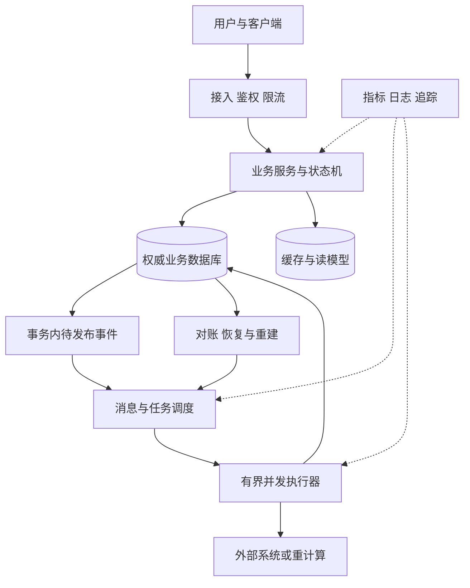

# 13 类系统设计题详解

系统设计从业务成功条件出发，逐步确定数据模型、事务边界、并发协议、容量预算与故障恢复。登录、秒杀、实时通信、定时任务、排行榜、文件与视频、朋友圈与运动、点赞、评论、Redis、大数据存储、消息队列和 MySQL 调优，都可以沿着大数据量、高并发、接口延迟和高可用四条主线展开。

场景中的流量、容量、SLO 与参数作为题设假设，用于计算和推演。方案选择需要说明成立条件，并能继续处理重复、乱序、超时、权限变化、扩容与故障恢复。

## 学习目录

| 专题 | 核心知识 |
| --- | --- |
| [系统设计方法与容量估算](00_系统设计方法与容量估算.md) | 需求澄清、业务不变量、容量估算、一致性与故障模型 |
| [登录功能](01_登录功能.md) | 会话、JWT、OAuth/OIDC、MFA、短信结果与登录限流 |
| [秒杀系统](02_秒杀系统.md) | 库存、订单、支付、关单、热点预留与可靠受理 |
| [实时聊天与实时弹幕](03_实时聊天与实时弹幕.md) | WebSocket、ACK、顺序、补洞、多端同步、广播扇出与背压 |
| [定时任务](04_定时任务.md) | 触发实例、租约、执行代次、取消补跑、延迟与未知结果 |
| [排行榜](05_排行榜.md) | 同分排序、分片TopK、归并、快照与奖励结算 |
| [文件与视频流传输](06_文件与视频流传输.md) | 分块、续传、校验、转码、流式传输、资源隔离与发布 |
| [朋友圈与微信运动](07_朋友圈与微信运动.md) | Feed推拉、分页、权限、步数融合、CDC与撤销 |
| [点赞系统](08_点赞系统.md) | 点赞状态、版本、计数投影、分桶与微批 |
| [评论系统](09_评论系统.md) | 评论树、审核、删除占位、热评、分页与可见性 |
| [Redis大key与热key](10_Redis大key与热key.md) | 大key、热key、固定TTL、墓碑、排障与切主回源 |
| [海量数据存储与分库分表](11_海量数据存储与分库分表.md) | 分片、索引、CDC、在线迁移、写入主权与回切 |
| [消息队列场景](12_消息队列场景.md) | 积压、丢失、重复、offset、Outbox、ELR与延迟任务 |
| [MySQL调优](13_MySQL调优.md) | 索引、锁、MVCC、复制、DDL、慢查询、长事务与恢复 |
| [跨模块资源控制与故障推演](14_跨模块资源控制与故障推演.md) | 线程与连接、幂等、取消、恢复及跨模块故障练习 |
| [连续追问与知识点索引](15_连续追问与知识点索引.md) | 逐层追问、知识点定位与系统设计答题训练 |
| [非功能设计与容量规划](16_非功能设计与容量规划.md) | 大数据量、高并发、慢接口、高可用、SLO与容量 |
| [微服务与全链路治理](17_微服务与全链路治理.md) | 服务拆分、灰度、隔离、截止预算、UNKNOWN、TCC与Saga |
| [MySQL查询事务与在线迁移](18_MySQL查询事务与在线迁移.md) | 评论慢查询、库存死锁、长事务、MDL、在线迁移与崩溃 |
| [Redis缓存与排行榜](19_Redis缓存与排行榜.md) | 热榜归并、爆款点赞、旧回填、持久化与故障回源 |
| [Kafka可靠性与积压治理](20_Kafka可靠性与积压治理.md) | 分片Outbox、顺序热点、积压、延迟平台、ISR/ELR与Flink |
| [知识点索引与综合面试练习](21_知识点索引与综合面试练习.md) | 核心知识索引、易错边界、ES/Mongo与综合练习 |
| [海量数据与受限内存算法](22_海量数据与受限内存算法.md) | 数据结构、40亿号码去重、4TB int32、位图、分桶与外排 |
| [高并发准入与分布式锁](23_高并发准入与分布式锁.md) | 令牌桶、缓存承载、实例配额、锁维度、TTL与fencing |
| [慢接口诊断与线程连接预算](24_慢接口诊断与线程连接预算.md) | 索引与分页、有界并行、网络、JVM、线程与连接预算 |
| [高可用与容灾恢复](25_高可用与容灾恢复.md) | 主从与哨兵、多活写权、跨存储恢复、N−1与容灾演练 |

[参考文献](../参考文献.md)

# 第 0 章 怎样把一道系统设计题讲完整

## 0.1 先画出业务成功需要经过的系统

一个完整设计需要同时解释三件事：请求怎样成功；系统怎样确定已经成功；中途失败后如何继续。组件图只回答第一件事的一部分。

这里不是要求每道题都使用所有组件。例如，小规模排行榜可以先用带合适索引的 MySQL；普通登录不需要 Kafka；单机文件上传并不自动需要微服务。每个引入的架构组件，都应对应一个已经出现的问题：容量、延迟、解耦、可靠性或者访问模式。

从业务动作讲起，比罗列“Spring Boot + Redis + Kafka + MySQL”更容易形成可以验证的设计。例如秒杀中，应该先说明“用户拿到排队受理不等于拿到订单，订单拿到库存预留后才可付款”，然后再解释 Redis 为什么只负责入口资格筛选。

## 0.2 开场需要确认的少量问题

不要用十分钟追问所有需求。先提出会改变架构的三到五个问题，未给答案时说明自己的假设并推进。

| 需要确认什么 | 为什么会改变设计 | 示例 |
| --- | --- | --- |
| 核心业务不变量 | 决定事务与正确性要求 | 库存不能为负；一人只能买一件；撤权后新的授权检查不能通过 |
| 成功的定义 | 决定何时 ACK、何时重试 | 聊天服务器已存储、对方设备已收到、对方已读是三个状态 |
| 请求量与数据规模 | 决定是否需要分片或异步化 | 1000 QPS 与 100 万在线连接的瓶颈不同 |
| 可接受的延迟与陈旧 | 决定同步路径和缓存策略 | 点赞总数可延迟两秒，支付状态不能靠旧缓存判定 |
| 故障时优先保什么 | 决定降级选择 | 秒杀暂停售卖；弹幕采样；历史评论只读 |

“强一致”“最终一致”“高可用”必须落到对象和操作上。不要说整个系统强一致，而要说“同一个 SKU 的权威库存扣减在单库事务内串行化；排行榜投影允许秒级延迟；鉴权在请求的授权检查点读取有效版本”。

## 0.3 容量计算要算到瓶颈所在

### 请求量、并发量、连接数是三个量

日请求量除以 86400 得到平均 QPS，峰值比例来自题设或历史观测，不能把平均值当峰值。

稳定状态下，平均在途请求量约为：

\[
L = \lambda W
\]

例如假设到达率为 2000 请求/秒、平均处理时间为 0.08 秒，那么平均在途约为 160。它不是“线程池必须设置 160”的直接结论：异步 I/O、等待下游、连接池、CPU 核数和排队时间都会改变线程需要。容量估算用平均值，P95/P99 用来检查尾延迟与余量，不能把分位数代入后称为严格的 Little 定律。

假设 100 万 WebSocket 连接，每连接应用层状态平均 8 KiB，单状态就约 7.63 GiB；还没有算 TLS、网络缓冲、运行时对象、内核 socket 和心跳。连接多并不意味着每秒消息多，也不意味着每连接占一条线程。

### 存储算索引、副本和保留期

假设每天写入 5000 万条消息，每条平均 500 字节，逻辑正文约 25 GB/天。保留 30 天约 750 GB；再叠加索引、记录头、碎片、三副本和备份，实际容量会更高。压缩比例只有在样本压测后才可以代入。

### 扇出会把一个请求变成许多工作项

假设一条群消息有 10 万接收设备，平均消息体 1 KiB，那么一次广播的正文出流量约 97.7 MiB。入口每秒只有十条消息，出流量也可能接近 1 GiB/秒。朋友圈大 V 推送、弹幕和排行榜热点查询都要计算放大系数。

### 积压清空需要净消费能力

设积压为 B 条、持续输入速率为 λ、处理速率为 μ，且 μ 大于 λ，在速率近似稳定的前提下：

\[
T_{drain} \approx \frac{B}{\mu-\lambda}
\]

假设积压 600 万条，生产 1 万条/秒，消费 1.5 万条/秒，清空需要约 1200 秒，即 20 分钟。如果下游变慢使 μ 下降到 9000，增加等待时间不会清空积压。

## 0.4 用不变量指导表和状态机

建议每道题明确两到四条不变量，并在代码和故障处理处逐条检查。

| 系统 | 不变量示例 | 对应实现手段 |
| --- | --- | --- |
| 秒杀 | 已售出加有效预留不能超过可售总量 | 条件更新、预留记录、释放状态机、对账 |
| 登录 | 已撤销的会话不能在新的授权检查中继续有效 | 服务端会话状态或会话版本、权限复核 |
| 定时任务 | 同一触发实例只有一个最终有效结果 | 唯一触发键、执行代次、条件写回 |
| 点赞 | 同一用户对同一对象只有一个当前状态 | 唯一键、状态版本、幂等命令 |
| 消息消费 | 一个业务事件不能重复产生同一业务效果 | 事件幂等表与业务写入同事务 |
| 文件上传 | 不完整或未通过校验的文件不能被当作成品读取 | 上传状态机、隔离存储、发布指针 |
| 资料撤销 | 已撤销版本不能被异步任务恢复成有效版本 | 墓碑、版本门槛、权威状态复核 |

不变量比“所有地方都加锁”更有用。锁只是其中一种协调方式；唯一约束、条件更新、不可变对象、序列号和状态机往往能使设计更直接。

## 0.5 五种常被混淆的保证

| 概念 | 保证什么 | 不能自动保证什么 |
| --- | --- | --- |
| 原子性 | 一组操作在指定执行边界内不可被部分观察或交错 | 写入掉电后仍保留；其他系统一起提交 |
| 持久性 | 已确认的数据在声明的故障模型下可恢复 | 应用没有重复执行；跨地域所有灾难零丢失 |
| 幂等性 | 同一个业务意图重放后不重复产生效果 | 两个不同意图按正确顺序生效 |
| 有序性 | 某个明确范围内存在统一处理顺序 | 全局有序；处理结果不会因并发而逆序 |
| 隔离性 | 并发事务按规定方式互相观察与修改 | 外部接口调用也属于本地事务 |

例如 `SET NX PX` 可以表达有超时的互斥意图，但锁超时后旧执行者仍可能运行；真正阻止旧写的是资源端核验执行代次。又如 Redis Lua 可以把同槽 key 的操作串起来，但脚本成功后 Redis 故障仍涉及复制和持久化。

## 0.6 所有故障题都可以从这九个位置注入

1. 请求尚未到达服务端，客户端超时。
2. 服务端收到请求，但尚未完成任何持久写入。
3. 权威数据库提交成功，响应尚未送达。
4. 数据库提交成功，消息尚未可靠发布。
5. 消息发布成功，生产者未收到 ACK。
6. 消费者业务提交成功，offset 或 ACK 尚未提交。
7. 执行租约过期，新执行者接手，但旧执行者仍运行。
8. 缓存、搜索索引或只读副本比主库落后。
9. 切换分片、主从或者地域时，新旧写入路径同时存在。

每次推演需要回答：目前哪个系统保存了真相；哪个标识能证明是同一次业务动作；是否可以安全重试；谁来扫描与恢复；恢复的最坏时间和成本是什么。

**超时表示结果未知，不等于业务失败。** 支付、消息发布、库存预留和文件合并都应优先通过稳定业务标识查询结果，再决定是否重试或补偿。补偿也是业务动作，需要自己的幂等性和重试策略。

## 0.7 不同规模下的架构选择

| 阶段 | 常用结构 | 何时推进到下一阶段 |
| --- | --- | --- |
| 可解释的最小方案 | 单体服务、单库事务、合适索引 | 已有瓶颈证据，不能靠查询或模型优化解决 |
| 读优化与异步化 | 缓存、只读副本、Outbox、任务表 | 热点或写负载仍逼近单节点容量 |
| 按对象分片与资源隔离 | 分库分表、分区队列、独立线程池 | 单地域或单租户故障影响范围过大 |
| 更大规模与灾备 | 跨地域路由、故障切换、冷热分层 | 业务明确需要并能承担协调成本 |

每增加一级都要解释新成本。例如缓存增加失效与回填竞态，消息队列增加重复和积压，分片增加跨片查询与迁移，异地双写增加冲突处理。技术取舍的价值是说明“为什么现在值得承担这些成本”。

## 0.8 一小时连续追问的回答节奏

下面是练习时可使用的节奏，不要求现场机械照读。

| 时间 | 重点 | 应能交付的内容 |
| --- | --- | --- |
| 0–5 分钟 | 业务与约束 | 成功定义、不变量、量级、允许的陈旧 |
| 5–15 分钟 | 基线架构 | 组件图、一次读与写流程、权威存储 |
| 15–30 分钟 | 核心实现 | 表与索引、关键 SQL、状态机、并发顺序 |
| 30–45 分钟 | 故障与扩展 | 三个以上宕机窗口、重试、对账、热点 |
| 45–55 分钟 | 验证与 tradeoff | 压测、监控、替代方案与迁移风险 |
| 55–60 分钟 | 追问收束 | 最弱环节、仍然成立的前提、下一步改进 |

## 0.9 组件语义与实现边界

MySQL 使用 InnoDB 与 MySQL 8.x 的事务、索引和复制语义，具体行为需结合 8.4 等部署版本确认。Redis 6.2/7.x 与 8.2 的 Stream 裁剪选项存在差异；Kafka 的消费组行为也受配置与消费协议影响。设计时需要明确组件版本、配置、默认值和故障模型，避免把不同版本的能力混为一谈。

实现时先明确事务边界、条件检查和并发协议，再补齐鉴权、异常处理与部署配置。驱动行为、事务传播和数据库版本都可能改变运行语义，需要在集成与故障测试中验证。

