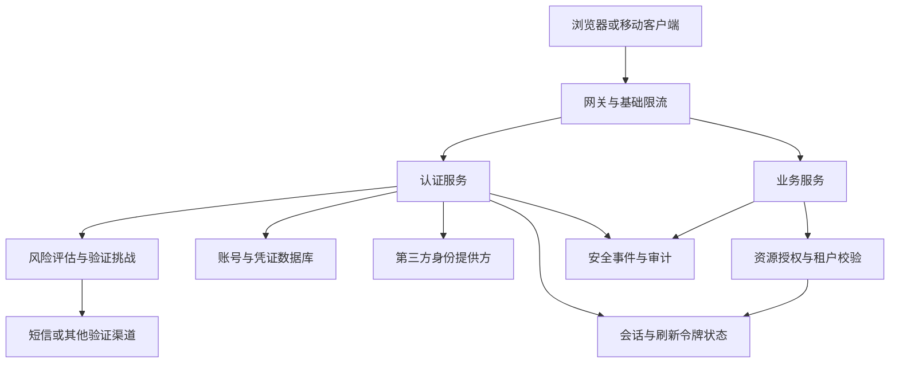
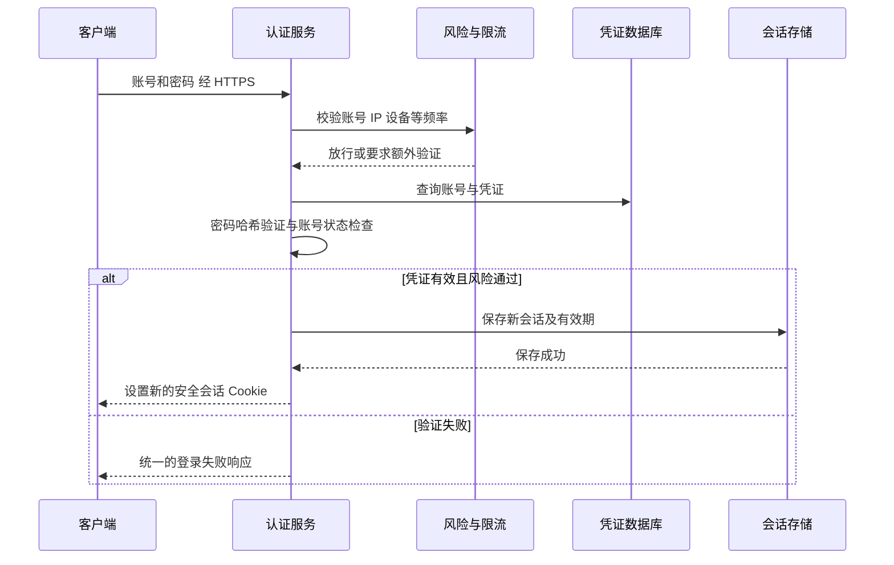
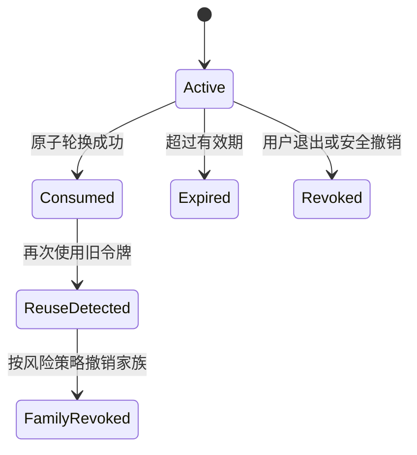
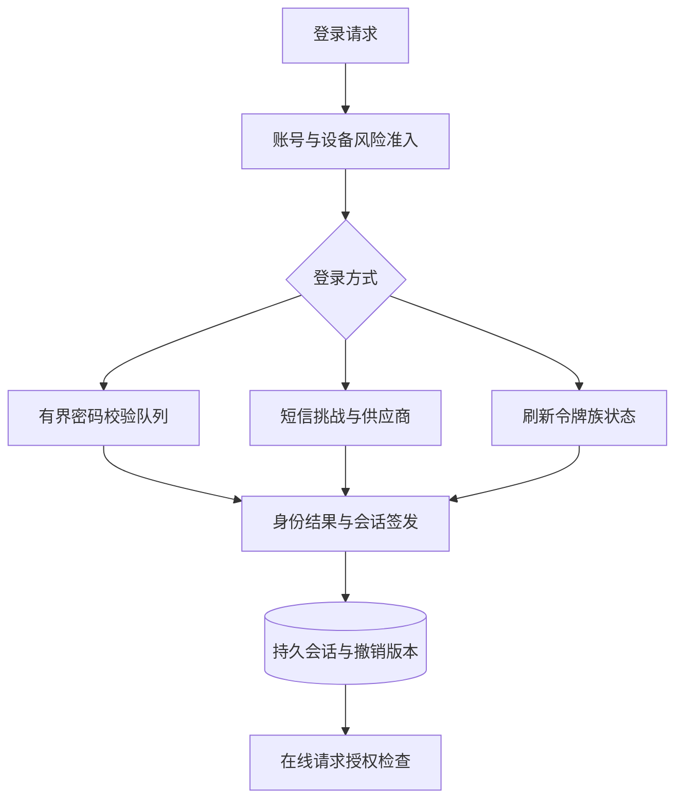

# 第 1 章 登录功能：从身份校验到完整会话系统

## 1.1 先画出完整架构

登录系统需要持续回答三个问题：当前操作者是谁，这次身份凭证是否仍然有效，这个人能否访问目标资源。第一问是认证，第三问是授权；用户登录成功并不意味着能读取任意用户的订单、文件或研究任务。



应先建立可靠的账号与会话主链路，再考虑跨应用单点登录、二维码、无密码认证。对于普通同站 Web 系统，使用随机会话 ID 加服务端会话记录就能完成登录；存在跨服务访问与开放 API 时，再讨论短期访问令牌和统一身份提供方。

**容量假设**：注册用户 1,000 万，日活 100 万，平均每天每人登录 0.2 次，普通业务请求平均每人每天 200 次。由此约为 20 万次登录/天和 2 亿次业务请求/天。平均登录 QPS 仅约 2.3，而业务鉴权 QPS 约 2,315；它们的峰值、密码校验成本和缓存访问成本也不同。不能因为登录接口 QPS 不高，就忽略每个业务请求都需要验证登录态的成本。

## 1.2 数据模型和接口怎么设计

| 对象 | 主要字段 | 设计目的 |
| --- | --- | --- |
| `account` | `user_id`、`status`、`auth_version`、`created_at` | 账号状态及全账号安全版本；手机号不作为永不变化的主键 |
| `login_identity` | `identity_id`、`user_id`、`type`、`normalized_identifier`、`verified_at` | 一个账号可绑定手机、邮箱、第三方身份；`(type, normalized_identifier)` 唯一 |
| `password_credential` | `user_id`、`password_hash`、`algorithm_params`、`changed_at` | 保存不可逆密码校验材料；参数随算法版本保存 |
| `session` | `session_id`、`verifier_hash`、`user_id`、`device_id`、`auth_version`、`expires_at`、`last_seen_at`、`revoked_at` | 支持单设备退出、踢人、空闲超时、绝对超时 |
| `refresh_token` | `token_id`、`family_id`、`token_hash`、`generation`、`status`、`expires_at`、`replaced_by` | 刷新轮换和重放检测；保留已消费令牌的关联关系 |
| `auth_challenge` | `challenge_id`、`purpose`、`subject`、`verifier`、`attempts`、`expires_at`、`status` | 短信、扫码、MFA 挑战，避免不同用途混用 |
| `security_event` | `event_id`、`user_id`、`type`、`risk_flags`、`created_at` | 事件审计和异常检测，避免记录密码、OTP、完整令牌 |

手机号必须有规范化规则，例如国家或地区码与号码分别存储；邮箱是否区分大小写、别名是否折叠，要由产品和身份规则决定，不能凭字符串处理习惯合并账号。第三方账号关联通常以 `(issuer, subject)` 为稳定身份键，不能仅靠一个可能变更、重复或未验证的邮箱地址自动合并用户。

接口可以分成以下几组：

- `POST /auth/password/login`：校验身份和凭证，返回会话或令牌；凭证放请求体，避免出现在 URL、代理日志和浏览器历史中。
- `POST /auth/challenges`、`POST /auth/challenges/{id}/verify`：创建与消费一次性挑战，携带用途和客户端上下文。
- `POST /auth/refresh`：轮换刷新令牌；不得把刷新令牌接受为普通业务访问凭证。
- `POST /auth/logout`、`DELETE /auth/sessions/{id}`：撤销当前会话或指定设备会话；设备列表也必须经过本人身份校验。
- `GET /auth/sessions`：返回本人设备和时间等有限信息，不能返回可复用的会话秘密。
- `GET /oauth/callback`：处理身份提供方的授权响应，完成状态绑定和凭证验证后建立本系统会话。

## 1.3 密码登录的完整链路



核心步骤应解释到实现层面：

1. **前置限流。** 先限制明显异常的请求，再做昂贵密码校验。否则攻击者可以用不存在的账号和超长输入把 CPU、内存和工作线程耗尽。限制输入长度是资源保护，不能静默截断密码后验证。
2. **查身份再查凭证。** 账号状态、凭证版本、是否要求二次认证，都属于本次认证决策。不存在账号时，对外保持统一的失败语义；在经过前置限流后，可使用固定的虚拟密码哈希做相似成本的校验，减小时间差枚举风险，不能为了完全等时而让攻击请求无限消耗资源。
3. **验证密码。** 使用成熟实现的 Argon2id 等适合密码存储的算法，盐和参数由库正确处理。普通 SHA-256 很快，适合高熵随机令牌的校验器，不适合直接存储人类选择的低熵密码。参数应在目标机器和峰值并发下实测，不能把某个推荐参数当作所有机器都能承受的固定配置。[A01][A03]
4. **生成新会话。** 登录前的匿名会话 ID 不直接升级为特权会话 ID；生成新的不可预测凭证，并让原有会话按策略失效，减少会话固定攻击机会。[A02]
5. **先完成会话状态保存，再返回成功。** 如果保存超时，要处理结果未知。可以通过固定登录事务 ID 查询会话是否创建，而不是无界创建新会话。返回 Cookie 失败可能留下未使用会话，由有效期回收；这与“用户已获得可用会话”不是一回事。
6. **发送安全事件。** 审计流水不应把敏感凭证写入日志。需要可靠记录的安全变更与审计事件，可在同库事务内写 Outbox，后续异步发送。

下面只展示 Java 服务的控制结构，`passwordVerifier`、`sessionService` 等代表成熟组件或已封装服务，不是可直接投入生产的完整认证实现。

```java
public LoginResult login(LoginCommand cmd, RequestContext ctx) {
    inputPolicy.validate(cmd);                 // 长度、格式、必填字段
    riskLimiter.check(cmd.identifier(), ctx); // 在密码哈希前限流

    Credential credential = credentialRepo.find(cmd.identifier());
    String storedHash = credential == null
            ? dummyCredentialHash : credential.passwordHash();
    boolean matched = passwordVerifier.matches(cmd.password(), storedHash);

    if (credential == null || !matched || !credential.accountEnabled()) {
        failureRecorder.recordMasked(cmd.identifier(), ctx);
        throw new AuthenticationFailedException("账号或凭证无效");
    }

    // 有 MFA 要求时，此处只能签发短期挑战凭证，不能提前给完整业务权限。
    if (riskPolicy.requiresStepUp(credential, ctx)) {
        return LoginResult.challenge(challenges.create(credential.userId(), ctx));
    }
    return sessionService.createNewSession(credential, ctx);
}
```

## 1.4 Session、JWT、OAuth 和 OIDC 分别解决什么

| 概念或方案 | 解决的问题 | 适用条件与代价 |
| --- | --- | --- |
| 服务端 Session | 用一个随机凭证查服务端状态，维持会话 | 撤销直接，设备控制简单；业务请求依赖会话读取或有明确边界的缓存 |
| JWT | 一种承载声明并进行签名或加密的令牌格式 | 本地验证方便；签名不等于加密，纯本地验证无法自动知道撤销和权限变更 |
| OAuth 2.0 | 让客户端获得对资源的有限访问授权 | 不是单独一套“判断用户是谁”的登录协议；访问令牌有目标资源和权限范围 |
| OIDC | 在 OAuth 之上表达用户认证结果和身份声明 | 用 ID Token 等机制提供身份层，必须校验来源、受众、时效等条件 [A05] |
| SSO | 一次认证后在多个应用建立登录体验 | 是系统能力；各应用可持有独立本地会话，通过统一身份服务完成认证 |

**为什么 JWT 不天然比 Session 更高级？** 两种方案把不同成本放在不同位置。Session 每次读取状态，容易立即撤销；短期 JWT 把读取成本变为签名验证和密钥管理，但权限变更传播、踢人和盗用阻断需要额外状态。若每次 JWT 请求都要查黑名单、查账号版本、查设备状态，它也不再是完全无状态的业务链路。

**JWT 要检查什么？** 使用库执行签名与格式校验；固定可接受算法和可信发行方，验证 `iss`、`aud`、`exp`、必要时 `nbf`，限制时钟偏差。`kid` 只能用于可信密钥集内部的选择，不能被当作任意文件路径或任意 URL 去取密钥。签名成功但受众属于另一个系统的令牌也应拒绝。涉及权限、租户、资金或资料撤销时，还要考虑声明是否已过时。

**如何进行密钥轮换？** 新令牌用新密钥签发，验证侧同时接受处于过渡期的旧公钥和新公钥；旧密钥至少保留到旧令牌正常失效加允许时钟偏差。密钥泄漏是紧急撤销场景，不能机械等待所有旧令牌自然过期。未知 `kid` 可以触发有频率限制的密钥集刷新，防止攻击者用随机 `kid` 冲击身份服务。

## 1.5 浏览器应该怎么保存登录态

对于同站 Web 系统，可让浏览器持有 `Secure; HttpOnly; SameSite` 配置合理的会话 Cookie，必要时使用 BFF 由服务端保管访问与刷新令牌。Cookie 是否需要 `Domain`、`Path`，是否可以使用 `__Host-` 前缀，应按部署域名设计，尽量减少凭证能到达的范围。[A02]

这里有三个经常混淆的点：

- **HttpOnly** 限制脚本读取 Cookie，但 XSS 仍可能在用户页面上下文中发起请求和读取业务数据；所以还要做好输出编码、HTML 清洗、依赖治理和合适的 CSP。
- **CSRF** 利用浏览器自动携带凭证的行为。修改状态的接口不能用 GET，配合 CSRF Token、来源校验和合适的 SameSite 策略。跨站登录回调、嵌入场景可能需要例外，必须按具体请求设计，而不是全站随意放宽。
- **CORS** 主要控制浏览器是否允许脚本读取跨源响应及部分请求过程，它不能代替服务端身份验证，也不能证明一个请求来自合法用户。

如果业务决定把短期访问令牌放到内存并通过 `Authorization` 头发送，要同时解决页面刷新、跨标签页和 XSS 威胁。不能只说“不用 Cookie 所以安全了”。长期高权限令牌落在可以被任意同源脚本访问的存储中，会扩大脚本漏洞的后果。

## 1.6 刷新令牌轮换：最容易被追问的并发问题

短期访问令牌用于频繁业务访问；刷新令牌只用于向认证服务获取下一组令牌。刷新令牌应与客户端、用户授权范围和令牌家族关联，使用时轮换或采用发送方约束等防重放机制。RFC 9700 对公共客户端的刷新令牌保护给出了相应要求。[A04]



服务端可以把刷新令牌组织为 `family_id + generation`。一次刷新事务必须原子完成“验证旧令牌仍为 ACTIVE → 标记为 CONSUMED → 保存新令牌的校验信息与关联关系”。锁住家族或用条件更新能保证并发刷新只有一个获胜，避免同一令牌派生两个无控制的有效分支。

**场景一：两个标签页同时刷新。** 如果没有协调，第二个请求会使用刚刚消费的旧令牌，被识别为重放。客户端可以用单飞机制协调同一设备内刷新；服务端仍必须有 CAS。对于跨标签页或移动端多线程，要明确共享存储和消息协调机制，不依赖“正常情况下不会同时发生”。

**场景二：服务端轮换成功，但响应丢了。** 客户端只有旧令牌，直接再次刷新与攻击者重放在服务端观察上可能相同。强安全策略可要求重新认证；若产品必须减少误登出，可以设计短期、绑定客户端及原始请求 ID 的幂等响应记录，让完全相同的刷新重试拿回同一个结果。若要重放包含新刷新令牌的响应，保存的响应材料本身具有高敏感性，需要加密、短期保留和访问保护。仅保存新令牌哈希不能重新还原令牌返回客户端。

**场景三：给旧令牌设十秒宽限期。** 宽限期确实缓解网络重试，却同时给窃取者更多使用机会。宽限期内也不能生成无限多的新令牌分支，应绑定同一次轮换结果和设备上下文，并接受“无法完全区分合法重试与复制令牌”的事实。具体选择是安全性与体验的权衡，不是一个通用标准答案。

**场景四：退出后旧访问令牌仍有效。** 撤销刷新家族只能阻止后续刷新，不能让已发出的自包含访问令牌自动消失。需要立即阻断时，业务侧查询账号或会话版本、执行令牌内省或检查撤销信息；允许短暂延迟时，可依靠短访问令牌有效期并明确最大风险窗口。

## 1.7 短信验证码、MFA、扫码与第三方登录

### 短信 OTP

OTP 不是一个 `phone -> code` 的简单缓存。至少要绑定 `challenge_id`、手机号、用途、过期时间、失败次数、消费状态和触发设备。注册、登录、找回密码、换绑手机必须区分用途；用于登录的验证码不能直接用于修改收款账户。

校验与消费要原子，避免两个并发请求同时用一个验证码成功。错误尝试也要原子计数，不能只在成功时删掉验证码。重发时要明确“原验证码失效”还是“短窗口内保留”，服务端只接受定义好的挑战版本。验证码只有少量数字，单独存储普通哈希仍可被离线枚举；可使用服务端秘密参与的校验值并隔离密钥，同时限制访问和日志暴露。

限流至少包括手机号、账号、IP、设备、网段和短信供应商配额。只限制 IP 会误伤公司或校园 NAT，也挡不住分布式攻击；只限制手机号则可能被用于恶意耗尽受害者的发送额度。可以结合渐进等待、风险挑战、号码冷却和全局成本预算。短信供应商接受请求不等于用户已收到，应分别统计请求、受理、送达和验证成功。

### MFA 与 Passkey

MFA 强调不同因素，不是把两个同样可被窃取的密码连输两次。用户开启 MFA、关闭 MFA、修改恢复方式，都需要适当的重新认证；恢复通道若只凭容易接管的邮箱或短信，会削弱主认证的强度。

Passkey/WebAuthn 的设计重点是服务器发随机挑战，客户端的认证器持有私钥，服务器保存公钥相关材料；认证时验证签名、挑战、RP ID、来源和需要的用户验证结果。挑战必须短期、一次性并绑定本次流程。它减少共享密码与钓鱼风险，但账号恢复、多设备使用、丢失设备撤销仍要单独设计。[A06]

### 扫码登录

二维码中放短期随机 `qr_token`，不要放可直接作为网页登录凭证的用户令牌。流程通常为：网页创建挑战并持有另一份浏览器侧秘密 → 已登录手机扫描 → 页面显示设备和地点等上下文 → 用户手机确认 → 服务端把挑战从 WAITING 改为 CONFIRMED → 原网页凭创建时的秘密领取一次性结果 → 建立网页会话。

只知道二维码 ID 的人不能领取网页会话，否则旁观者拍到二维码就可能接管登录。扫描和确认要分开，避免用户扫一下就无意识授权陌生设备。状态可用 `WAITING → SCANNED → CONFIRMED → CONSUMED`，任意未完成状态都可进入 EXPIRED 或 CANCELLED。轮询、SSE、WebSocket 只是通知状态变化的方式，认证结果仍以服务端原子状态为准。

### OAuth/OIDC 第三方登录和 SSO

采用授权码流程并按客户端类型使用 PKCE，把授权请求与浏览器发起状态绑定；校验回调地址、状态、可信发行方和返回令牌的相关声明。`state` 用于绑定应用发起的事务，OIDC 的 `nonce` 参与身份令牌的重放防护，PKCE 将授权码兑换与发起方持有的 verifier 关联，不能把三者当作可随意互换的一个随机字符串。[A04][A05]

一个应用退出不一定让所有应用退出。全局退出可以撤销身份服务会话并向各应用传播撤销，各应用还要清理自己的本地会话；传播存在失败与延迟，需要短期会话、版本检查或补偿。跨域 SSO 通常依赖重定向协议与各域本地会话，不能靠把一个 Cookie 的 Domain 设置得足够大解决任意域名互通。

## 1.8 故障和攻击场景矩阵

| 场景 | 直接风险 | 设计处理 | 必须验证的结果 |
| --- | --- | --- | --- |
| 会话缓存故障 | 登录态无法查询 | 新登录限流或拒绝；如持久库可回源，必须限流保护；敏感操作不凭“缓存没返回”放行 | 不越权、不形成数据库雪崩 |
| 会话缓存丢失 | 已登录用户被迫重登 | 若缓存只是加速层则可重建；若它就是会话存储则接受并定义该可用性后果 | 不把缺失状态解释为有效登录 |
| 密码修改与旧会话请求并发 | 旧权限继续使用 | 增加账号安全版本，撤销会话；明确缓存传播窗口 | 高风险操作能够及时拒绝旧版本 |
| 刷新响应丢失 | 合法用户被误判重放 | 原请求幂等响应或重新认证；宽限窗口有严格边界 | 不产生无限令牌分支 |
| 单设备被盗 | 攻击者持续使用会话 | 设备级撤销、风险挑战、重新认证；重要变更触发全局撤销 | 撤销效果符合时限 |
| 暴力尝试锁住受害者账号 | 攻击者制造拒绝服务 | 账号、设备、IP 多维限流和渐进挑战 | 保护账号同时保留恢复通道 |
| 第三方身份服务不可用 | 新登录受阻 | 已有本地会话在原有效期与策略内继续；不跳过第三方认证创建新会话 | 故障不扩大为身份冒用 |
| 时钟偏差 | 令牌提前失效或过期仍被接受 | 统一时间同步、有限偏差容忍、记录时钟异常 | 不使用无限容忍掩盖时钟问题 |
| 风控服务超时 | 登录链路延迟增大 | 按操作风险配置拒绝、挑战或低权限降级 | 修改密码与普通浏览有不同策略 |

## 1.9 监控、容量和验证

按“发起登录 → 凭证通过 → 挑战通过 → 会话成功建立 → 首次业务鉴权成功”建立漏斗。只看登录 HTTP 200 会漏掉 Cookie 配置错误、跨域问题和会话保存失败。错误率按合法用户流量与攻击流量分开观察，否则一次成功拦截的攻击会被当作业务质量崩溃。

关键指标包括密码验证时延和并发、登录与刷新成功率、挑战发送与送达率、会话存储 P99、刷新重放率、设备撤销传播时间、账号枚举和风险规则命中、第三方身份服务错误率。容量估算还应覆盖密码算法内存消耗：若单次约需 M MiB，允许 C 次并行，则仅哈希工作内存就约为 M×C，不能盲目按 HTTP 线程数放开。

有价值的测试场景包括：两个线程消费同一 OTP、两个标签页同时刷新、轮换事务提交后丢弃响应、改密后立即用旧会话访问敏感接口、注销与刷新同时发生、未知 `kid` 洪泛、账号不存在时的响应差异、会话存储故障、跨站请求、二维码被第三方获知但缺少原浏览器秘密。要核对安全状态与业务结果，不能只断言接口返回了某个状态码。

## 1.10 面试连续追问与回答

### Q1：我只做一个 Spring Boot 网站，为什么不直接用 JWT？

可以使用，但应先比较会话控制需求。如果主要是同站浏览器、需要设备管理与即时退出，服务端 Session 容易把状态统一管理。JWT 在跨服务验证和开放 API 中有价值，但要额外解释撤销、密钥轮换、权限变化与浏览器存储。选择依据是链路成本和需求，不是“JWT 更先进”。

### Q2：密码加盐后 SHA-256 可以吗？

加盐主要防止相同密码出现相同结果和预计算复用，无法让单次猜测变慢。人类密码空间有限，快速哈希仍适合攻击者批量尝试。应使用密码专用算法，并把算法参数与哈希一起保存，登录成功时可逐步升级旧参数。随机高熵会话令牌的哈希存储是另一类问题，不能混为一谈。

### Q3：JWT 验签通过，就能信任里面的 userId 吗？

还要确认可信发行方、正确目标受众、有效期、算法、租户和所需权限。令牌可能真实但发给了另一个服务，也可能代表一个已经禁用的账号。验签证明内容与签发者的关系，不等于当前业务授权已成立。

### Q4：退出登录就是前端删除 Token 吗？

删除本地副本改善当前设备体验，但被复制的令牌仍可能有效。服务端需要撤销会话或刷新令牌；要求立即阻断访问令牌时还要加服务端状态检查。可以明确选择短期有效窗口，但不能把“客户端不再保存”当作“服务端不再接受”。

### Q5：同一个账号限制最多两台设备，怎么防止三次并发登录都通过？

把设备数检查、选择淘汰对象、创建新会话视为一个账号维度的原子决策。可以锁账号会话管理行，或在具备可靠状态的存储中做 CAS；唯一索引只能阻止某种重复标识，不能自动约束“最多两条”。被淘汰会话的业务访问还要受撤销版本影响。

### Q6：限流是在 Redis 里计数就结束了吗？

还要回答维度、窗口、原子性、过期策略、故障降级和跨实例一致性。固定窗口可能在边界瞬间允许较大突发；滑动窗口或令牌桶更平滑，但资源成本和实现不同。全局限流服务不可用时，入口本地保护可以防失控；不能直接解除所有限制。

### Q7：验证码校验先 GET、再 DELETE 有什么问题？

两个请求可能同时读到有效验证码，然后各自通过验证。应以事务或 Lua 把“比较、次数限制、状态消费”合成一个原子操作；同时保证用途、手机号和挑战版本匹配。失败次数也要纳入原子逻辑，否则可以并发绕过尝试上限。

### Q8：为什么修改密码不只是更新 password_hash？

攻击者可能已经拿到旧会话、刷新令牌或恢复凭证。修改密码通常需要重新评估已有登录授权，增加安全版本并撤销适当的会话和刷新家族，同时通知本人。具体是保留当前可信设备还是全设备退出，要明确产品策略和风险等级。

### Q9：两个并发刷新请求，能不能让它们都成功？

如果各自签发不同的新令牌，会形成令牌分支，增加撤销和重放检测复杂度。更清晰的语义是只有一次逻辑轮换成功，合法重试在严格绑定条件下拿同一结果，其他旧令牌使用触发重新认证或风险处理。客户端单飞只是体验优化，服务端原子状态仍不可省。

### Q10：每次查询 Redis 校验登录态，Redis 会不会成为瓶颈？

先算业务请求鉴权 QPS，再看单次数据量和延迟。可以做按会话分片、批量或连接复用，必要时采用有短 TTL 的本地状态缓存。缓存会降低撤销实时性，应给敏感操作保留更强检查；也可以用短访问令牌减少会话读，但代价仍是撤销窗口和密钥管理。

### Q11：二维码被别人拍到了，为什么不一定能登录？

因为二维码只定位挑战，网页登录结果还绑定创建挑战的浏览器秘密，而手机端必须由已登录用户确认。拍摄者若只有二维码，不具备领取网页会话的条件。反过来，用户若被诱导确认攻击者自己创建的二维码，仍可能授权陌生设备，所以确认页必须解释正在授权哪个设备。

### Q12：第三方登录返回邮箱与已有账号相同，直接合并行吗？

不应仅凭同名邮箱无条件合并。要考虑邮箱是否经过可信验证、提供方身份域、账号所有权、邮箱变更和接管风险。安全做法通常要求用户对已有账号做一次认证或明确的绑定验证，再把第三方 `(issuer, subject)` 绑定进去。

### Q13：SSO 全局退出为什么很难？

每个应用都有自己的会话，中央身份服务退出不能直接删除所有应用的本地状态。需要撤销传播、版本检查或短会话有效期；应用离线或通知失败时还要补偿。应明确“从此不能新登录”和“已登录请求立即失效”是不同的承诺。

### Q14：怎么向面试官证明你考虑过登录安全，而不是背术语？

给出具体竞态：验证码并发消费、刷新响应丢失、改密与旧会话请求并行、匿名会话 ID 被固定、扫码挑战被窃取。逐个说明可信凭证是什么、谁能原子修改状态、失败后如何恢复、撤销多久生效，能展示完整系统推理。

## 1.11 应用示例：NoteWeave 的认证与授权

以 NoteWeave 类资料研究平台为应用示例，登录态用于确认“当前用户”，资料授权还要确认“该用户对这个 workspace、source、research unit 是否有权限”。可以让网关完成基本认证，业务读取时通过 `tenant_id/user_id` 参与 SQL 条件、检索过滤、对象存储访问和缓存键设计。Agent 使用工具时也应携带受限的用户与任务身份，不能因模型已经拿到一个 `source_id` 就直接读取资料。

用户撤销资料与退出登录是两种状态变化：前者影响资源有效性和引用展示，后者影响操作者会话。二者都说明短期缓存与旧令牌并不自动知晓最新权限，敏感读取需要权威状态复核或有明确上限的版本传播机制。

## 1.12 技术参考资料

- [A01] [OWASP Authentication Cheat Sheet](https://cheatsheetseries.owasp.org/cheatsheets/Authentication_Cheat_Sheet.html)：统一认证响应、登录限流和认证风险。
- [A02] [OWASP Session Management Cheat Sheet](https://cheatsheetseries.owasp.org/cheatsheets/Session_Management_Cheat_Sheet.html)：会话秘密、Cookie 属性、会话更新与存储。
- [A03] [OWASP Password Storage Cheat Sheet](https://cheatsheetseries.owasp.org/cheatsheets/Password_Storage_Cheat_Sheet.html)：密码专用哈希、盐和参数选择。
- [A04] [RFC 9700 OAuth 2.0 Security Best Current Practice](https://www.rfc-editor.org/rfc/rfc9700.html)：PKCE 与刷新令牌重放防护。
- [A05] [OpenID Connect Core 1.0](https://openid.net/specs/openid-connect-core-1_0.html)：身份层、ID Token 与验证规则。
- [A06] [W3C Web Authentication](https://www.w3.org/TR/webauthn-3/)：公钥凭证、挑战与验证流程。

## 1.13 场景推演：活动开始时登录雪崩，为什么不能只加 Redis

设活动开始五分钟内集中出现密码登录、短信登录、令牌刷新和已有用户访问。它们的资源成本与安全规则不同，应拆开观测和准入。

### 从一条登录请求追到真正瓶颈



登录接口慢，先拆成入口等待、账号读取、密码计算、风控、短信发送、会话写入和返回。密码专用哈希故意具有计算与内存成本，不能为了活动高峰临时降成普通快速哈希。参数应依据安全要求与硬件评估，容量通过独立资源、限速和扩容解决。[A01][A03]

举一个**假设计算**：每次密码校验消耗 80 ms CPU 时间，500次／秒就需要每秒40个CPU秒；32核机器即使允许70%CPU预算，也只有22.4个CPU秒／秒，显然不够。若算法每次占64 MiB内存、峰值同时执行80次，仅这部分约5 GiB；内存属于堆还是本地分配取决于实现，还要计进程其他资源。因此“线程池开到500”不能解决问题。

### 准入、数据库与供应商要分开保护

密码校验使用有界计算并发，不占用数据库连接等待哈希；先读取所需凭据版本，校验后在会话签发的权威事务中检查该账号仍启用且安全版本未变，并原子创建绑定此版本的会话。密码修改／账号禁用遵守同一账号的并发协议，后续授权按已定义的撤销规则核验。不能只是读一次版本再无条件创建会话，否则检查与创建之间仍有竞态。对账号与设备限速，IP作为一个风险维度；办公网或运营商NAT下很多正常用户共享IP，不能只用一个IP阈值判断。

短信使用独立执行器、HTTP池、供应商额度和发送责任表。请求超时只说明发送结果未知，不能立即生成另一个验证码使第一条迟到短信失效。验证码挑战要有稳定 `challenge_id`、明确有效版本、最大尝试次数和消费状态；同一个发送请求重复到达返回同一挑战的发送状态。手机号、验证码和原始令牌不应进入普通日志。

刷新令牌走独立的并发控制。客户端多个请求同时发现access token快过期，不应每个都刷新：客户端可合并刷新；服务端仍按令牌族与版本处理竞争。原章的轮换与重用检测协议不能因为高并发就退化成“旧refresh token永远有效”。[A04]

### Redis或身份依赖故障时，逐接口决定

| 功能 | 可以保留什么能力 | 必须守住的边界 |
| --- | --- | --- |
| 密码登录／新会话签发 | 若权威凭据库可用且有独立余量，可按既定协议继续 | 会话持久责任和账号禁用检查不可省略 |
| 已签发令牌访问低风险公开数据 | 可以按产品允许的短期令牌有效期验证签名等条件 | 这是明确接受撤销传播窗口，不能声称即时撤销 |
| 敏感操作与严格撤权资源 | 权威状态可核对才执行，必要时要求重认证 | 不能因缓存不可用把撤销状态当作未撤销 |
| 短信供应商故障 | 保留发送中／失败状态，受控切换或提示稍后重试 | 不能虚构验证码送达或跳过验证 |

JWT验证依赖公钥获取时，已知有效密钥可以按设计缓存；未知kid应触发受控刷新并在无法验证时拒绝，不可接受客户端任意指定的密钥URL。正常密钥轮换要为未过期令牌保留合理重叠期；安全事件下紧急吊销又是不同策略。签名可离线验证与会话可即时撤销是两项不同保证。[A04][A05]

### 怎么验证和继续回答

分别压测密码、短信、刷新和普通授权，不只测统一登录接口的平均QPS。记录每种方式的有效成功率、校验排队、CPU／内存、会话签发耗时、短信供应商未知存量与账号限流命中。故障注入包括用户改密码时旧校验返回、并发刷新、短信发送后断网、Redis切主和公钥轮换。

**追问：验证码放Redis，切主后计数丢失怎么办？** 要明确验证码挑战与尝试次数的权威性。如果风险模型不接受丢失次数，必须有可靠责任状态和保守准入；不能仅以TTL存在声称防暴力破解完整。活动高峰可降低新挑战受理量，但不能降低已经定义的验证要求。

**追问：登录成功率变低，是限流器设计失败吗？** 对超出已验证容量的流量，适当拒绝能保护正常请求；但拒绝要被指标真实呈现。进一步区分正常用户、机器人与系统错误，优化公平性和容量，不能把所有被限流者从分母删掉来宣称高可用。

**追问：不同业务采用统一认证方案时，需要调整什么？** 根据登录方式、凭据存储、授权检查点和外部依赖，分别确定校验成本、隔离预算、撤销语义与失败策略。短信、SSO 和密码登录具有不同的下游依赖与重试边界，容量和可靠性设计应分别评估。

**相关专题：** [非功能设计与容量规划](16_非功能设计与容量规划.md) · [微服务与全链路治理](17_微服务与全链路治理.md) · [高并发准入与分布式锁](23_高并发准入与分布式锁.md) · [慢接口诊断与线程连接预算](24_慢接口诊断与线程连接预算.md) · [高可用与容灾恢复](25_高可用与容灾恢复.md)。

[A01]: https://cheatsheetseries.owasp.org/cheatsheets/Authentication_Cheat_Sheet.html "OWASP Authentication Cheat Sheet"
[A02]: https://cheatsheetseries.owasp.org/cheatsheets/Session_Management_Cheat_Sheet.html "OWASP Session Management Cheat Sheet"
[A03]: https://cheatsheetseries.owasp.org/cheatsheets/Password_Storage_Cheat_Sheet.html "OWASP Password Storage Cheat Sheet"
[A04]: https://www.rfc-editor.org/rfc/rfc9700.html "RFC 9700 OAuth 2.0 Security Best Current Practice"
[A05]: https://openid.net/specs/openid-connect-core-1_0.html "OpenID Connect Core 1.0"
[A06]: https://www.w3.org/TR/webauthn-3/ "W3C Web Authentication"
