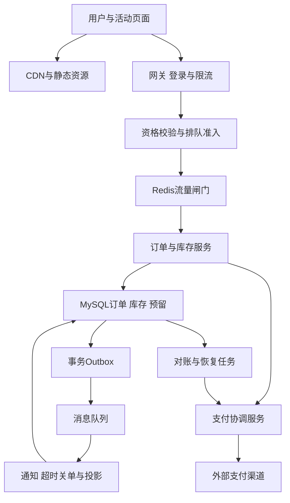
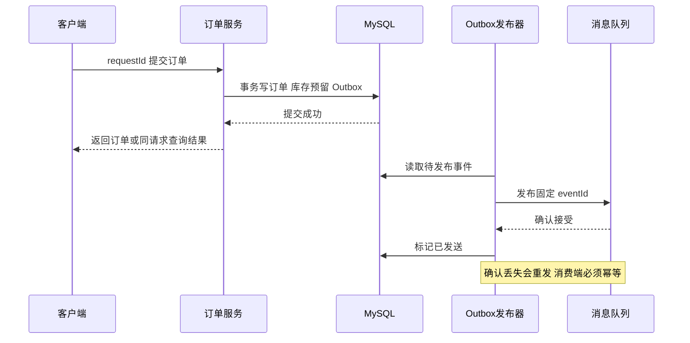
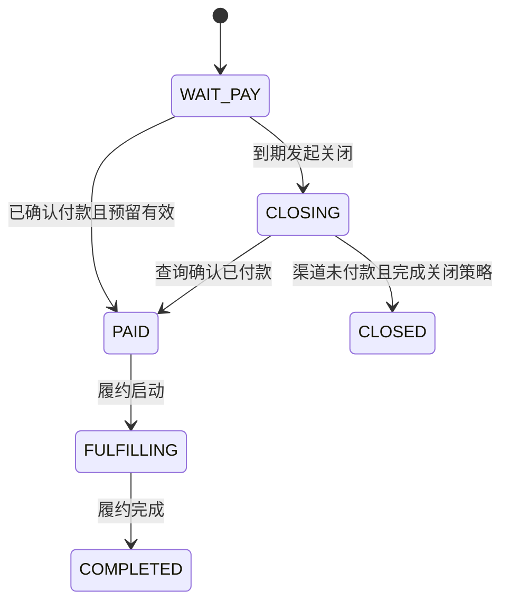

# 第 2 章 秒杀系统：库存、订单、支付与高峰流量

## 2.1 从业务承诺画架构

秒杀的核心不是“让一百万个请求同时扣 Redis”，而是在有限库存、突发流量和不可靠网络中，控制哪些请求进入交易链路，并保证已经形成的订单、库存预留和支付结果能够被解释与恢复。页面展示可最终一致，库存交易必须遵守明确的不变量。



Redis 和 MQ 是按规模选择的优化层。首先把单库事务方案设计正确，再讨论高峰下如何减少进入数据库的请求。用户收到“排队中”“请求已受理”“订单创建成功”“支付成功”，分别对应不同状态，不能都用一个“秒杀成功”模糊表达。

基础方案采用以下业务语义：一次活动中的一个 SKU，每个用户最多形成一个订单；订单未支付时占用库存，关单后释放；取消后是否允许重新参加作为后续变体。商品库存独立于页面展示库存，最终成交必须经过权威库存检查。示例数据：活动分配 10,000 件库存，峰值 100 万请求/秒持续 5 秒，目标让绝大多数请求在边缘、入口和资格阶段结束，数据库只处理有资格的少量交易请求。这些数值用于容量推演。

## 2.2 先写出必须始终成立的不变量

在不考虑退款后重新入库的基础流程中，为活动分配库存 `S`，可售库存 `A`，预留库存 `R`，已成交库存 `C`，应满足：

\[
A\ge 0,\quad R\ge 0,\quad C\ge 0,\quad A+R+C=S
\]

下单把 `A` 转为 `R`，支付确认把 `R` 转为 `C`，关单把 `R` 转回 `A`。退货后的实物验收、库存重分配和活动补货是新的有凭据库存动作，不能随便把退款等同于库存自动加回。

还应满足：同一请求只对应一个结果；同一业务订单不能重复扣库存；同一预留只能在 COMMITTED 和 RELEASED 之间选择一个终态；订单金额由服务端活动价计算；支付渠道回调必须关联正确订单、商户、金额和币种；任何一次“结果未知”都能通过稳定标识查询。

这些约束比“用了分布式锁”“用了 MQ”更重要。锁、索引、状态机和幂等记录都是实现它们的手段。

## 2.3 数据模型与接口

| 表或对象 | 关键字段与约束 | 作用 |
| --- | --- | --- |
| `campaign_sku` | `(campaign_id, sku_id)` 主键，`start_at`、`end_at`、`price`、`status` | 活动资格、价格和时间的权威配置 |
| `inventory` | `(campaign_id, sku_id)` 主键，`available`、`reserved`、`sold`、`version` | 权威库存；基础方案的所有动作在同库事务内 |
| `seckill_order` | `order_id` 主键，`request_id` 唯一，`(campaign_id,sku_id,user_id)` 唯一，`status`、`version`、`accepted_payment_receipt_id` | 请求幂等、业务限购、支付入口门控与唯一履约收款归属 |
| `reservation` | `reservation_id` 主键，`order_id` 唯一，`quantity`、`state`、`expires_at`、`version` | 表达库存的持有与释放责任 |
| `payment_attempt` | `payment_attempt_id`、`order_id`、`channel`、`merchant_request_id` 唯一、`state`、`version`、`next_check_at`、`create_started_at` | 保存每次渠道创建责任、在途与未知结果；`(order_id,payment_attempt_id)` 支持按订单锁定所有尝试 |
| `payment_receipt` | `receipt_id`、`order_id`、`attempt_id`、`channel`、`merchant_account`、`channel_transaction_id`、`amount`、`currency`、`disposition` | 每笔真实收款单独入账；`(channel,merchant_account,channel_transaction_id)` 唯一，区分回调重复与第二笔真实扣款 |
| `refund_task` | `refund_id`、`receipt_id` 唯一、`merchant_refund_request_id` 唯一、`state`、`next_check_at` | 多付或晚付退款责任，固定幂等键重试与查询，不因订单已终态而丢弃 |
| `outbox_event` | `event_id` 主键，`aggregate_id`、`type`、`payload`、`created_at` | 与业务状态同事务产生待发布事实 |
| `consumer_inbox` | `(consumer_name,event_id)` 唯一 | 消费者去重；去重与本地业务更新同事务提交 |

`request_id` 应与用户身份、操作类型、业务参数摘要绑定。相同 `request_id` 携带不同 SKU、数量或金额，应返回冲突，而不是悄悄复用旧结果。客户端的幂等键不能替代服务端用户身份校验，也不能让用户通过新建无数个请求 ID 绕过限购。

建议接口：

- `GET /campaigns/{id}`：可以缓存的活动展示，不承诺实时精确可售数。
- `POST /campaigns/{id}/admissions`：发放短期、绑定用户和活动的准入凭证；是否需要该步骤由流量与防刷策略决定。
- `POST /orders`：提交 `request_id`、活动、SKU 与准入凭证。同步模式返回明确订单；异步模式返回可查询的请求状态。
- `GET /order-requests/{request_id}`：查询 ACCEPTED、PROCESSING、SUCCEEDED、REJECTED 等状态，要校验请求所属用户。
- `POST /orders/{id}/payment-attempts`：创建或复用支付尝试，不能由前端决定支付金额。
- `POST /payment-callbacks/{channel}`：验签、验业务字段、去重后驱动状态机。

## 2.4 基础正确方案：数据库条件扣减加本地事务

如果数据库能承受过滤后的有效请求，最容易解释和验证的是：在同一个数据库事务中完成订单唯一性约束、库存条件扣减、预留记录和 Outbox。无需为了“分布式”而额外套一把 Redis 锁。

```sql
-- 所有语句必须处于同一个事务；任意一步失败都回滚整个事务。
START TRANSACTION;

-- 示例选择：同一活动 SKU 每人最多创建一个订单，取消后也不重新创建。
-- price 与 amount 由服务端读取活动配置计算，不能信任客户端。
INSERT INTO seckill_order
    (order_id, request_id, campaign_id, sku_id, user_id,
     quantity, amount, status, version)
VALUES
    (:order_id, :request_id, :campaign_id, :sku_id, :user_id,
     1, :amount, 'WAIT_PAY', 1);

UPDATE inventory
SET available = available - 1,
    reserved = reserved + 1,
    version = version + 1
WHERE campaign_id = :campaign_id
  AND sku_id = :sku_id
  AND available >= 1;

-- 必须检查 affected_rows = 1；否则回滚并返回库存不足。
INSERT INTO reservation
    (reservation_id, order_id, campaign_id, sku_id,
     quantity, state, expires_at, version)
VALUES
    (:reservation_id, :order_id, :campaign_id, :sku_id,
     1, 'RESERVED', :expires_at, 1);

INSERT INTO outbox_event
    (event_id, aggregate_id, type, payload, created_at)
VALUES
    (:event_id, :order_id, 'ORDER_RESERVED', :payload, CURRENT_TIMESTAMP(6));

COMMIT;
```

**为什么不会超卖？** 多个事务更新同一库存记录时，InnoDB 会协调冲突写入；条件与扣减在同一条 UPDATE 中执行，后继更新必须基于实际可更新的记录判断 `available >= 1`。它不同于先普通 SELECT 读到库存为 1，再在应用内算成 0，然后分别写回。后者可能发生丢失更新，且没有把可售条件作为数据库更新的前提。

**为什么插入订单放在前面？** 本例用唯一约束尽早挡住重复业务请求，使重复请求不必竞争库存。也可以先扣库存，再插订单，但插入冲突时必须回滚整个事务。关键是所有路径统一加锁顺序、事务短小、失败完整回滚，而不是某一种语句排列绝对正确。复杂订单涉及多 SKU 时按稳定主键顺序锁定或更新，减少死锁；仍要处理数据库选择牺牲事务的情况。[A08]

**唯一键冲突应该怎么返回？** 回滚当前事务后，按请求 ID 查询原订单并核对用户与参数摘要。若冲突来自“同用户同活动”的业务约束，则查询已有订单，返回“已参与”或已有结果。事务提交响应丢失时也是查询同一个请求 ID，不要换新 ID 再下单。

**事务应该多长？** 只包含必要数据库读写，不能在事务里调用支付、短信或远程风控。外部调用耗时无法控制，会延长锁持有时间，并使数据库连接、线程池和库存行排队相互放大。

## 2.5 锁住谁，锁到哪里，什么时候可以不用显式锁

| 目标 | 正确的竞争对象 | 常见误用 |
| --- | --- | --- |
| 防同一个用户重复参与 | 活动 SKU 与用户的唯一约束或参与配额记录 | 只锁 userId 导致跨活动串行，或只做 Redis 去重却缺数据库约束 |
| 防库存超卖 | 活动 SKU 对应的权威库存记录或预分配库存桶 | 只锁用户：不同用户仍同时竞争同一库存 |
| 保证一个订单只支付确认一次 | 订单、支付流水与预留状态 | 只用回调 eventId 去重，忽略渠道可能换事件 ID 重发同一业务事实 |
| 防重复释放库存 | 预留记录的 RESERVED 到 RELEASED 条件转换 | 关单消息每来一次都直接 `available + 1` |
| 防旧任务回写新状态 | 被写资源上的状态与版本条件 | 只有 Redis 锁过期时间，没有资源端旧版本拒绝 |

`UPDATE ... WHERE available >= quantity` 已经利用数据库写入协调，不必先 `SELECT FOR UPDATE` 才叫“有锁”。如果还要依据多条记录做复杂判断，可以在事务里锁定所需记录再计算。乐观版本条件适合冲突率相对可控的更新，但高争用时大量失败重试也会产生压力；悲观锁适合短事务内串行决策，但排队与锁等待需要受控。

Java `synchronized` 只约束同一 JVM 内共享锁对象的线程，多实例之间不生效；错误地每次 `new Object()` 再锁更是没有共同竞争对象。Redis 租约锁可以减少重复工作，却不能替代数据库库存条件和业务唯一约束。进程暂停超过租约后，旧执行者仍可能继续工作；异步复制故障切换也可能破坏“只有一个持有者”的假设。[A10]

Fencing 的完整含义是：每次授权得到单调递增的代次，所有受保护写入携带代次，被写资源原子拒绝过期代次。仅仅在日志中打印 token 没有意义。外部支付渠道若不理解你的 fencing token，就不能靠它阻止重复扣款，仍需渠道幂等键、查询和对账。

## 2.6 从单库方案扩到突发流量

先把请求分成三类：无资格或恶意请求、合法但不可能得到库存的请求、真正需要生成交易记录的请求。优化目标是让前两类尽早结束，让第三类进入有界的交易通道。

1. **静态与动态分离。** 活动介绍、图片、脚本走 CDN；活动资格、价格最终确认和订单写入走受控接口。不能把库存为零的展示缓存视为永久拒绝，因为后续可能有取消释放或补货，缓存要有版本和失效策略。
2. **分层限流。** 边缘保护流量体积，网关保护服务，活动维度保护热点，用户与设备维度限制刷请求。入口返回明确的限流响应和合适的重试建议，客户端采用随机退避，避免所有用户整点同步重试。
3. **准入与排队。** 只给一定数量请求进入下单路径。准入凭证说明“允许尝试”还是“保证一个库存预留”，必须明确；前者可在数据库终判时失败，后者必须由可靠配额预留支持。
4. **本地快速拒绝。** 某实例发现活动已结束或某版本确实售罄，可以短期本地缓存拒绝；恢复销售时通过版本通知或短 TTL 解除。不能用无限期的本地布尔变量让部分实例永远售罄。
5. **保护交易依赖。** HTTP 并发、数据库连接、工作线程、MQ 生产并发和查询频率都设上限。把 100 万请求堆进无界内存队列不会增加吞吐，只会把立即失败变成延迟崩溃。

**容量推演。** 若交易链路实测稳定容量为 2,000 单/秒，入口每秒只放入约 1,500 个有效尝试，留出重试和运维余量。10,000 件商品可能在数秒到十余秒内形成预留；用户不需要在同一毫秒完成交易。若允许排队 5 秒，队列规模应按服务速率和时限控制，不能宣称“MQ 能无限削峰”。

## 2.7 Redis 预扣到底能保证什么

必须先区分两种架构，否则面试回答容易前后矛盾。

| 方案 | Redis 含义 | 权威成功点 | 故障后处理 |
| --- | --- | --- | --- |
| 准入计数器 | 限制进入数据库的尝试数 | 数据库订单与库存事务提交 | Redis 丢失可能多放或少放请求，数据库仍终判；按活动版本重建 |
| 承诺库存预留 | 对用户承诺持有某份库存 | 可靠的预留记录或配额状态已完成持久化 | 要完整恢复每个预留与其消息，不能只重置一个余额 |

第一种更容易实现与论证。Redis 可快速拒绝大部分请求，数据库 `available >= quantity` 是最后防线；Redis 多放请求会增加数据库负载和下单失败率，却不会因此超卖。第二种追求更高规模或更强排队承诺，复杂度明显更高，必须说明持久化、主从故障、重复投递和补偿归属。

下面 Lua 仅示意**同一 Redis 分片上**的原子准入检查。相关 key 使用相同 hash tag；没有跨 Redis 与 MySQL 的事务，也没有承诺该结果在故障切换后绝不丢失。脚本执行期间会阻塞其他命令，因此操作必须短、数据规模有界。[A09]

```lua
-- KEYS[1]: gate:{campaign:sku}:available
-- KEYS[2]: gate:{campaign:sku}:request:<requestId>
-- ARGV[1]: requestFingerprint  用户和参数摘要
-- ARGV[2]: retentionMs        至少覆盖本轮重试和恢复窗口
-- 这是准入门票，不是最终库存订单。
-- 参数验证必须位于首次写入之前。示例上界30天，按实际恢复窗口配置。
if not ARGV[1] or #ARGV[1] == 0 then return -4 end
local ttlText = ARGV[2]
if not ttlText or not string.match(ttlText, '^%d+$') then return -4 end
local retentionMs = tonumber(ttlText)
if not retentionMs or retentionMs < 1 or retentionMs > 2592000000 then
    return -4
end
local prior = redis.call('GET', KEYS[2])
if prior then
    if prior == ARGV[1] then return 2 end  -- 同一请求已获准入
    return -2                            -- 幂等键被不同参数复用
end

local remaining = tonumber(redis.call('GET', KEYS[1]))
if not remaining then return -3 end       -- 未初始化，不默认无限库存
if remaining <= 0 then return 0 end

-- 部署时保证 key 类型与参数合法，写入后不再执行可能因业务校验失败的逻辑。
redis.call('DECR', KEYS[1])
redis.call('SET', KEYS[2], ARGV[1], 'PX', ttlText)
return 1
```

Lua 的原子执行表示其他命令不会插入脚本中间，并不意味着遇到运行时错误会回滚此前已经执行的写入。因此要在首次写前验证 TTL、数值格式、key 类型与容量前提，脚本版本也要受控；例如先 DECR 再用无效 PX 参数 SET，会留下已经扣减但没有幂等记录的状态。即便参数合法，资源故障和持久化恢复仍需由前述权威账本与对账兜底，不能把 Lua 当作跨系统事务。

**预扣成功后进程崩溃、消息没发出去怎么办？** 如果你只是先减 Redis 再调用 MQ，这两步有空隙。可以把准入请求状态记录在可靠存储并由恢复扫描推进；也可以在同槽 Lua 中同时产生 Redis Stream 事件，但此时整体可靠性仍受 Redis 持久化和故障切换语义限制，不能说“有了 Stream 就等于不丢”。若用户成功承诺需要更强持久性，可先在可靠数据库建立请求责任或采用能满足要求的事务消息方案。

**MQ 发送超时后能马上回补 Redis 吗？** 不能仅因超时回补。消息可能已被接受并正在创建订单；立即回补会让另一个请求获得同一份准入额度，形成重复放行或错误补偿。应以固定事件 ID 查询或重试发布，并让订单结果成为补偿判定依据。补偿也要有自己的条件状态，不能执行若干次就加回若干次。

**Redis 全部重启，直接从数据库可售库存重建可以吗？** 对准入计数器可采取暂停放行、提升活动代次、核对已有请求与进行中的门票、建立保守余额后恢复。对真正的库存预留系统，不能忽略已经承诺但尚未落订单的预留；只按订单表统计会把在途库存再次出售。恢复时需要准确包含未决责任，无法确认时先保守冻结并对账。

**每个请求一个 key 会不会太多？** 会。可以按活动分片、按时间窗口保留、使用紧凑结构，但保留期必须覆盖最大重放和对账窗口。把去重记录 TTL 设得比可能重试周期还短，会让旧请求再次进入。Redis 存储去重也只是优化，权威数据库唯一约束仍需存在。

## 2.8 订单与消息如何衔接



事务 Outbox 将“订单已提交”和“有一条需要对外传播的事件”放在同一个本地事务。发布器崩溃后继续扫描，或用 CDC 将事件传出。它解决业务写入与事件产生之间的原子性，不自动消灭发布重复。Debezium 的 Outbox 模式提供事件 ID 等字段用于消息标识与下游去重，具体消费幂等仍属于业务设计。[A11]

消费者可以在同一个数据库事务中：插入 Inbox 唯一键 → 更新本地投影或通知任务 → 提交；提交后再确认消息。若确认前宕机，重放会触发唯一约束并跳过已完成业务。若副作用在外部渠道，例如短信或支付，Inbox 只能证明本地决策，不自动把外部调用纳入事务，需要稳定业务幂等键和结果查询。

活动订单的消息如果按 `order_id` 分区，可以保留同订单事件的分区顺序；消费者内部并行执行仍可能破坏完成顺序，因此最终还要靠状态和版本条件防止旧事件覆盖新状态。全活动所有消息放进同一分区会形成热点，应在需要的最小业务范围内保证顺序。

## 2.9 支付与超时关单的竞争



支付状态和订单状态应分开记录。支付渠道可能已经扣款，而本地订单还处于 CLOSING；本地订单已关闭，也可能收到很晚到达的成功通知。状态机不能用“最后到达的消息覆盖前一个状态”。

### 创建支付与关单必须经过同一订单门控

支付创建不是一个可以绕过订单状态的独立 HTTP 调用。创建新 `payment_attempt`、授权发送渠道创建请求、进入 CLOSING、归并支付回调，都先锁同一订单行，再按固定顺序锁该订单下的支付尝试。这样，关单关闭的是整个订单的支付入口，而不是只关闭扫描时偶然看到的一笔支付。

```sql
START TRANSACTION;
SELECT status, version, amount FROM seckill_order
WHERE order_id = :order_id FOR UPDATE;
-- 应用校验：仅WAIT_PAY允许建立新尝试；CLOSING以后拒绝新建。
-- 已有相同merchant_request_id时核对参数并返回原尝试，不新建副作用。
INSERT INTO payment_attempt
    (payment_attempt_id, order_id, channel, merchant_request_id,
     state, version, next_check_at)
VALUES
    (:attempt_id, :order_id, :channel, :merchant_request_id,
     'PREPARED', 1, CURRENT_TIMESTAMP(6));
-- 与此处同时保存可恢复的渠道创建责任，例如写入Outbox。
COMMIT;
```

发送器真正调用渠道前，再在短事务中依次锁订单、尝试：订单仍为 WAIT_PAY 才把 PREPARED 条件改为 CREATE_IN_FLIGHT，并保存本次开始时间，然后提交并发出请求。若关单先取得订单锁，未发送的 PREPARED 尝试可取消，发送器不得继续发起；若发送器先取得锁，则关单必须把已登记的 CREATE_IN_FLIGHT 纳入待核对集合，不能认为“尚无渠道支付号”就不存在支付。所有尝试写入路径都遵循此门控，避免只给关单接口加锁、创建接口仍绕过。

进入 CLOSING 后不允许新建支付尝试，也不允许重新发送尚未开始的创建动作。关单器枚举该订单**全部**尝试，分别核对 PREPARED、CREATE_IN_FLIGHT、PENDING、UNKNOWN、SUCCEEDED 等状态；只有未发送动作已经取消、已发出的创建与支付均进入可证明的安全终态，才能按正常关闭路径释放预留。

特别要处理这个时序：发送器标记 CREATE_IN_FLIGHT 后暂停 → 关单查询渠道得到 NOT_FOUND → 关单释放库存 → 发送器恢复并成功创建支付。查询一时不存在，不能证明创建请求以后不会生效。对于 CREATE_IN_FLIGHT/UNKNOWN，需等待创建结果确定后关闭，或使用渠道保证的创建截止时间、取消屏障等能力，使旧请求之后也不能生效；没有这种保证就保留未知责任，不能仅凭 NOT_FOUND 释放。业务若为了库存周转选择超时释放，则明确进入“晚付退款”策略，继续追踪全部尝试，并承担晚付收款的退款责任。

一种便于解释的基础方案是：

1. 下单事务创建预留并确定 `expires_at`；到期扫描或延迟消息只是唤醒检查，不直接释放库存。
2. 关单事务将 `WAIT_PAY` 条件更新为 `CLOSING`，关闭新支付入口、取消尚未发送的创建责任，保留库存预留，并为所有在途或未决尝试产生核对任务。
3. 事务外查询或关闭每个渠道支付尝试。若某笔已成功，走支付确认；若全部尝试均满足安全关闭条件，执行关单释放；若有创建在途或结果未知，保留可恢复任务，后续查询，不在数据库事务里一直等待渠道。
4. 支付确认事务先按真实渠道流水写收款账，再核验订单和预留状态。第一笔可被接受的收款关联 `accepted_payment_receipt_id`，把 `RESERVED` 条件转换为 `COMMITTED`，把库存 `reserved` 转为 `sold`，订单进入 PAID。相同渠道流水的重复回调返回已有结果；不同成功流水必须另行记账和处置。
5. 关单释放事务必须把同一预留 `RESERVED` 条件转换为 `RELEASED`，再把库存 `reserved` 转回 `available`，订单进入 CLOSED。任何一条更新失败，都回滚并按最新状态决策。

示意释放事务如下。所有参与路径应使用一致的锁顺序；库存数量和 SKU 从锁定的预留记录读取，不能采用客户端或旧消息中的数量。`state` 与 `version` 条件让重复补偿变成无操作，而不是再次加库存。

```sql
START TRANSACTION;

SELECT status, version FROM seckill_order
WHERE order_id = :order_id FOR UPDATE;

-- 持有订单锁后核对全部支付尝试，确保无新创建入口、无未解决的在途责任。
-- 正常释放要求所有渠道处置条件满足；若采用晚付退款策略，要先持久保存补偿责任。
SELECT reservation_id, campaign_id, sku_id, quantity, state, version
FROM reservation WHERE order_id = :order_id FOR UPDATE;
-- 后文参数均来自这条锁定记录；验证它为RESERVED且quantity > 0。
UPDATE reservation
SET state = 'RELEASED', version = version + 1
WHERE reservation_id = :locked_reservation_id
  AND state = 'RESERVED' AND version = :locked_reservation_version;
-- affected_rows != 1：回滚并读取已发生的终态，不继续给库存加一。

UPDATE inventory
SET available = available + :locked_quantity,
    reserved = reserved - :locked_quantity,
    version = version + 1
WHERE campaign_id = :locked_campaign_id AND sku_id = :locked_sku_id
  AND reserved >= :locked_quantity;
-- affected_rows != 1：整个事务回滚并报警，说明账实约束异常。

UPDATE seckill_order
SET status = 'CLOSED', version = version + 1
WHERE order_id = :order_id AND status = 'CLOSING';
-- affected_rows必须为1；否则整个事务回滚，不提交预留释放与库存增加。

INSERT INTO outbox_event (event_id, aggregate_id, type, payload, created_at)
VALUES (:event_id, :order_id, 'ORDER_CLOSED', :payload, CURRENT_TIMESTAMP(6));
COMMIT;
```

**同一个订单真的被扣了两次钱，能因订单已经 PAID 就忽略第二次回调吗？** 不能。第二个不同的渠道成功流水是另一笔真实收款，不是同一笔回调重放。每个流水先在 `payment_receipt` 独立入账，锁订单后只有一个可成为履约收款，其余标为 MULTIPLE_PAYMENT 或 LATE_PAYMENT，并在同事务建立 `refund_task` 与事件责任。退款使用独立且稳定的商户退款请求号，超时核对原退款，退款失败持续告警或交人工处理。订单只履约一次不等于资金已经对平；收款账、被接受收款、退款账必须逐笔核对。

**渠道不支持可靠关闭，或者未知状态一直不消失怎么办？** 产品必须定义最大保留、人工对账和晚付处理策略。可以延长保留等待确认；也可以在一定条件下先关闭并释放，接受之后出现晚付时自动退款。后者需要单独的退款责任和用户通知，不能让已释放库存的订单直接恢复 PAID 并履约。如果允许重新抢占库存，则必须重新经过权威库存事务，失败就退款。

**本地超时是否等于支付失败？** 不等于。请求发送后超时，只说明当前调用方没有得到结果。支付重试必须使用同一个业务支付尝试标识，并查询同一笔支付的状态；换一个新标识可能造成第二次扣款。对外部副作用的最终确认依靠渠道幂等、状态查询、回调和账单对账共同完成。

## 2.10 库存热点、分桶与多机房

一条库存行保证正确性很清晰，但所有成功下单都要竞争它。真实瓶颈可能是锁等待、日志写入、连接排队，也可能在更前面的服务限流；应先测量。不能只看数据库总 CPU 不高，就断定“还能再加连接”。单热点行可能已经串行饱和。

**分桶库存**把总配额 `S` 预分配到 K 个桶：`S = Σ S_i + central_unallocated`。每个桶独立做非负条件扣减。用户按稳定规则路由到桶，可以降低单行竞争。空桶而其他桶还有库存会造成局部售罄，需要允许有限次数换桶、集中余量补充或后台再平衡。

分桶的难点是守恒：同一份额度不能同时出现在两个桶。跨库转移时，可用中央配额账本先冻结待转移额度，再确认目标生效，期间这部分额度暂不可卖。出现结果未知时继续查同一个转移 ID；不能源桶减成功后丢失响应，就直接在另一个桶重新发同样额度。若源和目标在同库，可在一个短事务按固定桶 ID 顺序更新。

**每个应用实例预领一批库存**也是额度分配。实例崩溃时剩余额度的回收必须能确认哪些已经消耗，不能看到租约过期就把整批额度重发。仅租约过期不能阻止旧实例继续返回成功；需要代次限制与权威账本确认。库存额度跨区域预分配可以减少跨机房延迟，但会带来某地售罄、另一地剩余的利用率问题。

**多地域同时售卖同一池库存**要求选择一致性边界：单区域权威写入更简单但有跨区延迟；强一致多区域账本成本更高；按区域分配互不重叠配额可本地销售但调拨复杂。不能在两个异步复制的数据库上各自从 100 开始扣库存，再期待合并时自动不超卖。

## 2.11 公平、防刷和用户体验

“先到先得”必须说明在哪个位置确定先后：到达用户手机、CDN、入口网关、排队服务还是库存数据库，结果都可能不同。跨网络不存在天然公平的全局到达顺序。如果题目要求强公平，可以在受控入口生成排队序号，按队列准入；即使如此也有接入网络差异和恶意多设备问题。

抽签、预约资格、分批放量、随机排队能缓解毫秒级抢占，但改变了业务规则。验证码只是风险策略的一种，不应每次请求都调用高成本验证，也不能宣称它能彻底阻止脚本。账号成熟度、设备风险、频率、支付行为可以用于风控；涉及敏感用户画像时要最小化数据和严格授权。

异步下单必须防止“等待页面的查询打死系统”。给客户端退避和查询间隔，用事件通知改善体验，查询结果可短期缓存；失败状态要区分售罄、资格拒绝、处理中、系统繁忙。未知结果不应显示“请马上重新购买”，否则用户会创造大量重复意图。

## 2.12 常见故障窗口与闭环

| 故障窗口 | 错误直觉 | 正确处理 |
| --- | --- | --- |
| Redis 准入扣减后进程退出 | 门票一定会自动回来 | 记录与扫描未决请求；回补要有条件状态和固定标识 |
| MQ 生产超时 | 消息未发送，立即回补 | 可能已经投递；固定 eventId 重试和查询，用业务终态判断补偿 |
| DB COMMIT 后响应丢失 | 再换个 requestId 下单 | 按原 requestId 查询，数据库唯一键防重复 |
| 消费更新 DB 后宕机 | MQ 不会再发 | 可能再次投递；Inbox 与业务同事务或业务唯一键处理 |
| 支付回调重复或乱序 | 用最新收到的状态覆盖 | 验证事件和业务标识，以状态机与版本决定合法转移 |
| 关单时支付创建仍在途 | 渠道NOT_FOUND就释放库存 | 关闭订单级新建入口，收敛全部创建与支付尝试；未知先核对 |
| 同订单有第二笔真实收款 | 订单已PAID所以忽略回调 | 每笔流水独立入账，只选一笔履约，多余收款形成退款责任 |
| 关单与支付确认竞争 | 两边都查到 WAIT_PAY 就各做各的 | 同资源条件更新或锁，预留终态只能成功一次 |
| Redis 故障切换丢写 | Lua 是原子，所以不会丢 | 原子执行与持久性不同；权威库存终判或可靠恢复协议 |
| 库存已释放后晚付成功 | 恢复订单继续发货 | 重新预留成功才可履约，否则创建退款责任 |
| Outbox 发布后标记失败 | 标记没成功就不用再发 | 重发允许，事件 ID 和下游幂等阻止重复副作用 |
| 活动提前结束或改价 | 刷新缓存即可 | 定义在途门票与已有订单的版本规则，不能悄悄改已确认订单金额 |
| 取消消息永远进死信 | 已进 DLQ 就处理完了 | 预留责任仍存在；扫描到期未决记录，告警并人工或自动恢复 |

## 2.13 监控、压测与验收

核心指标应按层拆开：入口请求、通过资格数、准入数、有效订单数、库存拒绝数、支付成功数、取消释放数、未知支付数、退款未完成数。过滤 99.9% 请求并不一定是失败，关键是合法用户是否获得了符合规则的结果。系统需要观察数据库锁等待 P99、热点行吞吐、连接池等待、MQ 最老消息年龄、Outbox 最老未发布年龄和未决预留数量。

压测应覆盖：大量不同用户抢同一 SKU、单用户大量不同请求 ID、同一请求 ID 不同参数、客户端超时重试、消费者重复与乱序、数据库提交后断网、MQ 发布后断响应、支付晚回调、Redis 重启与数据丢失、服务长 GC、分桶倾斜、活动中途结束。

验收不仅看 QPS：对每个 SKU 验证库存守恒；对每个用户验证限购；对每个订单验证最多一个有效预留终态；对每笔渠道流水验证是否有订单或退款归属；检查所有处理中状态是否有下一步推进机制。若测试结束仍有未知状态，应能列出责任和恢复路径，而不是把它们从统计中删除。

## 2.14 面试连续追问与回答

### Q1：防超卖到底锁 userId 还是 skuId？

防重复参与的竞争对象是用户与活动 SKU 的组合；防超卖的竞争对象是共享库存。只锁 userId，不同用户会同时扣同一库存，仍不安全。基础方案用订单业务唯一键解决限购，用数据库条件 UPDATE 解决库存，两个约束各司其职。

### Q2：Redis 已经原子扣减了，为什么数据库还要判断库存？

取决于 Redis 的角色。如果它只是准入层，数据库必须终判，这能覆盖故障切换、配置失误和重复放行。如果 Redis 是真正库存权威，则要证明其持久化和恢复协议满足承诺，并处理订单消息之间的空隙。不能一边承认 Redis 会丢写，一边说数据库可以无条件创建订单。

### Q3：条件 UPDATE 和乐观锁 version 有什么区别？

`available >= q` 直接表达库存业务前提，多个事务可以在剩余量允许时依次成功。`version = oldVersion` 检查自读取后是否有人修改，冲突后需要重新读取；它会让一些仍有库存的请求因版本变化失败。两者可以组合，但版本字段不是防超卖的必要前提，业务条件不可遗漏。

### Q4：如果数据库成功扣库存，插订单失败，怎么办？

同一库本地事务中全部回滚即可，前提是错误没有被吞掉并继续提交。若库存与订单在不同库，则本地事务不再覆盖两者，需要库存预留、订单创建和确认/取消的协议以及恢复扫描。应先说明是否有必要跨库，不能直接默认两次远程调用相当于一个事务。

### Q5：为什么超时不能马上重试？不是重试加幂等就好了？

应区分重试同一业务操作与重新发起新操作。超时可能已成功，可以用相同幂等标识重试或查询；如果换新订单号、新支付流水号，就会绕开原幂等范围。即使复用标识，也要知道对端是否真正支持幂等、保留期多长、参数冲突如何处理。

### Q6：一人一单用 Redis Set 可以吗？

可用于提前过滤，但权威约束最好在持久交易存储中。Set 丢失、过期或预扣后失败都会造成误放或误拒，数据库唯一键保证最终不重复。取消是否允许重新购买决定约束设计；如果允许，需要有可释放的参与配额或有效订单槽位，不能直接删除历史订单来腾唯一键。

### Q7：为什么不用一个全局分布式锁？

它会把所有 SKU、所有用户交易串行化，吞吐与可用性都受影响，而且仍有租约过期和外部副作用的问题。只对真正竞争的资源序列化，使用短数据库事务和业务条件，往往更清晰。分布式锁适用于减少重复任务，不应作为所有正确性问题的唯一答案。

### Q8：取消订单后库存增加，是不是直接 INCR 就可以？

不可以，消息重复、任务重试会导致多加。先把对应预留从 RESERVED 条件转换为 RELEASED，仅成功者允许加库存；这两个动作同库同事务。库存是账户余额，预留记录是这次释放的依据，没有依据的 INCR 无法对账。

### Q9：MQ 能削峰，是不是越长的队列越安全？

队列只是把现在的工作延后。若到达速率持续高于消费速率，等待时间和未决订单会一直增长，甚至超过支付有效期。要有队列长度、最老年龄、预计等待时间的上限，入口停止接收或采用排队规则，并优先保护已有承诺的请求。

### Q10：消费者扩容后订单还按顺序吗？

相同 key 可以落同分区，但只保证该分区内记录顺序；消费端线程池、重试队列和下游异步请求仍可能乱序完成。订单状态机要拒绝不合法或过期事件。跨订单通常不需要全局顺序，强行追求全局顺序会损失吞吐。

### Q11：支付与关单同时发生，谁赢？

本地由合法状态转换和预留终态决定，渠道事实仍需查询。关单先进入 CLOSING 并保留预留，确认渠道结果后转 PAID 或 CLOSED；无法可靠关闭的渠道要定义晚付补偿。如果库存已经释放，晚付不能无条件恢复订单，必须重新预留或退款。

### Q12：热点 SKU 分成十个桶就解决了吗？

分桶能降低竞争，却带来余量不均、跨桶查询、额度调拨和恢复问题。要维护总配额守恒，不能每个桶都初始化为总库存。热点用户路由也可能偏斜，所以要测量桶级成功率和剩余量，再决定换桶或再平衡策略。

### Q13：活动前缓存预热完成了，还可能有什么问题？

可能活动配置版本错误、热 key 落在同一分片、预热后批量过期、主从切换丢失数据、实例同时冷启动、活动开始时间不一致。预热需要校验活动版本、容量和过期策略，并准备未初始化时的拒绝或受控恢复路径，不能缺 key 就按“有库存”处理。

### Q14：准入成功是不是应该保证最终有订单？

必须先定义承诺。普通准入只表示有机会进入交易链路，可在权威库存终判后售罄；若承诺排队成功即持有库存，就必须先形成可靠预留，并承担恢复、释放和对账责任。用户文案、接口状态和内部持久化点应该一致。

### Q15：库存与订单必须强一致，那系统其他数据呢？

页面库存、销量展示、搜索热度和通知可以采用最终一致，但订单是否可履约、是否已付款、预留是否释放不能随意延迟判断。把每条数据的用途说清楚，才能决定缓存与消息延迟是否可接受；不能给全系统贴一个笼统的一致性标签。

### Q16：你如何证明系统恢复以后不会把库存再卖一遍？

从持久化的订单、预留、支付和库存动作对账，区分已成交、仍预留、已释放及未知请求。恢复前停止或限制新准入，使用新的活动代次并拒绝旧代次操作；对每份额度确认唯一归属。无法确认的部分保守冻结，待查询或人工对账，而不是把计数器重置到初始库存。

## 2.15 映射到 NoteWeave 的资源槽位

应用示例：NoteWeave 类资料研究平台的并发研究槽位、模型调用配额和昂贵工具预算，都有“有限资源被任务预留、使用、释放”的结构。区别是库存通常代表不可随意重复售卖的商品，任务槽位可以在执行者确认结束后复用；但租约到期不代表旧执行者物理停止，所以槽位回收仍要配合任务代次、受保护写入的 fencing 和外部调用幂等。

可以用同样的问题追问项目：槽位由谁权威记录？领取成功后进程崩溃怎么办？调用模型超时是没发出去还是结果未知？旧执行者晚返回能否覆盖新研究结果？多研究单元合并时为何按主键顺序加锁？这些机制与秒杀的库存守恒、状态转移和未知结果恢复有共同基础。

## 2.16 技术参考资料

- [A07] [MySQL 8.4 Locking Reads](https://dev.mysql.com/doc/refman/8.4/en/innodb-locking-reads.html)：事务中的锁定读与 SKIP LOCKED 语义。
- [A08] [MySQL 8.4 How to Minimize and Handle Deadlocks](https://dev.mysql.com/doc/refman/8.4/en/innodb-deadlocks-handling.html)：短事务、稳定锁顺序与死锁重试。
- [A09] [Redis Scripting with Lua](https://redis.io/docs/latest/develop/programmability/eval-intro/)：脚本原子执行与阻塞性质。
- [A10] [Redis Distributed Locks](https://redis.io/docs/latest/develop/clients/patterns/distributed-locks/)：异步复制、锁有效期与 fencing 的边界。
- [A11] [Debezium Outbox Event Router](https://debezium.io/documentation/reference/stable/transformations/outbox-event-router.html)：Outbox 事件结构与事件标识。

## 2.17 场景推演：活动流量上涨十倍，Kafka 健康但订单迟迟不落库

场景假设：活动入口从每秒 2 万请求升到 20 万，过滤后仍有每秒 8,000 个有效尝试；数据库稳定交易能力只有每秒 2,000 单。若不限制接收速率，每秒至少积累 6,000 个待处理请求，MQ 只能推迟失败，不能消除容量差。

### 从响应语义开始排查

先检查接口究竟返回“获得准入”“请求已可靠接收”还是“订单与库存预留已提交”。这三种响应可以有不同耗时，但不能把内存队列收到请求当作下单成功。如果产品允许先接收后排队，就要有稳定 request_id、持久责任与状态查询；若仅仅发到 Redis 后立刻返回成功，后续恢复必须包含尚未落订单的承诺。

随后把耗时拆为网关等待、准入检查、连接池等待、库存锁等待、事务执行、提交以及事件发布。假设 Kafka 发送只有 8 ms，但数据库获取连接需要 700 ms，新增消费者会让更多请求等待相同的库存行，通常使 p99 更差。对同一 SKU 的条件扣减是必要的正确性裁决点；优化应围绕减少无价值竞争、缩短锁持有和明确并发上限展开。

### 三步止血必须保留业务承诺

1. 根据交易稳定容量与重试余量降低有效准入，尽早给未接收的请求明确拒绝或重试建议。已经可靠接受的请求继续可查，不能因为队列长就无声丢弃。
2. 暂停促销报表、通知回放等非关键负载，限制订单消费总并发和数据库连接总预算。观察实际成功订单吞吐是否提高，而不是看线程池活跃数。
3. 将可异步传播的履约通知交给同事务 Outbox，订单事务不等待短信/推送等远程服务。若原本订单与库存跨库，先保留现有业务一致性协议，不能为了快直接切成无保护双写。

### 四条主线在同一个活动里怎样交汇

| 追问主线 | 本活动的具体问题 | 可解释的改造 | 新引入的责任 |
| --- | --- | --- | --- |
| 大数据量 | 历史订单、参与记录、Outbox 膨胀 | 热冷分离、按访问模式分片、分批归档 | 全局唯一约束、旧事件去重和回放保留 |
| 高并发 | 同一 SKU 串行竞争 | 有界准入、短事务、可验证配额分桶 | 库存守恒、桶间调拨与故障恢复 |
| 接口慢 | 连接池等待和远程调用占锁 | 删除事务内远程等待、精确定位慢段 | 异步状态可查、未知结果核对 |
| 高可用 | Kafka/Redis 短暂不可用 | 权威账本、Outbox 积压、保守降级 | 发布恢复、回源限流和接收上限 |

### 面试官继续问：消息超过五分钟才消费，还要下单吗

不能只按技术到达顺序一律执行。请求应保存 accepted_at、业务有效期和活动版本；消费者在权威创建订单前校验活动与资格，确定过期后的退款/额度返还或拒绝规则。若接收时已经承诺一份库存预留，则“迟到就丢”会破坏承诺，必须按对应预留状态转为明确终态。取消消息到达得早，也不能在不知道原请求结果时裸回补库存。

### 面试官再问：怎样证明优化有效

使用相同负载分布、热点 SKU 比例、消息大小、数据库数据量与可靠性配置比较。关注成功订单吞吐、p95/p99、等待时间分解、拒绝率、最老已接收未完成年龄、库存守恒和重复业务效果。故意在提交后响应前、Outbox 发布中、支付查询不确定时中断进程，再检查用户能否查到唯一结果。不能仅用一次接口平均耗时下降宣称整个链路已经稳定。

分片 Outbox 的扫描、公平性、租约接管、迁移清理和逐条审计，见 G.2；支付与关单竞态仍以订单状态机为准。

**相关专题：** [非功能设计与容量规划](16_非功能设计与容量规划.md) · [MySQL查询事务与在线迁移](18_MySQL查询事务与在线迁移.md) · [Kafka可靠性与积压治理](20_Kafka可靠性与积压治理.md) · [高并发准入与分布式锁](23_高并发准入与分布式锁.md) · [高可用与容灾恢复](25_高可用与容灾恢复.md)。

[A07]: https://dev.mysql.com/doc/refman/8.4/en/innodb-locking-reads.html "MySQL 8.4 Locking Reads"
[A08]: https://dev.mysql.com/doc/refman/8.4/en/innodb-deadlocks-handling.html "MySQL 8.4 How to Minimize and Handle Deadlocks"
[A09]: https://redis.io/docs/latest/develop/programmability/eval-intro/ "Redis Scripting with Lua"
[A10]: https://redis.io/docs/latest/develop/clients/patterns/distributed-locks/ "Redis Distributed Locks"
[A11]: https://debezium.io/documentation/reference/stable/transformations/outbox-event-router.html "Debezium Outbox Event Router"
