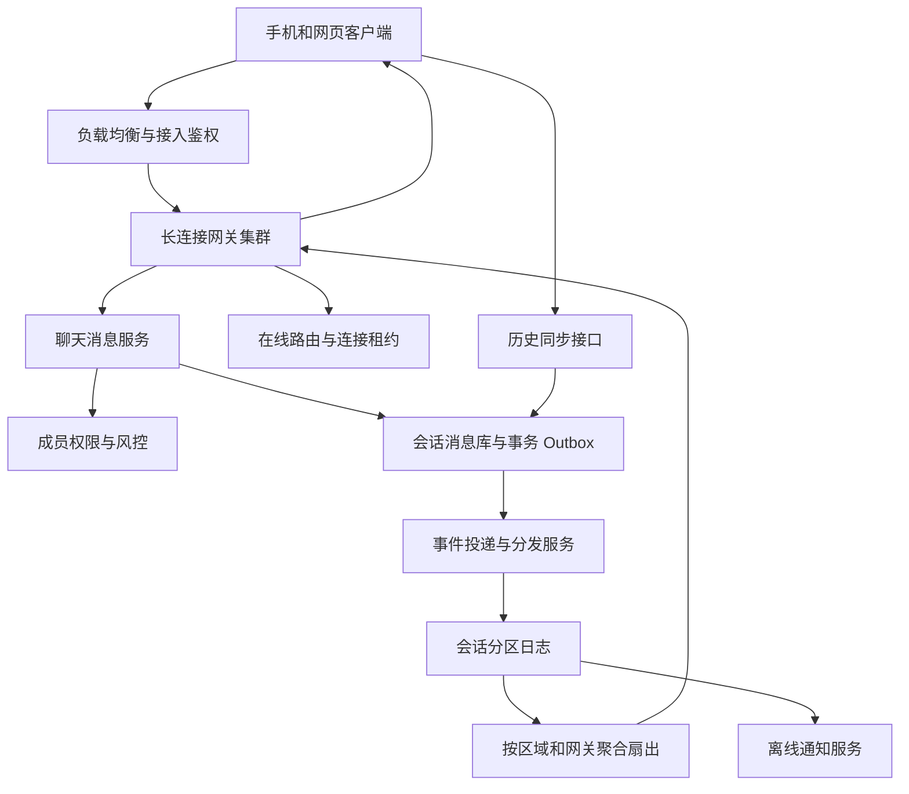
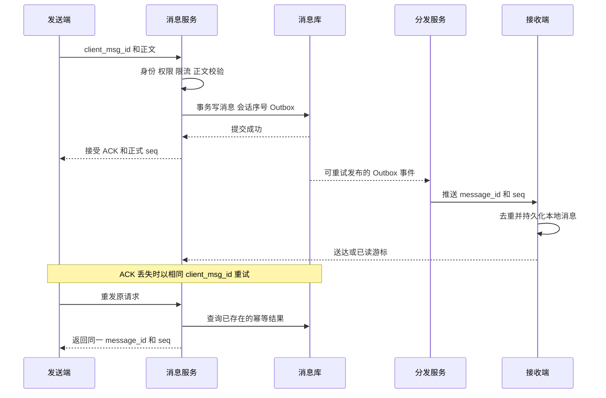

# 第 3 章 实时聊天与实时弹幕系统

## 3.1 先画出完整的消息链路



用户发送一条消息，要经历“校验身份和会话权限、形成可恢复的消息记录、通知接收方、接收方补齐历史”四件不同的事。长连接解决服务器如何及时把数据送到在线设备；消息数据库解决连接断开以后如何继续；会话序号解决双方怎样判断有没有缺失；幂等键解决发送方重试时怎样避免重复生成消息。不能用一个 WebSocket 连接同时替代这四层责任。

设计实时消息系统前，应先确认数据规模、保留时间和延迟目标。

### 聊天和弹幕的目标不能混在一起

| 维度 | 单聊与普通群聊 | 直播弹幕 | 点播视频弹幕 |
|---|---|---|---|
| 用户最在意什么 | 发出去的消息可查、顺序清楚、多端一致 | 及时出现、房间不被刷屏、播放不卡 | 弹幕与视频时间点对应 |
| 持久化 | 通常需要持久历史和离线补拉 | 可分为重要事件持久化、普通弹幕短期保留 | 一般按视频和播放时间组织历史 |
| 过期消息 | 晚到也要补齐 | 过晚弹幕通常应丢弃 | 跳转进度后重新拉取对应时间窗 |
| 顺序 | 会话内形成统一的可解释顺序 | 可接受区域或时间窗内的弱顺序 | 以媒体时间为主，同时间再稳定排序 |
| 慢客户端 | 断开后补拉，不能无限堆积 | 丢弃旧弹幕、降采样、合并相似内容 | 只取当前播放位置附近的数据 |
| 已读 | 常有业务价值 | 通常不逐条确认 | 一般不需要 |

如果题目只写“实时聊天/实时弹幕”，开场就应主动做这个区分。将弹幕设计为每一条都等待百万观众确认，会把可丢弃的实时体验问题变成巨大且没有必要的可靠投递问题。

## 3.2 协议选择和接入层为什么这样设计

WebSocket 适合双向交互频繁的聊天场景；SSE 适合主要由服务器向浏览器持续输出、客户端操作另走 HTTP 的场景，例如 Agent 答案流。轮询可以作为低频通知或降级方案，长轮询也能工作，但连接周转和请求开销需要计入容量。

WebSocket 有 Ping/Pong 控制帧，可以用于保活或检查连接响应；它没有定义“消息已入业务数据库”或“用户已读”的业务含义。[B01] SSE 的事件可以携带 `id`，浏览器重连时可发送 `Last-Event-ID`；历史是否仍然存在、服务端怎样从该位置重放，仍然是应用负责的部分。[B02]

接入网关通常保留以下连接级状态：`user_id、device_id、connection_id、session_epoch、last_heartbeat、outbound_pending_bytes`。在线路由记录的是“这个用户的哪些设备目前在哪些网关”，而不是把完整消息正文塞进在线状态表。

一个用户换网络会产生新连接，旧连接可能还没被检测为失效。因此路由更新要带连接代次。例如新连接写入 `epoch=18`，旧连接关闭时只能删除自己持有的 `epoch=17` 记录，不能直接删除整个用户路由。否则用户刚重连成功，旧连接的清理线程就把新路由删掉了。

负载均衡需要支持协议升级、合理的空闲超时和连接排水。应用心跳周期应小于链路中最短的空闲关闭时间，并加入抖动，避免所有客户端同一秒发送心跳。短暂掉线不能立即推导为用户离线；在线状态可以有宽限窗口，并明确它是近似展示状态。

## 3.3 数据模型、接口和三个不同的确认

一个可用于讨论的关系模型如下，租户字段适用于多租户系统。

```sql
CREATE TABLE conversation (
    tenant_id BIGINT NOT NULL,
    conversation_id BIGINT NOT NULL,
    next_seq BIGINT NOT NULL,
    PRIMARY KEY (tenant_id, conversation_id)
);

CREATE TABLE chat_message (
    tenant_id BIGINT NOT NULL,
    conversation_id BIGINT NOT NULL,
    seq BIGINT NOT NULL,
    message_id BIGINT NOT NULL,
    sender_id BIGINT NOT NULL,
    client_msg_id VARCHAR(64) NOT NULL,
    payload_hash BINARY(32) NOT NULL,
    message_type VARCHAR(24) NOT NULL,
    content_ref VARCHAR(512),
    status VARCHAR(24) NOT NULL,
    created_at DATETIME(6) NOT NULL,
    PRIMARY KEY (tenant_id, conversation_id, seq),
    UNIQUE KEY uk_sender_request (tenant_id, sender_id, client_msg_id),
    UNIQUE KEY uk_message (tenant_id, message_id)
);

CREATE TABLE conversation_member (
    tenant_id BIGINT NOT NULL,
    conversation_id BIGINT NOT NULL,
    user_id BIGINT NOT NULL,
    joined_seq BIGINT NOT NULL,
    left_seq BIGINT,
    read_seq BIGINT NOT NULL,
    membership_version BIGINT NOT NULL,
    PRIMARY KEY (tenant_id, conversation_id, user_id)
);
```

`client_msg_id` 是客户端在第一次发送前生成、重试时复用的业务请求标识。`message_id` 是消息实体标识。`seq` 是某一个会话内部的排序位置。三者解决的问题不同，不能只说“用雪花 ID 就够了”。同一个幂等键对应不同正文时，应返回冲突，而不是将后一条正文静默覆盖前一条。

建议接口包括：发送消息 `POST /conversations/{id}/messages`；按游标同步 `GET /conversations/{id}/messages?after_seq=...&limit=...`；推进已读 `PUT /conversations/{id}/read-cursor`；断线后同步会话摘要 `GET /sync?cursor=...`。发送响应携带 `message_id、seq、accepted_at`，客户端据此将本地临时气泡与正式消息合并。

| 确认类型 | 由谁产生 | 能说明什么 | 不能说明什么 |
|---|---|---|---|
| 业务接受 ACK | 消息服务 | 消息与恢复责任已经按约定提交 | 接收者一定在线、一定已经收到 |
| 设备送达回执 | 接收设备 | 某个设备已接收或落入本地消息库 | 人已经看见内容 |
| 已读回执 | 客户端业务逻辑 | 满足产品定义的阅读条件 | 内容被理解，或其他设备都已同步 |

“发给 TCP 后拿到成功”只代表本地或传输栈接受了数据，不能当作业务接受 ACK。对于重要消息，服务端应在消息与 Outbox 的本地事务提交后才确认接受，持久性强弱再由数据库复制和提交配置决定。

## 3.4 正常发送与超时重试的完整时序



简化实现可以在短事务内锁定该会话行，分配下一个序号，插入消息和 Outbox，然后提交。多个会话互不阻塞，同一个会话串行分配序号。对极热群聊，这个序号行会成为热点；可以让一个会话在某个时间段由一个有代次的 owner 排序，或者让会话对应消息日志中的固定分区，再将确定顺序物化到查询库。不能一开始就让所有服务无约束地生成“本地递增序号”，再期待客户端自动形成统一顺序。

如果消息日志和数据库是两个不同系统，不能把“先写库、再发消息”说成原子动作。Outbox 的作用是：业务提交后总有一条持久记录说明还需要分发；投递重复时接收方以事件 ID 或消息 ID 去重。即使 Outbox 正确，分发服务仍可能在“已推送、未记完成”时宕机，因此推送链路一般要容忍重复。

## 3.5 顺序、补洞、多端同步是三个独立问题

### 会话顺序不等于全局时间顺序

用户 A 和 B 同时发送时，没有必要追求宇宙意义上的“谁先想到”。服务端只需给一个会话建立稳定顺序，使各设备最终看到相同排列。客户端时间可能错误，分布式时钟也有偏差，不能直接用客户端毫秒时间决定最终顺序。

同一会话的操作事件也要进入顺序：发消息、编辑、撤回、成员变更可以使用统一事件序列，或正文序列加单独的版本号。若撤回事件先到、正文后到，客户端要记住该消息的更高版本，不能让迟到正文把撤回结果覆盖。

### 客户端维护的是连续确认位置

设备收到 `101、103` 时，不能直接把“已完整同步位置”设为 `103`，否则再重连会漏掉 `102`。可以暂存乱序消息，请求 `after_seq=101` 的补洞数据；只有连续区间已齐，或者服务器明确说明该区间不可见、被删除、或本来就不对应可见消息时，才推进连续游标。

序号不一定严格无空洞。批量分配、事务失败后的编号空耗、内容审核、成员可见性都可能造成“看到的消息不连续”。同步协议应返回 `next_cursor、has_more、server_high_watermark`，必要时返回已确定终结的跳过区间。这里的 `server_high_watermark` 必须是稳定前缀：服务器已经确认这个位置及以前的序号都已提交，或已永久作废，不会随后又出现一条尚未交代的较早有效记录。它不等于已分配最大序号，也不等于当前读到的最大序号。

例如批量分配后，102 仍在执行而 103 已提交，稳定前缀最多到 101。客户端可以暂存或展示 103，但不能因为看见 103，就把完整同步游标越过 102。服务端必须等 102 提交，或通过可证明的作废记录终结该位置，再推进稳定前缀。只有明确终结的空洞才能跳过；暂时没查到不能当作永久不存在。

审核隐藏、撤回和权限变化还涉及后续再可见。若客户端已经跳过被隐藏的 102，之后只把原行改成 VISIBLE，`after_seq=103` 不会发现它。因此恢复可见、编辑和撤回应追加具有新事件序号的变更，或者提供独立的 `GET /conversations/{id}/changes?after_event_seq=...` 变更游标；变更引用原 message_id，消息原展示位置可以保留。仅有正文版本号但没有能发现版本变化的同步通道，仍会永久漏更新。新获得历史权限时也要显式启动对应范围的历史回填。

### 多端用服务端游标协调，不只广播当前连接

同一账号在手机和电脑都有连接时，一端发出的消息也需要同步到另一端。每个设备有独立的接收位置，用户级已读位置则可以按产品规则取最大值；用 `GREATEST(old_read_seq, submitted_read_seq)` 推进可避免旧设备回退已读状态。

但客户端提交的已读位置仍要校验会话成员权限和合理范围。存在消息过滤或多分片序列时，简单的一个最大值可能不足，必须先定义它表示的可见连续范围。

## 3.6 大群、百万在线和热点房间

### 容量估算先算扇出

假设高峰每秒产生 5 万条消息，平均在线接收人数为 20，单条编码后 400 字节，则基础下行正文为：

`50,000 × 20 × 400 = 400,000,000 字节/秒，约 400 MB/s`。

这还没有计入协议、TLS、回执、重传和跨区域流量。如果某个房间每秒 1,000 条弹幕、100 万观众全部接收，则只是正文就约 `400 GB/s`。真正的瓶颈是扇出和带宽，不是每秒 1,000 次数据库插入。

再假设每连接应用状态、缓冲区等平均占 24 KiB，100 万连接的这部分内存就约 22.9 GiB，且还没有包含内核、TLS 和 JVM 开销。这个数字只是估算输入，最终要用真实消息分布和慢客户端比例压测。

### 分层扇出

一次房间广播先按区域、再按网关汇聚，每个网关收到一份消息后向本机连接分发，避免中心服务对每个用户做一次网络 RPC。在线路由缓存保存“房间在哪些网关有订阅者”，不需要每条消息去 Redis 查询百万用户。

普通群可以给每个成员维护收件箱索引，大群则更适合保存一份会话日志，成员通过游标读取。对大群逐条记录“所有成员是否已读”会产生乘法级存储和写放大，可以只提供人数估计、最近已读成员，或在产品上取消逐人已读。

### 慢连接必须有出站队列上限

以下是策略伪代码，展示的是分类处理，不是可直接放入生产的 Netty 实现：

```java
void push(Connection c, Event e) {
    // 判断字节数，而不只判断消息条数：一条大消息也能耗尽内存。
    if (c.pendingBytes() + e.encodedBytes() <= c.maxPendingBytes()) {
        c.enqueue(e);
        return;
    }
    if (e.isEphemeralDanmaku()) {
        // 对实时体验没有价值的旧弹幕可以丢弃并计数。
        c.dropOldEphemeralUntilFits(e);
        return;
    }
    // 可靠消息已经在持久日志中；通知重同步并关闭慢连接。
    // 不在网关内无限积压，也不谎报消息已送达。
    c.closeWithResyncHint();
}
```

断开慢连接后客户端按最后连续游标补拉。客户端重连要指数退避和随机抖动，否则一个机房重启会触发同时重连，持续压垮认证、路由和历史查询服务。网关发布时应先停止接收新连接，再迁移或逐步关闭现有连接，避免整批连接瞬间断开。

## 3.7 弹幕还需要媒体时间、审核与有损降级

点播弹幕记录可以包含 `video_id、video_version、playback_ms、danmaku_id、sender_id、text、status`。按 `(video_id, time_bucket, playback_ms, danmaku_id)` 组织数据，播放器提前拉取当前位置附近的时间窗。视频重新剪辑后时间轴会变，必须定义新版本与旧弹幕如何对应，不能只沿用同一个视频 ID。

直播弹幕可携带服务器接收时间和直播流时间映射，但不同观众的播放延迟可能不同。产品可以选择“收到就显示”或“按观看进度对齐”，两者对应不同缓冲与延迟。观众暂停播放后继续时，通常不应把暂停期间所有弹幕瞬间灌入屏幕。

审核可以采用快速规则同步过滤、复杂审核异步处理。若要求内容审核通过后才能展示，就必须将审核延迟计入端到端延迟；若先展示后撤回，则要承认存在短暂可见窗口。房间级限速、用户级限速、重复文本合并、设备风险控制和展示密度上限，都是容量与体验的一部分。

Redis Pub/Sub 可用作可丢失的在线通知信号，但订阅者离线期间没有历史补发；不能单独承担可靠聊天存储。[B03] 要做持久回放可以使用数据库日志、Kafka 或 Redis Stream 等机制，选型还需要考虑保留量、故障持久性和运维成本。

## 3.8 应用示例：NoteWeave 的流式回答

在 NoteWeave 类资料研究平台中，答案流可以设计成“有最终快照的单向事件流”，事件可定义为 `answer_started、text_delta、citation_added、checkpoint、answer_completed、answer_failed`。`request_id + event_seq` 用于去重，最终答案和任务状态在数据库中形成权威快照，Redis Stream 保留近期增量。

一个常见错误是：给同一回答的多个浏览器设备配置同一个 Redis 消费者组，并希望它们都收到完整答案。消费者组内的成员是分摊处理任务；广播到多个设备应使用各自读取游标，或由服务端读取一次后进行扇出。`XACK` 也不等于删除 Stream 正文，裁剪与消费者组进度需要单独设计。[B04]

如果前端带来的 `Last-Event-ID` 早于最早保留位置，服务器不能假装“接着读就是完整答案”。应返回重同步信号，先加载答案快照以及它覆盖的序号，再订阅更后的增量。快照必须带对应已提交稳定前缀的 `snapshot_seq`，并保证从该位置之后的增量仍能回放，才能避免“读快照后、新订阅前”丢掉一段更新；仅记录一个最大已见序号并不足够。

资料撤销后，历史答案可以保留审计内容，同时标注引用失效并禁止把已失效资料重新作为有效证据展示；如果撤销属于访问权限变化，则读取和推送都需要重新校验权限。

## 3.9 故障矩阵和压测重点

| 故障点 | 可观察症状 | 正确恢复动作 | 容易产生的问题 |
|---|---|---|---|
| 数据库提交后 ACK 丢失 | 发送端一直转圈 | 相同 client_msg_id 查询或重试 | 换请求 ID 导致两条消息 |
| 消息入库后分发进程宕机 | 已接受但暂未送达 | Outbox 扫描和幂等重投 | 无持久待投递记录导致永远漏发 |
| 接收端收到但回执丢失 | 服务端认为未送达 | 允许重推，客户端按 message_id 去重 | 把重复推送展示成重复聊天 |
| 网关重启 | 一批连接掉线 | 抖动重连、路由代次校验、历史补拉 | 重连风暴或旧连接删新路由 |
| 慢客户端 | 网关堆内存增长 | 有界缓冲、按类型降级、断开后重同步 | 无限队列拖垮其他用户 |
| 热点房间暴涨 | 分发与出口饱和 | 区域扇出、批量编码、弹幕降采样 | 只扩消息数据库无效 |
| 撤回与正文乱序 | 撤回内容重新出现 | 消息版本号或事件顺序拒绝旧状态 | 用到达时间覆盖业务版本 |
| 历史保留窗口已过 | 游标无法继续 | 返回完整快照或明确历史缺口 | 静默跳过内容却宣称无损 |

监控至少区分：连接建立成功率、在线连接数、心跳超时、发送接受延迟、业务提交到首次推送延迟、历史补拉延迟、网关待发送字节、每房间扇出倍数、重复事件率、补洞次数、Outbox 最老未投递年龄。单独看 WebSocket QPS 很容易漏掉“连接还在但消息早已积压”的故障。

压测应覆盖持续在线、集中上线、持续收不到数据的慢连接、万人群和单个百万房间、接入节点滚动重启、发送响应丢失、消息乱序与重复。可靠聊天的正确性断言是“已经确认接受的消息能经同步路径找回，重复请求只对应一个业务消息”，并不是“每次 TCP 发送都返回成功”。

## 3.10 未读计数 历史归档与跨地域恢复

### 未读数为什么不能总用最大序号减已读序号

如果会话序号严格连续，所有序号都对应当前用户可见且计入未读的正文消息，那么 `max_seq - read_seq` 可以作为未读数。但前面已经允许撤回、审核隐藏、系统事件、加入群前不可见内容和编号空洞，这时差值只代表位置差，并不等于未读正文数。

小群可以维护每个成员的未读计数，并通过业务事件幂等增减；这样写入成本与成员数相关。大群可在用户打开会话时按可见消息索引计算，或只显示“有新消息”和上限截断数字，例如“99+”。还可以保存会话累计的可计数消息数与用户读取位置对应的计数快照，但一旦每个人看到的消息集合不同，就不能再共用同一个全局累计计数。

会话列表通常是独立的物化视图，包含最后一条可见消息摘要、最后活动时间、未读提示和置顶状态。最后一条消息被撤回时，需要找新的可展示摘要，而不是只把正文改成空字符串；消息排序时间、用户置顶顺序和免打扰规则也不宜混用一个 score 随意编码。

### 加群 退群 重新加入要保留时间区间

简化的成员表只记录一组 `joined_seq/left_seq`，适合一次加入过程。若用户在序号 10 加入、100 退出、200 重新加入，需要记录多段成员关系，例如 `(membership_epoch, start_seq, end_seq)`，否则重新加入时覆盖 joined_seq 会丢失旧历史授权语义。

产品可以规定重新加入后可见全部历史，也可以仅可见新成员周期的消息，但需要明确。同步接口按对应成员周期检查消息，不应该因为用户当前在群里，就自动开放其所有历史内容。群解散、群转让和成员角色变化也要生成可审计的版本事件。

“清空聊天记录”通常是当前用户或设备的显示行为，可以用用户级 `hidden_before_seq` 表达，而不是删除全体成员的历史。真正的全局删除或到期清理则修改消息可用性与保留策略。两个操作若共用一个 DELETE 接口且语义含糊，会造成误删。

### 历史冷存储不应破坏同步协议

近期消息放在线数据库，较久历史可以按会话与序号范围打包到对象存储，并保留块索引。归档过程先写并验证冷存储，再更新路由元数据，最后回收热数据；任何阶段重试都需要知道哪段序号已经完整归档。

客户端请求某个旧游标时，服务端可从冷存储读取相应块，或者明确返回历史已超出保留范围。不能因为热库没有记录就假装该会话从未有过消息。大附件的保留期限与文字消息可能不同，正文仍在但附件已过期时，应返回清晰的附件状态。

### 跨地域单写与多写的取舍

为了让一个会话只有一个排序点，可以为会话指定 home region，其他地区接入后将写入路由到该地域，再就近扇出。这样会话顺序容易解释，但跨地域发送时延和故障可用性受到影响。

如果两个地域都能独立接受同一会话写入，就必须额外定义冲突解决和最终排序，并处理成员权限变更的因果关系。仅在两地各自生成递增 seq，再异步合并，不能同时保证原有单调顺序和已经确认给客户端的位置不变。

故障切换可用持久代次标记新 owner，资源端拒绝旧 owner 的写入。这里“资源端”必须是真正保存会话日志的权威存储；如果两个孤立数据库都接受写入，各自的本地唯一索引不能替代跨地域一致性。是否暂停写入等待主权确认，要根据用户对顺序、可用性和数据丢失窗口的要求选择。

数据库异步复制意味着故障时可能尚未复制的已确认消息丢失；如果要求跨机房故障后仍不丢已确认消息，应选择符合要求的提交与复制机制，并承担跨地域等待成本。不能同时给出“异步复制、零数据丢失、任何分区都持续可写”三项没有条件的承诺。

### 移动端后台和连接安全

移动应用进入后台后，长连接可能被操作系统暂停，离线推送更适合作为“你有新消息”的提示。用户点击通知后仍应通过已鉴权同步接口拉取权威消息，不能把通知正文作为唯一历史。

浏览器 WebSocket 接入应验证身份、Origin、订阅权限和消息大小，并限制握手与重连速率。Origin 检查减少跨站滥用风险，但不等于用户认证。凭据出现在 URL 时容易被日志记录，可使用受控 Cookie 或短期连接票据；连接建立后的订阅操作还要检查对应会话权限。

如果服务端部署多个子协议版本，需要支持逐步升级：消息 envelope 带协议版本与事件类型，未知的可选字段可忽略，未知的关键事件要求升级或重同步。不要在一次滚动发布中让旧客户端把新事件当作正文显示。

## 3.11 连续追问与答题要点

### Q1：既然 TCP 可靠，为什么业务还要 ACK 和重试？

TCP 只负责某段连接上的有序字节传输。连接断开时客户端不知道最后一条请求是否已经入库；服务端收到字节后也可能在提交前宕机。业务 ACK 确认约定的提交点，幂等重试消除结果未知造成的重复执行。传输可靠和业务可靠处在不同层次。

### Q2：服务端什么时候告诉用户“发送成功”？

在消息与后续分发责任已经按约定持久提交之后。若只完成了网关接收，应展示“发送中”而不是业务成功。发送成功也不表示对方已读，三种回执需要分开。

### Q3：消息 ID 能排序，还要 seq 吗？

全局唯一 ID 不必保证同一会话内所有并发写入都按提交顺序排列，也不方便表达连续同步进度。会话 seq 将排序和补拉约束局部化。极大规模下可以用日志分区位置或复合游标，但仍需明确其顺序范围。

### Q4：同一用户在两个设备同时发送怎样保证顺序？

设备各自产生唯一幂等键，服务端在会话排序点决定最终先后。设备本地先展示临时消息，再按正式 seq 校正。不能让两个设备的本地时间成为最终裁决。

### Q5：为什么不能把 Redis 在线路由当作唯一消息地址？

路由是会过期、会延迟、会被旧连接影响的瞬时状态。找不到路由只说明此刻不能推送，不应删除持久消息。可靠性依赖会话历史和同步游标，路由只加速在线触达。

### Q6：大群离线消息要为每人复制一份吗？

小群这么做能换取简单快速的收件箱读取；大群会产生严重写放大。大群可以保留一份会话日志，为每个成员保存加入位置和阅读位置，读取时鉴权并补拉。两种模型可以按群大小分层。

### Q7：群成员退出后还能看历史吗？

这是产品权限规则。允许查看退出前历史时保存 `joined_seq/left_seq`；不允许时读请求实时拒绝。被移出群后的已有连接也要更新订阅权限，不能只在建立连接时鉴权。

### Q8：怎么避免接收方重复显示消息？

接收端本地消息表以稳定 `message_id` 唯一，重复推送执行 upsert 或忽略，版本更新按业务版本比较。发送端也应把临时消息与服务端返回的正式消息合并，而不是保留两份气泡。

### Q9：如果 102 被审核隐藏，客户端会不会一直等它？

会，因此同步协议不能把裸序号连续性当作唯一契约。服务器只能对已提交或永久作废的稳定前缀返回可推进游标，必要时说明终结的跳过范围；102 仍在途时不能因为 103 已提交就跳过。102 被隐藏后恢复可见，还要追加新事件或通过独立变更游标同步，不能只改旧行并期待 after_seq 自动发现。

### Q10：百万观众是否每条弹幕都入一个消费者组？

不应把观众建模成任务消费者组成员。房间消息先经过少量分发 worker，再按网关广播；客户端可收到有损展示流。若使用共享消费者组，组内只会分摊消息，不会让每位观众都得到全部内容。

### Q11：发消息和撤回同时发生怎样处理？

撤回引用稳定消息 ID，并带高于正文创建状态的版本或处于同一事件序列。所有物化视图执行只接受更新版本的规则；客户端先收到撤回时保留撤回墓碑，迟到正文不能复活。

### Q12：怎样保证端到端加密后还能全文搜索和服务端审核？

端到端加密意味着服务端通常没有正文解密能力，因此不能同时承诺按普通明文方式做全文检索、内容审核和任意恢复历史。可以采用端侧搜索、端侧审核、用户主动上报或不同安全模型，但必须公开这些功能取舍，不能把它们当成无成本叠加。

### Q13：为何 SSE 重连仍会丢内容？

`Last-Event-ID` 只是客户端告诉服务器上次收到哪里。服务器没有历史、历史被裁剪，或快照和增量切换不原子，仍会缺失。需要保留窗口、快照覆盖序号和显式重同步协议。

### Q14：消息数据库不可用时还能继续收聊天吗？

取决于是否存在另一个符合约定持久性要求的接收日志。如果持久日志可用，可以确认“已接收待处理”并异步物化；如果只剩进程内队列，就应返回暂不可用或保持发送中，不能承诺消息已安全接受。

### Q15：如何防止单一房间影响整个系统？

在房间、用户、租户、网关和区域多个层级设置配额；热点房间独立分区或专用分发池，出站缓冲独立计量。实时弹幕有明确降级策略，可靠聊天保留历史恢复路径。隔离单位要对应会产生集中负载的对象。

技术参考：[B01]、[B02]、[B03]、[B04]。

## 3.12 场景推演：热门直播间使网关内存上涨，重启又引发重连雪崩

假设一个直播间有 10 万在线观众，每秒 100 条有效弹幕，平均有效负载 300 字节。如果全部发给每个人，单房间应用有效负载约为 `100 × 100,000 × 300 = 3 GB/秒`，约 24 Gbit/秒，尚未计算协议、TLS 和重传。Kafka 每秒处理 100 条看似轻松，真正压力在下行扇出。

### 第一问：哪里在积压

需要区分 Kafka 未读取、分发任务未完成、网关每连接出站缓冲、操作系统 socket 发送缓冲和客户端渲染队列。若 Kafka 的读取 lag 很低，而网关内存与慢连接数上涨，扩 Kafka 分区无法释放这些缓冲。应采样比较“入站接收时间、分发时间、写 socket 时间、客户端确认/补拉”四段，不把 write 调用返回当作对方已收到。

### 第二问：先保护正常用户还是保证每条弹幕都展示

普通弹幕允许按产品约定过期丢弃、采样、合并重复内容；礼物支付、房主管理和聊天历史属于不同责任，分别进入可靠链路。每连接设置字节、条数和最长排队时间，同时设网关总预算。某个连接超过预算可以丢弃允许丢的旧弹幕，或关闭连接让它重新同步，不能无限占用整个进程。

若单个连接上限是 8 KiB，10 万连接仅这一项就可能接近 781 MiB，另有对象、TLS、socket 和路由状态。配置上限不是免费额度，应按最大可承载连接数和实例内存反推。对于客户端显示能力，先限制每秒可展示条数，可以同时减少网络、解析和渲染压力；这是一项业务降级，需要明确不会丢弃哪些关键事件。

### 第三问：重启为什么把问题扩大

重启网关后大量客户端同时重连，会叠加 TCP/TLS 握手、鉴权、在线路由注册、会话订阅与历史补拉。如果 10 万客户端均匀分散在 30 秒内，平均仍约每秒 3,333 次重连；真实尖峰可能更集中。客户端指数退避加随机抖动、服务端重连准入、鉴权缓存的安全边界、补拉页数和并发上限必须一起设计。

滚动发布时先停止分配新连接，再让已有连接按有限窗口迁走；不把所有网关同时下线。新的在线连接带有连接代次，旧连接晚到的心跳和下线事件不能删除新路由。路由无效时允许接收方补拉历史，不能把在线地址缓存当作消息存在与否的唯一依据。

### 第四问：Kafka 在这个场景到底帮了什么

它隔离消息接收与分发，支持下游独立推进和可恢复消费，但同组消费者不是对所有网关广播。应由分发服务把事件聚合到有接收者的网关，再由网关展开连接写入；热门房间还可按区域分层。若接收前已形成持久历史，网关短暂失败可以通过会话序号补拉；否则仅靠长连接和 transient 推送无法恢复漏过的消息。

### 验证不能只测空闲连接数

一组负载测连接驻留，另一组测真实 fanout；再注入慢客户端、大包、热点房间、网关滚动重启与鉴权依赖变慢。验收看正常用户 p99 时延、关键事件完整性、内存上限、重连完成时间和补拉缺口率。对顺序热点如何拆分及分区扩容如何建立 route_epoch 屏障，见 G.3；对客户端水位，始终使用已最终化前缀而非最大已看到序号。

**相关专题：** [微服务与全链路治理](17_微服务与全链路治理.md) · [Kafka可靠性与积压治理](20_Kafka可靠性与积压治理.md) · [高并发准入与分布式锁](23_高并发准入与分布式锁.md) · [慢接口诊断与线程连接预算](24_慢接口诊断与线程连接预算.md) · [高可用与容灾恢复](25_高可用与容灾恢复.md)。

[B01]: https://www.rfc-editor.org/rfc/rfc6455.html "RFC 6455 The WebSocket Protocol"
[B02]: https://html.spec.whatwg.org/multipage/server-sent-events.html "WHATWG HTML Server-sent events"
[B03]: https://redis.io/docs/latest/develop/pubsub/ "Redis Pub/Sub"
[B04]: https://redis.io/docs/latest/develop/data-types/streams/ "Redis Streams"
