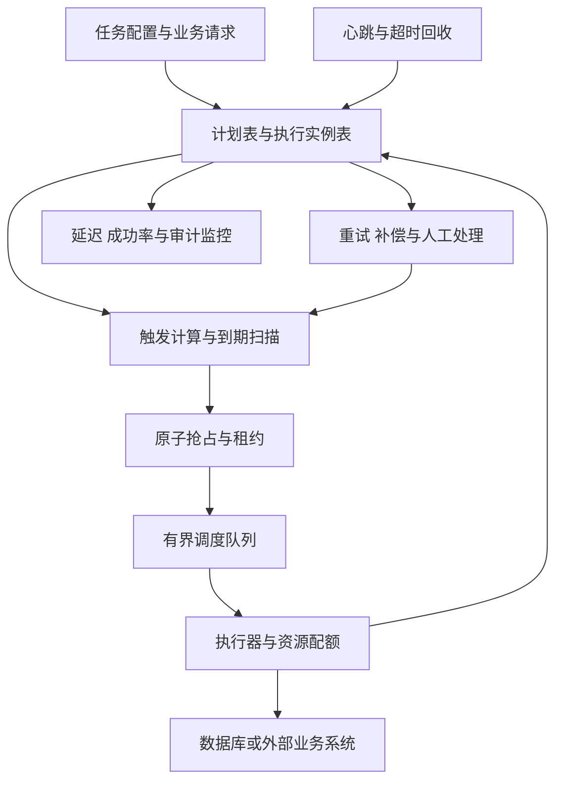
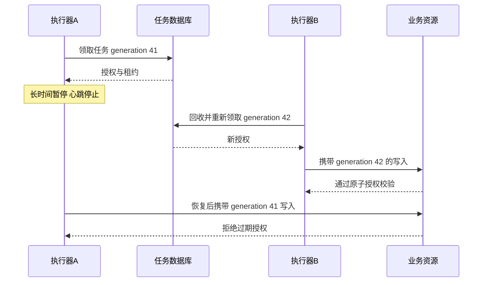
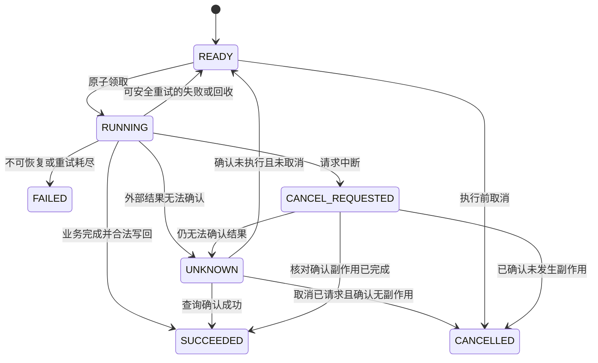

# 第 4 章 定时任务：从按时触发到可恢复执行

## 4.1 完整架构与问题分解

“每天凌晨跑一次”“订单 15 分钟后关闭”“告警失败 30 秒后重试”都属于时间驱动工作，但对精度、可靠性、重叠执行、补偿和幂等的要求不同。一个完整调度系统要分别处理：计算什么时候触发、为本次触发建立责任、分配执行者、执行副作用、记录结果、在失败后继续推进。



基础方案采用 **MySQL 保存任务事实、多实例扫描、短事务抢占、事务外执行、版本条件写回**。Redis ZSET、时间轮和延迟消息可以优化触发效率，但不能让任务责任只存在于某台机器的内存。

**容量假设示例**：有 1,000 万条未来任务，每秒平均到期 2,000 条，任务平均执行 200 ms；按 Little 定律，稳定状态仅执行中的平均并发约为 `2,000 × 0.2 = 400`。这只是理想均值，实际还需考虑尾延迟、突发、线程资源、外部连接池与重试。1,000 万条未来任务也不意味着每秒扫描 1,000 万行，应通过可用索引只取近期到期项。

## 4.2 先区分五类时间语义

| 类型 | 示例 | 必须定义的问题 |
| --- | --- | --- |
| 一次性延迟任务 | 订单创建后 15 分钟关单 | 从事件发生还是提交成功计时，晚执行允许多久，条件已变化时如何处理 |
| 固定频率 | 每 10 秒采样一次 | 按原始时间轴触发，执行慢时是否重叠、跳过还是补齐 |
| 固定间隔 | 上一次完成 10 秒后再运行 | 下一次依赖完成时间，失败和重试是否延长间隔 |
| 日历 Cron | 每天当地时间 02:30 | 时区、夏令时不存在或重复的时刻、计划修改如何影响在途任务 |
| 事件触发后的重试 | 发送失败后退避重试 | 最大次数、最大年龄、可重试错误、业务幂等和最终处置 |

**延迟不是错误本身。** “不早于到期时间执行”与“准时到毫秒执行”是不同承诺。扫描周期、队列等待、执行器饱和和业务耗时都会影响完成时间。如果业务要求在 12:00 前完成，不能只把任务的 `scheduled_at` 设为 12:00。

时间字段通常保存 UTC 时间点；日历计划另外保存 IANA 时区和原始 Cron 表达式。展示时间可以按用户时区转换。执行时长使用单调时钟测量，跨机器的绝对到期判断使用受控的墙上时钟并监控偏差；数据库抢占可统一使用数据库时间，避免每个 worker 以自己的时钟决定是否过期。

## 4.3 表结构、索引和任务身份

一个“计划”和某次“执行实例”应该分开。

```sql
CREATE TABLE job_schedule (
    schedule_id BIGINT PRIMARY KEY,
    schedule_version BIGINT NOT NULL,
    job_type VARCHAR(64) NOT NULL,
    cron_expr VARCHAR(128),
    time_zone VARCHAR(64),
    next_fire_at DATETIME(6) NOT NULL,
    enabled TINYINT NOT NULL,
    misfire_policy VARCHAR(32) NOT NULL,
    overlap_policy VARCHAR(32) NOT NULL,
    payload JSON,
    KEY idx_schedule_due (enabled, next_fire_at, schedule_id)
) ENGINE=InnoDB;

CREATE TABLE task_run (
    run_id BIGINT PRIMARY KEY,
    schedule_id BIGINT,
    scheduled_at DATETIME(6) NOT NULL,
    schedule_version BIGINT,
    business_key VARCHAR(128) NOT NULL,
    job_type VARCHAR(64) NOT NULL,
    status VARCHAR(24) NOT NULL,
    next_run_at DATETIME(6) NOT NULL,
    owner_id VARCHAR(128),
    generation BIGINT NOT NULL DEFAULT 0,
    lease_until DATETIME(6),
    attempt_count INT NOT NULL DEFAULT 0,
    max_attempts INT NOT NULL,
    deadline_at DATETIME(6),
    cancel_requested_at DATETIME(6),
    external_operation_key VARCHAR(128),
    payload JSON,
    last_error_code VARCHAR(64),
    finished_at DATETIME(6),
    UNIQUE KEY uq_schedule_fire (schedule_id, scheduled_at),
    UNIQUE KEY uq_business (job_type, business_key),
    KEY idx_ready (status, next_run_at, run_id),
    KEY idx_expired (status, lease_until, run_id)
) ENGINE=InnoDB;
```

上面是设计示意，不是一套通用于所有任务的最终 DDL。`schedule_id` 为空的一次性任务通过 `business_key` 去重；Cron 实例的 `business_key` 可包含计划 ID 和计划触发时间。相同逻辑触发在调度重启、主备切换或扫描重复时，应命中相同身份，而不是每次扫描都生成一个新 UUID。

`schedule_version` 用于确认实例使用哪版配置。默认 `UNIQUE(schedule_id, scheduled_at)` 防止一次逻辑时间点因计划修改产生重复实例；如果产品明确要求同一时刻按新旧计划分别执行，就应该创建新的逻辑计划身份，而不是偷偷放宽唯一约束。

`owner_id` 应包含 worker 进程实例标识，避免机器重启后复用同一个名字；`generation` 每次重新授权时递增，且不能随缓存重建回到零。长任务的每次尝试可以另建 `task_attempt` 记录开始、心跳、结果与 trace ID，便于区分“同一个逻辑任务被执行多次”和“多个不同任务”。

索引 `idx_ready(status,next_run_at,run_id)` 使数据库先定位 READY，再按时间取得到期任务；同一索引也分别支持 UNKNOWN、CANCEL_REQUESTED 的到期核对扫描，此时 `next_run_at` 表示下次核对时刻。`idx_expired(status,lease_until,run_id)` 用于找 RUNNING 且租约过期者。不要把不同责任的查询写成一个复杂 OR 后假设它仍然高效，也不要让扫描 SQL 每次解析大 JSON 字段。`cancel_requested_at` 保存独立的取消意图，即使任务后来转成 UNKNOWN，也不能丢掉“禁止重新执行副作用”的要求；`external_operation_key` 关联可查询的那一次逻辑外部操作。

## 4.4 如何生成周期执行实例

调度器读取一条到期 `job_schedule`，在短事务中锁住计划行或用版本 CAS，按原 `next_fire_at` 生成 `task_run`，再计算下次触发时间并更新计划。实例插入和推进计划时间同事务提交：否则先推进计划后宕机会漏任务，先插实例后宕机又可能重复生成。

遇到唯一冲突时，核对已有实例是否是相同逻辑触发，不要删除重建。停机两小时后发现错过很多时间点，要按 `misfire_policy` 决定：

- **SKIP**：跳到下一个未来时间点，适合过期采样。
- **FIRE_ONCE**：把错过的一段合并为一次补偿，适合刷新汇总。
- **CATCH_UP**：补齐每个错过的逻辑时间点，适合需要逐期结算的业务；必须限制补齐批次与速率。
- **EXPIRE**：超过某个截止时间不再执行，记录明确终态。

例如每日账单通常不能简单跳过，但它的业务键应是账单所属日期或结算期，补跑时不应把任务实际执行日期当作账单日期。执行实例保存原 `scheduled_at`，就是为了区分“应何时发生”和“实际上何时执行”。

## 4.5 多实例如何抢任务

MySQL 支持在锁定读中使用 `SKIP LOCKED` 跳过已被其他事务锁住的行；它返回的不是完整一致视图，适合队列表的并行领取，不能把它当作普通业务读取的通用隔离方案。[A07]

```sql
START TRANSACTION;

SELECT run_id, generation
FROM task_run
WHERE status = 'READY'
  AND next_run_at <= CURRENT_TIMESTAMP(6)
ORDER BY next_run_at, run_id
LIMIT 100
FOR UPDATE SKIP LOCKED;

-- 应用保留本事务锁住的 ID；下面仅更新这些 ID。
UPDATE task_run
SET status = 'RUNNING',
    owner_id = :worker_instance,
    generation = generation + 1,
    attempt_count = attempt_count + 1,
    lease_until = TIMESTAMPADD(SECOND, :lease_seconds, CURRENT_TIMESTAMP(6))
WHERE run_id IN (:claimed_ids)
  AND status = 'READY';

-- 同事务读取新 generation 与所需 payload，提交后才开始执行。
COMMIT;
```

抢占事务必须短。把 100 条任务锁住后串行跑 100 次远程 HTTP，其他扫描器就会长时间跳过这些记录，连接和事务都被占住。正确做法是领取后提交，执行阶段由租约与状态管理保护。

批量领取也不能大于本机实际承载能力。一个只有 16 个执行名额的 worker 一次领取 1,000 个任务，会让多数任务还在本机队列中租约就过期。应把可用执行配额反馈给扫描器，限制预取数量，并让领取到的任务尽快开始。租约通常覆盖排队和执行的不确定性，过短易误回收，过长拖慢故障恢复。

如果无法使用 `SKIP LOCKED`，可先无锁读候选 ID 与 `generation`，再执行条件更新：

```sql
UPDATE task_run
SET status = 'RUNNING', owner_id = :worker_instance,
    generation = generation + 1,
    attempt_count = attempt_count + 1,
    lease_until = TIMESTAMPADD(SECOND, :lease_seconds, CURRENT_TIMESTAMP(6))
WHERE run_id = :run_id
  AND status = 'READY' AND generation = :observed_generation
  AND next_run_at <= CURRENT_TIMESTAMP(6)
  AND cancel_requested_at IS NULL;
```

只有受影响行数为 1 的 worker 获得新代次授权。这种 CAS 方式简单，但大量 worker 扫到同一批记录时会产生碰撞，可以分片扫描、随机起点或限制扫描器数量。不能只靠 SELECT 查到 READY 就认为自己拥有任务。

## 4.6 租约、心跳、回收与 Fencing



心跳必须带 `run_id + owner_id + generation` 条件，只能续自己的当前租约。若只按 `run_id` 续约，旧执行者恢复后可能替新执行者修改租约，形成状态污染。

```sql
UPDATE task_run
SET lease_until = TIMESTAMPADD(SECOND, :lease_seconds, CURRENT_TIMESTAMP(6))
WHERE run_id = :run_id
  AND owner_id = :worker_instance
  AND generation = :generation
  AND status = 'RUNNING'
  AND lease_until > CURRENT_TIMESTAMP(6);
```

续约影响行数为 0，执行者应停止后续工作并丢弃写回资格，但不能假设取消能瞬间停止已经发出的远程请求。回收器对过期 RUNNING 任务先区分责任：纯计算、已确认没有外部动作或可以严格复用同一幂等结果的任务，可按策略放回 READY；已经登记外部动作但结果未确认的任务进入 UNKNOWN，并安排核对，不能默认重新发送。重新领取执行或核对责任都增加 generation。回收与续约在数据库条件更新中竞争，以一个可检查的当前状态作决定。

**任务表拒绝旧写，不等于外部副作用不会重复。** 如果旧执行者已经向短信平台发送请求，即使它最后更新任务状态失败，短信仍可能发出去。所以应区分三个层次：

1. **调度所有权。** 租约决定谁当前被授权继续工作。
2. **状态写回。** `generation/owner/status` 条件拒绝过期执行者覆盖任务结果。
3. **业务副作用。** 业务资源本身要理解授权或幂等标识，否则旧执行者仍可能造成真实影响。

如果业务数据与任务表在同一个数据库，可以在短事务内锁定并验证当前任务代次与租约，再修改业务数据与任务结果，使授权检查和写入原子。如果是外部支持 fencing 的资源，由它维护和比较代次；仅比较“已见过的最大 token”防止旧写覆盖更新写，但在新代次尚未到达资源前，不自动证明旧租约已经失效。要求立即撤销旧授权时，资源必须核对当前授权代次或接收可靠的授权推进。

外部渠道只支持幂等键时，应使用稳定的**逻辑业务操作键**，例如 `notification_id`，而不是每次 attempt 或 generation 都生成新键。否则每次重试在渠道看来都是一条全新消息。若外部渠道既不支持幂等也不能查询，系统只能在“可能重复”和“可能漏发”之间选择并明确代价，不能声称做到了无条件恰好一次。

## 4.7 任务完成与失败状态机



UNKNOWN 不一定必须是一个独立枚举，也可由“等待查询”的阶段表达；重要的是不能把调用超时统一记成业务失败并立即执行新的副作用。任务成功也应定义清楚：把邮件提交给供应商、供应商接受、收件人收到、收件人阅读是不同事件，系统只能在自己可观察的阶段作承诺。

下面是**普通 RUNNING 执行路径**的成功写回；取消或未知状态由后面的核对路径处理，不能把所有状态都放宽为同一个 UPDATE。

```sql
UPDATE task_run
SET status = 'SUCCEEDED', finished_at = CURRENT_TIMESTAMP(6),
    lease_until = NULL, owner_id = NULL
WHERE run_id = :run_id
  AND status = 'RUNNING'
  AND owner_id = :worker_instance
  AND generation = :generation
  AND lease_until > CURRENT_TIMESTAMP(6);
```

影响行数为 0 时，不应盲目覆盖：可能任务已取消、被新代次接管或已经处于终态。保存尝试日志并查询最新状态，让负责当前代次的执行者或恢复器继续处理。若业务副作用已经成功，要利用相同业务幂等键或业务完成凭证使下一次恢复能识别它。

### UNKNOWN 与取消请求必须有人继续核对

任务进入 UNKNOWN 或 CANCEL_REQUESTED 时，在同一个条件更新中设置下一次 `next_run_at`、释放旧 owner/lease，并增加 generation 使旧执行者失去状态写回资格。取消同时保存 `cancel_requested_at`；对已经发出的操作不能清空 `external_operation_key`。普通 worker 的晚结果可作为核对线索保存，但不能越过当前代次直接覆盖终态。

独立核对器分别扫描这两个状态的到期项，使用前述索引，每次只领取有界数量。领取的是“查询与归并结果”的责任，**不包含重新发送原业务副作用的权限**：

```sql
-- :pending_status由受信任代码固定为UNKNOWN或CANCEL_REQUESTED。
-- 候选读取后，用旧generation和租约条件竞争核对责任。
UPDATE task_run
SET owner_id = :reconciler_instance,
    generation = generation + 1,
    lease_until = TIMESTAMPADD(SECOND, :check_lease_seconds, CURRENT_TIMESTAMP(6))
WHERE run_id = :run_id
  AND status = :pending_status AND generation = :observed_generation
  AND next_run_at <= CURRENT_TIMESTAMP(6)
  AND (lease_until IS NULL OR lease_until <= CURRENT_TIMESTAMP(6));
-- affected_rows=1才获得核对授权，持有new_generation=observed_generation+1。
```

核对器在事务外使用原 `external_operation_key` 查询渠道或业务账本。确认副作用完成，可以把 UNKNOWN 或 CANCEL_REQUESTED 转为 SUCCEEDED，并保留取消请求时间和“取消未赶在完成前生效”的结果说明；如果业务要求撤销已完成效果，则另外创建补偿任务，不能把已发生的副作用伪记为 CANCELLED。确认未发生且已不能因在途旧请求随后生效时，有取消意图的转 CANCELLED，无取消意图且仍允许重试的转 READY。查询暂时 NOT_FOUND 不必然证明在途请求永远不会落地，无法排除时继续 UNKNOWN。

核对写回必须匹配领取时的状态、核对 owner、新 generation 与有效租约。`target_state` 由经过业务验证的分支决定，不由客户端传入：

```sql
UPDATE task_run
SET status = :target_state,
    next_run_at = :next_check_or_retry_at,
    finished_at = :terminal_finished_at,
    owner_id = NULL, lease_until = NULL
WHERE run_id = :run_id
  AND status = :claimed_pending_status
  AND owner_id = :reconciler_instance
  AND generation = :new_generation
  AND lease_until > CURRENT_TIMESTAMP(6);
-- 必须检查affected_rows=1；状态已变化则重新读取，不能覆盖。
-- 目标仍为UNKNOWN时设未来next_run_at；转终态才设置finished_at。
```

核对器崩溃后，原 UNKNOWN/CANCEL_REQUESTED 状态仍在，租约到期可由另一个核对器 CAS 接管。查询超时则退避设置新的核对时间；超过业务核对期限后告警并转交人工责任，不自动把未知当失败、也不默认重发。由此，取消请求、外部未知结果和执行成功都有可继续推进的路径。

## 4.8 重试不是一个固定次数的 for 循环

先分类错误：网络临时故障、供应商限流、锁冲突可以重试；非法参数、无权限、永久资源缺失通常应直接失败；超时和连接中断可能是结果未知，应先查询或幂等重试。一次业务重试还可能触发 SDK 内部重试，因此必须限制整条链路的总预算，避免三层各重试三次形成 27 次副作用尝试。

常见退避设计是 `min(cap, base × 2^attempt) + jitter`，但它只是示例策略。供应商给出 Retry-After 时优先尊重其限速建议。还要设置最大任务年龄和业务截止时间：昨天的临时验证码通知即使今天终于能发送，也可能已经没有意义。

避免“所有失败任务每分钟整点同时重试”。重试应有抖动、队列隔离和容量比例，正常任务不应被大量历史失败淹没。死信队列或 FAILED 表需要明确负责人、告警、可重放操作和业务结果查询；把任务放进去只是转移处理责任。

## 4.9 任务重叠、取消、计划修改与夏令时

**上次没跑完，下次又到时间了怎么办？** 常见策略有 ALLOW 并行、SKIP 跳过新实例、QUEUE 排队串行、REPLACE 请求停止旧实例再运行新实例。它们各有代价。跳过适合刷新缓存，却可能遗漏需要逐期结算的账单；排队适合保留所有工作，但过载时不断积压；替换不等于旧进程立刻消失，副作用仍要幂等和版本保护。

Kubernetes CronJob 明确暴露并发和错过触发等策略，并说明在某些情况下可能出现重复创建或缺少某次创建，因此任务仍应幂等。这说明调度平台通常不能替业务提供无条件恰好一次执行。[A12]

**取消任务**首先取消继续执行的授权，之后请求线程或进程中断。Java 的 `interrupt` 是合作式信号，阻塞 IO、第三方库或已发出的请求未必立即停止。对于外部扣费、发信、建单等行为，要先确认结果，再决定状态与补偿；“用户点了取消”不意味着外部世界已经回滚。

**修改计划**需要明确对哪些对象生效。常见策略是新版本只影响尚未生成的实例，已经运行的实例保留原配置快照；如果要求取消旧版待执行实例，应通过受控迁移和版本条件处理。执行时总是读取最新 payload 可能让同一个逻辑实例在重试时做完全不同的工作，导致幂等键与参数冲突。

**夏令时**会让某些当地时间不存在或出现两次。例如“当地每天 02:30”不能只靠 UTC 时间加 24 小时得到永久正确的下一次触发。应使用时区库按日历规则计算，定义跳过、顺延或执行一次/两次；保存 UTC 触发点与业务日期，避免账单因为两个同名本地时间产生重复。若业务不依赖当地时间，可以直接采用 UTC 计划减少复杂度。

## 4.10 数据库扫描、ZSET、时间轮和延迟消息怎么选

| 方案 | 优点 | 局限与适用条件 |
| --- | --- | --- |
| MySQL 到期扫描 | 状态、索引和事务统一，恢复和审计清晰 | 频繁扫描有数据库成本；精度受扫描周期影响，需限制批量与索引范围 |
| Redis ZSET | 按 score 取最近到期项，时间排序直观 | 查询后删除不是原子领取；Redis 故障和在途项恢复要设计 |
| 内存时间轮或最小堆 | 大量近时任务的调度开销可控 | 进程重启丢内存，必须有持久来源和重建；不适合单独承担责任存储 |
| 延迟消息 | 业务异步化自然，减少主动轮询 | 能力、最大延迟、精度因实现而异；取消和改期常需应用状态校验 |
| 专用调度平台 | 管理、可视化、分片、运维能力丰富 | 平台只解决部分触发与执行管理，业务幂等、未知结果和补偿仍由应用负责 |

**ZSET 的正确领取。** `ZRANGEBYSCORE` 后再 `ZREM` 有竞争窗口，应在同槽 Lua 中把到期项从 waiting 转移到 inflight，并记录处理代次或租约。不要先 ZREM 再启动任务，进程恰好在中间退出就会丢调度；也不要先执行再删除，因为其他 worker 会并发执行。即使做到了 Redis 内原子转移，持久性与跨 MySQL 状态仍需单独处理。

一种常见组合是：数据库保存任务事实，Redis 只索引近期到期任务；扫描器定期把未来窗口内任务投影到 ZSET，执行器从 ZSET 收到候选后再去数据库 CAS 领取。Redis 丢失会导致暂时延迟，数据库扫描能重建；Redis 重复候选不会重复获得业务授权。代价是仍有数据库写入，但责任链路更清楚。

**时间轮**把未来时间按 tick 分桶，适合数量多、近时、可接受桶粒度精度的任务。长延迟可用多级时间轮或远期持久表结合近期窗口。需要考虑桶内瞬时高峰、取消索引、轮转圈数、时钟跳变和重启恢复，而不是只背“插入 O(1)”就结束。

**延迟消息**可作为“到点提醒重新检查”的机制。关闭订单前仍检查订单状态和真实截止时间，不能认为延迟消息到达就一定应该关闭。消息可能重复、晚到或早于新版本截止时间；改期后旧消息仍可能到达，因此消息应带任务 ID 和版本，由权威状态拒绝旧触发。

## 4.11 线程池、连接池与隔离

调度线程只负责扫描和提交，执行线程负责工作，心跳与回收独立保障。若所有线程都被慢 HTTP 请求占满，连续约也发不出去，会出现大量错误回收；如果续约继续而实际工作线程已死锁，又可能长期占用任务，所以还要有任务最大运行时间和进展监测。

对于 Java，执行器使用有界队列，拒绝时把尚未开始的任务按代次条件归还 READY 或不再领取。不要在拒绝处理里悄悄丢任务。CPU 密集任务与阻塞 IO 任务拆池，在线任务与离线批处理拆配额，供应商 A 变慢不应耗尽供应商 B 的全部连接。

线程数不能单独决定吞吐。若数据库连接池只有 30 个连接，启动 500 个同时访问数据库的线程可能只增加排队；若外部接口只允许 100 QPS，开 1,000 个线程会引发限流和重试放大。应结合目标 QPS、服务时间、连接等待、外部配额和内存预算测量，再设置最大并发。

## 4.12 故障矩阵与恢复责任

| 故障点 | 可能留下的状态 | 恢复方式 |
| --- | --- | --- |
| 生成实例前崩溃 | 计划仍到期 | 下次扫描继续，同逻辑触发身份不变 |
| 插入实例后推进计划失败 | 若同事务则整体回滚 | 重扫；若已提交则唯一约束阻止重建 |
| 领取提交后执行器退出 | RUNNING 且无人续约 | 租约回收，重新领取增加代次 |
| 任务在本地队列等太久 | 未开始就租约过期 | 限制预取量；不要让领取量大于可执行配额 |
| 远程调用成功后写回前崩溃 | 外部成功，本地 RUNNING | 用相同业务键查询或幂等重试，不能创建新副作用身份 |
| 旧 worker 长暂停后恢复 | 已有新代次执行 | 任务状态及资源端拒绝旧代次，外部操作靠业务幂等 |
| 心跳服务网络分区 | 所有权可能被回收 | 失去续约的执行者停止新动作；结果由权威状态与恢复器裁定 |
| 扫描数据库变慢 | 到期任务延迟扩大 | 缩小批量、优化索引、分片扫描；避免盲目增线程压垮 DB |
| 计划恢复后积压百万次 | 大规模补跑 | 按 misfire 策略合并或限速补齐，正常任务和补跑隔离 |
| 外部结果无法查询 | 业务结果长期未知 | 保留责任并告警，选择明确的重复/遗漏风险策略和人工处理 |

## 4.13 监控与有意义的测试

至少区分四个时间：`scheduled_at`、`claimed_at`、`started_at`、`finished_at`。调度延迟是领取或开始减去应触发时间，执行耗时是完成减去开始，端到端完成延迟是完成减去应触发时间。若只统计执行耗时，排队 30 分钟、执行 100 ms 的任务会被误认为性能很好。

监控应包含最老到期未领取年龄、READY 数量、RUNNING 数量、租约超时回收率、续约失败率、每类任务 P95/P99 时延、同业务键尝试次数、UNKNOWN 年龄、死信年龄、扫描 SQL 扫描行数与锁等待、执行器拒绝和连接池等待。按租户和任务类型切分，避免一个大客户占满全局资源。

关键验证包括：多个扫描器抢同一任务；领取提交后杀进程；外部调用成功后杀进程；长暂停跨越租约；心跳和回收同毫秒竞争；取消与完成竞争；计划修改时补跑；夏令时切换；数据库时间与 worker 时间偏差；全部任务在同一秒到期；执行池满时扫描器是否还继续领取。每个测试都应验证副作用次数、任务终态和恢复路径。

## 4.14 面试连续追问与回答

### Q1：为什么不能每个应用实例都加一个 `@Scheduled`？

每个实例都会按本地调度触发，可能重复执行同一逻辑任务。若只是刷新各自本地缓存，重复触发可能正是需要的；若是扣费或发通知，就需要任务身份、原子领取和业务幂等。框架注解解决单进程时间触发，不自动解决多实例业务责任。

### Q2：加一把分布式锁不就只执行一次了吗？

锁减少并行执行，但任务完成后写回前崩溃，或租约过期旧进程继续运行，都可能导致重复副作用。还需要稳定任务身份、可恢复状态、资源端条件写入和幂等。如果整个操作只是一段同库短事务，数据库条件更新可能比外部租约锁更直接。

### Q3：`SKIP LOCKED` 为什么适合任务队列，不适合查询完整订单列表？

队列领取允许本次先处理未被别人占用的任务，跳过的任务之后还会被扫描。完整业务查询若跳过锁住的行，会向用户返回缺项结果，违反查询语义。它也不是“所有锁都不等待”，只针对相关行锁，元数据锁等问题仍可能存在。

### Q4：领取后不持有数据库锁，怎么保证任务不会同时执行？

数据库中的 RUNNING、owner、generation 和 lease 表达当前授权；其他 worker 不能领取未过期任务。租约过期后确实可能有旧执行者物理上仍在运行，所以还要 fencing 与业务幂等。设计目标是控制有效写入和最终副作用，而不是保证宇宙中始终只有一个线程在计算。

### Q5：租约设置多长合适？

依据任务启动排队、执行耗时分布、心跳间隔、网络尾延迟和可接受恢复时间来设置。短租约恢复快但误回收多，长租约稳定但故障恢复慢；长任务可以续约并设置最大运行时间。不能按平均耗时直接取一个固定倍数而不看 P99 和暂停风险。

### Q6：旧执行者为什么不能直接把任务标记成功？

它可能代表已经被撤销的授权，或者执行的是旧配置；写回会覆盖新尝试的结果。完成更新必须验证当前 owner、generation 和状态，必要时验证租约。已发生的外部事实仍要保存或可查询，由当前责任人归并，不能靠旧执行者无条件改终态。

### Q7：任务执行成功，但更新成功状态失败，下一次不就重复了吗？

这就是业务幂等存在的原因。下次用相同业务操作键查询或重试，业务端返回已完成结果。若业务变更与任务状态都在同一个数据库，可同事务提交；外部副作用无法自动加入该事务，需要渠道能力和对账。仅把“成功”写入日志无法可靠去重。

### Q8：每个任务都加一个唯一 ID，不就幂等了吗？

ID 只有在多次尝试保持相同、被副作用接收方存储并原子校验时才有作用。每次重试生成新 ID 反而意味着新的业务操作；只在任务表唯一、外部平台不识别，也不能阻止重复发送。幂等范围和保留期必须覆盖实际重试和人工重放窗口。

### Q9：调度器停了三天，恢复后把所有任务立即执行吗？

按业务定义决定。过期采样可以跳过，日汇总可以合并，账单需要逐期补齐。即使必须补齐，也要有速率预算和正常流量隔离；重新计算任务所属业务日期，不能把所有补跑记作当天业务。

### Q10：为什么不直接用 Redis 的 key 过期通知做定时任务？

过期通知适合辅助事件，不应被当作可靠任务账本。需要关单或可靠通知时，任务必须有持久身份、状态和补偿扫描；通知丢失或消费端离线不能导致责任消失。过期时机也不应被理解为精确的业务执行时刻。

### Q11：任务量大，是否一定要换成时间轮？

先看瓶颈是触发查找、数据库写入还是实际业务执行。时间轮优化近时任务的调度开销，不会提高短信供应商配额或数据库事务吞吐。可以把远期任务放持久表，近期任务进入时间轮，同时保留重建与补偿；无需为所有任务一开始就引入复杂调度器。

### Q12：用户取消后，你还能发出一次通知，算 bug 吗？

取决于取消承诺。若通知请求已经被外部接受，系统可能无法撤回；界面和接口应区分“取消后续尝试”与“保证没有任何副作用”。执行前可以再次校验取消状态，并用代次防旧写；已经发出的副作用要查询、记录或补偿，不能假装取消能回滚网络世界。

### Q13：如何避免一个租户占满全部任务线程？

设置全局并发上限和租户级配额，用公平调度或分层队列，让不同任务类型独立预算。扫描器也要遵守配额，不能先把一个大租户的所有任务领到本机再谈公平。每个租户的积压年龄、拒绝率和实际服务份额需要可观察。

### Q14：你如何解释“至少一次执行”和“业务效果一次”？

可靠调度通常允许失败后重新尝试，因此同一逻辑任务可能执行多次。业务通过唯一业务键、状态机和原子更新，使重复尝试落到同一结果；外部系统也要有相应能力。所谓一次应明确是任务触发、函数调用、数据库状态变更还是外部用户可见效果，不能混用这些层次。

## 4.15 应用示例：制造业告警与 NoteWeave

制造业可靠通知可以把“某告警按某规则向某接收目标发送一次通知”定义为稳定业务键。待执行任务通过 `(status,next_run_at,run_id)` 联合索引扫描；worker 领取后在事务外调用渠道，用版本号与当前状态条件写回。渠道超时时进入待查询或受限幂等重试，告警版本变化后旧任务不能覆盖新版本处理结果。

NoteWeave 类资料研究平台的摘要异步生成、资料解析、研究单元重试和失效资料清理，也可以用同一套任务责任模型。模型调用超时有“已消耗预算但未拿到结果”的可能，重试不能只看 HTTP 超时；长任务需要可恢复阶段和预算上限。ZSET 可以帮助管理到期租约，但任务状态、当前 generation 和结果写回的权威判断必须清楚，旧 Agent 不应凭过期授权提交新研究结果。

## 4.16 技术参考资料

- [A07] [MySQL 8.4 Locking Reads](https://dev.mysql.com/doc/refman/8.4/en/innodb-locking-reads.html)：SKIP LOCKED 的行为与队列表使用边界。
- [A08] [MySQL 8.4 Deadlock Handling](https://dev.mysql.com/doc/refman/8.4/en/innodb-deadlocks-handling.html)：短事务、锁顺序与重试。
- [A10] [Redis Distributed Locks](https://redis.io/docs/latest/develop/clients/patterns/distributed-locks/)：租约、异步复制和 fencing。
- [A12] [Kubernetes CronJob](https://kubernetes.io/docs/concepts/workloads/controllers/cron-jobs/)：时区、并发、错过触发和幂等作业要求。

## 4.17 场景推演：停机两小时后，百万定时任务同时补跑怎么办

假设调度服务停机两小时，库里有 300 万个已到期实例，正常期间仍有每秒 1,000 个新任务到来。执行依赖只能稳定承受每秒 1,500 个成功操作，净补偿能力只有每秒 500 个，理想恢复时间约为 `3,000,000 / 500 = 6,000 秒`，即 100 分钟。

此时一口气启动 1 万线程，不会让数据库、短信服务或外部平台产生更多配额，反而可能引起连接耗尽、限流和重试风暴。恢复计划必须同时处理“哪些该补”“谁先补”“补多快”和“重复执行会怎样”。

### 先按业务语义划分欠账

| 任务 | 停机恢复后的合理候选策略 | 必须核对的业务事实 |
| --- | --- | --- |
| 过期心跳采样 | 跳过旧采样，恢复当前检测 | 不能伪造停机期间实际观测数据 |
| 每日账单 | 按原账期补跑 | 账期身份唯一，已生成结果不重复 |
| 未支付订单关单 | 尽快核对到期订单 | 已支付、支付在途、预留状态 |
| 营销提醒 | 按过期时间丢弃或合并 | 产品是否仍需要通知 |
| 告警渠道重试 | 根据告警当前状态与渠道结果决定 | 告警已恢复、通知是否已发送 |

SKIP、FIRE_ONCE、CATCH_UP 是调度策略，不是业务真相。一个定时配置改了版本，也不能让已接受的财务责任凭空消失。恢复器应保存原计划时间、原业务键和当前状态，补跑不要用“现在的日期”覆盖账期。

### 近实时与历史补偿分别给预算

可先保留一部分容量给新到期的高优先任务，剩余容量补历史；各类预算随积压年龄与业务期限调整。若所有旧任务优先，新任务会形成新的长尾；若只处理新任务，历史永远还不清。跨租户也需要公平性，防止一个大租户把调度、数据库连接和外部配额全部占满。

领取批次受可用执行名额约束，不能先把百万任务改成 RUNNING 再堆进本地队列。队列等待也消耗租约；大量尚未开始的任务租约一起过期，会被其他实例重复领取。恢复扫描、正常扫描与 UNKNOWN 核对可以共享数据库，但应有独立预算和索引。

### 一次修改计划与执行的竞态

设任务 T 原计划 10:00 执行，轮中保存 schedule_version=4。用户把它改到 11:00，数据库变为版本 5；10:00 的旧引用仍可能被弹出。执行前检查版本与当前 due_at，旧版本不得触发。若旧版本已经进入外部调用，再改计划只代表后续意图，必须记录在途调用并核对，不能直接删除旧 attempt 的证据。

计划版本、领取代次和外部逻辑幂等键分别解决不同问题。前两者可以增加，但外部同一逻辑操作的幂等键不能每次重试都变，否则渠道认为是新的操作。租约到期也不意味着旧 worker 已停止，业务侧的状态条件和幂等仍不可省。

### 恢复验收与回退

恢复看四个结果：最老应补任务年龄是否下降；新到期关键任务是否仍满足时限；下游错误、池等待和重复效果是否受控；UNKNOWN/CANCEL_REQUESTED 是否有人持续核对。若提高并发后有效成功吞吐反降，就回退到此前稳定档位，并检查下游竞争。

用数据库到期索引加近期时间轮可减少正常触发成本，但停机后恢复仍从数据库责任重建，时间轮不是唯一事实。完整的“到期二次校验 → 任务与触发 Outbox 同事务 → Kafka 执行 → 取消与未知结果核对”设计，见 G.5。

**相关专题：** [微服务与全链路治理](17_微服务与全链路治理.md) · [Kafka可靠性与积压治理](20_Kafka可靠性与积压治理.md) · [高并发准入与分布式锁](23_高并发准入与分布式锁.md) · [高可用与容灾恢复](25_高可用与容灾恢复.md)。

[A07]: https://dev.mysql.com/doc/refman/8.4/en/innodb-locking-reads.html "MySQL 8.4 Locking Reads"
[A08]: https://dev.mysql.com/doc/refman/8.4/en/innodb-deadlocks-handling.html "MySQL 8.4 How to Minimize and Handle Deadlocks"
[A10]: https://redis.io/docs/latest/develop/clients/patterns/distributed-locks/ "Redis Distributed Locks"
[A12]: https://kubernetes.io/docs/concepts/workloads/controllers/cron-jobs/ "Kubernetes CronJob"
