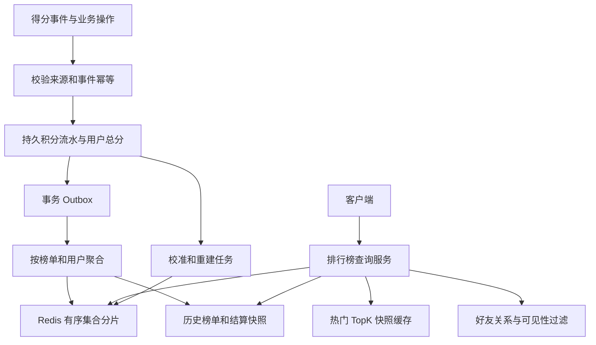
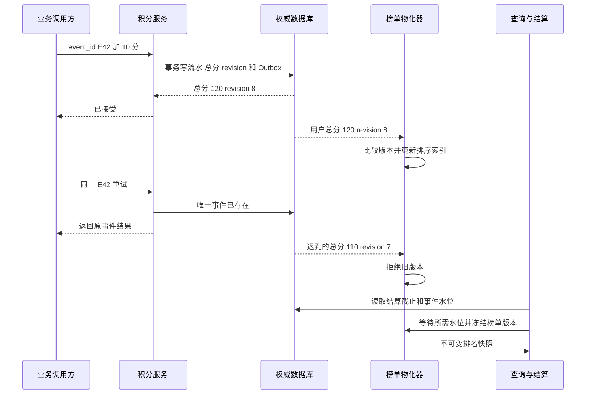

# 第 5 章 排行榜系统

## 5.1 完整架构和排行榜真正要回答的问题



“用 Redis ZSET”只回答了索引结构，尚未回答分数怎么来、重复事件怎么处理、同分怎么排名、榜单翻页为什么变化、Redis 丢失后怎么恢复、活动结束后以哪个版本发奖。一个完整排行榜至少要明确以下五件事：

1. 分数是累计值、最大值、最新值，还是最近一段时间的窗口值。
2. 名次是顺序名次、并列名次，还是稠密名次。
3. 更新和展示允许多大延迟，结算是否要求固定快照。
4. 比较范围是全站、租户、地区、好友，还是某次活动。
5. 分数是否影响奖励或金钱，是否需要可审计的原始流水。

例如“今日微信运动好友榜”与“全国游戏赛季积分榜”可能使用相似的排序结构，但前者主要难点是多来源步数去重和好友范围，后者还要处理积分账本、赛季冻结、反作弊、撤销分数和发奖幂等。

## 5.2 先设计权威数据，再设计查询索引

下面以“活动累计积分榜”为例。业务约定：同一积分事件只记一次，分数可以因纠错下降，排行榜允许几秒内收敛，结算使用冻结快照。所有容量数字均为示例。

```sql
CREATE TABLE score_event (
    board_id BIGINT NOT NULL,
    event_id VARCHAR(64) NOT NULL,
    user_id BIGINT NOT NULL,
    delta BIGINT NOT NULL,
    reason VARCHAR(64) NOT NULL,
    occurred_at DATETIME(6) NOT NULL,
    PRIMARY KEY (board_id, event_id),
    KEY idx_user_event (board_id, user_id, occurred_at)
);

CREATE TABLE member_score (
    board_id BIGINT NOT NULL,
    user_id BIGINT NOT NULL,
    score BIGINT NOT NULL,
    revision BIGINT NOT NULL,
    status VARCHAR(16) NOT NULL,
    updated_at DATETIME(6) NOT NULL,
    PRIMARY KEY (board_id, user_id),
    KEY idx_board_score (board_id, score, user_id)
);
```

一个本地事务中，先插入具有唯一事件 ID 的积分流水，再更新用户总分与 revision，最后写 Outbox。重复流水应读取之前的执行结果；不能简单吞掉重复插入异常后继续给总分加一次。

排行榜物化层消费的消息尽量使用“用户最新总分 + revision”，而不是只有 `+10`。当版本 21 的总分先到、版本 20 后到，Redis 只接受更高版本；消息重复也不会再次累加。此设计把业务幂等放在持久流水，把乱序收敛放在物化视图。

如果业务本来就是实时游戏状态，也可以由权威游戏服务直接产出完整分数快照；如果分数会影响奖励，则仍应保留能解释分数来源的审计依据。Redis 中的分数不能在没有恢复来源的情况下成为唯一奖惩依据。接口与账本还应统一计分单位，防止某个来源把毫分当成整数分，导致无法通过幂等机制发现的数量级错误。

## 5.3 ZSET 的能力、复杂度与容易误答的名次

ZSET 将成员与一个分数关联，适合有序查找；同一个成员再次写入会更新其分数。需要特别注意：score 使用 double，整数能精确表示的范围是 `[-2^53, 2^53]`，同分时还存在成员字符串的词典序规则。[B05]

常见操作可以围绕单个榜单设计：

```text
ZADD rank:season:2026 950 user:42
ZREVRANGE rank:season:2026 0 99 WITHSCORES
ZREVRANK rank:season:2026 user:42
ZSCORE rank:season:2026 user:42
```

更新一名成员通常按 `O(log N)` 讨论；取前 K 名约为 `O(log N + K)`；读成员分数和查询名次的代价不同。复杂度之外，还要看成员字符串长度、内存占用、热点请求与网络输出量。请求“取前 100 万名”即使是一次命令，也会造成很大阻塞和传输压力。

### 三种“排名”不能混用

假设 A、B、C、D 的分数为 `100、100、90、80`：

| 定义 | 名次结果 | 实现思想 |
|---|---|---|
| 顺序名次 ordinal | 1、2、3、4 | 用明确的同分次序形成全序 |
| 竞赛名次 competition | 1、1、3、4 | 高于当前分数的人数加 1 |
| 稠密名次 dense | 1、1、2、3 | 高于当前分数的不同分值数量加 1 |

`ZREVRANK + 1` 给的是某种顺序名次，不是自动得到“并列第一”。竞赛名次可以计算严格高于当前 score 的成员数量；稠密名次需要维护不同分值及其人数，或在聚合层维护辅助结构。

例如当前分数为 100，严格大于该分数可使用排除边界的区间计数概念。不要把 `>=100` 的人数算进去，否则同分用户的名次错误。命令参数中的排除边界和升降序方向，现场写代码时需要特别检查。

## 5.4 同分按时间排序，为什么不能随手拼一个大数字

常见需求是“分数越高越靠前，同分时先达到该分数的人靠前，再按用户 ID 稳定排序”。直接令 `score = 积分 × 10^13 + 时间戳` 有三个风险：数值可能超过 double 精确范围；正负方向容易错；业务分数与 tie-break 纠缠，积分上限变化就要重构编码。

可选做法如下：

| 方案 | 适用条件 | 代价 |
|---|---|---|
| 分数用 ZSET，同分候选在应用层排序 | 同分集合较小，主要查 TopK | 分页和名次要处理同分边界 |
| 有严格上界的整数复合 score | 能证明最大编码不超过 `2^53`，粒度足够 | 约束强，规则升级困难 |
| 等 score 的字典序复合 member | 所有成员 score 相同，固定宽度编码排序元组 | 要另存 user 到 member 的映射，更新需删除旧 member |
| 数据库或专门排序索引多列排序 | 规模允许，排序规则复杂 | 实时高频更新和查询成本较高 |

字典序方案可以把排序键编码为 `反向归一化积分|首次达成时间|用户ID`，每一段使用固定宽度、无歧义字符集，再让所有 ZSET score 相同。这样字典序对应业务顺序；不能一边让 score 各不相同，一边指望字典序区间查询完成全局多字段排序。

“首次达成时间”也必须定义。用户从 100 分扣到 90 分再升回 100 分，是否保留原来的达成时间？如果规则不明确，技术实现无法保证公平。奖励榜还要统一以服务端权威事件时间或结算规则排序，不能让客户端自己提交任意时间。

## 5.5 处理重复、乱序、降分和删除

下面 Lua 是单榜单分片内“完整分数 + 版本”更新的示意。两个 key 必须位于同一 Redis Cluster hash slot；`revision` 采用同长度、补零的十进制字符串，避免 Lua 数字转换带来的大整数精度问题。score 本身仍必须限制在约定精确范围内。

```lua
-- KEYS[1] = rank:{board:shard}:scores
-- KEYS[2] = rank:{board:shard}:versions
-- ARGV[1] = user_id
-- ARGV[2] = fixed_width_revision，例如 00000000000000000021
-- ARGV[3] = absolute_score
-- ARGV[4] = ACTIVE 或 REMOVED
local old = redis.call('HGET', KEYS[2], ARGV[1])
if old and old >= ARGV[2] then
    return 0
end
if ARGV[4] == 'REMOVED' then
    redis.call('ZREM', KEYS[1], ARGV[1])
else
    redis.call('ZADD', KEYS[1], ARGV[3], ARGV[1])
end
-- 即使删除也保留版本墓碑，防止迟到旧事件复活用户。
redis.call('HSET', KEYS[2], ARGV[1], ARGV[2])
return 1
```

该脚本保证的是当前 Redis 实例上正常执行期间不会被其他命令穿插，不保证数据库与 Redis 跨系统原子，也不能消除 Redis 故障回退丢掉较新版本的风险。生产实现应在写入前校验参数和 key 类型；脚本执行错误不等于自动回滚此前写入。因此必须保留持久权威分数，并能在重建后按版本重放。新建榜单时应同时恢复 score 和 revision，不能只恢复分数然后把旧事件当成新事件。

墓碑也不是永久不清理。它的回收条件应覆盖消息最长重放时间、重试积压、备份恢复和迁移窗口。活动完全归档后可以封存整个榜单版本；不能只按“删除后过 5 分钟”就清除版本，除非能证明迟到旧事件绝不会再来。

## 5.6 日榜、周榜、滑动窗口和历史榜

### 日榜和周榜

按明确时区计算 `board_period`，例如 `Asia/Shanghai` 的自然日。榜单换日通过新 key 或新 board_id 完成，不在零点遍历一亿用户清零。旧榜单保留到结算、迟到事件和审计窗口结束后再归档。

需要区分“事件发生在哪一天”和“服务端什么时候收到”。用户晚间离线，次日上传步数或积分，如果业务接受迟到数据，就应按事件时间更新昨天的候选榜；若已经结算，需要定义修正还是仅审计。处理时间方便实现，但会让网络延迟改变比赛结果。

### 最近 24 小时不是今天

自然日榜可以按天切 key，最近 24 小时是不断移动的窗口。可按分钟或小时维护桶，查询时聚合落在窗口中的桶；窗口边界处如果整桶纳入，会引入误差。要求精确时，需要在首尾桶处理更细粒度事件，或者由流处理维护到期扣减和补偿。

将 24 个小时桶 ZUNION 到一个临时大 ZSET，数学上直观，却可能产生昂贵 CPU 和内存峰值；Redis Cluster 上跨槽不能直接依靠单节点多 key 操作完成。高频查询一般由持续聚合服务维护活动窗口视图，低频离线分析才考虑临时合并。

### 发奖使用固定版本

结算过程可以是 `OPEN -> FREEZING -> FROZEN -> REWARDED`。冻结时记录接收截止规则、事件水位、榜单版本和排名规则版本，生成不可变结算快照。发奖以 `(board_version, user_id, reward_type)` 唯一，任务重试不会重复发放。

仅仅在午夜给 Redis key 加个锁并读取前 100 名，不能证明所有应该计入的事件都已处理。必须看生产事件的截止边界和聚合消费水位，并为迟到数据预留规则。

## 5.7 亿级成员怎样分片，TopK 合并何时正确

### 按用户分片

每个用户在一个榜单中只属于一个逻辑分片，该分片保存此用户的完整分数。查询全局 TopK 时，每个分片取本地 TopK，协调层把候选合并排序后取全局 K 名。

这个办法有明确证明：若一个用户在自己分片已经排在 K 名之后，则该分片至少有 K 个用户按同一排序规则排在它前面，因此它不可能进入全局前 K。前提是每个用户只在一个分片、完整分数已聚合、各分片使用同一全序，而且查询基于可接受的一致快照。要求“所有并列第 K 名都返回”时，还要扩展本地 K 名边界上的全部并列者。

### 哪种情况下这个证明失效

假设两个分片存储的是用户的部分分数：分片一 X=60、Y=100；分片二 X=60、Z=100。每片只取 Top1，会得到 Y 和 Z，遗漏合并后总分 120 的 X。原因是 X 的完整分数没有先归并。这样的分片模型必须先按用户 reduce，或使用有正确性证明的候选阈值算法，不能套用本地 TopK 并集。

同样，如果先取本地 TopK，再过滤掉无权限、已封禁或不在好友集合的人，也不保证剩余候选足够。过滤条件要进入候选生成，或者继续按游标拉更多候选直至满足条件与终止证明。简单“多取 2 倍”只是启发式。

### 精确查询任意用户名次

拿到该用户完整排序键后，在每个分片统计比它更靠前的人数，再求和加 1。分数相同但 tie-break 不同的用户也要计入正确方向。因此全局名次的开销通常高于 Top100 热榜缓存，不能认为本地 `ZREVRANK` 就是全局名次。

热点查询可以缓存 TopK 和个人名次短时间快照；分段分数直方图可以加速估算或粗定位。但直方图只能直接给出近似排名，若要精确，仍需在边界段内细算。按分数区间分片可以优化范围查询，却增加用户改分时跨分片迁移和热点倾斜的复杂度。

## 5.8 好友榜、分页和用户自己的位置

好友数量较小时，读取好友 ID 集合，按用户分片批量取分数，再在应用层排序，通常比给每个用户预建一份全量好友榜便宜。若一个用户有 300 位好友，按分片分组批量请求可以避免 300 次串行网络调用。

好友关系变更与隐私设置要在读路径体现。缓存好友榜时可以绑定关系版本、隐私版本和分数快照时间。好友删除之后，不能只等某个长 TTL 自然过期才消失，尤其当榜单暴露运动或生活信息时。

排行榜翻页有两种常见产品语义：

| 语义 | 设计 | 用户看到的行为 |
|---|---|---|
| 实时榜 | 每页读当前状态，客户端按 user_id 去重 | 位置可能变化，可能需要刷新 |
| 快照榜 | cursor 绑定 board_version 和最后排序键 | 多页稳定，但不反映最新更新 |

单纯把 `offset=100` 当第二页游标，在第一页和第二页之间分数变化时容易重复和漏人。Keyset 游标能避免部分位移问题，但排序字段本身变化时仍不能自动形成一致快照。需要严格稳定分页，就物化快照或使用一致的版本化索引。

“看我附近的排名”可先获得自己的名次，再取前后各 N 个；单分片容易，全局分片则需要全局排序范围查询或协调合并。用户不在榜时要区分“没有有效分数”“被过滤”“数据尚未物化”，避免错误显示第零名。

## 5.9 容量、缓存和重建

假设一个榜有 5,000 万成员，如果估算每成员平均占 120 字节，则单纯索引约 6 GB；再加 revision、成员字符串、内存碎片、副本、重建双份空间，实际需求会明显更高。120 字节只是待实测的输入，不能把某次压测结果当作所有 ZSET 的固定占用。

若每秒 10 万次查询里 95% 都是首页 Top100，就没有必要把 9.5 万次请求全部落到同一榜单 key。可以每 200～1,000 毫秒构建一次 Top100 快照，在进程缓存或边缘层分发；容忍多久陈旧由业务定义。用户自己的即时分数可以与榜单快照时间分别展示。

重建流程应保留一个服务中的旧版本，后台从权威分数快照构建新版本，再接续快照水位之后的事件，追平后切换读指针。只把数据库全表扫描一遍导入 Redis，然后立刻切换，会漏掉扫描期间的变化，也可能被迟到事件覆盖。

| 故障或变化 | 正确处理 | 需要监控的信号 |
|---|---|---|
| 同一积分消息被重投 | 持久 event_id 去重，物化按 revision 接受 | 重复事件率与冲突率 |
| 先收到新版本后收到旧版本 | 拒绝旧 revision | 乱序拒绝计数 |
| 处罚用户后旧加分消息迟到 | 保留删除或禁榜墓碑 | 被移除用户重新出现的校验 |
| Redis 重启或故障切换 | 从权威分数恢复并重放，短期返回快照 | 物化版本落后、校准差异 |
| 跨零点事件积压 | 按事件时间和结算规则归属 | 最老事件年龄与截止水位 |
| 迁移分片重复读到用户 | 逻辑路由版本、按 user_id 合并去重 | 跨分片重复和缺失 |
| 恶意客户端直接报高分 | 校验可信事件来源，不信任客户端总分 | 异常增长、来源分布 |

## 5.10 用故障时序证明计分和结算正确



### 两个不同事件同时给一个用户加分

初始总分 100，事件 A 加 10、事件 B 加 20。如果两个线程都先查询到 100，再各自写 110 和 120，就会丢掉一个事件的增量。即使流水都成功插入，排行榜仍可能只有 120。

可在同一短事务内使用 `UPDATE score = score + delta, revision = revision + 1`，并在锁定同一用户积分行的条件下取得新总分与版本；也可显式 `SELECT ... FOR UPDATE` 后计算。事务包含流水、总分与 Outbox，失败整体回滚。多个用户批量操作时按稳定主键顺序加锁，减少锁顺序反转。

另一种方案是按 `(board_id, user_id)` 固定分区，由单个逻辑消费者串行聚合，但它仍要处理重平衡、故障重放和权威状态恢复。消息分区串行不等于永远不重复，也不自动解决外部数据库的提交边界。

### 重复消息不一定只来自 MQ

HTTP 请求重试、上游业务超时重做、Outbox 重投、消费者回滚、人工补数据，都可能重复同一事实。因此业务事件 ID 应由事实来源稳定生成，并随着整个链路传递；不能每个服务收到请求后重新随机生成一个 ID，再宣称用了幂等键。

同一 event_id 携带不同 `user_id、delta、reason` 时，应识别为冲突而不是正常重复。可以保存请求内容摘要，并在重试时核对。否则攻击者或上游 bug 能用同一键掩盖不同的计分请求。

### 分数减少时如何审计

处罚可以新增一条补偿流水引用原事件，而不是直接把原始流水删掉。这样当前总分和“为什么变成这个分数”都能解释。若是来源记录修订，则保存原记录版本和新版本之间的关系，重算差额。补偿事件自身也必须有唯一 ID，否则一次处罚重试会多扣。

只保存总分时，出现“数据库 120、Redis 130”只能知道不一致；保留流水和聚合版本后，才有能力定位是重复事件、漏事件、旧快照覆盖还是规则变化。审计字段要服务于恢复，不是无限堆日志。

### 在线重建不能让缺失版本使分数回退

一个可讨论的重建流程是：先取得数据库支持的一致快照及其对应日志检查点 S0，生成新榜单 generation；扫描快照构建分数与 revision；从持久日志补齐 S0 之后的变化；追平约定水位后切换查询指针。

“对应日志检查点”需要使用数据库或 CDC 提供的可靠协议获得，不能随便先记一个时间戳再执行长时间全表查询。业务时间戳相同、事务提交顺序变化和时钟偏差都会让这种朴素做法出现边界遗漏。

切换期间可以让物化器同时维护旧 generation 和新 generation，或者短暂暂停新榜发布并完成最终追平。读指针切换要是单一明确动作；旧榜保留回滚窗口。新榜只构建分数却没有构建删除墓碑，会被重放的旧加分事件复活，因此 tombstone 或完整状态也属于重建输入。

### 活动结束后的三个时间点

第一是业务事件发生截止时间，决定某个动作是否属于本次活动；第二是数据接收截止时间，决定迟到上传是否仍被接受；第三是物化处理完成水位，决定所有已接受事件是否已经进入榜单。

例如活动在 20:00 结束、允许 2 分钟迟到、聚合还需 30 秒，那么在 20:00 直接读取 Redis 发奖会遗漏合法事件。可以在 20:02 关闭接收，记录接受事件集合或日志位置，待物化追平后生成最终快照。2 分钟与 30 秒是示例，不是通用参数。

如果接收来自多个分区，水位是一组分区进度，而不是单个最大 offset；处理完分区一不能代表分区二也完成。日志空闲分区与事件时间 watermark 也有自己的规则，不能把“最近没有新消息”当作全部处理完毕的证明。

### 热点写入和热点读取要分别优化

读取热点通常能用 TopK 快照分发；写入热点如果来自一个用户频繁更新，可以在业务允许的延迟内合并其多次完整快照，只提交最新 revision。但不能合并掉会影响审计和奖惩的权威流水；合并发生在派生索引层。

如果写入均匀分散到大量用户但落在同一个榜单 key，增加查询副本不会分摊主节点更新压力。此时按成员分片、降低展示刷新频率或分层榜单才更有针对性。分片数增加后全局名次协调成本上升，需要重新测查询尾延迟。

### 衰减热榜和离线 TopK 是不同的变体

如果分数是“点赞数除以内容年龄的某个函数”，即使没有新点赞，排名也可能随时间变化。只在收到点赞事件时更新 ZSET，会让很久没有事件的内容保持旧热度。可定期重算活跃候选、维护时间桶，或选择能把时间变化转换为统一变换的公式，并明确陈旧窗口。

例如所有成员使用相同衰减系数的指数衰减，某个时刻的分数可以写成公共时间因子乘以按事件时间累计的权重。公共正因子不改变成员相对顺序，因此理论上能避免每秒更新全部成员。但转换后的权重有数值范围问题，需要周期归一化；使用不同衰减系数、硬滑动窗口或复杂年龄惩罚时，这个技巧未必适用。先证明公式再做优化，不能把“热度会自然下降”当作 Redis 自动能力。

离线从一亿条完整用户分数中找前 100 名，可以顺序扫描并维护大小为 100 的最小堆，时间约 `O(N log K)`、额外候选空间约 `O(K)`；如果要输出所有用户的精确名次，就需要更完整的排序过程，不能只保存前 100 名。分片局部堆再合并仍遵守前文“每用户完整分数且只属于一片”的前提。

需要把结果持久化时，保存排序规则版本、输入快照水位和输出校验统计。后续规则改变或发现漏事件，才能知道应当重算哪个快照，而不是覆盖一个没有来源说明的 `top100.json`。

### 正确性压测应断言什么

构造一组有已知最终结果的事件：同一事件重复十次、两事件并发加分、扣分事件重复、版本乱序、删除后旧事件重放、重建中持续更新。最终应满足权威流水总额等于用户总分、当前榜单等于权威状态的对应版本、被移除成员不会被旧消息复活。

结算还要验证同一 board_version 重跑只生成一份奖励。性能压测分别测更新延迟、热门 TopK 延迟、任意用户名次、好友榜批量查询和重建期间的内存峰值，不要用最便宜的首页缓存结果代表全系统性能。

## 5.11 连续追问与答题要点

### Q1：为什么不能只用 ZINCRBY 完成计分？

命令自身原子不代表业务消息只到一次。消费成功后提交位点前宕机，消息重投会再次加分。应在权威层按事件 ID 去重，或在同槽原子脚本中绑定事件去重记录并明确保留窗口；影响奖励的账本仍应有持久来源。

### Q2：积分只能增加时，ZADD GT 是否足够？

它能避免较小分数覆盖较大分数，但不能表达扣分、反作弊撤回、赛季重置，也不能验证分数来源。存在下降时应该按业务 revision 决定新旧，而不是按分值大小决定。

### Q3：同分时按先达到者排名怎么做？

先确定“达到”的业务时间和扣分后重新达到的规则，再选择多字段排序或经过范围证明的编码。不能直接把毫秒时间拼进 score；超过 `2^53` 后相邻整数可能无法区分。

### Q4：TopK 为什么可以从每片 TopK 合并？

只有每个成员在单片持有完整分数、各片采用相同全序时，局部 K 名之外的人才一定不能进入全局前 K。成员分数分散、后置过滤或需要返回全部并列边界时，要调整算法。

### Q5：名次要求精确，分数却不断变化，怎么办？

“精确”必须相对于某个版本。若每个分片在不同瞬间读取，会得到一个混合视图；可以提供近实时名次并标注更新时间，或定期生成一致快照供严格查询和结算使用。不能同时无成本承诺全局实时、强一致和无限吞吐。

### Q6：好友榜是否需要每个人一个 ZSET？

好友数较小时，批量读朋友分数再排序更简单，关系变化也不需要大规模重写。为每人维护榜单适合读取极热且关系稳定的情况，但写放大与内存成本随边数增长，要量化后再选。

### Q7：日榜清零怎么避免零点卡顿？

按日期或周期生成新 board_id，旧榜进入结算和归档。不要遍历全部成员执行置零。跨日迟到事件按事先定义的时间规则处理，新旧榜分别计量。

### Q8：每天零点过期旧 key 就结束了吗？

不够。还可能有结算、迟到上传、审计和客服纠错。榜单展示 TTL、原始流水保留、结算快照保留是三个不同期限，不能共用一个过期时间。

### Q9：只显示前 100 名还要保存其他人的分数吗？

如果仍有持续加分、个人名次或之后进入 Top100 的需求，就需要某种完整权威分数。可以只缓存 Top100，但不能只记住当前前 100 人而丢弃其他人的累积状态。

### Q10：为什么重建要保存水位？

全量扫描期间业务仍在变化。快照水位明确哪些事件已经包含，之后只需重放更后的更新；版本号保证重复重放不回退。没有水位，既可能漏更新，也可能重复计分。

### Q11：排行榜刷分怎么办？

分数必须由可信业务事件产生，客户端只报告可校验的动作证据。还要做来源鉴别、速度和分布异常检查、反作弊隔离、人工复核与可撤销流水。只加接口限流无法阻止低频伪造高分。

### Q12：怎么设计奖品发放避免重复？

先冻结榜单版本，再生成奖励记录，唯一约束使用榜单版本、用户和奖励类型。外部发奖接口使用同一幂等键；响应超时时查单或重试该键，不能重新创建奖励任务。

### Q13：这些设计如何用于 NoteWeave 类研究平台？

资料热度、研究任务优先级和近期活动列表都可使用排序索引，但权威事实应来自持久业务数据；缓存只保存可重建视图。任务优先级分数与资源租约到期时间含义不同，不宜混在同一个排序规则里。

### Q14：一个热点榜查询增加副本就一定解决了吗？

副本可以分担允许陈旧的读取，却不能分担同一主分片的全部写入，也引入复制延迟。TopK 快照、应用缓存、批量更新、分片和业务限频分别解决不同瓶颈，应先测出读、写、CPU、内存或网络哪一项饱和。

技术参考：[B05]。

## 5.12 场景推演：从直播活动榜单卡顿追问到精确名次与发奖

面试官给出条件：“直播活动 800 万人参加，榜单首页突然变慢，希望你同时解决大数据量、高并发、接口慢和高可用。”先把这四个词拆成可测的对象：全量成员存储与重建时间、首页热点请求量、单请求返回量和查询扇出、故障期间可提供的榜单版本。上述规模为案例假设。

### 业务约束怎样决定第一步优化

如果 90% 请求只看 Top100，先构建可复用的短期首页快照，而不是让每个请求读全部分片。完整积分按用户归属分片，负责容量与写入分散；首页快照负责重复读取。否则拆 64 片后，单次查询多出 64 路扇出，接口可能更慢。F.1 给出该方案的容量计算和 Java k 路归并实现。

用户刚加分时，接口返回权威积分版本；全站排名按快照返回，两者可以有不同更新时间。如果产品要求“每次加分后全国精确名次立即更新”，就要重新评估每次读跨片计数或维护全局有序索引的成本，不能沿用允许一秒陈旧的预算，却改口承诺强实时。

### “我排第几名”不能用每片排名简单相加

假设用户 X 属于分片 3，分数 100，同分按达成时间和用户 ID 排序。查询全局名次时，应在每个分片统计**排序元组严格优于 X**的成员数，再求和加一。X 在其他分片并不存在，因此不能对每片调用 `ZREVRANK X` 再相加。只统计分数大于 100，又会漏掉同分但应排在 X 前面的成员。

如果使用 F.1 的固定宽度字典序索引，可用完整排序 member 作边界，每片统计严格小于该 member 的数量。所有 score 相同是该索引语义的前提，且查询必须处在约定的同一榜单快照；实时分别读取会得到多时刻组合，只能按产品接受的实时展示语义解释。[F12]

### 高频刷新会把精确个人名次做成另一个热点

即使 Top100 已缓存，百万用户每秒刷新自己的精确名次，跨片计数依然昂贵。可按用户活跃度降低刷新频率，返回名次快照时间，给“前 1%”这类展示使用明确标注的近似分位；领取奖励仍查固定结算结果。不能用近似分位反推精确名次，也不能把每个人的名次缓存都设成零点同时过期。

### 冻结流程如何处理迟到事件

明确三个时间：业务事件发生时间、系统接受时间、最终结算时间。假设活动 22:00 结束，允许两分钟迟到，则先固定符合资格的输入集合与接受规则，等待所需日志水位处理完成，再生成结算快照。不能只是 22:00 停止榜单接口写入，因为已接受事件可能还在积压。

若赛后发现作弊，生成明确的结算修订版本和补偿责任；不能原地修改已发奖快照却保留原版本号。榜单更新消息、奖励命令和补偿命令都需要各自稳定幂等标识。

### 故障追问与验收

单分片不可用时，首页使用上一个完整快照；精确名次查询可以明确稍后重试，发奖停止推进该结算。切主造成缓存回退时，从权威积分和版本恢复，不接受缺失版本的旧消息任意填充。

验证至少包含大量同分、跨片重复路由、扣分、删除参赛者、一个分片迟到、结算后重放和旧快照发布者恢复。除了 P99 与吞吐，还对比离线全排序的 TopK 和名次，检查奖励唯一键冲突率与结算差异。这样可以继续回答“为什么拆分正确”“为什么最终不乱发奖”，而不止回答“Redis 快”。

**相关专题：** [Redis缓存与排行榜](19_Redis缓存与排行榜.md) · [海量数据与受限内存算法](22_海量数据与受限内存算法.md) · [高并发准入与分布式锁](23_高并发准入与分布式锁.md)。

[B05]: https://redis.io/docs/latest/commands/zadd/ "Redis ZADD"
[F12]: https://redis.io/docs/latest/commands/zrange/ "Redis ZRANGE"
