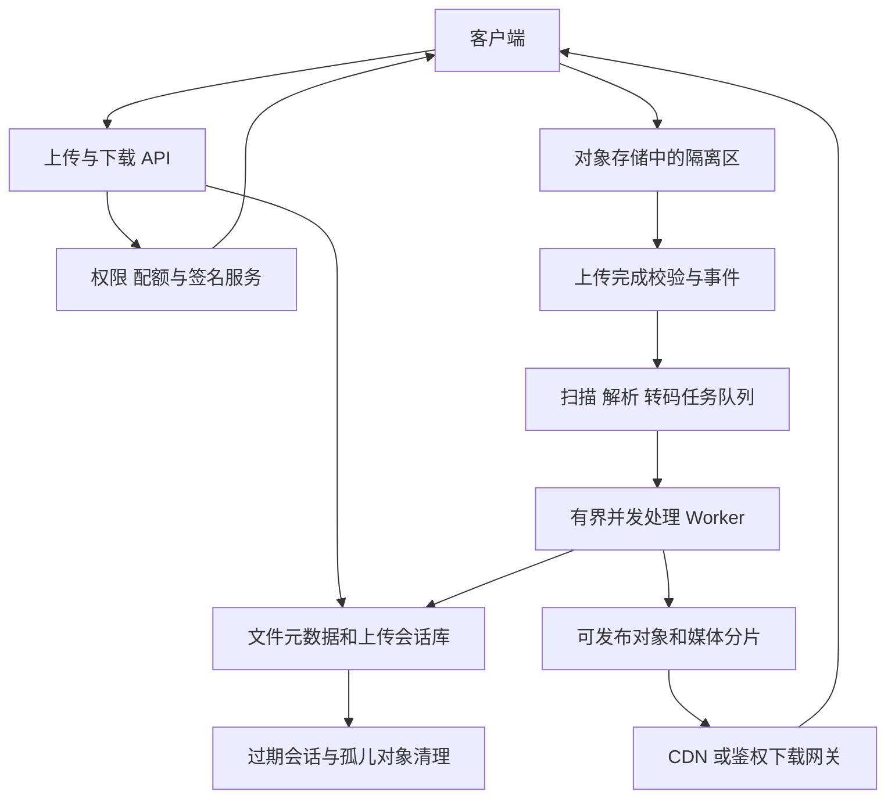
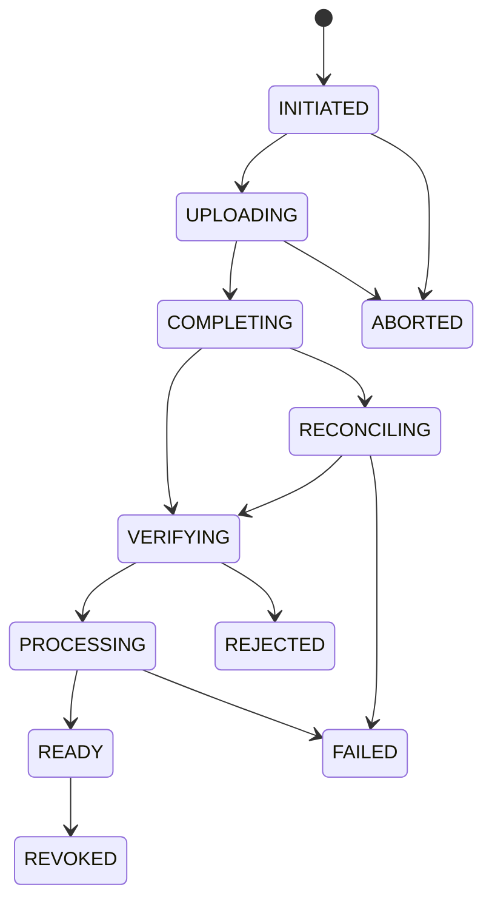
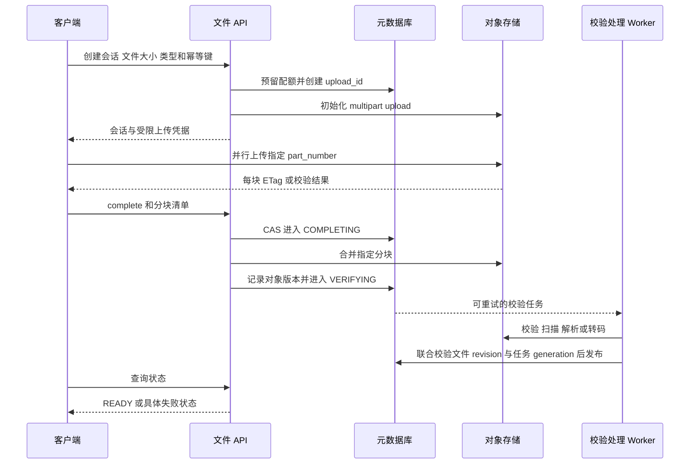

# 第 6 章 文件上传 下载与视频流传输

## 6.1 把控制链路和文件字节链路分开



文件服务不是一个 `MultipartFile` 接口就完成了。它至少管理“谁能上传、上传到哪里、上传到什么程度、内容是否完整和安全、什么时候可见、怎样恢复与清理”。应用服务处理身份、配额、元数据和状态机，大量文件字节尽量由客户端与对象存储、CDN 直接传输，减少应用机器带宽和堆内存占用。

若场景要求实时内容检查、特殊网络隔离或统一限速，也可以经过上传网关，但网关应使用流式读写、有界缓冲和反压，不将整个大文件读进内存。两种方案的差异是字节链路是否经过自有服务，而不是有没有权限校验。

## 6.2 数据模型与文件生命周期



这里 `COMPLETING` 表示正在请求对象存储合并，`VERIFYING` 表示对象已经存在但仍需检查，`READY` 才表示业务允许读取或进入检索。上传返回成功不等于病毒扫描、PDF 解析、视频转码全部成功。将这些状态合并为一个 `success=true` 会让客户端误认为内容已可用。

```sql
CREATE TABLE file_asset (
    tenant_id BIGINT NOT NULL,
    file_id BIGINT NOT NULL,
    owner_id BIGINT NOT NULL,
    object_key VARCHAR(512) NOT NULL,
    object_version VARCHAR(128),
    content_sha256 BINARY(32),
    byte_size BIGINT NOT NULL,
    media_type VARCHAR(128),
    status VARCHAR(24) NOT NULL,
    revision BIGINT NOT NULL,
    created_at DATETIME(6) NOT NULL,
    PRIMARY KEY (tenant_id, file_id),
    KEY idx_owner_created (tenant_id, owner_id, created_at, file_id)
);

CREATE TABLE upload_session (
    upload_id VARCHAR(128) NOT NULL,
    tenant_id BIGINT NOT NULL,
    file_id BIGINT NOT NULL,
    expected_size BIGINT NOT NULL,
    part_size INT NOT NULL,
    provider_upload_id VARCHAR(512),
    status VARCHAR(24) NOT NULL,
    revision BIGINT NOT NULL,
    expires_at DATETIME(6) NOT NULL,
    PRIMARY KEY (upload_id),
    KEY idx_expire (status, expires_at, upload_id)
);
```

对象 key 由服务端生成，并包含不可预测的标识或不可变版本路径；原始文件名只作为展示字段，不能直接拿来拼接服务器路径。配额要包含已完成文件、处理中对象以及尚未完成的分块，避免用户反复创建上传会话占满空间。

## 6.3 分块上传和断点续传完整流程



S3 的 multipart upload 分为创建会话、上传分块、完成合并；完成时需提供 upload ID 与分块编号和对应 ETag。最终对象 ETag 不一定是整个文件的 MD5，不能把它当作通用内容哈希。[B06]

断点续传时，客户端先恢复 `upload_id`，向服务端查询已经确认存在的分块，然后只上传缺失块。客户端本地记录不能作为最终事实，因为请求超时时某块可能已经写入；必要时通过对象存储的分块列表和校验值核对。

同一会话内分块编号应固定表示同一段字节。重复上传相同编号和相同内容可收敛为同一个结果；若相同编号对应不同校验值，应拒绝或者显式替换并更新会话版本，不能在用户无感知的情况下混合两份不同文件。服务端还应验证最终块数、总长度、顺序及预期内容标识。

### 块大小和并发怎么选

块太小会增加签名、请求、状态记录和合并开销；块太大则失败重传代价高，客户端并行缓冲占用大。假设块大小 16 MiB、并行数 4，则仅这部分在途缓冲上限约 64 MiB；如果客户端把整份 10 GiB 文件先读入内存，所谓分块上传并没有解决内存问题。

并行度要同时受客户端网络、存储请求限额、每用户配额和服务端控制面能力约束。应按观测吞吐和失败率动态调整，不能给所有用户一律开 100 个并发连接。具体对象存储的最小块、最大块和最大块数属于产品约束，应对照所用产品版本确认。

## 6.4 complete 超时为什么不能直接重新建文件

对象存储可能已经合并成功，只是响应没回到应用。此时状态是“结果未知”，不是“失败确定”。如果重新生成 object_key 并再次上传，会产生重复对象、重复计费和重复解析；如果立即释放配额或删除对象，也可能破坏已经完成的上传。

恢复做法是：记录 `upload_id、目标不可变 object_key、预期长度、校验信息、操作代次`，进入 `RECONCILING`；查询目标对象和上传会话状态。如果对象存在且版本、长度、可信校验信息符合预期，则补齐元数据并进入验证；确认不存在或已失败后再按原会话规则重试。

数据库状态和对象存储动作跨系统，不能只靠一个本地事务使其完全原子。可以先写持久意图，再执行外部动作，最后条件写回；后台扫描长时间停留的中间态并恢复。完成事件与数据库写回也可能重复，逻辑处理任务以 `(file_id, object_version, stage, processor_version)` 幂等；每次实际执行另有 generation/attempt_id，并使用独立产物路径，不能把逻辑任务幂等键直接当作所有重试共享的可覆盖输出路径。

取消上传与完成合并竞态时，先由元数据状态机决定当前允许的操作。取消请求不意味着已经到达对象存储的合并请求一定被撤销；需要恢复任务检查真实结果，并按最终业务状态删除或隔离已合并对象。不能同时把同一会话标为可下载和已取消。

## 6.5 校验 安全 秒传和多租户权限

### 完整性校验不等于业务可信

分块 checksum 发现传输损坏，整文件哈希用于内容一致性和去重，文件扫描与类型识别判断内容是否允许进入业务。客户端声明的 MIME、扩展名、总长度和 SHA-256 都需要按风险校验，不能直接相信。

解析器应在受限环境中运行，限制 CPU 时间、输出大小、解压层数、页面数、图片像素和临时磁盘。一个很小的压缩文件可能解压出巨量内容；一份 PDF 也可能触发异常耗时。接口层的“文件不超过 100 MB”不能覆盖处理阶段的资源风险。

### 预签名 URL 是短期凭据

预签名 URL 的持有者可在它允许的范围内执行对应操作，权限受签发身份限制，临时凭据到期也可能使 URL 提前失效。[B07] 因此要限定对象 key、HTTP 方法、有效期和所用机制能够约束的大小、类型或校验条件；不能由客户端任意指定其他租户路径。

短期不等于单次使用。若产品要求“一次性上传”或“一次性下载”，还需要服务端会话状态、代理鉴权或能执行单次消费的能力；单纯签一个过期时间并不会阻止有效期内重复使用。日志与分析系统应避免收集完整凭据 URL。

### 秒传的正确边界

服务端可根据内容哈希发现已有相同字节，从而复用物理对象，但逻辑文件身份、拥有者和 ACL 仍然独立。用户猜到一个哈希，不等于获得读取别人的文件、文件名或元数据的权限。

对于敏感文件，可只在同租户或同用户范围内去重，并避免在 API 响应中泄露跨租户“这个文件是否存在”。需要证明持有内容时可要求上传内容证据或真实数据，但证明拥有相同字节仍不授予其他逻辑文件的业务权限。

### 引用计数和删除

多个逻辑文件共用同一对象后，删除一个文件只能移除它的授权关系，不能立刻删除共享对象。物理垃圾回收需要确认没有有效引用、没有进行中的创建或迁移，并有宽限期与代次检查。简单“先查 count=0 再 delete”会与并发新增引用竞态。

## 6.6 大文件下载和 Range 请求

客户端可以请求某一字节范围，服务器支持时返回 `206 Partial Content`；范围不可满足可能返回 `416`。`If-Range` 配合强验证器可以避免把旧文件片段与新文件片段拼在一起，验证器不匹配时服务端会忽略 Range 并返回新表示的完整内容。[B08]

例如客户端已下载某个不可变版本前 8 MiB，恢复时请求后续范围，同时提交对应 ETag。必须区分 ETag 作为版本验证器和 ETag 是否为 MD5；后者没有通用保证。

下载接口先校验当前用户是否有权读取该逻辑文件，再返回短期受限下载地址或通过鉴权网关转发。访问控制若依赖请求头或 Cookie，CDN cache key 和缓存策略必须避免把一名用户的私有响应共享给另一名用户。

### 删除或撤权以后，签发过的 URL 怎么办

如果客户端已经持有仍有效的存储或 CDN 地址，仅在业务数据库里把文件标为 REVOKED，并不能自动撤回该凭据。可选措施包括更短的凭据寿命、每次请求都经过鉴权层、版本化访问策略、支持撤销的签名机制和缓存失效。不同策略对应不同延迟与成本。

已经下载到用户设备的字节也无法靠服务端撤权追回。因此产品应定义“撤权后阻止后续访问”的承诺，不应宣称能让所有已离线保存的副本消失。

## 6.7 视频点播 直播与实时通话分别怎么设计

| 场景 | 常见传输组织 | 优先目标 | 主要难点 |
|---|---|---|---|
| 文件下载 | HTTP GET 与 Range | 完整性、断点续传、吞吐 | 文件版本一致、权限、带宽 |
| 视频点播 | 多码率 HLS 或 DASH 分段 + CDN | 播放流畅、成本、清晰度 | 转码、ABR、预取、缓存 |
| 大规模直播 | 持续产出媒体分段与滑动播放列表 | 扇出规模、可接受延迟 | 窗口更新、延迟、源站保护 |
| 连麦或视频会议 | WebRTC 与必要的媒体服务器 | 低交互延迟 | 网络穿透、抖动、转发与拥塞 |

HLS 用播放列表组织媒体分段和不同码率变体，切换时需要正确对齐媒体时间轴；它不是简单把同一视频随机切成多个字节文件。[B09] WebRTC 包含连接建立、ICE/STUN/TURN 等网络穿透机制，信令通道与实际媒体传输不是同一件事。[B10]

WebRTC 也不意味着所有视频都直接点对点。多人会议常使用媒体转发服务，无法直接连接时可能经过中继。把“WebRTC 不经过服务器，所以带宽免费”作为回答，会忽略真实网络和多人拓扑。

### 转码流水线

上传原片后先探测格式和时长，再生成多个码率分辨率版本、缩略图、字幕和清单。相同原片版本和转码配置版本对应一个逻辑任务键；每次重试或接管使用新的 generation/attempt_id，将产物和 manifest 写入该次执行独享的不可变前缀。manifest 只引用本次执行的产物；校验完整后，在同一权威事务中核验文件当前 revision 与未撤销状态、任务当前 generation 与运行态，再发布清单指针。

不要先把最终播放清单公开，再慢慢补它引用的分片，否则播放器会收到不存在的资源。某个低码率版本已经完成时可以先发布“可用清晰度集合”，后续更高清版本完成后发布新清单版本，而不是伪称所有清晰度都已就绪。

分段边界要考虑关键帧与时间戳。客户端切换码率时，如果两个版本时间轴不一致，就可能黑屏、重复播放或音画不同步。容器、编码、分辨率、码率和传输协议是不同概念：MP4 是容器，H.264 等是编码，HLS 是流组织与分发协议，不能混用名词。

### 自适应码率和延迟取舍

播放器根据可用吞吐、缓冲区长度、近期卡顿和设备解码能力选择码率。只看瞬时下载速度容易频繁切换，应平滑估计并留安全余量。低延迟要求更小缓冲、更频繁请求，网络波动时可用于恢复的余量更少；点播通常可以用较多预缓冲提高稳定性。

直播 DVR 还要定义可回看的保留窗口。播放游标已经早于最早可用分片时，应明确跳到可用位置或提示已过期，不能无限请求被清理的旧分片。

## 6.8 带宽与存储容量必须算一遍

假设 10 万人同时观看平均码率为 3 Mbps 的视频，基础出口为：

`100,000 × 3 Mbps = 300 Gbps，约 37.5 GB/s`。

若分段时长为 4 秒，一个 3 Mbps 分段平均约 1.5 MB；不考虑音视频分开请求和重试，每秒媒体分段请求约 `100,000 / 4 = 25,000` 次。首屏同时到来、播放器预取和跨区域分布会进一步影响峰值。

CDN 的字节命中率若为 99%，在该示例稳态下源站正文带宽约为 3 Gbps。但这个乘法只描述稳态平均；新热点视频、缓存失效、单一地区冷启动可能使回源突然增加。需要分层缓存、回源合并、预热与源站限流。

再假设一个视频同时保留 1、3、5 Mbps 三种码率，三者总码率为 9 Mbps，一分钟媒体正文约 `9 × 60 / 8 = 67.5 MB`，还要加原片、音轨、字幕、缩略图、容器开销和副本。不能用“原视频只有 20 MB”直接估算整个视频平台存储。

对上传解析服务也要计算：`并发文件数 × 每文件缓冲上限 + 解析器内部峰值 + 中间结果 + JVM 基础内存`。连接池和线程池只是并发入口，不能让排队的大文件对象把堆占满。

## 6.9 Java 流式处理与资料流水线应用示例

```java
void copyBounded(InputStream in, OutputStream out, long maxBytes)
        throws IOException {
    byte[] buffer = new byte[64 * 1024]; // 固定缓冲，不随文件大小增长。
    long total = 0;
    int n;
    while ((n = in.read(buffer)) != -1) {
        if (n == 0) continue;
        if (n > maxBytes - total) {
            throw new IOException("file exceeds allowed size");
        }
        out.write(buffer, 0, n); // 下游慢时形成背压，而非无限加入队列。
        total += n;
    }
    out.flush();
}
```

该示意只展示固定内存与大小上限，真实服务还需要超时、取消、异常关闭、校验和、限速及请求生命周期控制。流式复制也不意味着后续 PDF 或 Office 解析一定是流式；某些解析库会在内部加载整个文档，必须实测并隔离。

以 NoteWeave 类资料研究平台为应用示例，可以把“文件可下载”和“资料可检索”拆成不同状态：`UPLOADED、SCANNED、PARSED、CHUNKED、EMBEDDED、INDEXED、READY`。原文件字节放对象存储，Kafka 传 file_id、版本和对象引用，避免把大文件正文放入消息。每阶段输出标记 `source_version、processor_version、generation/attempt_id`，产物路径按实际执行隔离；发布时同时核验资料当前版本与有效状态、任务当前代次与运行态，取消或撤销后旧 worker 不得重新发布。

大文件引起频繁 GC 时，先检查是否整文件入堆、是否重复拷贝、一次批量载入多少页/块、解析并发和队列是否有界，再考虑 JVM 参数。仅加堆或增加线程，可能放大同时在内存中的大对象数量。

## 6.10 异常与恢复矩阵

| 场景 | 应有的恢复路径 | 不能采用的简化 |
|---|---|---|
| 某个分块响应超时 | 核对 part_number 和 checksum 后重传缺失块 | 从零重新上传整份文件 |
| complete 超时 | 按目标对象与会话核对，进入恢复状态 | 直接判断失败并重建 file_id |
| 对象成功但元数据写失败 | 扫描持久意图，补齐状态或清理孤儿 | 永远留下不可追踪对象 |
| 元数据存在但对象缺失 | 暂不可用、恢复副本或重新处理 | 返回无效下载地址且仍标 READY |
| 扫描器发现恶意内容 | 隔离并禁止发布，保留必要审计 | 上传完成后立即公开下载 |
| Worker 重试两次生成产物 | 每次 attempt 独立不可变前缀，校验当前 generation 后发布本次 manifest | 重试共享路径使旧 worker 覆盖新产物 |
| 用户撤销但旧转码完成 | 发布事务同时核验文件 revision/未撤销与任务 generation/运行态 | 只校验任务代次便把已撤销文件改为 READY |
| CDN 缓存仍有旧私有内容 | 撤销访问能力并按策略失效缓存 | 只删数据库记录就宣称无法访问 |
| 大量未完成分块 | 过期会话扫描、存储生命周期清理与配额回收 | 只删除 upload_session 记录 |

监控应包含上传成功率、分块重试率、complete 未知状态年龄、已完成但未 READY 的文件年龄、扫描和转码队列最老任务、单任务峰值内存、单位字节成本、CDN 字节命中率、源站带宽、首帧时间、卡顿率和播放错误率。控制面延迟低，不代表视频播放体验好。

## 6.11 处理任务 回调和资源隔离如何落地

### 处理任务既要有文件版本 也要有处理器版本

同一个 PDF 更新了一页，应产生新的内容版本；同一个 PDF 没有改变，但解析器升级、分块策略变化或向量模型变化，也需要生成不同的处理产物。因此任务键可以定义为 `(file_id, source_version, stage, processor_version)`。

worker 开始执行前取得本次任务 generation、独立 attempt_id 和文件的预期 revision。产物前缀可以是 `files/{file_id}/{source_version}/{stage}/{processor_version}/g{generation}/{attempt_id}/`。每次实际重试或接管创建新的 attempt_id；对象使用条件创建等方式保持不可变，不能让旧执行者复用新执行者的输出路径。manifest 与分片都写在本 attempt 的前缀下，并只引用本 attempt 的产物。

完成发布需要在一个权威事务中同时满足两个条件：文件仍是预期 source_version/revision 且未撤销；任务仍由当前 generation/attempt_id 持有且处于 RUNNING。假设文件和任务元数据同库，可以按固定顺序锁文件行、再锁任务行，校验后把发布指针指向该 attempt 的不可变 manifest，并推进任务状态。任何校验失败都不发布。如果文件与任务分属不同服务，需要等价的统一发布权威或协调协议，不能用两次无锁查询替代这个原子判定。

只写 `WHERE task_id=? AND generation=? AND status='RUNNING'` 不够：文件可能已被撤销，但取消事件尚未传播到任务表。只保护数据库写回也不够：若旧 worker 覆盖 `/current/output.json` 或所有重试共享的版本路径，即使发布 CAS 拒绝它，已经被新 manifest 引用的字节仍可能被污染。因此需要执行级产物隔离和联合发布门控两者同时成立；垃圾回收只清理确认未被有效 manifest 引用的失败 attempt 产物。

### 外部回调只是一个待核对的事件

转码服务或对象存储可能回调“任务已完成”。回调入口应验证签名或受信身份、消息 ID、时间范围、任务归属和版本，并将事件先持久接收。相同事件重投返回相同结果，不能再次触发整条流水线。

回调里的任意 URL、对象路径和文件大小不能直接信任。服务端根据已注册任务及其 generation/attempt_id 找到允许访问的对象，再核对版本、长度和本 attempt 的预期产物清单，避免错误回调把另一租户或另一执行代次的对象挂到当前文件。对需要下载外部地址的处理功能，还应明确允许的协议和目标范围，防止把文件处理器变成任意内网访问入口。

不能因为回调丢失就永远停在 PROCESSING。后台扫描超过正常耗时的任务，使用 provider_job_id 主动查询处理服务；查询结果未知时继续恢复，明确失败后按原任务键重试。回调与扫描可能同时到达，用条件版本写入让两条路径收敛。

### 在线接口与离线大任务分开争用资源

上传会话创建、文件列表和权限查询属于在线接口，解析与转码属于离线重任务。它们应有独立线程池、队列、连接配额和超时策略，否则几份超大文档会占满全部数据库连接，让用户连列表都打不开。

限并发最好不只按“文件数”。十份 1 MB 文本与十份 4 GB 扫描 PDF 的成本完全不同，可以按估算页数、文件大小、解码像素和任务类型分级，使用加权令牌限制同时运行的资源总量。估算不准时通过实际峰值修正，超大任务进入单独通道。

队列必须有容量上限。满载时可以拒绝新处理请求、保留已上传文件为待处理、返回明确预计状态，或按租户配额延后任务；不要用无限阻塞让请求线程和连接一直占着。每个租户设置公平份额，防止单个批量导入挤占所有人的资源。

### 取消和超时不能只靠线程中断

一个 HTTP 调用超时可能只是当前等待结束，远端转码仍然运行。业务取消应更新任务状态和版本，并尽可能调用远端取消接口；最终发布仍由条件写回保护。即使远端无法取消，也能阻止结果继续生效。

超时应分层设置：连接建立、单次读写空闲、总处理 deadline、任务租约和业务过期时间不是一个参数。大文件总耗时可能较长，但长时间没有任何字节进展仍应中止；租约续期反映 worker 仍然负责，不代表任务无限延长。

重试大文件请求时，还要确认请求体可重新读取。已经消费过的 InputStream 不能直接原样重发；客户端应能从文件的指定偏移重开，或使用已经确认的分块与校验状态继续。业务幂等键解决重复副作用，不解决请求体已经被读完的问题。

### 凭据过期和会话过期要分开

一个 20 GB 上传可能运行数小时，单个预签名 URL 可以较短期。凭据即将到期时，客户端凭上传会话身份重新申请缺失块的签名，而不是重新创建文件。服务端再次校验用户权限、配额和会话是否已经取消，再签发相同对象范围的续传能力。

会话已经过期则不能只刷新签名继续写入，因为后台可能已经清理分块并释放配额。应先确认是否允许恢复同一会话，必要时重新预留资源并生成新代次。认证失败也不能无限重试，应区分临时失效、权限撤销和参数错误。

### 解析完成的判定要覆盖整份文件

对于需要逐页解析的资料，可以保存页级或块级完成记录及失败原因。只有所有必须处理的页都成功，或者业务明确允许带缺失的部分结果，才推进到完整 READY。某个 worker 处理了前 100 页就退出，不能仅凭“已生成一些 chunk”判断整份资料处理完成。

部分成功时应显示覆盖范围，并让检索与回答知道哪些页不可用。索引切换应以完整版本为单位或携带明确的部分覆盖状态；否则用户会把“没有检索到”误认为“原文不存在”。这对于资料研究平台的证据质量与引用审计尤其关键。

## 6.12 连续追问与答题要点

### Q1：为什么不让所有文件都经过 Spring Boot？

应用会承担两次网络搬运和连接占用，且容易因为缓冲策略导致堆压力。直传对象存储把字节路径交给更合适的服务，业务 API 仍负责认证、配额、会话与发布。如果必须经过应用，则采用流式传输和有界并发。

### Q2：断点续传的断点存在客户端还是服务端？

客户端保存本地进度便于恢复，服务端和对象存储保存可核对的已完成分块事实。客户端超时后可能误以为块未完成，因此最终以服务端验证的分块编号和校验值为准。

### Q3：分块上传能不能只检查每块 MD5？

每块校验能发现单块传输损坏，但还要确认分块集合、编号、总长度和整个文件身份，避免漏块、错序和混用两份文件。哈希算法也要根据完整性与安全需求选择，不能把某个 ETag 默认当整文件 MD5。

### Q4：用户上传中断后永远不回来怎么办？

上传会话设置过期时间，由任务协调中止未完成分块、释放预留配额并记录清理结果。对象存储生命周期规则可作后备，但业务元数据也要收敛，不能只依赖一边清理。

### Q5：为什么文件已经存在仍然返回处理中？

存在只说明字节写入完成。业务还可能需要完整性校验、恶意内容扫描、格式解析、索引构建或视频转码。将对象存在与业务 READY 分开，用户才不会拿到一份尚不能使用的资料。

### Q6：预签名 URL 被复制给其他人怎么办？

它本身就是持有即可使用的临时凭据。可以缩短有效期、绑定允许的对象和操作、经鉴权网关访问、限制网络条件或采用支持撤销的访问策略。需要严格逐次授权的业务不应只依赖长时间有效 URL。

### Q7：怎样实现秒传又不泄露其他用户文件？

只在明确范围内复用物理字节，独立建立逻辑授权；不要根据猜测到的哈希直接返回他人文件地址或名称。是否存在的响应也可能泄露信息，敏感场景可限制同租户去重或保持统一响应行为。

### Q8：视频播放为什么不用 WebSocket 直接持续发字节？

点播和大规模直播通常更需要 CDN 缓存、码率切换、分段重试和进度跳转，HTTP 分段体系更适合这些目标。低延迟交互媒体可以采用 WebRTC。WebSocket 能传字节，并不意味着它自动提供完整媒体传输体系。

### Q9：CDN 命中率很高，源站为什么仍会被打满？

平均命中率掩盖了新热点、全量失效、地区冷缓存和大对象字节分布。应关注字节命中率、分地区回源峰值、并发回源合并和缓存穿透；单纯看请求命中率可能低估少量大文件的流量。

### Q10：重新转码怎样避免用户读到半成品？

所有新产物写到本次 generation/attempt 独享的不可变路径，manifest 仅引用本次产物。检查完整性后，在同一权威事务核验文件当前 revision/未撤销和任务 generation/运行态，再更新发布指针。旧版本可保留一段时间给正在播放的客户端，之后按引用和保留规则回收。

### Q11：删除文件后为什么不能立即删除全部底层对象？

可能存在共享去重引用、进行中的下载、处理任务和历史版本保留。先撤销逻辑访问，再由有代次保护和宽限期的垃圾回收确认物理对象无有效引用。是否保留用户可见历史由业务策略决定。

### Q12：4 GB 文件解析频繁 GC，第一步做什么？

先分析对象分配与堆快照，确认是否全量读入、重复 byte[] 拷贝、大批次解析和无界任务队列。限制单文件峰值、并行文件数与批次，再验证吞吐和延迟。加线程通常会让内存峰值更高。

### Q13：下载断点续传时原文件被替换怎么办？

最好使用不可变对象版本；否则用强 ETag 与 If-Range 验证。版本变化后重新下载新表示，不能把旧前半段和新后半段拼接。文件名相同不代表内容版本相同。

### Q14：视频清晰度越多越好吗？

更多版本增加转码时间、存储和缓存碎片，收益取决于用户网络和设备分布。可以先提供常用码率，按播放热度补充更高质量版本；发布时清楚标注可用集合。

### Q15：资料撤销与旧解析任务完成同时发生如何处理？

撤销提升文件状态 revision；worker 发布时在同一权威事务核验文件仍为预期版本且未撤销，同时核验任务 generation/attempt_id 与运行态。任一条件不匹配就不发布。各 attempt 使用独立不可变路径，防止旧 worker 在 CAS 失败前已覆盖新产物；仅取消线程或仅检查任务代次都不够。

技术参考：[B06]、[B07]、[B08]、[B09]、[B10]。

## 6.13 场景推演：上传速度正常，为什么文件半小时仍不可用

文件处理系统应从“用户想什么时候拿到什么结果”出发，拆开上传完成、文件验证完成、预览可用、视频可播放和内容可检索。

### 第一条链处理字节，第二条链处理业务责任

文件字节通过签名凭据直接上传对象存储，应用服务控制上传资格、对象引用、元数据和状态。这样字节带宽不必经过所有业务实例，但签名接口、对象权限、分块数量和上传并发仍要受控。上传完成只使文件进入待校验状态，不能直接标记所有后处理完成。[B06][B07]

假设40个并发处理任务，每任务同时预取5块，每块8 MiB，仅块缓冲就约1600 MiB；再加解析器、解压后对象和输出缓存，内存可能远高于文件原始大小。大文件任务应按预计峰值内存和CPU／GPU成本获取资源许可，而非所有任务都只消耗一个相同“线程名额”。这些数字是容量推演，不是默认参数。

### 用户“处理中”的完整排查表

| 阶段 | 必须有的业务状态 | 关键指标 | 典型根因 |
| --- | --- | --- | --- |
| 上传完成确认 | upload_id、对象版本、COMPLETING | 完成调用未知数、未完成分块年龄 | 对象完成成功但响应丢失 |
| 完整性与安全校验 | 校验任务、校验版本、失败原因 | 校验队列年龄、读取字节、CPU／内存 | 损坏内容、压缩炸弹、超预算文件 |
| 转码／解析 | stage、处理器版本、attempt、generation | 实际执行时间、OOM、重试与未知数 | 大文件独占资源、重复任务、供应商限额 |
| 索引／产物构建 | 分块进度、manifest、目标索引版本 | 已完成块数、缺块数、写入失败 | 只收到部分回调就错误等待全部完成 |
| 发布 | 文件revision、撤销状态、可见性 | 条件更新失败原因、发布延迟 | 用户修改或撤销，旧任务被正确拒绝 |

只查Kafka lag无法确定文件何时可用。日志已被消费但外部解析仍在执行、索引只有部分块、发布屏障未满足，都可能使业务停在处理中。每个持久任务需要下一次核对时间；用户查询应返回正在进行的阶段和可解释的失败原因。

### 三级隔离让一个大文件不拖住全站

第一层隔离在线控制API和后台执行。上传凭据、状态查询和撤销操作不应和转码共用CPU密集队列。第二层按任务成本分池：小文档、长视频、批量导入与恢复重建各有并发和队列上限。第三层做租户公平调度，限制单用户／租户同时占用的字节、成本与供应商调用量，防止一家公司导入历史资料让所有人的新上传都排队。

资源许可不是权威任务状态。许可丢失、进程重启后仍要从持久任务恢复；租约到期也不代表旧解析器已经停止。各attempt使用独立不可变产物路径，最终发布时核验文件revision与执行代次，避免旧任务先覆写对象、再在数据库CAS失败。

### 第三方超时与切换怎样保持可解释

以外部转码／OCR为例，提交前持久化稳定任务ID与参数摘要，记录供应商请求ID。超时进入UNKNOWN并查询；如果供应商确认尚未受理，才按其幂等协议重试。供应商结果只是产物证据，仍需通过当前文件版本和安全规则的发布校验。

切换供应商时，两个任务可能同时完成，也可能各自计费。保留每个真实执行回执，只选择满足当前版本、质量与权限条件的一个产物集合发布。未选中的产物可在保留窗口后清理，不能把“没被发布”误当成“没有执行、没有成本”。

### 更新处理器时怎样不停机

逻辑处理键包含 `(file_id, source_version, stage, processor_version)`。新处理器先在抽样文件上输出独立产物，比较格式、覆盖率、内容完整性和性能。需要重建所有历史文件时走独立限速队列，不抢占在线新文件的全部资源。

发布指针从旧manifest切到新manifest是一个受版本约束的动作。若新解析器漏页，可以回到仍可用的旧manifest；若新产物已经被下游使用，还要记录下游索引版本与需要重建的范围。删除输入文件、撤销权限与回滚处理器是三种不同事件，不能因为回滚而恢复本应删除的数据。

### 三个有区分度的追问

**追问：只要上传完成就把消息发到Kafka，为什么还要任务表？** 消息负责触发与传播，任务表表达阶段、版本、当前责任、结果和恢复时间。若用日志本身作为完整任务权威，也要实现等价的可恢复状态；仅有一条“请处理文件”消息无法解释改期、取消、未知外部结果和长期卡住。

**追问：怎样证明转码并发从20调到40有效？** 比较单位时间有效完成文件／视频分钟数、任务成本分布、P99完成时间、OOM和供应商限额，而不只看同时运行数。若资源已饱和，更多并发可能降低吞吐；需保持输入样本和质量标准一致。

**追问：文件已经删除，旧CDN缓存还在怎么办？** 区分停止新授权、新链接失效、边缘缓存失效和已经下载的字节。私有资源通过明确的鉴权／签名有效期控制后续访问；发布与检索校验当前有效版本。已经发出的内容无法靠数据库删除倒转，产品必须明确这一边界。[B07][B08]

**相关专题：** [微服务与全链路治理](17_微服务与全链路治理.md) · [MySQL查询事务与在线迁移](18_MySQL查询事务与在线迁移.md) · [Kafka可靠性与积压治理](20_Kafka可靠性与积压治理.md) · [慢接口诊断与线程连接预算](24_慢接口诊断与线程连接预算.md) · [高可用与容灾恢复](25_高可用与容灾恢复.md)。

[B06]: https://docs.aws.amazon.com/AmazonS3/latest/userguide/mpuoverview.html "Amazon S3 multipart upload overview"
[B07]: https://docs.aws.amazon.com/AmazonS3/latest/userguide/using-presigned-url.html "Amazon S3 presigned URLs"
[B08]: https://www.rfc-editor.org/rfc/rfc9110.html "RFC 9110 HTTP Semantics"
[B09]: https://www.rfc-editor.org/rfc/rfc8216.html "RFC 8216 HTTP Live Streaming"
[B10]: https://www.w3.org/TR/webrtc/ "W3C WebRTC Real-Time Communication in Browsers"
