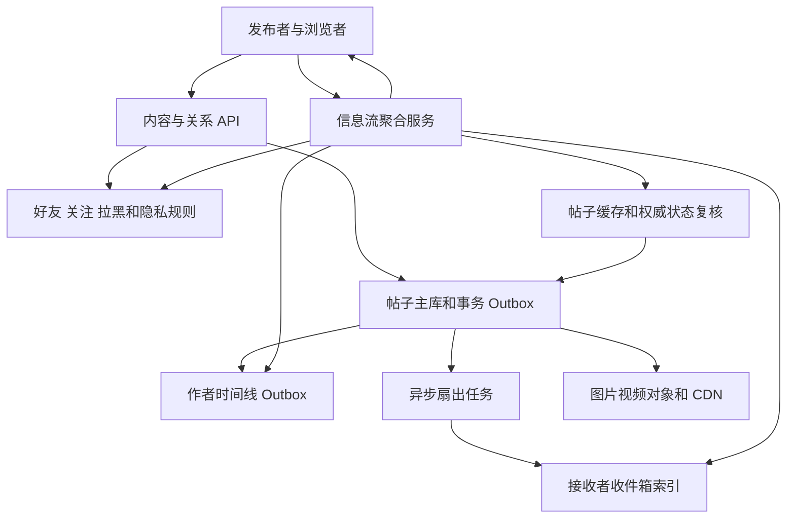
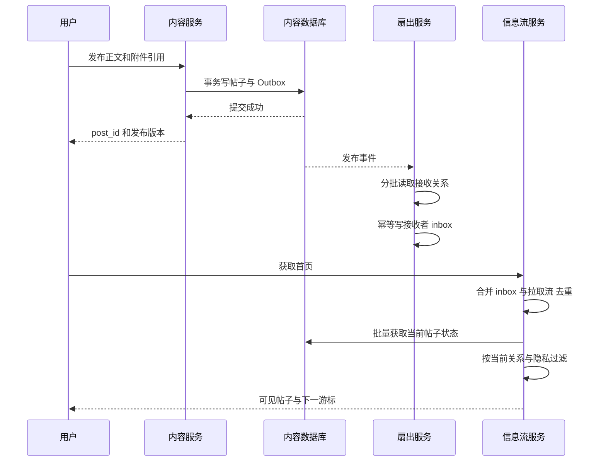
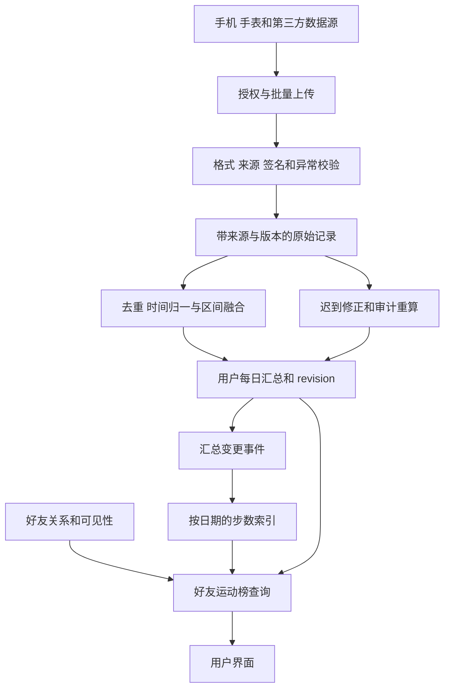

# 第 7 章 朋友圈信息流与微信运动类系统

## 7.1 朋友圈的完整架构



朋友圈类信息流的核心问题是：某个用户打开首页时，怎样在有限延迟内找到“现在有权看到的、相关作者最近发布的内容”。它不是简单按发布时间扫描全部帖子，也不是只要把帖子写入好友收件箱就永久有权显示。

“微信运动”则把事件来源换成步数数据，输出换成日汇总和好友榜。两者共享关系与权限服务，但数据正确性问题不同：朋友圈主要处理扇出、分页和撤权；运动榜主要处理多设备重复、跨日、纠错和可信来源。下面分别设计，最后说明怎样复用基础设施。

## 7.2 数据模型与接口

```sql
CREATE TABLE social_post (
    post_id BIGINT NOT NULL,
    author_id BIGINT NOT NULL,
    created_at DATETIME(6) NOT NULL,
    content_ref VARCHAR(512),
    status VARCHAR(16) NOT NULL,
    content_version BIGINT NOT NULL,
    visibility_version BIGINT NOT NULL,
    visibility_mode VARCHAR(24) NOT NULL,
    PRIMARY KEY (post_id),
    KEY idx_author_time (author_id, created_at DESC, post_id DESC)
);

CREATE TABLE feed_inbox (
    recipient_id BIGINT NOT NULL,
    created_at DATETIME(6) NOT NULL,
    post_id BIGINT NOT NULL,
    author_id BIGINT NOT NULL,
    source_visibility_version BIGINT NOT NULL,
    PRIMARY KEY (recipient_id, post_id),
    KEY idx_recipient_time (recipient_id, created_at DESC, post_id DESC)
);

CREATE TABLE social_relation (
    owner_id BIGINT NOT NULL,
    target_id BIGINT NOT NULL,
    relation_type VARCHAR(24) NOT NULL,
    status VARCHAR(16) NOT NULL,
    revision BIGINT NOT NULL,
    updated_at DATETIME(6) NOT NULL,
    PRIMARY KEY (owner_id, target_id, relation_type)
);
```

作者时间线保存该作者发布的帖子 ID，可以直接由 `social_post` 的作者索引提供，也可物化到专门存储。接收者收件箱保存“候选帖子指针”，通常不复制完整正文。复制指针的好处是删帖和编辑不用修改几百万份正文，也能减少隐私内容残留。

接口可包括发布 `POST /posts`、删除 `DELETE /posts/{id}`、改可见性 `PUT /posts/{id}/visibility`、读取信息流 `GET /feed?cursor=...`、读取作者页 `GET /users/{id}/posts`。发布请求携带业务幂等键；正文、图片附件列表和发布事件在适当事务边界内形成一致版本。

内容、关系、收件箱三个表规模和访问模式不同，不一定放在同一分片。既然跨系统，就不能声称发布时一个数据库事务同步修改所有好友收件箱。合理做法是内容持久提交后留下可重试的扇出责任，再由异步任务更新收件箱。

## 7.3 推模式 拉模式和混合模式

| 方式 | 发布时做什么 | 读取时做什么 | 适合的条件 |
|---|---|---|---|
| 写扩散，推模式 | 将帖子指针写入候选接收者 inbox | 从自己的 inbox 取最新候选 | 作者粉丝不多，读频繁 |
| 读扩散，拉模式 | 只写作者时间线 | 拉关注作者的时间线并合并 | 作者发布频繁，接收者少读 |
| 混合模式 | 普通作者推，极大作者保留拉取 | 合并 inbox 与少量大作者流 | 关系分布偏斜、存在名人热点 |

推模式把计算前移，让首页读取稳定，但写放大与关系边数相关。拉模式避免给从不登录的用户写收件箱，却把读取成本推到关键请求路径。混合模式通常更符合重尾关系分布，但复杂度增加：同一作者从推切换为拉的期间，候选可能既在 inbox 又在作者流，必须按 post_id 去重并明确切换水位。

### 不要机械地用“粉丝超过一万”当阈值

阈值应看作者发帖频率、粉丝活跃度、首页读取次数、每次获取候选数、延迟预算和存储成本。一个百万粉丝但一月发一次的作者，与每天发几百条的作者，不应只根据粉丝数做相同判断。

可以粗略比较 `发布次数 × 活跃接收人数` 的推送成本与 `读取次数 × 需要拉取的作者候选` 的读取成本，再结合尾延迟决定。只给近期活跃用户推送、长期不活跃用户首次打开时回填，是常见折中，但回填要有独立限流，避免节假日回流用户压垮系统。

### 容量示例

假设 1,000 万日活、每人每天平均发 0.2 条，共 200 万条帖子/天；每条平均推给 300 个接收者，则每天形成 6 亿条 inbox 指针。即使每指针原始字段只按 32 字节估算，也约 19.2 GB/天，尚未计入索引、副本和存储开销。

一个拥有 1,000 万接收者的账号发布一条内容，仅指针原始字段就约 320 MB。如果与普通作者共用单个队列并同步处理，就会形成很长尾部延迟。应把大扇出任务分批、分片、限速，并为普通内容保留容量。

## 7.4 发布和读取的关键时序



发布成功与好友已看到可以是两个状态。如果产品要求自己发完马上在首页看见，可以让发布响应返回帖子完整展示数据，或让自己的首页额外合并作者时间线，实现 read-your-writes；不必等待几百万好友的异步扇出全部完成。

扇出任务按 `(post_id, recipient_id)` 唯一写入。进程在写完半批后宕机，可以重放该批，唯一约束阻止重复指针。必须记录批次进度和未完成任务，避免仅用内存队列承载全部传播责任。

读取时按页批量获取正文、媒体、点赞摘要和权限信息，避免每条帖子触发若干串行 RPC 的 N+1 查询。聚合层对下游设置总时间预算；非关键计数可以降级，正文状态和访问权限不能因为超时就默认通过。

## 7.5 信息流分页 为什么游标比 offset 更合理

按倒序时间展示时，用 `(created_at, post_id)` 作为稳定排序键。例如：

```sql
SELECT post_id, author_id, created_at
FROM feed_inbox
WHERE recipient_id = ?
  AND (created_at < ? OR (created_at = ? AND post_id < ?))
ORDER BY created_at DESC, post_id DESC
LIMIT 100;
```

用两个字段是为了处理相同时间戳的帖子；仅以 `created_at < last_time` 翻页会漏掉同一时刻的其他帖子。cursor 应签名或校验，包含用户、排序方式、最后扫描位置、快照标识等必要上下文，不能让用户任意拼接查询他人的 inbox。

不过 keyset 不是所有分页问题的万能解。异步扇出晚到时，一条较早发布的帖子可能插入已经翻过的区间；推荐排序分数变化时，同一帖子也可能跨越游标。产品要选择实时刷新语义，或者在一次浏览会话中物化候选快照。

仅记录一个 `as_of_time` 不自动得到完整快照：如果某些索引尚未处理完那个时间点以前的事件，仍会漏项。严格快照需要对应的事件水位、稳定候选集合或可证明完整的版本化读。

### 权限过滤后不足一页怎么办

读取 100 个候选，过滤后可能只剩 5 个。可以继续取下一批，直到凑够目标数量、真正到末尾或达到扫描预算。游标推进到最后扫描的候选，而不是最后展示的候选；否则一批候选全被过滤时会反复扫描同一区间。

达到预算时可以返回不足一页但仍有 `next_cursor`，不要错误返回“已经没有更多”。对多个拉取源，cursor 可能包含各源进度，或由服务端维护一个有过期时间的合并会话。不能用一个随意取的时间戳替代所有来源的读取位置。

## 7.6 好友权限 删帖 拉黑和缓存一致性

朋友圈比公开微博更容易被权限问题追问。以下规则都应在设计时明确：新加好友能否看历史；解除好友后能否看过去内容；“三天可见”是按阅读时刻滚动判断还是发布时固化；仅某组可见时组成员变化是否影响旧帖；作者拉黑用户后，旧推送和媒体地址如何处理。

可以选择“按当前关系和当前帖子可见性判断”的产品语义，再据此设计读写链路。需要历史授权语义时再引入授权快照与生效时间。

### 收件箱是候选，权限才决定展示

写扩散时就做权限过滤能减少无效指针，但发布后的关系和隐私会变。因此读路径仍要检查帖子当前状态和必要的权限版本。未经检查地返回缓存正文，会让“已经推过”变成永久授权。

Google Zanzibar 的研究将授权变更与对象内容的因果顺序作为一致性问题处理，说明权限缓存也需要版本与可解释的读取语义，不能只把它看成一张偶尔刷新的布尔表。[B12] 权限系统必须保证：旧 ACL 不能把新内容错误地开放给已经被移除的人。

### 删除与旧缓存回填的典型竞态

1. 请求 R 读到帖子版本 5，尚未写入缓存。
2. 作者删除帖子，数据库变为版本 6 的 DELETED，缓存被删除。
3. 请求 R 把版本 5 的正文重新填入空缓存。
4. 下一次读取若只看缓存，就会让删帖复活。

解决可以使用版本化缓存、删除墓碑和写入条件：缓存记录保留最低可接受版本或删除版本，拒绝版本 5 回填；读路径在严格场景复核数据库或权限状态。墓碑要覆盖旧请求、消息重试与重建的最长窗口，不能删除正文后立即删除全部版本信息。

如果要求撤权响应返回之后的新读取都不能看到内容，需要同步的授权检查或具备明确版本保证的权限层，并定义读操作的判定时刻。已经发送到客户端或已离线保存的内容不能被服务器回收；缓存失效也不能追回网络中已经发出的字节。

### 图片 视频 评论同样有权限

只隐藏帖子正文，却留下长期有效的媒体 URL、通知摘要或未经权限过滤的评论，不算完整撤权。评论是否只展示共同好友、点赞名单是否暴露关系、计数是否包含不可见成员，都应明确产品规则并统一在聚合层执行。

## 7.7 微信运动类系统的独立数据链路



步数数据首先是带来源与时间的信息，再是一个榜单分数。直接把每次上传的 `steps` 累加到 Redis，是最容易被追问击穿的设计：同一请求会重试，同一设备可能上传累计值，手机和手表可能同时记录同一次步行，设备可能重启或换时区，第三方也可能纠正之前的记录。

现实平台同样要处理多来源重复。Android Health Connect 的活动类聚合会考虑重复数据和用户设定的来源优先级，因此不能把多个来源原始记录简单相加。[B11] 下面设计只借鉴这个问题，不宣称微信内部采用相同机制。

### 原始记录至少需要哪些字段

可以记录 `user_id、source_id、device_id、source_record_id、source_revision、start_time、end_time、timezone_offset、step_count、record_mode、device_epoch、received_at`。

`record_mode` 明确数据是某时间段增量，还是自某次启动以来的累计计数。`source_record_id + source_revision` 表达同一条来源记录的更新，`device_epoch` 区分设备重启或计数器重置。服务端最终每日汇总还需要自己的 `aggregate_revision`，让排行榜拒绝迟到旧汇总。

## 7.8 重复 乱序 多设备和计数器重置

### 同一记录重传

对 `(user_id, source_id, source_record_id)` 建唯一约束，只接受更高的 source_revision。重复上传返回原结果。若新版本将某个时间段从 1,000 步更正为 900 步，汇总需要回滚差额或重算受影响窗口，不能因为“步数应该单调增长”就拒绝合法纠错。

### 同一设备上传累计值

假设同一 epoch 上传累计值 1,000，之后上传 1,200，新增是 200。旧的 1,100 乱序到达不能再加 100。可以按单调采样序号和时间维护已接受的累计进度；设备重启变成 50 时必须开启新 epoch，不能算成负 1,150，也不能在无法识别重置时盲目取最大值。

更重要的是，累计总数无法直接准确分配到跨午夜的两天。如果需要每日精确统计，应采集明确时间区间的数据，或接受基于采样区间拆分的估计，并向产品说明精度限制。

### 手机与手表同时记录

假设手机记录 09:00—10:00 为 4,000 步，手表同一小时为 4,100 步，直接加成 8,100 会重复。可以按区间选择可信来源优先级，或者根据平台已经去重的聚合值接入；来源优先级变更后要能够重算。

但是对全天总数取 `max(手机, 手表)` 也不总正确。如果上午只戴手表走 4,000 步，下午只带手机走 3,000 步，正确结果可能是 7,000，而最大值只有 4,000。需要时间区间重叠信息，才能区分同一次活动与互不重叠的活动。

当原始记录只有粗粒度区间总数，重叠区间内部的精确分布不可知。可按可信来源覆盖、按更细粒度采集，或定义估算规则；不能凭两个总数声称能精确还原真实步数。

## 7.9 跨日 时区 迟到和反作弊

日榜需要明确“日”的时区。可以按用户资料中的固定时区结算，也可以按活动发生地时区归档，但用户跨时区旅行时规则必须一致。不能在每次上传时让客户端任意选择日期，从而把同一份步数灌入两个榜单。

原始记录保留绝对时间和来源提供的时区信息，汇总规则版本负责映射日期。夏令时地区的一天不总是 24 小时，因此“本日零点加 86,400 秒”并不适用于所有地区。国际化服务应使用时区数据库按本地自然日计算边界。

离线设备次日上传昨日数据，展示榜可修正昨日汇总；如果榜单涉及竞赛和奖励，需要设置允许迟到窗口、冻结时刻和申诉规则。当前榜可以先展示“尚未同步完全”的状态，不能把暂未上传当作永久零步。

反作弊可结合来源可信度、异常变化速度、设备和账号关联、重复模式与历史分布，但不能用某个简单步频阈值断言用户一定作弊。风险数据可以先隔离出奖励榜、保留个人记录并触发复核。客户端签名证明消息来自某个设备或软件，不自动证明现实世界中真的走了这些步。

运动数据还涉及用户隐私。关闭运动展示、解除好友或拉黑之后，好友榜读路径必须立即按约定收敛；第三方读取授权被撤销后停止新增采集，历史数据如何保留或删除遵守明确产品规则。

## 7.10 共享哪些服务 不共享哪些假设

朋友圈和运动榜可以共用身份、好友关系、隐私规则、对象存储、Outbox、消息队列、审计和观察体系。朋友圈的正文候选索引与运动榜的分数索引都属于可重建视图，适合用持久事实加版本化更新维护。

但它们不能共用所有降级规则。朋友圈首页可以少展示一部分推荐候选，权限检查不能省；运动榜可以稍晚刷新，不能把重复步数当真。运动上传接受成功，也不意味着融合后的当日总分一定增加，合法纠错可能使它下降。

应用示例：在 NoteWeave 类资料研究平台中，资料关注动态、Wiki 更新流和研究任务活动流可以复用“作者流 + 订阅者候选 + 读时权限”的思想；资料撤销则对应删帖墓碑与版本拒绝旧回填。制造业告警平台可以把设备事件时间与服务器接收时间分开，并借鉴来源记录 ID、版本纠正和迟到重算，避免设备重发造成重复统计。

## 7.11 故障与扩展场景

| 故障或变更 | 朋友圈处理 | 运动系统处理 |
|---|---|---|
| 客户端重试同一请求 | 发布幂等键返回同一帖子 | 来源记录 ID 去重 |
| 消费者重复处理 | inbox 唯一键防重复指针 | 按 source/aggregate revision 更新 |
| 队列积压 | 发布已持久，候选稍晚出现，可从作者流补充 | 展示同步时间，旧榜按规则修正 |
| 用户撤权 | 当前 ACL、墓碑和媒体凭据策略一起生效 | 好友榜过滤和停止后续授权采集 |
| 高粉丝作者发帖 | 分批扇出、混合推拉、隔离队列 | 大规模统一活动榜使用分片和快照 |
| 旧消息迟到 | 拒绝旧内容或可见性版本 | 拒绝旧来源版本，按事件时间归属 |
| 缓存丢失 | 从帖子和关系重建候选 | 从原始记录或权威汇总重建榜单 |
| 用户更换设备 | 新连接与登录会话代次 | 新设备来源，不把计数重置当减步 |

朋友圈重点监控发布到可见延迟、扇出最老任务、每帖子收件人数、首页候选扫描放大、权限拒绝率、下游批量请求数和首页 P99。运动系统重点监控上传重复率、来源修订比例、迟到分布、融合差异、设备重置次数、日汇总重算延迟和好友榜物化水位。

上线验证应准备一组能被人工推演的时间线：同一帖子发布后改隐私、删好友、删帖、旧缓存回填；同一步数记录重复、乱序、修订、跨午夜、手机手表重叠、设备重启。正确性用这些事件的最终可见结果来判断，比单纯压高 QPS 更有价值。

## 7.12 从读取算法到迁移和纠错

### 一个有扫描预算的信息流读取算法

下面伪代码强调“扫描进度”和“展示结果”分离。真实多源游标需要保存各个来源位置，且必须绑定当前用户与查询规则。

```java
FeedPage readFeed(User user, Cursor cursor, int wanted) {
    List<Post> visible = new ArrayList<>();
    Set<Long> returnedIds = new HashSet<>();
    int scanned = 0;
    Cursor scanCursor = cursor;
    while (visible.size() < wanted && scanned < MAX_CANDIDATES) {
        CandidateBatch batch = source.mergeNext(scanCursor, BATCH_SIZE);
        if (batch.isEmpty()) return FeedPage.end(visible);

        // 一次批量获取内容状态和授权结果，避免每条记录单独串行 RPC。
        Map<Long, Post> posts = postStore.batchGet(batch.ids());
        Map<Long, Boolean> allowed = auth.batchCheck(user, posts.values());
        for (Candidate c : batch.items()) {
            scanned++;
            scanCursor = c.cursorAfter(); // 不可见记录也推进扫描位置。
            Post p = posts.get(c.postId());
            if (p != null && p.isPublished()
                    && Boolean.TRUE.equals(allowed.get(p.id()))
                    && returnedIds.add(p.id())) {
                visible.add(p);
            }
            if (visible.size() == wanted || scanned == MAX_CANDIDATES) break;
        }
    }
    return FeedPage.partialOrFull(visible, scanCursor);
}
```

`source.mergeNext` 只有确认相关来源都已耗尽时才返回代表结束的空批；来源超时或暂未追平必须返回可区分的状态，不能误判为没有更多。`auth.batchCheck` 的版本语义必须符合产品要求，不能把未知或超时转换为允许。去重集合的作用域也要明确：页内去重避免混合源重复；跨页去重还需要快照、客户端已见集合或服务端会话状态。仅用局部 HashSet 不能保证跨页永不重复。

### 作者从推模式迁移到拉模式

如果直接改一个布尔配置，新请求可能开始从作者流拉取，但旧扇出任务仍在继续写 inbox，造成重复；反方向迁移时，历史尚未回填又停止拉取，则会漏帖子。

可以给作者分发策略一个 `distribution_epoch` 和切换水位 P：水位以前按旧策略解释，之后按新策略；迁移窗口允许两边都有候选，统一按 post_id 去重。回填完成并追平后再收缩旧路径。任务事件携带策略版本，旧任务不能根据新配置重新推导出另一组接收者。

阈值附近的作者要有滞回与冷却时间，避免粉丝数短时间波动导致推拉模式反复切换。对用户活跃与不活跃切换也一样，不能每次打开页面都触发全量回填。

### 关系变化与扇出接收者快照

发布后分批扫描好友时，列表也在变化。若业务定义“发布时好友可见”，需要关系快照或可重放的关系版本；若定义“读取时当前好友可见”，扇出名单可以只是近似候选，但读时必须严格判断。

对于新加好友是否补历史，可以异步回填最近时间窗，也可以读取时从作者流补充。回填任务记录用户、作者、关系版本和进度；中途解除关系后旧回填可以停止，已写候选即使尚未清理也不能绕过当前权限。

### 运动数据纠错的最小重算单元

一条来源记录只覆盖 10:00—10:15，修订它时没有必要重算用户一整年的全部步数。可以定位受影响的时间桶，重新融合该桶中的各来源区间，再更新当日汇总。跨日记录则影响两个或多个自然日，不能只更新 received_at 所在日期。

但最小重算单元不能小于去重规则所需信息。如果规则按整段运动会话选择主来源，只重算一个分钟桶可能破坏会话级一致性。数据模型应保存足以重放规则的原始区间与规则版本，使升级后可以解释新旧汇总的差异。

### 批量导入和回放不能淹没在线链路

用户第一次授权运动数据时，可能导入数月历史；用户恢复社交账号时，也可能回填很长的时间线。这些批任务应使用独立优先级和配额，与当天上传和首页查询隔离。否则一次历史回放就会让全部用户的实时数据过时。

回放过程中先写权威事实，再按版本更新视图；实时新数据与回放旧数据同时到达时，版本比较保证当前状态不回退。对于需要重新计算而不是简单覆盖的聚合，应采用指定规则版本和输入水位，避免两个重算任务互相覆盖。

## 7.13 连续追问与答题要点

### Q1：朋友圈为什么不能每次查所有好友最近帖子再排序？

好友少、请求少时完全可以，这是合理起点。规模增大后，多作者读取与合并会拉高首页尾延迟；此时再引入 inbox 或混合模式。应先算读取扇出，不能为了展示架构复杂而从第一天上全套写扩散。

### Q2：已经给好友推过帖子，为什么读时还要鉴权？

好友关系、黑名单、可见组和帖子状态会变化。inbox 只是历史生成的候选，不能代表当前授权。读取时检查必要权限版本，才能让撤权实际影响后续访问。

### Q3：刚发完朋友圈自己看不到怎么办？

发布成功响应携带正式帖子，客户端可立即展示；后续读取合并自己的作者流，或者使用最低写入水位保证 read-your-writes。没有必要等待所有好友扇出完成才确认发布。

### Q4：大 V 的一条消息为什么不能同步推给所有粉丝？

接收者规模使写放大和事务时长不可控，还会占用普通作者容量。采用异步分批、只推活跃用户或大作者读时拉取，并对转换期间去重。具体阈值由发布与阅读成本决定。

### Q5：用时间戳游标就不会漏帖子了吗？

还需要唯一 tie-break 字段，避免同时间戳漏项。异步晚到、排序更新和多个来源也会造成遗漏；严格稳定翻页需要快照或明确水位，实时信息流则可通过刷新补充。

### Q6：过滤权限后只剩几条，怎样凑够一页？

继续批量扫描候选，但设最大扫描预算；cursor 推进到最后扫描位置。预算耗尽可返回部分页并保留 next_cursor，避免无限工作或错误宣称到底。

### Q7：删好友以后旧评论是否还看得见？

先确认评论可见性规则，是公开、随帖子、还是仅共同好友。然后把规则贯穿正文、评论、点赞名单和通知摘要，不能只隐藏首页中的帖子卡片。

### Q8：步数上传直接 ZINCRBY 为什么错？

上传可能是累计值而非增量，同一请求会重试，多设备还会记录同一活动。需要先明确原始记录语义、去重和来源融合，再把版本化日汇总投影到榜单。

### Q9：同一设备今天报 1,000、1,200、1,100 怎么处理？

若是同一 epoch 的累计计数，接受更新采样后只新增 200，旧采样不再增加；如果 1,100 是显式更正版本，就按修订规则重算。必须使用采样序号和修订语义，不能仅从数字大小猜测。

### Q10：手机和手表步数取最大值是否就去重了？

只能解决某些完全重叠的情况。不同时间分别使用两设备时应合并互不重叠活动，简单取最大会少算。需要区间信息和来源优先级，粗粒度数据无法凭空恢复精确重叠。

### Q11：设备重启导致累计计数归零怎么处理？

使用 device_epoch 或明确重置标记把计数序列分开。新 epoch 从零开始不意味着用户当天步数归零，也不应将负差值直接扣减。无法识别时先标记异常并核对，避免静默污染总分。

### Q12：昨天走的步数今天上传，算哪天？

按明确的事件时间和榜单时区归属，不按服务器接收日期随意改变。展示榜允许按策略修正，已结算竞赛则受迟到窗口和冻结规则约束，修正过程要保留版本和审计。

### Q13：为什么累积步数也需要允许减少？

来源可能纠正错误记录、合并重复区间或撤销作弊数据。真实业务修订会减少汇总，因此缓存更新应比较版本而不是永远取最大分数。

### Q14：用户关闭运动展示后如何处理缓存？

更新隐私版本并触发失效，读好友榜时检查当前规则；对严格撤权要求使用权威鉴权或可证明的版本水位。个人数据是否保留与是否对朋友展示是不同策略。

### Q15：如果数据库分片，好友关系和帖子不在同库怎么办？

写路径不追求跨全部分片的大事务，帖子本地提交加 Outbox 形成异步传播责任；读路径由关系服务和内容服务批量协作。对授权变更要明确一致性级别，不能借“最终一致”永久容忍隐私泄露。

### Q16：推荐信息流和纯时间流能否共用分页？

候选生成可以部分复用，但排序分数会变化，按时间游标不能描述推荐排序的稳定位置。可以为一次会话生成带版本的候选排序列表，或接受刷新时重新排序，并通过 post_id 去重。

技术参考：[B11]、[B12]。

## 7.14 场景推演：热点作者发布、删除与读取变慢同时发生

假设一位高粉丝作者发布动态后迅速删除，扇出任务仍在执行，用户侧同时报告“刷不出新内容”和“删除内容又出现”。这是大规模写扩散、缓存一致性、接口尾延迟共同出现的场景，不应只归类成一个 Redis 热 key。

### 先拆清三条链路的状态

发布事务确认帖子事实和版本；扇出任务只写收件箱候选；读取在返回正文前检查当前可见性。删除先形成权威 `DELETED/newVersion`，扇出任务收到删除后可以停止后续工作，但即使消息延迟、仍插入旧候选，也不能绕过读时可见性检查。

这样允许候选索引短期冗余，却不允许旧任务复活正文。对任务已写过的候选，用异步清理降低后续扫描成本；对缓存旧回填，用对象版本门槛和墓碑拦截。CDC 改善传播与重放，不消除提交到消费之间的延迟，具体竞争时序见 F.3。

### 高粉丝作者不应耗尽普通用户的扇出资源

扇出拆成有稳定批次 ID 的分页任务，使用可恢复的收件人扫描位置。一个大作者占用有界配额，其他作者保留独立吞吐；任务失败重试时按 `(recipient,postId)` 等唯一条件去重。队列积压不仅看消息条数，还看最老未完成帖子年龄和每位作者剩余收件人数。

当读扩散更合适时，作者可从推模式迁到拉模式，但要有切换水位：哪些帖子已保证推完，哪些由拉取路径覆盖，交叠范围如何去重。仅改变一个 `fanoutMode=PULL` 开关，可能让切换前尚未推完的帖子既不在收件箱也不被拉取。模式选择同时考虑粉丝数、活跃率、发帖频率与读频率，不设脱离负载的万能阈值。

### “一页要 20 条”为什么可能扫描几百条

删除、拉黑和权限变化会使候选不可见。读取需要继续批量扫描，但同时设候选条数、校验次数和请求截止时间。游标推进到最后扫描位置，即使该记录被过滤；扫描预算耗尽可以返回不足 20 条并保留下一页游标。若执着于一次凑满，热门删除会把读接口变成长时间循环，继而耗尽数据库池。

同时观察 `返回条数/扫描候选数`。该比例持续下降说明候选垃圾过多，应该加速异步清理或改善候选生成；只把批量大小从 100 调到 1,000，可能把隐藏的工作量扩大十倍。

### 热正文缓存不能等同公共内容缓存

公开帖可以使用较多本地与边缘副本；仅好友可见的正文仍需要以当前用户授权为依据。不要把一位用户访问后产生的已授权完整页面，用仅含 postId 的公共 key 提供给其他用户。可以复用与用户无关的正文载荷，但将“谁可读”的判断与每次访问绑定。

媒体访问也要独立控制。删除 Redis 正文不意味着以前签发的媒体链接立即失效；根据业务要求采用较短凭据有效期、代理校验或有撤销能力的分发机制，并说明已经下载的副本无法追回。

### 一组可证明设计的故障演练

让扇出执行到一半时删除帖子，再暂停删除事件传播；将读取旧正文的线程延迟到删除后回填；清空一个实例本地缓存；让一页候选全部不可见；在推拉模式切换时追加一条新帖。正确结果应是：旧候选不越权、翻页不死循环、普通作者不被拖垮、切换范围不遗漏、缓存恢复后版本不倒退。性能指标必须与这些正确性条件一起验收。

**相关专题：** [Redis缓存与排行榜](19_Redis缓存与排行榜.md) · [高并发准入与分布式锁](23_高并发准入与分布式锁.md) · [高可用与容灾恢复](25_高可用与容灾恢复.md)。

[B11]: https://developer.android.com/health-and-fitness/health-connect/aggregate-data "Android Health Connect Read aggregated data"
[B12]: https://research.google/pubs/zanzibar-googles-consistent-global-authorization-system/ "Zanzibar Google's Consistent Global Authorization System"
