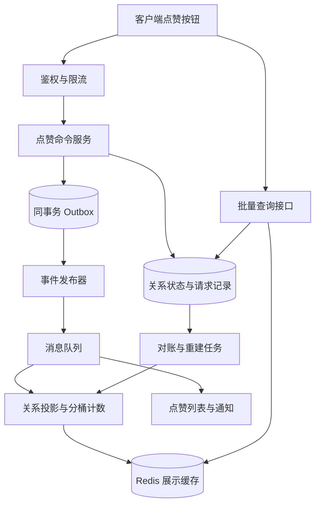
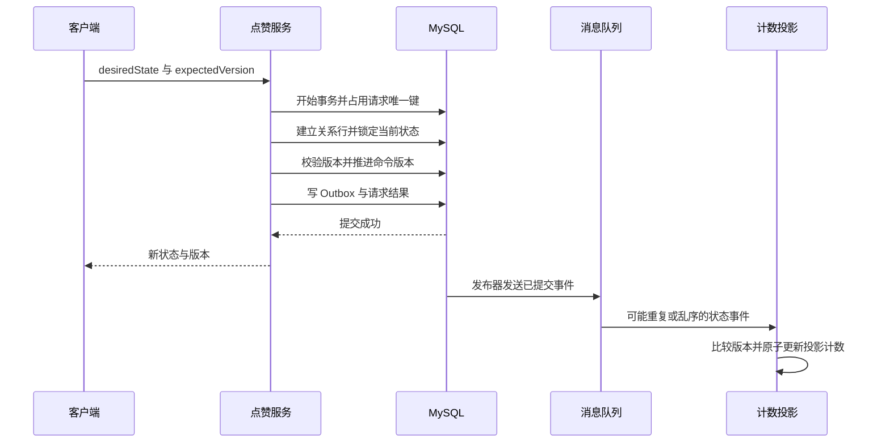

# 第 8 章 点赞系统：把用户状态、显示计数和事件传播分开设计

## 8.1 从完整功能架构开始

点赞看起来只有一个按钮，真正需要回答的是四类问题：用户对某对象是否点赞、对象总共获得多少赞、谁给对象点过赞、用户点过哪些对象。这四种查询不必由同一张表、同一个 Redis Set 或同一个强一致事务承担。下面以“关系状态在 MySQL 中可靠保存，计数和列表异步生成”为主方案；规模较小时，可以先在同一数据库事务中维护关系和计数。



数据库关系状态是事实，展示计数是事实的一个投影。用户撤销点赞后，事实先变化，计数、榜单和通知可以随后收敛。产品若要求“操作后马上看到正确状态”，写接口直接返回已提交的新状态和版本；不能为了让一个数字立刻变化，把所有派生系统都放进同步链路。

**示例容量假设：**日活 1000 万，每人每天发生 20 次点赞或取消操作，则每天约 2 亿次操作，均值约 2315 次/秒；以 20 倍峰值估算约 4.6 万次/秒。一次操作不一定产生新关系，存储量应按“独立用户与对象关系数”估算；事件日志按首次接受的合法命令数估算，包括目标状态未改变的命令，网络幂等重试不重复产生事件。若某热门对象占全部写入的 30%，即使总体容量够用，单对象计数行也可能先成为瓶颈。这些数值用于容量估算。

## 8.2 先定义语义，才能选择幂等方案

推荐接口：

```http
PUT /v1/objects/{type}/{id}/like
Idempotency-Key: 由客户端为本次操作生成的唯一值

{
  "liked": true,
  "expectedVersion": 7
}
```

这里有三种不同的保证：

| 机制 | 解决的问题 | 没有自动解决的问题 |
|---|---|---|
| `liked=true/false` 目标状态 | 同一状态被重复设置时不反复翻转 | 两个相反状态请求乱序到达 |
| `Idempotency-Key` | 同一个请求因超时重试时返回同一结果 | 用户真的发出了第二次、第三次操作 |
| `expectedVersion` 条件更新 | 客户端基于旧状态的请求不能覆盖新版本 | 不同设备真实意图的先后关系，需要产品定义 |

不能设计成简单 `POST /toggle`：网络重试两次，服务端会先点赞再取消，结果恰好与用户意图相反。但改成 `set liked=true` 也不是完整答案。例如用户先点赞 A，再取消 B，网络使 B 先到、A 后到，服务端按到达顺序执行仍然会得到点赞。解决方法包括：同一客户端同一对象串行发送，服务端使用版本条件；或者定义可信的操作序列，并拒绝更旧序列。手机本地时间不能直接充当全局先后标准，因为时钟可以漂移，多设备也没有天然共同序列。

本方案使用服务端关系版本：客户端看到版本 7，提交 `expectedVersion=7`。服务端只允许从 7 改为 8。另一个同样基于 7 的相反请求收到冲突，客户端获取最新状态后决定是否提交新的意图。这个过程让冲突显式发生，避免悄悄覆盖。若产品接受“服务器最后接收的操作生效”，也可以不用条件版本，但必须如实说明语义。

这里的 `version` 同时是命令接受的防旧写版本：**每个首次接受的合法命令都推进一次版本，即使目标状态与当前状态相同；同一幂等键的重试只返回原结果，不再推进。**例如当前为 `false/v7`，用户较新的取消命令先到，必须提交为 `false/v8`，这样较旧的点赞命令携带 expectedVersion=7 后到时才能被拒绝。如果取消因为“不改变状态”就直接成功返回 v7，旧点赞仍会成功覆盖它，版本检查也就失去保护。服务端版本解决的是并发冲突检测，不会凭空知道跨设备真实意图先后；冲突后的重新提交仍由客户端决定。

## 8.3 关系表、请求表和事件表

```sql
CREATE TABLE like_relation (
  tenant_id    BIGINT NOT NULL,
  target_type  SMALLINT NOT NULL,
  target_id    BIGINT NOT NULL,
  user_id      BIGINT NOT NULL,
  liked        TINYINT NOT NULL,
  version      BIGINT NOT NULL,
  updated_at   DATETIME(6) NOT NULL,
  PRIMARY KEY (tenant_id, target_type, target_id, user_id),
  KEY idx_user_recent (tenant_id, user_id, liked, updated_at, target_id)
) ENGINE=InnoDB;

CREATE TABLE like_request (
  user_id       BIGINT NOT NULL,
  request_id    VARCHAR(64) NOT NULL,
  payload_hash  BINARY(32) NOT NULL,
  response_json JSON NOT NULL,
  created_at    DATETIME(6) NOT NULL,
  PRIMARY KEY (user_id, request_id)
) ENGINE=InnoDB;

CREATE TABLE like_outbox (
  event_id       BIGINT NOT NULL,
  aggregate_key  VARBINARY(128) NOT NULL,
  version        BIGINT NOT NULL,
  payload        JSON NOT NULL,
  published      TINYINT NOT NULL DEFAULT 0,
  created_at     DATETIME(6) NOT NULL,
  PRIMARY KEY (event_id),
  UNIQUE KEY uk_relation_version (aggregate_key, version),
  KEY idx_pending (published, event_id)
) ENGINE=InnoDB;
```

主键约束把“一名用户对同一对象只有一个当前状态”交给数据库执行；涉及唯一性的列都设为非空。唯一约束是并发下的最终防线，不能只在业务代码里先 `SELECT`、查不到再 `INSERT`。MySQL 对主键和唯一键的约束行为以官方文档为准。[C11]

取消点赞时保留 `liked=0` 的状态行，而不是立刻物理删除，原因是它同时保存版本。若先删掉版本 8 的取消状态，重放版本 7 的点赞事件可能被误认为一条新关系。这个“墓碑”是业务状态版本，与 Kafka 日志压缩使用的空值墓碑不是同一个概念。

墓碑不一定永久保存。要先确定请求、消息、备份回放的最大保留窗口；清理之前建立更高层的版本水位，保证过旧请求和事件不再被接受。不能一边允许无限历史重放，一边声称几天后删掉所有版本仍然安全。

## 8.4 一次点赞怎样完整提交



服务端伪代码重点是一个本地事务，而不是在 Java 进程里加锁：

```java
// 示意代码：repository 的写入使用同一个数据库事务。
// 请求唯一键冲突必须回滚当前尝试，再查询已经提交的原请求结果。
public LikeResult setLike(LikeCommand cmd) {
    return transactionTemplate.execute(status -> {
        requestRepo.claim(cmd.userId(), cmd.requestId(), hashPayload(cmd));
        // 首次创建用唯一键兜底；并发插入冲突按数据库异常规则处理。
        relationRepo.ensureInitialRow(cmd.key(), false, 0L);
        LikeRelation old = relationRepo.selectForUpdate(cmd.key());
        if (old.version() != cmd.expectedVersion()) {
            return requestRepo.finishConflict(cmd, old.state(), old.version());
        }
        // 即使 desiredState 与当前相同，也要推进防旧写版本。
        // 同一幂等键重试由 claim 冲突后的原结果查询处理，不走到这里。
        long next = old.version() + 1;
        relationRepo.update(cmd.key(), cmd.desiredState(), next);
        outboxRepo.insert(new LikeStateSnapshot(
            newEventId(), cmd.key(), next, cmd.desiredState(), old.state()));
        return requestRepo.finishSuccess(cmd, cmd.desiredState(), next);
    });
}
```

实现时还要补齐：同一幂等键若携带不同请求体应拒绝；请求状态未提交时，重复请求可以短暂等待或返回处理中；数据库提交结果因网络中断而未知时，查询请求记录再决定下一步。不要把未知结果直接等同失败，然后换一个幂等键再发。

`ensureInitialRow` 可以用明确的无变化 upsert 建立初始行，再做锁定读取；例如 `INSERT ... VALUES (...,0,0,NOW(6)) ON DUPLICATE KEY UPDATE version=version`。它只是建行，不是接受命令；随后每个校验通过的新命令仍要执行 `version+1`。不能根据建行 upsert 的 affected rows 判断本次是否发生点赞。请求占位行可先写空响应对象，在同一事务完成前填入结果；未提交的占位不对其他事务当作最终成功暴露。

`SELECT ... FOR UPDATE` 的锁由索引访问路径和隔离级别共同决定。完整唯一条件定位已存在记录时可只锁索引记录；范围扫描、未命中查找等情况不能照搬“一定只锁一行”的说法。[C01] 在本方案中按完整关系主键访问、事务保持短小，能够显著缩小冲突范围。无需再为整个对象建立 Redis 分布式锁，那会把不同用户本来独立的点赞串行化。

## 8.5 总数怎样做到重复、乱序都不算错

最容易答错的方案是：“消息带版本，大于当前版本就 `INCRBY delta`，旧版本直接丢弃。”例如状态变化为：版本 1 点赞 `+1`，版本 2 取消 `-1`。若版本 2 先到，被执行 `-1`；版本 1 后到又被当旧消息丢弃，计数就错了。**状态覆盖可以丢弃旧版本，增量求和通常不能随意丢弃旧增量。**

有两条正确路径。

**路径 A：完整增量流水。**每个已经提交的状态变化产生一个唯一事件，消费者对 `event_id` 去重，再原子修改计数。只要不漏掉任何增量，`+1` 和 `-1` 的总和不受到达顺序影响；不过中间计数可能暂时变成负数，列表状态仍需版本。去重记录和计数必须具有共同的原子提交边界，否则“先写去重再加计数”会漏算，“先加计数再写去重”会重算。该方法还要求补偿、清算和重放使用一致事件语义。

**路径 B：最新状态投影。**为每个关系保存 `applied_version` 和 `applied_liked`。收到新版本状态时，用“新状态减投影旧状态”作为本次计数变化，并在同一事务提交。版本 2 的取消先到，投影原本就是未赞，变化为 0；版本 1 后到被丢弃，最终计数正确。主方案选择这条路径，因为它能直接从关系事实重建。目标状态不变的新命令也发布绝对状态和新版本；投影追平版本时，若自身状态也未变，delta 为 0，不能再加一。如果投影此前落后，新快照仍可一次修正到当前状态。

```text
事务开始
  锁定 projection[用户, 对象]
  如果 event.version <= projection.version：提交并返回
  delta = (event.liked ? 1 : 0) - (projection.liked ? 1 : 0)
  写入 projection 的新状态与新版本
  counter[对象, bucket] += delta
事务提交
```

投影状态与相应计数桶可以放在同一数据库分片中，让单条事件的处理成为本地事务。若它们分属两个系统，就不能把上面四行伪代码当作已经有了原子性：需要新的 Outbox、事务日志或允许重建的投影协议。Redis Lua 也只能覆盖同一 Redis 执行范围中的数据，不能同时原子提交 MySQL。

## 8.6 热点对象、分桶计数和批量查询

一个明星对象有百万用户并发点赞，关系行按不同用户分散，仍可能有一个总计数行被所有请求争抢。可以按 `bucket=hash(user_id) % B` 拆计数，保持同一用户关系的投影和桶路由稳定。

| 方案 | 读写代价 | 适用条件 |
|---|---|---|
| 同事务更新单计数行 | 读极便宜，写在热点对象上串行 | 早期规模、热点可控、强一致计数 |
| 分桶计数并实时求和 | 写分散，读需要访问多个桶 | 桶数有限、读量较低 |
| 分桶计数加周期聚合快照 | 写分散，读便宜，有可说明的延迟 | 大规模内容平台展示计数 |
| 日志批量聚合 | 高吞吐，结果延迟更明显 | 榜单、分析、非即时展示 |

分桶后不能“随时把 B 从 16 改成 32”：旧关系的取消若路由到新桶，会在新桶减数、旧桶留下原来的加数。应把分桶版本写入投影路由，或者重建一代新计数并在一致水位切换。扩桶也需要迁移协议。

页面一次展示 50 个对象，不应逐个 RPC 查询“总赞数”和“我是否点过赞”。提供批量接口，先批量读取计数快照，再按当前用户和对象 ID 列表读取关系，返回每个对象的 `liked`、关系版本、计数版本或更新时间。对于列表中的十几个小字段，减少网络往返往往比换一种 Redis 数据类型更有价值。

Redis Set 适合中等规模的成员存在判断，但把一个超级热点对象的全部用户 ID 塞进单个 Set 会形成大 key。Bitmap 适合 ID 空间相对紧凑且可建立映射的场景；用户 ID 非常稀疏时不能直接拿巨大 ID 当位偏移。仅有 Bitmap 也难以表达点赞时间、关系版本、审核撤销原因，因此它通常是派生加速结构。

## 8.7 读你之写、缓存一致性与对账

写接口成功后，客户端立即使用返回的新关系状态。随后列表查询若读到落后的副本或缓存，应比较关系版本，不能让 UI 从版本 8 回退到版本 7。必要时短时间将该用户该对象的状态读取路由到主库，或让查询携带最小可接受版本。这个最小版本只保障该关系，不等于全站所有数据都强一致。

总数的乐观显示可以做成本地视觉变化，但不能永久叠加。客户端要记录“这个本地增量对应哪次尚未反映的操作”，等服务器投影追上后消除本地覆盖；否则服务器已加 1，客户端仍额外加 1，反而重复展示。更简单的面试方案是：自己的图标即时确定，总数带短暂延迟，由后续响应刷新。

缓存写入要携带投影版本或生成代号，拒绝旧快照覆盖新快照。若删除缓存后旧查询回填旧值，单纯“先更新数据库再删缓存”仍有竞态。可以用有界 TTL 加版本校验收敛；对准确性要求更高时引入失效水位。使用 Redis 里当前不存在的键作为“可以随便回填”的判断是不够的，删除会同时删掉抵御旧值的信息。

对账不能在持续写入时分别 `COUNT(*)` 和读取计数，看到不一致就直接覆盖。两次读取可能对应不同时间点。可选方法是取一致快照与水位，在新一代计数上完成全量重建，再追平水位后的状态事件，校验后切换；小范围单对象修复也要以关系版本或有序日志位置协调，不能把正在发生的新点赞抹掉。

## 8.8 故障与恢复矩阵

| 故障窗口 | 正确判断 | 处理方式 |
|---|---|---|
| 点击后客户端没收到结果 | 服务端可能已提交 | 用原幂等键重试或查操作结果 |
| 两个设备同时修改 | 两个不同意图发生冲突 | expectedVersion 检测，客户端获取新版本后决定 |
| 数据库提交后进程崩溃 | 状态已经成功，事件可能未发 | 同事务 Outbox 恢复发布 |
| 事件已发但 published 未更新 | 可能重复发布 | 下游以事件或关系版本幂等 |
| 取消事件先于点赞到达 | 最新状态与历史增量语义不同 | 最新状态投影按新旧状态差计算 |
| Redis 数据丢失 | 展示层不可用，事实仍在 | 限流回源、从可靠投影或事实重建 |
| 热门对象计数行锁等待高 | 单行写入竞争 | 分桶投影，读聚合快照 |
| 对象已删除仍收到点赞 | 请求与对象删除并发 | 写入校验、读取强制过滤、异步清理关系 |
| 去重表无限增长 | 请求和事件保留策略未设计 | 定义重试窗口并建立清理水位 |
| 总数和列表不一致 | 投影时间点或可见性规则不同 | 统一口径与版本，再做有水位对账 |

对外计数是否包含被封禁用户、机器人、私密对象中的点赞，需要提前定义。不能把风险撤销简单地做成后台 `count--` 而不修改相应关系事实，否则重建后被撤销的数量又会回来。风险处置可以成为新的可审计状态转换。

## 8.9 监控、验证与扩展

应监控写接口成功率、P99、同对象锁等待、版本冲突率、幂等键冲突、Outbox 最老未发年龄、计数投影延迟、热点对象偏斜和定期对账差异。投影延迟比消息数量更贴近用户体验：十万条小事件可能很快处理，一条卡住的热点关系也可能迟迟不收敛。

验证需要构造重复请求、相反操作乱序、数据库提交后断网、消费者事务提交后未确认、Redis 清空、历史事件重放、扩桶期间取消点赞等场景。断言应是“当前关系唯一、已确认操作可查询、重放后计数等于可见点赞事实”，而不是仅验证一次请求返回 200。

扩展路径可以是：单库关系和计数同事务 → Outbox 异步计数 → 分桶计数与批量查询 → 热点单独治理 → 按访问模式分片和派生列表。不要一开始就把每个点赞拆成十几个服务，但每一步都保留未来可迁移的关系主键、版本和事件标识。

## 8.10 连续追问与参考回答

### Q1：为什么不用 Redis 的 `INCR` 直接实现点赞？

`INCR` 只保证单次计数修改的原子性，不知道谁点过赞，也不知道某次重试是不是已经执行。最少需要关系去重、取消规则和恢复来源。若 Redis 是唯一事实存储，还要明确持久性和故障丢失预算。大多数业务更容易解释为“关系可靠落库，Redis 加速展示”。

### Q2：唯一键有了，为什么还需要请求幂等键？

唯一关系保证不会有两条当前关系，却不能识别“同一操作重试”与“用户后来再次点赞”。请求记录保存一次命令的结果，关系版本保存对象当前事实，两者作用不同。幂等键还应绑定请求体，防止一个键被用于不同对象或不同目标状态。

### Q3：`PUT liked=false` 重试是不是天然安全？

同一幂等键重试应返回同一个已提交结果。新的 `liked=false` 命令即使不改变当前布尔状态，也必须推进该方案的防旧写版本；否则它先到但不升版本，较旧的相反命令仍可携带相同 expectedVersion 后到并成功。需要请求窗口和命令版本，或者明确接受服务器到达顺序。把“HTTP 方法幂等”解释成“跨设备乱序也一定正确”是不成立的。

### Q4：数据库成功了、MQ 失败了怎么办？

把状态和 Outbox 放在同一个本地事务。发布器继续发送未完成事件，成功响应以状态事务为准。发送与标记的间隙可能造成重复，所以消费者必须幂等。Outbox 解决可恢复发布责任，不承诺 MQ 与数据库天然组成一个事务。

### Q5：为什么最新状态投影能跳过旧版本，而 delta 不能？

最新状态包含“现在应当是什么”，可以用它替换旧投影并计算差；delta 只描述“发生了一次什么变化”，缺少其他增量就无法求正确总和。因此事件契约必须写明是状态还是变化，消费者不能混用二者语义。

### Q6：百万点赞事件全部落同一个对象，按对象分区不就解决了吗？

按对象分区能集中处理和维护顺序，却也把热点集中在一个分区。点赞关系通常只要求单个用户与对象有序，不要求所有用户之间有序，因此可以按关系或计数桶分区。强制不必要的全对象顺序会损失并行能力。

### Q7：我既要总数实时准确，又要单对象百万并发写，怎么回答？

先量化“实时准确”：是否每次读取都必须线性化地反映所有已提交写入。若是，单对象的全局协调成本不能消失，分桶也需要一致快照或读协调。可以减少业务要求，改为自己操作即时、全局总数短延迟；若不能改变，就按真实协调能力给容量和延迟预算，不承诺无成本两者兼得。

### Q8：缓存没了，直接 `COUNT(*)` 重建是否可行？

小对象低频可行，热点对象会造成昂贵扫描和回源放大。应优先读可靠计数投影，有界限流重建，并按一致水位重建以避免覆盖新变化。全站 Redis 故障时必须有限流和降级，不能让所有页面同时扫描关系表。

### Q9：取消点赞后可以马上删关系吗？

如果系统还会重放旧请求或事件，立刻删掉版本会丢失拒绝旧写的依据。保留未赞状态或独立版本墓碑，在历史窗口过后按水位清理。若采用永久去重日志，成本也要纳入容量设计。

### Q10：如何做“谁给我点过赞”的通知？

绝对状态事件可以同时携带权威事务读到的 `previousLiked`。只有它表示 `false → true` 的真实变化时才产生点赞通知，目标状态未变但版本推进的命令不再次通知；通知侧仍以事件 ID 去重。计数投影依然用“新状态减投影自己的旧状态”，不能把这个上游 previousLiked 误作乱序计数依据。反复点赞取消不应无限轰炸，可以按用户、对象和时间窗聚合。通知送达属于外部副作用，应有自己的重试与状态；取消点赞是否撤销通知，是产品规则，不要默认做成数据库级回滚。

### Q11：总数偶尔不准，晚上全量覆盖就好了么？

简单覆盖会和白天持续写入竞争，也可能把迟到事件算两次。重建要有快照、日志水位、新投影代号和切换步骤。对账是正确性协议的一部分，而不是用一个定时 `SET` 掩盖缺失的幂等设计。

### Q12：这种状态模型如何用于 NoteWeave 类资料研究平台？

资料收藏、回答反馈、研究单元人工标记都可以复用“关系状态＋版本＋可靠事件＋派生统计”。尤其是资料撤销后拒绝旧缓存回填，与取消点赞保留版本墓碑具有同一类因果关系。

### Q13：一个用户给十万个对象点赞，用户维度也会热，怎么办？

先识别是否异常流量，限制用户速率和批量大小；合法大规模导入可走异步批处理。按用户分片利于查询“我赞过的”，但超级用户仍可能热点，所以可以增加用户内分桶和游标合并。不能仅把 key 换成 user_id 就认为偏斜消失。

### Q14：点赞表分片后还保得住用户与对象唯一吗？

只有同一个关系始终路由到同一权威分片，分片内唯一键才足够。路由改变期间必须迁移唯一主权，旧路由拒写或重定向。若两个分片同时接收同一关系，两个局部唯一键不能构成全局唯一约束。

**技术参考：**[C01] [MySQL 8.4 InnoDB Locking](https://dev.mysql.com/doc/refman/8.4/en/innodb-locking.html)；[C11] [MySQL 8.4 PRIMARY KEY and UNIQUE Index Constraints](https://dev.mysql.com/doc/refman/8.4/en/constraint-primary-key.html)。

## 8.11 场景推演：爆款内容每秒十万次点赞，如何保护写入并避免扩桶算错

假设一个热点内容出现每秒十万次合法点赞或取消，自己的状态要求即时确定，总数允许两秒延迟。先观察是同一用户反复操作、不同用户关系写入，还是共用总数行造成串行。三种负载对应不同处理，不能统一加一把目标对象锁。

### 关系事实尽量并行，总数投影另行聚合

不同用户的关系行可以并行提交；请求幂等、关系版本和 Outbox 在各自本地事务内完成。单个总数行若成为热点，改成按稳定用户桶更新投影。显示读取复用总数快照，本人状态直接使用写响应或带最小版本的查询。

如果微批中同一关系出现多个绝对状态事件，统计投影可以只处理最大版本，但通知与审计仍保留自己的完整事实。处理投影时根据“新状态减投影旧状态”计算差值，不能仅因为事件是点赞就一律加一。F.2 给出了微批、桶路由和幂等保留的完整链路。

### 面试官追问：不改变状态，为什么也发事件？

当前关系未赞 v7，新取消命令首先被接受，应该成为未赞 v8；它不增加计数，但必须推进拒绝旧命令的版本屏障。发出完整未赞 v8 事件，还可以让落后的投影越过旧状态一次收敛。如果只在真假发生变化时发事件，物化端可能一直不知道这道更新过的屏障。

同一幂等键的重复请求不会再推进版本，因为它不是新命令。同键不同请求体应拒绝；数据库提交结果未知时，查原请求记录，不换新键盲目再做。这三条规则分别处理 no-op、重复和未知结果，不能混为一条“加幂等”。

### 面试官追问：扩 128 桶为什么总数偶尔为负？

可能旧点赞落在 64 桶规则的桶 17，新取消落在 128 桶规则的桶 81。桶 81 从零减一，桶 17 遗留一；总和偶尔看似没错，但修复任一桶后就会显露错误。扩桶前后必须携带路由代号，或完整构建新投影后按水位切换，不能只改配置里的桶数。

单个计数快照还需要自己的生成版本。旧聚合任务执行慢，在新快照发布后才写回，必须被拒绝；否则关系全都正确，总数页面仍会倒退。缓存版本保护属于发布协议，不是仅给关系表加一个 version 就全部解决。

### 面试官追问：去重记录越来越大，能否用 Bloom 替代？

Bloom 的假阳性可能将一个未处理事件认成已处理，从而少算或漏通知。可用它引导查询精确去重记录，但不能直接丢弃命中事件。最新状态投影通过持久版本收敛，并不需要永久保存每一个派生投影事件 ID；客户端请求结果、审计流水和奖励唯一记录则各自按契约保留，不能一刀切清理。[F09]

### 怎么证明它真的扛住高并发

用相同权威关系快照计算精确计数，与投影在相同水位对比；随机制造点赞取消乱序、重复、超时重试和扩桶。性能方面记录关系事务等待、各桶负载、最大桶与平均桶比值、微批等待、最老未应用事件年龄和总数快照年龄。

热点过载时限制单用户未完成命令、返回明确重试或冲突，优先保护已接受命令的完成；总数降级为旧快照或暂不展示，不把取消操作伪装成成功。自己的状态和公开总数分开降级，能在可用性与真实性之间保持清楚边界。

**相关专题：** [Redis缓存与排行榜](19_Redis缓存与排行榜.md) · [Kafka可靠性与积压治理](20_Kafka可靠性与积压治理.md) · [高并发准入与分布式锁](23_高并发准入与分布式锁.md)。

[C01]: https://dev.mysql.com/doc/refman/8.4/en/innodb-locking.html "MySQL 8.4 InnoDB Locking"
[C11]: https://dev.mysql.com/doc/refman/8.4/en/constraint-primary-key.html "MySQL 8.4 PRIMARY KEY and UNIQUE Index Constraints"
[F09]: https://redis.io/docs/latest/commands/bf.reserve/ "Redis BF.RESERVE"
