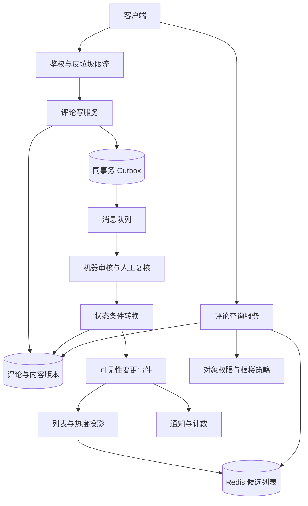
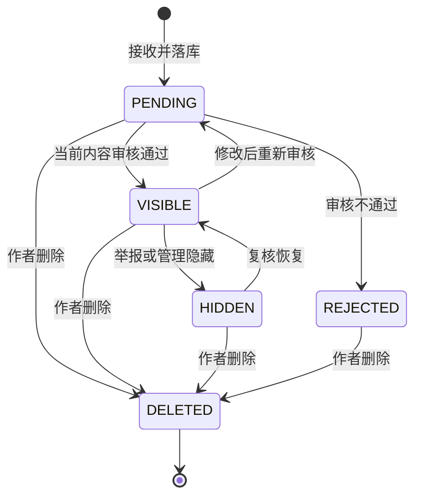
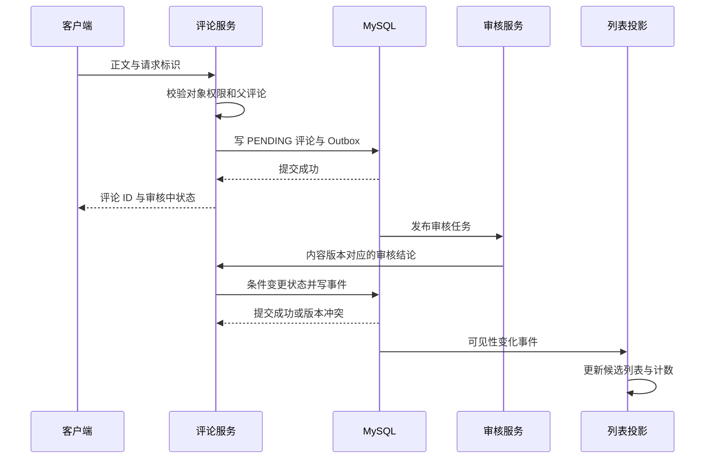

# 第 9 章 评论系统：树结构、审核、分页和可见性的一致设计

## 9.1 一张架构图说明完整链路

评论系统需要同时支撑“写入被可靠接收”“内容决定何时可见”“列表稳定展示”“删除和权限变化及时生效”。它不仅是给内容表加一个 `parent_id`。下面设计以 MySQL 保存评论事实，审核决定发布状态，Redis 保存候选列表，读取阶段再复核可见性。



这里刻意区分“候选列表”和“可见结果”。缓存中存在某条评论，不能证明用户现在有权看到它；评论可能刚被删除、作者被封禁、原文变为私密，或者根楼已被管理员隐藏。因此列表缓存负责减少候选检索成本，最终可见性由权威状态和权限规则决定。

**示例容量：**日活 1000 万，平均每人每天 2 条评论，约 2000 万条/日，平均写入 231 条/秒；若峰值系数为 15，约 3500 条/秒。每条正文平均 300 字节，正文原始量约 6 GB/日；加上元数据、索引、版本历史、复制和备份会明显增加。读取通常远多于写入，热门内容可能贡献大部分请求，所以数据库行数与单内容流量都要估算。

## 9.2 两层展示与无限嵌套不是同一道题

“楼中楼”通常指页面只展示根评论和其下回复，但回复仍能指向另一条回复。可以同时保存 `root_id` 和 `parent_id`：前者决定属于哪个讨论串，后者表达实际回复关系。根评论的 `root_id=id`，`parent_id=0`。所有回复都挂在根楼下分页，正文中显示“回复某某”，避免前端无限缩进。

| 模型 | 适合的查询 | 写入和维护代价 | 主要风险 |
|---|---|---|---|
| 邻接表 `parent_id` | 查直接孩子、修改父关系 | 单条写入便宜 | 查全子树需要递归，深度要受控 |
| `parent_id + root_id` | 两层展示、整个讨论串分页 | 冗余根 ID，写入时验证 | 不支持任意子树快速查询，需要额外路径 |
| 物化路径 | 查某路径下后代 | 路径增长，移动子树昂贵 | 深度、路径长度和编码规则 |
| 闭包表 | 祖先与后代关系查询 | 一次写入多行祖先关系 | 深树或大树写放大和空间成本 |
| 嵌套集合 | 相对静态树的范围查询 | 插入和移动可能改很多节点 | 高频评论不适合频繁整体编号 |

本题主方案采用 `parent_id + root_id`，并限制回复链深度和单页数量。评论通常不需要“任意移动子树”，没有必要为很少出现的功能引入昂贵的闭包维护。若题目明确要求论坛式无限嵌套，再升级模型，而不是把两层系统硬称为支持无限树。

## 9.3 表结构、索引和接口

```sql
CREATE TABLE comment (
  id              BIGINT NOT NULL,
  tenant_id       BIGINT NOT NULL,
  object_type     SMALLINT NOT NULL,
  object_id       BIGINT NOT NULL,
  root_id         BIGINT NOT NULL,
  parent_id       BIGINT NOT NULL DEFAULT 0,
  author_id       BIGINT NOT NULL,
  client_req_id   VARCHAR(64) NOT NULL,
  request_hash    BINARY(32) NOT NULL,
  state           VARCHAR(16) NOT NULL,
  content_version BIGINT NOT NULL,
  state_version   BIGINT NOT NULL,
  body            TEXT NOT NULL,
  created_at      DATETIME(6) NOT NULL,
  updated_at      DATETIME(6) NOT NULL,
  PRIMARY KEY (id),
  UNIQUE KEY uk_author_request (tenant_id, author_id, client_req_id),
  KEY idx_thread (tenant_id, root_id, state, created_at, id),
  KEY idx_author (tenant_id, author_id, created_at, id)
) ENGINE=InnoDB;

CREATE TABLE comment_thread (
  root_id       BIGINT NOT NULL,
  tenant_id     BIGINT NOT NULL,
  object_type   SMALLINT NOT NULL,
  object_id     BIGINT NOT NULL,
  created_at    DATETIME(6) NOT NULL,
  listed        TINYINT NOT NULL DEFAULT 0,
  policy        VARCHAR(16) NOT NULL,
  policy_version BIGINT NOT NULL,
  PRIMARY KEY (root_id),
  KEY idx_root_listing (tenant_id, object_type, object_id,
                       listed, created_at, root_id)
) ENGINE=InnoDB;
```

`comment_thread.policy` 可以为 `NORMAL`、`READ_ONLY`、`HIDDEN`，分别表示正常讨论、关闭新回复、整楼隐藏。把它独立于根评论作者删除正文的状态，是为了区分两件事：作者删掉自己的发言，可以保留“该评论已删除”的占位和其他人的合法回复；管理员封禁整楼，则需要隐藏整条讨论。

`comment_thread` 同时保存独立的根楼展示锚点。根评论创建时 `listed=0`，首次发布成功时在同一事务置为 1；作者随后删除正文，不把这个锚点一并删除。待审或被拒绝且从未公开的根评论保持 `listed=0`，不能因作者删除而突然出现在公开列表。该方案选择“曾公开的根楼在作者删正文后保留占位”的规则，即使暂时没有回复也可保留；若产品要回收空楼，另用有并发保护的清理流程。管理员整楼隐藏修改 `policy=HIDDEN`；作者删除正文不得把已隐藏的 policy 改回 NORMAL。

联合索引应从实际查询条件出发。根列表从 `idx_root_listing` 按对象和 `listed=1` 定位，随后按根楼原始创建时间与 ID 游标，并复核 policy；`idx_thread` 服务某一讨论串的可见回复。多列索引的左前缀能力见 MySQL 官方说明。[C02] 不应因为表中出现十几个字段，就给每个字段各建一个单列索引。

接口至少包括：创建评论、查看自己的提交状态、按时间分页根评论、展开某楼回复、编辑、删除、举报、管理审核和热评列表。创建接口应返回 `comment_id`、当前状态和版本。若先审后发，可以返回“已接收，审核中”；不能返回“发布成功”却让所有人永远看不到。

```http
POST /v1/objects/{type}/{id}/comments
Idempotency-Key: 客户端请求标识

{
  "parentId": 0,
  "body": "评论正文"
}

GET /v1/objects/{type}/{id}/comments?sort=time&cursor=...
GET /v1/comments/{rootId}/replies?cursor=...
DELETE /v1/comments/{commentId}?expectedVersion=...
```

`root_id` 由服务端根据父评论计算，不信任客户端任意指定。必须校验父评论属于相同租户和相同原对象，否则攻击者可以制造跨对象关系，甚至利用错误关联绕过权限。

`request_hash` 记录创建时的原始对象、父评论和正文摘要，用于检查幂等键是否被不同请求重用。不能在评论已经编辑后，拿当前正文与旧创建请求比较来判断是否为同一次请求；原始请求身份应保持稳定。

## 9.4 发布、审核、编辑和删除的状态机



状态机还要关联内容版本。审核员检查的是版本 3 的正文，用户在此期间改成版本 4；版本 3 的“通过”结果不能让版本 4 自动发布。条件写入示例：

```sql
UPDATE comment
SET state = 'VISIBLE', state_version = state_version + 1,
    updated_at = NOW(6)
WHERE id = ?
  AND state = 'PENDING'
  AND content_version = ?
  AND state_version = ?;
```

只有影响一行才代表这个审核结论成功应用；影响零行表示状态或内容已变化，需要读取当前事实判断，不能盲目重试覆盖。状态转换与对应的可见性事件在一个事务中写入。用户删除后，迟到审核、缓存回填和重放事件都必须受版本约束。

这个状态机描述评论正文，不替代根楼锚点和整楼策略。根评论首次通过时，同事务推进 `comment_thread.listed=1`；管理员将根评论所属整楼封禁时，同事务推进 `policy=HIDDEN` 与 policy_version。作者把正文改成 DELETED 时保留原 listed 和 policy，读取侧只生成占位文本，绝不返回已删正文。根评论重新审核期间，该方案选择暂不展示该根楼正文入口；审核通过再恢复，已有回复事实不删除。

编辑可选两种产品语义：编辑后原版本暂时下线，等待新版本审核；或者保留旧的已通过版本对外可见，新版本只在审核通过时替换。后一种体验更平滑，但需要 `published_content_version` 和草稿版本分开保存，查询不能误取最新未审正文。面试中必须说清自己选择哪种。

先审后发、先发后审、分级审核三者各有代价。先审后发内容风险更低，但可见延迟更大；先发后审体验快，却存在违规内容暴露窗口；分级策略可以让低风险短文本快速通过，高风险用户、链接或多媒体走更严格链路。审核超时不等于审核通过，降级策略要明确显示状态。

## 9.5 正常发布的事务时序



写入正文前要鉴权、限制正文大小、限制单位时间评论数量，并对父评论与原对象进行校验。涉及昂贵机器审核或人工审核时，不能一直持有数据库事务和连接等待；先可靠记录待处理责任，再异步执行。这个模式也可迁移到制造业通知和 NoteWeave 资料处理。

若要求“关闭讨论和新回复绝不并发成功”，关闭操作与回复创建必须在同一个权威串行化范围内，例如同库锁定 `comment_thread` 行后检查 `policy` 再插入。若原内容与评论分属不同服务，简单先 RPC 查询“是否允许评论”存在时间窗口。可以接受短窗口并由读取规则兜底，也可以给关闭操作建立版本门控或统一权威；不能假装一个远程布尔查询就实现了跨服务原子性。

## 9.6 按时间分页：不用大 OFFSET，也不能只用时间戳

根评论按 `(created_at DESC, id DESC)` 排序。第一页取得一批数据后，返回最后一条的时间和 ID，下一页查询：

```sql
SELECT t.root_id AS id, c.author_id, c.state, t.created_at
FROM comment_thread AS t
JOIN comment AS c
  ON c.id = t.root_id AND c.tenant_id = t.tenant_id
WHERE t.tenant_id = ?
  AND t.object_type = ? AND t.object_id = ?
  AND t.listed = 1
  AND t.policy IN ('NORMAL', 'READ_ONLY')
  AND c.state IN ('VISIBLE', 'DELETED')
  AND (
    t.created_at < ?
    OR (t.created_at = ? AND t.root_id < ?)
  )
ORDER BY t.created_at DESC, t.root_id DESC
LIMIT 21;
```

查询返回 DELETED 根楼时，服务端生成“该评论已删除”的占位，并允许按该 root_id 获取仍可见的回复；正文接口同样拒绝返回已删内容。VISIBLE 根楼才补齐正文。不能再用 `comment WHERE parent_id=0 AND state='VISIBLE'` 作为唯一入口，否则删除根评论就会把保留的子回复变成首页无法展开的孤楼。展开回复仍需校验当前原对象权限和根楼 policy，不能仅凭持有 root_id 绕过整楼封禁。

取 21 条是为了展示 20 条并判断是否还有下一页。相同创建时间用 ID 打破并列，避免分页随机重复。`LIMIT 100000,20` 即使走索引也常需越过大量记录；游标直接给出继续扫描的位置，更适合下拉加载。具体执行计划仍要验证，不能仅根据 SQL 外观推断。

游标可以包含对象、排序方式、排序版本、最后键值和签名，防止被随意修改为跨租户查询；身份和权限仍在每次请求重新验证。第一页到第二页期间新增评论可以留待用户刷新，这通常比插入当前遍历窗口更稳定。若需要严格固定快照，必须增加快照上界并解决旧内容状态变化问题；单一时间上界无法冻结后来变化的热度和审核状态。

查询得到 20 个候选后，若 8 个因权限、删除或封禁不可见，不能直接把数据库已扫描范围忘掉，否则下一页反复扫描同一批。返回游标应标识实际扫描进度，服务端可以有限次补取直到凑足一页或达到成本上限。禁止为凑满 20 条在大规模过滤时无限扫描。

## 9.7 置顶、热评和用户个性化排序

置顶列表与普通时间流最好作为两个区域返回，并在普通流中去掉置顶 ID。这样置顶变化不会频繁扰动普通游标。如果把 `is_pinned`、热度和时间全部混在一个实时排序键里，跨页时置顶或热度变化会把记录移动到游标前后，重复和漏读都难解释。

热评分数可以来自赞数、回复数、作者可信度、时间衰减和风险惩罚，但公式必须版本化。展示热评时有三种选择：

| 模式 | 实现 | 分页语义 |
|---|---|---|
| 仅展示 TopN 热评 | 定期刷新一个有界候选集合 | 不承诺深翻页稳定 |
| 一次浏览固定榜单快照 | 生成 ranking_epoch，游标绑定该代 | 页间稳定，有可见刷新延迟 |
| 实时重排并去重 | 每页基于最新分数，客户端保留已见 ID | 可能跳过或重复候选，不保证完整遍历 |

面试官如果要求“热度一直实时变化、翻页绝对不重复不遗漏、服务端不保存任何快照”，应指出这些要求互相牵制。一个内容在两次请求之间从后页移到前页，游标无法单靠当前排序恢复它曾经的位置。需要快照或已见集合等额外状态，或者放宽结果语义。

个性化评论排序会进一步提高缓存基数。可以先缓存公共候选集合，再在内存中做小规模个性化排序和权限过滤；不要为每个用户、每个对象永久保存整份评论列表。

## 9.8 删除父评论、删除原文、拉黑和计数口径

父评论删除有三种常见语义：整棵子树删除、保留子回复并显示父评论占位、把子回复提升。主方案采用作者删根评论时保留 `comment_thread` 展示锚点，由根列表把 DELETED 正文渲染为占位；管理员隐藏整楼时依根策略过滤。这样避免一个用户删除自己的话就抹去其他人合法回复，也避免同步删除巨大树。占位是导航结构，不是可见评论正文，不计入公开评论数。

如果题目要求级联删除，采用“根策略先不可见＋后台有界批次清理”。先让入口和读取规则生效，再按游标删子评论、附件、索引和通知引用。不要在一个事务里删除几百万条回复，长事务会占用锁、undo 和复制资源。删除任务记录进度和版本，重复执行应安全。

原文删除或私密后，评论缓存即使还没清空也不能继续对无权限用户展示。查询必须验证原对象可见性；多层缓存要携带对象权限版本或读取可撤销的授权状态。缓存失效传播是加速手段，不是权限正确性的唯一依据。

评论计数也有多种：总提交数、公开可见数、根评论数、全回复数、当前用户可见数。常见页面总数采用公开可见评论数，审核中和已删不计入。某人拉黑作者后，他看到的列表可能少于全局公开计数，这可以接受，但应选择显示“公开评论数”或给出个性化计数成本，不能默认它们是同一数字。

状态由不可见变可见时加 1，由可见变不可见时减 1；可见内容编辑但仍可见不应再加 1。可直接复用第 8 章的版本化状态投影算法。若整楼隐藏，仅更新根策略就能立即影响展示，但总数需要批量重算或单独维护楼内可见数参与聚合；不能假设只发一个根状态事件，所有子评论数量都会自动减少。

## 9.9 内容安全、附件、查询放大和缓存

正文限制应按编码后的大小、字符长度和渲染复杂度共同考虑。纯文本输出做对应上下文的转义；允许富文本时使用明确的允许列表和成熟净化策略，不靠一个正则删除 `<script>`。HTML、属性、URL、JavaScript 上下文的编码要求不同，这一点是 OWASP 官方防护指导强调的基础。[C13]

图片和视频评论可复用文件上传系统：附件先隔离、校验和审核，评论引用已确认可用的附件版本。评论审核通过不代表后来替换的对象存储内容也自动通过，因此对象键应不可变或版本绑定，禁止客户端覆盖已审资源。

列表接口常见瓶颈是 N+1：20 条评论分别查作者、点赞、回复数、权限、头像，形成几十到上百次调用。应先取评论 ID，再按用户 ID、评论 ID 批量补齐数据。楼中楼预览可维护每根最新几条回复的有界投影；不能给 20 根楼各拉全部回复再在内存截取。

正文通常与候选列表分开缓存：列表缓存 ID 和排序元数据，正文缓存按评论 ID 与内容版本读取。只对热点页和有限回复页缓存，避免每种任意游标都形成永久 key。缓存失效时有限回源，热评集合和首屏可以提前构建，深页则按需查询。

## 9.10 故障矩阵与验证重点

| 场景 | 可能的错误 | 设计动作 |
|---|---|---|
| 客户端连点和超时重试 | 重复评论 | 作者与请求唯一键，校验请求体 |
| 审核结果迟到 | 已改正文被旧审核放行 | 内容版本和状态版本条件更新 |
| 删除与审核并发 | 已删除评论复活 | 删除状态终止旧转换，事件按版本应用 |
| 父评论被隐藏 | 子回复仍泄露敏感上下文 | 根楼策略和对象权限复核 |
| 热评权重变化 | 游标重复或漏条 | 榜单代号快照或明确实时模式 |
| 超大楼层 | 一次查询或删除拖垮数据库 | 根楼独立分页，有界批处理 |
| 审核服务超时 | 待审任务丢失或误发布 | 可靠任务状态、重试、超时告警 |
| 新增后读副本 | 自己刚发的评论消失 | 返回提交结果，必要时主库读或版本门控 |
| 权限缓存落后 | 已私密对象的评论外泄 | 权威权限复核和权限版本 |
| 总数重建撞上实时更新 | 计数回退或重复累加 | 一致水位与新代投影切换 |

监控应包括“接收成功到可见”的时间、待审最老年龄、审核回调冲突率、首屏 P99、候选到可见的过滤比例、单楼回复规模、缓存命中与回源、计数差异和举报处理积压。压力测试要覆盖极端分布：绝大部分对象无评论、少数对象巨量评论、同一根楼爆发、黑名单导致大比例候选被过滤。

## 9.11 连续追问与参考回答

### Q1：为什么只放 parent_id 不够？

它能表达树，却不一定高效支撑按整楼分页。每次沿 parent_id 递归查一棵大树代价高且难分页。冗余 root_id 将最常见查询变为一次范围检索，代价是在创建时验证根归属并保持一致。

### Q2：如何保证回复不会挂到另一个帖子？

服务端根据父评论查出租户、对象和根 ID，校验它们与当前请求一致，再确定 root_id。不能只检查 parent_id 存在。若原帖权限变化与回复并发，按照选定一致性策略校验根策略并在读取时兜底。

### Q3：删掉根评论，几百万回复怎么办？

先定义产品语义。保留回复时根正文变成 DELETED，但独立根楼锚点仍在列表中，服务端只返回占位和可见回复；整楼隐藏则改变根策略，让根列表和回复接口一起拒绝展示，再异步分批清理。不能只查 VISIBLE 根评论，否则保留的回复没有可进入的根楼。不要把数百万行级联删除放进用户请求同步事务。

### Q4：先发后审是不是只要异步删违规内容？

还要处理曝光窗口、搜索和推送已传播、通知预览、缓存、截图和外部副本。系统可撤销自己的投影，不能承诺撤回已经被用户看到的信息。因此审核策略取决于内容风险和可接受暴露窗口，不只是吞吐。

### Q5：审核通过后用户马上编辑，旧回调又到一次怎么办？

审核任务绑定 content_version。状态更新同时匹配内容版本和状态版本，旧回调影响零行。这个条件写回也适用于制造业通知结果回写和 Agent 异步任务结果，都是防止旧执行覆盖新状态。

### Q6：评论列表缓存一致性要求多高？

新评论延迟出现通常可以接受；已删除、已私密或权限撤回内容继续暴露的代价更高。因此可以容忍新增投影迟到，同时在最终读取进行权威可见性校验。两类变化不能机械地使用同一 TTL 当作全部保证。

### Q7：热门评论需要多少个索引？

先列主要查询：按对象的根评论、按根楼的回复、按作者的历史、管理审核扫描。各自按等值过滤和排序设计复合索引，再根据写入成本评估是否需要派生存储。每加一个索引都增加写维护和空间，不是越多越快。

### Q8：为什么游标一定带 ID？

时间精度有限，多条评论可以拥有相同时间。只记录时间，下一页用严格小于会漏掉同时间剩余记录，用小于等于又会重复。加入唯一 ID 形成全序后，才能准确描述上一页结束位置。

### Q9：置顶变化会不会导致重复？

会，若置顶参与同一个动态排序。更清楚的方案是独立置顶区域加普通时间流，并用 ID 去重。若业务坚持混排，就为一次浏览固定排序快照，或者接受实时变化下的去重和非完整遍历。

### Q10：为什么计数不能创建评论时直接加一？

因为创建可能只是进入审核中，后续还可能被拒绝。显示可见评论数应由可见性状态转换驱动，且重复回调不能重复加减。计数口径和状态机必须先对齐。

### Q11：如何支持“我刚发的待审评论只有我能看见”？

公共列表只取已发布；作者的本地提交记录或单独待审查询合并显示，并标明审核中。不能把未审内容放进公共缓存后靠前端隐藏，其他客户端可能直接拿到数据。

### Q12：为什么内容审核任务不能包在数据库事务里调用模型？

模型或外部审核耗时且可能超时，长事务会占用连接、持有锁并阻碍清理。先保存责任和内容版本，再异步调用，结果通过条件写回提交。超时后查询或重试同一审核任务，不要产生无法追踪的新任务。

### Q13：删除状态写入数据库后，搜索引擎还搜得到怎么办？

搜索引擎提供候选，返回正文前批量复核评论和原对象的可见性。删除事件继续异步清理搜索投影，墓碑和版本拒绝旧回填。对无法承担额外复核成本的接口，需要明确撤销传播 SLO，而不是承诺瞬时一致。

### Q14：这种设计如何用于资料研究平台的资料撤销？

评论删除与资料撤销都需要让权威状态先生效，再清理搜索和缓存，旧异步结果不能复活内容。资料撤销还会影响已生成回答的引用，应标记来源失效或触发重新核验；不能把“索引已删除”当作所有历史产物已自动修正。

**技术参考：**[C02] [MySQL 8.4 Multiple-Column Indexes](https://dev.mysql.com/doc/refman/8.4/en/multiple-column-indexes.html)；[C13] [OWASP Cross Site Scripting Prevention Cheat Sheet](https://cheatsheetseries.owasp.org/cheatsheets/Cross_Site_Scripting_Prevention_Cheat_Sheet.html)。

## 9.12 场景推演：热门评论楼占满 Redis，批量拉取把接口拖慢

假设一个热帖有百万回复，早期把所有评论序列化成一个 JSON String，或放在一个 Hash 中每次 `HGETALL`。接口初期很快，热点后即使每页只显示 20 条，后端仍先取全量再分页。此时数据库 QPS 可能不高，但 Redis 出口、客户端解码、Java 堆和 GC 都可能成为瓶颈。

### 第一处改造是访问粒度，而不只是换数据结构

分离评论 ID 的有序索引、评论正文、楼层锚点与权限策略。列表先按业务排序读取有界候选，再批量取需要的正文；子回复按根楼或二级索引分页，页面不展开的部分不读取。小正文可以独立缓存，超长正文或附件只保留摘要与对象引用，不在榜单索引中重复存储。

如果改成 100 个 Hash，但每次仍读取全部 100 个再过滤，单次处理工作没有下降，还增加了网络扇出。把相同 hash tag 加在所有桶上也不会把负载均匀分给多个主节点。拆分应与“页面只读必要范围”的访问模式一起完成。[R10]

### 热评排序是另一种索引，不覆盖审核和可见性

热评可以维护按热度排序的候选索引，但评论是否可展示仍由当前审核状态、内容版本和整楼策略决定。热度消息迟到可以使候选位置短期不准确，却不能让已删正文重新出现。审核回调绑定内容版本，编辑后的旧审核结果不得发布新正文；热评缓存不得直接携带未经当前状态校验的完整页面。

如果要稳定翻页，cursor 绑定榜单或排序快照版本以及最后扫描键。仅把 offset 换成热度值，还不足以解决热度持续变化导致的位置移动。产品接受实时变化则可以客户端去重并提供刷新；要求稳定阅读则使用快照，而不是口头同时承诺“实时且翻页永不变化”。

### 作者删除根评论，为什么不能删除整个楼层 key

假设根正文已删除，但下面回复按产品规则仍可见。整楼 key 同时保存正文、排序锚点和回复列表，直接删除会丢失入口和缓存版本。应保留 `comment_thread` 锚点与策略，根正文显示占位，合法回复继续分页；管理员整楼隐藏则通过更高策略版本拒绝全部回复。

对于旧根正文加载器，在删除后回填时仍需版本门槛和 tombstone。对仅删除候选索引的做法，数据库或正文缓存中的旧载荷不会自动消失；对仅删正文的做法，旧候选也会持续浪费读取预算。正确性拦截与后台清理负责不同目标，二者都要有。

### 如何排查与止血

从单次返回字节、候选数、实际展示数、解码耗时和客户端分配率入手，再查看 Redis 命令统计与慢日志。慢日志不多但接口慢，不能断言没有 Redis 链路问题，因为响应传输和客户端解码不在该指标内。[F01]

先限制每页、每楼展开与每次批量字节；热点首页使用仍需权限过滤的候选快照；导出和后台全量扫描隔离资源。清理大对象采用分批替换和有恢复来源的迁移，避免一次删除大量缓存造成数据库回源峰值。

### 怎样验证没有把性能问题换成展示错误

检查同一评论不重复出现，父正文删除后回复入口仍符合产品规则，整楼隐藏后旧热评缓存不越权，审核旧版本不能回写，候选被大量过滤时游标继续推进。压测比较的不只是平均延迟，还包括返回字节、JVM 分配、最慢页扫描数、缓存命中时效与数据库回源量。F.4 的诊断流程可以直接用于该事故。

**相关专题：** [MySQL查询事务与在线迁移](18_MySQL查询事务与在线迁移.md) · [Redis缓存与排行榜](19_Redis缓存与排行榜.md) · [海量数据与受限内存算法](22_海量数据与受限内存算法.md) · [慢接口诊断与线程连接预算](24_慢接口诊断与线程连接预算.md)。

[C02]: https://dev.mysql.com/doc/refman/8.4/en/multiple-column-indexes.html "MySQL 8.4 Multiple-Column Indexes"
[C13]: https://cheatsheetseries.owasp.org/cheatsheets/Cross_Site_Scripting_Prevention_Cheat_Sheet.html "OWASP Cross Site Scripting Prevention Cheat Sheet"
[F01]: https://redis.io/docs/latest/commands/slowlog/ "Redis SLOWLOG"
[R10]: https://redis.io/docs/latest/operate/oss_and_stack/reference/cluster-spec/ "Redis Cluster specification"
