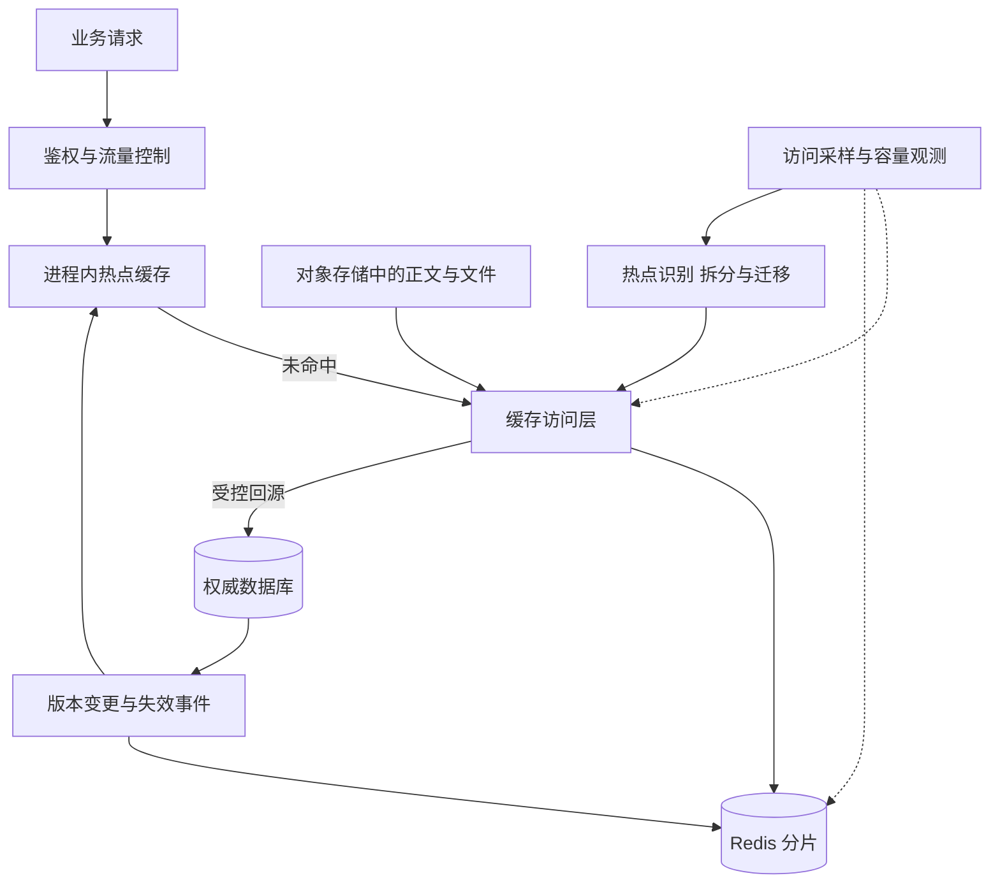
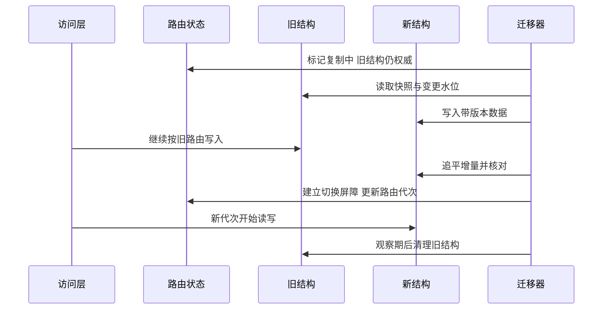
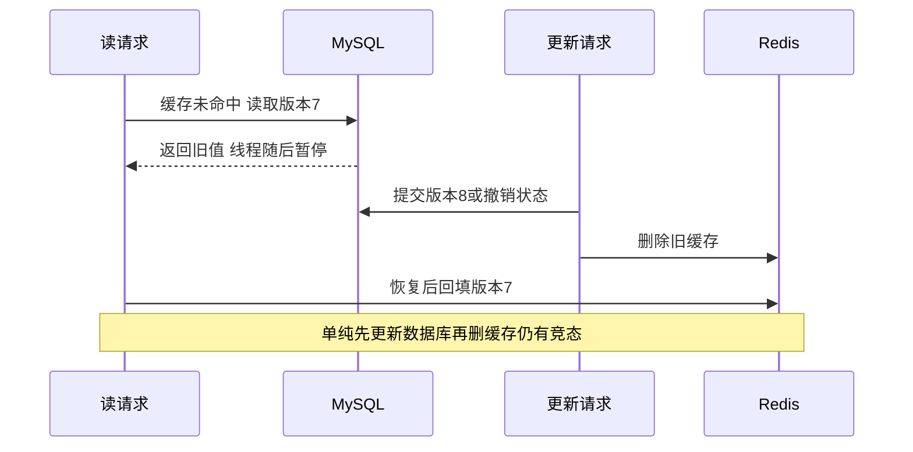

# 第 10 章 Redis 大 key 与热 key

## 10.1 先把问题放回完整的访问链路



大 key 问题是一个数据对象太大，导致访问、序列化、回收、复制或迁移的单次工作过重；热 key 问题是访问过度集中，使一个 key 所在节点成为瓶颈。两者可以同时出现，也可以独立存在。

例如，存放十万段完整会话正文的 Hash 可能很大，但一天只读几次；只有 20 字节的库存计数可能很小，却每秒被请求十万次。只回答“拆 key”没有说清要拆容量还是拆访问量，更没有说明拆完以后读写语义如何保持。

## 10.2 什么算大 什么算热

不存在对所有业务都适用的固定阈值。10 KiB 是否算大，取决于调用次数、网卡、序列化和延迟目标；一个几 MiB 的冷文件放对象存储非常正常，放在登录热路径则可能不合适。

建议从四个维度判断：

| 维度 | 观察什么 | 为什么影响设计 |
| --- | --- | --- |
| 单 key 字节数 | value、对象开销、成员大小分布 | 决定内存、网络与反序列化成本 |
| 集合成员数 | Hash field、List/Set/ZSet/Stream 长度 | 决定全量命令和维护成本 |
| 访问集中度 | 单 key QPS、热 key 占节点流量比例 | 决定一个分片是否被打满 |
| 单次操作成本 | 扫描长度、返回字节、脚本时间 | 低 QPS 也可能产生高尾延迟 |

大 String 的 `GET` 即使在数据结构层面查找很快，完整传输 5 MiB 内容仍然需要时间。不能用 O(1) 推断网络与客户端处理没有成本。

假设每秒读取 1 万次，每次返回 1 KiB，仅正文就约 9.77 MiB/秒；每次变成 1 MiB，则约 9.77 GiB/秒。此时“Redis 单线程还能跑多少 QPS”已经不是首要矛盾。

## 10.3 大 key 具体会怎样伤害系统

**命令执行占用。** `HGETALL`、`SMEMBERS`、超大范围 `ZRANGE` 等会产生大量工作；一个慢命令会影响同一执行线程后续的请求。把单次遍历改成有界批次，可以减少一次占用，但总工作量仍存在。[R05]

**网络与堆内存放大。** Redis 返回正文后，Java 客户端还可能生成字节数组、字符串、JSON 对象树及业务 DTO。一个 10 MiB 数据在 JVM 中不一定只占 10 MiB，多层拷贝可能带来 GC 峰值。应测量对象大小与分配速率，而不是只看 Redis `used_memory`。

**复制和持久化成本。** 大量变更增加复制流量、AOF 写入和重写压力；后台任务并不等于前台完全没有影响。后台保存或重写涉及的 fork 与写时复制，可能带来延迟和额外内存。[R05]

**删除与过期峰值。** 删除对象既需要从 keyspace 摘除，也需要释放对象占用。过多大对象在同一时间失效，会把回收与回源压力叠在一起。

**迁移风险。** Cluster 迁移的是 key 所属的槽及其中的数据；不会自动把一个巨大 Hash 的 field 分散到多个节点。扩机器能增加总容量，却不能直接拆掉单 key 的局部瓶颈。[R10]

## 10.4 怎样找到问题而不把线上扫描打成事故

先确认延迟发生在哪一层：应用排队、连接池等待、网络、Redis 执行还是客户端反序列化。Slow Log 主要帮助观察命令执行时间，不包含所有网络往返和客户端排队，因此“没有慢日志”不能证明缓存链路没问题。

一个分阶段的排查顺序是：

1. 看请求 P95/P99、超时率、Redis 节点 CPU/网络/内存、连接池等待。
2. 将问题定位到节点、命令类型、key 模板和时间窗口。
3. 用采样识别访问最集中的 key，而非长期逐条同步记录所有访问。
4. 对怀疑对象检查成员数、字节数、返回结果大小。
5. 在有负载预算的时段做限速、分节点的全量诊断。

可用命令示例：

```text
INFO memory
INFO stats
INFO commandstats
SLOWLOG GET 64
MEMORY USAGE conversation:123:meta SAMPLES 5
HLEN conversation:123:meta
XLEN answer:456:events
redis-cli --bigkeys -i 0.01
redis-cli --memkeys -i 0.01
```

`--bigkeys` 有助于识别大 String 和成员多的集合；集合成员数不等同于占用字节，需结合 `--memkeys` 或 `MEMORY USAGE`。`--hotkeys` 依赖 LFU 计数，需要相应 LFU 策略，不能在没有计数依据时把结果当精确 QPS。[R03][R04]

Cluster 下应覆盖相关主节点；扫描一个节点不代表扫描了整个集群。诊断复制节点也有成本，还要注意复制延迟与主节点数据差异。避免在高峰执行 `KEYS *`、巨大 `HGETALL` 或长时间全量 `MONITOR`。

`SCAN` 是增量遍历，不是快照：可能重复返回，遍历期间变化的元素不保证以固定方式出现；`COUNT` 是工作量提示，不是严格分页条数。因此要让处理动作幂等，并设置总扫描速率。[R01]

## 10.5 按什么维度拆分大 key

### 方案一 按自然业务对象拆

把 `tenant:42:all_documents` 拆成每份资料的元信息与内容分片：

```text
resource:42:781:meta
resource:42:781:chunk:00001
resource:42:781:chunk:00002
resource:42:782:meta
```

这种拆法让读取一份资料无需搬运所有资料，适合 NoteWeave 的资料元信息、正文窗口和引用信息。完整输入文件留在对象存储，缓存只保存当前访问需要的内容。

代价是 key 数量增加，元数据开销上升；完整读取需要多次请求。可以有界批量读取，但每批必须限制 key 数和返回字节，不要用一个无限大的 pipeline 重新制造内存峰值。

### 方案二 对成员做固定虚拟分桶

对点赞成员、关注集合等，按稳定哈希选择逻辑桶：

```text
like_members:object781:bucket000
like_members:object781:bucket001
...
bucket = stableHash(userId) mod logicalBucketCount
```

查询某个用户是否点赞只访问一个桶；列出所有成员则需要遍历多个桶。桶数过大增加元数据和跨桶调用，过小则容易再次形成大 key。扩容时用路由版本或虚拟桶映射，不能直接把取模值从 16 改成 32 后让历史数据失联。

### 方案三 按时间窗口拆

聊天历史、审计、趋势数据可按会话与时间片组织，旧片段转入持久存储，Redis 保留近期窗口。需要定义迟到事件写哪个窗口、跨窗口分页游标如何表达以及窗口何时封存。

### 方案四 只缓存摘要和索引

如果业务只需要“最近十条”“资料摘要”“当前状态”，就不应该缓存完整历史。NoteWeave 可以分别维护近期消息窗口、异步摘要、任务状态、引用索引，让一次模型上下文构造只读取必要部分。

### Hash tag 是拆分时最容易遗漏的陷阱

`conversation:{123}:part0` 与 `conversation:{123}:part1` 会落入相同 hash slot。它们有利于同槽原子操作，却未实现跨节点分流。如果目的是拆热点，需要让可独立处理的桶落入不同槽，并接受跨桶没有单个 Lua 原子性。[R10]

## 10.6 拆分迁移如何保持可读和可回退

最简单的迁移策略是版本化路由：



真实系统需要让“最后一批旧写”和“第一批新写”有明确归属。可以短暂停写目标对象，或者使用可靠变更日志加路由代次，让旧写入端拒绝过期路由。盲目双写两个 Redis 结构不能解决一边成功一边失败，必须有权威来源和补偿。

迁移校验不能只比较条数，还应核对业务 ID、版本、内容摘要和删除记录。回滚同样要考虑新结构已接收的写入，不能把指针简单切回一份已落后的旧副本。

## 10.7 删除大 key 的正确方式

`UNLINK` 先将 key 从可见键空间移除，再把较重的内存释放工作交给后台；它降低阻塞风险，不会减少必须释放的总内存，也不保证 RSS 立刻下降。[R02]

实施步骤可以是：业务先停止向旧结构写入或切换版本路由；确认旧版本不再是读取来源；分批清理旧 key；观察后台回收、内存与延迟。若后台释放积压，继续高速删除可能加重负担。

删除后旧异步任务重新 `SET` 是另一类问题。需要用版本门槛或删除墓碑拒绝旧写，不能依靠“已经执行过 DEL”证明对象永远不会回来。直接换一个新 key 名同样需要规范新旧路由。

## 10.8 热读如何处理

### 进程内缓存

将极热但允许短暂陈旧的数据放到每个应用实例本地，可显著降低 Redis 请求量。代价是内存重复、版本传播与实例启动时的冷缓存。

例如商品活动配置可以本地缓存，但剩余库存与权限撤销不能仅凭旧本地副本作最终裁决。缓存条目需要业务版本、有效期、容量上限；事件通知用于加快失效，短时有效期和必要的权威复核兜底通知丢失。

### 请求合并

同一个 key 失效时，进程内只允许一个加载任务，其余请求等待同一个结果。跨实例可以用短期加载租约进一步减少回源，但不能无限等待拿锁，也不能把回源锁当作业务正确性依据。

加载需要设置超时、并发上限和失败后清理。否则一次永久卡住的加载，会把后续所有访问都挂在同一个 Future 上。发生超时时，下游操作可能仍在运行，所以同时还需要有限资源和底层取消能力。

### 热点副本与分散读取

对允许陈旧的配置，可以生成多个缓存副本分散读取，或者使用多个本地缓存。更新必须有版本、失败修复和最大陈旧时间。复制 N 份数据不是免费扩容，更新成本与一致性复杂度也会变成 N 份。

只读副本能分摊部分读压力，但存在复制滞后，也没有消除主节点上的热写。权限、余额、库存等关键裁决不能盲目改到副本。

## 10.9 热写如何处理

**可合并的计数。** 点赞总数、播放量可以按桶累加后聚合。必须先确定重复事件如何去重，以及“计数延迟几秒”是否可接受。若每次增量都丢进内存再定时刷盘，进程崩溃会丢增量，应从可靠事件流或权威明细重建。

**不可随意拆的约束。** 库存剩余 100 件，不能在四个节点各保存 100 件让它们独立扣减。可分配为四个独立额度，要求总额度守恒，额度转移也必须幂等且避免同时被两边使用。所有桶都要访问同一个全局库存锁，则仍保留原热点。

**对象内顺序必须串行。** 对同一订单或研究任务的一系列状态变更，可按对象分区，由一个逻辑执行链处理。它用减少争抢换取对象级顺序，但单个极热对象的上限仍然存在。

**批处理与背压。** 下游支持批写时可合并小写，但批大小需要同时受条数、字节数和等待时长限制。批越大越不一定快：会增加尾延迟、重试代价和内存占用。

## 10.10 缓存穿透 击穿 雪崩要分别回答

| 场景 | 主要原因 | 首选思路 | 仍然需要回答的问题 |
| --- | --- | --- | --- |
| 穿透 | 大量请求不存在的对象 | 参数校验、限流、短期空值缓存、布隆过滤器 | 新对象如何进入过滤器，恶意随机 ID 如何限速 |
| 击穿 | 一个热 key 失效后并发回源 | 请求合并、有界加载、预热、允许时提供旧值 | 不允许旧值时怎样保护数据库 |
| 雪崩 | 大批失效或缓存服务整体故障 | 分散加载、隔离、限流、回源预算、降级 | 固定 TTL 不能抖动时怎么办 |

布隆过滤器对已正确加入且未损坏的数据集合可以提供“肯定不存在”或“可能存在”的判断，但系统中的异步同步可能遗漏刚创建的对象。数学上的无假阴性不等于整个业务不会误拒绝新对象。可在对象开放查询前先更新过滤器，允许回滚造成额外假阳性；重建时结合快照与增量水位，不要把一个未追平的新过滤器直接上线。[R20]

空值缓存需要较短且有界的保留时间。真实对象创建后要失效对应空值，避免“明明创建成功却仍然查不到”。随机 ID 攻击还可能用大量空值填满 Redis，因此限流与缓存准入不能省略。

## 10.11 固定 TTL 不允许抖动怎么办

首先澄清“固定”约束是哪一种：

- 每个条目从写入起必须恰好缓存 60 秒，但不同条目写入时间可以不同。
- 某个业务版本在绝对时间 T 后禁止使用，例如活动结束或权限到期。
- 整个集合要求在同一时间过期，不能提前刷新，也不能继续使用旧数据。

第一种可以分散预热或加载时间，同时保留每个条目的固定 TTL。第二种可预生成下一版本，但必须按 `valid_from` 和 `expires_at` 决定何时可以读，不能通过续 TTL 延长旧版本的业务有效期。

第三种无法靠过期抖动解决，应组合：提前准备新的合法数据来源、按 key 合并回源、全局数据库回源配额、接口限流、有界队列和允许的功能降级。若新结果尚未准备好且旧值已禁止使用，就返回明确的暂不可用或排队状态；不能偷偷提供过期权限或过期价格。

逻辑过期是一种“是否允许返回陈旧值”的业务协议，不是绕开固定有效期的技巧。缓存过期事件也不应承担精确业务定时器职责；任务到期仍要检查权威截止时间。

## 10.12 缓存一致性必须讲到旧回填

典型错误时序：



延迟双删能够减小某些时序窗口，但延迟值难以覆盖所有长查询、暂停、重试和网络抖动，不能作为严格证明。

一种可解释的方案是：主库维护对象版本与有效状态；变更事务写出失效事件；Redis 为对象保存独立于内容 TTL 的版本门槛；加载结果带版本；回填时用原子比较拒绝低版本，删除也留下版本信息。消费事件需要单调推进门槛，不能让乱序的旧事件把门槛降回去。

下面是回填步骤的 Lua 示意。两个 key 使用相同 hash tag。版本使用固定长度、补零的非负整数十六进制字符串，按字典序比较，避免把超出双精度整数精确范围的 ID 转成 Lua number。

```lua
-- KEYS[1] = resource:{781}:fence，Hash: min_version/state
-- KEYS[2] = resource:{781}:cache，Hash: version/payload
-- ARGV[1] = 16位补零版本；ARGV[2] = 正文；ARGV[3] = 内容TTL秒数
-- 版本与state只接受受信任服务从权威数据库得到的结果。
local floor = redis.call('HGET', KEYS[1], 'min_version')
local state = redis.call('HGET', KEYS[1], 'state')
if not floor or not state then
    return 'UNINITIALIZED'  -- 不把丢失门槛当成允许任意旧写
end
if state ~= 'ACTIVE' or ARGV[1] < floor then
    return 'REJECTED'
end
local cached = redis.call('HGET', KEYS[2], 'version')
if cached and ARGV[1] < cached then
    return 'STALE'
end
-- 接收更高可信版本时同步推进独立门槛。否则内容TTL到期后，
-- 较老加载者可能在旧floor上再次成功回填。
if ARGV[1] > floor then
    redis.call('HSET', KEYS[1], 'min_version', ARGV[1])
end
redis.call('HSET', KEYS[2], 'version', ARGV[1], 'payload', ARGV[2])
redis.call('EXPIRE', KEYS[2], ARGV[3])
return 'OK'
```

调用前验证版本格式和正 TTL；脚本仅表达受保护的回填，不包含门槛初始化、恢复和事件更新的完整实现。事件更新需要在同槽原子操作中比较版本、推进状态，并清理低版本内容。

还有三个不能省略的前提：

1. **门槛不能比旧加载任务更早消失。** TTL、淘汰、故障切换和恢复都可能丢掉 Redis 内门槛。需要可靠重建、失效时期回主库和限制旧任务存活期，而不是把无门槛当新对象。
2. **异步事件到达之前存在窗口。** 主库已经撤销而 Redis 尚未知道时，版本 Lua 无法凭空知道数据库的新状态。严格授权或撤销要求需要在定义好的授权检查点复核主库状态，或采用有明确传播保证的授权协议。
3. **事件重放不能复活删除对象。** 删除墓碑与版本一起推进；“删除 key”不等于删除版本历史。恢复对象若允许，必须是一个新的、更高版本的明确业务动作。

因此，版本号加墓碑的价值是拒绝已知旧版本与方便恢复；它不是 MySQL、Redis、Elasticsearch 之间的原子事务。

## 10.13 NoteWeave 中如何讲到资料撤销与已有回答

资料撤销先更新 MySQL 的有效状态和版本，形成权威事实。检索可用墓碑提前过滤，命中的候选再按资料 ID 批量复核，避免对每个 chunk 单独查库；异步索引删除负责收敛查询成本，不能独自承担权限保证。

旧缓存加载者提交的内容必须带原始版本，不能在回填时临时换成“当前版本”伪装新鲜。异步摘要、向量索引、Wiki 汇总与研究任务写回都应核验来源版本仍有效。

已有回答应保留其引用关系与生成时的来源版本。对于普通“资料不再参与新研究”，可以把历史回答标记为来源已撤销、结论需重新验证，并允许用户发起重新生成；如果属于访问权限撤回，则后续查看也必须执行权限策略，不能仅靠旧回答的缓存权限。用户已经看到或下载的内容无法靠删 Redis 物理撤回，应明确产品的撤销语义。

流式输出中途撤权需要取消后续检索与生成，并按产品策略停止后续输出；已经发出的字节不能收回。正确的保证应表述为某个授权检查点之后拒绝新的访问，而非“任意并发时刻所有客户端立刻忘掉已见内容”。

## 10.14 持久化 高可用 淘汰为什么会被追问

| 机制 | 解决的主要问题 | 必须保留的限制 |
| --- | --- | --- |
| RDB | 周期性快照与恢复 | 故障后可能退回较早快照 |
| AOF | 记录写操作并重放 | 可靠程度受 fsync 与磁盘故障模型影响 |
| RDB 与 AOF 组合 | 兼顾恢复与日志记录 | 同时开启时通常由 AOF 恢复，不是逐 key 比较谁新 |
| 主从与 Sentinel | 复制与主节点故障切换 | 异步复制存在丢最近写入的窗口 |
| Cluster | 按槽扩容量与访问量 | 单 key 不自动分散，跨槽原子操作受限制 |
| LRU/LFU 淘汰 | 有限内存下优先保留有价值缓存 | 不是业务过期，也不是可靠状态保留机制 |

AOF `everysec` 常被概括为可能丢约一秒近期写入，这是正常刷盘模型下的近似，不应把磁盘长时间阻塞、配置变化或整体存储损坏排除后仍承诺硬上限。`always` 增强单节点落盘要求，但不能自动解决所有副本丢失或错误恢复。AOF 重写也不是把业务写暂停到结束。[R06]

Redis 默认异步复制。`WAIT` 能等待若干副本确认此前本连接的写入，需要检查实际返回的确认数量；它本身不把 Redis 变为强一致数据库，故障切换仍存在保证边界。[R07][R08]

缓存 Redis 与任务状态、租约、Stream 等重要状态最好采用不同资源池和容量策略。`noeviction` 可以避免因内存压力主动淘汰 key，却可能让新写失败；它既不取消 TTL，也不替代持久化和复制。[R09]

## 10.15 Stream 定长裁剪与内存控制

NoteWeave 的回答事件流可以保留一个有限的重连窗口，最终正文与终态落到可靠存储。`XADD ... MAXLEN ~ N` 或 `XTRIM` 限制历史条目，但近似裁剪可能保留比 N 更多的条目；字节数还取决于每条事件大小，不能只限制条数。[R11]

如果客户端游标早于最早保留事件，服务端需要返回“从快照恢复”的明确协议，先拿到快照对应的业务序号，再接续后续事件，避免拼出重复或缺段的正文。最终终态也不能只依赖一个可能被裁掉的 `done` 事件。

消费组的未确认消息不因存在 PEL 就自动免于裁剪。Redis 8.2 新增的 `KEEPREF`、`DELREF`、`ACKED` 明确区分引用处理与确认条件；旧版本或默认行为不能假设“所有消费者处理前永不删除”。[R11] 对可靠任务，应从业务状态表恢复，不能把短期回答事件日志兼作唯一任务账本。

## 10.16 故障矩阵

| 故障 | 直接表现 | 处理顺序 | 不应采取的捷径 |
| --- | --- | --- | --- |
| 一个大 Hash 拉取超时 | 节点与客户端同时出现尾延迟 | 限制返回量、定位调用、拆自然对象 | 只增加客户端超时时间 |
| 单节点 CPU 高 其他空闲 | 单 key 或少数槽流量集中 | 定位读写类型，读缓存或写分桶 | 只加节点不改 key 模型 |
| 缓存整体不可用 | 数据库连接池迅速耗尽 | 回源预算、熔断、限流、分级恢复 | 所有请求无限回源 |
| 大量 key 同时过期 | 回收与加载峰值叠加 | 分散加载、请求合并、提前准备 | 在硬有效期后无条件返回旧值 |
| 旧任务回填撤销资料 | 检索或回答重新出现旧内容 | 主库复核、门槛与墓碑、恢复事件 | 仅再删一次 key |
| 内存达到限制 | 淘汰或写入报错 | 隔离关键状态、观察增长来源 | 把 noeviction 当无限容量 |
| 删除后 RSS 未下降 | 误认为 UNLINK 未生效 | 查 key 可见性、后台回收与分配器 | 重复大规模删除剩余数据 |
| Redis 切主后版本回退 | 缓存复活或租约判断错误 | 权威重建、暂停关键判断 | 宣称 WAIT 已消除所有风险 |

## 10.17 连续追问与回答

### Q1 大 key 一定是 value 很大吗

不一定。一个集合每个成员很小，但成员数巨大，也会在全量遍历、删除或序列化时制造大工作量。应同时看总字节、成员数、访问命令和返回字节，而不是只给一个 10 KB 的固定阈值。

### Q2 为什么拆了 100 个 key 热点还在

可能使用了相同 hash tag，仍落在一个槽；也可能客户端每次读取全部 100 个 key，使总工作没有减少。拆分必须配合访问粒度变化，并验证负载是否真的分散到多个节点。

### Q3 SCAN 能否作为业务列表的稳定分页

不适合。它不提供固定快照或稳定业务顺序，可能重复；业务分页需要有确定排序字段和游标，或者快照版本。SCAN 适合运维遍历、迁移扫描等可容忍重复并做幂等处理的任务。[R01]

### Q4 pipeline 能解决大 key 问题吗

它减少多条命令的往返开销，不减少总数据量，也不提供事务原子性。无界 pipeline 还会使客户端、服务端输出缓冲和网络瞬时压力上升。应同时限制每批条数和字节，并按需要读取字段。

### Q5 本地缓存怎样更新

用版本化条目、变更通知和有界有效期，通知到来只允许推进版本；失败时依赖重新加载与权威检查。对撤权类数据，不应把通知可靠性当成唯一安全条件。实例重启与消息丢失必须进入演练。

### Q6 热点缓存失效后加锁就够了吗

锁能减少重复加载，却不能让慢数据库变快，也不能保证所有等待请求都有资源。还要设置等待上限、全局回源并发、超时和允许的降级策略；锁过期后旧加载者回填要受版本保护。

### Q7 缓存更新为什么推荐删而不是直接改

在 Cache Aside 中，删除可减少业务代码重复构造复杂缓存值，也避免两个写者把构造出的旧快照覆盖新快照。但删除仍有失败、乱序和旧回填窗口，不能把“先更新库再删缓存”当完整一致性协议。

### Q8 用 Canal 监听 binlog 就完全一致了吗

没有。CDC 使变更传播更可靠、更便于重放，但主库提交到事件到达之间仍有延迟；回填与删除也可能乱序。需要版本、墓碑、消费水位、积压监控以及对关键读的权威校验。

### Q9 墓碑保留多久才正确

应覆盖可能到达的旧请求、旧任务、日志重放与备份恢复窗口。如果无法给这些窗口上限，不能随意设置短 TTL；可把最小有效版本持久保留在主库，在缓存信息缺失时回源确认。墓碑过早删除会使旧创建事件再次生效。

### Q10 固定 TTL 条件下能提前刷新吗

取决于约束含义。如果固定的是硬截止时刻，提前加载下一版本可以，但不能提前暴露未来版本或延长当前版本有效期。如果连加载时刻也固定，就依靠并发控制和容量准备；解释清约束后再选策略。

### Q11 布隆过滤器说不存在 我能直接返回不存在吗

只有在过滤器覆盖当前可查询对象集合的前提下才成立。异步更新未追平、新对象未加入、切换到不完整过滤器时会误拒绝。要定义写入与可见性的顺序，以及过滤器不可用时的受控回源行为。

### Q12 UNLINK 为什么不让内存立刻下降

键空间删除与底层内存回收不是同一时刻，分配器也可能保留内存供复用。先验证 key 是否不可见，再看后台释放与实际内存压力，不要只用 RSS 判断业务删除是否成功。[R02]

### Q13 Redis 持久化开启后还能把它作为库存唯一账本吗

选择权威存储需要完整故障模型和恢复协议，不是一个开关。若接受的故障中可能丢最近成功扣减，就需要额外可靠账本、幂等流水与对账。多数面试方案用数据库守住最终库存约束，让 Redis 承担准入与加速更容易证明。

### Q14 热写分桶后怎样得到准确总数

如果允许短暂延迟，聚合各桶的版本化计数即可。如果要求一个时刻的严格一致总数，需要一致快照或协调机制；读每个桶得到的是不同时间点的数值。对于资金、库存，应用层随意相加不足以证明全局约束。

### Q15 Stream 留最后一万条是不是内存就固定了

不一定。每条消息字节不同，近似裁剪可能超过目标，PEL、消费者状态和缓冲区也占内存。需要条数、单条大小、空闲会话 TTL 和总实例容量同时设限。[R11][R12]

### Q16 你怎样验证优化真的有效

用同一负载模型比较请求尾延迟、返回字节、单节点热点程度、JVM 分配速率、数据库回源量与错误率。再注入热点突变、Redis 故障、版本通知丢失和旧加载延迟，验证性能优化没有破坏撤销与一致性约束。

## 10.18 面试口述收束

可以这样讲：“我先区分大 key 的单次工作过重和热 key 的访问集中，再根据读写语义选方案。大对象按自然业务或桶拆分，读路径限制返回量；热读用本地缓存和请求合并，热写看是否允许分桶聚合。拆分后还要证明路由切换、删除旧写和缓存回填正确。对资料撤销，我把 MySQL 的状态和版本作为依据，Redis 的墓碑与版本门槛做加速和旧写拦截，关键授权仍在定义好的检查点复核。”

## 10.19 Redis 延迟事故：四类根因与处理方案

四类 Redis 延迟事故需要不同的定位与止血动作。以下观测与数字均为场景假设，分析时应建立现象、根因和处理措施之间的证据链。

| 事故 | 支持根因的证据 | 第一批止血动作 | 后续设计问题 |
| --- | --- | --- | --- |
| 热门楼全量拉取 | 响应字节和客户端分配升高，慢日志未必明显 | 限制返回量、按页取候选与正文 | 拆分、游标、权限过滤和迁移 |
| 单热点写入 | 一个 key 或槽忙，其他节点空闲 | 限制滥用、保护写入队列 | 是否可分桶，增量还是绝对状态 |
| 持久化期间内存顶满 | fork/AOF 重写与 RSS/COW 峰值重合 | 降低非必要写入与后台重建重叠 | 峰值余量、数据大小、恢复承诺 |
| 切主后数据库池耗尽 | 缓存 miss、回源等待、重试同时升高 | 全局回源预算、旧快照、入口拒绝 | 重建顺序、版本回退和关键状态 |

### 为什么“分 key”只是讨论开始

一是分布条件：相关原子操作需要同槽，不相关桶需要真正分散；二是访问条件：请求不能仍然把所有桶完整读取；三是正确性条件：读写使用同一代路由，旧写不能进入已切换对象；四是恢复条件：迁移失败能从权威数据或日志继续，而不是新旧各有一半且没人知道。

对于排行榜，拆分后要证明全局 TopK；对于点赞，拆分后要证明取消落到原贡献所属桶；对于评论，拆分后要证明父楼占位与整楼权限仍可查询。把业务语义说清楚，“拆”才是一个方案，而非一个单字答案。

### 为什么“加本地缓存”也不总是免费收益

本地缓存适合重复读且允许短暂陈旧的数据。它减少远程访问，却增加多份副本、失效传播、进程峰值内存和冷启动。热点突然切换时，各实例可能同时加载；内容撤权时，某个实例漏接通知可能继续持有旧值。

因此要限制条目大小和总字节，使用请求合并和加载预算，绑定版本与硬有效期。公开 Top100 可以在允许时间内复用旧快照；严格授权缓存不能仅凭本地命中就默认允许。Redis 服务恢复后也不要立刻清空所有本地缓存，否则一次集体冷启动会抵消其保护作用。

### 怎样把 Sentinel 与 Cluster 讲进事故链路

先交代真实部署模型：有几个数据主节点、每主几个副本、位于哪些故障域；Sentinel 有几个进程及 quorum。Sentinel 的故障判定投票不同于数据复制确认。Cluster 槽路由中的 MOVED/ASK 由兼容客户端处理，但应用仍负责请求截止时间、有限重试及写结果未知时的业务恢复。[F06][R10]

切主后的缓存可能回退。排行榜从权威积分恢复，点赞从关系事实恢复，撤权门槛在缺失时转权威检查；不能认为配置 WAIT 后所有已确认写都获得了强一致保证。[R08]

### 一段更有说服力的面试回答

“我先用同一请求 trace 区分应用等待、Redis 执行、网络和解码，结合单次返回字节与 key 分布确认瓶颈。热读通过有界快照和本地缓存减少重复工作，热写则先明确是否允许分桶聚合。任何拆分都包含路由切换和旧写拒绝；任何缓存都包含版本回退与恢复。故障时严格控制全局回源，避免 Redis 切主成功后数据库继续过载。”

面试案例应交代发现、证据、改造、代价与验证，并明确区分实际经历与设计假设。QPS 和节点数需要由具体负载与部署条件推导。排行榜、点赞、撤权、排障和切换的完整案例见 F：Redis 热点、缓存一致性与排行榜实战。

**相关专题：** [Redis缓存与排行榜](19_Redis缓存与排行榜.md) · [高并发准入与分布式锁](23_高并发准入与分布式锁.md) · [高可用与容灾恢复](25_高可用与容灾恢复.md)。

[F06]: https://redis.io/docs/latest/operate/oss_and_stack/management/sentinel/ "High availability with Redis Sentinel"
[R01]: https://redis.io/docs/latest/commands/scan/ "Redis SCAN"
[R02]: https://redis.io/docs/latest/commands/unlink/ "Redis UNLINK"
[R03]: https://redis.io/docs/latest/commands/memory-usage/ "Redis MEMORY USAGE"
[R04]: https://redis.io/docs/latest/develop/tools/cli/ "Redis CLI"
[R05]: https://redis.io/docs/latest/operate/oss_and_stack/management/optimization/latency/ "Redis latency diagnosis"
[R06]: https://redis.io/docs/latest/operate/oss_and_stack/management/persistence/ "Redis persistence"
[R07]: https://redis.io/docs/latest/operate/oss_and_stack/management/replication/ "Redis replication"
[R08]: https://redis.io/docs/latest/commands/wait/ "Redis WAIT"
[R09]: https://redis.io/docs/latest/develop/reference/eviction/ "Redis key eviction"
[R10]: https://redis.io/docs/latest/operate/oss_and_stack/reference/cluster-spec/ "Redis Cluster specification"
[R11]: https://redis.io/docs/latest/commands/xtrim/ "Redis XTRIM"
[R12]: https://redis.io/docs/latest/develop/data-types/streams/ "Redis Streams"
[R20]: https://redis.io/docs/latest/develop/data-types/probabilistic/bloom-filter/ "Redis Bloom filter"
