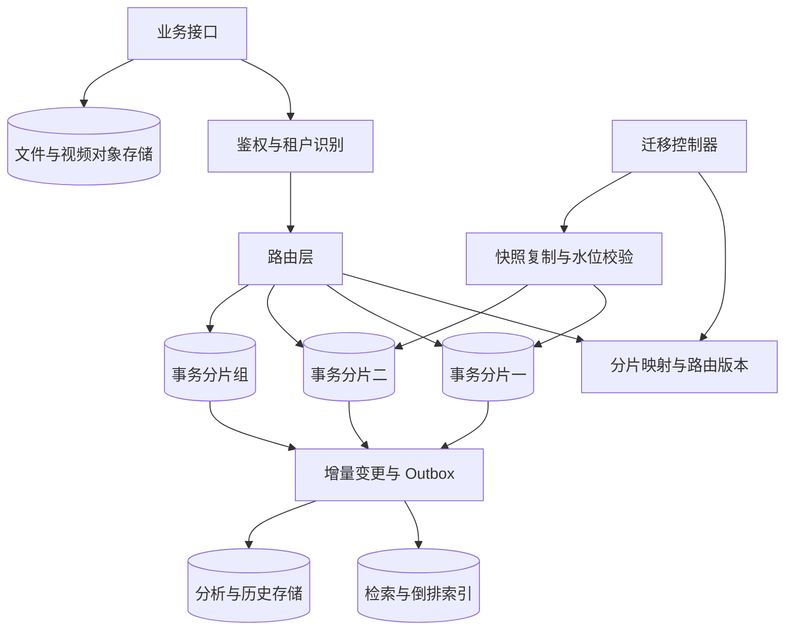
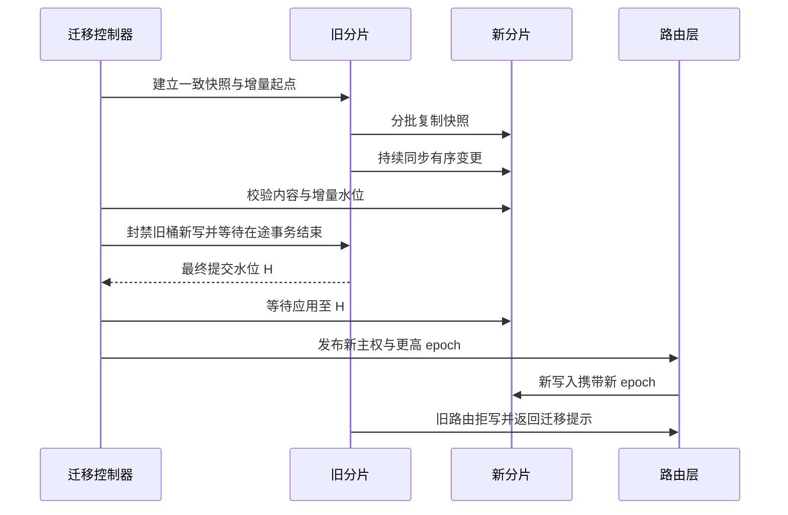

# 第 11 章 大数据量存储与分库分表：访问模式、唯一主权和在线迁移

## 11.1 先区分数据类型，再谈数据库数量

大数据量不等于所有数据都分到更多 MySQL 表中。事务状态、原始文件、检索索引和分析数据具有不同访问方式，应先放到合适的存储中，再决定哪一类需要水平扩展。



应用示例：在 NoteWeave 类资料研究平台中，可以把任务状态、资料元数据、权限和撤销版本留在事务库；原文件和解析产物进入对象存储；BM25、向量索引是可重建的派生数据；研究过程日志按保留需求进入日志或归档体系。这种拆分先减少数据库的不必要负担，再讨论事务元数据的分片。

| 数据 | 典型访问 | 主存储选择思路 | 应避免的做法 |
|---|---|---|---|
| 订单、任务、权限、幂等记录 | 点查、条件更新、本地事务 | MySQL 等事务数据库 | 为了扩容先丢掉必要事务约束 |
| 大文件、视频、解析正文 | 流式读写、范围读取 | 对象存储，数据库保存引用 | 将大 BLOB 与热点状态行长期混放 |
| 全文、向量和多条件检索 | 召回、相关性排序 | 搜索或向量系统 | 把检索索引视为权限唯一权威 |
| 指标、事件、历史明细 | 大范围扫描与聚合 | 分析数据库或列式归档 | 在在线主库执行无界报表 |
| 近期热点缓存 | 低延迟、可重建读取 | Redis 与本地缓存 | 默认缓存故障不会丢业务事实 |

## 11.2 什么时候真正需要分片

“单表到了 2000 万行就必须分表”没有普适依据。相同行数下，行宽、索引宽度、热数据比例、硬件、查询选择性、事务长度都能让性能差别很大。判断依据是容量和 SLO 的实际瓶颈：单机写入与持久化能力、热点行竞争、工作集是否装得下、备份恢复时长、维护窗口和单故障影响范围。

**容量示例：**10 亿条记录，平均每条 300 字节，基础数据约 300 GB；假设二级索引额外占基础数据的 80%，单副本约 540 GB；三份副本约 1.62 TB，若再给碎片、增长和操作留 50% 空间，约需 2.43 TB，备份另算。300 字节与 80% 都是假设，实际应使用样本表、真实索引和压缩设置测量。

如果实测单分片在目标 P99 下稳定承载 5000 次写/秒，业务设计峰值为 3 万次写/秒，按 60% 目标利用率估算，至少需要 `30000 / (5000 × 0.6)=10` 个等效写分片。这个算式还没有考虑租户偏斜、故障时流量重分配和跨分片额外开销，所以不是最后的机器采购结论。

先排除几个更低成本的方向：错误 SQL 和索引、查询批量化、冷热分离、垂直拆表、合理归档、读副本和缓存。读副本可以分担读，不会提升同一主库的写容量；同一实例里拆成 100 张表，也不会自动得到 100 倍 CPU 或 I/O。

## 11.3 垂直拆分、分区、分表和分库的区别

| 手段 | 实际改变 | 能解决什么 | 不能自动解决什么 |
|---|---|---|---|
| 垂直拆表 | 按字段把冷大字段与热状态分开 | 降低热点行宽和缓存占用 | 同一热点状态行竞争 |
| 业务分库 | 不同业务进入不同数据库 | 隔离资源与故障范围 | 单业务内的大热点 |
| MySQL 表分区 | 同一逻辑表拆为多个物理分区 | 分区裁剪、生命周期管理 | 单实例资源上限、跨机器水平扩展 |
| 水平分表 | 同结构记录进入不同表 | 控制单表维护规模 | 若仍同实例，CPU/I/O上限不变 |
| 水平分库 | 记录进入不同实例或节点 | 扩写容量与存储容量 | 跨分片事务、全局查询和迁移复杂度 |

按月份做时间分区，适合日志和时间窗口查询，也方便按生命周期清理。但 MySQL 分区表的每个唯一键必须包含分区表达式所用的全部列，这会影响原本的全局唯一设计。[C10] 把主键从 `id` 改为 `(id, created_month)` 后，只能直接约束这两个字段的组合唯一，不能假装数据库仍独立保证 id 全局唯一。

分区和分片还可以组合：先按租户或用户分到不同数据库，每个分片内再按时间归档。但组合越多，路由、查询计划和迁移测试面也越大，不能只计算“总表数”。

## 11.4 分片键决定系统的大部分后续成本

选择分片键要同时看高频查询是否能定位、写入是否均匀、关联事务是否同地、键是否稳定，以及超级租户如何处理。

| 候选键 | 优势 | 难题 | 常见补救 |
|---|---|---|---|
| user_id | 用户资料和个人列表容易定位 | 查询某对象的所有用户需跨片 | 对象维度派生索引 |
| object_id | 评论、对象详情和局部事务集中 | 爆款对象可能形成热点 | 对象内部桶、热点单独路由 |
| tenant_id | 租户隔离和迁移直观 | 大租户压满单片 | 大租户二级分桶或独立集群 |
| 时间 | 归档和范围查询简单 | 当前时间段写热点 | 时间加哈希桶 |
| 业务编号哈希 | 通常分布较均匀 | 列表查询缺乏路由键 | 路由索引或按用户派生视图 |

以 NoteWeave 为例，按 `tenant_id` 或 `user_id` 聚集资料、任务和权限，有利于个人工作台查询；但某个超大团队会偏斜。可以先把普通租户映射到共享分片，大租户映射到专属分片，再在该租户内按资料或会话分桶。若频繁需要跨用户共享 Wiki，权限查询不一定与正文同分片，需要单独设计访问路径。

分片键最好稳定。用户改手机号时，若手机号就是分片键，简单更新字段将隐含一次数据迁移；业务 ID 更适合路由键，手机号可作为次级查找索引。分片路由也必须包含租户隔离，不能信任客户端传入任意 tenant_id 来选库。

## 11.5 为什么使用虚拟桶和版本化路由

最直接的 `hash(id) % N` 随 N 改变会移动大量数据。一个更容易扩容的方案是固定较多逻辑桶，例如 `bucket=stableHash(key) % 1024`，由映射表决定每个桶属于哪个物理分片。扩容时迁移部分逻辑桶，不必改变全部记录的逻辑桶编号。

```text
bucket_map:
  bucket_id
  owner_shard
  route_epoch
  state: ACTIVE / COPYING / FENCED / SWITCHED
  migration_id
```

Java 路由伪代码：

```java
Route route(TenantId tenant, BusinessKey key) {
    // stableHash 的算法、编码和版本必须固定；跨语言需一致。
    int bucket = Math.floorMod(stableHash(tenant, key), 1024);
    BucketOwner owner = routingSnapshot.lookup(bucket);
    return new Route(bucket, owner.shard(), owner.epoch());
}
```

虚拟桶让迁移更小，但它本身不保证正确性。旧进程缓存旧映射后仍可能写旧分片，所以请求要带路由代号，写入端验证自己是否仍有主权。仅刷新配置中心、等 30 秒、宣布切换完成，无法处理长暂停进程和已经在途的事务。

路由版本要在真正写入前被权威执行端校验，并与业务提交建立可靠关系。例如事务内锁定桶主权记录并验证 epoch，迁移时先使旧桶进入拒写状态并等待旧事务结束。只在服务启动时读一次 epoch，不能阻止旧写。

一种便于证明的实现是：普通业务事务对桶主权行取共享锁并验证 `ACTIVE + epoch`，再修改该桶数据；迁移事务要把主权改为拒写，必须取得该行排他锁，因此会等旧业务事务结束。多个普通写者可以同时持有共享锁，不必把整桶写入串行化。它仍有主权行访问开销，可由经过验证的代理或存储路由协议替代；不能为了省一次检查删掉主权约束。

## 11.6 全局 ID、全局唯一和二级路由

**全局 ID 不等于业务唯一。**两个订单可以拥有不同全局 ID，却使用了相同的用户请求号；两个账号也可能 ID 不同但邮箱相同。前者需要幂等唯一键，后者需要邮箱唯一约束的全局权威。

| ID 方案 | 适合之处 | 需要回答的故障问题 |
|---|---|---|
| 号段服务 | 批量发号、数据库负担较低 | 号段不能重发，服务恢复和预取失败 |
| 时间加机器加序列 | 本地快速生成、总体有时间趋势 | 时钟回拨、机器号重用、单毫秒序列耗尽 |
| 随机 UUID | 无中央发号依赖 | 概率碰撞、宽索引和局部性成本 |
| 数据库自增加分片信息 | 简单、定位方便 | 分片扩容、编号泄露、规则长期稳定 |

时间类 ID 在时钟回拨时可以等待、小范围借用逻辑时间，或切换到明确的新纪元；不能无条件把时间往回调后继续发同样序列。机器号租约过期也不是足够条件：旧进程若暂停后继续发号，可能与新进程冲突，所以要有持久的分配规则或隔离机制，不把普通可过期缓存锁当作唯一性证明。

全局邮箱唯一可以建立独立的规范化邮箱索引服务，按邮箱确定唯一分片，先占用邮箱再创建用户，失败时用状态机释放或修复。占位超时不能直接释放一个已经可能成功创建的账号，需要核对状态。另一个选择是让与邮箱唯一有关的数据本来就按邮箱同地，但这会影响按用户查询和修改邮箱的成本。

“只知道订单号怎么查库？”可以在 ID 中编码路由信息，或者使用全局路由索引。后者是新的一份可用性和一致性依赖：订单已成功而路由索引尚未生成时，应能从幂等记录查询结果、等待投影或采用有界回源；不能把全库广播当成每次请求的常规路径。

## 11.7 跨分片事务与查询如何收敛

最划算的事务优化通常是把同一业务聚合放在同一分片，例如一份任务与其状态、幂等记录、Outbox 同地。这样保留本地 ACID，不必为每一次状态变化引入分布式事务。

跨分片不可避免时，先问是否真的需要所有步骤同时对外生效：

| 方案 | 适用条件 | 代价与语义 |
|---|---|---|
| 分布式事务或 2PC | 参与者支持协议，确实需要原子提交 | 协调、日志、故障恢复及锁持有成本；隔离仍取决于实现 |
| TCC | 能把业务拆成预留、确认、取消 | 预留资源、悬挂、空回滚和重试设计复杂 |
| Saga | 可接受中间状态，步骤可补偿或可人工处置 | 补偿是新动作，不是时间倒流；不自动提供全局隔离 |
| Outbox 与异步投影 | 一个权威事实驱动其他视图 | 最终一致，需要幂等、版本、监控与重建 |

外部付款、邮件、短信、物理设备动作不一定可逆。Saga 的“取消”可能是退款或发送更正通知，而不是让用户没收到原消息。若超时后无法判断外部动作是否成功，需要查询和核对，再决定补偿，不能按网络异常直接重做。

跨片查询也要按类型处理。用户列表尽量带路由键；搜索和分析走派生系统；少量跨片 TopK 可以并行取每片候选再归并。若每条记录只属于一个分片，且所有分片用相同全序和同一逻辑快照，局部 TopK 的并集包含全局 TopK：一条不在本片 TopK 中的记录，其前面已至少有 K 条本片记录，因此不可能进入全局前 K。若同一成员分散在多片保存部分分数，必须先聚合总分，这个证明就不适用。

深分页若每片都取 `offset+limit`，扫描量随分片数和页深增大。优先使用全局排序键游标，维护每片游标或统一有序边界。聚合时 `SUM`、`COUNT` 容易合并，`AVG` 应合并总和与数量，不能直接平均各片平均值；精确 `DISTINCT` 和全局排序的通信成本往往更高。近似算法需要明确误差和业务是否接受。

## 11.8 在线扩容的完整迁移协议



一套可解释的流程至少包括以下步骤。

1. **明确迁移单位和旧主权。**记录桶、源分片、目标分片、迁移 ID、路由 epoch。复制期间只有源分片接受业务写入，目标是影子副本。
2. **获得一致基线和增量起点。**快照与 binlog 起点必须相互匹配，确保没有夹缝。可以使用成熟迁移工具的快照与日志协调，不能随便先扫表、结束后才打开 CDC。
3. **分批全量复制，同时捕获增量。**按主键小批量读取，限制 I/O、网络和目标写入速率；大表长快照会增加历史版本保留成本，生产方案可采用经过验证的分块快照协议。
4. **应用更新和删除。**该方案选择所有业务变更都递增行版本，删除通过 `deleted=1, version=version+1` 的逻辑更新产生新版本。目标按来源纪元及业务版本拒绝旧数据，并保留删除标记；全量扫描到版本 8，而增量已把目标更新为版本 9，版本 8 不得覆盖版本 9。物理清理另受迁移与重放水位约束。
5. **校验与影子读。**比较行数只是初步检查，还应按桶或范围校验关键字段、校验和、唯一约束、删除状态和业务查询结果。两边都在变时，应对齐比较水位。
6. **建立切写屏障。**源分片拒绝该桶新写，并等待已经进入的事务提交或回滚。取其最终已提交位置 H。目标必须应用到 H，才有资格接管。
7. **切换唯一主权。**发布更高路由 epoch，目标开始接受新写；源分片继续拒绝旧 epoch，旧客户端更新路由并重试原幂等请求。
8. **保留回滚窗口。**观察错误率、延迟和数据差异。若要能切回旧库，必须把新库期间的写入同步回旧库，并再次执行屏障和水位确认。
9. **完成后清理。**过了观察与回滚期限，才清理旧副本、复制任务和临时路由。清理不是复制一结束就执行的无条件步骤。

Vitess 的 Reshard 工作流也包含复制、校验、切流和完成阶段；其文档明确描述切写时暂停源写并等待目标追平，且支持反向切流。采用自定义迁移协议时，同样需要实现协调切换、校验和恢复保证。[C09]

## 11.9 CDC、删除墓碑与双写的细节

CDC 的日志位置是一个有语义的有序标识，不应拿字符串随意比较。要考虑源实例纪元、事务提交边界、binlog 文件与位置或 GTID 等信息；跨分片各自的日志位置也没有天然全局可比性。迁移对单个源桶保持一致即可，不必强行建立全系统总序。

Debezium MySQL 连接器提供快照和 binlog 变更捕获，并分别描述删除事件与用于日志压缩的 tombstone 事件。[C12] 使用 CDC 仍需要消费者正确处理初始化、重放、删除和状态水位；接入一个连接器不会自动解决目标端旧快照覆盖新数据。

该方案采用**业务逻辑删除并递增版本**，而不是假定物理 DELETE 自带新版本。例如源记录为 `deleted=0, version=10`，删除事务执行下列更新；CDC 因此能在该 UPDATE 的 after 镜像中读到 `deleted=1, version=11`：

```sql
UPDATE business_record
SET deleted = 1, version = version + 1
WHERE id = ? AND deleted = 0 AND version = ?;
-- 参数中的旧版本为 10；影响一行才代表本次删除成功。
```

目标应用版本 11 的删除标记后，旧全量批次即使重新带来版本 10，也只能被拒绝。目标不能立即只做物理 DELETE 并丢弃版本 11，否则旧版本可能再次插入。删除标记的清理必须等迁移完成、相关快照退出、消息与恢复重放窗口关闭，并建立不再接受这些旧版本的水位；若需要更早移走正文，可以把键、版本、删除状态保留在独立墓碑表。

**直接物理删除版本 10 的行不会自动产生业务版本 11。**CDC 的 delete 事件通常表达删除前记录和空的 after，不能从中凭空推导出新的业务行版本。若既有系统必须物理删除，应另选同事务 Outbox 保存显式删除版本，或按连接器的来源纪元与日志位置协议排序；那是不同的实现路径，需要完整替换版本规则，不能混用。迁移协议以前述逻辑删除方案为前提。成熟迁移工具若已提供自身的快照与日志协调，应按其准确协议使用。

直接应用层双写旧库与新库的问题是两个提交没有共同原子边界：旧成功新失败、新成功旧失败、超时未知、同一记录并发乱序都会出现。可以通过一个权威写源加日志复制降低这些问题；如果不得不双写，必须记录每次迁移写的状态并设计重试、版本和对账，不能把“双写一周没报警”当作一致性证明。

切换后回滚也不是简单改配置。假设新库已经接受订单 X，旧库没同步到，立刻切回会让 X 消失。回滚需要反向同步、新主权暂停写、追平最终水位和再次切换。若无法完成，就应停止继续切换并修复新主权，不能用“回滚容易”掩盖未同步的数据。

## 11.10 冷热分层、归档、备份和灾难恢复

冷热划分不能只看创建时间。一个很老但仍在执行的任务是热数据，一份刚上传却已撤销的大文件可能很快进入清理流程。可以按状态、最近访问、合规保留需求和对象生命周期综合判断。

归档任务应先复制并校验，再建立可查询的归档位置，最后删除在线副本。删除过程使用小批次和游标，避免大事务。归档后仍需要回答“用户按 ID 查询旧记录怎么办”：路由到归档服务、返回异步导出，或者提供仅保留摘要的在线视图，不能把所有旧查询变成全表扫描对象存储。

备份必须与恢复目标对应。恢复时间目标 RTO 要考虑备份读取速度、日志回放、索引重建、路由恢复和校验；恢复点目标 RPO 取决于复制与备份策略，不能用“有三个副本”代替。逻辑误删可能迅速复制到所有副本，因此副本不是历史备份。定期做恢复演练比只检查备份文件存在更有意义。

数据删除还可能跨在线库、搜索索引、缓存、对象存储和备份。设计删除工作流、保留策略和审计记录时，要区分在线不可见与物理清理完成，不能在索引删除时就宣称所有副本已消失。

## 11.11 故障矩阵与扩容验证

| 故障 | 为什么发生 | 恢复策略 |
|---|---|---|
| 旧路由仍写源库 | 配置传播不等于在途请求结束 | 执行端主权校验、旧 epoch 拒写 |
| 目标少数据 | 快照和 CDC 之间存在缺口 | 重新建立一致起点或补齐缺失区间 |
| 删除记录复活 | 旧快照或旧事件覆盖删除 | 删除版本墓碑与应用水位 |
| 切写后新旧各有一部分写 | 同时接受写或路由失控 | 停止扩散、确定唯一主权、按日志核对 |
| 复制落后持续增大 | 复制能力小于源写入 | 限速调整、扩容目标或择机迁移，禁止强切 |
| 路由服务不可用 | 路由元数据成为依赖 | 使用有版本本地快照，但已失主权写必须拒绝 |
| 大租户压满分片 | 平均分布掩盖偏斜 | 独立迁移大租户或租户内二级桶 |
| 跨片分页超时 | 广播和深 OFFSET 放大 | 游标、派生索引、查询成本限制 |
| 切回后数据消失 | 未复制新主权期间的写 | 反向同步并按同一切换协议执行 |
| 备份存在却恢复失败 | 未验证依赖和回放 | 恢复演练与明确 RTO/RPO |

验证应包括路由缓存长时间不刷新、进程暂停后恢复、切写时长事务、CDC 重放、快照重试、删除后重建、目标故障、切流失败和反向切回。关键不变量是“一个桶在一个 epoch 只有一个可接受业务写的主权”“已确认写在切换后仍可查”“旧写不能覆盖新状态”，不是只看迁移进度显示 100%。

## 11.12 连续追问与参考回答

### Q1：一亿行一定要分库分表吗？

不一定。先看行宽、查询模式、索引、工作集、写入量、维护时间和实际 SLO。单机能稳定承载且恢复窗口满足要求时，分片可能只增加复杂度。达到资源或操作边界时，再用容量测量决定分片规模。

### Q2：分库还是分表优先？

如果是实例 CPU、I/O 或写入能力不够，仅在同实例分表帮助有限，需要跨实例扩展；如果主要是归档和单表维护困难，可以先按时间分区或拆表。问题原因决定手段，不能固定背“先分表后分库”。

### Q3：按用户分片后，按订单号查询怎么办？

在 ID 中携带路由线索，或维护订单到用户/分片的路由索引。对高频查询需要单片定位，不能每次扫全部数据库。索引生成延迟和索引不可用时的查询行为也要设计。

### Q4：分片内有唯一键，为什么全局还能重复？

因为每个数据库只检查自己的数据。相同业务键若可以路由到不同片，两边都能插入成功。要么让同一唯一键确定同一权威分片，要么引入全局唯一服务；迁移期间仍要保证唯一主权。

### Q5：一致性哈希是不是就不用迁移了？

它减少节点变化时需要移动的键范围，不会搬动实际数据，也不负责在途写、删除、事务和路由切换。仍然要复制、追平、校验、切主权和处理旧路由。虚拟节点同样不能代替迁移协议。

### Q6：能不能双写一段时间，再直接读新库？

双写可能部分成功和乱序，不加事务日志或版本无法证明一致。应明确旧库为权威，用可靠日志复制，切换前对齐最终水位。即使两边行数相同，也可能记录内容不同。

### Q7：全量复制很慢，线上还在写，会不会永远追不上？

如果增量应用能力不大于源变化速度，确实可能追不上。需要减少全量对源和目标的争抢、扩大增量并行、缩小迁移单位，或在低峰限制源写。不能因为迁移时间超预算就跳过追平直接切换。

### Q8：为什么切写一定要处理旧事务？

一个事务可能在封禁前进入、封禁后才提交。若最终水位取在它提交之前，新库接管时就缺少这次写。屏障必须阻止新事务并等待在途事务完成或可控取消，之后确定最终提交位置。

### Q9：版本号能解决所有迁移乱序吗？

只能解决可比较的同一记录历史。版本必须在权威写源单调递增；该方案用逻辑删除的 UPDATE 显式产生新业务版本，CDC 物理删除不会自动替你生成 version+1。迁移后主权纪元要明确。不同源各自产生的 version=10 不能直接比较成同一历史。

### Q10：跨分片事务用 Saga 是不是最终一定成功？

不是。Saga 可以持续重试、补偿或进入人工处理，但外部系统长期失败、不可逆动作和补偿失败都可能存在。需要持久状态和可见的待处理责任，不能把“最终一致”解释成没有前提的必然成功。

### Q11：能直接汇总各分片 Top10 得到全局 Top10 吗？

只有每条候选唯一归属、排序规则一致、比较时间点一致等条件下成立。同一个人的分数若在不同分片各有一部分，必须先求总分；否则一个处处排在局部第 11 的人，总分可能是全局第一。

### Q12：时间分区能解决海量写入吗？

它有利于时间裁剪和归档，但当前分区仍可能承受所有写，且通常仍在同一实例资源范围内。要扩写需多个实际资源节点或增加时间内哈希桶，不能把分区数当成机器数。

### Q13：如何控制分片数量越多连接越爆炸？

不要为每个应用实例到每个分片都建立很大的常驻连接池。按实际访问分片懒创建、有上限地回收，使用路由代理或聚合连接管理，并控制全局连接预算。数据库可并行执行能力决定总连接量，不是实例数量乘一个随意池大小。

### Q14：怎样结合制造业项目讲？

告警历史可以按时间归档，设备当前状态按工厂或设备路由，待执行通知仍要按扫描需求设计索引。若按设备分片后全局扫描通知变成全片轮询，可以按执行桶维护任务路由或派生调度表。数据分片必须服务主要操作，不能只看设备 ID 分布均匀。

### Q15：迁移完成后为什么不能立刻删旧库？

需要观察真实流量、数据差异和恢复能力。若计划可回退，还要保留反向同步和旧副本。确认没有依赖、超过回滚窗口后再清理；清理动作一旦执行，回退可能变成重新全量恢复。

### Q16：数据库分片后缓存 key 要改什么？

key 应使用稳定业务身份和租户信息，不宜直接绑定易变化的物理库号。缓存值包含业务版本或主权纪元，防止迁移中旧库读结果覆盖新值。路由缓存与业务缓存也应区分，前者过期不能授权旧分片继续写。

**技术参考：**[C09] [Vitess 24 Reshard](https://vitess.io/docs/24.0/reference/vreplication/reshard/)；[C10] [MySQL 8.4 Partitioning Keys, Primary Keys, and Unique Keys](https://dev.mysql.com/doc/refman/8.4/en/partitioning-limitations-partitioning-keys-unique-keys.html)；[C12] [Debezium MySQL Connector](https://debezium.io/documentation/reference/stable/connectors/mysql.html)。数据库与迁移工具应固定版本，并验证对应协议。

## 11.13 场景推演：从“存不下”追问到迁移中仍有人写

**场景题：**假设用户资料平台累计 10 亿条元数据，90% 数据一年内不再读取；某个企业租户只占总记录的 2%，却贡献 60% 的高峰写入。当前实例查询还能满足平均耗时，但恢复演练已经无法满足业务 RTO。你会按用户哈希分成 64 库吗？以上数字均为设计假设。

先拆开三个问题。历史数据使容量和恢复成本变大，适合按业务状态与保留要求归档；超级租户造成负载偏斜，平均哈希并不能保证这个租户被分散；恢复窗口不达标说明故障单元过大，属于可用性约束，不应只用“SQL 目前还快”拒绝扩展。是否采用 64 库，要由单片实测容量、余量、热点和维护成本推导。

### 11.13.1 四条非功能性主线在本题中的具体决策

| 追问方向 | 本题证据 | 初始选择 | 选择后要补的责任 |
|---|---|---|---|
| 大数据量 | 冷数据占比、行宽、索引宽度、增长 | 在线保留活跃元数据，历史归档 | 按ID查询归档记录、删除与恢复策略 |
| 高并发 | 企业租户写流量明显偏斜 | 大租户独立映射，必要时租户内分桶 | 多桶聚合、跨桶事务、热点迁移 |
| 响应慢 | 列表扫描放大或跨片广播 | 先优化访问路径与派生列表 | 列表版本、权限复核、投影重建 |
| 高可用 | 实测恢复时间超过业务目标 | 缩小恢复单元，明确接管流程 | 复制水位、唯一写主、备份恢复演练 |

这里可以选择“普通租户共享分片，超级租户独立分片”的方案，而不是立刻把所有记录随机打散。资料与任务若频繁需要同事务维护，可以保留同聚合内的共址；检索索引与正文走适合各自访问方式的系统。下一步才是评估超级租户是否需要二级分桶。

### 11.13.2 面试官追问：全量和增量都完成了，能切吗

“追平”是某个时点的观察，源库可能在观察后又提交了新写。正确的切换需要建立禁止源桶继续接受新写的屏障，等待已经进入的业务事务结束，再取得最终水位 H。目标应用到 H 并完成校验，才允许以更高 epoch 接管。

如果主权检查在一个独立事务里完成，然后另开事务写业务行，就仍有检查后被切走的窗口；共享主权锁必须覆盖业务提交，或由经过验证的协议提供等价保证。后台任务、修复脚本和消费者同样要经过这层检查，HTTP 网关上做一次检查是不够的。

### 11.13.3 面试官追问：复制期间有人删除，目标怎么处理

本讲义采用逻辑删除并递增业务版本：版本 8 的正文删除后成为版本 9 的墓碑。目标应用版本 9 后，即使全量批次稍后又到版本 8，也拒绝旧值。目标如果只物理删除且丢掉版本，旧批次可以把数据复活。

既有系统只使用物理 DELETE 时，要承认 CDC 的 before 值仍是删除前版本，不会自动生成下一业务版本；应使用同事务删除事件或一个完整的日志位置排序方案。删除墓碑的清理要与快照、重放和恢复窗口相关，不能固定“过十分钟删掉”就宣称正确。[C12]

### 11.13.4 面试官追问：新库跑了十分钟出问题，怎么回滚

如果目标已经接受新评论、订单或任务，源库只是旧副本。安全回切要将目标新增变化反向同步到源，封禁目标新写、等待在途事务结束，再确认反向最终水位，以更高 epoch 切回；若没有反向数据和可逆 schema，就只能在当前主权上修复或走明确的恢复流程。Vitess 等成熟方案也把复制、校验、切流与清理分为不同阶段。[C09]

这道题完整的验收应包括：旧路由进程暂停后恢复、删除事件先到、CDC 重复、源已封写但控制器死亡、目标已激活但路由未发布、回切时仍有在途写。只验证“迁移前后行数相等”无法覆盖这些风险。详细的 MDL、DDL、迁移协议和故障时序见场景推演 E.4；容量与 B+ 树误区见 E.6。

**相关专题：** [MySQL查询事务与在线迁移](18_MySQL查询事务与在线迁移.md) · [海量数据与受限内存算法](22_海量数据与受限内存算法.md) · [高可用与容灾恢复](25_高可用与容灾恢复.md)。

[C09]: https://vitess.io/docs/24.0/reference/vreplication/reshard/ "Vitess 24 Reshard"
[C10]: https://dev.mysql.com/doc/refman/8.4/en/partitioning-limitations-partitioning-keys-unique-keys.html "MySQL 8.4 Partitioning Keys, Primary Keys, and Unique Keys"
[C12]: https://debezium.io/documentation/reference/stable/connectors/mysql.html "Debezium MySQL Connector"
