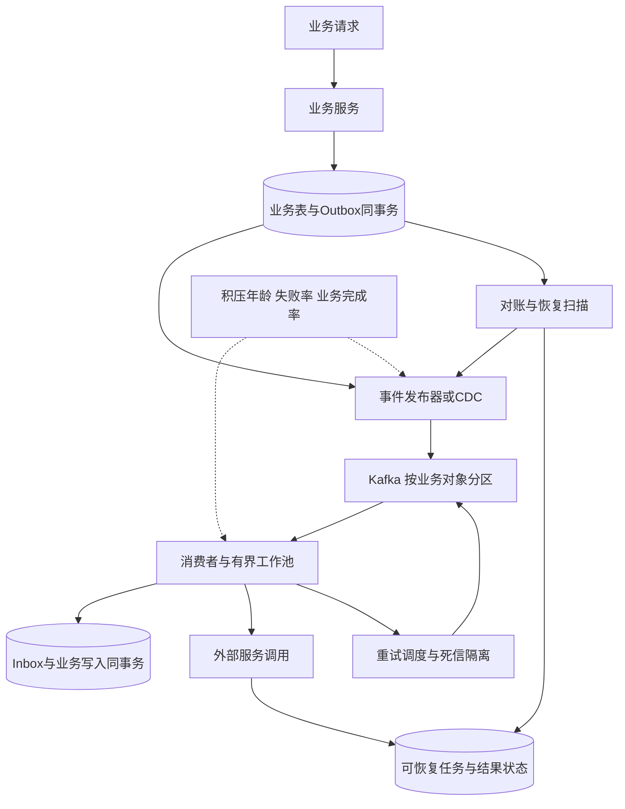
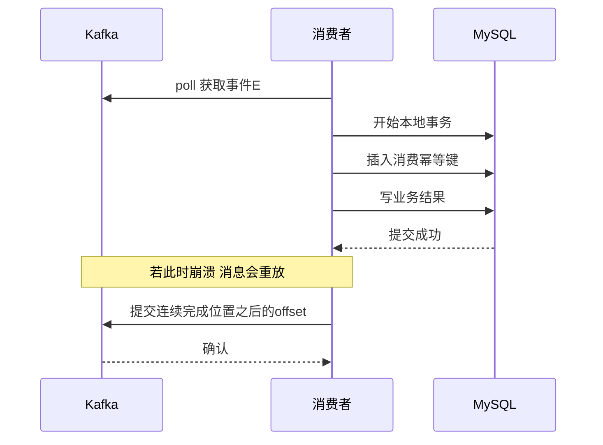

# 第 12 章 消息队列 积压 丢失 重复 顺序与事务

## 12.1 先画出消息承担的业务责任



引入 MQ 的理由可能是削峰、隔离耗时操作、让多个下游独立订阅、保留可重放事件或减少同步链路长度。只有“用了消息队列”并不能自动得到可靠性；把消息从应用内存移到 broker 后，业务责任仍需要明确保存、完成和核对。

例如资料上传完成后，解析、分段、嵌入和索引不应阻塞上传 HTTP 请求。用户可以先看到“资料已接收、处理中”，随后读取任务状态。此时需要保证的是资料最终能进入可检索状态或有明确失败原因，而不只是 Kafka 消费 offset 前进。

## 12.2 Topic Partition Consumer Group 怎么讲清楚

Topic 是业务事件的逻辑集合；partition 是日志分片与顺序范围；普通 consumer group 是一组共同完成同一份订阅工作的消费者。不同组各自维护消费位置，所以新增组通常会增加一份独立消费，并不会替原组分担它的积压。

在普通分区消费者组中，一个 partition 在稳定分配下交给一个活跃消费者；一个消费者可以负责多个 partition。消费者进程与工作线程不是同一个概念，处理线程可以增加，但需要另外维护顺序和 offset 安全。[R17]

假设一个 topic 有 12 个 partition：

| 调整 | 结果 | 什么时候有价值 |
| --- | --- | --- |
| 同组从 3 个消费者增加到 6 个 | 平均每个实例承担更少分区 | 消费者本身是瓶颈且下游有余量 |
| 同组从 12 个增加到 24 个 | 普通分配下部分实例无分区 | 通常不会使这一个 topic 再翻倍提速 |
| 新建第二个组 再放 12 个消费者 | 新组独立读取相同事件 | 增加独立业务订阅或显式的新处理路径 |
| 分区从 12 增加到 24 | 新数据可以获得更高分区并行度 | 当前分区数限制扩展且能处理路由变化 |
| 单实例增加工作线程 | 可提高 CPU 或 I/O 并行处理 | 必须保证有界队列、顺序与连续提交 |

这里讨论普通分区消费模型；不要把其他消费模式的语义直接套进来。“一个分区只能一个线程”也不准确：拉取所有权与应用内部处理并发是两层问题。

## 12.3 生产者消息不丢要覆盖三个层次

### 第一层 业务事实与待发送责任一起提交

错误做法一：先提交订单，随后发 MQ，进程在两步之间退出，消息丢失。

错误做法二：先发 MQ，再提交订单，下游已经消费，但订单事务失败。

可采用事务 Outbox：本地事务同时写业务表与待发布事件，独立发布器扫描或 CDC 捕获后发送。发布成功后再更新发布进度；如果发送成功但进度没写回，允许重发同一个 `event_id`，由下游幂等。

```sql
CREATE TABLE outbox_event (
    event_id       CHAR(36) CHARACTER SET ascii COLLATE ascii_bin PRIMARY KEY,
    aggregate_id   BIGINT NOT NULL,
    aggregate_ver  BIGINT NOT NULL,
    event_type     VARCHAR(64) NOT NULL,
    payload        JSON NOT NULL,
    status         VARCHAR(16) NOT NULL,
    next_attempt_at DATETIME(6) NOT NULL,
    created_at     DATETIME(6) NOT NULL,
    KEY idx_publish (status, next_attempt_at, event_id),
    KEY idx_aggregate (aggregate_id, aggregate_ver)
);
```

事件 ID 在业务事务创建时生成，重试发布不重新生成。多个发布器需要领取协议与超时恢复，或使用适合的 CDC；不要让所有实例反复全表扫同一批记录。按对象严格有序时，还要保证发布器不把后一个版本先发出去。

Outbox 的核心保证是本地数据库事务里的“业务事实与发布责任一致”。它不保证 broker 永远可用，也不保证某条事件只被发送一次。对账检查待发布事件年龄、业务状态与下游进度，才能把故障从“静默丢失”变成“可恢复积压”。

### 第二层 明确 broker ACK 条件

在本文使用的 Kafka 4.1 普通复制语义下，可靠性配置通常从 `acks=all`、合适副本数、`min.insync.replicas` 和生产者幂等开始检查。`acks=all` 需要当前 ISR 确认，不是永远固定等待所有配置副本，也不是只等 `min.insync.replicas` 个就立即返回。[R14][R15]

实际部署还需确认 ELR feature 状态：Kafka 4.1 新集群默认启用 ELR，控制器可以记录满足安全条件的非 ISR 副本作为合格选主候选，与允许任意落后副本的非干净选主不同。严格最小 ISR 规则还限制 ISR 不足时数据分区高水位的推进；配置作用域与特性状态要一起核验。12.20 节与 G.6 节详细说明这些条件。[G03]

例如假设副本数为 3、最小 ISR 为 2：三者都在 ISR 时需要三者确认；ISR 只剩 2 个时可以按约束写入；低于要求时应拒绝或等待恢复，应用把未完成发布责任留在 Outbox。不能为了恢复表面可用性随意放宽耐久条件。

ACK 与每条记录在每块硬盘上同步刷盘不是同一概念。复制、操作系统缓存、磁盘与机架故障域都属于可靠性模型；不能用一个参数承诺任何灾难下绝对不丢。

### 第三层 发送超时的结果可能未知

生产者超时可能是消息未进入 broker，也可能是 broker 已提交而 ACK 丢失。应继续用同一事件 ID，并根据客户端结果分类决定重试、查询或进入待恢复状态。

Kafka 生产者幂等处理其协议范围内的重试；应用重新构造并发送一个业务事件、重启后任意重发，并不自动被视为同一个业务操作。[R21] 因此业务幂等键不能省略。

## 12.4 消费者怎样避免丢失与重复副作用

先处理再提交 offset，可能在业务成功后、提交 offset 前崩溃，导致重放。先提交 offset 再处理，则可能在处理前崩溃，使消息被跳过。因此常见选择是至少一次投递，加业务幂等。



### Inbox 与业务写入必须在同一个事务中

```sql
CREATE TABLE consumer_inbox (
    consumer_name VARCHAR(64) NOT NULL,
    event_id CHAR(36) CHARACTER SET ascii COLLATE ascii_bin NOT NULL,
    processed_at DATETIME(6) NOT NULL,
    PRIMARY KEY (consumer_name, event_id)
);
```

Java 风格事务示意：

```java
void handleOnce(Event event) {
    try {
        transactionTemplate.executeWithoutResult(tx -> {
            try {
                // 只识别这张表、这个主键的重复；其他约束错误仍然抛出。
                inbox.insert("resource-index-v1", event.id());
            } catch (DuplicateKeyException ex) {
                if (isInboxPrimaryKeyConflict(ex)) {
                    // 抛出运行时异常，让整个本地事务退出并回滚。
                    throw new AlreadyProcessed(event.id(), ex);
                }
                throw ex;
            }

            // 与幂等记录共享同一个数据库事务和连接。
            // 对乱序事件还需另外检查对象版本与状态。
            resourceProjection.apply(event);
        });
    } catch (AlreadyProcessed duplicate) {
        // 同一消费逻辑之前已提交，重放可以视为完成。
        // 若并发首次处理回滚，其唯一键插入不会形成已提交冲突。
    }
}
```

这里展示的是同一关系数据库内的幂等效果。异常判断要由 DAO 明确映射，不能把任意业务表的重复键异常都当“消息已消费”；也不能在事务已标记回滚后，吞掉异常继续执行业务。

另一种方案是让业务表本身以 `event_id` 或业务唯一键防重复，不额外建 Inbox。前提是唯一约束确实对应这次业务副作用，而不是一个过粗的对象 ID。

幂等记录保留期必须覆盖可能重放的事件范围。事件可以重放三个月、幂等记录只留一天，会重新产生旧效果。若删除幂等记录，需要有业务版本或永久唯一约束接替防线。

### 外部 API 不能放进这个承诺里

调用支付、短信、邮件或第三方模型不属于 MySQL 本地事务。事务回滚不会撤回已经发送的通知。应保存可恢复任务、使用外部服务支持的稳定幂等键，超时先查询结果；外部系统不支持幂等和结果查询时，只能明确接受重复风险、人工复核或选择更保守的交付语义。

## 12.5 Exactly once 应该回答到哪里

需要先问“在哪个边界内恰好一次”。Kafka 内从输入 topic 读取、处理、向输出 topic 写入并提交输入 offset，可以使用 Kafka 事务将输出与位置绑定，读者需按相应隔离级别读取。[R16]

但这不意味着 Java 方法只执行一次，也不意味着某个 HTTP 接口、MySQL 更新或短信服务自动与 Kafka 一起提交。执行可以重复，只要最终可见效果不重复；跨系统要么有共同事务协议，要么让外部系统提供幂等、版本或原子记录消费位置的能力。

面试中可以明确分三层：

| 层次 | 常用手段 | 不可扩大解释的范围 |
| --- | --- | --- |
| 生产者到 Kafka 日志 | 幂等生产与事务 | 不是任意业务重复请求去重 |
| Kafka 输入到 Kafka 输出 | 事务提交输出与消费位置 | 不自动覆盖外部数据库与HTTP |
| 应用业务效果 | 唯一约束、Inbox、状态机、外部幂等键 | 不承诺所有故障下代码只运行一次 |

如果声称端到端 exactly once，应能逐一指出每个外部副作用如何与消费位置关联，否则说“至少一次传递，业务效果幂等”更准确。

## 12.6 消息顺序有四层

1. **业务发生顺序。** 两个终端同时操作同一对象，可能没有天然可比较的先后，需要由服务端序列、版本 CAS 或事务确定。
2. **进入日志的顺序。** 同一对象通常映射到同一 partition；多个生产者仍需约束业务版本，不能仅凭网络到达推断真实因果。
3. **消费者执行顺序。** 拉取顺序有序，丢进线程池后完成顺序仍可能逆转。
4. **结果可见顺序。** 数据库、缓存和搜索索引的异步投影需要版本保护，不让旧结果覆盖新结果。

例如资料 `v7=ACTIVE`、`v8=REVOKED`。即使 v8 先完成，晚到的 v7 也不能重建有效索引。若事件携带完整状态快照，可用“只接受更高版本”更新；如果是 `+1/-1` 增量，就不能简单丢弃较旧版本，必须按序补齐增量、对每事件幂等累加，或改为每对象的版本化完整贡献值。

### 严格顺序与重试的矛盾

把失败事件放到重试 topic，然后继续消费后续事件，会打破该对象的顺序。可选方案包括：暂停该分区，代价是同分区其他对象受影响；按对象维护顺序队列与阻塞标记；或者证明操作可交换、版本可覆盖，允许无序处理。

DLQ 也不等于顺序问题消失。跳过一个必要的“创建”事件后执行“更新”，可能让业务永久不完整。

## 12.7 Kafka 积压先判断类型 再决定动作

积压不是只有“消费者太少”。至少区分以下来源：

| 类型 | 观察证据 | 优先动作 | 加消费者的效果 |
| --- | --- | --- | --- |
| 上游突发流量 | 输入速率突然增加，各分区普遍落后 | 削峰、限流、临时扩容、延长可用恢复窗口 | 分区与下游有余量时有效 |
| 消费计算不足 | CPU满、单条计算耗时高 | 优化算法、分批、增加有效并行 | 经验证后可有效 |
| 下游慢 | DB/模型/索引服务延迟和连接等待升高 | 限制并发、优化下游、隔离非关键工作 | 可能进一步压垮下游 |
| 热分区 | 少数分区lag明显高 | 检查key分布与单对象流量 | 其他空闲消费者通常帮不上 |
| 重试风暴 | 同一事件反复失败、重复量激增 | 分类重试、退避、隔离毒消息 | 通常扩大故障 |
| 重平衡反复发生 | poll超时、实例抖动、所有权变化多 | 稳定消费循环、合理批次与超时 | 扩缩过频可能更差 |
| broker或网络瓶颈 | 多组一起慢、磁盘/复制/网卡异常 | 检查broker与网络容量 | 客户端扩容未必有效 |
| 开放事务阻塞可见位置 | read_committed下可见进度停滞 | 排查未完成事务与超时恢复 | 不是简单处理线程不足 |

不要只看总 lag。至少看每个 partition 的 lag、最老未完成事件年龄、输入与完成速率、处理耗时分布、重试比例、下游错误、队列和连接池水位。对于每条事件成本差异很大的资料解析，100 条大 PDF 可能比 1 万条小文本更难处理。

## 12.8 一套可操作的积压处置流程

### 第一步 确认业务影响与剩余窗口

确认是离线索引延迟、通知过期还是支付状态受阻；核对 retention 剩余时间和磁盘。用积压年龄对比业务 SLO，确定哪些任务还值得做、哪些已经过期。

### 第二步 阻止恶化

上游限制非必要输入，下游设置资源预算，关闭没有价值的无限重试。暂停低优先级回放、重建和批任务，避免它们挤占在线处理能力。降级必须明确哪些结果会延迟或失败。

### 第三步 找到真正瓶颈

把单条耗时拆成排队、下载、解析、外部模型调用、数据库写入与索引刷新；检查批大小、并发数和连接复用。某阶段已达到下游配额，再加线程只会增加排队。

### 第四步 扩有价值的容量

如果有未充分利用的 partition，并且单个消费者是瓶颈，增加同组消费者；如果消费者已覆盖全部分区，再评估增加分区或内部处理并发。必须按真实下游成功吞吐验证，不看启动了多少实例。

### 第五步 估算清空时间并持续校准

假设积压 1200 万条，输入 2 万条/秒，恢复后有效消费 3 万条/秒，净消化 1 万条/秒，预计约 20 分钟清空。这里的“有效消费”是完成业务责任的速率，不是把事件快速扔进另一个没有监控的内存队列。

### 第六步 安全回放与对账

回放失败对象，核对业务状态、投影版本与处理结果。恢复后逐步撤销临时限流或扩容，保留故障前后指标用于验证根因。

## 12.9 什么情况下增加分区

分区数已成为同组消费并行度上限，而且负载可被多个独立 key 分散、broker 与下游仍有容量时，增加分区有意义。但有三点不能漏。

**增加分区不会自动搬走原分区中的旧积压。** 原有日志仍在原分区，新增分区主要承接按新路由写入的消息。要消化旧积压，仍需提高原分区处理能力，或进行显式、可审计的再分发。

**默认按 key 取模的路由可能改变。** 同一个 key 的旧消息和新消息可能进入不同分区，由不同消费者并行处理。因此需要切换屏障、按对象版本校验，或使用稳定逻辑分桶与路由映射。

**一个必须串行的极热 key 仍然是串行。** 除非重构业务为可独立分片的子任务，否则增加分区没有消除单对象的顺序约束。例如一份资料的不同 chunk 可以并行嵌入，但“资料版本提交为可用”需要聚合屏障和版本核验。

## 12.10 多线程消费怎样安全提交 offset

假设同分区偏移 100、101、102 并行处理，102 和 100 已完成，101 未完成。不能因为看到 102 完成就提交 103，否则重启可能跳过 101。可提交的位置应为连续完成区间之后的下一个 offset；本例最多推进到 101。

当 topic 有事务或其他日志记录时，业务看到的 offset 不一定每个整数都有一条普通消息；实现应跟踪已拉取记录的顺序与完成水位，不应死等一个本来就不存在的整数记录。

下面是结构性伪代码，重点是线程归属和提交水位。客户端必须显式设置 `enable.auto.commit=false`，否则自动提交可能先于异步任务完成，破坏这里的承诺：

```java
// consumer只由poll线程调用；worker只处理业务并投递完成通知。
while (running) {
    drainCompletionsAndAdvanceContiguousWatermarks();

    // 某分区的待处理条数或字节超预算就pause；恢复后resume。
    // pause期间仍需保持poll循环，不能永久sleep。
    updatePartitionPauseState();

    ConsumerRecords<String, Event> batch = consumer.poll(shortTimeout);
    for (TopicPartition partition : batch.partitions()) {
        for (ConsumerRecord<String, Event> record : batch.records(partition)) {
            final long epoch = tracker.epochFor(partition);
            tracker.register(partition, epoch, record.offset());
            boundedWorkers.submit(() -> {
                Completion outcome;
                try {
                    handleOnce(record.value());
                    outcome = new Done(partition, epoch, record.offset());
                } catch (Exception ex) {
                    outcome = new Failed(partition, epoch, record.offset(), ex);
                }
                publishCompletionReliably(outcome);
            });
        }
    }

    // 只提交仍归本实例所有、且连续完成的nextOffset。
    consumer.commitSync(tracker.safeNextOffsets());
}
```

这段伪代码还必须配合容量预留：提交线程池前保证队列有空间，拒绝时保留记录并暂停拉取，不能丢弃已拉取事件。`publishCompletionReliably` 是明确的可靠投递抽象，例如每个在途任务预留一个完成通知位置，并在控制线程持续排空；不能用忽略返回值的 `offer`。失败通知由控制线程安排重试或持久转交失败处理责任，在其业务语义被明确解决之前不推进水位。捕获的 `epoch` 在任务提交时固定，不能在异步回调时读取可变的当前代次。

`KafkaConsumer` 本身不是供多线程随意并发操作的客户端；poll、pause、resume 和 commit 的协调放在一个控制线程更容易正确实现。[R17] 发生 rebalance 后，旧工作仍可能跑完，必须识别 assignment epoch 并忽略过期提交；业务副作用仍靠幂等与版本防重复。

同步逐分区处理更简单，也更容易解释。只有观测到吞吐瓶颈、明确可以接受复杂度时，才引入内部并行。

## 12.11 为什么心跳正常仍可能重平衡

心跳与 poll 进度检查不是一件事。后台心跳可以说明进程还在，但应用如果过久没有 poll，仍可能被视为没有正常推进，触发分区重新分配；静态成员与不同消费协议会影响具体时机。[R13]

应从缩小单次处理批量、把耗时阶段异步化并有界控制、合理配置 `max.poll.interval.ms`、减少全局长暂停和稳定部署入手。单纯把超时改成极大值，会延长故障恢复并掩盖卡死。

`max.poll.records` 控制每次 poll 返回给应用的记录数量，不等同于底层一次网络 fetch 的总量。[R13] 内存风险还需检查 fetch 字节、单条消息上限和预取行为。

## 12.12 重试 延迟与死信要形成闭环

| 错误类型 | 处理方式 | 例子 |
| --- | --- | --- |
| 短暂可恢复 | 有上限的指数退避加随机抖动 | 短期网络抖动、限流 |
| 等待业务前置条件 | 延迟任务并记录依赖与期限 | 资料分片尚未全部完成 |
| 数据永久不合法 | 隔离并给出可诊断原因 | 不支持的事件版本、缺必填字段 |
| 结果未知 | 查询原操作或用原幂等键恢复 | 第三方超时但可能已成功 |
| 已经失效 | 按业务规则终止而非机械执行 | 过期通知、被撤销资料 |

重试记录应保存原 `event_id`、业务对象、尝试次数、首次失败时间、下次执行时间、错误分类和关联 trace。尝试次数不是唯一预算，还需要总时长和外部成本预算。

DLQ 需要告警、负责人、检视与重放流程；否则只是把“丢失”改了一个目录名。重新发布时保持业务事件身份，附加新的投递尝试 ID，避免破坏幂等。

Kafka 核心日志并不等于任意精度的每消息定时调度器。把消费者停在一个未来执行时间上，会阻塞后续记录；可以用任务表加到期扫描、分层延迟队列或其他明确支持的调度机制。涉及先后顺序时，还要决定后续同对象消息是否允许越过等待中的事件。

## 12.13 大消息 Schema 变更与重放

大文件不宜直接作为 MQ 消息体。保存对象存储地址、对象版本、校验摘要、访问范围和业务 ID，由消费者按配额下载；访问凭据不要长期裸放消息中。要保证对象生命周期覆盖队列保留和重试窗口，不能消费者还没读文件就被清理。

事件 envelope 可包含：

```json
{
  "event_id": "stable-business-event-id",
  "event_type": "ResourceParsed",
  "schema_version": 2,
  "tenant_id": 42,
  "aggregate_id": 781,
  "aggregate_version": 8,
  "occurred_at": "2026-11-11T02:00:00Z",
  "payload_ref": "object-version-reference",
  "trace_id": "request-trace"
}
```

新增字段尽量有兼容默认值；删除或改变含义需要分阶段迁移。消费者应对未知类型明确隔离或按协议忽略，不能吞异常后提交 offset。

历史重放需要区分“重建一个新读模型”和“再次执行真实副作用”。重建索引可以使用新消费组和新的目标索引，再按水位切换；支付、短信等副作用不能用重建的名义再次触发。回放流量应与在线流量隔离，避免修复任务把当前服务拖垮。

## 12.14 Kafka 与 Redis Stream 的系统设计比较

| 维度 | Kafka | Redis Stream | 面试中应怎样选择 |
| --- | --- | --- | --- |
| 数据组织 | 分区日志 | Redis key 中的流结构 | 看数据量、保留期与已有运维能力 |
| 同组消费 | 普通模型按分区分配所有权 | 一个流的消息在组内分配给消费者 | 不把两者并行度限制直接等同 |
| 顺序范围 | 一个partition的日志顺序 | 一个Stream的ID顺序 | 都不自动保证并行处理完成顺序 |
| 独立订阅 | 不同group独立进度 | 不同group或各自XREAD游标 | 先确定竞争消费还是广播 |
| 恢复位置 | offset与保留日志 | 游标、PEL与保留条目 | 保留期不足时都要从业务状态恢复 |
| 确认机制 | 提交消费位置 | XACK移除组内待确认引用 | 确认不等于业务事务 |
| 存储与耐久 | 复制日志与保留策略 | Redis持久化、复制、内存策略 | 不能因为有Stream就跳过Redis故障模型 |
| 短期会话回放 | 可以实现但粒度与管理需设计 | 便于按会话维护短窗口 | 回答事件可用Stream加最终快照 |
| 大量离线流水线 | 适合评估为主事件总线 | 需评估内存、持久性和重建成本 | 资料解析链路通常更适合日志队列方案 |

这里是针对两类组件机制形成的设计选择，不宣称任何产品在所有负载下绝对更快。延迟、吞吐和成本必须在同样的消息大小、复制要求、确认方式和硬件下比较。[R12][R16]

## 12.15 Redis Stream 的可靠消费细节

基本处理链路是 `XREADGROUP` 领取、执行业务、成功后 `XACK`。消费者崩溃后，已经领取但尚未确认的记录在 PEL 中，需要检查并接管；仅继续用 `>` 读取新消息不会自动处理全部旧待确认消息。[R12]

`XAUTOCLAIM` 可以把超过指定空闲时间的待确认记录转给新消费者；阈值必须考虑正常处理时长，否则会把还在工作的慢消费者误判成失败。新旧消费者仍可能并行产生结果，所以接管本身不代替业务幂等。[R18]

`XACK` 清理的是对应组的待确认引用，不是删除 Stream 正文。[R19] 反过来，正文裁剪也不能无条件假设等待所有业务完成。选择裁剪策略时要区分短期可丢事件与必须可靠执行的任务。

```text
XGROUP CREATE resource-events parser-group 0 MKSTREAM
XREADGROUP GROUP parser-group worker-1 COUNT 100 BLOCK 2000 STREAMS resource-events >
XPENDING resource-events parser-group
XAUTOCLAIM resource-events parser-group worker-2 60000 0-0 COUNT 100
XACK resource-events parser-group 1731290400000-0
```

命令中的超时、批量和起始位置只是演示；`0` 表示从已有历史开始，创建时用 `$` 则选择未来新消息，两者会改变是否重放历史。接管游标需要迭代，不能只调用一次就认为所有待确认都恢复了。

同一个流的多个网关如果处在同一个消费组，消息会分配给其中某个消费者，不会让每个网关都获得完整事件。广播到多个会话客户端时，应由明确的分发层分发，或每个读者维护独立游标，避免错误地把工作队列当广播总线。

## 12.16 映射到 NoteWeave 与制造业告警

### NoteWeave 资料流水线

按 `resource_id` 和 `resource_version` 组织解析任务，输入文件在对象存储，数据库记录处理状态。Kafka 承载解析、分段、嵌入和索引阶段事件；每阶段有幂等键和版本检查，最终发布可检索版本时确认必需分片都已成功。

不同阶段应按资源特征隔离：解析可能吃 CPU 和内存，嵌入受远端配额与连接限制，索引写入受批次与搜索集群容量限制。让所有阶段共用一个无界线程池，容易因慢模型调用阻塞资料状态更新。

如果积压来自大文件解析 GC，先做流式读取、限制单任务内存、减少批次和并发，并按文件大小分队列；如果来自 embedding 配额，增消费者不会突破配额，应削峰、批量调用、缓存可复用结果并限制租户预算。

资料撤销事件必须压过旧解析结果。处理器执行前与写回时检查版本；旧版本任务可以终止或只保存审计信息，不能继续把资料标记为 ACTIVE。

### NoteWeave 流式回答

Redis Stream 只保留有界的近期回答事件用于重连；最终文本、引用与任务终态进入可靠存储。连接断开只意味着发送通道断了，是否取消生成由产品策略决定；用户重连时以任务 ID 和序号恢复，不能无条件再启动一个新生成任务。

### 制造业可靠通知

告警规则触发后先记录通知任务，任务唯一键可以由告警实例、接收目标、渠道与通知阶段构成。执行者领取任务后调用渠道，成功或失败采用版本号条件写回；超时进入待确认状态，重试沿用渠道支持的幂等标识。

业务完成率应看告警是否按时到达指定渠道或被明确确认失败。单看 MQ lag 为零，可能只是把任务快速转移到了一个长期未完成的通知表。

## 12.17 消息可靠性故障矩阵

| 故障位置 | 是否可能重复 | 是否可能丢责任 | 解决机制 |
| --- | --- | --- | --- |
| DB成功 MQ未发 | 否 | 直接双写会丢 | 事务Outbox与恢复扫描 |
| MQ成功 生产者超时 | 是 | 错误放弃可能丢处理机会 | 稳定event_id与发布状态恢复 |
| broker副本不足 | 取决于重试 | 放宽保证可能丢最近写 | 明确ACK与ISR要求 保留待发布责任 |
| DB业务完成 offset未提交 | 是 | 正确幂等下不丢 | Inbox或业务唯一约束 |
| offset先提交 业务失败 | 否 | 是 | 提交必须跟随有效完成 |
| 线程池拒绝已拉取消息 | 可能 | 静默丢弃会丢 | 有界缓冲 pause 不越过未完成水位 |
| 重平衡后旧worker完成 | 是 | 状态覆盖风险 | 执行代次 业务版本 幂等 |
| 消息超过保留期 | 无法重放 | 是 | 监控年龄 提前扩保留 从业务账本恢复 |
| PEL接管后原worker复活 | 是 | 外部副作用可能重复 | 同一业务幂等键与条件写回 |
| 重试转DLQ后无人处理 | 否 | 业务责任实际上悬空 | 告警 诊断 修复 重放闭环 |

## 12.18 连续追问与回答

### Q1 积压时加消费者组还是消费者

通常先增加原业务组内的消费者实例，因为它们共同分担已有订阅。新增组会独立消费消息，不能直接帮原组清积压。还要验证分区有余量和下游没有被打满，否则新增实例不产生有效吞吐。

### Q2 同组消费者已经等于分区数怎么办

先检查当前吞吐受 CPU、下游还是单对象顺序限制。可以在安全前提下增加内部工作并发，或扩分区承接后续负载；增加分区不会自动重新分配旧日志，也不会自动拆开一个严格有序的热 key。

### Q3 为什么消费者越多 数据库反而越慢

每个消费者增加连接、并发事务、随机写和锁竞争，数据库到达饱和点后服务时间变长，排队又消耗更多连接。应根据数据库稳定成功吞吐限制总并发，再优化 SQL、批次与事务范围，而不是继续放大请求。

### Q4 如何证明不会丢消息

先定义故障模型，再按业务提交、发布、broker复制、消费、外部副作用逐段说明保存的责任和恢复动作。只说生产者 ACK 加消费者手动提交不够，因为数据库与 MQ 双写窗口、外部接口超时和保留期都还未覆盖。

### Q5 手动提交 offset 能防重复吗

不能。业务成功后 offset 提交前崩溃仍会重放。手动提交主要让应用选择何时推进位置，业务幂等需要唯一约束、Inbox、版本或状态机单独实现。

### Q6 Redis SETNX 做消费去重够不够

如果先写 SETNX 后业务失败，重放可能被错误挡住；如果先业务后写 SETNX，崩溃会重复；key还可能过期或淘汰。对于数据库内副作用，幂等记录与业务同事务更直接。Redis适合加速判断，不能自动替代事务协议。

### Q7 消费顺序等于业务顺序吗

不等于。不同生产者、分区变更、线程池、失败重试和异步投影都可能改变完成顺序。必须明确顺序范围，绑定业务对象版本，并决定遇到缺版本时等待、补读还是使用可覆盖的完整状态。

### Q8 一个失败消息能否跳过

先判断它是不是后续操作的必要前置。可独立的坏数据可以持久隔离后继续，需保留可追踪结果；严格依赖链中不能只为了让 lag 变小跳过。如果定义为永久失败，应让业务状态明确进入失败或补偿流程。

### Q9 消息积压很多 能否把 offset 直接调到最新

这会放弃尚未处理的业务事件，除非业务明确允许丢弃，并且从权威状态能正确重建。日志采样、过期无价值通知与支付订单不是同一种取舍，不能把运维命令当通用恢复方案。

### Q10 auto.offset.reset 是重试策略吗

不是。它主要决定没有有效已提交位置或位置不可用时，从哪里开始读取。它不代替每条业务失败的重试。自动跳到最新还可能掩盖保留期不足导致的历史缺失，关键链路需要显式监控与恢复判断。[R13]

### Q11 启用生产者幂等后应用还能重复发送吗

能。生产者协议去重不等于业务同一事件在任意时间重发都被识别。应用生成两个 event_id、换生产会话重新发送，都需要消费者业务幂等约束来兜底。[R21]

### Q12 Kafka 事务为什么不能自动保证 MySQL 只写一次

Kafka事务参与的是Kafka自己的输出与位置信息，MySQL提交不是其中一个自动参与者。可用数据库事务把Inbox与业务结果绑定，或采用真实的跨系统协调方案；不能因为两个客户端都支持“事务”就说它们属于同一事务。[R16]

### Q13 异步线程池处理 offset 如何提交

只推进本分区连续完成的处理水位，不能按最大已完成offset提交。记录还需绑定本次分区所有权代次，重平衡后旧回调不能推进新所有者的进度。业务效果仍应幂等，因为旧任务不一定能被立即停止。

### Q14 重试 topic 为什么可能破坏顺序

失败的早期事件被移走，主topic继续处理后续事件，重试回来时已经落后。需要按对象阻塞、按分区暂停、版本化状态覆盖，或证明操作可交换；每种选择都有吞吐或语义代价。

### Q15 延长 retention 能解决积压吗

它只能延长恢复窗口，不增加净处理能力，还会增加磁盘压力。应该同时解决 μ不大于λ 的根因，估算保留容量和清空时间，并防止磁盘满把broker拖入更大故障。

### Q16 Redis Stream 有消费者组 为什么还会丢消息

消息正文与消费状态受Redis复制、持久化、淘汰和裁剪策略影响。消费者组记录待确认，不保证所有故障下数据都能恢复；正文被裁剪后，PEL引用也不能重新创造正文。[R11][R12]

### Q17 XACK 后另一个消费者还能读到吗

同组的新消息分配与其他组、普通游标读取要分开说。XACK主要移除本组待确认引用，正文仍可能被其他独立读者按各自进度读取；是否还能读取取决于保留与裁剪。[R19]

### Q18 消息进入死信队列就算处理成功吗

从主队列转移责任可能完成了，但业务不一定成功。要有明确业务失败状态、可定位原因、告警与可控重放；对必须完成的操作，死信只是等待修复的位置。

### Q19 如何让重放不重复发通知

重建读模型与真实通知使用不同消费逻辑和目标；真实通知由永久业务任务唯一键或足够长的幂等状态控制。回放时不能随意换业务ID绕过去重，应明确哪些效果允许再次发生。

### Q20 用什么指标判断恢复成功

除了总lag下降，要看最老未完成年龄、业务完成率、失败/重试比例、各分区倾斜、下游延迟和对账差异。把事件从Kafka搬进无界线程池会让lag看起来很好，但实际恢复可能更糟。

## 12.19 面试口述收束

“我先从业务完成条件出发，使用本地事务保存业务事实与Outbox发布责任。Kafka用合适复制和ACK条件承接事件，下游先幂等处理再推进连续完成位置。积压时先看输入、处理耗时、热点分区和下游，再决定限流、优化、增加同组消费者或分区。资料流水线与短期回答回放的保留和可靠性要求不同，所以分别评估Kafka和Redis Stream。Exactly once我会限定边界，外部副作用仍靠业务状态与幂等协议。”

## 12.20 消息链路的端到端可靠性与故障分析

**版本限定：**本章使用 Kafka 4.1 普通分区消费基线；实际部署需同时确认 ELR feature 状态与 classic/consumer 消费组协议。Kafka 4.1 新集群默认启用 ELR，控制器可将符合安全条件的非 ISR 副本列为 leader 候选，这不等于允许任意落后副本进行非干净选主。新 consumer 协议的心跳和会话超时参数主要由服务端管理，不能机械套用 classic 客户端配置。`acks=all` 与最小 ISR 的写入门槛仍应结合实际特性和主题配置解释。[G03][G05]

### 先证明自己优化的不是一个假指标

假设消费看板 `records-lag-max` 已经接近零，用户却仍要等几十秒才能看到资料索引结果。先查指标定义：该客户端指标按当前读取位置计算，并非已提交 offset。将记录快速拉入异步线程池，会让读取 lag 下降，但业务队列仍可能增长。[G04]

此时要增加应用在途条数/字节、最早未完成时间、连续完成水位、数据库连接等待、外部模型配额等待和最终可检索时间。只有完整业务责任下降，才叫积压恢复；把任务从 Kafka 搬到一个无监控内存队列，通常只是隐藏问题。

### 用场景选择技术，不用组件名称代替答案

| 技术要点 | 系统设计场景 | 需要说明的边界 |
| --- | --- | --- |
| 本地消息表 | 秒杀订单创建后触发履约 | 同库事务、逐行领取代次、发送未知、分片扫描公平性 |
| 顺序消息 | 会话消息、设备状态机 | 业务 seq、分区路由、执行顺序、结果版本 |
| 数据倾斜/热点 | 超级房间或异常设备 | 热写与热扇出分开，单 key 串行上限 |
| 消息积压 | 资料解析/索引或订单投影 | 净消化速率、下游预算、完成前缀与重平衡 |
| 延迟消息 | 关单、提醒、失败重试 | 持久到期索引、计划版本、取消和 UNKNOWN |
| 高可用/ISR | broker 或可用区故障 | ACK、min ISR、ELR、KRaft 控制面与故障域 |
| Kafka + Flink | 设备告警、实时统计 | 事件时间、迟到、checkpoint、外部副作用 |

### 两个最容易被追问到的反例

**反例一：布隆过滤器显示已消费，于是跳过履约。** Bloom 的“可能存在”包含假阳性，关键业务直接跳过会漏处理；应查询精确 Inbox 或业务唯一键。去重记录与业务结果仍需共同提交，不能先写 Redis 标志再写数据库。[R20]

**反例二：Kafka 扩分区后，旧订单状态被新状态覆盖又倒退。** 新旧消息可能落到不同分区，业务完成顺序已改变。需要对象版本保护、可证明的重排/补洞或路由迁移屏障；如果消息是必须执行的增量，不能仅丢掉旧版本。增加分区也不会搬走旧日志积压，恢复仍需针对原分区。

### 可以直接使用的案例陈述骨架

“这条链路里，数据库是业务事实源，事务同时建立发布责任。发布器按库和逻辑桶分配扫描额度，Kafka 不可用时保留可审计欠账；下游把精确去重与本地业务更新放在同一事务。扩容时先确认瓶颈是消费者还是下游，对热点 key 保留明确顺序，异步处理只提交连续完成位置。上线验证包含 ACK 丢失、租约过期、rebalance、分片迁移与外部结果未知，不只比较平均吞吐。”

面试陈述应明确区分实际实施的工作与设计假设。

通用实现、表结构、故障时间线及六类业务案例见 G：Kafka 业务可靠性、顺序与积压治理。

**相关专题：** [Kafka可靠性与积压治理](20_Kafka可靠性与积压治理.md) · [高并发准入与分布式锁](23_高并发准入与分布式锁.md) · [高可用与容灾恢复](25_高可用与容灾恢复.md)。

[G03]: https://kafka.apache.org/41/operations/eligible-leader-replicas/ "Apache Kafka 4.1 Eligible Leader Replicas"
[G04]: https://kafka.apache.org/41/operations/monitoring/ "Apache Kafka 4.1 Monitoring"
[G05]: https://kafka.apache.org/41/operations/consumer-rebalance-protocol/ "Apache Kafka 4.1 Consumer Rebalance Protocol"
[R11]: https://redis.io/docs/latest/commands/xtrim/ "Redis XTRIM"
[R12]: https://redis.io/docs/latest/develop/data-types/streams/ "Redis Streams"
[R13]: https://kafka.apache.org/41/configuration/consumer-configs/ "Kafka 4.1 Consumer Configs"
[R14]: https://kafka.apache.org/41/configuration/producer-configs/ "Kafka 4.1 Producer Configs"
[R15]: https://kafka.apache.org/41/configuration/topic-configs/ "Kafka 4.1 Topic Configs"
[R16]: https://kafka.apache.org/41/design/design/ "Kafka 4.1 Design"
[R17]: https://kafka.apache.org/41/javadoc/org/apache/kafka/clients/consumer/KafkaConsumer.html "KafkaConsumer Java API"
[R18]: https://redis.io/docs/latest/commands/xautoclaim/ "Redis XAUTOCLAIM"
[R19]: https://redis.io/docs/latest/commands/xack/ "Redis XACK"
[R20]: https://redis.io/docs/latest/develop/data-types/probabilistic/bloom-filter/ "Redis Bloom filter"
[R21]: https://kafka.apache.org/41/javadoc/org/apache/kafka/clients/producer/KafkaProducer.html "KafkaProducer Java API"
