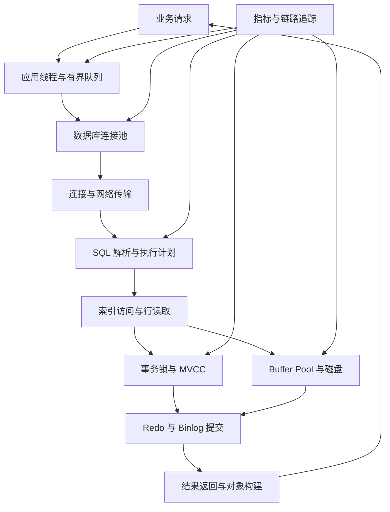
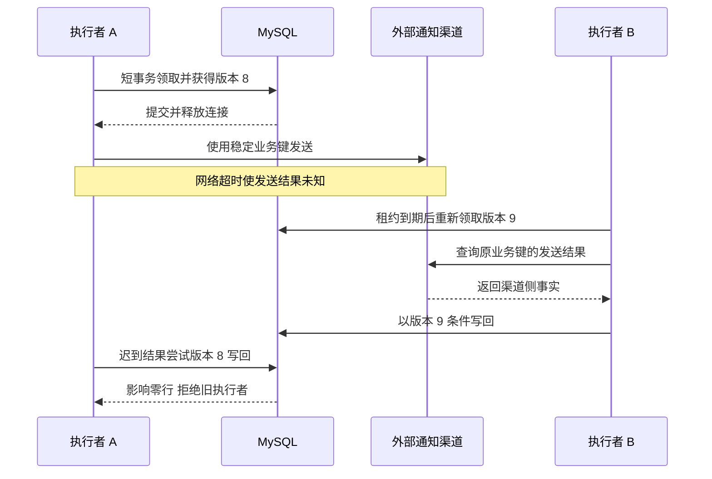

# 第 13 章 MySQL 调优：从证据定位到索引、事务、连接与容量

## 13.1 先画出一次请求经过的所有等待点

MySQL 调优不是背一组参数，也不是看到慢查询就加索引。用户感到接口慢，时间可能花在连接池排队、网络、行锁、磁盘、执行计划、返回大结果或应用处理上。应先分解延迟，再优化真正限制吞吐的环节。



一个实用的延迟模型是：

`接口耗时 = 应用排队 + 连接获取 + 网络往返 + 数据库等待与执行 + 结果传输 + 应用处理`。

如果 SQL 实际执行 5 毫秒、连接池排队 500 毫秒，继续给 SQL 加索引可能收益很小。反过来，数据库已被慢扫描打满，扩大连接池通常只会让更多请求同时争抢资源。优化要连接“症状—证据—原因—动作—验证”，不能把一个参数当万能药。

## 13.2 一套可以在面试中复述的排查流程

1. **确认问题范围。**是某接口、某 SQL、某租户、某时间段，还是数据库整体退化？P50 正常而 P99 高通常提示偶发等待、热点、抖动或数据偏斜。
2. **拆分端到端时间。**从追踪和连接池指标分离获取连接、SQL 执行、结果处理；确认数据库的慢查询时间与应用观测是否一致。
3. **查看资源与等待。**CPU、磁盘延迟和吞吐、Buffer Pool、活跃线程、连接等待、锁等待、长事务、复制延迟、临时磁盘表、日志刷盘。
4. **按负担找 SQL。**看总耗时、执行次数、平均与尾延迟、扫描行数、返回行数。每次 50 毫秒但每秒执行一万次的 SQL，可能比每天一次的十秒 SQL 更值得先优化。
5. **获取代表性参数和执行计划。**热租户与普通租户可能选择不同计划。保留脱敏后的参数分布，不能只用一个空表样例证明索引有效。
6. **提出一个可验证假设。**例如“每次按对象扫描十万条后过滤状态，索引缺少 state”；或“请求把模型调用包进事务，连接被占用几十秒”。
7. **在相似数据分布下验证。**观察扫描量、锁、CPU、I/O、尾延迟和写入代价，不能只比一次执行的偶然耗时。
8. **灰度发布并保留回退。**新增索引会影响写入与存储，SQL 改写可能改变排序或空值语义，参数调整可能改变持久性。验证正确性和性能之后再扩大范围。

排查证据示例：

| 现象 | 首先观察 | 常见原因 | 优先动作 |
|---|---|---|---|
| CPU 高、扫描行数巨大 | SQL 总耗时和执行计划 | 缺索引、过滤太晚、排序聚合过大 | 重写查询、减少扫描、合适复合索引 |
| CPU 不高但延迟高 | 锁等待、磁盘等待、连接等待 | 热点行、长事务、存储慢、池耗尽 | 定位等待资源和持有者 |
| 新版本发布后变慢 | SQL/参数/计划变化 | ORM N+1、返回列膨胀、索引失配 | 对比发布前后查询形态 |
| 越运行越慢 | 长事务、undo、空间和脏页 | 历史版本无法清理、磁盘压力 | 结束问题事务、恢复清理能力 |
| 读副本越来越旧 | 应用延迟、复制线程、慢事务 | 从库承载过多查询、DDL或大事务 | 控制负载与追平策略 |

## 13.3 EXPLAIN 与 EXPLAIN ANALYZE 要看什么

普通 `EXPLAIN` 用来查看优化器计划；`EXPLAIN ANALYZE` 会实际执行所分析语句，并返回估计与实际行数、循环和耗时信息。它不是只读地估算成本：对长查询会真的消耗资源，对该版本支持的写语句尤其要注意副作用和环境。[C03]

```sql
EXPLAIN FORMAT=JSON
SELECT id, status, next_run_at
FROM notification_task
WHERE status = 'READY' AND next_run_at <= NOW(6)
ORDER BY next_run_at, id
LIMIT 100;

-- 在受控环境、可接受成本的数据范围内再执行实际分析。
EXPLAIN ANALYZE
SELECT id, status, next_run_at
FROM notification_task
WHERE status = 'READY' AND next_run_at <= NOW(6)
ORDER BY next_run_at, id
LIMIT 100;
```

读计划时关注这些问题：

| 信号 | 应回答的问题 | 常见误读 |
|---|---|---|
| 访问方式和使用索引 | 是点查、范围、全索引扫描还是全表扫描？ | 看到“用索引”就认为一定高效 |
| 估计行数与实际行数 | 统计信息是否低估热点或相关性？ | 只看估计 rows，不看真实分布 |
| 返回行数与扫描量 | 为拿 20 条读取了多少数据？ | 查询只返回 20 条所以成本很小 |
| loops | 内层操作执行了多少次？ | 单次很快却忽略几十万次重复 |
| Using index | 是否可以从索引获得所需列？ | 与 Using index condition 混为一谈 |
| Using filesort | 需要额外排序多大数据？ | 一定在磁盘上排序、一定不能接受 |
| Using temporary | 中间结果规模与是否落盘？ | 任何临时表都必须消除 |

实际迭代器耗时可能包括子节点耗时，不能把树上所有节点耗时简单相加。多次循环显示的平均行数和平均耗时，也应结合 loops 理解总体负担。优化器偶尔选择全表扫描是合理的：小表或需要大比例数据时，随机回表可能比顺序扫描更贵。

## 13.4 聚簇索引、二级索引与覆盖索引如何影响设计

可以把 InnoDB 主键组织理解为记录的主要访问结构，二级索引帮助按其他字段找到主键，再取得记录。于是主键宽度、二级索引数量和查询列数都会影响空间和访问成本。宽字符串主键会把成本传播到许多二级索引，随机写入也可能影响页局部性；不过是否需要换主键仍要结合实际负载，不能仅凭“随机 ID 一定慢”下结论。

**覆盖索引**的价值在于某次查询所需字段都能从索引获取，减少访问完整记录。比如通知调度先取 `id`、`status`、`next_run_at`，不需要一次拿到很长的消息正文；领取任务后再按主键读取正文。不要为了“覆盖”把大 JSON、长文本和十几个低频字段塞进一个巨大索引。

在事务可见性检查等具体情况下，索引访问仍可能需要访问聚簇记录，因此覆盖索引的工程结论是减少常见回表成本，不应把它表述成任何情况下都绝不访问主记录。涉及精确执行行为时以实际计划和版本验证为准。

## 13.5 联合索引：等值、范围、排序与过滤各自是什么作用

假设研究任务表常按用户和状态查看最近任务：

```sql
CREATE INDEX idx_task_user_state_time
ON research_task (tenant_id, user_id, status, created_at, id);

SELECT id, status, created_at
FROM research_task
WHERE tenant_id = ? AND user_id = ? AND status = 'RUNNING'
ORDER BY created_at DESC, id DESC
LIMIT 20;
```

前面的等值条件固定一个较小索引区间，后面的顺序可以服务排序与继续翻页。多列索引应围绕这种高频查询组合设计，而不是机械地把“选择性最高字段永远放第一”。若所有查询都必须先按租户隔离，tenant_id 放前面可能使一组查询都受益；如果还有大量不带 status 的时间排序，现有索引是否满足需要另看计划。[C02]

“遇到范围条件后，后面的字段全部失效”是不准确的。应分三层讨论：后续字段能否继续缩小索引定位范围、能否在索引层过滤、能否覆盖查询或参与排序。前一个作用受范围边界和查询形态限制，不代表后两个作用消失。索引条件下推 ICP 允许引擎先利用索引中的条件过滤，满足后才读取完整行，从而减少回表；它与“覆盖索引无需取所有行内容”不同。[C04]

例如索引 `(tenant_id, created_at, status)`，条件是 tenant_id 等值、created_at 大范围、status 等值。status 不一定能像放在范围之前那样大幅缩小扫描区间，但仍可能用于索引层过滤。若状态过滤非常强且查询形态稳定，改成 `(tenant_id, status, created_at)` 可能更好；若查询还大量需要所有状态的时间流，要衡量多种查询和维护成本。

## 13.6 所谓索引失效，需要逐项说清原因

| 查询形态 | 为什么可能慢 | 处理方式与例外 |
|---|---|---|
| `DATE(created_at)=?` | 对列计算可能妨碍普通索引范围定位 | 改半开时间区间，或验证适用函数/生成列索引 |
| 字符串列与数字参数比较 | 可能对列进行隐式类型转换 | 参数类型与列一致；不要泛化成所有类型转换都不走索引 |
| `LIKE '%关键词%'` | 普通 B 树难由前缀定位 | 全文检索、专门索引；小表扫描也可能足够 |
| `LIKE '关键词%'` | 有前缀范围机会 | 仍受字符集、排序规则、选择性和返回量影响 |
| `OR` 多个条件 | 每支访问路径和合并成本不同 | 可能索引合并，也可能扫描；改 UNION 要处理重复语义 |
| 不等于、NOT、IS NULL | 匹配比例可能高 | 不是绝对无法用索引，观察选择性和计划 |
| `SELECT *` | 宽结果、回表和网络成本 | 按需选列；不能说它必然让索引失效 |
| 深 OFFSET | 为跳过记录扫描大量索引项 | 游标分页或先取 ID 再关联回表 |
| 统计信息不准 | 优化器估算错误 | 受控更新统计信息，必要时验证直方图 |
| 字符集/排序规则不一致 | 比较与转换增加成本或改变访问 | 统一连接列类型和规则，确认业务语义 |

SQL 改写必须保留语义。例如把 `OR` 拆成两个 `UNION ALL`，同一记录满足两支时会出现重复；用 `UNION` 又有去重成本。把包含式时间上界改成半开区间时，要根据业务时区计算准确边界，不能把用户自然日直接当 UTC 自然日。

```sql
-- 用范围表达某个业务日，边界由应用按业务时区转换得到。
WHERE created_at >= ? AND created_at < ?;
```

强制索引只能作为有证据的手段。数据分布变化后，今天强制的计划明天可能更差。应记录理由、对照计划和撤销条件，而不是把 `FORCE INDEX` 当“优化器不听话”的固定补丁。

## 13.7 深分页、排序、分组和 JOIN

对资料列表，推荐稳定的 `(created_at,id)` 游标：

```sql
SELECT id, title, created_at
FROM material
WHERE tenant_id = ? AND status = 'ACTIVE'
  AND (created_at < ? OR (created_at = ? AND id < ?))
ORDER BY created_at DESC, id DESC
LIMIT 20;
```

游标能避免随着页码增加而扫描更多前缀，但不支持任意跳到第十万页。若产品必须随机页码跳转，可以考虑预计算分页锚点、限制最大页深，或改为搜索定位。先用覆盖索引取得深页 ID、再回表能减少跳过阶段的回表次数，却仍要走过被跳过的索引项，不能说复杂度已经变成常数。

排序看是否能按索引顺序返回以及实际候选量。一个只有几百行的内存排序可能比维护庞大的额外索引更合理。分组则先尽量减少输入，再决定是否预聚合；实时在线接口不应每次对亿级历史记录全量 `GROUP BY`。维护日级汇总也要定义迟到数据和修正版本。

JOIN 不是天然慢，跨十几个表也不是天然高级。要确认连接键类型一致、连接方向和过滤位置、内层索引、预计与实际循环次数。如果评论列表需要作者展示信息，单次小范围 JOIN 或批量查询往往优于逐条 RPC。超大跨业务关联、跨分片 JOIN 或分析扫描则可能更适合派生宽表或分析系统。

## 13.8 事务、行锁、间隙锁和 MVCC

事务隔离和锁不是“读不加锁、写只锁一行”这么简单。快照读取依赖历史版本构造一致视图；锁定读取和写入需要协调当前记录。InnoDB 的旧版本信息和撤销信息保存在 undo 相关结构中，删除也不是立即物理清理，purge 需要等相关历史不再被需要。[C05]

可重复读中普通一致性读通常沿用事务的读视图，读已提交通常每条一致性读创建新的视图；锁定读取使用当前可锁定状态，不能把快照读的规则直接套上去。[C15] “开启事务”也不意味着所有普通查询立刻锁住记录。究竟锁哪些索引记录和间隙，要结合访问路径、唯一条件、范围与隔离级别判断。[C01]

长事务会带来三类代价：锁持有更久，其他请求等待；旧读视图使部分历史版本不能及时清理；占用连接和恢复资源。尤其要避免在事务中调用 LLM、HTTP、文件上传或等待人工结果。NoteWeave 的模型调用和制造业第三方通知应在短事务记录任务责任后执行，结果再以版本条件写回。

死锁不一定代表业务写错了。多个事务按不同顺序更新记录，即使每条 SQL 都命中索引，也可能互相等待。主策略是缩短事务、统一加锁顺序、减少扫描范围，并对可重试事务进行有界重试。重试必须重做整个失败事务并沿用业务幂等标识，不能把已产生外部副作用的操作无条件再执行。

锁等待超时也不能一律假设整个事务已回滚。错误处理应根据数据库配置和驱动事务状态显式回滚或结束事务，避免把前面已经执行的语句留在未知状态继续提交。面试时可以说“发生锁相关异常后按统一事务边界回滚本次尝试，再有界重试”，比仅记住一个错误码更可靠。

## 13.9 制造业待通知扫描：一个完整优化案例

假设任务表有 1 亿条历史记录，其中待执行 `READY` 只有 20 万条，每次领取 100 条。错误扫描可能先按主键扫大量已完成任务，再筛选到期状态。可以设计：

```sql
CREATE INDEX idx_notify_due
ON notification_task (status, next_run_at, id);

START TRANSACTION;

SELECT id, version
FROM notification_task
WHERE status = 'READY'
  AND next_run_at <= NOW(6)
ORDER BY next_run_at, id
LIMIT 100
FOR UPDATE SKIP LOCKED;

-- 对选中的主键更新状态、owner、lease_until、version。
-- 全部任务领取操作保持在短事务中，随后立刻 COMMIT。
COMMIT;
```

`SKIP LOCKED` 跳过被其他事务锁定的记录，适合队列领取等允许不完整即时视图的场景；不适合把结果当作所有业务记录的一致快照。[C14] 如果频繁被锁的记录长期跳过，需要监控最老待执行年龄和公平性，不能只看每批都领满。

领取后不要持有事务去发送短信。发送完成使用条件写回：



这个时序中，B 先查询外部结果的前提是渠道提供可靠业务键和查询能力；如果渠道不支持，系统必须承认“未知结果”并选择业务可接受的重复风险或人工核对，版本号本身无法推断短信究竟发出没有。

```sql
UPDATE notification_task
SET status = 'SUCCEEDED', version = version + 1,
    finished_at = NOW(6)
WHERE id = ?
  AND status = 'RUNNING'
  AND version = ?;
```

新执行者重新领取后会使 version 变化，旧执行者迟到回写影响零行。这个版本门控保护数据库状态；它不自动撤销旧执行者已经发送的短信，因此外部通知仍需要幂等业务键、查询能力或允许重复的业务策略。

扫描索引也不是唯一选择。如果 `READY` 积压特别大，可将调度责任按执行桶分片，或把未来任务推进近端队列；但数据库任务表仍保留恢复依据。`status` 低基数不代表它永远不能放在联合索引首部：与到期时间组合，能把扫描限制在某种状态的时间范围内，是否高效取决于这条查询的分布。

## 13.10 NoteWeave 资料查询与撤销：另一个完整案例

场景包括按用户查看有效资料、取研究单元、批量复核检索候选，以及撤销后防旧结果写回。

```sql
CREATE INDEX idx_material_user_status_time
ON material (tenant_id, user_id, status, created_at, id);

-- 检索系统只给候选，数据库按一批 ID 复核权威状态。
SELECT id, status, version
FROM material
WHERE tenant_id = ? AND id IN (?, ?, ?);
```

候选批量复核要控制批次大小，避免一个巨大 `IN` 列表占用过多解析、网络和内存；大量候选可以分批或用临时结果集等经过验证的方案。资料正文按需另取，减少状态复核的行宽。

撤销操作更新 `status` 与 `version`，同事务写清理索引和缓存的事件。搜索结果带上资料版本，生成答案前复核是否仍有效；旧任务回填缓存时比较版本。数据库索引优化让复核成本可控，但索引本身不解决跨系统一致性：版本和墓碑才负责拒绝旧结果。两类问题应分开解释。

多研究单元合并需要锁多行时，先对主键排序，再按固定顺序加锁，减小死锁概率；仍保留有界重试。不要使用很宽的范围条件“顺手锁一批”，让本来无关的任务互相阻塞。

## 13.11 Buffer Pool、日志和连接池怎样调

**Buffer Pool。**关心工作集是否命中、磁盘读取延迟、脏页与刷盘压力，而不是只盯一个极高命中率。即使 99.9% 命中，在每秒百万次页访问时，剩余未命中仍可能可观。总内存还要留给连接、排序、临时结果、复制、操作系统和同机服务，不能把物理内存全部分给 Buffer Pool。

**Redo 与 Binlog。**Redo 支撑事务数据的崩溃恢复，Binlog 支撑复制和按日志恢复。`innodb_flush_log_at_trx_commit=1` 在提交时写并刷 redo；0 和 2 降低同步成本，但崩溃时可能丢失尚未持久化事务，周期刷盘不是硬实时上界。[C07] `sync_binlog=1` 对提交的二进制日志进行同步；更宽松设置可能丢失尚未同步的 binlog。[C08] 调低持久性参数属于改变故障语义，不是免费的性能优化。

即使采用严格刷盘设置，仍需正确的存储硬件、文件系统和复制/备份策略；本地持久化不等于跨机房 RPO 为零。吞吐不足时先检查批处理、事务粒度、索引数量、热点和磁盘能力，再考虑业务是否真的接受更大丢失窗口。

**连接池。**连接数表示允许多少请求同时占用数据库会话，不表示数据库能无限并行。示例：总查询到达 3000 次/秒，平均持有连接 5 毫秒，按 Little 定律平均在用连接约 15；尾部、事务组合和故障需要余量，但不能直接推出要 3000 个连接。反过来，20 个应用实例各配置 100 个最大连接，数据库可能突然面对 2000 个连接。

应制定全局连接预算，分配在线读写、后台任务和管理连接，设置有界等待、获取超时、查询超时、事务超时和泄漏检测。连接用 `try-with-resources` 或可靠事务框架归还，避免异常路径泄漏。模型调用和外部 I/O 不占着数据库连接等候；虚拟线程降低线程等待成本，也不会提高数据库的连接执行能力。

## 13.12 主从延迟、读你之写和在线 DDL

异步副本落后时，用户刚创建的任务在列表里可能暂时消失。可选方法是关键读取走主库、写后一定范围内粘主，或者使用提交位点/版本让副本至少追到要求位置再读取。固定“写后两秒读主库”只是经验性窗口，不是严格保证；复制可能落后超过两秒。

副本查询压力、长事务、大批写和 DDL 都可能影响追平。副本只能在明确可接受的陈旧范围内分担读流量。资料撤销、权限变化、支付状态等读取有更强要求时，要单独定义路径，不能用“所有读都走从库”作为默认优化。

新增索引和改表也会制造故障。Online DDL 不代表完全无锁；它可能等待或短暂请求元数据锁，长事务可以使其阻塞，构建过程也消耗 I/O 并导致复制延迟。[C06] 上线前检查表规模、算法支持、临时空间、长事务、锁等待和恢复窗口，明确 `ALGORITHM`、`LOCK` 与实际操作的兼容性。

不要在高峰发现慢 SQL 后直接对超大表随手加索引，也不要把 `OPTIMIZE TABLE` 当无成本整理。应在代表性数据上评估构建时间和写放大，灰度或在可控窗口执行，观察 MDL 与复制积压，并准备停止或回退策略。

## 13.13 性能验证和常见故障矩阵

| 场景 | 容易做错的动作 | 更有根据的处理 |
|---|---|---|
| 连接池排队 | 立即翻倍池大小 | 查持有时间、SQL耗时、事务外等待和总预算 |
| 主键点查也慢 | 继续加相同索引 | 查锁等待、I/O、网络与数据页热点 |
| 参数对普通用户快，对大用户慢 | 只用平均样本压测 | 单独评估偏斜、计划和大租户隔离 |
| 查询范围很大 | 一律强制索引 | 比较扫描与随机回表真实代价 |
| 批量删除历史数据 | 一个事务删完 | 主键游标小批次、限速、观测复制和undo |
| 死锁偶发 | 完全不重试或无限重试 | 短事务、固定锁序、有界重试与幂等 |
| 加索引后写变慢 | 只报告读性能提升 | 评估总读写收益与索引维护成本 |
| 主库提交但用户看不到 | 认定写失败再创建 | 查询主库或等待已知位点，保留原幂等键 |
| EXPLAIN ANALYZE拖垮生产 | 误以为只做估算 | 受控范围和环境执行，理解真实执行语义 |
| 改表后请求堆积 | 认为online不会阻塞 | 检查MDL、长事务、DDL资源与回退 |

验证要保持数据规模、字段宽度、租户偏斜、并发和读写比接近实际。冷缓存与热缓存分别观察；只重复同一个 ID 的查询，会高估真实命中。关注 P95/P99、CPU、IO、锁等待、扫描行数、连接等待、复制延迟和错误率，避免只展示平均耗时下降。

正确性验证包括排序稳定、分页无不必要重复、空值与字符比较语义、事务冲突、读副本陈旧、重试是否重复副作用。索引改写再快，如果悄悄改变权限过滤或把取消状态查出来，就不算优化成功。

## 13.14 连续追问与参考回答

### Q1：接口很慢，你第一步做什么？

确认范围并拆分耗时，区分连接池排队、数据库执行、锁和网络。直接说“开慢日志、加索引”太早，因为问题可能根本不在执行计划。拿到代表性 SQL、参数分布和资源证据后再形成假设。

### Q2：EXPLAIN 显示走索引，为什么还慢？

可能扫描了大量索引项、回表次数大、返回列宽、排序多、锁等待或执行频率过高。索引只是一种访问路径，不是性能结论。看实际行数、循环、等待和总负担。

### Q3：联合索引遇到范围后，后续列真的全失效吗？

不应这样表述。定位范围、索引层过滤、覆盖和排序是不同作用。范围后的列仍可能参与 ICP 或覆盖，是否帮助排序与边界定位要根据具体谓词和执行计划分析。[C04]

### Q4：为什么 status 低基数还放索引前面？

调度查询固定 status，再按 next_run_at 取到期任务，联合索引能限定某状态的时间范围。单列选择性低并不意味着它在任何联合索引位置都没价值。还要看状态分布和查询组合。

### Q5：覆盖索引是不是把 SELECT 的所有字段都加进去？

不是。覆盖能减少读取完整记录的成本，但大字段和过多列会使索引膨胀、缓存效率下降、写入更慢。先减少查询必要字段、分开状态与正文，再对高频窄查询设计覆盖。

### Q6：为什么不能只用 created_at 做游标？

同一时间可能有多条记录，严格小于会漏同时间剩余项，小于等于会重复。加入唯一 ID 形成稳定全序，游标才有准确边界。热度变化排序则还需要快照或接受实时变化语义。

### Q7：事务里调用模型为什么危险？

它把不可控的外部延迟变成连接和锁持有时间，容易耗尽连接池和放大重试。先短事务保存任务，再在事务外执行模型调用，最后用状态与版本条件提交结果。数据库事务保护的是本地状态，不应覆盖整段长时间业务执行。

### Q8：RR 与 RC 哪个更好？

要看需要的读视图语义、锁竞争和业务约束。RC 能减少某些范围锁相关影响，但不会让写冲突、唯一约束竞争和死锁消失。RR 也不意味着业务层所有读写组合都天然正确；关键不变量仍需条件更新与合适锁。

### Q9：死锁应该如何重试？

回滚本次事务，沿用幂等标识，以有界次数和退避重新执行完整事务；同时记录锁序与访问范围找根因。外部通知或支付不能随事务重跑无条件重复，必须从事务外副作用协议处理。

### Q10：主键更新一行为什么仍会等锁？

它可能与同一行其他写者冲突，或者相关唯一索引、外键和事务持有锁存在竞争。命中主键减少扫描，不等于绕过并发协调。查看等待者与持有者，而不是再加一条重复索引。

### Q11：连接池越大，吞吐越高吗？

只在当前并发不足且数据库有余量时可能提高。过多连接会增加调度、内存和锁竞争，把队列从应用移动到数据库。按到达率、持有时间、数据库容量和全局实例数建立预算，再用压测找稳定区间。

### Q12：把刷盘参数调松能快速救火吗？

可能提高吞吐，却改变已确认事务在崩溃时的丢失风险，需要业务接受。对订单、库存和任务责任等关键事实，不应把丢失语义作为不经讨论的优化。优先处理不必要写放大、事务粒度和存储瓶颈。[C07][C08]

### Q13：为什么 online DDL 还是把业务卡住了？

它仍涉及元数据锁，并与长事务和并发 DML 协调；构建索引也消耗资源。先查 MDL 等待和持有者，再评估 DDL 本身的 I/O 与复制影响，不能只看语句用了 `LOCK=NONE` 就排除它。[C06]

### Q14：如何优化每分钟扫全表的定时任务？

先用状态与到期时间联合索引，只取有界批次；领取后推进状态，外部执行不在事务中。量大时加执行桶、增量游标或近端队列，但保留可靠任务表用于恢复。只增加扫描线程容易把同一批任务重复扫描并抢锁。

### Q15：数据库 CPU 不高却响应慢，如何解释？

CPU 低不代表空闲，可能在等行锁、磁盘刷盘、网络或可用连接。等待型瓶颈的处理方式不同：找到具体等待事件和资源持有者，再缩短持有时间或提高相应资源能力。

### Q16：用了 Canal 或 CDC 就不会读旧缓存了吗？

不会。CDC 传播存在延迟，缓存更新前仍可能命中旧值；旧查询还可能在失效后回填。需要根据业务选择版本门控、墓碑、读主库、短TTL或可接受陈旧窗口。CDC 提供变更通道，不能替代一致性协议。

### Q17：为什么读副本不适合所有查询？

副本可能尚未应用刚提交的写入，权限撤销、支付结果和自己的新任务有更强要求。可以为这类读提供主库或位点门控路径，普通历史查询继续读副本。按读取语义路由比一刀切更准确。

### Q18：优化后怎样证明真的变好了？

在相似负载和分布下比较端到端尾延迟、扫描量、资源、锁和错误率，同时检查写入成本及正确性。一次暖缓存查询从 10 毫秒到 2 毫秒，只能证明该样例变快，不能替代系统级验证。

**技术参考：**[C01] [InnoDB Locking](https://dev.mysql.com/doc/refman/8.4/en/innodb-locking.html)；[C02] [Multiple-Column Indexes](https://dev.mysql.com/doc/refman/8.4/en/multiple-column-indexes.html)；[C03] [EXPLAIN Statement](https://dev.mysql.com/doc/refman/8.4/en/explain.html)；[C04] [Index Condition Pushdown](https://dev.mysql.com/doc/refman/8.4/en/index-condition-pushdown-optimization.html)；[C05] [InnoDB Multi-Versioning](https://dev.mysql.com/doc/refman/8.4/en/innodb-multi-versioning.html)；[C06] [Online DDL Limitations](https://dev.mysql.com/doc/refman/8.4/en/innodb-online-ddl-limitations.html)；[C07] [InnoDB Startup Options and System Variables](https://dev.mysql.com/doc/refman/8.4/en/innodb-parameters.html#sysvar_innodb_flush_log_at_trx_commit)；[C08] [Binary Logging Options and Variables](https://dev.mysql.com/doc/refman/8.4/en/replication-options-binary-log.html#sysvar_sync_binlog)；[C14] [Locking Reads](https://dev.mysql.com/doc/refman/8.4/en/innodb-locking-reads.html)；[C15] [Consistent Nonlocking Reads](https://dev.mysql.com/doc/refman/8.4/en/innodb-consistent-read.html)。示例基于 MySQL 8.4；具体参数值与功能应匹配部署版本。

## 13.15 场景推演：同样是接口一秒，不同证据对应不同改法

慢请求可能来自 SQL 扫描、锁等待、长事务、连接耗尽、DDL 或复制延迟，不能统一归因于索引。以下四条是假设的单次代表 trace；这些时间是一次请求的分段耗时，不是各服务 P99 的相加。

| 场景 | 一次请求中的主要时间 | 根因假设 | 第一项动作 |
|---|---|---|---|
| 评论深页 | 连接获取 5ms，SQL 扫描与取行 850ms，其他 145ms | OFFSET 和过滤造成扫描放大 | 代表参数的计划与实际行数，改窄索引和游标 |
| 视频处理拖累登录 | 连接获取 900ms，SQL 5ms，其他 95ms | 后台占着连接等待外部 I/O | 连接持有 trace、隔离预算、拆短事务 |
| 秒杀订单提交 | 定位行很快，锁等待 800ms，其他 200ms | 热库存或相反锁序 | 持有者/等待者图、锁序与事务长度 |
| 发布后全站查询卡住 | 执行 SQL 前等表元数据锁 950ms | DDL 与遗留事务形成 MDL 队列 | metadata_locks、DDL与长事务时间线 |

### 13.15.1 慢查询怎样连接到联合索引，而不是背定义

选一条具体的评论或任务列表查询，说明等值列、范围列、排序列和返回列分别是什么。`(tenant_id,status,created_at,id)` 能帮助固定租户与状态的时间列表，但不自动满足不限制 status 的混合排序。返回列中如果还有正文或未包含的作者 ID，就不能随口称为完全覆盖。

优化后的证明分两层：访问路径是否减少了候选扫描和完整行读取；系统在真实冷热比例、租户偏斜与并发写入下是否改善 P99。索引增加会增加写入与空间成本；`EXPLAIN ANALYZE` 会真正执行，使用前要评估成本。[C03] 场景推演 E.1 给出完整表结构、查询、计划解读示意与分页边界。

### 13.15.2 锁题怎样连接到秒杀和批处理

组合购买先更新 SKU 101 再更新 202，后台或另一订单反向操作，就可能形成记录锁等待环；主键索引和 RC 都不会消除这个环。把所有相关路径的对象按同一顺序处理、缩短事务，并对已明确回滚的尝试有界重试。提交应答丢失属于未知结果，先走稳定业务键确认，不能和死锁回滚使用同一条盲目重试分支。[E03][E06]

批量任务的范围锁则是另一种形态：状态与到期时间索引帮助缩小扫描和锁范围，领取有界批次后立刻提交，外部执行移到事务外。此时 `SKIP LOCKED` 只适用于允许跳过已锁任务的领取语义，不能把它用于需要完整账目的一致性统计。[C14]

### 13.15.3 长事务优化怎样连接到分布式一致性

将“更新任务、调用外部服务、写结果”拆成短事务后，系统会暴露 RUNNING、UNKNOWN、取消请求等状态。任务与 Outbox 负责保存受理责任，generation 与输入版本拒绝旧结果，外部稳定业务键负责重试或查询，超时不确定的责任由核对任务继续处理。

局部事务仍有 ACID，但跨步骤不再自动同时完成。不能把这一步包装成“只是把注解挪了一下”：接口返回语义、失败重试、取消与结果发布都要同步改变。场景推演 E.3 给出了数据模型与条件发布代码，并说明长只读事务保留历史版本、大写事务影响复制和外部 I/O 占连接的不同路径。

### 13.15.4 高可用怎样连接到“刚写完读不到”

主库提交、半同步副本收到日志、副本应用完、用户收到成功，是不同边界。半同步确认接收不代表读副本已应用，固定写后两秒读主也不是严格保证。[E11] 关键确认读可走当前主库；需要副本扩读时，用可信的提交 GTID 门控，并在等待完成后使用同一副本的新读取视图查询。[E12]

这些措施仍依赖故障切换保留了业务承诺的已确认范围。如果允许提升落后副本，幂等记录与订单可能一并丢失，灾后重放还要对外部支付等系统核对。场景推演 E.5 从 redo、undo、binlog 内部协调讲到主权隔离、提交未知、读己之写与备份恢复，构成完整的高可用答案。

**相关专题：** [MySQL查询事务与在线迁移](18_MySQL查询事务与在线迁移.md) · [海量数据与受限内存算法](22_海量数据与受限内存算法.md) · [慢接口诊断与线程连接预算](24_慢接口诊断与线程连接预算.md)。

[C01]: https://dev.mysql.com/doc/refman/8.4/en/innodb-locking.html "MySQL 8.4 InnoDB Locking"
[C02]: https://dev.mysql.com/doc/refman/8.4/en/multiple-column-indexes.html "MySQL 8.4 Multiple-Column Indexes"
[C03]: https://dev.mysql.com/doc/refman/8.4/en/explain.html "MySQL 8.4 EXPLAIN Statement"
[C04]: https://dev.mysql.com/doc/refman/8.4/en/index-condition-pushdown-optimization.html "MySQL 8.4 Index Condition Pushdown"
[C05]: https://dev.mysql.com/doc/refman/8.4/en/innodb-multi-versioning.html "MySQL 8.4 InnoDB Multi-Versioning"
[C06]: https://dev.mysql.com/doc/refman/8.4/en/innodb-online-ddl-limitations.html "MySQL 8.4 Online DDL Limitations"
[C07]: https://dev.mysql.com/doc/refman/8.4/en/innodb-parameters.html#sysvar_innodb_flush_log_at_trx_commit "MySQL 8.4 InnoDB Startup Options and System Variables"
[C08]: https://dev.mysql.com/doc/refman/8.4/en/replication-options-binary-log.html#sysvar_sync_binlog "MySQL 8.4 Binary Logging Options and Variables"
[C14]: https://dev.mysql.com/doc/refman/8.4/en/innodb-locking-reads.html "MySQL 8.4 Locking Reads"
[C15]: https://dev.mysql.com/doc/refman/8.4/en/innodb-consistent-read.html "MySQL 8.4 Consistent Nonlocking Reads"
[E03]: https://dev.mysql.com/doc/refman/8.4/en/innodb-deadlocks-handling.html "MySQL 8.4 How to Minimize and Handle Deadlocks"
[E06]: https://dev.mysql.com/doc/refman/8.4/en/innodb-error-handling.html "MySQL 8.4 InnoDB Error Handling"
[E11]: https://dev.mysql.com/doc/refman/8.4/en/replication-semisync.html "MySQL 8.4 Semisynchronous Replication"
[E12]: https://dev.mysql.com/doc/refman/8.4/en/gtid-functions.html "MySQL 8.4 Functions Used with Global Transaction Identifiers"
