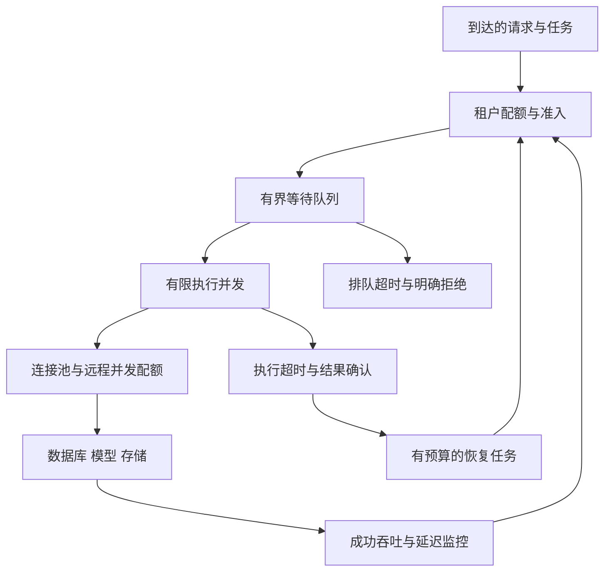

# 附录一 跨模块的资源控制与困难场景

## A.1 为什么线程池 连接池 队列要一起设计



一个请求可能先在 HTTP 接入排队，再在线程池排队，再等数据库连接，再等数据库锁。只优化某一层，可能只是把队伍搬到另一层。

假设数据库稳定支持 300 个并发事务，应用有 20 个实例，每个实例配置 100 个连接，总上限已经达到 2000；继续扩应用会增加争抢。应把数据库的总预算分配到实例与业务池，并保留运维、复制和管理余量。连接池大小不是按前端在线人数一一对应，池过大也可能降低性能。[R23]

反过来，线程池有 100 个线程、HTTP 连接池只有 10 条有效并发连接时，90 个线程可能只是在等待。若外部接口平均耗时 2 秒，10 个并发连接在理想稳定条件下只能支撑约 5 请求/秒；线程数加到 1000 不能突破这个瓶颈。

### ThreadPoolExecutor 的知识点怎样变成设计选择

七个构造参数分别控制核心线程数、最大线程数、空闲保留时间、时间单位、等待队列、线程创建方式和拒绝处理。常规处理顺序是核心线程、排队、扩至最大线程、拒绝；无界队列可能让最大线程数基本失去扩容意义。[R22]

设计时要回答的是：

| 选择 | 应根据什么决定 | 常见风险 |
| --- | --- | --- |
| 核心与最大线程数 | CPU、等待比例、下游并发预算与压测 | 只套公式，不看数据库和外部限额 |
| 队列容量 | 允许等待时长、稳定处理速率、任务内存 | 队列越长用户等越久，超时任务仍占资源 |
| 拒绝方式 | 请求是否可丢，是否有可靠任务账本 | 静默丢掉订单或通知责任 |
| 线程工厂 | 识别业务池与跟踪异常 | 所有线程同名，故障无法定位 |
| 任务粒度 | 单任务内存、耗时和可取消性 | 一个大文件占满大量堆内存与执行名额 |

标准拒绝策略包括 AbortPolicy、CallerRunsPolicy、DiscardPolicy、DiscardOldestPolicy。CallerRuns 会把压力传给提交线程，但若提交者是事件循环、Kafka poll 线程或持锁线程，直接执行慢任务可能引发连锁阻塞；丢弃策略不能用于没有其他可靠责任记录的关键任务。[R22]

NoteWeave 可以分别限制在线问答、离线解析、嵌入、摘要与外部工具调用。在线问答有响应时限，离线索引可以排队；不同资源特征的任务共用一个无界队列，会让一个批量导入拖慢所有在线请求。

## A.2 超时 取消和重试怎样形成统一预算

一个端到端请求有总 deadline。排队、取连接、建立连接、TLS、发送、读取和后续重试都消耗它；每层各设置“30 秒超时”，并不能得到总共 30 秒的体验。

假设接口总预算 2 秒，已经排队 800 毫秒，剩余时间只约 1.2 秒；此时不应再启动一个默认可等 5 秒的下游调用。传递剩余预算，过期任务在开始执行前就应检查是否还有业务价值。

重试需要满足三个条件：错误可能暂时恢复；重复操作具有幂等协议或可查询结果；还有时间和成本预算。多层各重试三次会形成乘法放大，因此选择合适的一层承担重试，并用退避和随机抖动分散重试流量。[R24]

取消 Future 不代表远端业务已取消。数据库查询是否中断、HTTP 请求是否停止、模型是否继续计费，都取决于具体接口。发生取消后，释放本地名额与记录远端未知状态是两个动作；不能只把线程中断了就把任务写成“肯定未执行”。

## A.3 常见限流算法和分布式代价

| 算法 | 基本做法 | 优点 | 需要回答的难点 |
| --- | --- | --- | --- |
| 固定窗口 | 每个固定时间段计数 | 简单、状态小 | 窗口交界可出现接近两倍额度的瞬时突发 |
| 滑动日志窗口 | 保存窗口内每次请求时间并清理旧记录 | 时间范围精确 | 高QPS下记录多，清理成本和原子操作复杂 |
| 滑动计数窗口 | 多个小桶近似最近一段时间 | 状态与精度可折中 | 桶边界近似误差需可接受 |
| 令牌桶 | 以速率补令牌，桶容量限制可积累突发 | 同时表达平均速率与突发 | 时钟、原子扣减、集群额度分配 |
| 漏桶 | 将输入排队后按稳定速率排出 | 平滑输出 | 队列上限、等待时限、满队列拒绝 |

本地限流速度快，但 N 个实例各允许 100 QPS，系统总量可能接近 N×100。全局每次都访问一个 Redis key 又会形成热点，并增加对限流服务的依赖。可向实例分配短期额度，实例本地消费，再通过配额回收与续领控制总量；租约到期不能让旧额度和新额度同时继续使用。

对于“尽量不超过上游推荐速率”，允许少量误差的分布式限流可接受；对于“库存总额严格不超过100”，配额必须有守恒证明。不要把流量限速算法直接当作库存账本。

限流服务故障时，按业务风险决定使用保守本地额度、暂停关键操作或降级非关键功能。直接全量放行可能把限流组件的小故障变成数据库故障。过载时及时拒绝无法在截止前完成的工作，通常比维持无界队列更能保护有效吞吐。[R25]

## A.4 MySQL 能否做分布式锁

可以，但要说清是哪种锁和保护哪个资源。

**短事务内行锁。** 为业务对象保存唯一记录，事务里 `SELECT ... FOR UPDATE`，检查并修改状态，提交释放。适合修改同库资源，因为检查与业务写入可以共同提交。它占用事务与连接，不适合拿着锁进行长时间模型调用。

**持久租约表。** 表里存 `lock_key、owner、generation、lease_until`，领取使用原子条件更新，续租和释放都核验 owner 与 generation。它让进程崩溃后有机会超时回收，但旧进程仍可能运行，需要资源端版本检查。任务表就是这种思想的业务化表达，通常比单独创建无语义锁表更清晰。

**会话级命名锁。** MySQL 的 `GET_LOCK(name, timeout)` 作用于单个 mysqld 的会话；事务提交或回滚并不释放它，通常要显式 `RELEASE_LOCK`，会话结束也会释放。连接归还池中不等于会话结束，因此必须正确释放并处理异常。它不能直接提供跨多个独立 MySQL 实例的全局互斥，故障切主也需要另行设计。[R26]

面试时，若真正需求只是同一条库存记录不能扣成负数，直接条件更新往往比另造分布式锁更容易证明。若保护外部副作用，无论 MySQL 锁还是 Redis 锁，都要说明外部资源怎样识别重复或过期授权。

## A.5 海量整数问题怎样从值域推导方法

常见变体：“有 4 TB 的 int32 数据，内存只有 2 GB，如何判断某个整数是否存在？”首先区分一次查询与大量重复查询，文件是否允许预处理，是否需要严格准确。

### 一次查询

顺序扫描并比较即可，内存只需一个 I/O 缓冲。最坏读完整文件；如果只有一次查询，建立大型索引未必比扫描更划算。可以并行读多个存储分片，但总吞吐仍受磁盘或网络限制。

### 大量查询且必须准确

int32 的完整值域只有 `2^32` 个可能值。每个值占 1 bit，完整存在位图需要：

\[
2^{32}/8 = 2^{29}\text{ bytes} = 512\text{ MiB}
\]

因此在 2 GiB 内存下可以容纳完整位图与合理缓冲。4 TB 的文件体积大，不代表去重后的值域超过位图可表示范围。扫描一次为每个整数置位，之后每次查询只看一个 bit。

Java 中注意有符号映射和移位：

```java
// 结构示意：完整位图约512MiB；单独评估JVM堆、GC和进程其他内存。
final long[] present = new long[1 << 26]; // 2^26个long，共2^32个bit

void add(int value) {
    long unsigned = Integer.toUnsignedLong(value);
    int wordIndex = (int) (unsigned >>> 6);
    long mask = 1L << (unsigned & 63);
    present[wordIndex] |= mask;
}

boolean contains(int value) {
    long unsigned = Integer.toUnsignedLong(value);
    int wordIndex = (int) (unsigned >>> 6);
    long mask = 1L << (unsigned & 63);
    return (present[wordIndex] & mask) != 0;
}
```

示例按单线程构建。多线程对同一个 long 执行读改写会丢位，需要把值域分区给不同线程、使用原子按位或，或先建立局部位图再合并；不能因为置位“最终都是1”就断言普通 `|=` 线程安全。

### 值域变成 int64 或对象 ID

完整位图可能不可承受，可以按哈希分桶，使相同值进入同一文件，查询只加载对应桶；桶仍过大时递归细分。假定哈希绝对均匀不够，需要检查倾斜并为超大桶设计退路。

另一种方案是外部排序：内存内排序小块，落盘为有序段，再多路归并。构建成本高，但支持去重、范围查询和顺序访问。布隆过滤器可快速排除大量不存在项，但“可能存在”仍要到精确存储核对，不能把概率判断用作严格存在证明。[R20]

这道题的关键是先发现 int32 值域有限，再根据查询次数选择扫描或预处理，不是看到“4 TB”就机械回答分库分表。

## A.6 多地域与故障切换怎样继续追问

多地域读写不是在架构图上多画一个数据库就完成了。先定义对象主权和冲突策略：同一订单可以固定在一个主写地域，同一会话可以有一个逻辑顺序拥有者，朋友圈读缓存可以多地分发；不同业务不必统一成无约束双写。

切主需要处理旧主仍能写的情况。路由更新不等于旧连接和旧事务已停止；需要数据库或资源端的写入隔离、代次或明确的故障切换协议。否则网络分区会让两个地域各自接受成功，事后无法仅靠“取最新时间”保持库存守恒。

RPO 表达可接受的数据损失，RTO 表达恢复时间，两者应从完整业务链路衡量。数据库恢复到昨日备份，但消息、对象存储和搜索索引来自今日，可能产生无法解释的版本关系；恢复演练应核对跨系统水位与引用完整性，而不是只验证数据库进程能启动。

## A.7 十五个联合故障演练

下面每个场景都给出处理方向。练习时先自己画时间线，再与答案核对。

### 场景 1 秒杀数据库已提交 客户端只看到超时

沿用原请求 ID 查询订单，并核验请求用户与参数。查到订单返回原结果；暂时查不到时，区分主库已提交与读副本落后的可能性。不要换请求 ID 再次扣减，也不要因为响应超时直接补库存。

### 场景 2 支付成功回调与库存释放同时到达

由订单和预留状态的事务条件决定一个合法终态。关闭支付中的订单先保留预留，确认渠道状态后再释放；若已释放后才确定晚付，记录退款或重新预留责任。渠道回调晚到不能无条件把 CLOSED 改回 PAID 并履约。

### 场景 3 定时任务拿到租约后机器暂停五分钟

新执行者以更高代次接手，旧执行者恢复后续租和结果写回应失败。外部请求可能仍然执行，所以下游要使用稳定业务幂等键，或资源端验证授权。只在任务表拒绝旧状态，不足以撤销已经发出的短信。

### 场景 4 Redis 整体故障 登录与秒杀同时受影响

先按业务职责隔离。登录无法确认必要会话状态时按授权协议拒绝或要求重认证；秒杀暂缓准入，避免全部流量直接进入数据库；可缓存的活动静态内容继续提供。重建过程限速，避免所有实例冷启动同时回源。

### 场景 5 旧资料摘要在撤销后才生成完成

摘要任务携带开始时的资料版本，写回前校验资料仍有效且版本匹配。数据库中的撤销版本不允许被旧任务改回有效；缓存和索引消费同样核验版本。已有回答保留来源状态与产品约定的历史可见规则。

### 场景 6 Kafka lag 下降 但用户说资料一直不可检索

检查 lag 是否只代表转移到线程池，而非完成解析；检查阶段任务状态、模型排队、索引写入失败和最终发布屏障。用业务完成水位与阶段耗时定位，不能仅以 offset 达到末尾宣告完成。

### 场景 7 同一点赞的取消事件先到 点赞事件后到

不要先减总数再按版本丢掉旧加数。使用完整状态事件，在同一个事务内比较关系投影旧状态与新状态，计算真实贡献变化，并更新投影版本与计数桶。或者完整处理每个去重后的增量，接受并处理其中间态。

### 场景 8 评论审核回调通过时 用户已经修改或删除正文

回调必须绑定 comment_id、正文版本和审核任务 ID。条件不匹配就不发布旧审核结果；删除或更高版本不能被旧回调覆盖。发布可见性变化和可见计数传播也要绑定同一次版本变化。

### 场景 9 大 V 发帖时粉丝写扩散爆炸

将大 V 内容改为读时合并，普通用户维持推模式，按实际活跃粉丝和成本动态调整。切换时使用生效时间或游标水位，避免既没推又没拉的空窗；合并后按帖子 ID 去重并重新检查权限。

### 场景 10 用户翻排行榜时分数变化 导致重复和遗漏

先决定产品要实时近似列表还是稳定榜单快照。稳定翻页用榜单版本和完整排序游标；实时名次需允许变化并说明刷新语义。奖励结算必须冻结版本，不应边翻页边发奖。

### 场景 11 文件合并成功 业务完成回调没到

通过稳定 upload_id 和对象版本查询对象存储结果，再幂等推进验证与 READY 状态；扫描卡在 COMPLETING 的任务恢复。不要因为回调未到就盲目重新创建另一份文件，更不要未经安全校验直接发布对象。

### 场景 12 WebSocket 断线后客户端重发最后十条消息

服务端根据发送者、会话和 client_msg_id 返回原始结果；消息已有 conversation_seq 的不重新分配。客户端按服务端序号补取缺段并去重。传输重连成功与历史消息补齐分别确认。

### 场景 13 分库迁移中旧服务持有旧路由继续写

旧分片执行端验证主权 epoch，并在切换屏障后拒绝旧写。迁移等待已开始事务结束，追平最后提交水位再让目标开放写入。请求收到过期路由错误后重新查询映射，重试保持原业务幂等键。

### 场景 14 索引优化后吞吐变好 但写延迟明显变差

新增索引对查询有收益，同时增加写维护、缓存占用、redo和复制成本。比较优化前后整个业务的读写比例与尾延迟，删减冗余索引、调整查询或分离读模型。单条 SQL 更快不等于系统整体收益为正。

### 场景 15 恢复任务本身不断失败 形成新的积压

恢复任务也要有配额、幂等键、期限和失败分类。在线与恢复流量隔离，先处理高价值、可恢复的对象，记录无法确定的结果并告警。对账不能不带水位地覆盖当前状态，否则恢复器会成为新的错误写入者。

## A.8 面试中最容易露出理解缺口的表述

| 容易被追问的说法 | 更准确的表达 |
| --- | --- |
| Redis是单线程所以绝对安全 | 指定命令或脚本的执行协调，与持久化、集群和跨系统事务是不同问题 |
| 超时就重试 | 先区分未执行、可幂等重放、结果未知，再按稳定标识恢复 |
| 加消费者组解决积压 | 增加原组的有效处理能力，并判断分区与下游是否有余量 |
| Kafka开启事务所以短信只发一次 | Kafka事务有边界，外部通知需要独立幂等与结果确认 |
| 加版本号就不会乱序 | 还要定义版本由谁分配、哪些写核验、增量是否允许跳过 |
| 删缓存即可强一致 | 删除会失败或与旧回填竞态，需要版本与明确读一致性协议 |
| 定时框架保证任务执行一次 | 业务需要重复触发下的幂等、丢触发后的补扫与终态恢复 |
| 分库扩容双写一段时间再切 | 先说明单一主权、快照水位、增量追平、切写屏障和回滚 |
| 线程池开大就能提升吞吐 | 下游资源、等待与竞争决定有效并发上限 |
| 索引包含所有where字段就一定快 | 看访问顺序、筛选性、回表、排序、扫描量与实际执行计划 |

[R20]: https://redis.io/docs/latest/develop/data-types/probabilistic/bloom-filter/ "Redis Bloom filter"
[R22]: https://docs.oracle.com/en/java/javase/17/docs/api/java.base/java/util/concurrent/ThreadPoolExecutor.html "Java 17 ThreadPoolExecutor"
[R23]: https://github.com/brettwooldridge/HikariCP/wiki/About-Pool-Sizing "HikariCP About Pool Sizing"
[R24]: https://aws.amazon.com/builders-library/timeouts-retries-and-backoff-with-jitter/ "Amazon Builders Library Timeouts retries and backoff with jitter"
[R25]: https://sre.google/sre-book/handling-overload/ "Google SRE Handling Overload"
[R26]: https://dev.mysql.com/doc/refman/8.4/en/locking-functions.html "MySQL 8.4 Locking Functions"
