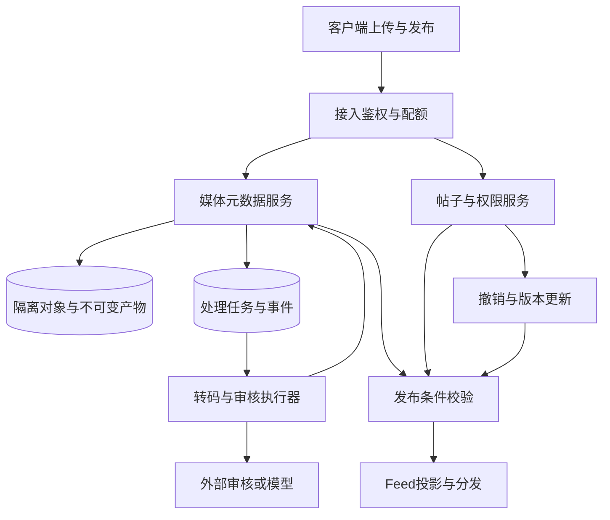
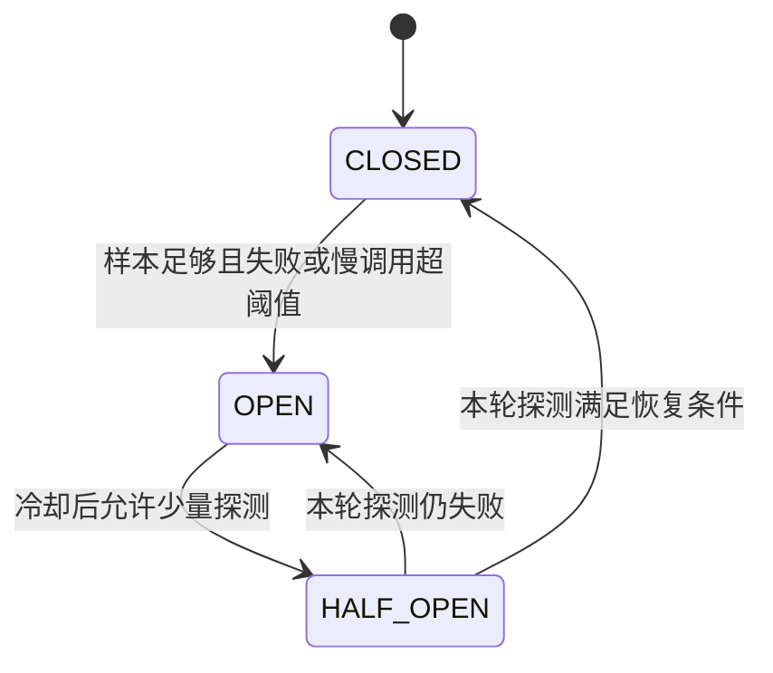

# D：微服务拆分、第三方调用与全链路治理

微服务拆分需要同时考虑限流、降级、熔断、隔离、路由、幂等、超时和可观测性。每拆开一个本地可控的边界，就增加一次网络失败与部分成功的可能。社区文件处理、登录短信、订单履约和开放接口可以体现这些机制如何组合；场景规模与参数按假设推演。

## D.1 先看到完整业务，而不是先拆出十几个服务

以“用户上传视频，审核通过后发布到朋友圈”为例，必须解释四个时间点：上传已受理、对象已完整保存、内容已经通过检查、帖子已经对好友可见。它们不应被一个 `success=true` 混在一起。



媒体服务可以回答“版本 v7 已具备哪些合格产物”，帖子服务决定“用户现在是否仍要求发布、允许谁看”。发布条件需要绑定文件版本、帖子版本、审核策略版本与结果状态。若审核在用户删除之后返回，不能直接发布。把这条约束写清楚，再选择服务边界。

拆成独立数据库以后，还必须明确**谁串行化发布决定**。本例由帖子与权限服务在自己的事务中处理发布意图、帖子删除与可见状态；媒体服务提供绑定文件版本、处理策略和不可变manifest的READY事实。收到READY事实只证明该版本曾处理完成，不证明文件现在仍有效。读取与签发媒体访问权限时，在约定的授权检查点核验当前文件状态，失去权威核验能力时不能假定允许。这样提供的是明确检查点上的可见性保证。

如果业务进一步要求“媒体撤销一经提交，任何后来的发布记录都不能再创建”，仅分别调用两个服务读取版本不够：撤销可以发生在读取与发布提交之间。需要把这两个决定归到共同的串行化权威，或设计双方实际参与的协调协议；也可以暂时保留同一事务边界。不能把跨服务的两个版本检查当作同库原子校验。READY通知、当前授权与发布记录是三类不同事实。

## D.2 案例 D1：从模块化单体拆出媒体处理服务

### 为什么拆，以及为什么先拆这一块

假设当前单体同时处理登录、评论、视频转码和定时导出。转码突发时 CPU、内存与工作线程被占满，评论接口开始超时；转码依赖升级也迫使所有模块一起发布。这个证据支持将媒体处理的资源与发布周期隔离。

如果只是代码文件多、业务概念还不稳定，先按模块划定接口与数据所有权也能改善维护。微服务边界应围绕业务能力、内聚性和独立变更需求确定，不能机械地按 Controller、Service、DAO 各拆一个进程。[H01]

| 候选边界 | 为什么可以独立 | 必须保留的契约 | 不恰当拆分的信号 |
| --- | --- | --- | --- |
| 媒体处理 | CPU／GPU资源、格式依赖、执行时间独立 | 文件版本、阶段任务、不可变产物、发布条件 | 每次处理都要跨服务反复改同一事务记录 |
| 登录身份 | 安全边界、凭据生命周期独立 | 主体ID、会话撤销、授权检查点 | 所有业务字段都塞进身份令牌导致频繁耦合 |
| 评论与互动 | 访问模式和写热点相近，可先同模块 | 评论可见性与点赞状态分别有权威表 | 按每张表各拆服务，页面需要几十次同步调用 |
| 订单与库存 | 可因团队／容量拆开，但一致性代价显著 | 预留、确认、释放与支付未知结果 | 拆完只能用跨服务锁维持单体内的逐行操作 |
| 推荐与搜索投影 | 可从事件重建、允许确定的延迟 | 版本、删除传播、回放与发布水位 | 投影偷偷成为权限或余额的权威依据 |

### 分阶段迁移要交付什么

第一步，在单体内建立明确媒体接口，禁止其他模块任意写媒体表。补充契约测试与状态机测试，记录基线完成时间、失败率和资源消耗。第二步，让新执行器处理影子输入并生成隔离产物，不把测试请求真的发成短信、扣款或对外可见内容。第三步，按稳定的租户或文件批次进行灰度，确保同一个文件版本不会被两个实现同时当作权威发布者。

第四步，转移任务与数据写入主权。旧任务、旧消息和旧连接仍会到达，服务端必须识别旧代次；不能只靠网关把新请求指向新服务。第五步，观察足够长的重试和回调窗口，再回收旧执行器与兼容字段。渐进迁移可以降低一次性切换的影响范围，但仍需要数据与副作用的切换协议。[H02]

### 灰度与回滚的难点

代码回滚、数据库结构回滚、数据语义回滚是三个动作。新增可空字段且新老代码都能读取，通常比直接重命名或删除字段更容易兼容；但若新版本已写入旧版本不理解的状态，切回旧代码可能导致错误覆盖。

对不可变产物，可让旧版本继续读取新版本仍能理解的 manifest，或保留对应旧处理器；对任务状态，引入兼容状态或稳定协议，不能在部署回滚时把全部 `UNKNOWN` 任务改回 `READY`。回滚验收包含状态和事件，不只看接口返回正常。

## D.3 案例 D2：第三方变慢，把全站线程池拖死

### 故障如何发展

假设评论审核平均每秒 300 次，外部服务平均耗时 100 ms，对应平均外部在途约 30。故障时平均耗时变成 2 秒，同样速率会产生约 600 个在途请求。若审核、登录短信和支付查询共享工作池与 HTTP 连接池，审核慢就能让其他功能也排队。

此时增加线程数可能增加内存、套接字和供应商压力，却不增加供应商容量。资源隔离要落实到共享资源：执行线程、在途许可、HTTP连接、数据库连接、队列、重试预算、租户额度，而不只是建几个不同名字的服务。

### 一套可解释的示例预算

| 项目 | 示例设置的推导方式 | 应观察什么 |
| --- | --- | --- |
| 外部调用速率 | 根据供应商合同与压测设全局上限，实例分配额度 | 429、业务重试放大、真实调用次数 |
| 外部并发 | 假设全服务最多80个在途；2秒平均耗时时约40次／秒可完成 | 活跃调用、许可等待、超时后的远端未知数 |
| 本地待执行队列 | 根据允许排队时长与可完成能力设上限 | 最老年龄、过期任务、拒绝数 |
| 数据库连接 | 只覆盖提交意图与写回结果的短事务 | 连接持有时长、active/pending、慢事务 |
| 恢复／重试配额 | 留独立预算，避免恢复器吃光在线额度 | 重试占比、首次请求与恢复请求成功率 |
| 租户公平性 | 大租户有上限，小租户保留最小可服务能力 | 各租户排队年龄与拒绝率 |

这些数字不是可复制的推荐配置。它们示范的是：先描述资源，再定义全局边界，最后分到实例。部署实例数变化时，要重新核对总额。

### 正确组合限流、熔断、隔离与降级

限流回答“新请求能不能进入”；隔离回答“最多多少资源被这个依赖占用”；超时回答“本地愿意等多久”；熔断回答“根据近期结果是否暂时停止尝试”；降级回答“不能调用时业务返回什么”。它们可以组合，但不能互相替代。Resilience4j 的断路器与 Bulkhead 就是分开的能力，断路器自身不负责限制所有并发调用。[H04][H05]

审核失败不能降级为“默认通过”；可以把内容保留为审核中。短信失败不能假装用户已经收到验证码；可以返回发送状态并提供重试规则。公开榜单依赖失败时可以提供带更新时间的快照；库存扣减不能提供猜测成功。

### Java 资源隔离示意

```java
// 独立且有界的执行器示例。
// 队列80只是假设，必须与队列等待SLO、任务大小和供应商能力一起验证。
ThreadPoolExecutor moderationPool = new ThreadPoolExecutor(
    16, 16, 0, TimeUnit.SECONDS,
    new ArrayBlockingQueue<>(80),
    namedThreadFactory("moderation"),
    new ThreadPoolExecutor.AbortPolicy());

void submitAcceptedJob(JobRef ref) {
    // 前提：任务已经持久化，可由恢复扫描再次发现。
    try {
        moderationPool.execute(() -> executeWithDurableClaim(ref));
    } catch (RejectedExecutionException overloaded) {
        // 没有本地排进去不等于业务任务丢失。
        // 持久任务保持可领取状态，或条件更新next_attempt_at；外部请求尚未发送。
        metrics.increment("moderation.local_dispatch_rejected");
    }
}
```

这里不使用静默丢弃策略。若选择 `CallerRunsPolicy`，调用者会同步执行任务：对于 Netty 事件循环、Kafka poll 线程或 HTTP 接入线程，可能把隔离层反过来阻塞。因此拒绝策略必须和调用线程身份一起设计。线程池何时创建线程、入队与拒绝的顺序，需要按 `ThreadPoolExecutor` 的真实语义理解。[R22]

## D.4 案例 D3：开放接口超时，调用方重试，供应商却已执行

### 总截止时间先于每跳 timeout

假设开放接口总预算 1200 ms。接入已耗 100 ms，必须给最终写回和响应预留 100 ms，则后续最多还有 1000 ms；如果在本地队列里再等 300 ms，就只剩 700 ms。不能每跳都重新给 1200 ms，导致调用链叠加到数秒。

在单进程里用单调时钟计算剩余预算；跨机器传递截止信息时考虑时钟偏差，或采用框架支持的剩余超时传播。gRPC 会将截止时间传播与取消关联，但服务代码仍要停止自己派生的无用工作。[H03]

```java
// 伪代码：只计算一次入口截止，后续每一步重新读取剩余量。
Result handle(Request r) {
    Deadline deadline = Deadline.after(Duration.ofMillis(1200)); // 每个请求单独创建
    Auth auth = authenticate(r, deadline);
    DurableOperation op = createOrLoadIntent(
        auth, r.operationType(), r.idempotencyKey(), r.payloadHash());
    if (op.isFinal()) return resultOf(op);

    if (deadline.remainingMillis() - 100 <= minimumUsefulAttemptMillis)
        return accepted(op.id());

    // 准入失败就不发送。客户端配置须覆盖连接获取、连接建立和请求整体预算。
    // 数据库事务已经结束；不得拿着数据库行锁等待供应商。
    DispatchToken token = claimAndPersistDispatch(op.id());
    if (token == null) return accepted(op.id());
    // 领取、准入和数据库等待也消耗预算；不能沿用领取前算出的值。
    long callBudgetMs = deadline.remainingMillis() - 100;
    if (callBudgetMs <= minimumUsefulAttemptMillis) {
        markNotSentAndRescheduleIfCurrent(token); // 本次确定还没有发送外部请求
        return accepted(op.id());
    }
    try {
        ProviderReceipt receipt = provider.execute(
            op.stableBusinessKey(), op.immutablePayload(), callBudgetMs);
        persistReceiptAndReconcile(op.id(), receipt);
    } catch (TransportTimeout uncertain) {
        // 调用超时只证明本地没拿到结果，不证明远端未执行。
        markUnknownIfCurrent(token);
        scheduleReconciliation(op.id());
    }
    return readCurrentResultOrAccepted(op.id());
}
```

`claimAndPersistDispatch` 只允许明确可发送的状态进入本轮发送；`UNKNOWN`、未确认终止的旧发送与仍可能在途的操作先走核对，不能因租约过期就再次发送。领取事务同时保存稳定请求标识、执行代次、租约以及 `next_check_at`，恢复扫描可以发现长期处于发送中的记录。这样即使进程在请求发出后崩溃、遭遇非 timeout 异常，或者安排核对的后续调用失败，责任仍然存在。客户端内部的连接排队与重试也必须计入本次剩余预算，不能每次尝试重置 timeout。

`persistReceiptAndReconcile` 必须能保存迟到的真实回执，即使原执行代次已经过期；但只有当前业务状态机可以决定履约。否则旧 worker 的有效扣款回执可能因为代次过期而被丢掉。回执账本与“谁有权推进主状态”不能混成一张 CAS 更新。

### 幂等协议最少需要什么

```sql
-- 示意表：由一次业务动作的权威分片持有；无生产通用字段保证。
CREATE TABLE external_operation (
  tenant_id BIGINT NOT NULL,
  operation_id BINARY(16) NOT NULL,
  operation_type VARBINARY(32) NOT NULL,
  idempotency_key VARBINARY(128) NOT NULL,
  payload_hash BINARY(32) NOT NULL,
  state VARCHAR(24) NOT NULL,
  generation BIGINT NOT NULL,
  provider_request_id VARBINARY(128),
  next_check_at DATETIME(6),
  result_ref VARBINARY(256),
  PRIMARY KEY (tenant_id, operation_id),
  UNIQUE KEY uk_business_intent (tenant_id, operation_type, idempotency_key),
  KEY idx_reconcile (state, next_check_at)
);
```

同一 key 不同参数要拒绝，不能返回另一个意图的旧结果。首次调用在发送外部请求前持久化意图；竞争方通过唯一键查询同一操作。key 的作用域要包含租户和动作类型，保留期限要覆盖客户端重试、消息重放与供应商回调窗口。极长期财务责任不能只用一个几分钟的 Redis 去重 key。

对外部结果不可查询、又不支持幂等的接口，网络超时后无法同时保证“不漏执行”和“绝不重复”。需要选择业务策略、人工核对或更换协议。不能用本地分布式锁掩盖这个信息缺口。

### 重试与切供应商也要分类

对明确未发送的本地准入失败，可以稍后重试；对只读、可重放且剩余预算充足的调用，可以有限重试；对已经可能产生效果的支付、发券、短信，优先以稳定业务 ID 查询或用供应商幂等语义重放。一次 `NOT_FOUND` 还必须结合请求是否可能在途、查询是否强可见以及供应商状态机，才能判断后续动作。

如果三层服务每层最多尝试三次，最坏可能向底层放大到 27 次。应指定重试责任层，给整个业务动作一个预算，采用退避和抖动，并区分429／暂时失败／参数错误。多供应商切换也不能绕过这个预算；两家都可能成功时，必须保留两份真实结果并按业务处理重复效果。[R24]

### 本地超时后，80个并发名额何时释放

本地网络资源已经清理后，本地连接／线程名额可以释放；但是供应商可能仍在执行。应额外监控“远端状态未知”的存量，并为它设准入保护。否则不断本地超时、立即释放许可、再次发起请求，仍会在远端累积大量任务。能向供应商传播取消时要使用它，但取消请求本身也可能与完成竞态，需要最终回执确认。

## D.5 案例 D4：用 ring buffer／bit ring 统计失败率，怎样追到真实熔断器

### 先分清三种东西

**按调用次数的滑窗**统计最近 N 次完成结果；**按时间的滑窗**统计最近一段时间的完成结果；**限流窗口**统计进入量。把它们全部叫“滑动窗口”会在低流量、高突发和长调用下得到不同含义。

bit ring 很适合保存最近 N 个二值结果，环形桶适合聚合次数、失败次数、慢调用次数与耗时。二值位图不能自己提供 P99，也不能区分请求在队列里等了多久。下面使用一个易检查的按完成次数模型，它不是某个框架当前源码的复制。

```java
// 算法示意：最近N次“完成”的结果；false=成功，true=失败。
// 生产实现还需异常分类、慢调用、状态代次与度量导出。
final class FailureRing {
    private final BitSet failures;
    private final int capacity;
    private int next = 0;
    private int size = 0;
    private int failureCount = 0;

    FailureRing(int n) {
        if (n <= 0) throw new IllegalArgumentException("n must be positive");
        capacity = n;
        failures = new BitSet(n);
    }

    synchronized void record(boolean failed) {
        if (size == capacity && failures.get(next)) failureCount--;
        if (size < capacity) size++;  // 未填满时不能把未使用位算成功
        failures.set(next, failed);
        if (failed) failureCount++;
        next = (next + 1) % capacity;
    }

    synchronized boolean thresholdReached(int minimumCalls, double ratio) {
        if (minimumCalls <= 0 || minimumCalls > capacity
            || !Double.isFinite(ratio) || ratio <= 0 || ratio > 1)
            throw new IllegalArgumentException();
        return size >= minimumCalls && failureCount >= ratio * size;
    }
}
```

这个算法每次更新和读取均为常数级工作，位图内存随 N 增长；最关键的正确性是覆写前减掉旧贡献、只用已填入数量作分母、并发更新与读取使用一致快照。如果使用多个原子计数器替代同步，也要解决“分子已更新、分母还没更新”的瞬时不一致，不能仅因为字段都是 atomic 就断言组合快照一致。

按时间实现时，可以用例如 10 个一秒桶，桶内保存 `count/failure/slow/total_duration`，轮转时从总聚合减去过期桶。必须区分当前桶代次，处理长时间无请求后的整体过期与单调时钟；桶级边界是近似时间窗口，不能宣称任意毫秒边界都精确。框架也常采用环形数组和逐桶聚合，具体配置及并发语义应以部署版本为准。[H04]

### 熔断状态机还有哪些竞态



进入 HALF_OPEN 时必须限制真实探测的在途数，不能把排队的旧请求同时放进去。每轮探测要有代次：上一轮非常迟的成功回调不应把已经再次 OPEN 的断路器错误关闭。业务返回400／权限拒绝不一定代表依赖故障；调用被上游主动取消也应根据定义分类。内部重试每次都记样本还是一次业务调用只记最终结果，两种都可做，但指标分母必须与阈值一致。

故障恢复后逐渐放大流量。如果一瞬间从零放到满速，冷缓存和供应商连接恢复会再次触发熔断。应观测有效完成吞吐与并发，而不只看“断路器现在是 CLOSED”。

## D.6 案例 D5：订单拆成库存、优惠券、履约服务后，原事务怎么办

### 先承认本地 ACID 的边界变了

原来一个数据库事务可以同时检查库存、写订单和占用优惠券。拆开后，第一步成功、第二步超时成为正常状态。不能用“最终一致”四个字跳过中间状态，也不能宣称所有流程都必须使用某一种分布式事务框架。

| 方法 | 适合的条件 | 需要说明的代价／限制 |
| --- | --- | --- |
| 保留同库短事务 | 业务必须紧密原子变更，容量仍可承受 | 放弃过度拆分，保持清晰模块与写入所有权 |
| 本地事务＋Outbox＋Saga | 流程可以用业务状态与补偿收敛 | 中间状态可见、补偿可能失败、需要恢复器与幂等 |
| TCC | 资源支持明确预留、确认、释放 | 三个接口与控制记录；空回滚、悬挂、重复确认 |
| XA／参与者支持的2PC | 参与资源协议可控且业务接受协调代价 | prepared事务持有资源、故障恢复与协调可用性 |
| Seata AT等框架 | SQL／数据源／部署满足框架要求 | undo记录、全局锁、冲突与隔离语义，外部HTTP不自动参加 |

Saga 由多个本地事务和补偿构成，不天然提供跨步骤隔离。预留资源、业务锁定状态与版本校验仍需设计；补偿是新的业务动作，不一定能把现实世界恢复成从未发生。邮件发出不能收回，扣款退款也留下两笔账。[H10]

Seata AT 的分支在第一阶段本地提交，不能因此认为任意普通读都只能看到全局已提交状态。需要按代理数据源、全局锁和指定读取方式分析隔离，也要考虑不参与框架的写入者。引用框架名不是业务不变量的证明。[H11]

### 用优惠券预留说明 TCC 的三个难点

令一个业务意图有稳定 `reservation_id`。Try 原子地创建控制记录与冻结额度；Confirm 仅把本次已冻结额度改为消费；Cancel 仅释放本次实际冻结额度。控制记录和额度变化必须位于同一个局部事务，不可先改状态、后改额度。

| 到达顺序 | 正确结果 | 错误实现的后果 |
| --- | --- | --- |
| Try、Confirm、Confirm | 第二次确认返回已确认结果，不再扣减 | 重复消费额度 |
| Try、Cancel、Cancel | 第二次取消不再增加可用额度 | 凭空增发券 |
| Cancel先到，Try迟到 | 先保存本意图已取消的墓碑；迟到Try不再冻结 | 空回滚后悬挂，额度永久冻结 |
| Try超时，但实际已冻结 | 根据稳定ID查询，继续同一流程 | 新ID再次冻结，留下孤儿预留 |
| Confirm与Cancel并发 | 依授权的最终决定与记录状态串行决定合法迁移 | 同一预留既消费又释放 |

幂等、空回滚与防悬挂是 TCC 的真实业务责任，Seata 的 TCC fence 机制也围绕这些问题设计。[H12] 记录的回收期限必须覆盖迟到 Try／Confirm／Cancel 的最大允许窗口，不能很早删除墓碑让旧意图重新复活。

### Saga 编排者自身失败怎么办

持久记录每个步骤的命令ID、状态、回执与下一次核对时间。步骤推进使用条件更新，事件传播使用 Outbox。编排者恢复后先看已知回执和参与者状态，不从第一步盲重跑。参与者返回未知时保留 UNKNOWN，能够对账后才决定重试或补偿。

对于已不可逆的履约阶段，例如实物已经交付，流程不能再沿原路机械回滚。应进入退款、追偿或人工业务流程。这个决策点应在业务状态机中明确，面试官追问“补偿也失败了呢”时，要能指出持久责任、重试预算、升级条件和人工处理入口。

## D.7 案例 D6：服务都没报错，用户却一直看到“处理中”

### 从业务ID贯穿异步链路

以文件为例，至少关联 `tenant_id、file_id、source_version、stage、task_id、attempt_id、generation、provider_request_id、event_id`。这些标识各有用途，不能仅凭一个 trace_id 做幂等或授权。请求追踪在跨 HTTP、线程池和 MQ 时需要传播上下文；异步批处理可用 Span Link 关联多个来源，不必硬凑一个跨度数天的同步调用树。[H07]

指标使用低基数维度，如服务、阶段、错误类、资源池、优先级；file_id/user_id/event_id 更适合受控日志或 Trace，不能把每个ID都做 Prometheus label。日志记录状态转换前后、版本和错误分类，避免记录令牌、验证码和正文敏感数据。

### 业务状态与技术指标要能对照

| 用户现象 | 查技术指标 | 查持久业务状态 | 可能结论 |
| --- | --- | --- | --- |
| 上传完但看不了 | 对象完成率、校验队列年龄 | COMPLETING／VERIFYING卡住、对象版本 | 完成响应丢失或验证未启动 |
| 已审核但不发布 | 审核回调与事件延迟 | 文件版本、帖子版本、发布条件 | 回调属于旧版本，被正确拒绝 |
| Kafka lag很小仍在处理 | 本地在途、任务年龄、外部UNKNOWN | 哪个阶段尚无最终结果 | 消息已拉取，业务尚未完成 |
| 只一个租户很慢 | 分租户队列年龄、配额占用 | 大任务数、优先级、重试数 | 热租户或配额公平性问题 |
| 所有服务都200 | 202受理、轮询成功、真正完成率 | 长时间非终态任务 | HTTP成功被误当业务成功 |

### 需要哪些可执行的恢复动作

恢复器按状态与 `next_check_at` 分页扫描，领取短租约，先确认事实，再推进状态。长期缺回执的任务不能只在日志里报一行 ERROR；它要留在可枚举的责任列表里。恢复操作也要留审计和幂等键，不能因为叫“人工补偿”就允许任意改数据库。

恢复器与在线流量分配不同预算；任务扫描、供应商查询与重建索引分别设上限。若故障持续，增加失败退避而不是高频轮询全部历史任务。验收要看未知任务存量是否下降、最老年龄是否收敛，以及业务不变量是否保持。

## D.8 路由、分组与开放接口还会被追问什么

**按对象路由。** 同一个会话、订单或迁移中的分片需要稳定写入主权；按请求随机灰度可能让新旧实现同时推进一个状态机。可按租户／聚合对象稳定分桶，并在服务端验证代次。网关只能帮助路由，不能代替数据端的最终校验。

**按成本分组。** 小请求和批量导出不能共用无界工作队列。VIP可以有更高预算，但普通流量仍需最低保障；否则一个大客户可能占满全部连接。超大文件、长文本和复杂查询还要按字节或估算成本限制，仅按请求次数不足以防过载。[R25]

**公开接口契约。** 定义认证、资源级授权、幂等键、参数哈希、分页上限、请求体大小、状态查询、速率额度和错误码。返回429可以引导稍后重试；返回202必须提供可查询的处理标识。租户ID从认证上下文确定，不能相信请求体任填的tenant_id。

**版本兼容。** 新增事件字段应允许旧消费者忽略；删除或改变含义需要版本策略。重放旧事件时采用当时的业务语义还是当前规则，要按事件类型明确。金融账本不能因今天改了计算公式就随意重算过去的金额，推荐特征则可能允许按新算法重建。

**虚拟线程。** 可以降低大量等待线程的成本，但不会增加数据库连接、供应商配额或 CPU。即便请求处理改成每任务虚拟线程，仍要在数据库、外部调用和队列边界设置资源限制；不能把“创建线程便宜”误当“外部工作免费”。[H09]

## D.9 连续追问详答

### Q1：为什么不把所有功能都拆成独立服务？

拆分收益来自独立扩容、故障隔离和独立发布，成本是网络、协议、数据一致性和运维。若某两个模块每次请求都需要多次同步往返且必须一起发布，边界可能不合理。先让单体内部模块和数据所有权清晰，再从最有资源或发布独立性的部分拆。

### Q2：DDD是不是按名词建服务？

不是。“订单”“库存”是领域词，但事务不变量、业务变化边界、团队职责与访问模式决定是否需要独立部署。一个限界上下文也未必对应恰好一个进程。面试要用拆分前后的具体调用与数据责任说明边界，不能只背聚合、实体等术语。

### Q3：断路器打开后，是不是系统就不再占下游资源了？

只能阻止后来获准前的调用。已经发出去的请求仍可能运行，连接与远端任务何时释放取决于协议和客户端。还需要在途限制、取消传播、未知结果统计和逐步恢复；断路器不负责撤销过去的副作用。

### Q4：超时阈值按下游P99设置就够了吗？

不够。下游P99是输入，但必须受整个用户动作剩余预算、连接建立、队列等待、重试次数与允许误超时率约束。长连接稳定期和冷启动连接建立期也不同。阈值需要按操作类型验证，而不是所有接口统一一个常数。

### Q5：为什么不能每一层都加三次重试？

嵌套重试会乘法放大最底层流量，并让总等待失控。应选一个知道业务幂等和剩余预算的责任层，其余层明确哪些错误向上传播；每个业务动作共享尝试次数或重试时间预算。故障恢复期间仍要受全局准入约束。

### Q6：接口已经返回202，能不能把任务只放内存队列？

若202语义是已受理且未来可查询处理结果，就必须有足够持久的任务责任。内存队列可以是加速派发层，进程崩溃后应能从持久记录重新发现；否则要把响应明确为尚未受理，不能在重启后静默消失。

### Q7：本地幂等表可以保证外部接口只执行一次吗？

它能防止部分本地重复调度，但无法仅凭本地记录判断网络超时后的远端状态。需要外部接受稳定幂等键、返回可查回执，或者业务接受重复／人工核对。表里写过“发送中”不是远端已经执行或尚未执行的证据。

### Q8：错误率滑窗为什么要最小样本数？

一个请求失败就得到100%错误率，但它是否代表持续故障需要业务价值与流量上下文。最低样本数可以减少低流量噪声，同时也可能延迟低流量关键业务故障发现。因此关键付款失败可单独报警，常规断路器则结合时间窗、样本数与慢调用。

### Q9：bit ring能不能同时计算P99响应时间？

一个成功／失败位没有保存延迟分布，不能推出P99。可以额外存最近N次延迟或使用直方图／近似分位结构，但这会改变内存、更新与合并方式。错误率、慢请求比例和P99解决不同问题，不能互相替代。

### Q10：半开探测成功一次就全量恢复有什么风险？

一个成功请求只能说明部分能力恢复，不证明下游可以承受全部流量。还可能有上一轮迟到成功误更新状态的问题。限制本轮探测数量，验证代次，根据业务设置恢复条件，并逐步放量观察在途和完成率。

### Q11：Saga补偿成功后，外界是不是看不到中间状态？

一般不是。局部事务已经提交，其他操作可能观察或依赖它。因此需要业务预留、状态过滤、并发控制或重新设计隔离边界。补偿使业务向一个可接受结果收敛，不等同于把整段过程变成一个数据库原子事务。

### Q12：TCC的Cancel先到但查不到Try，可以直接返回吗？

只返回而不记住取消意图，会让迟到Try再次冻结资源。应留下本业务意图已取消的控制记录，Try检查这个记录后拒绝迟到预留。控制记录与资源变更必须处于同一参与者局部事务，并保留到迟到窗口结束。

### Q13：引入Seata后外部支付调用能一起回滚吗？

普通HTTP支付不会自动成为数据库代理或XA参与者。需要支付渠道提供支持的业务预留／撤销／退款协议，并记录每次真实支付结果。数据库回滚不能把已经完成的扣款从现实世界中消除。

### Q14：为什么已有日志还要Trace和Metrics？

指标帮助发现总体异常与趋势，Trace定位单条链路的等待和扇出，日志记录具体状态与证据。三者用业务标识关联，才能从“用户处理中”定位到哪个任务、哪次供应商调用和哪条条件更新。只有散落ERROR日志通常不能还原异步流程责任。

### Q15：流量录制回放能不能直接打生产验证？

只读流量也要考虑成本与数据权限；写流量更不能重新扣款、发短信或发布内容。使用隔离副本、影子存储、供应商模拟器以及禁用外部副作用的执行模式，比较规范化结果。脱敏后仍需确保回放所需关联与版本关系没有丢失。

### Q16：限流和熔断组件本身坏了怎么办？

要按操作风险约定退路。公开只读可使用保守本地额度和缓存；库存、凭据或付款操作可能暂停新受理。全量fail-open可能把组件故障放大成数据库崩溃，统一fail-closed又可能不必要地中断可安全服务的读，需逐接口定义。

### Q17：新版本回滚后，为什么仍然会被旧回调改坏数据？

回滚只改变新执行的代码，之前已经发出的消息、任务和外部请求仍然存在。回调要携带任务与业务版本，由当前状态机验证；真实外部效果仍要登记到账本。协议兼容窗口应覆盖这些迟到输入，不能只覆盖部署几分钟。

### Q18：高并发场景用虚拟线程是否可以不要线程池与队列控制？

不需要为了复用虚拟线程而沿用平台线程池，但业务准入、全局在途、下游连接和内存仍然有限。可以以信号量等方式限制资源，而不是靠线程数量意外地限流。CPU密集任务也不会因线程更便宜而获得更多CPU时间。

[H01]: https://learn.microsoft.com/en-us/azure/architecture/microservices/model/domain-analysis "Microsoft Azure Architecture Center: Domain analysis for microservices"
[H02]: https://docs.aws.amazon.com/prescriptive-guidance/latest/cloud-design-patterns/strangler-fig.html "AWS Prescriptive Guidance: Strangler fig pattern"
[H03]: https://grpc.io/docs/guides/deadlines/ "gRPC: Deadlines"
[H04]: https://resilience4j.readme.io/docs/circuitbreaker "Resilience4j: CircuitBreaker"
[H05]: https://resilience4j.readme.io/docs/bulkhead "Resilience4j: Bulkhead"
[H07]: https://opentelemetry.io/docs/concepts/context-propagation/ "OpenTelemetry: Context propagation"
[H09]: https://docs.oracle.com/en/java/javase/21/core/virtual-threads.html "Oracle Java 21: Virtual Threads"
[H10]: https://learn.microsoft.com/en-us/azure/architecture/patterns/saga "Microsoft Azure Architecture Center: Saga distributed transactions pattern"
[H11]: https://seata.apache.org/docs/user/appendix/isolation/ "Apache Seata v2.6: Transaction Isolation"
[H12]: https://seata.apache.org/blog/seata-tcc-fence/ "Apache Seata: TCC fence, idempotence, dangling and empty rollback"
[R22]: https://docs.oracle.com/en/java/javase/17/docs/api/java.base/java/util/concurrent/ThreadPoolExecutor.html "Java 17 ThreadPoolExecutor"
[R24]: https://aws.amazon.com/builders-library/timeouts-retries-and-backoff-with-jitter/ "Amazon Builders Library Timeouts retries and backoff with jitter"
[R25]: https://sre.google/sre-book/handling-overload/ "Google SRE Handling Overload"
