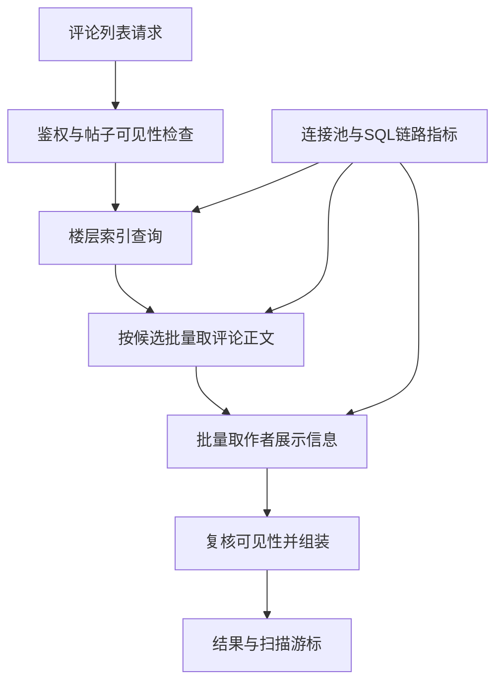
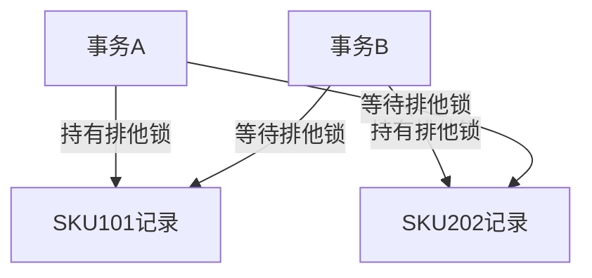
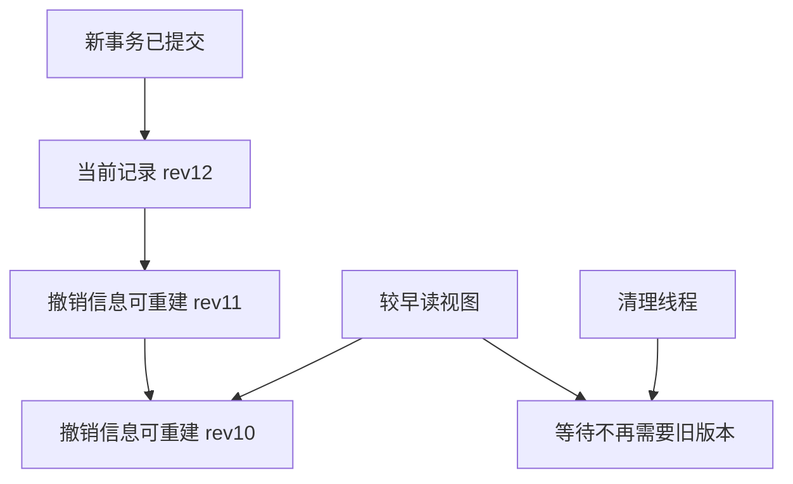
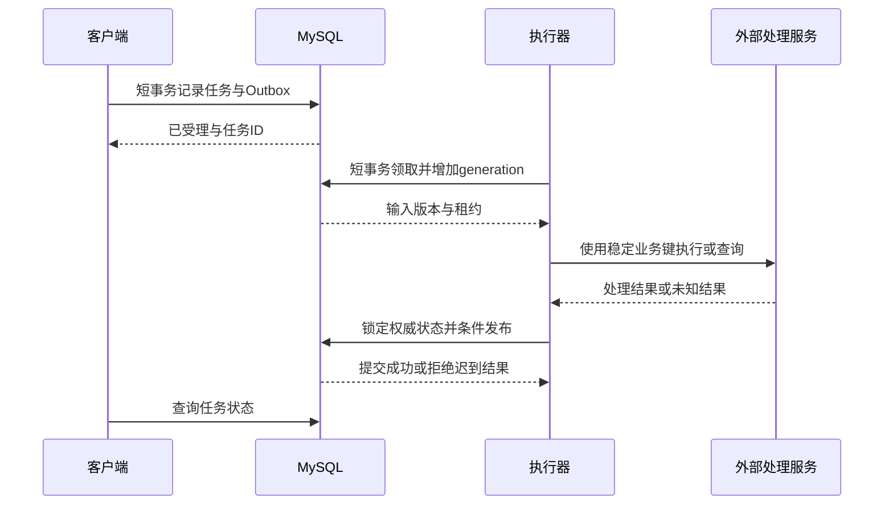
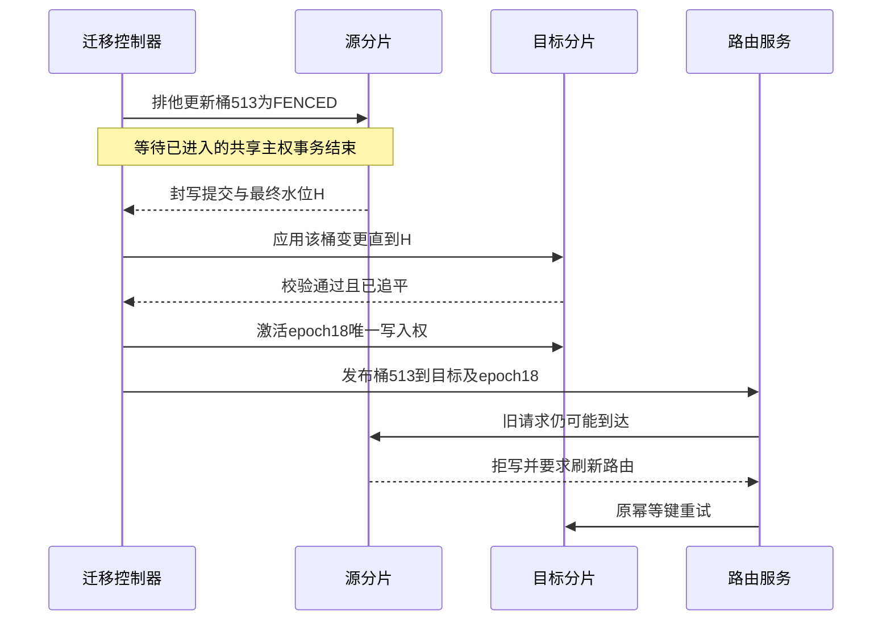

# 专题 E：MySQL 查询、事务与在线迁移

索引、EXPLAIN、ACID、MVCC、锁、复制和恢复共同决定数据库系统的性能与可靠性。分析业务事故时，应依次明确业务约束、定位证据、判断根因、选择止血与长期改造措施，并说明改造后的数据一致性和恢复责任。

**案例假设：**业务规模、耗时、比例、线程数和验收目标均为假设输入，执行计划表用于解释预期形态。SQL 以 MySQL 8.4 与 InnoDB 为基线；Java 片段表达事务边界和错误分类，实现时需适配框架与驱动。

## E.0 核心知识与业务链路的对应关系

| 核心知识 | 对应系统设计场景 | 不充分的回答 | 需要解决的难题 |
|---|---|---|---|
| 联合索引、覆盖索引、索引条件下推 | 评论列表、朋友圈列表、订单列表 | 建一个联合索引 | 多种过滤与排序是否兼容，扫描多少项、回表多少次，删除占位能否保留 |
| EXPLAIN 与慢查询案例 | 爆款帖子评论接口 P99 抖动 | 看 rows、看 key | 估计与真实数据偏斜、计划与等待的区别，优化如何改变写入成本 |
| 行锁、间隙锁、死锁 | 多 SKU 秒杀、批量审核、库存回补 | 改成乐观锁或 RC | 两个事务具体锁了什么，重试哪些部分，提交超时是否能重做 |
| MVCC、undo、长事务 | 文件解析、视频转码、模型调用、导出 | 拆成短事务 | 拆完如何保存执行责任、处理中间态、迟到结果与外部未知结果 |
| Online DDL、大表变更 | 评论大表补索引、字段升级 | 在低峰 ALTER | MDL 队列如何阻塞后续读写，构建期磁盘和复制如何受影响 |
| 分库分表、在线迁移 | 热租户独立分片、订单库扩容 | 双写、全量加增量 | 快照与增量起点如何匹配，谁能写，删除墓碑和回切如何处理 |
| redo、binlog、主从、崩溃 | 秒杀订单已确认后主库失联 | 有主从就能切 | 本地提交、远端收到、远端应用、用户收到 ACK 是不同事实 |
| 数据量与 B+ 树 | 千万到亿级数据规模 | 超过 2000 万必须分表 | 真正瓶颈是索引访问、写入、热点，还是备份恢复窗口 |

面试时先交代“这次业务要守住什么”，再讲底层原理。例如评论列表允许统计数短暂陈旧，但不能把已下架内容因索引优化重新返回；库存允许请求失败，但不允许把失败重试变成重复扣减；迁移允许某个桶短暂返回可重试错误，但不能让两个分片同时拥有写入权。这样的约束才决定技术选型。

## E.1 案例一：爆款帖子评论列表变慢，索引优化怎样讲成完整项目

### E.1.1 需求、架构和故障现象

假设平台累计有 1 亿条评论，普通帖子只有数十条，爆款帖子有 200 万条。接口按“最新楼层”翻页，每页 20 个根楼层，允许根评论删除后保留讨论占位；整个楼层被审核隐藏时不能展示。接口目标假设为 P99 小于 200 毫秒。某次活动后，首屏大体正常，深页和少数热门帖出现秒级尾延迟。

这时不能只拿“1 亿条”作为分库理由。单个帖子是否集中在一片、查询实际读了多少行、是否把长正文和作者信息逐个加载，通常更接近瓶颈。



把楼层锚点和评论正文分开，有两个原因。第一，列表只需要少量定位字段，不应为跳过的几十万条记录读取正文。第二，根评论是否存在，与这条讨论线程是否仍可列出并非同一件事。不能通过 `comment.state='VISIBLE'` 的条件，把允许保留回复的已删除根楼层一起过滤掉。

```sql
-- 教学简化表；各主键在本场景中由业务统一生成。
CREATE TABLE comment_thread (
  thread_id       BIGINT NOT NULL,
  tenant_id       BIGINT NOT NULL,
  object_id       BIGINT NOT NULL,
  root_comment_id BIGINT NOT NULL,
  listed_state    TINYINT NOT NULL, -- 1=可列出，0=整楼隐藏；不等同正文状态
  created_at      DATETIME(6) NOT NULL,
  version         BIGINT NOT NULL,
  PRIMARY KEY (thread_id),
  KEY idx_thread_object_time
      (tenant_id, object_id, created_at DESC, thread_id DESC)
) ENGINE=InnoDB;

CREATE TABLE comment_body (
  comment_id BIGINT NOT NULL,
  tenant_id  BIGINT NOT NULL,
  thread_id  BIGINT NOT NULL,
  author_id  BIGINT NOT NULL,
  state      VARCHAR(16) NOT NULL,
  revision   BIGINT NOT NULL,
  body       MEDIUMTEXT,
  PRIMARY KEY (comment_id),
  KEY idx_body_thread (tenant_id, thread_id, comment_id)
) ENGINE=InnoDB;
```

### E.1.2 先提出能被证据推翻的假设

原查询可能是：

```sql
SELECT t.thread_id, t.root_comment_id, t.created_at,
       c.author_id, c.state, c.body
FROM comment_thread AS t
JOIN comment_body AS c ON c.comment_id = t.root_comment_id
WHERE t.tenant_id = ?
  AND t.object_id = ?
  AND t.listed_state = 1
  AND c.tenant_id = t.tenant_id
ORDER BY t.created_at DESC, t.thread_id DESC
LIMIT 100000, 20;
```

需要验证的是：深 OFFSET 是否使数据库走过大量索引项；`listed_state` 是否不在有效访问前缀而导致大量额外过滤；执行器是否为最终被跳过的候选读取正文；应用是否对 20 位作者做了 20 次串行查询。不同计划的 JOIN 执行位置不同，不能看到这个 SQL 就断言“必定回表 100020 次”；应观察实际访问行数和循环次数。

采集证据时把一次请求的时间拆开。例如假设链路显示连接获取 8 毫秒、数据库调用 870 毫秒、作者查询 100 毫秒、组装 12 毫秒，才有理由优先处理 SQL 和 N+1。若数据库执行仅 8 毫秒而连接获取 900 毫秒，应该转向 E.3 的连接持有问题。

```sql
EXPLAIN FORMAT=TREE
SELECT t.thread_id, t.created_at
FROM comment_thread AS t
WHERE t.tenant_id = ? AND t.object_id = ? AND t.listed_state = 1
ORDER BY t.created_at DESC, t.thread_id DESC
LIMIT 100000, 20;

-- 下面的实际分析只在受控环境和可接受成本的参数范围运行。
-- EXPLAIN ANALYZE 会执行查询，不能把它当成无成本的计划打印。
EXPLAIN ANALYZE
SELECT t.thread_id, t.created_at
FROM comment_thread AS t
WHERE t.tenant_id = ? AND t.object_id = ? AND t.listed_state = 1
ORDER BY t.created_at DESC, t.thread_id DESC
LIMIT 100000, 20;
```

下表只说明应如何解读优化前后，不是伪造的测试输出。

| 对比项 | 旧方案可能出现的计划形态 | 新方案应验证的形态 | 不能直接下的结论 |
|---|---|---|---|
| 访问前缀 | tenant、object 后沿时间索引扫描 | tenant、object、listed_state 固定后定位游标范围 | `key` 有值就一定快 |
| 扫描项 | 为跳过 10 万条合格记录，可能访问更多候选 | 从明确游标开始取有界候选 | rows 估计值就是实际扫描量 |
| 正文读取 | 可能在候选处理中大量访问宽行 | 小批候选 ID 确定后再批量读取 | 覆盖索引在所有 MVCC 情况下绝不碰聚簇记录 |
| 排序 | 取决于索引与 JOIN 顺序，可能需要额外排序 | 与索引后缀全序匹配，验证是否免排序 | `Using filesort` 一定代表落磁盘 |
| 总负担 | 单次成本乘高调用量 | 尾延迟、总读取页、写放大共同下降 | 一次热缓存查询变快就能扩大流量 |

`EXPLAIN ANALYZE` 的实际 rows、loops 与耗时要一起看；父迭代器的耗时通常包含子工作，不能把每行数字直接相加。其结果也不替代锁等待、连接排队和端到端监控。[C03]

### E.1.3 长期改造：窄索引、游标和批量回表

针对这条固定状态的最新列表，可以增加：

```sql
CREATE INDEX idx_thread_visible_time
ON comment_thread
   (tenant_id, object_id, listed_state, created_at DESC, thread_id DESC);

-- 下一页：先从窄的楼层结构中找候选。
SELECT thread_id, root_comment_id, created_at
FROM comment_thread
WHERE tenant_id = ? AND object_id = ? AND listed_state = 1
  AND (created_at < ? OR (created_at = ? AND thread_id < ?))
ORDER BY created_at DESC, thread_id DESC
LIMIT 40;
```

这里 `root_comment_id` 没有包含在新索引中，所以这条查询不是严格意义上的完全覆盖。若业务中 `thread_id` 就是根评论 ID，可以只取 `thread_id,created_at`，减少一次字段读取；若两个 ID 独立，就应在“接受少量回表”和“把窄的 root_comment_id 加到索引尾部”之间做有证据的选择。不能为了宣称覆盖，把实际未覆盖的 SQL 写成成功案例。

取 40 而不是 20 是一个有界候选批次示例，目的是容忍权限过滤、并发删除和帖子状态变化。它不是“永远恰好补齐 20 条”的保证：如果前 40 条全部不可见，继续到下一有界批次，受最大扫描量和请求预算限制；不能为了补满一页无限回源。

正文查询使用候选 ID 列表：

```sql
SELECT comment_id, author_id, state, revision, body
FROM comment_body
WHERE tenant_id = ? AND comment_id IN (?, ?, ?, ?);
```

`IN` 查询不保证按参数顺序返回，所以应用要按第一步的楼层顺序组装。根正文为 `DELETED` 时返回占位和仍可见回复入口；整楼 `listed_state=0` 时不展示。最后一次可见性检查与响应之间的并发变更，需要业务定义允许的检查时点；如果要求撤销后立即禁止新的访问，必须把权限权威校验放到相应边界，不能靠列表缓存的 TTL 来宣称强保证。

游标至少包括帖子、排序方式、最后扫描的 `(created_at,thread_id)`，并防止客户端更换帖子或篡改。**游标推进到实际扫描边界，不只是最后返回项。**如果隐藏项未推进边界，下一页会反复扫同一批内容。第一页可以记录一个新内容上界，用来避免刚插入的楼层不断挤入后续页，但它不等同于数据库历史快照：已存在楼层的审核状态仍然变化，先隐藏后放开的老楼层可能要刷新列表才看到。若产品要求一次翻页会话严格固定成员集合，就需要物化快照或版本化列表，成本与普通实时列表不同。

### E.1.4 ICP、覆盖与索引顺序，如何被继续追问

假设审核后台的索引是 `(tenant_id, created_at, listed_state)`，查询 tenant 等值、created_at 时间范围、listed_state 等值，并返回不在索引中的正文。created_at 形成较大范围后，listed_state 未必能继续像等值前缀那样大幅压缩定位范围，但可以在满足条件的执行计划下被用于索引条件下推，先过滤再读取完整行。这个优化减少的是部分回表，不会把大时间范围变成只扫目标状态那一段。[C04]

把索引改成 `(tenant_id,listed_state,created_at)`，可能显著帮助“固定状态加时间”的查询，却不一定帮助“所有状态混合按时间”的查询。因为多个状态段各自有时间顺序，不代表拼起来是统一时间顺序。若后台确实需要两类高频查询，可以维护两个有明确收益的索引，也可以把低频审计交给异步检索。单列 status 选择性低，不足以否定它在联合索引中的作用。[C02]

覆盖索引服务的是“这次查询需要的列能否从索引获得”；ICP 服务的是“拿到完整行之前能否用索引列过滤”；最左前缀服务的是“能否有效定位连续或可枚举的范围”。这是三个问题，不应压缩成一句“索引生效了”。

### E.1.5 如何止血、上线和回滚

止血可以先限制异常深页、合并重复查询、缓存可陈旧的首屏摘要、把作者逐条查改成有界批量查；是否缓存必须保留审核和权限检查。不要在故障峰值直接向 1 亿行大表执行未经评估的 DDL，具体风险见 E.4。

长期变更应在代表性数据下对照：普通帖、爆款帖、隐藏比例很高的帖、同一时间戳的多条记录、作者信息缺失、读取期间根评论被删除，以及冷热缓存两类负载。除了读 P99，还检查每秒写入的索引维护量、磁盘空间、页读取和复制延迟。新索引上线后先保留旧 SQL 的受控开关；索引删除不应跟随一次 SQL 发布立即进行，否则回滚可能重新落到昂贵路径。

本案例的可复述结论是：“我先定位到爆款帖和深页的扫描放大，把楼层可见性与正文状态分开，围绕等值条件加排序游标设计窄索引，随后批量取正文。收益要用扫描量和尾延迟证实，同时检查写放大；列表删改语义和回滚计划也一起验证。”这个结论能继续追到 B+ 树、ICP、MVCC、缓存、审核和分片，具有完整的业务前因后果。

## E.2 案例二：秒杀组合购买与库存回补死锁，不能只回答换乐观锁

### E.2.1 业务约束和最小复现

假设用户可以购买一个包含两个 SKU 的组合，两个 SKU 必须同时预留成功，否则整个订单失败。另一条后台链路会回补同样的两个库存。库存表以 SKU 为主键，所有访问都能命中主键。

```sql
CREATE TABLE stock_bucket (
  sku_id    BIGINT NOT NULL,
  available INT NOT NULL,
  reserved  INT NOT NULL,
  sold      INT NOT NULL,
  version   BIGINT NOT NULL,
  PRIMARY KEY (sku_id),
  CHECK (available >= 0 AND reserved >= 0 AND sold >= 0)
) ENGINE=InnoDB;
```

先暂时忽略后台业务，用两个相反顺序的组合订单就能演示死锁。初始两个 SKU 都有足够库存，两个事务各自先锁住一个不同的主键记录。

| 时间 | 事务 A：先 101 后 202 | 事务 B：先 202 后 101 | 结果 |
|---|---|---|---|
| t1 | 开始事务；条件扣减 101，持有其排他记录锁 | — | A 持有 101 |
| t2 | — | 开始事务；条件扣减 202，持有其排他记录锁 | B 持有 202 |
| t3 | 条件扣减 202，等待 B 的锁 | — | A 等 B |
| t4 | — | 条件扣减 101，等待 A 的锁 | B 等 A，形成环 |
| t5 | 其中一个事务被选为受害者并回滚 | 另一事务继续 | 不应把受害者结果当库存不足 |



这四条边已经解释了死锁，不需要用“数据库锁表”这种不准确说法。命中主键只减少扫描，不会免除排他锁；把隔离级别改为 RC，也不会消除同一记录上写写互斥形成的环。InnoDB 官方建议保持事务短、让多对象访问遵循一致顺序，并准备重试被死锁回滚的事务。[E03]

### E.2.2 怎样找到真实的持有者和等待者

先看错误率、业务请求 ID、死锁频率及最近发布，再将应用 trace 与数据库线程关联。`SHOW ENGINE INNODB STATUS` 可以观察最近的死锁；较频繁的事故可以在受控时段打开所有死锁日志，收集完关闭，避免长期增加日志噪声。不要只保存“Deadlock found”一句异常而丢掉具体 SQL、索引、事务和锁顺序。[E03]

```sql
-- 当前等待边；数据来自 Performance Schema，权限和字段以部署版本为准。
SELECT w.REQUESTING_ENGINE_TRANSACTION_ID AS waiting_trx,
       w.BLOCKING_ENGINE_TRANSACTION_ID   AS blocking_trx,
       r.OBJECT_SCHEMA, r.OBJECT_NAME, r.INDEX_NAME,
       r.LOCK_TYPE, r.LOCK_MODE,
       r.LOCK_DATA AS waiting_key,
       b.LOCK_DATA AS blocking_key
FROM performance_schema.data_lock_waits AS w
JOIN performance_schema.data_locks AS r
  ON r.ENGINE = w.ENGINE
 AND r.ENGINE_LOCK_ID = w.REQUESTING_ENGINE_LOCK_ID
JOIN performance_schema.data_locks AS b
  ON b.ENGINE = w.ENGINE
 AND b.ENGINE_LOCK_ID = w.BLOCKING_ENGINE_LOCK_ID;

SELECT trx_id, trx_state, trx_started, trx_wait_started,
       trx_mysql_thread_id, trx_rows_locked, trx_rows_modified, trx_query
FROM information_schema.innodb_trx
ORDER BY trx_started;
```

`data_lock_waits` 表达等待边，`data_locks` 表达请求或持有的锁；结合它们，才能回答“谁在等谁”。死锁可能在采样前已被检测并解除，因此当前等待表为空，不能反证过去没发生死锁；还需要事件日志或周期采样。[E01]

### E.2.3 统一锁序和有界事务重试

改造时先为所有会修改同一组对象的链路定义锁序，包括下单、回补、取消、人工修复和批量脚本。只把下单接口排序，后台仍逆序更新，环依旧可能出现。对于本例，统一按 SKU ID 升序执行主键更新，并保持库存预留、订单、幂等结果和 Outbox 在同一事务中。

```java
// 协议伪代码：tx.newTransaction 必须创建真正独立的新事务，
// 出错后完整回滚并归还连接；不能在一个已标记回滚的外层事务里继续。
OrderResult reserveBundle(Command cmd, Deadline deadline) {
    var items = validateMergeAndSortBySku(cmd.items());
    // 同一SKU重复出现要先合并数量；数量必须为正且防整型溢出。
    for (int attempt = 0; attempt < 3; attempt++) {
        deadline.requireRemaining();
        try {
            return tx.newTransaction(() -> {
                // 唯一键是(tenant_id, request_id)，同时校验payload_hash。
                // 同一请求重放返回已提交结果，不再次进入库存扣减。
                var old = requests.claimOrRead(cmd.tenantId(), cmd.requestId(),
                                               cmd.payloadHash());
                if (old.hasCommittedResult()) return old.result();
                for (Item item : items) {
                    int n = stock.execute("""
                        UPDATE stock_bucket
                        SET available=available-?, reserved=reserved+?,
                            version=version+1
                        WHERE sku_id=? AND available>=?
                        """, item.qty(), item.qty(), item.sku(), item.qty());
                    if (n != 1) throw new InsufficientStock();
                }
                var result = orders.createReserved(cmd, items);
                outbox.insertOrderReserved(result); // 与库存和订单同一连接提交
                requests.finish(cmd.requestId(), result);
                return result;
            });
        } catch (DeadlockOrLockWaitFailure e) {
            // 这里只处理已明确结束/回滚的尝试；外部支付不在这个函数里。
            if (attempt == 2 || !deadline.canRetry()) throw e;
            backoffWithJitterWithin(deadline, attempt);
        } catch (CommitOutcomeUnknown e) {
            // COMMIT应答丢失不等于事务失败；交给幂等结果查询与核对。
            return orders.resolveOrReturnPending(cmd.tenantId(), cmd.requestId());
        }
    }
    throw new IllegalStateException("unreachable");
}
```

`claimOrRead` 不是“先普通 SELECT，不存在就认为没请求过”。它必须通过数据库唯一约束和规定的事务处理争夺同一个业务键；遇到同键冲突时，要区分该请求的重放、不同负载误用同键和其他唯一约束冲突。真正的订单数据结构与状态机见第 2 章，这里只突出锁序和重试边界。

锁等待超时与死锁的数据库默认处理不同：死锁通常使整个事务回滚，锁等待超时在默认设置下可能只回滚当前语句。为了避免业务代码把前面成功的扣减继续提交，本示例事务框架对两者统一结束本次事务，再进入全新的尝试；不能把默认的语句级回滚误认为已经自动回滚全部业务。[E06]

### E.2.4 为什么乐观锁仍可能等锁

`UPDATE ... WHERE version=?` 需要实际获得被更新记录的排他锁。乐观锁减少的是长时间“先锁着读再等待决策”的应用方式，不是让更新不加锁。两个事务仍可分别更新不同记录后再竞争对方记录，仍然形成环。热点 SKU 的版本冲突还可能产生大量失败重试，使吞吐更差。

如果本例库存条件扣减已经准确表达 `available>=quantity`，额外要求客户端读出的 version 完全匹配，可能把本来可成功的并发扣减变成无谓冲突；是否使用 version，要看是否还保护“基于旧状态计算整个新状态”的其他业务约束。

对真正单行热点，统一锁序也不会增加那一行本身的并行提交能力。还要判断能否预分配库存额度、按仓库或活动桶切分、在单分区内顺序处理，或在入口排队。分桶后每个桶的可用额度以及回收规则要能证明总量守恒；把一个数简单复制到多个节点会直接破坏库存约束。

### E.2.5 RC、范围锁和批量任务的另一种冲突

批量审核如果使用“某状态且小于某时间”的范围锁定读取，RR 下的 next-key 锁可能扩大冲突范围。增加准确索引、减小领取批次、任务领取后立即提交，往往比直接改全局隔离级别更先考虑。RC 在很多普通范围扫描中减少间隙锁，但外键和唯一性检查仍有相关例外，且每条一致性读使用新的快照；这些变化必须与业务读语义一起验证。[E05]

例如一个事务第一次统计某活动参与人数，第二次检查另一条件，再决定插入。切成 RC 后，两次读取可见不同提交集合；保持 RR 的同一快照也不自动保护“人数不能超过配额”这种跨行约束。应把配额表达为权威计数条件更新、资源预留、明确锁住的聚合行或其他可证明的并发控制，不把隔离级别名字当业务正确性的证明。

### E.2.6 止血与验证的尺度

止血可以暂停冲突的后台回补批次、降低同一活动执行并行度、缩短事务外等待，并对已经失败的请求做有界重试。不要通过无限重试把一次死锁放大成请求风暴，也不要为了恢复流量随意放弃库存守恒。

验证必须覆盖相反输入顺序、重复 SKU、库存不足、同幂等键并发、提交应答丢失、后台取消和下单同时发生。观察指标除了死锁次数，还包括成功吞吐、锁持有时间、事务 P99、重试放大量和最终库存对账。死锁降为零而吞吐下降九成，可能只是把整个业务串行化；应说明这是否符合业务目标，而不是只展示一个好看的数字。

## E.3 案例三：视频处理和外部调用写在事务里，拖垮的为什么是整个网站

### E.3.1 从一个功能正常的实现开始

假设文件上传完成后，接口执行四步：读取文件状态、调用转码或解析服务、写处理结果、创建通知。开发者为了“任何一步失败就全部回滚”，给整个方法加了事务注解。正常外部调用只花 200 毫秒，系统看似可用；某次第三方变慢到 30 秒，用户开始反复点击重试。

```java
// 反例：数据库本地事务无法回滚已经发生的外部转码或通知。
@Transactional
Result completeUpload(Command cmd) {
    Material m = dao.selectForUpdate(cmd.materialId());
    RemoteResult r = transcoder.convert(m.objectKey()); // 可能等待30秒
    dao.markReady(m.id(), r.manifest());
    notification.send(m.owner());                     // 另一个外部副作用
    return Result.ready(m.id());
}
```

这个反例同时有性能与正确性缺陷。数据库连接和已获取的锁在等待外部 I/O 期间没有释放；外部动作成功、数据库随后回滚时，也不可能把已发送通知收回来。事务范围越大，并不意味着整个业务的原子性越强。

假设到达率为每秒 40 个处理请求，平均持有数据库连接 30 秒，稳态平均需要约 `40×30=1200` 个连接，而应用池只有 80 个。排队会迅速增长。把池改为 1200 仍然没有给外部服务增加处理能力，却可能使数据库同时承担更多活跃事务和内存压力。真实故障往往先表现为“登录和评论也拿不到连接”，于是原本的非核心视频处理拖垮了核心接口。

### E.3.2 证据链需要区分四种时间

至少分别记录请求总时间、连接获取时间、连接持有时间、数据库事务时间。它们不相等：有的框架延迟获取连接；有的只开连接不启事务；有的在事务内没有锁住业务行，但仍保留读视图。只用“SQL 慢日志里没有慢 SQL”不能排除数据库使用方式的问题。

| 证据 | 它支持的假设 | 还应排除什么 |
|---|---|---|
| pool active 达上限，pending 持续增加，acquire timeout 增多 | 请求拿不到连接 | 真实连接泄漏还是合法长持有 |
| 多数 trace 的外部调用耗时与连接持有时间重合 | 事务包住外部 I/O | 框架是否真已获取连接、是否传播了事务 |
| `innodb_trx` 有大量长龄事务 | 事务没有结束 | 长时间空闲读事务还是大量写事务 |
| 行锁等待沿同一 file_id 或汇总行聚集 | 热点锁被长事务持有 | 是否有无索引范围扫描进一步放大 |
| History list length 随持续写入增长 | 旧版本清理受阻或写入生成超过清理 | 它不是直接的 undo 字节数，也不等于未提交行数 |
| 副本应用时间落后、出现大事务应用 | 大批写可能拖慢复制 | 网络、接收线程、从库磁盘与查询竞争 |

长时间 RR 一致性读即便不写，也可能使其他事务产生的旧版本暂时不能清理；历史链保留取决于仍需要它的读视图。官方文档列举了长时间一致性备份、关闭 autocommit 后读完忘记结束事务等情况。[E04] 但“长事务必然导致复制延迟”太绝对：一个只读事务不在 binlog 中生成一大段写入。它可以通过资源与清理压力间接影响系统；真正的大写事务则会让日志和副本应用在提交及回放阶段承担集中工作。

### E.3.3 MVCC 在这个场景里到底保留了什么

设一行资料的最近版本如下，箭头表示能沿撤销信息寻找旧版本的概念关系，并不是物理存储格式图：



读视图需要判定某个版本的创建事务在当时是否可见。一个适合面试的概念模型包括：当前事务自身、创建视图时仍活跃的事务集合、该集合的较小边界，以及创建视图时未来事务的边界。自身写入通常可见；足够早且已提交的版本可见；视图建立后才开始的事务版本不可见；中间区间要看创建视图时是否仍活跃。沿版本链找到可见版本，而不是简单“取版本号最大的一条”。字段的实际名字属于实现细节，不能把业务 revision 当成 InnoDB 事务 ID。[C05][C15]

再看一个容易被追问的时间线：

| 时刻 | 事务 T1（RR） | 其他事务 | T1 可见结果 |
|---|---|---|---|
| t1 | `BEGIN`，尚未执行一致性读 | 当前状态为 10 | 普通 BEGIN 不等于此刻已固定所有查询快照 |
| t2 | — | T2 把状态改为 11 并提交 | — |
| t3 | 首次普通 SELECT | — | 通常在此建立一致性读视图，读到 11 |
| t4 | — | T3 改为 12 并提交 | — |
| t5 | 再次普通 SELECT | — | 在同一 RR 读视图下仍读到 11 |
| t6 | 执行 `SELECT ... FOR UPDATE` | — | 锁定读取按当前可锁定记录工作，不能照搬普通快照读结论 |

显式 `START TRANSACTION WITH CONSISTENT SNAPSHOT`、隔离级别、读取形式会改变建立视图的时点与行为；RC 的普通一致性读通常每条语句获得新视图。[C15][E05] 因此面试回答“RR 防幻读”，应说明在讨论重复的普通快照读，还是阻止别人插入的锁定范围操作。普通快照读让新提交行对旧视图不可见，不等于真的阻止别人插入；锁定范围读取才涉及记录锁、间隙锁或 next-key 锁的具体作用。

### E.3.4 改成可靠任务：数据库先承担责任，外部执行在事务外

功能改为：上传完成接口短事务创建处理任务，返回 `202 Accepted` 和任务 ID；后台执行器领取任务、处理文件，最后条件发布结果。业务要展示 `ACCEPTED / RUNNING / READY / FAILED / CANCEL_REQUESTED / UNKNOWN` 等可解释状态，而不是把异步提交伪装成处理完成。

```sql
CREATE TABLE material_processing_job (
  job_id              BIGINT NOT NULL,
  tenant_id           BIGINT NOT NULL,
  material_id         BIGINT NOT NULL,
  input_revision      BIGINT NOT NULL,
  processor_version   VARCHAR(64) NOT NULL,
  request_id          VARCHAR(64) NOT NULL,
  payload_hash        CHAR(64) NOT NULL,
  status              VARCHAR(24) NOT NULL,
  generation          BIGINT NOT NULL DEFAULT 0,
  owner_id            VARCHAR(64),
  lease_until         DATETIME(6),
  next_check_at       DATETIME(6) NOT NULL,
  stable_action_key   VARCHAR(128) NOT NULL,
  result_manifest_key VARCHAR(512),
  version             BIGINT NOT NULL,
  PRIMARY KEY (job_id),
  UNIQUE KEY uk_job_request (tenant_id, request_id),
  UNIQUE KEY uk_job_logical
      (tenant_id, material_id, input_revision, processor_version),
  KEY idx_job_due (status, next_check_at, job_id)
) ENGINE=InnoDB;
```

两个唯一键表达不同约束：请求键防客户端重放；逻辑处理键防不同请求重复创建同一版本同一处理器的工作。请求相同但 payload_hash 不同应拒绝；逻辑键相同但请求键不同，可以返回已存在任务，不能把所有唯一键冲突都当“同请求已完成”。



状态发布必须校验两种版本。`input_revision` 保护“结果是否仍对应用户当前资料”；`generation` 保护“当前谁有资格完成这个任务”。不能只验证其中一个。示意实现：

```java
// 所有涉及资料与任务的路径使用相同锁顺序，例如先material再job。
void publish(Claim claim, ValidatedManifest manifest) {
    tx.newTransaction(() -> {
        Material m = dao.lockMaterial(claim.materialId());
        Job j = dao.lockJob(claim.jobId());
        require(m.active() && m.revision() == claim.inputRevision());
        require(j.status().equals("RUNNING"));
        require(j.generation() == claim.generation());
        require(j.owner().equals(claim.owner()));
        require(j.leaseValidAtDatabaseNow());
        require(!j.cancellationRequested());
        // 每次attempt产物使用独立不可变路径，避免旧执行者覆盖同名文件。
        require(manifest.belongsTo(claim.jobId(), claim.generation()));
        dao.bindManifestAndMarkReady(m, j, manifest);
        outbox.insertMaterialReady(m.id(), m.revision(), j.id());
        return null;
    });
}
```

执行器收到结果后仍可能在上传结果后、提交发布前崩溃。未发布产物通过定期对账清理；只有成功绑定的 manifest 才对用户可见。若每次重试都覆盖同一个对象 key，旧执行者可以在新版本发布后覆盖文件，数据库 CAS 再正确也保护不了文件内容，所以对象路径必须纳入执行代次或采用等效的条件写协议。

### E.3.5 拆成短事务后需要解决的五个问题

**一是任务受理后消息没发出。**创建任务与 Outbox 同事务提交，发布者重试投递；消费者仍幂等。仅在提交后调用一次 MQ producer，会留下数据库成功、消息未发送的夹缝。

**二是执行器死在 RUNNING。**租约和恢复扫描找到过期任务，但过期只代表执行权可能转移，不证明旧进程已经停止。新 generation 拒绝旧写回；外部动作是否能重复执行，另由渠道幂等键或查询协议处理。

**三是第三方超时，不知道是否成功。**对于只产生可废弃中间产物的转码，可以允许重复计算并控制成本；对于收费、通知、设备控制等副作用，应先查询原稳定业务键，把无法确认的结果保存在 `UNKNOWN` 并定期核对。不能重新生成业务键后盲目调用。

**四是用户取消后旧结果返回。**取消意图先持久化，随后阻止新领取或发布。若外部服务不支持取消，系统可以停止发布并回收产物，但不能声称已经取消了外部执行或计费。只把页面按钮变灰并不能形成取消语义。

**五是从一个 ACID 事务变成多个步骤。**每个本地事务仍有自己的 ACID，原先跨步骤的整体原子可见性不再自动存在。业务必须用中间态、补偿、查询与对账表达整个流程。把“加重试和补偿”写成两个名词不够，要明确每一步的责任记录、幂等键、可回退动作和无法判定时的处理入口。

### E.3.6 止血、验收与反例

止血先停止新增长时间后台任务、收紧其并发和独立连接预算，保留核心接口资源。对异常长事务，要查持有者、业务责任和预计回滚量，再决定结束；回滚大写事务本身也可能耗时，杀掉会话不会立刻让所有资源消失。不要持续重启整个数据库来“清掉连接”，这会把本可局部处理的问题升级成恢复事件。

验证不仅要让外部调用变快，还要主动把它变慢、超时、重复返回、乱序返回，并杀掉不同阶段的执行器。验收条件可以包括：后台任务异常时登录与评论的连接等待仍在预算内；已受理任务都能查到最终状态或明确的待核对责任；旧代次不能发布；取消后不会重新变 READY；补偿量和最老 UNKNOWN 年龄可观测。

“超过 500 毫秒算长事务”可以作为一个治理阈值，但不是 MySQL 的普适边界。一个持锁 100 毫秒的热库存事务也可能伤害高并发；一个隔离副本上的只读导出可能允许更久。阈值应来自业务 SLO、锁对象竞争、连接预算、历史版本生成速率与恢复目标。

## E.4 案例四：给评论大表加索引，为什么引出了不停机迁移

### E.4.1 场景分叉：补一个索引，还是改变数据主权

假设 E.1 找到了明确的索引缺口，要给 1 亿行的楼层表加索引；同时一个超级租户占用了大部分写入，需要考虑独立分片。这其实是两类不同变更。

增加兼容索引通常首先评估数据库原生 online DDL；超级租户移到另一物理数据库，则涉及数据复制、路由、唯一写入权和回切。不能因为二者都有“复制数据”就使用一套没有边界的“双写方案”。

| 变更 | 首选需要验证的路径 | 主要风险 | 上线后的回退含义 |
|---|---|---|---|
| 增加普通二级索引 | 原生在线构建，评估算法与并发支持 | MDL、I/O、空间、复制影响 | SQL 可先回退；删除索引是后续独立变更 |
| 增加或改变列 | 确认该版本该操作是否支持 INSTANT/INPLACE | 是否重建表、旧新代码是否兼容 | 旧代码能否读新数据，而非只看 ALTER 能否逆向 |
| 更改主键、类型或复杂结构 | 按操作评估原生重建或成熟影子表工具 | 复制追平、外键、触发器、切换锁 | 新字段数据是否可逆转换 |
| 租户跨实例迁移 | 版本化路由、快照加增量、切写屏障 | 双主写、漏日志、旧路由、回切丢写 | 必须把目标库已接受的新写入带回 |

`INSTANT`、`INPLACE`、`COPY` 描述不同实现能力，是否允许并发 DML 还要看 `LOCK` 与具体操作。`INPLACE` 不等于所有操作都不重建表，`LOCK=NONE` 也不等于完全没有元数据锁。[E07][E08]

### E.4.2 一个三个会话就能解释的 MDL 事故

| 时间 | 会话 A：遗留事务 | 会话 B：改表 | 会话 C：正常查询 |
|---|---|---|---|
| t1 | 开事务，读过 comment_thread 后没有提交 | — | — |
| t2 | 事务空闲但仍未结束 | 请求 DDL 所需的排他元数据锁 | — |
| t3 | 继续不提交 | 等待 A 释放相应 MDL | 新查询可能排在等待的排他锁之后 |
| t4 | 应用层看起来没有慢 SQL 在运行 | 改表还没完成 | 连接和请求排队开始扩散 |

MDL 保护的是表定义的一致使用，不是某个业务行的值。事务访问过表后，相应元数据锁通常保留到事务结束。online DDL 最后提交表定义时需要排他 MDL；如果等待期间形成阻塞链，后续查询也可能被挡住。官方文档明确给出了这个模式。[E02][E08]

```sql
-- 在诊断会话观察请求与持有状态，不是自动kill脚本。
SELECT ml.OBJECT_SCHEMA, ml.OBJECT_NAME,
       ml.LOCK_TYPE, ml.LOCK_DURATION, ml.LOCK_STATUS,
       th.PROCESSLIST_ID, th.PROCESSLIST_USER,
       th.PROCESSLIST_TIME, th.PROCESSLIST_STATE,
       th.PROCESSLIST_INFO
FROM performance_schema.metadata_locks AS ml
LEFT JOIN performance_schema.threads AS th
  ON th.THREAD_ID = ml.OWNER_THREAD_ID
WHERE ml.OBJECT_TYPE = 'TABLE'
  AND ml.OBJECT_SCHEMA = ?
  AND ml.OBJECT_NAME = 'comment_thread';
```

`GRANTED` 是持有，`PENDING` 是等待。仅仅同表上存在两个锁，不足以断言它们一定互相冲突；要结合锁类型兼容关系、事务信息和时间线确认阻塞链。连接 `Sleep` 也不代表没有未结束事务，更不能把 `KILL QUERY` 与结束整个事务混为一谈。[E21]

### E.4.3 原生 DDL 的可执行上线计划

上线前在代表性结构上确认支持的算法，在接近真实规模的数据上评估构建时间与临时空间，识别大事务和复制延迟。新旧代码采用兼容顺序：先添加可兼容结构，再发布使用新结构的代码，最后在回退窗口过后清理旧结构。

```sql
-- 仅为已确认该操作兼容后的执行模板；生产参数来自变更预算。
-- 这个超时约束MDL等待，不是给整个索引构建设置五秒总截止时间。
SET SESSION lock_wait_timeout = 5;

ALTER TABLE comment_thread
  ADD INDEX idx_thread_visible_time
      (tenant_id, object_id, listed_state, created_at DESC, thread_id DESC),
  ALGORITHM=INPLACE,
  LOCK=NONE;
```

显式指定算法和锁要求的价值，是在不支持时让变更失败，而不是默默接受更强阻塞；实际支持矩阵应按该版本、引擎、表结构和操作核验。[E07] 对 `INSTANT` 操作使用什么 LOCK 选项也要按文档来，不能把以上模板复制到所有 ALTER。

构建过程中观察业务 P99、MDL 等待、磁盘可用空间、I/O 延迟、redo 增长和复制追平速度。预先定义停止条件，例如出现持续的核心接口超时或剩余空间跌破安全余量。原生索引构建并不天然支持任意暂停后原地续跑；中断和清理本身可能需要时间，不能宣称“出事立刻 kill，零成本恢复”。

如果变更对热点主库影响难以接受，可以评估成熟的影子表/在线迁移工具。此时应准确核对工具对无主键表、外键、触发器、生成列、唯一约束、binlog 格式和拓扑的限制。工具承担复制与切换实现，并不替业务决定 SLO、资源预算和回滚窗口。

### E.4.4 跨分片迁移：先证明任意时刻谁有资格写

设逻辑桶 513 当前归源分片 S，路由 epoch 为 17，目标分片 T 尚未接管。复制期间只有 S 接受业务写，T 接收迁移数据。普通用户写入不仅要查配置，还应在实际事务里验证本分片的主权。

```sql
CREATE TABLE bucket_authority (
  bucket_id    INT NOT NULL,
  route_epoch  BIGINT NOT NULL,
  state        VARCHAR(16) NOT NULL, -- ACTIVE/FENCED/SHADOW
  migration_id VARCHAR(64),
  PRIMARY KEY (bucket_id)
) ENGINE=InnoDB;

START TRANSACTION;
SELECT route_epoch, state
FROM bucket_authority
WHERE bucket_id = 513
FOR SHARE;
-- 应用校验state=ACTIVE且epoch=请求中的17；缺行也拒写。
-- 共享锁一直持有至业务事务结束，不能校验完立刻提交再另开事务写。
UPDATE business_record
SET value = ?, version = version + 1
WHERE id = ? AND bucket_id = 513;
-- 同事务记录幂等结果、Outbox等必要事实。
COMMIT;
```

这是一种便于证明的教学协议：共享锁允许同桶多笔正常事务并发；迁移控制器要改成 `FENCED` 时取该行排他锁，因此必须等前面的业务事务结束。它增加一次权威行访问，生产中可用经过验证的路由代理或存储协议实现等价保证，但不能省掉“检查与提交之间受保护”这一条件。

所有写者都必须遵守，包括定时任务、管理后台、修复脚本、旧版本服务和补偿消费者。只在 HTTP 入口检查 epoch，Kafka 消费者直连数据库继续写旧分片，仍会破坏迁移。还要控制能绕过协议的凭据和直连路径；单靠一段应用约定无法隔离不受控写者。

### E.4.5 快照、CDC 和删除：如何防漏与防复活

全量扫描和增量捕获必须有协调起点。先扫完两小时数据、再打开 CDC，会漏掉扫描期间的变更；先开 CDC 再扫，如果不处理覆盖关系，又可能让较旧快照覆盖较新的增量。可以采用成熟连接器/迁移工具的一致快照协议，或严格实现带水位的分块复制，不能只在方案图上画“全量+增量”两个箭头。[C12]

这里沿用第 11 章的明确规则：每次业务修改递增 version；删除先写 `deleted=1, version=version+1`，CDC 捕获到这个更高版本的更新。目标原子应用更高版本，较低版本拒绝，同版本的重复事件应校验内容一致或按确定规则判重。源实例纪元与迁移 ID 防止不同来源的版本空间被误混。

| 到达顺序 | 目标已保存状态 | 后到事件 | 正确结果 |
|---|---|---|---|
| 增量先到，全量后到 | 记录版本 12 | 快照版本 10 | 保留 12 |
| 删除先到，旧更新后到 | 墓碑版本 13 | 更新版本 12 | 保留删除 |
| 相同增量被重复发送 | 记录版本 14 | 同版本同内容 | 幂等通过，不重复副作用 |
| 同版本但内容不同 | 记录版本 14 | 不同内容版本 14 | 视为协议或数据异常，不静默覆盖 |

物理 `DELETE` 并不会自动把业务 version 从 12 变成 13。常见 CDC 删除事件携带的是被删除前的记录；若无法改变业务删除方式，需要同事务写显式删除事件，或完整采用连接器来源日志位置的排序协议。不能一半事件按行版本，一半事件按不相关的时间戳比较。[C12]

目标不应收到删除后马上丢弃版本信息，否则一个迟到的全量版本又能插回这条记录。墓碑至少保留至相关快照、增量重放、重试和恢复窗口都越过删除水位；如果正文需要早清理，可以保留小的键与版本标记。还有多表一致性问题：订单、明细和 Outbox 可能在同一源事务里变化，目标若对业务开放中间应用状态，可能读到半笔事务。接管前必须完成相应事务边界与一致性校验，而不是只比较某张表的行数。

### E.4.6 真正的切写屏障与崩溃恢复顺序



目标先具备接管条件再向客户端公布，源始终保持拒写。假如控制器在目标激活后、路由发布前崩溃，可以短暂不可用，但不能为恢复流量擅自把源重新设为 ACTIVE。恢复者应读取持久的迁移状态和两侧主权，继续发布目标，或执行一次完整受控的反向切换。

路由服务的高可用也需要自己的协调保证。epoch 只是数字；如果两个控制器能并发写出相互矛盾的主权状态，数字再大也无法保证唯一写者。应由串行化的迁移状态机、持久操作记录和对控制器的隔离来决定步骤，重复调用每一步必须可检测完成结果。

H 是源日志中有明确语义的最终已提交水位，不是业务服务器墙上时钟。若使用 GTID 集合，应按集合包含关系验证；不能比较字符串大小。若源继续承载其他桶，H 之后仍可有那些桶的提交，不代表正在迁移的桶又有合法写入。复制与校验需要知道自己跟踪的是哪个源纪元、哪个桶和哪些事务。

Vitess Reshard 将复制、数据差异校验、切流和完成清理作为不同阶段，并提供受控切流/回切流程。借鉴的是这些阶段之间的保证，而不是声称一个自写脚本已有同等成熟度。[C09]

### E.4.7 回滚不是把路由配置改回去

设接管后目标已经接受新评论 X、删除评论 Y，并完成点赞状态修改 Z。旧源只有接管前的副本，直接回切会丢掉 X、让 Y 复活、恢复旧的 Z。为保留回切能力，要从接管点开始捕获目标新写，反向同步到源；反向流应区分业务变更与复制应用，防止变更在两侧循环放大。

回切时先封禁目标新写并等在途事务结束，取新的最终水位 H2；旧源应用到 H2，校验通过；再以更高 epoch 重新激活旧源，目标继续拒绝旧 epoch。这里的“旧源”只是物理位置，已不再拥有历史上的默认主权。

如果新 schema 允许旧 schema 无法表达的数据，例如新字段不可逆合并、精度提升后产生旧类型存不下的值，就不具备无损反向同步条件。应在升级阶段限制写入为双方兼容集合，或明确从某个时点开始只能向前修复，不能承诺随时回滚。

### E.4.8 迁移验收应故意制造哪些故障

至少演练：全量复制一半时进程死亡、CDC 重复与乱序、删除先到、复制落后、旧服务长时间暂停后恢复、主权检查后事务卡住、源封写后控制器死亡、目标激活后控制器死亡、回切期间出现新写、旧分片误接到修复脚本。

验收分成三类。正确性看所有已确认业务键是否可查、库存或计数不变量是否保持、删除是否复活、是否曾有双侧成功写。可用性看受影响桶的失败与重试时长、其他桶是否被拖慢。运维性看复制速度、最老未应用事件、迁移状态可恢复性、剩余空间和回切耗时。

“不停机”在这里指服务整体继续可用、变更可滚动完成，不代表每一笔写在切换瞬间都无等待无重试。应给切写窗口一个可观察的预算；超过预算时停止继续推进并保持唯一主权，而不是用不受控双写交换表面上的零错误率。

## E.5 案例五：用户说订单成功了，主库崩溃后为什么查不到

### E.5.1 先确认“成功”发生在哪一层

假设秒杀接口已经创建订单，用户随后查询却看不到记录。至少有五种不同解释：事务根本没有提交；事务提交但应用应答丢了；写在主库而查询走了落后副本；故障切换提升了缺少这笔事务的副本；数据已经存在，但缓存或订单路由索引尚未追上。

排查时保存用户业务请求 ID、订单 ID、服务 trace、写入连接所在主库、提交结果、读路由和数据库切换时间线。不要让用户先换请求号再试；这个动作可能把一个结果未知的请求变成第二笔真实订单。

| 确认边界 | 已证明的事 | 尚未证明的事 |
|---|---|---|
| 应用内存里组装出订单对象 | 应用计算完成 | 数据库是否持久提交 |
| 数据库事务提交成功 | 在该数据库配置和故障假设下，事务提交 | 其他副本是否已收到、已应用 |
| 半同步副本 ACK | 满足配置的副本已接收并持久记录相应日志 | 查询节点是否已经执行该事务 |
| 应用收到数据库成功 | 应用知道提交结果 | HTTP 成功是否到达用户 |
| 用户收到成功 | 客户端知道业务已接受或完成 | 后续读路径是否满足读己之写 |

最后一列必须由对应协议补齐。用一个“高可用数据库”标签跨过全部边界，是这类面试题最常见的漏洞。

### E.5.2 redo、undo、binlog 各自负责什么

| 机制 | 主要责任 | 不能替代的机制 |
|---|---|---|
| redo | 将已记录的数据页修改用于崩溃恢复，减少每次提交都立即刷全体数据页的需要 | 历史备份、任意时间点回滚、业务幂等 |
| undo | 回滚相关事务修改，并支持构造旧版本 | 把整个业务的外部调用撤回、跨系统事务协调 |
| binlog | 记录用于复制和时间点恢复的变更信息 | 本地数据页崩溃恢复的全部职责、自动保证每个副本已应用 |
| checkpoint | 标识脏页落盘与 redo 回收推进的有关边界 | 每一笔事务的业务完成标识 |

数据页可能在事务提交前因为后台刷盘写出，redo 也不应简单理解成“只记录已经提交的事务”。恢复既需要恢复相关页状态，也需要处理未完成事务。大体过程是应用必要 redo，结合事务状态与相关日志协调决定提交或回滚，利用 undo 处理需要撤销的修改；某些回滚可在恢复后后台继续，期间仍可能与新业务发生锁冲突。[E10][E19][E20]

理解 redo 如何参与事务恢复，需要说明内部两阶段提交的协调过程，不能只记住 prepare 和 commit 两个标记。当启用 binlog 时，MySQL 要协调 InnoDB 与 binlog，避免数据存在但复制日志不存在，或复制日志存在而本地恢复把它当未提交回滚。正常事务的内部协调与应用显式发起的外部 XA 是不同层次。[E09]

### E.5.3 用崩溃位置解释内部两阶段提交

下表抽象描述正常、内部协调的事务；真实实现包含组提交、日志缓冲和并发阶段，不应误解为每笔事务一定独占执行三次同步刷盘。

| 崩溃位置 | 恢复时需要观察的事实 | 概念上的处理 |
|---|---|---|
| 尚未形成可提交的 prepare 状态 | 事务未完成 | 撤销未提交修改 |
| 已 prepare，但没有完整、有效、已持久保留的 binlog 提交记录 | 缺少内部协调的提交依据 | 不能仅凭 prepare 就宣布业务成功，应按恢复协议回滚 |
| 已 prepare，binlog 中能找到完整有效的该事务 XID，最终引擎提交阶段未完成 | binlog 已记录提交依据 | 恢复时完成相应 prepared 事务提交 |
| 引擎提交完成，但应用没有收到结果 | 数据库已提交，网络结果未知 | 通过业务幂等键确认，不能当作必然失败 |

官方文档描述了恢复时扫描 binlog 的事务 XID，并让 InnoDB 完成已经成功写入有效 binlog 的 prepared 事务。[E09] 外部 XA 的 PREPARED 事务可能必须等待外部协调器决定；不能把上表“找不到普通事务提交依据”的解释照搬成“所有 XA 重启后都自行回滚”。

为了让本地确认具有预期耐久性，订单类场景常选严格的 redo 与 binlog 同步配置，例如 `innodb_flush_log_at_trx_commit=1` 与 `sync_binlog=1`，并依赖存储栈真实兑现同步写入承诺。调松参数可能增加吞吐，但改变掉电或进程崩溃下的丢失窗口；周期刷盘“通常一秒”也不是严格最大只丢一秒。[C07][C08]

这只讨论本地故障。机器整盘永久丢失、机房故障、误删被复制到所有节点，需要复制、备份和恢复策略；redo/binlog 内部协调不会自动把单机升级成跨地域 RPO=0 的系统。

### E.5.4 COMMIT 超时：允许重试什么，不允许推断什么

业务请求应有数据库唯一约束保护的稳定幂等键。连接在提交时断开后，先通过已确认的当前写主查询这条业务键，区分：已提交结果、仍在进行的责任、确实可安全重新执行，以及需要继续核对的状态。不能仅因一次查询没看到就立即重做，尤其查询可能走了落后副本、切换尚未完成或旧主尚未被隔离。

如果幂等记录与订单、库存处在同一数据库事务中，那么同一权威数据库上的唯一约束可以帮助串行化重放。若故障切换允许丢失已经确认的事务，幂等记录也可能一起丢失；这时不能再声称“重试绝不会产生新的订单”，因为外部付款等系统可能仍记得第一次动作。灾难恢复后需要与支付渠道、事件台账和受理记录对账，确认重放边界。

```java
// 事务结果未知后的简化控制流，不对网络超时直接返回“已失败”。
OrderReply resolveAfterCommitTimeout(RequestKey key, Deadline deadline) {
    PrimaryRoute route = topology.requireFencedCurrentPrimary();
    Lookup result = orderRepository.lookupByRequestKey(route, key);
    if (result.isCommitted()) return OrderReply.success(result.order());
    if (result.isInProgress()) return OrderReply.pending(key);
    if (!route.hasRequiredRecoveryGuarantees()) {
        return OrderReply.reconciling(key); // 已记录且有人负责核对
    }
    // 重新执行仍沿用同一key；唯一约束保护与并发原事务的竞态。
    // 不在这里重新发起一个没有幂等能力的外部支付。
    return submitSameBusinessCommand(key, deadline);
}
```

其中 `hasRequiredRecoveryGuarantees` 表示经过明确的切换协议确认这一写主没有遗漏业务所要求保留的已确认范围，不是代码随意返回 true 的健康检查。对于无法证明的范围，返回待核对比把未知当成功或失败更诚实，也更容易恢复。

### E.5.5 半同步、高可用和读己之写是三条独立线

普通异步复制中，主库可以在副本收到前返回成功。半同步复制在满足配置的情况下等待副本确认接收；官方说明确认发生在事件写入副本 relay log 并刷盘后，不代表已经应用到数据表。此外，当等待超时并退回异步模式时，确认语义又发生变化，因此需要监控实际运行状态，而不是只检查配置里有“半同步”。[E11]

假设副本 R1 收到了事务但应用线程因为大事务或磁盘慢落后，客户端查询 R1 仍可能读不到新订单。另一方面，选择一个没有完整日志的 R2 提升，即使 R1 有数据，也可能造成错误切换。高可用控制面必须选择符合日志与状态条件的候选，隔离旧主，等待必要应用和恢复，再发布新写路由。

Group Replication 有自己的一致性控制选项，能够在事务前后或主切换阶段要求相应等待；具体模式与代价要按部署配置解释，不能把“组内复制成功”自动推导为任意节点任意时刻都能立即读到最新值。[E17]

### E.5.6 给读己之写设计三种明确接口语义

| 路径 | 做法 | 适用场景 | 代价和边界 |
|---|---|---|---|
| 关键读走当前主库 | 新订单确认、支付结果、资料撤销检查走权威写主 | 简单且正确性要求高 | 主库读压力、切换期间需要可靠路由 |
| 基于提交位点门控副本 | 写后得到可信提交 token，读副本先追到该位点 | 读扩展且希望保留因果下界 | 等待预算、驱动支持、拓扑和分片对应关系 |
| 明确允许陈旧 | 历史列表、非关键统计读副本或缓存 | 可接受稍后刷新 | UI 和接口不应把暂不可见解释为写失败 |

固定“写后两秒读主”只能降低通常情况下的旧读概率，不是严格保证。要使用提交位点，就必须真的拿到这次事务的位点。MySQL 的 `session_track_gtids=OWN_GTID` 可以在会话应答中返回相应已提交事务 GTID；应用驱动或代理必须支持可靠获取它。不要凭空使用不存在的通用“last GTID”字段，也不要从某次全局状态读值猜测唯一对应当前事务。[E13]

```sql
-- 连接到选定的同一个副本，尚未建立旧的RR一致性快照。
-- 示意选择最多等待1秒；若接口预算不足，直接选择主库路径。
SELECT WAIT_FOR_EXECUTED_GTID_SET(?, 1);
-- 返回0后，才在这一个副本的新读取视图中查询订单。
-- 返回1表示等超时，转到受预算约束的主库/明确待刷新路径。
-- timeout=0在该函数中表示无限等待，不是“不等待”。

SELECT order_id, status, version
FROM orders
WHERE tenant_id = ? AND request_id = ?;
```

这个协议至少还需要四个条件：等待和查询确实访问同一物理副本；查询使用等待完成后建立的读取视图；该副本完整复制有关业务表，没有过滤掉所需数据；token 对应正确分片与有效拓扑。不能先建立一个旧 RR 快照，再等待 GTID，然后继续在旧快照里查。还要防止客户端提交任意巨大的 GTID 集合拖住查询，使用服务端签发或验证的 token，并限制等待。[E12]

位点门控提供的是“至少包含某些已提交事务”，不是冻结历史快照。例如用户创建后又删除了订单可见记录，读门控通过也可能看不到原状态；这里应该解释后续合法变化，而不是把位点等待当成“永远返回当时那一行”。

### E.5.7 主库真崩溃时的处理步骤

先停止把新写继续发给不确定的旧主，保护故障日志与受理记录；由受控故障切换流程确认候选数据状态并隔离旧主，再开放新主。不要只根据 ping 不通就让两个自动化脚本各提升一台副本。网络分区时“我看不到旧主”不等于旧主已经停止服务。

当前主库重新出现后，不应带着旧角色自动接入写流量。先比较数据历史与拓扑，必要时重建为副本；对可能分叉的写入作业务核对。连接池和缓存也要刷新路由，旧的长连接不能绕过新写主入口继续写。

`Seconds_Behind_Source` 等复制监控是诊断信号，不是某笔业务已经可见的证据。还要查看接收与应用线程状态、错误、GTID、并行工作者情况以及真实延迟探针；指标为零或暂时不可得，需要按其具体定义解释。[E18]

### E.5.8 故障转移和备份恢复要分别演练

故障转移解决可接管副本仍在时的连续服务；备份加 binlog 的时间点恢复解决历史数据损坏、误删或全部副本不可用等场景。误删可能很快复制到所有副本，所以副本数量不能替代备份。[E14]

一个恢复时间预算示例：待恢复基础数据 2 TB，持续有效读写速度 200 MB/s，单是搬运就约需 10000 秒，即 2 小时 47 分钟，还没有算日志回放、索引处理、校验、路由与业务对账。若业务要求 15 分钟恢复，不能在设计图上写“每天全量备份”就认为已达标；应考虑更快恢复介质、可接管副本、增量策略与实际恢复演练。

验收要故意在“提交前、prepare 后、binlog 写入与持久化边界、数据库提交后 HTTP 应答前、半同步超时降级后、提升副本前后”注入可控故障。记录用户已确认集合、数据库恢复集合、外部支付集合、Outbox 集合之间的差异，并测出 RTO 和 RPO。验收依据是这些集合是否满足业务承诺；三个数据库进程均处于运行状态，并不足以证明恢复成功。

## E.6 案例六：数据到了 2000 万行，如何判断该归档、分区还是分片

### E.6.1 从 B+ 树容量推导，纠正一个常见口号

B+ 树层高受索引结构和数据分布影响，不能把“到 2000 万就从三层变四层”当作固定规律。索引页大小、键宽度、记录宽度、页填充率与分裂情况都会改变扇出和叶子容量。InnoDB 的主键记录与二级索引记录也不是相同宽度。[E15][E16]

一个仅用于说明变量关系的近似模型：内部节点平均扇出为 F，每个叶子页平均保存 L 条记录，树高 h 包含根到叶的层数，那么可容纳数量近似与 `L×F^(h-1)` 同阶。假设 F=400、L=80，三层约可容纳 1280 万条；若 F=800、L=100，则同样三层约 6400 万条。它们都不是实际 MySQL 保证值，目的只是说明“行数门槛”依赖记录与页结构，而非固定 2000 万。

树高增加一层也不等于每次查询固定多一次磁盘随机 I/O。根和上层页可能常驻 Buffer Pool；真正的性能变化还来自叶子工作集、二级索引回表、写入页分裂、缓存失配、日志刷盘和并发争用。一个 500 万行但每次扫描几十万行的查询，可以比十亿行上的良好主键点查慢得多。

### E.6.2 用四组容量证据决定动作

| 问题 | 需要的证据 | 更匹配的动作 | 不匹配的动作 |
|---|---|---|---|
| 查某个用户很慢 | 扫描/返回比、联合索引、租户偏斜 | 索引、游标、批量查询、热租户隔离 | 先把所有表机械拆成100张 |
| 历史记录挤占在线资源 | 热数据占比、保留期、按时间查询比例 | 归档、冷热分层、必要时表分区 | 将历史全量继续复制进每个缓存 |
| 单主写入到极限 | 日志/磁盘/CPU/锁瓶颈、稳定峰值与增长 | 减少写放大、分散热点、水平分库 | 加读副本期待写容量线性提升 |
| 恢复与维护窗口太长 | 备份/恢复/DDL实测时长、故障影响范围 | 缩小故障与维护单元、分片或分层 | 只看当前平均查询延迟仍可接受 |

归档与分区经常先于分片。按月分区有利于生命周期处理和符合分区键的裁剪，但仍共享实例资源，也会影响唯一键设计；MySQL 要求分区表达式涉及的列被每个唯一键包含，这可能使原来的单列全局唯一约束不再成立。[C10]

如果采用分片，写容量估算可用 `所需等效分片数≥设计峰值/(单片在目标P99下实测容量×目标利用率)`。例如假设峰值 24000 次写/秒，单片在代表性混合负载下能稳定处理 4000 次/秒，正常目标利用率 60%，基础估算为 10 个等效分片。还要扣除故障接管余量、热点偏斜和后台任务；它不是“10个分片一定够”的承诺。

### E.6.3 热点不能靠总量均匀掩盖

哈希 user_id 可以让用户分布较均匀，但一个超大用户仍可能独占一片；按 object_id 让评论列表好查，但一条爆款帖子可能形成单片热点。解决方式可以是超级租户单独路由、对象内分桶、异步汇总或读视图，而每一种都增加新的成本。

例如把一个爆款帖的评论按 comment_id 分到 32 桶，写入可以分散，但最新列表需要多桶归并，根楼层回复可能跨桶，删除与审核要覆盖所有相关位置。应该先确认热点来自写入、读放大还是某个计数行；如果只是总评论数这一个热写行，拆计数贡献而保留正文归属，可能比重分所有正文更划算。

分片也让全局唯一、跨片事务、联表、排序、ID 定位和数据迁移变复杂。面试中可以明确选择：“普通租户留共享分片，只有超大租户走单独映射；当前先控制列表扫描和归档，不立即改变全平台路由。”这是由证据决定的渐进方案，并不因组件较少而欠缺设计深度。

### E.6.4 索引与存储引擎如何横向比较

围绕访问方式比较，比背名称更有价值。InnoDB 主键组织适合事务点查和范围查询，二级索引中的主键信息使宽主键的空间成本传播到多个索引。[E16] 全文搜索需要词项到文档的倒排关系，复杂分析更关心列扫描与聚合，文件流则适合对象存储和范围下载。不能因为某个数据系统用了树或哈希，就把它的查询、事务和恢复语义套到 MySQL 上。

对于订单、库存、幂等记录和任务责任等需要事务约束的场景，选择 InnoDB 的依据应是所需事务和恢复行为。MyISAM 等其他引擎的历史使用方式可以作为知识点，但不能为了某个脱离业务的纯读基准，忽略锁、故障恢复和约束差异后直接替换订单表。系统设计选型始终回到业务要守住的事实。

## E.7 从一条慢 SQL 连续追问到整套系统：24 道详答

下面可以按顺序做一次模拟面试。前 8 题从列表查询进入索引与分页；9—15 题进入并发、事务与连接；16—19 题进入变更与迁移；20—24 题进入可靠性与系统取舍。每一题都要能回到前面的具体案例，而不是换成孤立术语解释。

### Q1：联合索引为 `(A,B,C)`，SQL 写成 `B=1 AND A=2 AND C=3`，会因为 WHERE 顺序不同不用索引吗？

不会因为文本顺序不同就得出这个结论。应看可提取的等值谓词是否覆盖索引前缀、类型和比较规则是否匹配，以及优化器是否认为该路径划算。E.1 的 tenant、object、listed_state 等值条件，即使在 WHERE 中换书写顺序，仍可形成相应约束。要区别“SQL 文本的条件顺序”和“索引记录的物理排序顺序”；后者才决定怎样定位范围与服务排序。[C02]

### Q2：`A=2 AND B>3 AND C=4`，究竟算用了哪些列？

不能只回答“用了 AB”或“ABC 都用了”。先说明 A 与 B 如何形成主要定位范围，再看 C 是否被用于索引条件下推、剩余过滤或覆盖；如果查询只取索引已有的窄列，C 的作用又可能表现为索引上过滤。E.1 中 created_at 范围后的状态就是这个例子。看执行计划、访问边界、actual rows 和回表量才能判断各列贡献，而不是用一句“范围后失效”遮住不同作用。[C04]

### Q3：status 只有几个取值，为什么还放到联合索引前面？

索引是为查询组合服务的。调度只取 READY 且已经到期的任务，或者评论只列可见楼层，status 等值能把后面的时间扫描限定在目标状态段。如果大部分记录都是 DONE，而 READY 很少，这个前缀尤其有价值。代价是无状态条件的时间排序不一定还能直接复用同一索引，因此应说明还有哪些查询、是否值得额外索引，以及写入维护成本，而非只看单列基数。

### Q4：覆盖索引已经避免回表，为什么接口还是慢？

它可能仍扫描十万条索引项才跳到深页，或者需要大排序、网络传输、作者 RPC 和连接排队。覆盖减少读取宽记录的成本，不减少所有访问量。E.1 的 ID 延迟关联能减少不必要正文读取，但保留深 OFFSET 时仍要跳过前面的索引项；因此最终还要改变分页契约。涉及 MVCC 可见性时，也不应把覆盖描述成永远绝不访问聚簇记录。[C03][C05]

### Q5：EXPLAIN 里有 `Using filesort`，是否必须优化到没有？

不一定。先看需要排序的候选规模、是否落盘、执行频率和端到端预算。对几十条候选做排序可能比维护一个很宽、很少用的索引更便宜。真正有问题的是为拿 20 条结果先读出并排序几十万条，或者大量并发排序吃掉内存与临时磁盘。优化目标是系统 SLO 和资源成本，不是把计划里的某个词删掉。

### Q6：如何比较优化前后的 EXPLAIN 与实际收益？

比较执行计划时，应固定 SQL、代表参数、数据分布、索引结构和数据库版本，并记录相似负载下的指标。预期计划形态不能代替执行数据。估计 rows 变化只证明优化器估算改变；实际扫描量、loops、尾延迟、错误率与写放大，才能共同说明优化收益。

### Q7：游标分页可以保证翻页期间完全不重不漏吗？

对于不变的排序键和固定成员集合，稳定全序游标很好解释；真实评论的删除、审核、置顶和热度会改变成员或顺序。E.1 选择实时列表语义，游标推进扫描位置，新插入内容可通过刷新获取，状态变化按当前规则过滤。若需要一次浏览固定结果，应建立明确快照或物化列表。只把 offset 换成时间戳，没有唯一并列键和变化语义，仍可能重复或漏项。

### Q8：单表到了 2000 万行，B+ 树变高一层就必须分库吗？

树高门槛依赖键宽、行宽、页大小和填充率，没有固定值；多一层也不等于多一次真实磁盘读，因为上层页可能常驻缓存。E.6 的两个假设扇出已经给出不同三层容量。是否分库还要看单主写容量、热点、工作集、维护与恢复目标。若慢在深分页或一个库存行，分库可能既不解决原问题，又增加路由和事务复杂度。[E15][E16]

### Q9：所有 UPDATE 都走主键，为什么还会死锁？

主键定位减少无关扫描，但写同一行仍需排他协调。E.2 中 A 先锁 101 再等 202，B 先锁 202 再等 101，已经足以形成环。还可能有唯一索引、外键或多表访问带来的其他锁。回答时画出等待边、说清谁先拿到了什么，再提出统一锁序、缩短事务和有界重试，比“加索引就解决死锁”准确得多。[E01][E03]

### Q10：把版本号加到 WHERE，就是无锁更新了吗？

不是。版本条件决定是否接受基于某个旧状态的变更，真正执行 UPDATE 仍要获得相应记录锁，也可能等待或与其他记录形成死锁。对热库存，错误地强制要求客户端旧版本匹配还可能制造更多失败重试。应分别证明业务约束如何表达、锁等待如何控制、冲突如何反馈，而不是把“乐观”理解成数据库不需要锁。

### Q11：把 RR 改成 RC，能解决幻读和死锁问题吗？

这是两个不同问题。RC 的普通一致性读使用新的语句级快照，因此不能保证同一事务两次读到相同集合；它减少许多普通范围操作的间隙锁影响，但不消除写写记录锁竞争，也有外键与唯一性检查例外。E.2 的反向记录锁环在 RC 下仍可出现。隔离级别改变应有业务读语义和冲突证据支撑，不能作为通用性能开关。[E05]

### Q12：RR 的普通 SELECT 没加锁，为什么还说它可以避免某些幻读？

因为旧读视图重复读取时不把后提交的新行纳入可见集合，属于可见性效果，并非物理阻止插入。锁定范围读取的 next-key 等机制则用于约束并发修改，这两类保证不能混讲。还要考虑事务自己的写入与当前读，所以“RR 下整个事务永远看到同一份静态世界”也过度简化。E.3 的普通读与 `FOR UPDATE` 时间线能把区别讲清楚。[C15][C01]

### Q13：只读事务没有修改数据，为什么会拖慢写入？

它可能持有旧读视图，使其他事务更新产生的旧版本暂时不能被 purge；持续写入时历史版本和空间压力会累积。它还占用连接，并可能通过元数据锁阻塞 DDL。但这不意味着只读事务直接为复制产生一个大写事务。要区分保留历史、持有连接、MDL 和复制应用这几条路径，分别用证据判断。[E04][E02]

### Q14：连接池满了，临时扩大池容量为什么有时反而更差？

如果数据库有余量且只是人为并发过低，适当增加可能有用；如果是 E.3 外部调用导致持有 30 秒，扩大只会增加被占住的连接。若数据库执行能力已满，则会增加争用、内存和尾延迟。先看连接持有时间、等待位置和全局实例连接预算，再决定是隔离后台、缩短事务、改异步，还是确有必要提高并发。Little 定律只能辅助估算平均在途量，不能代替尾部压测。

### Q15：发生死锁或锁等待超时后，只重试那条失败 SQL 行不行？

必须先知道事务已处于什么状态。死锁通常回滚整个事务，锁等待超时默认可能仅回滚当前语句。E.2 的业务框架选择统一完整回滚当前尝试，再在新事务重做库存、订单和幂等结果；外部支付不在这段事务重试里。提交网络超时是另一类“结果未知”，不能归入已确认回滚的瞬态错误。错误分类直接决定是否会重复扣减或丢失前序工作。[E06]

### Q16：`ALGORITHM=INPLACE, LOCK=NONE` 为什么仍让正常查询排队？

这些选项不取消表定义的协调。online DDL 在相关阶段仍需要 MDL，长事务可以让排他元数据锁等待；等待中的排他锁又可能挡住后续查询。E.4 三会话时间线比“online 也会锁”更完整。应通过 metadata_locks、线程与事务记录找出等待链，并用受预算约束的 MDL 等待、兼容发布和资源监控控制变更风险。[E08]

### Q17：全量复制完成，再启动 CDC，不是最简单吗？

这会漏掉全量扫描期间发生的修改。即使先启动 CDC，也必须处理旧快照后到覆盖新增量的竞态。E.4 需要一致快照与增量起点协调、幂等版本应用、事务边界与墓碑，接管前还要追到最终水位。成熟工具可以实现这些机制；只说用了 Canal 或 Debezium，不等于应用端已正确处理它们提供的事件。[C12]

### Q18：目标库删掉记录后，为什么还要保存墓碑？

因为旧快照、重放消息和失败重试可能随后再次带来旧值。目标若只物理删行而不保留更高删除版本，就失去拒绝旧插入的依据。墓碑不一定保存正文，但要保存可比较的身份和删除版本，清理条件也要与相关重放窗口和水位一致。物理 DELETE 的旧 before 镜像不自动形成新的业务版本，必须选择明确的删除协议。

### Q19：切换一分钟发现问题，直接把配置改回旧库为什么不行？

因为这一分钟目标已经成为唯一写主，并接受了源没有的新事实。直接切回会让新评论丢失、删除复活、计数回退。E.4 要捕获目标新写，反向追平，再封写目标、等在途事务结束、确认 H2 并以更高 epoch 回切。若 schema 不可逆或反向同步从未建立，应明确采取向前修复，不能把“配置可改回”当成“数据可无损回滚”。

### Q20：主从延迟显示为零，为什么刚下的订单仍看不到？

该指标不是一笔事务的提交证明。副本应用线程可能已追上自己收到的日志，但接收线程还没取得主库最新日志；并行复制和时钟等因素也影响解释。此外，读缓存、路由索引和旧 RR 快照都可能让结果陈旧。应确认这次事务所需 GTID 是否已在实际查询节点应用，并保证查询视图建立时点正确，或让关键查询走当前权威主库。[E18][E12]

### Q21：开启半同步后，主库确认的数据是不是绝对不会丢？

要附带故障和配置前提：当前确实处在半同步工作状态，所需副本已经持久接收日志，切换会选有该日志的合格节点，旧主被隔离，存储没有超出假设的共同故障。等待超时退回异步会改变语义，收到日志也不等于已经应用。半同步提高一类故障下的保障，但不能单靠这个名字承诺任意故障 RPO=0。[E11]

### Q22：redo 与 binlog 的两阶段提交，能否保证 MySQL 和 Kafka 一起成功？

不能。内部协调解决的是 MySQL 内部引擎与日志的一致恢复，不覆盖应用在事务后调用 Kafka 的网络操作。订单已提交、应用没来得及发消息的夹缝依然存在。第 2、12 章的同事务 Outbox 让数据库同时记录订单与待发送责任，发布者重试、消费者幂等，再通过积压监控与对账闭环；这是另一个业务协议。[E09]

### Q23：主库崩溃后，恢复程序把 redo 重放完就能马上正常服务吗？

还要处理事务状态、未提交事务回滚和 binlog 协调，恢复后后台回滚可能继续与新请求争锁；若有存储损坏，正常自动恢复也可能无法完成。服务恢复还涉及候选主权、复制、应用连接池、缓存和业务核对。E.5 把数据库进程恢复、写路由恢复、用户承诺恢复分别验收，所以不会只用“端口又能连上”作为事故结束标准。[E10]

### Q24：如果面试官只给你十分钟，你会怎样总结这几个案例？

先用一分钟给出业务约束和假设指标，再选一个有证据的核心瓶颈。慢查询讲扫描和回表；并发冲突画锁等待环；池耗尽讲连接持有与外部 I/O；迁移讲唯一写入权和水位；可靠性讲提交、复制、读路径之间的确认边界。最后说明修改后的新风险、验证和回退，不把所有组件都塞进答案。面试官继续追问时，再沿对应案例进入索引、MVCC、复制或分布式事务细节。

## E.8 性能与迁移案例的分析框架

分析性能与迁移方案时，需要把业务约束、触发条件、证据、根因和改造动作建立对应关系，并分别验证收益、代价和恢复路径。

| 叙述部分 | 评论慢查询示例 | 在线迁移示例 |
|---|---|---|
| 业务约束 | 删除根评论保留讨论；整楼隐藏不能出现 | 同一桶任意时刻至多一个业务写主 |
| 触发条件 | 爆款帖与深页尾延迟上升 | 单片容量或恢复窗口接近目标边界 |
| 排查证据 | 代表参数、扫描/返回比、loops、连接等待 | 桶负载、源目标差异、CDC水位、路由版本 |
| 原因假设 | 深OFFSET与状态过滤导致扫描放大 | 老路由或在途事务会绕过配置切换 |
| 改造动作 | 窄索引、游标、批量取正文、可见性复核 | 快照+增量、事务内主权保护、封写追平 |
| 新增风险 | 写放大、游标语义、权限传播窗口 | 复制落后、墓碑、回切和schema可逆性 |
| 验证方式 | 热点/冷缓存/并发删改与真实混合负载 | 各阶段杀进程、延迟事件、旧服务恢复 |
| 回退或恢复 | SQL开关、旧索引保留、重新验证 | 保持唯一主权、反向追平后受控回切 |

完整方案必须说明每个保证的建立位置，以及失败后依靠哪条持久事实继续恢复。

[C01]: https://dev.mysql.com/doc/refman/8.4/en/innodb-locking.html "MySQL 8.4 InnoDB Locking"
[C02]: https://dev.mysql.com/doc/refman/8.4/en/multiple-column-indexes.html "MySQL 8.4 Multiple-Column Indexes"
[C03]: https://dev.mysql.com/doc/refman/8.4/en/explain.html "MySQL 8.4 EXPLAIN Statement"
[C04]: https://dev.mysql.com/doc/refman/8.4/en/index-condition-pushdown-optimization.html "MySQL 8.4 Index Condition Pushdown"
[C05]: https://dev.mysql.com/doc/refman/8.4/en/innodb-multi-versioning.html "MySQL 8.4 InnoDB Multi-Versioning"
[C07]: https://dev.mysql.com/doc/refman/8.4/en/innodb-parameters.html#sysvar_innodb_flush_log_at_trx_commit "MySQL 8.4 InnoDB Startup Options and System Variables"
[C08]: https://dev.mysql.com/doc/refman/8.4/en/replication-options-binary-log.html#sysvar_sync_binlog "MySQL 8.4 Binary Logging Options and Variables"
[C09]: https://vitess.io/docs/24.0/reference/vreplication/reshard/ "Vitess 24 Reshard"
[C10]: https://dev.mysql.com/doc/refman/8.4/en/partitioning-limitations-partitioning-keys-unique-keys.html "MySQL 8.4 Partitioning Keys, Primary Keys, and Unique Keys"
[C12]: https://debezium.io/documentation/reference/stable/connectors/mysql.html "Debezium MySQL Connector"
[C15]: https://dev.mysql.com/doc/refman/8.4/en/innodb-consistent-read.html "MySQL 8.4 Consistent Nonlocking Reads"
[E01]: https://dev.mysql.com/doc/refman/8.4/en/performance-schema-data-lock-waits-table.html "MySQL 8.4 The data_lock_waits Table"
[E02]: https://dev.mysql.com/doc/refman/8.4/en/metadata-locking.html "MySQL 8.4 Metadata Locking"
[E03]: https://dev.mysql.com/doc/refman/8.4/en/innodb-deadlocks-handling.html "MySQL 8.4 How to Minimize and Handle Deadlocks"
[E04]: https://dev.mysql.com/doc/refman/8.4/en/innodb-purge-configuration.html "MySQL 8.4 Purge Configuration"
[E05]: https://dev.mysql.com/doc/refman/8.4/en/innodb-transaction-isolation-levels.html "MySQL 8.4 Transaction Isolation Levels"
[E06]: https://dev.mysql.com/doc/refman/8.4/en/innodb-error-handling.html "MySQL 8.4 InnoDB Error Handling"
[E07]: https://dev.mysql.com/doc/refman/8.4/en/innodb-online-ddl-operations.html "MySQL 8.4 Online DDL Operations"
[E08]: https://dev.mysql.com/doc/refman/8.4/en/innodb-online-ddl-performance.html "MySQL 8.4 Online DDL Performance and Concurrency"
[E09]: https://dev.mysql.com/doc/refman/8.4/en/binary-log.html "MySQL 8.4 The Binary Log"
[E10]: https://dev.mysql.com/doc/refman/8.4/en/innodb-recovery.html "MySQL 8.4 InnoDB Recovery"
[E11]: https://dev.mysql.com/doc/refman/8.4/en/replication-semisync.html "MySQL 8.4 Semisynchronous Replication"
[E12]: https://dev.mysql.com/doc/refman/8.4/en/gtid-functions.html "MySQL 8.4 Functions Used with Global Transaction Identifiers"
[E13]: https://dev.mysql.com/doc/refman/8.4/en/server-system-variables.html "MySQL 8.4 Server System Variables"
[E14]: https://dev.mysql.com/doc/refman/8.4/en/point-in-time-recovery-binlog.html "MySQL 8.4 Point-in-Time Recovery Using Binary Log"
[E15]: https://dev.mysql.com/doc/refman/8.4/en/innodb-physical-structure.html "MySQL 8.4 The Physical Structure of an InnoDB Index"
[E16]: https://dev.mysql.com/doc/refman/8.4/en/innodb-index-types.html "MySQL 8.4 Clustered and Secondary Indexes"
[E17]: https://dev.mysql.com/doc/refman/8.4/en/group-replication-configuring-consistency-guarantees.html "MySQL 8.4 Configuring Transaction Consistency Guarantees"
[E18]: https://dev.mysql.com/doc/refman/8.4/en/show-replica-status.html "MySQL 8.4 SHOW REPLICA STATUS Statement"
[E19]: https://dev.mysql.com/doc/refman/8.4/en/innodb-redo-log.html "MySQL 8.4 Redo Log"
[E20]: https://dev.mysql.com/doc/refman/8.4/en/innodb-undo-logs.html "MySQL 8.4 Undo Logs"
[E21]: https://dev.mysql.com/doc/refman/8.4/en/performance-schema-metadata-locks-table.html "MySQL 8.4 The metadata_locks Table"
