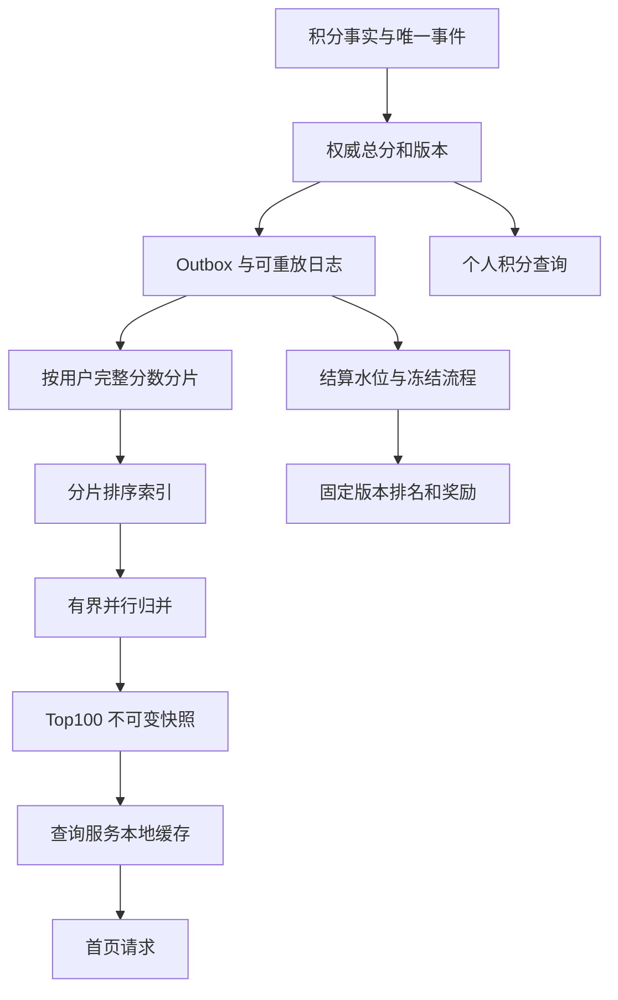
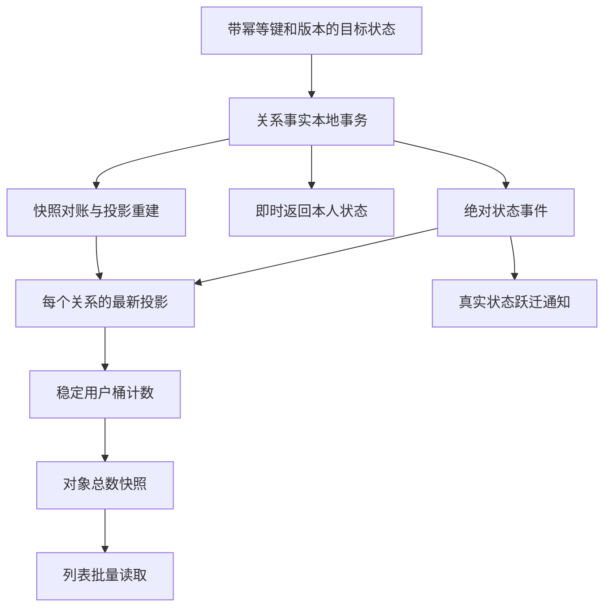

# F：Redis 热点、缓存一致性与排行榜实战

Redis 数据结构、大 key、热点、数据倾斜、性能、高可用和 MySQL 缓存一致性，需要放在排行榜、点赞、信息流和故障恢复的完整链路中分析。设计时应说明：瓶颈在哪个资源，优化减少了哪一项工作，不一致窗口由谁负责，出现故障后如何恢复。

以下业务规模、延迟、内存单价和流量比例都是**推演假设**；性能变化与恢复效果均作为验收目标。命令以常见 Redis Open Source 能力为基线，内部编码、INFO 字段和扩展数据类型应按部署版本核对。所有代码用于表达协议，其中 Java 归并算法可独立实现，其余涉及数据库和客户端的代码是带契约的伪代码。

| 技术要点 | 系统设计场景 | 面试考查能力 |
| --- | --- | --- |
| ZSET、复合排序、分 key、归并排序 | F.1 百万级排行榜 | 能否证明拆分后结果正确，并算出查询放大 |
| 热点写、Set、Bitmap、幂等 | F.2 爆款内容点赞 | 能否分清关系状态、统计投影和业务副作用 |
| Redis 与 MySQL 一致性、Canal | F.3 朋友圈删除与撤权 | 能否识别 CDC 延迟、旧回填和缓存重建边界 |
| 慢查询、CPU、持久化、内存 | F.4 Redis 延迟事故 | 能否从证据定位，避免排障本身扩大故障 |
| Sentinel、Cluster、槽迁移 | F.5 切主与扩容 | 能否解释路由、数据回退、回源预算和恢复顺序 |
| Bloom、HLL、Geo、List、Hash | F.6 按业务语义选择结构 | 能否把概率、内存和版本限制变成产品约束 |

## F.1 场景一：排行榜首页很慢，拆成 64 个 ZSET 以后反而更慢

### F.1.1 先把题目固定成可以计算的工作负载

假设一个活动有 800 万参赛者，每秒 6 万条已校验的积分变化，榜单页面每秒 10 万次查询，其中 90% 只看全站 Top100。积分为非负整数，上限暂定为一万亿；同分按“首次达到当前分数的服务端时间升序，再按用户 ID 升序”。首页允许一秒内收敛，个人积分写成功后立即可读，发奖必须使用固定版本。

单个 ZSET 是否立刻不可用，不能只凭“800 万”下结论。先测每个成员的成员字符串、排序索引、版本映射等平均占用，再看峰值写入、输出字节和持久化开销。假设只算排序索引，每成员 160 字节，则约为 1.28 GB，约 1.19 GiB；这还没有算版本表、副本、内存碎片、重建双份空间和进程开销。160 字节是需要用真实数据抽样校准的输入。

更早出现的瓶颈可能是输出。若 Top100 序列化结果约 6.4 KB，9 万次首页查询每秒就产生约 576 MB 的逻辑响应数据，尚未计协议、复制和重试。这时只说 `ZRANGE` 是 `O(log N+K)`，解释不了网卡、客户端解析和序列化为什么先饱和。[F12]

把一个榜拆成 64 个分片，也不应让每次首页请求都查询全部分片。那会把 9 万次请求放大成每秒 576 万次分片请求，而且协调服务等待最慢分片，尾延迟通常更难控制。**分片解决成员与写入的分布，热门结果快照解决重复读取。**

### F.1.2 改造后的数据流与责任边界



主库总分和积分流水解释“分数为什么是这个值”，Redis 保存可重建的排序投影，首页快照只负责展示。个人刚加分可以立即看到自己的权威分数，但榜单位置可能晚于这个分数；响应分别给 `myScoreRevision` 和 `boardSnapshotId`，不要让前端误以为两者处于同一时刻。

若每 250 毫秒刷新一次一个热门榜的 Top100，64 分片每秒约需 256 次分片查询，远小于逐请求查询。这个数字只适用于“一个榜的一套集中快照构建责任”，不能让每个应用实例都各自每 250 毫秒扫描全部分片，再把相同计算放大一百倍。快照构建可以主备调度，也可多个构建者竞争发布单调版本；构建失败时继续展示仍在允许陈旧预算内的旧快照。

活动有一万个榜时，也不能机械地每榜每 250 毫秒刷新。按热度分级：热门榜周期构建，中等榜按需合并且合并同一轮请求，冷榜降低刷新频率。刷新任务同样需要总并发、分片负载和返回字节预算。

### F.1.3 分片键、复合排序与 double 精度

选择 `bucket=stableHash(userId) % virtualBucketCount`，一个成员在一代路由中只属于一个逻辑桶。分桶数与 Redis 物理主节点数量不是同一个概念，桶可映射到节点，扩容时迁移桶。需要原子修改的“排序索引、user 到旧 member 的映射、用户已应用版本”在同一 hash slot；不同桶使用不同 hash tag，避免表面拆了 64 个 key，实际仍在同一个槽。[R10]

“高 32 位放分数，低 32 位放时间”不能直接当作 ZSET score 的通用实现。Redis score 是 64 位浮点数，并非能精确保存任意 64 位整数；整数精确范围到 `2^53`。一旦编码超过边界，相邻值可能变成同一个浮点数，排名就会出现难以复现的同分错误。[B05]

本案例用**全部 score 等于 0 的字典序索引**表示完整排序键：

```text
member = reverseScore(13位十进制)
         + "|" + reachedAtMillis(13位十进制)
         + "|" + userId(20位十进制)

reverseScore = 1_000_000_000_000 - businessScore
所有字段固定宽度、非负、使用ASCII数字，所有member的Redis score均为0。
按member升序读，恰好对应：积分降序、达成时间升序、用户ID升序。
```

这里的位宽是业务契约的一部分。入口校验上限，规则改变需要新索引代号；不能静默截断或把负数直接塞进固定宽度字符串。更新积分时，在同槽脚本中先校验版本与全部参数，再移除旧 member、添加新 member、更新映射和版本。Lua 正常执行的原子可见性不等于错误时回滚，因此类型与格式校验必须在第一次修改前完成。

如果采用普通 `score=积分`，还要处理 TopK 边界的大量同分成员。只取各分片默认倒序前 100 名，再在 Java 按时间重排，可能已经把应该入围的同分成员丢了。必须让分片本地排序与全局排序完全一致，或扩取边界同分集合并承担其容量上界。

### F.1.4 为什么每片 TopK 可以归并，以及什么时候不可以

假设 X 没进自己分片的前 K，则至少已有 K 个成员按同一全序排在 X 前面，因此 X 不可能进入全局前 K。这个证明依赖三点：每个成员只在一个分片；分片保存完整总分；本地和全局使用相同全序。

再补一个系统条件：输入属于约定的同一快照，或者产品明确接受多个实时分片在一个有界时间窗口内被采样。仅仅所有分片返回相同 `generation=3`，不能证明它们处理到了相同业务截止点。generation 只说明构建代次；快照还需要清楚的分片水位向量或统一冻结协议。

两个常见反例必须能当场说出：

- 按行为来源分片，X 在两片各 60 分，Y 与 Z 各在一片 100 分。每片 Top1 不含 X，但合并后的 X 是 120 分。此时必须先按用户聚合完整分数。
- 各片取 Top100 后才过滤掉无权限成员，可能剩下不足 100 个，且漏掉原来排在第 101 位的合法候选。必须把权限条件纳入候选生成，或继续有界翻页补候选；“固定多取两倍”没有正确性证明。

### F.1.5 可以现场写出来的 k 路归并算法

以下 Java 17 算法接收各分片已经排好序的候选，不包含网络调用。调用方必须先完成超时控制、路由所有权校验和快照获取；这里检查分片集合、快照标识、局部排序和重复用户，以免把缺一个分片的结果偷偷宣称为全局榜。

**输入完整性还有一个算法无法自行验证的契约：每片必须返回该快照下 `min(K, 有效成员总数)` 条完整候选。** 少于 K 条只能是该片有效成员确实不足，不能是超时、网络截断、服务端资源限制或未补足权限过滤后的结果。`snapshotId` 是可信快照协议的引用，不是填上相同字符串就得到一致快照的证明；构建者仍须保证所属水位、路由和完整性。网络层与分片服务需要明确的完成状态，发生部分失败时让整次精确榜构建失败或退回旧完整快照。下面的归并函数仅检查可见的结构条件，不会凭返回列表推断分片是否偷偷漏了候选。

```java
import java.util.*;

record RankRow(long userId, long score, long reachedAtMillis) {}
record ShardTop(int shardId, String snapshotId, List<RankRow> rows) {}
record Head(int shardIndex, int rowIndex, RankRow row) {}

class TopKMerge {
    // 不用 a.score-b.score，避免减法溢出改变比较结果。
    static final Comparator<RankRow> ORDER = (a, b) -> {
        int c = Long.compare(b.score(), a.score());
        if (c != 0) return c;
        c = Long.compare(a.reachedAtMillis(), b.reachedAtMillis());
        return c != 0 ? c : Long.compare(a.userId(), b.userId());
    };

    static List<RankRow> merge(List<ShardTop> shards,
                               Set<Integer> expectedShardIds,
                               String snapshotId, int k) {
        if (k <= 0 || k > 10_000) throw new IllegalArgumentException();
        Set<Integer> received = new HashSet<>();
        Set<Long> allUsers = new HashSet<>();
        for (ShardTop s : shards) {
            if (!received.add(s.shardId())
                    || !snapshotId.equals(s.snapshotId())
                    || s.rows().size() > k) {
                throw new IllegalStateException("invalid shard response");
            }
            RankRow previous = null;
            for (RankRow row : s.rows()) {
                // 迁移期重复用户应由路由协议解决，不能静默取一个。
                if (!allUsers.add(row.userId()))
                    throw new IllegalStateException("duplicate owner");
                if (previous != null && ORDER.compare(previous, row) > 0)
                    throw new IllegalStateException("unsorted shard");
                previous = row;
            }
        }
        if (!received.equals(expectedShardIds))
            throw new IllegalStateException("missing or unexpected shard");

        PriorityQueue<Head> heap = new PriorityQueue<>(
                (a, b) -> ORDER.compare(a.row(), b.row()));
        for (int i = 0; i < shards.size(); i++) {
            if (!shards.get(i).rows().isEmpty()) {
                heap.add(new Head(i, 0, shards.get(i).rows().get(0)));
            }
        }
        List<RankRow> result = new ArrayList<>(k);
        while (result.size() < k && !heap.isEmpty()) {
            Head h = heap.remove();
            result.add(h.row());
            List<RankRow> rows = shards.get(h.shardIndex()).rows();
            int next = h.rowIndex() + 1;
            if (next < rows.size()) {
                heap.add(new Head(h.shardIndex(), next, rows.get(next)));
            }
        }
        return List.copyOf(result);
    }
}
```

如果有 S 个分片，归并部分是 `O(K log S)`，堆是 `O(S)`；提前取回并校验的候选最多 `S×K` 条，所以网络、输入保存和校验仍有 `O(SK)` 成本。不能只报堆的空间复杂度，把真正占用内存的输入列表省略。需要进一步节省网络时，可每片先取一小页，堆耗尽某片页时再拉下一页，但必须维持稳定快照和每片游标，不能边拉实时榜边声称精确快照。

### F.1.6 不能忽略的结算、失败与验收

一个分片超时，首页可以回退到上一个完整快照并附带时间；不得把剩余 63 片合并后仍称“全站精确前 100”。若产品允许展示部分结果，响应必须明确完整性，发奖流程则必须等待全部约定水位。

结算快照需要固定计分规则版本、截止规则、输入日志水位和参赛资格版本。纯 Redis 热榜只是输入之一，奖励记录以 `(activityId, settlementVersion, userId, rewardType)` 唯一。不能因为一个用户的热点缓存分数更高，就覆盖已冻结的审计结果。

验收使用相同输入日志，与离线全量排序对比；覆盖空分片、大量同分、扣分、用户移除、分片缺失和迁移重复。性能看每秒分片请求数、Top100 输出字节、协调服务峰值内存、快照年龄、个人积分读取延迟；正确性看分数版本回退、重复用户、漏分片和结算差异。这才说明优化同时减少了成本并保住了结果。

## F.2 场景二：一条视频突然爆火，点赞关系没有冲突，总赞数却成为瓶颈

### F.2.1 为什么热点写不能照搬热点读方案

假设一个视频每秒 12 万次点赞或取消请求，来自大量不同用户。关系表按 `(target,user)` 定位，各用户的关系行不同；如果每个事务都更新同一条 `video.like_count`，它们最终仍在一个计数行上排队。

把这个计数搬到一个 Redis `INCR`，减少数据库热点，但仍是单个 key 的串行写入，并新增关系事实和计数无法跨系统原子提交的问题。本地缓存可以减少读，不能凭空消除每个合法状态变化必须被处理的写入责任。写入变快之前，先确定哪些操作可以合并，哪些必须保留。

本案例的产品契约是：自己的点赞图标立即确定；全站总数允许两秒内收敛；每个用户最多贡献一个当前赞；通知只由真实的未赞到已赞变化触发；点赞不直接作为资金结算依据。如果总数触发奖金，奖金应使用独立可审计的结算规则，不能直接盯着展示缓存越过一个阈值就付款。

### F.2.2 三条链路分开，各自保留正确性



关系事实保持第 8 章的版本协议。一个首次接受的合法命令，即使目标状态与现有状态相同，也要推进命令版本；同一幂等键的网络重试返回原结果。否则“先到达的取消是 no-op”可能没有留下版本屏障，后到达的旧点赞就会生效。

投影采用完整状态事件 `target,user,liked,relationVersion`。同一用户在本代计数路由中固定到一个桶，事件处理在一个本地事务中锁定关系投影、比较版本、计算“新状态减投影旧状态”，再更新所属桶计数。新版本先到可以跳过旧状态，前提是事件携带完整当前状态；只有 `+1/-1` 的增量事件不能这样随意丢弃旧版本。

### F.2.3 可以合并的是投影计算，不是所有业务事实

如果 50 毫秒微批内，同一关系出现 `true/v11、false/v12、true/v13`，统计投影可以只应用 `true/v13`，因为它只关心当前贡献。但审计、通知和风控可能需要中间跃迁。把三条事件在唯一的原始日志中直接删成一条，会丢掉它们的业务意义。

正确做法是保留可靠状态事件或业务流水，在**统计投影的消费分支**按关系取最大版本合并；提交检查点前，确保所有被合并关系都已完成投影事务。下游某个桶失败时，整批不能直接提交到批尾，必须能恢复那些未完成的关系；具体 offset 协调见消息队列章节。

```text
按关系收集一个有界微批：最多条数、最多字节、最长等待同时设限
每个关系保留本批最大 relationVersion 的绝对状态
按稳定 bucket 分组
每个 bucket 的数据库事务：
    按稳定关系主键顺序锁定当前投影
    仅接受比投影更新的版本
    求本批实际贡献差值之和
    原子写投影状态、桶总数和桶版本
已完成关系加入消费完成账本
仅提交已完成前缀，未完成部分保留恢复责任
```

计数桶从 64 扩到 128 时，不能即时改变 `hash(userId)%B` 并继续增减。某个用户在旧桶加过一，取消若落到新桶，会出现旧桶遗留一、新桶负一。即便总和暂时碰巧抵消，按桶校准与局部恢复也已经失真。使用路由代号固定旧关系归属，或构建完整新一代投影、追平水位后切换；数据迁移必须包含“这个关系的贡献在哪个桶”。

### F.2.4 幂等窗口过期之后怎么办

幂等表无限增长，需要保留策略，但“七天后删掉”不是完整答案。先区分三种标识：客户端命令 ID、业务事件 ID、关系版本。

同一个旧命令 ID 的结果记录过期后，如果它仍携带旧 `expectedVersion`，当前关系版本应使它冲突，不能被当成当前新意图接受。若客户端协议允许无版本重放，就需要额外的请求 epoch、服务端接受窗口或持久高水位；客户端自己声称的时间不构成可靠边界。

通知事件或奖励事件的去重保留期由其最大重试、日志回放和备份恢复范围决定。展示统计允许从关系事实重建，奖励重复支付不能靠“缓存幂等键通常还在”保证。若清理去重记录，则必须同时封存旧回放代次，或在更持久的业务记录上保留唯一约束。

### F.2.5 Redis 的角色、瓶颈迁移与事故演练

一种容易解释的实现是：关系与统计投影落持久分片库，Redis 只保存对象总数快照和本人状态的可重建缓存。更高吞吐可以采用有持久日志的流处理状态，但需要说明检查点、重放和外部写入边界，不能把“用流计算”当作免于恢复设计。

热对象读取 10 万次总数时，返回一个短期快照可有效降低压力；快照按生成代次和版本拒绝旧发布者覆盖新结果。读取多个桶相加得到的是多个采样时刻的组合，不自动构成一个全局瞬时精确总数。只要产品允许显示延迟，就给出 `updatedAt` 和可接受年龄；结算另走冻结快照。

同一用户反复点赞取消造成的是单关系热点和滥用，不应通过增加目标对象分桶无限接纳。按用户、设备和对象关系做限速，客户端串行发送，限制未完成命令；也要允许正常用户完成取消，避免粗暴“每天只准一次写”破坏语义。

事故演练至少覆盖：取消先于点赞到达；投影先收到 v12 再收到 v11；业务提交后 HTTP 超时；批处理中一个桶失败；计数快照被旧发布者覆盖；扩桶同时取消；幂等记录清理后重放旧请求。验收不仅比较总数，还逐关系比较贡献，避免“正负错误刚好抵消”掩盖故障。

## F.3 场景三：朋友圈已删除的内容又出现，接入 CDC 以后仍然复现

### F.3.1 四类缓存的语义不能混成一种

朋友圈页面经常包含收件箱候选、帖子正文、好友关系、媒体链接四类数据。它们陈旧的后果不同：候选多一条可以在后续过滤，点赞数晚两秒通常可接受，已经撤权的正文和长时媒体链接可能越权。

| 缓存 | 保存什么 | 允许怎样降级 | 不能承担什么最终职责 |
| --- | --- | --- | --- |
| 收件箱候选 | postId 与排序位置 | 返回少量候选、继续游标扫描 | 不能证明帖子当前可见 |
| 正文缓存 | contentVersion 与正文 | 仅在授权仍有效时使用允许的旧版本 | 不能凭缓存命中跳过当前撤权规则 |
| 关系或 ACL 投影 | 关系版本和可见范围 | 按明确传播 SLO 或权威复核处理 | 异步投影不自动等于立即撤权 |
| 媒体授权 | 可访问对象及凭据期限 | 缩短有效期、代理授权或拒绝 | 已发出的 bearer URL 不会因删一条 Redis key 自动撤销 |

先画出检查点再回答一致性：候选检索可以最终一致，准备返回正文前进行批量可见性校验，媒体另有自己的授权点。一个步骤返回 50 条候选，不应产生 50 次串行数据库请求；按用户、对象批量查询当前状态与权限版本，但批量化不能省掉校验本身。

### F.3.2 旧回填竞态为什么不会被“先写库再删缓存”消除

假设帖子当前为 `ACTIVE/v41`：

| 时刻 | 请求 A | 删除请求 B | 缓存 |
| --- | --- | --- | --- |
| t1 | miss，读取主库 ACTIVE/v41 | 尚未执行 | 空 |
| t2 | 序列化变慢 | 提交 DELETED/v42 和 Outbox | 仍空或旧值 |
| t3 | 仍持有 v41 | 删除缓存成功 | 空 |
| t4 | 无条件 SET v41 | 已返回删除成功 | 旧正文重新出现 |

如果 CDC 在 t5 再删除一次，确实可能缩短错误窗口，但 t4 到 t5 仍有暴露；如果 A 比 t5 还慢，t6 又会重新填入。延迟双删只是特定时延假设下的概率缓解，无法覆盖任意长尾请求、任务重试和恢复回放。

### F.3.3 版本屏障需要独立于缓存正文存在

缓存对象包含两个逻辑部分：`fence(minVersion,state,epoch)` 与 `payload(version,body)`。同一对象的两个 key 使用相同 hash tag，失效事件和回填脚本可以在同一执行范围内比较版本。

更新或删除事件只能推进 fence，不能后退。回填接受条件包括：路由或恢复 epoch 当前有效；fence 已由可信权威数据初始化；对象处于允许状态；候选版本不低于已知门槛；候选版本不会覆盖已有更高 payload。接受一个可信的更高版本 payload 时，**也要把 fence 门槛推进到该版本**。否则 payload 的 TTL 到期后，仍可能依据低门槛接受旧值。

这里有个常被跳过的失败分支：fence key 被淘汰或切主回退后不存在。不存在不能解释为“没有限制，随便写”。它应触发权威恢复或受控未命中；缓存自证自身版本没有回退是不成立的。对于性能缓存，重建成本可以接受；对撤权判断，缺少可信依据就必须走清楚的权威检查路径。

还要覆盖 **fence 仍存在但已经回退** 的情形。例如切主前是删除门槛 v42，新主只有 ACTIVE/v41；只检查 key 存在，旧正文就会被当作合法值。恢复 epoch 必须由 Redis 之外的可靠控制面，例如受事务或共识保护的恢复元数据，推进并提供核验依据；若 epoch 和 fence 都只保存在同一个可能回退的 Redis 中，它们会一起回退，不能互相自证可信。故障或恢复切换后，受影响分片在新代次和权威快照／日志水位完成验证前，不开放依赖这些状态的严格判断。新 epoch 本身也不能代替重新获得当前对象版本；无法证明代次有效时走权威检查或按契约拒绝。若控制面代次也采用本地缓存，则同样必须声明失联与陈旧窗口，不能宣称异步通知等价于即时屏障。

版本可以使用固定宽度字符串比较，避免 Lua 将大整数转换为 double 后丢精度。删正文时保留 tombstone 版本，显式恢复内容则产生更高版本的 ACTIVE 事件；“重新创建同名 key”不是恢复授权。

### F.3.4 CDC 的价值与严格承诺的边界

CDC 或 Outbox 使变更传播可追踪、可重放，能减少业务代码漏删缓存的分支，但主库提交到消费者应用之间仍有延迟。要监控最老未应用事件年龄、消费者水位和失败重试，而不仅是“消费者进程还在”。[C12]

如果产品只要求删除后几秒内从普通列表消失，可以声明传播预算，并通过可靠失效、TTL 和监控证明可恢复。若要求严格授权，则每次返回正文前，以定义好的权威检查点判断访问是否允许，数据库只读副本也必须满足相应的新鲜度；一个落后的副本不能成为绕过撤权的后门。[B12]

“删除提交后，任何已经开始的请求都不允许再发出一个字节”是更强的契约。单次前置校验不足以实现它，因为检查之后与发包之前还可能发生撤权。需要让撤权与发放读取资格在同一协调协议中排序，处理在途读取或短期资格的终止、等待与超时，并承担相应延迟。一般产品会明确：授权在某个检查点生效，已发出的字节和已下载副本无法追回。不要用模糊的“强一致”掩盖这条边界。

### F.3.5 缓存恢复与 tombstone 回收必须有历史边界

假设 Redis 丢失了所有 fence，不能先把一天前的缓存备份开放给读，再期待 CDC 慢慢修正。恢复流程应建立新 epoch，从权威快照初始化状态和版本，接续对应日志检查点之后的事件，达到服务水位后才开放受版本保护的读。普通内容可在恢复期间使用有权威校验的受控回源，严格权限不能相信不完整新缓存。

墓碑保留多久，要覆盖旧请求存活、任务最大延迟、消息保留与重放、备份恢复等范围。若允许恢复任意历史备份，则无法靠固定几天 TTL 保证永久不复活。可以让所有旧恢复产物必须进入新 epoch，经当前权威状态过滤后才可服务；或者持久保留对象的最低有效版本。回收的是已被更高层水位替代的信息，而不是“暂时没看到旧消息”的信息。

### F.3.6 关联到信息流分页和评论删除

候选被权限过滤后，游标仍要推进到最后扫描位置。若只记录最后一条可见帖子，当前一页全部被过滤时，下一次会反复扫描同一批已删除候选，形成热 key 和无效数据库校验。设置候选扫描上限、校验批量上限、整个请求截止时间；预算耗尽可返回不足一页并附 `nextCursor`。

评论删除还要区分根正文、楼层锚点、整楼策略。根评论被作者删除后，可能只显示占位并保留回复；管理员隐藏整楼则所有回复都应过滤。若用一个 Redis Hash 保存整楼正文，删除一个字段不能证明楼层权限和列表缓存已同步；拆分正文缓存与楼层策略，读时同时校验它们的版本。

演练时故意暂停一次回填，执行删除，再恢复回填；暂停 CDC；使权限缓存 miss；让 Redis 切主恢复到旧状态；让媒体旧链接仍在有效期；让一页候选全部不可见。每个用例都应有产品可观察的结果和明确的恢复责任，不能只断言“最终会一致”。

## F.4 场景四：Redis CPU 不高、慢日志也不多，接口 P99 却越来越差

### F.4.1 从一条请求的时间拆解开始

Redis 相关接口的耗时可分为：应用等待执行资源、等待连接或可用通道、编码请求、网络往返、服务端排队与执行、响应传输、客户端解码、后续业务处理。`SLOWLOG` 主要记录命令实际执行时间，不包含客户端通信等 I/O，因此“慢日志空”只能排除某一类慢，不能证明 Redis 访问链路正常。[F01]

下面是一个**假设的事故观测样例**，用来练习判断，不是线上实测结果：

| 观察项 | 假设现象 | 支持的假设 | 下一步证据 |
| --- | --- | --- | --- |
| HTTP P99 | 从常态明显上升 | 有尾部请求阻塞 | 同一 trace 的分段耗时 |
| Redis 命令执行慢日志 | 几乎没有长命令 | 未必是命令算法本身 | 网络、连接等待、解码队列 |
| 单次响应大小 | 热榜从 100 条变成 10 万条 | 输出与解析成本变大 | 返回字节分布与调用点 |
| 客户端 GC 与分配率 | 分配率陡升 | 解码大集合产生大量对象 | 分配采样与堆内存时间线 |
| Redis 输出缓冲 | 部分连接持续增长 | 消费速度小于产生速度 | 定位客户端 ID 和服务实例 |
| 网络出口 | 接近带宽上限 | 网络拥塞可解释尾延迟 | 重传、RTT 与丢包证据 |

不要把每个组件单独测得的 P99 简单相加，当作端到端 P99。分位数不具这种可加性；应从同一请求的 trace 拆解真实时间，或者基于明确概率模型估计。对于连接复用或异步客户端，“等待连接”可能表现为同一连接上待发送命令积压，需要使用对应客户端的队列和未完成请求指标。

### F.4.2 一套有顺序的定位动作

第一步确认影响范围。是单接口、单租户、单 key、单 Redis 主节点，还是整条网络链路？单节点高、其余节点低，更像分布不均；全部节点都高，可能是全局请求放大、客户端重试或公共网络。

第二步看请求数、返回字节和工作量是否一起改变。QPS 没涨但每次由 `HMGET` 三个字段改成 `HGETALL` 全对象，也会使 CPU、网络和客户端分配都上升。算法复杂度中的 N 是集合长度，输出规模 K 同样要算。

第三步对齐应用指标、Redis INFO、慢日志、持久化事件和主机指标的时间。单看某一分钟的 CPU 指标，不能证明某条慢命令导致了十秒前的用户超时。INFO 字段随版本变化，缺少字段时回到该版本文档和实际配置。[F02]

第四步缩小到候选 key，采用业务埋点的 key 模板和哈希化标识、采样的命令类型、长度和耗时。避免把每个用户 ID 都做 Prometheus label，监控高基数可能成为第二个事故。确需定位具体 key 时，在受控采样和访问权限下关联，不把用户正文、凭据写进通用日志。

第五步验证因果。临时把单次返回上限收紧、停掉某个批处理或将热点首页切到已构建快照，观察对应资源和尾延迟是否同步下降。止血动作应该能回退，并保留验证所需证据；直接重启会丢掉在途状态，且可能触发冷缓存与全量同步，不能当作默认第一步。

### F.4.3 排障命令该怎么讲，才不像背命令列表

```text
INFO commandstats
INFO memory
INFO persistence
INFO replication
INFO clients
SLOWLOG GET 64
LATENCY LATEST

TYPE rank:{activity-7:bucket-03}:index
ZCARD rank:{activity-7:bucket-03}:index
MEMORY USAGE rank:{activity-7:bucket-03}:index SAMPLES 5
OBJECT ENCODING rank:{activity-7:bucket-03}:index

CLIENT LIST ID 具体已定位连接ID
```

这些是诊断入口，不能原样变成无界高频采集。`SLOWLOG GET` 限制条数；`CLIENT LIST` 需要考虑连接数量，优先按已定位 ID 缩小范围；`MEMORY USAGE` 对集合的采样数影响成本和估计准确度。全实例遍历使用节流的 SCAN，并在 Cluster 中覆盖相关主节点；一次 SCAN 游标为零才表示该轮完成，返回重复 key 要能处理。[R01][R03][F14]

`redis-cli --bigkeys` 便于发现各类型的大对象候选，但不能把“成员数量最大”等同“字节数最大”；结合内存采样和业务命令判断。`--hotkeys` 依赖 LFU 相关配置及计数语义，不是所有实例都能直接获得精确访问排行榜。需要准确业务热度时，在调用端对 key 模板与采样标识统计。[R04]

`LATENCY LATEST` 没结果，可能是没有采样到超过阈值的事件，也可能没有启用相应监控。慢日志和延迟监控都需要结合配置解释，不能把“空”当成绝对健康。

`MONITOR` 实时输出请求，具有明显额外开销，还可能暴露命令参数。它适合受控环境或明确限时、限范围的诊断，不适合在已经过载的生产实例上常驻，再把全部输出送入另一个正在吃紧的日志系统。[F04]

### F.4.4 CPU 高时，区分命令工作、后台任务与主机资源

先确认监控里的 100% 是一个核、整个进程，还是容器 CPU 配额。主命令执行线程饱和与宿主机八核都饱和不是同一件事。Redis 有网络 I/O、持久化和回收等线程或后台工作，不能简单说整个程序永远只有一个线程；但也不能因为启用了 I/O 线程，就宣称一个长 Lua 脚本会在多个核并行执行。

高 CPU 的候选原因包括大范围查询、集合运算、复杂 Lua、过期与淘汰压力、压缩或编码转换、频繁连接与 TLS 工作、后台任务，以及客户端造成的重试放大。先看命令执行时间总量和调用量的变化，再看哪个 key 承担这些命令。

如果主要是单 key 的长命令，增加物理节点不会把这条命令自动切成并行任务。限制范围、拆业务对象、异步预计算才会改变工作量。如果是很多独立 key 的总负载，合理分片可能有效；若瓶颈其实在网卡，增加同一台机器上的 Redis 进程可能帮助很小。

Pipeline 减少往返次数，却不减少每条命令的计算和输出。无限加大 pipeline 会堆积服务端输出缓冲及客户端结果对象。设置每批条数和字节上限，同时限制在途批数；客户端必须及时消费结果，不能发送完几百万条以后再统一取返回值。[F03][F13]

### F.4.5 为什么开启持久化后，内存会突然顶满

假设容器限额 16 GiB，常态 Redis 已使用 12 GiB，后台生成快照或重写 AOF 期间，前台持续修改原有页面。Copy-on-write 可能使父子进程之间的物理页面复制增长，叠加页表、输出缓冲、复制缓冲和系统开销，导致整体超过限额。[R05][R06]

粗略估算应基于“后台任务期间被修改的不同内存页数量”，而不是直接把写请求字节相加。一条几字节更新可能复制一个内存页，多次写同一已复制页也不会无限重复放大。如果假设每秒新增脏页对应 100 MiB，持续 40 秒，仅这项增量约 3.9 GiB；这只是风险估计，实际仍需观测相应 COW 指标与内存曲线。

`maxmemory=12GiB` 不代表整个进程或容器峰值严格不超过 12 GiB。部分复制与 AOF 缓冲等不计入 key 淘汰判断，操作系统和子进程内存也要独立留余量。INFO 中如 `mem_not_counted_for_evict` 等指标有助于识别这部分压力。[F02]

`UNLINK` 使 key 脱离键空间，内存回收可能由后台继续进行；分配器还可能保留页面供重用，RSS 不一定立即下降。先看逻辑 key 是否消失、`used_memory`、后台待回收量以及真实内存压力，再判断泄漏。仅看 RSS 下降慢而继续大规模删除，可能把业务缓存删空，却未降低峰值。[R02][F05]

### F.4.6 用持久化换性能时，必须把失败模型说完整

RDB 是某一时点的数据快照，AOF 记录写命令并可重写压缩历史；它们的恢复模型不同。MySQL redo 是 InnoDB 崩溃恢复日志，binlog 是服务器层逻辑变更日志，不能把它们与 RDB/AOF 一一等同。面试可以类比“快照加增量恢复”，但应同时说清事务、复制和恢复边界各自不同。[R06][C07][C08]

对可重建榜单缓存，允许切主后短期回退并用权威流水恢复，可以选择相应持久化与可用性策略；对唯一库存账本，则必须证明接受成功后在约定故障中不会失去扣减责任。关闭持久化带来的延迟改善不是没有代价的优化。

同样，`noeviction` 只规定达到内存限制时某些写命令返回错误，并没有提供无限容量或避免 OOM 的普遍保证。重要的状态不能在一个可淘汰的大杂烩缓存中靠“希望它不被淘汰”保存；至少应分实例或资源池、独立预算，并有权威恢复来源。[R09]

### F.4.7 事故收尾必须得到什么证据

完整复盘应保留：触发的请求形态、具体变大的 key 或响应、最先饱和的资源、排队与重试如何传播、止血为何有效、长期改造减少了什么工作、容量上限如何重新测量。验收要覆盖正常量、突发热点、慢客户端、持久化任务重叠和缓存恢复，观察端到端 P99、错误率与数据正确性。

“单节点固定能扛十万 QPS”没有可迁移意义。对象大小、读写比例、命令类型、pipeline、网络 RTT、TLS、客户端数、持久化配置和硬件不同，容量曲线就不同。最有用的是在目标 SLO 下可持续的负载范围和过载时的受控行为，而不是一个脱离实验条件的峰值数字。[F13]

## F.5 场景五：Redis 切主只用了几秒，数据库却被拖垮了十分钟

### F.5.1 先区分 Sentinel、Cluster 与业务分片

Sentinel 解决非 Cluster 主从部署的监控、故障切换和主节点发现；它不会把一个实例的数据自动水平拆到多台主节点。Cluster 将 key 映射到 16,384 个 hash slot，再将槽分配给各主节点，并为分片配置副本。业务虚拟桶在这两者之上表达可迁移的逻辑分区，不必等于槽数或物理节点数。[F06][R10]

标准 Redis Cluster 的槽计算可写成 `CRC16(参与哈希的字节) mod 16384`；合法 hash tag 会改变参与哈希的字节范围。它不是“直接对当前主节点个数取模”，也不是自动把每个业务桶固定到一个节点的一致性哈希环。槽到节点的映射可以迁移，业务仍需避免让所有热点 key 使用同一个 tag。

例如三个主节点各一个副本，是六个 Redis 数据进程，不是“Cluster 只有三个节点”；再看进程如何放到机器和可用区，防止一个宿主机故障同时失去某分片主副本。内存预算还要包含副本和扩容迁移期间的临时空间。

Sentinel 的 `quorum` 表示多少 Sentinel 同意主节点故障；真正授权切换还需要可达的多数 Sentinel。它不是每笔业务写入需要多少个数据副本确认。把 `quorum=2` 解释成“数据写两份后才成功”，是把故障检测和复制协议混在一起。[F06]

### F.5.2 从网络分区到业务数据回退的完整时间线

| 时刻 | 基础设施事件 | 业务需要处理的事实 |
| --- | --- | --- |
| t1 | 主节点确认一次更新，但副本尚未收到 | 接口已成功，数据仍可能处于复制窗口 |
| t2 | 主节点不可达，客户端请求超时 | 超时不能证明刚才的写未执行 |
| t3 | 副本被提升，客户端重新发现主节点 | 新主状态可能比旧主已确认状态落后 |
| t4 | 应用集中重试、缓存 miss 激增 | 请求放大开始压垮数据库或新主 |
| t5 | 旧节点回来并被重新配置 | 不能让旧缓存值重新覆盖新业务事实 |

Redis 默认异步复制；`WAIT` 可以等待指定数量副本确认之前的写入，改善某些故障下的耐久性，但不把 Redis 变成强一致系统，仍需结合拓扑、持久化和切换过程定义丢失边界。[R07][R08]

切主检查不能只覆盖“缓存全空”。较旧但仍存在的计数、撤销 fence 或路由代次同样危险。尤其不能从新主读到一套内部自洽的旧 fence 和旧 epoch，就认定它们是当前权威状态；F.3 要求恢复代次由 Redis 之外的可靠控制面推进与核验，严格路径在状态未可信恢复之前继续使用权威检查。

对派生缓存，恢复时重新加载权威事实。对租约、去重标识、撤权 fence 等影响决策的状态，必须考虑回退后旧执行者或旧请求重新有效；它们不能只依赖一份会丢最近更新的缓存。是否使用更强权威存储、持久版本、fencing 或业务幂等，要按具体副作用选择。

### F.5.3 为什么回源不是“Redis 挂了就查 MySQL”这么简单

假设正常接口每秒 8 万次读取，命中率 99%，则约 800 次回源。Redis 不可用后全部回源变为 8 万次；若数据库剩余可用处理能力只有每秒 2,000 次，则请求量已是余量的 40 倍。增加应用线程会更快耗尽连接池，并不能增加数据库的处理能力。

先给回源分配全局预算。例如允许这条链路额外消耗每秒 500 次回源，并设置独立并发上限。速率预算约束长期输入，信号量约束同时占用资源，两者不能互相替代。若单次数据库读取平均占用 20 毫秒，稳定 500 次每秒意味着平均约 10 个在途查询；为了容纳分布与突发可以设置更高但有界的并发，并通过压测确认，不能直接拿 P99 套进公式就宣称最优。

预算还必须覆盖所有应用实例。20 个实例各自配置“500 QPS”，总量会变成 10,000 QPS。可以按实例数量分配静态份额并留故障余量，或使用有租约的配额分发，保证同一全局预算不会被重复发放；配额服务不可用时的保守行为也应明确。

### F.5.4 分级降级与恢复顺序

| 请求类型 | 缓存故障时的策略 | 必须守住的限制 |
| --- | --- | --- |
| 公开热门榜单 | 使用仍在允许年龄内的本地完整快照 | 返回快照时间，不能用于新结算 |
| 普通信息流候选 | 缩小页大小、受控回源或稍后重试 | 当前权限校验不因降级被取消 |
| 点赞总数 | 暂时显示旧统计或不显示 | 本人的关系写入继续有明确结果 |
| 关键会话或授权 | 权威校验或按业务拒绝 | 不得因缓存不可用默认允许 |
| 报表、全量榜导出 | 延后执行 | 不与在线请求竞争全部回源预算 |

重建先恢复热门、少量、高收益对象，再渐进放开普通流量。使用请求合并抑制同一对象的重复加载，但每个等待者仍需要截止时间与数量上限。某个加载者超时后，其请求是否取消、结果能否回填，仍需按版本和当前代次判断。

不要恢复第一秒就预热全部历史数据。预热是后台负载，必须在在线请求、复制追平、持久化任务之后分配余量；否则“自动恢复”会成为持续十分钟的第二次过载。恢复成功条件包括错误率、回源排队、缓存年龄和版本追平，不只是 TCP 端口重新可连接。

### F.5.5 扩容与槽迁移时，客户端会看到什么

`MOVED` 表示客户端应更新槽到节点的路由；`ASK` 是迁移期间的临时重定向，需要向指定目标连接发送 `ASKING`，再执行相应命令，不应立即永久改写整个槽的路由。使用正确实现 Cluster 协议的客户端，同时给重定向次数和整个请求设截止时间。[R10]

相同 hash tag 能使相关 key 处于同槽，是多 key 原子操作的必要条件之一，但迁移中部分相关 key 已到目标、部分仍在源端，可能出现需要重试的暂时状态。脚本和事务应有幂等或版本条件，不能把所有异常都当作“肯定未执行”而无限重发。

一个很大的 ZSET 仍是一个 key，槽迁移搬的是完整 key，不会自动把它拆给多个主节点。若热点来自单 key，迁到更空闲的节点只能暂时隔离或缓解，不改变该 key 的单点工作量。真正拆分需要业务路由、读路径合并以及一致性协议。

扩容验收至少检查：数据和流量分布是否都改善；槽和业务桶是否真分散；客户端重定向与超时是否在预算内；新节点内存及复制压力是否可承受；旧值能否经过重试覆盖新值。数据均匀不等于流量均匀，QPS 均匀也不等于字节和 CPU 均匀。

## F.6 场景六：面试官说“你还会哪些数据结构”，怎样继续讲成业务设计

### F.6.1 从访问模式选结构，而不是从 API 名字选结构

| 业务需求 | 候选结构 | 选择理由 | 需要继续回答的问题 |
| --- | --- | --- | --- |
| 短会话、幂等结果快照 | String 或小 Hash | 读取对象或少量字段方便 | 大 JSON、字段有效期、版本与撤销 |
| 有界最近访问记录 | List | 两端添加、按范围读取 | 去重、截断、顺序与大范围读取 |
| 中等规模精确成员关系 | Set | 成员存在判断和集合运算 | 大集合成本、遍历、跨槽运算 |
| 排行榜、时间有序候选 | ZSET | 按排序键查范围与位置 | double 精度、同分、分页和大 key |
| 紧凑 ID 集上的签到标记 | Bitmap | 每个对象一位 | 稀疏 ID、位偏移上限、版本语义 |
| 访问人数估算 | HyperLogLog | 用较小固定空间估计基数 | 允许误差、不能查询成员、不能直接精确删除 |
| 不存在对象的前置过滤 | Bloom | 低空间排除大部分无效查询 | 假阳性、集合完整性、重建切换 |
| 附近设备或门店候选 | Geo | 半径和区域邻近查询 | 分片边界、位置时效、精确距离和权限 |
| 可回放的短期事件 | Stream | ID、读取、消费组和 ACK | PEL、裁剪、持久性与业务账本边界 |

同一种公开类型可能有多种内部编码。小 Hash 或 ZSET 可以采用紧凑编码，超过元素数量或长度阈值转换；Redis 7.2 还增加了 Set 的 listpack 相关阈值。实际编码用 `OBJECT ENCODING` 检查，内存用采样测量，不能把很早版本的 ziplist 细节当成所有版本永恒实现。[F05][F10]

现场追问底层结构时，重点解释权衡：紧凑连续存储减少指针和分配开销，但更新、查找和转换成本取决于规模；哈希结构有利于成员定位；有序索引支持区间和名次。然后回到“这个调用是否全量拉取、对象多大、热点如何分散”，不要只背结构名。

### F.6.2 Bloom：能降低穿透，但不能充当精确幂等账本

假设有一亿个有效帖子 ID，希望过滤器假阳性概率约为万分之一。理想 Bloom 位数估计为：

\[
m=-\frac{n\ln p}{(\ln 2)^2},\qquad k\approx-\frac{\ln p}{\ln2}
\]

代入 `n=10^8、p=10^-4`，每元素约 19.17 位，总位数组约 239.6 MB，即约 228.5 MiB，未含实例、对象与扩容开销。Redis `BF.RESERVE` 文档对这个误判率给出 14 个哈希函数的选择；实际实现和扩容子过滤器会影响 CPU 与内存，必须按目标容量建立，而不是无限追加后仍宣称保持同样成本。[F09]

正确缓存穿透链路是：过滤器确认不存在且集合覆盖可信时，可快速返回不存在；过滤器说可能存在，则继续读缓存或数据库。假阳性只是使少量无效查询继续向后，不应导致有效业务被拒绝。

如果用它判断“这个支付事件是否已经处理”，假阳性会把一个从未处理的事件当成重复并丢弃，所以不能作为唯一依据。它可以在命中时引导查询精确去重表，最终副作用仍由持久唯一约束或精确账本保证。即便过滤器返回不存在，仍要防两个并发请求一起通过，数据库唯一约束不可省。

理论上“已加入且未被错误破坏的元素不会被 Bloom 判为不存在”，不等于业务系统永远没有误拒。新帖子先提交数据库、异步加入过滤器，在传播窗口里它就会被不完整过滤器拦掉。可以将新写入在进入公开可查询状态前完成过滤器可见责任，或维护覆盖传播窗口的可靠增量集合并与基础过滤器联合判断；这仍需失败恢复，不能假设一次跨系统双写永不失败。

重建时使用基础快照加增量水位，切换完整新代次；新过滤器未追平之前不能替换旧代次。过滤器不可用时，选择受限回源或明确暂不可查，不能默认把全部对象判不存在。普通 Bloom 不支持安全地直接把某个元素对应的所有位清零，因为这些位可能与其他元素共享；删除类需求要使用合适的结构或重建策略。

### F.6.3 Bitmap：一位一个用户，不代表一个用户 ID 就能直接当偏移

签到可以按 `sign:{userId}:2026` 保存一年内的天序号，每用户只需数百个位；这与用一个全局 bitmap、以分布式 64 位用户 ID 作为偏移完全不同。Redis `SETBIT` 的偏移必须小于 `2^32`，直接传入一个一万亿的 ID 并不会神奇压缩，反而超出这个命令边界。[F07]

即便偏移合法，几个用户散落在接近四十亿的位置，也可能让字符串扩展到接近 512 MiB。判断 Bitmap 是否省空间，看的是值域密度，不只是成员个数。可以建立紧凑内部 ID、按高位分桶并使用桶内偏移，或者采用支持稀疏压缩的其他结构；映射表和迁移成本也要算入。

Bitmap 能表达“今天是否签到”，无法单独表达签到来源、操作版本、撤销原因和审计时间。若用它实现点赞状态加速，关系主表仍应保存这些事实。按时间循环复用位时，也必须有窗口代号，避免去年的同一位被解释为今年已签到。

### F.6.4 HLL：估算 UV 可以，精确发奖不可以

Redis HyperLogLog 用概率方法估计集合基数，文档给出的标准误差约 0.81%，主要结构最多约 12 KB，实际 key 和运行时开销另计。这是标准误差，不是“每次结果绝对误差永远不超过 0.81%”的硬保证。[F08]

一个帖子每天的 UV，可以按天和分片保存 HLL，再合并同一语义窗口；不能把不同分片或日期的 `PFCOUNT` 结果直接相加，因为用户可能跨分片、跨天重复访问。合并应作用于可兼容的 HLL 状态，跨 Redis Cluster 槽的操作还要安排汇聚位置或应用流程。

如果业务问“第 10 万位独立访客发奖”，它需要成员身份、确切顺序与唯一奖励记录，HLL 不提供这些信息。它也不适合回答“某用户是否访问过”或任意删除一个人的贡献。隐私删除若要求统计精确剔除指定人，需要另有可重算输入和周期处理策略，不能承诺从 HLL 中精确减一。

### F.6.5 Geo、List 和 Hash 怎样形成有价值的后续追问

附近设备查询可以用 Geo 生成候选。Redis Geo 底层利用排序集合编码经纬度，提供邻近查找能力，但不是任意复杂空间分析系统。[F11] 按城市或地理网格拆分后，查询圆可能跨多个格子，需要覆盖相邻区域并去重，不能只查用户所在格子。设备移动跨格子时还要处理旧位置清理、版本与短期双候选；最终返回前按当前位置和业务权限复核。

最近访问记录适合有界 List，但“最多保留 100 条”应同时限制每条大小。`LPUSH` 与 `LTRIM` 如果需要对其他读者原子可见，可以在同槽脚本或事务里处理；若要求最近访问对象去重并按最新时间排序，List 会需要删除旧成员，可能不如 ZSET 的成员唯一性更自然。若承担可靠任务，不应只靠 `LPOP` 后进程内执行，必须补确认、重试与恢复机制，或选用契约更合适的队列。

Hash 可以减少许多小 key 的部分开销，也能用 `HMGET` 只拿需要字段；但把一个租户全部用户都放进一个 Hash，会形成独立更新、过期和分布的巨大边界。所谓“把内存 Map 搬到 Redis”会新增网络、并发、TTL、跨字段一致性与恢复问题，不能只比较哈希查找复杂度。

### F.6.6 把误差和降级范围写进接口

一个接口可以同时返回精确本人状态、近实时总赞数、估算 UV 和旧榜单快照。为了让上层正确使用，响应应标明各自语义，例如 `likedRevision`、`countUpdatedAt`、`uvApproximate=true`、`boardSnapshotId`。不是所有字段都需要暴露底层中间件，但消费方必须知道哪些能用于业务判断，哪些只用于展示。

这也避免“用了 Redis 所以所有数据实时一致”的错误期待。组件类型只是实现手段，数据契约才决定整个系统是否可解释、可恢复。

## F.7 围绕这些场景的连续追问与详答

### Q1：为什么排行榜只拆 key，热点仍可能没有缓解？

先看 key 实际落在哪个槽、哪个主节点，再看每次请求读多少桶。所有 key 共用同一 hash tag，仍会集中在一个槽；每次读取全部桶，则可能把原来一次请求放大成几十次。还要区别写热点与读热点：用户完整分数分片减少写集中，Top100 快照复用减少重复读，二者通常需要同时设计。

### Q2：每片 Top100 合并，为什么不会漏掉全局前 100？

因为一个未进本片前 100 的成员，已经至少有本片 100 个成员排在它前面。前提是完整分数按成员唯一归属、本地与全局同一个全序，以及输入满足约定快照。若每片只是部分分数、同分排序不同，或候选生成后才大量过滤，证明失效。先陈述这些条件再给结论，比直接背算法更关键。

### Q3：所有分片都带相同 generation，是否说明读到了同一快照？

不说明。generation 可以只是重建代次，各分片处理到的事件水位仍不同。精确结算需要一个已完成的冻结协议、可验证的分片水位向量，或权威存储提供的一致快照。实时展示可以接受一个有界采样窗口，但应明确这是实时近似视图，并给出生成时间与完整性。

### Q4：一个分片读超时，可否忽略它先返回其他结果？

可以作为明确标注的部分结果，但不能称为全局精确 TopK。热门榜更常用上一版完整且仍在陈旧预算内的快照。奖励结算则不允许把缺失分片当空集；必须等待或进入人工可观察的失败状态。这个选择来自产品正确性要求，不是简单由接口超时决定。

### Q5：为什么不能把分数和时间拼成一个 long 再写 ZSET？

Java long 的精度和 Redis score 的表示范围不同。ZSET score 使用 double，任意 64 位整数并不能都精确表达。编码必须证明最大值不超过 `2^53`，同时处理升降序、符号与位宽；或者使用所有 score 相同的字典序索引、数据库多列索引等替代。不能只在 Java 内部计算正确就认为存储排序正确。[B05]

### Q6：分片 TopK 的复杂度只需要说 O(K log S) 吗？

这只是有序候选的堆归并成本。若每片先返回 K 条，总输入、网络、反序列化和校验都达到 `S×K`。调用方还会受分片尾延迟与并发预算影响。完整回答应包含数据准备、归并、输出和失败重试的成本；在热门查询中，结果快照的复用往往比优化堆的常数更有效。

### Q7：点赞为什么不直接使用 SADD 返回值决定加一？

在单 Redis 集合里，SADD 的新增结果可以帮助一次原子状态更新，但不能同时保证关系数据库、计数数据库和 MQ 的一致提交。取消、版本乱序、Redis 回退以及异步副作用还没有解决。若选择 Redis 承担权威状态，必须额外说明持久性与恢复模型；本方案使用持久关系事实和可重建投影，更容易审计。

### Q8：取消点赞是 no-op，为什么也要推进版本？

因为版本同时承担拒绝旧命令的屏障。当前未赞时，较新的取消先到但不留新版本，迟到的旧点赞仍可能通过旧 expectedVersion。首次合法新命令推进版本，重复同一幂等键返回原结果；计数投影看到状态没变化则贡献差值为零。这区分了命令接受与状态改变两个概念。

### Q9：对同一用户只保留最高版本，会不会把计数漏掉？

取决于消息语义。完整当前状态可以用“新状态减当前投影状态”收敛；只带 `+1/-1` 的事件不能因版本小就随意丢弃，否则先减后加时会错。即便统计投影允许合并，通知、审计等其他分支也可能需要中间状态，不能在全局唯一原始日志中提前丢掉。

### Q10：计数 64 桶改成 128 桶，为什么不能上线新取模公式？

旧关系的贡献在旧桶，取消如果被新公式路由到另一个桶，就无法正确撤销原贡献。需要固定路由代号、逐关系迁移贡献，或构建新代投影并追平切换。校验既要看对象总数，也要看桶与关系的一致性，避免正负错误在总和里偶然抵消。

### Q11：幂等记录 TTL 到期后重放旧消息怎么办？

先确认该记录保护的是客户端重试、日志回放还是资金副作用。关系版本或请求 epoch 可拒绝已经过时的命令；资金和奖励还需持久业务唯一约束。清理前要定义旧消息最大存活范围，并由水位或代次封存旧历史；“通常不会超过 TTL”不是可靠性证明。

### Q12：已经用 Canal，为什么还需要缓存版本？

Canal 等 CDC 组件主要解决变更捕获和传播，不消除传播延迟，也不会自动协调一个早先查询的晚回填。版本和 tombstone 拦截已知旧值，水位监控负责发现落后，严格授权在权威检查点完成。几个机制分别解决不同故障窗口，不能互相替代。

### Q13：fence 缓存没有了，是不是可以从零开始接受？

不能。缺失可能来自淘汰、重启或切主回退，失去的恰好是拒绝旧写的依据。需要从权威数据恢复最低版本和状态，或使用新恢复代次，未初始化之前走受控回源。只有能证明对象从未存在、也无旧事件的创建路径，才可建立新的初始版本。

### Q14：接受更高版本正文时，为什么还要更新 fence？

假设 fence 为 v10，缓存接受了可信 v12，随后正文 TTL 到期。如果 fence 仍停在 v10，迟到的 v11 会被重新接受，造成版本回退。因此正文和版本门槛必须一起单调推进；payload 的短 TTL 不应删除“至少已经见过 v12”的信息。

### Q15：延迟双删能否完全解决缓存一致性？

它依赖第二次删除发生在所有旧读取回填之后。只要存在超出等待时间的长尾请求、重试任务或恢复回放，就可能在第二次删除后再次写旧值。可以作为特定条件下的辅助手段，但完整方案应有版本、可靠失效、缺失恢复和关键读的明确契约，不能靠一个固定 sleep 证明所有时序。

### Q16：Redis 慢日志为空，是不是该去扩容网络？

还不能下结论。慢日志不含整个客户端访问耗时，应继续检查应用排队、连接复用、在途命令、响应大小、GC、网络重传和输出缓冲。证据支持哪一段才优化哪一段。比如请求根本还没发出，扩 Redis 网卡无效；若大量大响应堵塞出口，减少返回量可能比扩容更直接。[F01]

### Q17：为什么关闭持久化以后快了，却不一定是正确优化？

它可能减少 fsync、fork 或后台写入干扰，但改变了失败后的可恢复范围。可重建缓存可以接受某种丢失；唯一库存、会话撤销或去重状态则可能影响业务正确性。需要把新 RPO、恢复来源和回源容量写清楚，并验证重建期间仍可控。[R06]

### Q18：Redis 进程 RSS 高，是否一定是内存泄漏？

不是。历史峰值、分配器保留页、碎片、输出缓冲、复制缓冲、后台 COW 等都可能解释 RSS。结合逻辑数据量、used_memory、峰值、后台回收和主机压力判断；只观察一个比例容易误诊。真正泄漏应能对应持续增长且不能复用或回收的责任对象。[F02][F05]

### Q19：Sentinel quorum=2，为什么网络分区后仍不能切换？

quorum 参与故障判定，授权切换还需要多数 Sentinel 可达，且 quorum 若设置更高也会约束授权。两个 Sentinel 认为主节点故障，不等于当前分区一定拥有足够投票。也不要把 Sentinel 的投票数量解释成业务数据已复制的份数。[F06]

### Q20：增加 Redis 副本能否消除所有热点？

副本分担读取需要客户端路由和允许陈旧的业务语义；写入仍集中到所属主节点，复制还会增加成本。严格读己之写、撤权或最新版本读不能无条件转向任意副本。一个巨大 key 的长写命令也不会因为有多个副本而被并行执行。

### Q21：缓存宕机时只限制数据库连接数够吗？

不够。连接数限制在途资源，但过多请求仍可能堆在应用队列，带来内存、超时和重试风暴。还需要入口拒绝、总速率预算、每对象请求合并、截止时间和可接受的降级。所有实例的预算之和必须受控，不能每个实例都拿数据库全部余量。

### Q22：Bloom 说“不存在”为什么还可能误伤新帖子？

因为数学性质针对已加入的集合。数据库已创建但异步过滤器还没收录时，业务查询集合与过滤器覆盖集合并不相同。维护新写增量、明确对象公开时点和追平水位，才可安全使用否定结论；恢复不完整时直接全量拦截，就是系统层面的误拒。

### Q23：既然 HLL 只占约 12 KB，为什么不把所有统计都换成它？

它输出估计基数，不能列出成员、确认某人是否访问、给出精确顺序或任意删除贡献。UV 展示可以容忍误差，奖励、精确配额与审计不行。多窗口合并也不能直接相加估计值，要对兼容状态求并集估算，并考虑窗口和分片操作成本。[F08]

### Q24：Bitmap 对 64 位 ID 为什么不划算？

首先 Redis SETBIT 有位偏移范围限制，任意 64 位 ID 不可直接使用；其次空间由最大偏移决定，稀疏大 ID 会浪费巨大空洞。要按业务窗口与局部紧凑编号设计位图，或使用其他结构，并计入映射和版本成本。判断依据是值域密度，不是简单的“一人只用一位”。[F07]

### Q25：如何证明热点优化没有破坏一致性？

把每种性能动作配一组反例：本地缓存对应失效丢失和撤权；分桶对应扩容时取消；快照对应缺分片和旧发布者；微批对应中途失败与 offset；异步重建对应快照期间新增和删除。用相同权威事件集检查最终状态，再验证接受成功、可见与恢复的时间预算。只有吞吐变高、错误数据也变多，不能称作成功优化。

## F.8 面试中可以完整讲述的一条案例路线

以“活动榜单慢”为主线，先讲原架构：权威积分库、可靠事件、单榜索引、直接页面查询。接着给假设或本人真实测量得到的工作负载，说明发现的是输出字节和重复查询，而非凭感觉认定 Redis 算法慢。

第一轮改造收紧范围并构建 Top100 快照，解决重复读；第二轮按用户完整分数分桶，解决更新与内存集中；第三轮说明 k 路归并的证明、复杂度和缺片策略；第四轮应对同分、扣分、删除和重放；第五轮把 Redis 切主后的快照回退、权威重建和数据库回源预算讲清楚；最后说明结算使用固定水位快照，展示榜的短暂陈旧不会直接触发错误奖励。

如果面试官沿 Redis 数据结构追问，就讨论 score 精度、字典序索引、紧凑编码与内存采样；沿高可用追问，就讨论槽迁移、MOVED/ASK、异步复制和 RPO；沿工程能力追问，就展示如何获取 trace、限制排障开销、设计负载与故障演练。围绕同一业务链条，应解释结构选择、瓶颈、优化代价和故障恢复；性能数字需要明确标注为测量结果或推演假设。

[B05]: https://redis.io/docs/latest/commands/zadd/ "Redis ZADD"
[B12]: https://research.google/pubs/zanzibar-googles-consistent-global-authorization-system/ "Zanzibar Google's Consistent Global Authorization System"
[C07]: https://dev.mysql.com/doc/refman/8.4/en/innodb-parameters.html#sysvar_innodb_flush_log_at_trx_commit "MySQL 8.4 InnoDB Startup Options and System Variables"
[C08]: https://dev.mysql.com/doc/refman/8.4/en/replication-options-binary-log.html#sysvar_sync_binlog "MySQL 8.4 Binary Logging Options and Variables"
[C12]: https://debezium.io/documentation/reference/stable/connectors/mysql.html "Debezium MySQL Connector"
[F01]: https://redis.io/docs/latest/commands/slowlog/ "Redis SLOWLOG"
[F02]: https://redis.io/docs/latest/commands/info/ "Redis INFO"
[F03]: https://redis.io/docs/latest/develop/reference/clients/ "Redis client handling"
[F04]: https://redis.io/docs/latest/commands/monitor/ "Redis MONITOR"
[F05]: https://redis.io/docs/latest/operate/oss_and_stack/management/optimization/memory-optimization/ "Redis memory optimization"
[F06]: https://redis.io/docs/latest/operate/oss_and_stack/management/sentinel/ "High availability with Redis Sentinel"
[F07]: https://redis.io/docs/latest/commands/setbit/ "Redis SETBIT"
[F08]: https://redis.io/docs/latest/develop/data-types/probabilistic/hyperloglogs/ "Redis HyperLogLog"
[F09]: https://redis.io/docs/latest/commands/bf.reserve/ "Redis BF.RESERVE"
[F10]: https://redis.io/docs/latest/commands/object-encoding/ "Redis OBJECT ENCODING"
[F11]: https://redis.io/docs/latest/commands/geoadd/ "Redis GEOADD"
[F12]: https://redis.io/docs/latest/commands/zrange/ "Redis ZRANGE"
[F13]: https://redis.io/docs/latest/operate/oss_and_stack/management/optimization/benchmarks/ "Redis benchmark"
[F14]: https://redis.io/docs/latest/commands/client-list/ "Redis CLIENT LIST"
[R01]: https://redis.io/docs/latest/commands/scan/ "Redis SCAN"
[R02]: https://redis.io/docs/latest/commands/unlink/ "Redis UNLINK"
[R03]: https://redis.io/docs/latest/commands/memory-usage/ "Redis MEMORY USAGE"
[R04]: https://redis.io/docs/latest/develop/tools/cli/ "Redis CLI"
[R05]: https://redis.io/docs/latest/operate/oss_and_stack/management/optimization/latency/ "Redis latency diagnosis"
[R06]: https://redis.io/docs/latest/operate/oss_and_stack/management/persistence/ "Redis persistence"
[R07]: https://redis.io/docs/latest/operate/oss_and_stack/management/replication/ "Redis replication"
[R08]: https://redis.io/docs/latest/commands/wait/ "Redis WAIT"
[R09]: https://redis.io/docs/latest/develop/reference/eviction/ "Redis key eviction"
[R10]: https://redis.io/docs/latest/operate/oss_and_stack/reference/cluster-spec/ "Redis Cluster specification"
