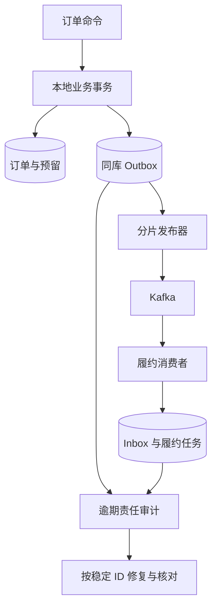
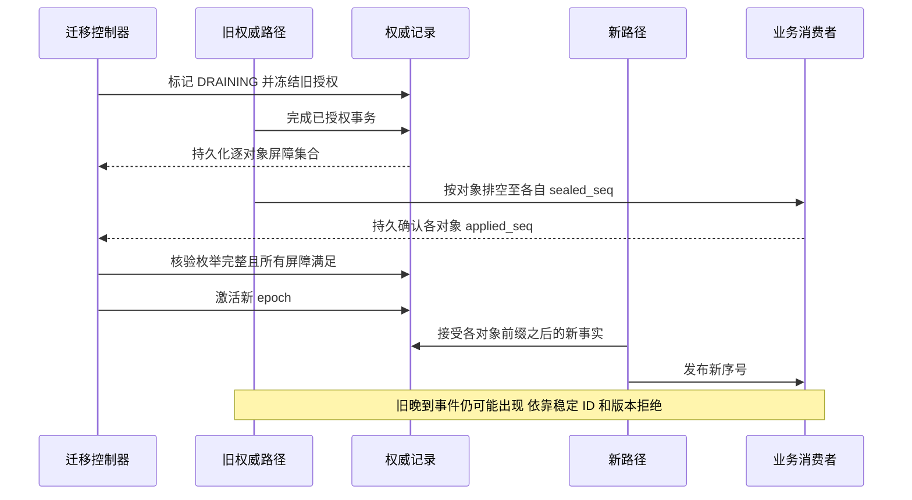
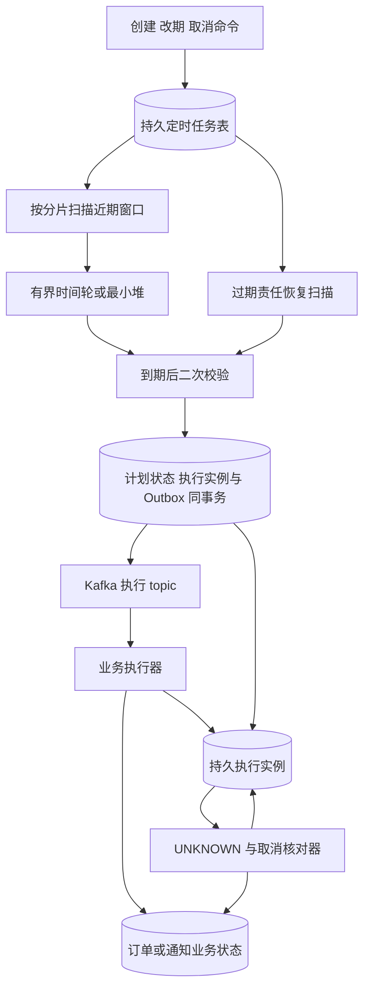
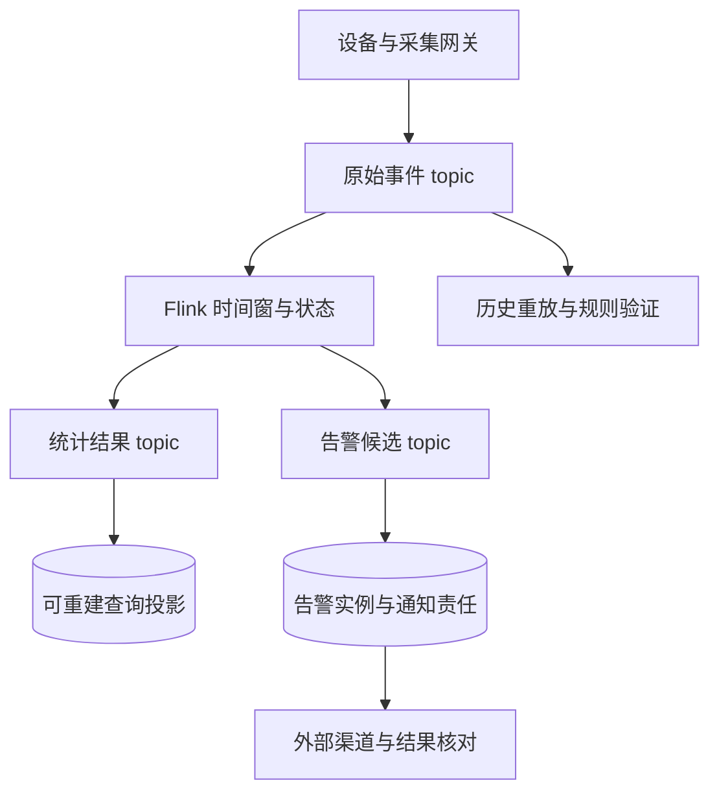

# G：Kafka 业务可靠性、顺序与积压治理

Kafka 系统设计需要同时处理业务用途、顺序与热点、本地消息表、延迟消息、积压、丢失、重复、高性能和高可用。对每条业务链路，都应分析异常首先表现在哪些指标上、如何定位瓶颈，以及调整后如何保持正确性。

所有吞吐、延迟、故障数量和容量均为**场景假设**；命令、配置与代码用于说明设计协议。Kafka 组件语义以 **4.1** 为基线，Flink 语义以 **2.1** 为基线。实际部署必须核对 feature level、消费组协议、客户端和 connector 版本；不把一个版本的默认值当作永久事实。

## G.1 先把“可靠”写成可验证的业务承诺

### G.1.1 一条消息至少有五个成功点

以订单创建后发送“预留成功事件”为例：

| 成功点 | 能证明什么 | 仍不能证明什么 |
| --- | --- | --- |
| 订单与 Outbox 同事务提交 | 有订单，也有必须发布的责任 | Kafka 已接受事件 |
| 发布器收到 broker 成功 ACK | 此次发送达到配置的确认条件 | 所有下游都完成业务 |
| 消费端拉取位置前进 | 客户端拿到过记录 | 数据库结果已经提交 |
| 消费端本地事务提交 | 这次本地副作用可恢复 | 短信、支付等外部副作用成功 |
| 业务终态或对账确认 | 对定义的业务目标有完成证据 | 用户已经阅读消息，或灾难下永久不会丢 |

因此，消息链路应同时有技术指标和业务指标。技术指标定位“卡在哪里”；业务指标回答“用户受了什么影响”。订单已预留但十分钟仍未进入履约、资料已接收但一直不可搜索，即使 producer 成功率与 poll 吞吐都很漂亮，也属于业务未完成。

### G.1.2 “每天人工处理少于三条”不是完整可靠性 SLO

假设一天接收 1,000 万条有效业务事件，最终有 3 条需要人工处理，人工介入比例是 `3 / 10,000,000 = 0.00003%`，对应自动完成比例 `99.99997%`。但这不能直接叫“系统可用性达到几个九”：人工介入可能成功补回，也可能是有意交给人工的业务异常；一个小时全面停机还可能被全日分母稀释。

应分别定义：

- **接收可用性**：有效请求在时限内获得明确接受或合法业务拒绝的比例；容量不足产生的拒绝是否计入失败，须提前约定。
- **及时完成率**：已接受事件中，多少在业务期限内完成，而非一周后补回也算准时。
- **最终未解决率**：超过恢复期限仍没有业务终态的比例。
- **重复效果率**：重复发货、重复扣款、重复通知等真实副作用，而非 Kafka 重复记录数量。
- **责任可追踪率**：每条已接受请求能否找到任务、事件或终态；未知去向必须单独报警。

分母按业务请求、逻辑事件还是发送尝试计算，结论完全不同。一次逻辑事件重试 20 次，只应有一份业务责任，不能用 20 次成功发送稀释一次真实丢失。

### G.1.3 用责任账本定位跨阶段缺口

可以让每个事件带上 `event_id`、`aggregate_id`、`aggregate_version`、`schema_version`、`accepted_at` 和 trace 关联标识。业务状态表、Outbox、下游 Inbox/投影共同提供证据，审计不必把每一步同步写到一个全局中心表，避免制造新的高写热点。

例如按订单分桶统计：“已预留订单数”“已生成对应发布责任数”“履约任务数”“异常终态数”。数量差异用于发现问题，最终按稳定 ID 定位缺口。仅核对总数不能证明正确：漏一条与重复一条可能刚好抵消。

## G.2 场景一：秒杀订单已成功，履约事件为什么没有发出去

### G.2.1 业务链路与约束

设想一个有 32 个订单库分片的平台。订单创建、库存预留和 Outbox 都位于同一业务事务能够覆盖的存储边界；履约服务单独消费事件。需要支持发布器重启、Kafka 短暂不可用、数据库扩容和同一事件多次发送。

如果库存与订单本来位于不同数据库，不能画一条“同事务”连线就认为它们原子。应先选择：同一活动的库存与订单写入放在可共事务的位置；或者库存服务提供独立预留账本，由订单 Saga 关联预留和后续确认。Outbox 只能覆盖它所在的本地事务，不能替跨库业务补出一个不存在的原子提交。



### G.2.2 发现问题：按责任年龄定位，而不是先看线程数

假设告警是“订单创建成功率正常，履约开始的 p99 从 2 秒升到 90 秒”。第一轮证据可以列成：

| 证据 | 可能解释 | 下一步验证 |
| --- | --- | --- |
| 某 2 个数据库分片的 READY 最老年龄上升 | 发布器没扫描到或扫描额度不公平 | 扫描路由、查询耗时、分片授权和连接池 |
| 各分片 SENDING 很多且租约过期 | 发布进程退出、发送回调未处理 | 进程事件、回调队列、恢复器是否在工作 |
| Outbox 发出正常，消费业务年龄上升 | Kafka 后半段积压 | 逐分区位置、业务完成水位与下游时延 |
| Kafka ACK 超时，副本异常同时升高 | broker 复制或网络故障 | ISR、请求排队、复制等待与故障域 |
| SENT 很多，某些订单找不到履约记录 | 事件路由、Schema、消费责任丢失 | 按 event_id 追踪原始记录和 Inbox，而非只看总数 |

“SENT”只表示当前发布协议已经达到所定义的 ACK；不能把它解释成所有下游都完成。业务审计需要另一个口径。

### G.2.3 把待发布记录和领取代次设计清楚

下面是**轮询发布器版本**的示意表。若使用 CDC 的插入事件模式，可将不可变事件表与可变投递状态分开，避免把状态 UPDATE 当成新的业务事件。Debezium Outbox 路由使用事件 ID 标识事件，并使用聚合 ID 形成消息 key；它提供消息变换能力，业务去重和生命周期仍需自行定义。[G01]

```sql
CREATE TABLE outbox_delivery (
    event_id BINARY(16) PRIMARY KEY,
    aggregate_id BIGINT NOT NULL,
    aggregate_version BIGINT NOT NULL,
    event_type VARCHAR(80) NOT NULL,
    schema_version INT NOT NULL,
    payload JSON NOT NULL,
    state VARCHAR(16) NOT NULL,
    next_attempt_at DATETIME(6) NOT NULL,
    owner_id VARCHAR(100),
    generation BIGINT NOT NULL DEFAULT 0,
    lease_until DATETIME(6),
    attempts INT NOT NULL DEFAULT 0,
    created_at DATETIME(6) NOT NULL,
    sent_at DATETIME(6),
    last_error_code VARCHAR(80),
    KEY idx_ready (state, next_attempt_at, event_id),
    KEY idx_expired (state, lease_until, event_id),
    KEY idx_aggregate (aggregate_id, aggregate_version)
) ENGINE=InnoDB;
```

`event_id` 在业务事务创建事件时生成，重新领取、跨分片搬迁和重发都不改变。事件正文在创建后不可随重试修改；否则同一个幂等键对应两个不同的业务事实，下游无法解释。需要修正业务事实时，产生新版本、新事件，而不是篡改旧事件。

领取过程只做数据库操作，发送 Kafka 位于事务外：

```sql
START TRANSACTION;

SELECT event_id, generation
FROM outbox_delivery
WHERE state = 'READY'
  AND next_attempt_at <= CURRENT_TIMESTAMP(6)
ORDER BY next_attempt_at, event_id
LIMIT :available_publish_slots
FOR UPDATE SKIP LOCKED;

-- :ids 只来自本事务锁住的结果。
UPDATE outbox_delivery
SET state = 'SENDING',
    owner_id = :publisher_instance,
    generation = generation + 1,
    lease_until = TIMESTAMPADD(SECOND, :lease_seconds, CURRENT_TIMESTAMP(6)),
    attempts = attempts + 1
WHERE event_id IN (:ids) AND state = 'READY';

-- 同事务读取新 generation 和正文；立即提交。
COMMIT;
```

`SKIP LOCKED` 适合队列领取，它让其他领取者可以继续工作，不保证公平，也不自动保持业务对象顺序。[A07] 一个发布器只能领取本机发送额度能够及时处理的记录，不能先占住十万条再慢慢发。

成功 ACK 后以领取时的条件写回：

```sql
UPDATE outbox_delivery
SET state = 'SENT', sent_at = CURRENT_TIMESTAMP(6),
    owner_id = NULL, lease_until = NULL, last_error_code = NULL
WHERE event_id = :event_id
  AND state = 'SENDING'
  AND owner_id = :publisher_instance
  AND generation = :claimed_generation
  AND lease_until > CURRENT_TIMESTAMP(6);
```

影响 0 行表示这次写回没有授权，不能无条件补一个 UPDATE。可能已经被回收、新代次已发布，也可能当前记录已进入其他恢复状态。成功 ACK 可以保留为尝试证据，但旧执行者不能覆盖当前任务责任。

### G.2.4 ACK 丢失与租约过期的完整时间线

| 时刻 | 发布器 A | 数据库与 Kafka | 发布器 B |
| --- | --- | --- | --- |
| t1 | 领取 E，generation=7 | E=SENDING | — |
| t2 | 向 Kafka 发送 E | Kafka 接受，响应在网络丢失 | — |
| t3 | 进程暂停，无法写回 | 租约过期，但事件可能已可消费 | — |
| t4 | — | 恢复器把过期责任重新开放 | 领取 E，generation=9 |
| t5 | 恢复并收到晚回调 | A 的写回因代次不匹配失败 | 重发同一个 E |
| t6 | — | Kafka 可能存在两条 E | 下游按同一 event_id 幂等 |

这里的正确性来自“责任不会因不确定结果而被删除，重复不会产生两份履约”，不是租约让旧请求停止。Kafka 生产者协议幂等可以抑制其覆盖范围内的发送重试；应用重启后重新提交同一业务事件仍需业务 ID 与下游去重。[R21]

对过期 SENDING，恢复器先锁定或 CAS 旧代次，再设置 READY、下一次退避时间并增加 generation，使旧回调失效。对不可解析正文等确定错误，进入隔离状态并报警，保留原事件和错误原因。不能无限重试毒事件，也不能标记成功清理。高可靠场景中，隔离队列同样需要负责人、修复时限和业务核对。

### G.2.5 通用本地消息表怎样支持分库而不成为热点

**事件与业务一起分片。** 订单库各自有本地 Outbox，业务无需跨库写一个中心消息库。发布协调器分配“扫描哪个数据库、哪些逻辑桶”的职责，而不是集中逐行转发全部事件。扫描职责本身可有租约，丢失后重领；真正的逐行领取仍依赖数据库条件。

**每个库有独立预算。** 同一发布集群访问 32 个库时，给每库设置连接、并发和批次上限。使用加权轮转让小分片也能前进，同时按最老责任年龄提升逾期分片优先级。不能让一个热点分片占满所有线程，再误以为其他库“没有数据”。

**避免每秒全表 COUNT 和全量 payload 扫描。** 正常扫描走 `(state,next_attempt_at,event_id)` 索引，先取有限候选；审计按时间桶与分片滚动汇总，异常时再细查。后台清理按已验证时间范围小批执行，监控锁等待、复制延迟和磁盘写入。拿一个已经几亿行的历史表每秒 `COUNT(*) WHERE state!='SENT'`，会把可靠性机制做成新瓶颈。

**不要只记“最大 event_id 已发送”。** UUID 不必按时间有序；即使使用自增 ID，事务提交顺序也可能与分配顺序不同。某个早分配 ID 还没提交，扫描器不能因为看见更大 ID 就永久越过它。按明确状态扫描，或使用由源日志定义且正确持久化的 CDC 位置。

### G.2.6 分片迁移时谁负责扫描，什么时候才能清理

假设逻辑桶 b 从源库迁到目标库，事件和业务记录一起迁移。正确的切换要回答四个问题：

1. **哪边还允许产生新业务事实？** 切换写主权时关闭旧入口，等待已进入旧事务的写入完成，再确认最终同步水位；不能只更新应用路由而让旧连接继续写源库。
2. **旧未发送责任在哪里？** 可以由源发布器继续排空，也可以把未完成事件连同稳定 ID 迁到目标，由目标接管。两种做法可选，但必须有明确责任表。
3. **在途源发布是否可能晚成功？** 可能。即使禁止旧数据库写回，已经发到 Kafka 的请求仍可能被接受。因此目标接管不能改 event_id，消费端仍要防重复。
4. **按聚合对象有序时，谁建立切换屏障？** 必须先处理旧版本前缀或让消费者按对象版本补齐；源、目标两个发布器同时发不能靠一个相同 key 自动恢复业务发生顺序。

最容易落地的方案是：业务切换后，源库保留只读业务历史和旧 Outbox 扫描责任；目标库负责新事件；消费者按聚合版本保护，必要时等待前缀。审计证明源库没有未决责任、CDC 位置已被持久确认、恢复保留期满足后，再停源扫描与清理。若业务要求严格执行顺序，必须在源责任排空与新责任启用之间加屏障，期间给新命令提供有界等待或明确重试结果。

**SENT 并不等于立即可删。** 还要覆盖可重放窗口、下游修复窗口、审计需求与灾备策略。CDC 模式更不能在 connector 尚未可靠跨过插入记录时清理原始责任，却只凭“看起来发了”判断安全。清理、归档与审计都要有自己的检查点。

### G.2.7 什么时候选择 CDC，什么时候先用轮询

轮询的好处是状态可见、部署关系简单，适合可接受扫描延迟、规模尚可控制的系统。代价是查询和状态更新负载，严格对象顺序还需额外处理。CDC 减少业务表反复扫描，并能利用源日志捕获已提交变化，但引入 connector、源日志保留、schema 变更、快照与恢复治理。[G01]

无论选哪种，跨源库都没有凭空出现一个全局提交顺序。同一个业务对象不能在没有写主权协议时被多个库独立更新。CDC 只是传播事实，不替业务决定哪个事实才正确。

### G.2.8 验证与回滚

验证要故意在以下位置杀进程：业务事务提交后、发送前；Kafka 已接受但 ACK 未到；ACK 到后数据库写回前；租约过期后旧回调到达；分片切换时旧发布器恢复。验收条件是订单责任可追踪、事件可重复但履约不重复、过期责任自动被接管、源分片可被明确判定已排空。

轮询迁到 CDC 时先让 CDC 影子输出到隔离 topic，对比事件 ID、版本和时间，不产生真实履约。正式切换确定各分片边界和唯一生效路径；回退也要说明哪些事件已经由新链路负责。不能同时打开两套非幂等消费者，再用“灰度”解释重复发货。

## G.3 场景二：IM 有序消息把一个 Kafka 分区打成热点

### G.3.1 先区分热写与热扇出

一个百万人在线直播间可能每秒只有几千条有效弹幕，却需要极大的下行扇出；另一个设备平台可能有一台异常设备每秒上报几万条，把同 key 的输入打爆。两者都表现为“某个房间或设备很热”，处理方法不同。

| 热点类型 | 真正受限环节 | 优先方案 |
| --- | --- | --- |
| 一个房间有很多接收者 | 网关网络与下行复制 | 按区域、网关聚合扇出，客户端背压与弹幕采样 |
| 一个 key 的状态更新特别多 | 必须串行的状态机或单分区处理 | 合并可交换更新、拆业务子键、隔离并限流 |
| 一个分区包含很多普通 key | 分区映射与任务分配不均 | 稳定逻辑桶迁移、分区扩容、消费者再分配 |
| 单条消息特别大 | 网络、反序列化和 GC | 正文外置、消息大小约束、流式获取 |

只要 ACK 已向发送方承诺消息持久存在，就不能在后端把普通聊天历史随意丢弃；实时弹幕则可以按明确的过期策略丢弃展示工作，但要把审核、礼物和交易类事件分开。

### G.3.2 观察证据：平均利用率会掩盖单 key 瓶颈

假设 24 个分区中只有分区 7 的业务完成年龄持续上升，其他分区几乎为空；整个消费集群 CPU 只有 20%。此时“CPU 低，加 10 台消费者”通常无效。应抽样分析分区 7 的 key 占比、每 key 处理成本、同一会话的串行等待和网关输出队列。

不要把高基数的会话 ID 全部作为 Prometheus label；可以用采样日志、受控 TopN 热点统计或可观测性存储查询定位。监控本身也要控制开销和敏感数据暴露。

如果热点主要来自一个会话，把同一 key 加随机盐能分散 Kafka 写入，但也把顺序责任转移给下游。若下游仍用一个锁依次更新同一会话状态，瓶颈只换了位置，还增加重排缓冲与缺口恢复成本。

### G.3.3 哪些操作可以拆，哪些必须保留一个裁决点

普通会话可以先在会话权威存储中确定 `conversation_seq`，形成可恢复历史；后面的多网关发送按接收目标并行。客户端根据 seq 去重与补拉，最终可见顺序不必依赖所有物理发送包按同一个网络时间到达。

制造业设备状态可按 `device_id + device_boot_epoch + sensor_id` 拆分独立传感器轨迹，但“整台设备由 RUNNING 变成 STOPPED”可能需要聚合多个输入。此时单独设计聚合窗口、事件时间和版本，不要声称拆完后天然等价。

可以合并的通常是有业务证明的操作，例如某时间窗内的展示计数、最新完整状态、独立 chunk 处理。转账、库存预留、不可交换状态转换不能因为希望扩容就随意改成并行。

### G.3.4 扩分区为什么会让同 key 新旧消息乱序

假设默认路由基于 `hash(key) % partition_count`，从 24 扩到 48 后，某个会话的新消息可能进入新分区，旧消息仍在旧分区积压。两个消费者没有全局顺序协调，版本 102 可以早于 101 完成。Kafka 只给出相应分区日志中的顺序，不替跨分区业务建立顺序。[R16]

稳定逻辑桶有助于控制迁移范围：`bucket = stableHash(key) % 4096`，再查 `bucket → partition/owner/route_epoch`。4096 是设计示例，不是推荐常数。逻辑桶数量取决于迁移粒度、路由表成本和热点分布；它不保证单个超级 key 能被拆开。

### G.3.5 一个能够恢复的顺序切换协议

下面以**权威存储先分配并提交对象序号，发布层再传播**为前提。路由表存储 `bucket, state, route_epoch, old_target, new_target, barrier_id`，状态至少有 ACTIVE、DRAINING、ACTIVE_NEW。所有接受业务写入的路径都必须执行当前主权校验；仅靠缓存中的 epoch 不够。

**桶里有多个对象，每个对象的 seq 都从自己的序列产生，所以不能用一个桶级 `sealed_prefix=103` 代表所有对象完成。** 本方案持久保存逐对象屏障集合：

```sql
CREATE TABLE cutover_object_barrier (
    barrier_id BIGINT NOT NULL,
    object_id BIGINT NOT NULL,
    sealed_seq BIGINT NOT NULL,
    applied_seq BIGINT NOT NULL DEFAULT 0,
    PRIMARY KEY (barrier_id, object_id)
);
-- 另有屏障头记录：barrier_id、bucket_id、route_epoch、
-- enumeration_done、expected_object_count、扫描游标和屏障状态。
-- applied_seq来自可核验的业务已应用水位，不是poll位置或最大已看见seq。
```

冻结旧写且旧事务排空后，在稳定对象集合上可恢复地枚举本桶对象，写入其已最终化序号；屏障头记录扫描游标与完成标志。该集合需要覆盖归属索引、待发布责任与尚需传播的删除墓碑，不能只枚举“当前仍活跃”的业务行而漏掉删除事件。每行唯一键使重复扫描幂等，枚举未完成之前绝不允许切换。已有对象若无需新事件，也要能由持久业务状态证明其已应用前缀；不能因为本次没有收到消息就从屏障里漏掉。只有枚举已完成、对象数核验一致，且**所有对象** `applied_seq >= sealed_seq`，控制器才以当前路由代次的条件事务推进该桶的切换状态。集合规模较大时需分批查询未完成项与恢复检查点；若改用真正的桶级全序日志，才可以用那个日志的单一连续水位代替这一集合。

1. 控制器将桶切到 DRAINING，停止旧主权接受新的权威写入。可以暂时拒绝新命令并提示重试，或把新命令放到另外的可靠待受理队列；不能 ACK 后只留内存。
2. 等待已被授权的旧事务结束，枚举并持久保存每个对象已经最终化的 `sealed_seq`。它不能取最大已分配序号，因为中间可能仍有未提交事务；桶中对象使用各自的序号，不能相互比较大小。
3. 旧发布责任持续推进，消费者分别处理到各对象声明的前缀，持久确认对象屏障，所有更早版本已完成或有明确定义的终态。对于序号空洞，只有权威记录证明取消/跳过后才能封口。控制器检查屏障集合完整且全部满足，而非只等一个最活跃对象。
4. 新路径获得新 epoch，并从该前缀之后开始接受和发布。目标消费者持久保存已应用版本，拒绝旧重复；遇到缺口先补齐或等待，不把未来版本随意盖上。
5. 审计旧责任排空后结束迁移。回滚若发生在新路径已接受写入以后，需要把新事实同步回去并重新切写主权；不能直接把路由地址改回旧节点。



如果多个发布器可绕过权威记录直接向同一对象写入，插入一个“迁移结束标记”并不能排除标记之后又出现旧生产者消息。需要真正约束生产权限或让消费端检查授权与序号；口头上要求“大家别再写”不构成协议。

### G.3.6 并发执行如何不破坏同对象顺序

可以把不同 key 分配到若干本地串行通道，同一个 key 的任务按顺序推进，不同 key 并行。通道队列、全局在途字节和单 key 积压都必须有上限。碰撞 key 共享一个通道会有队首阻塞；更精细的 per-key 调度可以改善公平性，但增加状态清理和调度复杂度。

失败事件是否阻塞后续，要按语义判断。最新完整状态可以在严格版本协议下覆盖旧状态；独立可交换增量可以逐事件去重；必须先创建再更新的状态机则不能越过失败事件。转入 DLQ 是责任转交，不自动证明后面的状态转换可以执行。

### G.3.7 网关扇出与 Kafka 消费组不要混淆

同组内多个消费者分担分区，并不是每个长连接网关各收到一份消息。一个可扩展设计是：会话事件被分发层消费后，根据在线路由聚合成“某网关上有哪些接收目标”，每网关发一次共享消息体或批次，再由网关写各连接。离线或慢客户端根据持久历史补拉。

网关本地排队必须按连接、用户和进程设置字节/时间预算。业务上可丢的弹幕允许丢弃过期展示，聊天消息可以断开慢连接并通知重同步。对断开的连接继续无限缓存，最后通常以整个网关 OOM 结束，影响原本健康的用户。

### G.3.8 验证与退出策略

压测同时包含：均匀 key、单 key 占 50%、大消息、慢客户端、消费线程延迟和迁移中断。验收要观察 p99 端到端时延、单分区年龄、重排缓冲、缺口恢复时间、网关内存和跨 epoch 旧写拒绝。

如果拆分不能证明业务等价，保留单 key 串行并设容量边界是合理选择。面试中应该能回答“这一对象最多承受多少有效操作，超过时业务如何退让”，而不是承诺任何业务都可无限横向扩展。

## G.4 场景三：消费积压千万条，加线程以后为什么更慢

### G.4.1 故障假设和第一个算式

假设一个资料索引或订单投影服务有 12 个分区，输入速率 `λ=24,000 条/秒`。积压已达到 `B=10,800,000 条`，当前有效业务完成速率 `μ=18,000 条/秒`。此时每秒还在新增 6,000 条欠账，系统没有“慢慢追上”的可能。

如果希望 15 分钟清空，在输入不变且处理成本稳定的理想模型下，需要：

\[
\mu_{required}=\lambda+\frac{B}{T}
=24,000+\frac{10,800,000}{900}=36,000\text{ 条/秒}
\]

这是容量目标，不是启动 36 个线程的依据。如果下游数据库经过受控压测只能稳定完成 30,000 条/秒，单靠消费者扩容无法达到目标。可把非核心新输入降到 18,000 条/秒，再以 30,000 条/秒处理，才有同样的 12,000 条/秒净消化能力；或者接受更长恢复时间、提升下游、减少每条处理成本。

流量波动、失败重试、单条大小、分区倾斜和 GC 都会使实际时间偏离这个算式，因此持续用“成功业务吞吐”重估，而不是把一次计算当作恢复承诺。

### G.4.2 三种 lag 必须拆开看

| 水位 | 问的是什么 | 常见误读 |
| --- | --- | --- |
| broker 可读末端与客户端当前读取位置之差 | 还有多少记录尚未被拉到应用 | 拉到线程池就认为业务已完成 |
| broker 可读末端与组已提交位置之差 | 崩溃恢复后大约要重读多远 | 提交错误导致指标很好看但实际漏处理 |
| 业务事实与已完成责任之差 | 真正还有多少效果没实现 | 只看 Kafka 数量，忽略转入数据库任务表的欠账 |

Kafka 客户端 `records-lag-max` 文档明确以当前位置计算，而非已提交位置。异步处理架构里，它可能很小，内存队列却堆着大量未完成任务。因此还需要报告最早在途事件年龄、应用缓冲条数/字节、已完成连续水位和业务完成比例。[G04]

事务主题使用 `read_committed` 时，还应分清日志末端与当前可见边界。某个长时间未结束的事务可能拖住后续可见进度；这不等于消费者业务线程算得太慢。检查事务状态与处理端水位，避免对错误环节扩容。

### G.4.3 按证据区分六类根因

| 观测组合 | 更可信的根因 | 立即措施 | 长期改造 |
| --- | --- | --- | --- |
| 多个消费组一起慢，broker 请求队列和磁盘延迟升高 | broker 或共享存储瓶颈 | 暂停低价值回放，限制背景迁移 | 容量规划、故障域和存储布局 |
| 某组慢，CPU 接近满，业务计算时间长 | 计算不足或算法退化 | 减少非必要处理，按余量扩有效并行 | 算法、批处理、字段精简 |
| CPU 不高，DB 连接等待与锁等待高 | 数据库串行/池耗尽 | 降消费者并发，暂停重试风暴 | SQL/事务/热点键治理 |
| 少数分区长尾，其他几乎空闲 | key 倾斜或热点对象 | 隔离热点，保护普通 key | 业务子键、稳定分桶与路由迁移 |
| 每次部署后频繁所有权变化，处理耗时超过 poll 预算 | rebalance 与工作执行耦合 | 稳定实例，缩小批次或有界异步 | 生命周期、分区代次和优雅停机 |
| JVM 停顿、堆使用和消息字节同时上升 | 大批量反序列化或无界缓冲 | 收紧缓冲与大消息入口 | 消息体外置、GC 与分配路径优化 |

Kafka 的监控文档把请求在队列、leader 本地处理、等待 follower、返回响应等阶段分开；应沿这些阶段找时延来源。不能看到 `Produce` 请求慢就一律断言“磁盘不行”。[G04]

GC 排障要先确认应用还是 broker、堆内还是直接内存、暂停是否与大消息批次相关。拿到一次 GC 日志就修改所有 JVM 参数，很容易掩盖真正的无界队列。先建立负载、对象分配速率、暂停、队列增长的时间关系，再改变一个可验证因素。

### G.4.4 线程池的预算从下游能力推导

假设单条任务平均 8 ms 的数据库占用，期望该消费服务总吞吐 10,000 条/秒，那么理想平均数据库并发已约为 `10,000 × 0.008 = 80`。这只给均值尺度，不等于连接池应固定 80：还需考虑事务时长尾部、批处理、锁争用、其他业务共享容量和副本分配。

如果有 20 个实例，每个数据库池 100 个连接，系统可能同时把 2,000 个查询压向一个本来只能稳定处理几百个并发的数据库。每实例“看起来不大”的配置叠加后会超过总预算。更好的做法是先明确整个服务能使用的连接与数据库吞吐，再分配给实例，并限制实例数变化时的总额度。

异步工作池也不应与 `max.poll.records` 简单划等号。后者约束一次 poll 返回给应用的记录数量，不保证底层 fetch 缓存、解压后对象和业务 payload 总字节都在上限内。[R13] 至少控制：入口单条消息最大值、fetch 相关字节、应用待分派字节、worker 在途数、完成通知容量、每分区积压和下游连接。

### G.4.5 一个可解释的有界异步消费结构

以下伪代码不是可直接复制的 Kafka 框架；它明确了需要实现的协议。consumer 只由控制线程操作，`enable.auto.commit=false`。工作任务拿到 dispatch 时固定的 assignment epoch，不在回调时读取新的 epoch。

```java
// 所有容量在启动时配置，必须同时限制条数和估算字节。
// tracker、pendingBuffer、completionQueue 只在控制线程归并。
while (running) {
    drainCompletionQueue();  // Done/Failed 都必须被消费，不能忽略 Future 异常。
    advanceOnlyCompletedPrefix();

    // 缓冲不足的分区pause；pause以后仍poll维持协议与控制事件。
    updatePauseResumeByRecordAndByteBudget();

    // 实现必须为一次允许返回的batch预留接收空间。
    // pause不保证消除客户端已fetch的数据，因此还要配置fetch与单条大小。
    ConsumerRecords<Key, Event> records = consumer.poll(pollDuration);
    for (var partition : records.partitions()) {
        final long assignmentEpoch = currentEpoch(partition);
        for (var record : records.records(partition)) {
            registerInFetchedOrder(partition, assignmentEpoch, record.offset());
            pendingBuffer.retain(record, assignmentEpoch); // 没空时不能丢record。
        }
    }

    while (pendingBuffer.hasDispatchableRecord()) {
        // 要么同时拿到worker额度和completion槽位，要么全部不占用。
        // Reservation内部负责部分获取失败时归还额度。
        Reservation reservation = budgets.tryReserveDispatch();
        if (reservation == null) break;
        Dispatch dispatch = pendingBuffer.take();
        // 一个dispatch预留一个completion槽位，使worker完成通知不会丢。
        // submit拒绝必须把dispatch和额度放回，保留tracker中的未完成记录。
        submitOrRestore(dispatch, reservation, () -> {
            Completion completion;
            try {
                applyBusinessIdempotently(dispatch.event());
                completion = Done.of(dispatch); // 绑定不可变epoch和offset。
            } catch (Exception ex) {
                completion = Failed.of(dispatch, classify(ex));
            }
            publishToReservedCompletionSlot(completion);
        });
    }

    // 提交的是当前所有权下已完成前缀的nextOffset。
    // commit失败保留本地证据，后续重试；不能伪记为提交成功。
    commitOnPolicyIfOwned(tracker.safeNextOffsets());
}
```

这里 `budgets.tryReserveDispatch()` 必须实现成**一组可回滚的容量预留**：若完成槽位获取失败，应立即归还已经获取的 worker 额度。完成通知槽在控制线程取走记录后释放，worker 执行额度也按协议归还。若 worker 因严重运行时故障无法返回通知，控制器还需通过尝试截止时间/看门狗发现停滞，停止越过该记录提交，按策略终止受损进程后重放；不能把“线程已消失”当作业务成功。进程退出后，未提交记录依靠 Kafka 重放和业务幂等恢复。

同一分区拉到 offsets 100、104、107，是允许出现的；控制记录和不可见事务等会造成应用记录 offset 不连续。若 100 和 107 已完成、104 失败，则不能提交 108。追踪**实际已拉取记录的有序序列**，只推进已完成前缀。提交位置通常是最后连续完成记录的 offset 加 1，而不是最大完成 offset 加 1。

### G.4.6 重平衡时旧 worker 已经写数据库怎么办

分区撤销后，控制线程停止该分区新派发，将相应 assignment epoch 标为无效，并尝试在允许的时间内提交已完成安全前缀。不能无限等待慢任务拖住 rebalance。失去所有权后收到的旧完成通知不再推动新代次提交。

但忽略旧通知不能撤销已经完成的数据库更新。新的消费者可能重读相同事件，因此业务更新必须幂等；有新旧对象版本竞争时还要有版本条件。assignment epoch 是本进程判断提交资格的工具，不天然是外部数据库认可的全局 fencing token。

Kafka 4.1 同时存在 classic 与新 consumer 协议；新协议的心跳/会话参数主要由服务端配置，不能拿 classic 客户端参数清单机械套用。[G05] 两者都不能替代应用对耗时任务、已完成水位和所有权变化的管理。

### G.4.7 重试、死信与“恢复了”的验收口径

失败分三种：瞬时依赖故障适合带预算退避；确定坏数据需要隔离和修复；外部结果未知需要查询与核对。三类混为“重试三次”会同时造成无意义流量和真实副作用重复。

若把失败事件可靠地写入一个任务表，再提交源 offset，需要在设计上说明源消费责任已经转交到谁，任务表的扫描、幂等、恢复和告警如何保证。技术上的 source lag 可以下降，但业务未完成责任仍在，不能把它记为履约成功。

毒消息隔离会影响严格顺序。可以隔离整个业务 key，让其他 key 继续；也可以阻塞其分区，简单但影响更大。若决定跳过，必须有业务允许的终态和后续状态修复规则。

验收包括净消化速度持续为正、最老业务责任年龄回落、下游错误与锁等待未恶化、rebalance 频率稳定、重复副作用为零或在明确容忍范围、所有转移责任可查。再逐步撤销入口限流，防止积压刚清完就被恢复流量第二次打垮。

## G.5 场景四：在 Kafka 上做订单关单、优惠券提醒和告警重试

### G.5.1 先定义时间承诺

“15 分钟后关单”至少要区分：15 分钟后开始检查，15 分钟后不得再支付，还是 15 分钟时库存必须可重新出售。它们分别涉及触发、支付授权截止和库存状态转换，不能靠消息在 15 分钟后投递就同时实现。

本场景选择：任务**不早于 due_at 进行权威检查**；正常负载下大多数触发在允许迟到窗口内发生；支付与关单通过订单状态机裁决；超时或故障后可补触发。高峰容量不足时，允许的是延迟核对，不是跳过支付核对后盲目释放库存。

Kafka 4.1 普通 topic 的记录时间戳不是“到点才对消费者可见”的调度协议。把未来一天的消息放在分区头部并 sleep，会阻塞后面一分钟后就该执行的任务；快速反复消费再写回还会形成空转流量。应增加持久到期索引或时间分层，而不是把日志偏移当成到期优先队列。[R16]

### G.5.2 数据库保存远期责任，内存只加速近期触发



假设有 1 亿条未来任务，每秒平均到期 5,000 条，而预取窗口是 2 分钟。平均近期约 60 万条，仍需按任务引用大小、峰值到期分布和分片数预算内存。窗口只是减少远期任务驻留，不意味着所有任务可以不经容量评估塞进一个时间轮。

数据库按业务/租户逻辑分片保存任务，查询使用状态、时间、稳定 ID 的联合索引。可按天归档历史终态；远期任务和近期执行任务是否拆表取决于写入和扫描压力。数据库时间统一到期判定，进程的单调时钟负责本地等待；时钟偏差需要监控。

### G.5.3 计划修订和执行尝试必须使用不同版本

建议至少区分三个标识：

| 标识 | 变化时机 | 用途 |
| --- | --- | --- |
| `task_id` | 新逻辑任务才变化 | 业务身份与操作查询 |
| `schedule_version` | 改期、取消/恢复等计划变更 | 让旧时间轮引用和旧触发消息失效 |
| `attempt_generation` | 新执行者获得授权 | 拒绝旧执行者写回 |

重试执行同一个逻辑外部操作时，外部幂等键应稳定，不随 attempt_generation 改变。改期是否创建新的通知操作要由产品语义决定：重发一条提醒与延后同一提醒是不同业务，不应让技术版本暗中决定。

```sql
CREATE TABLE delayed_task (
    task_id BIGINT PRIMARY KEY,
    task_type VARCHAR(64) NOT NULL,
    business_key VARCHAR(128) NOT NULL,
    schedule_version BIGINT NOT NULL,
    due_at DATETIME(6) NOT NULL,
    state VARCHAR(24) NOT NULL,
    cancel_requested_at DATETIME(6),
    payload JSON NOT NULL,
    created_at DATETIME(6) NOT NULL,
    updated_at DATETIME(6) NOT NULL,
    UNIQUE KEY uq_business (task_type, business_key),
    KEY idx_due (state, due_at, task_id)
) ENGINE=InnoDB;
```

时间轮只保留 `(task_id,schedule_version,due_at)` 等必要引用。到点后读取权威任务，确认仍是相同版本、状态允许且数据库时间已到期，才建立触发责任。重复扫描和进程恢复可能把同一引用入轮多次，由数据库条件和唯一事件键抵御，而不是要求内存永不重复。

**上面的 delayed_task 仅保存计划，不承担外部执行恢复。** 到期时还需要第 4 章那样的持久执行实例；可以复用第 4 章 `task_run` 并补充关联字段，或者采用下面的同型表，二者不是两份互不协调的执行账本：

```sql
CREATE TABLE delayed_task_run (
    run_id BIGINT PRIMARY KEY,
    task_id BIGINT NOT NULL,
    schedule_version BIGINT NOT NULL,
    state VARCHAR(24) NOT NULL,
    generation BIGINT NOT NULL DEFAULT 0,
    owner_id VARCHAR(100),
    lease_until DATETIME(6),
    next_run_at DATETIME(6) NOT NULL,
    next_check_at DATETIME(6),
    cancel_requested_at DATETIME(6),
    external_operation_key VARCHAR(128),
    external_started_at DATETIME(6),
    result_reference VARCHAR(256),
    last_error_code VARCHAR(80),
    UNIQUE KEY uq_task_version (task_id, schedule_version),
    KEY idx_execute (state, next_run_at, run_id),
    KEY idx_reconcile (state, next_check_at, run_id),
    KEY idx_lease (state, lease_until, run_id)
) ENGINE=InnoDB;
```

本表 `generation` 就是前面概念表中的 attempt_generation，用于每次执行或核对授权；`schedule_version` 固定标识本执行实例对应的计划版本，不随接管而改变。READY、RUNNING、SUCCEEDED、FAILED、UNKNOWN、CANCEL_REQUESTED、CANCELLED 及其转换规则沿用第 4 章。普通执行器只领取 READY；未知结果与取消核对器分别扫描 UNKNOWN 和 CANCEL_REQUESTED，使用 `next_check_at`，领取的是查询与归并责任，不是重新发送权限。

### G.5.4 到期触发必须与责任转交原子

```sql
START TRANSACTION;

SELECT schedule_version, due_at, state, cancel_requested_at
FROM delayed_task
WHERE task_id = :task_id
FOR UPDATE;

-- 应用校验：版本等于轮中引用、state=SCHEDULED、未取消、确已到期。
-- 验证失败则不生成触发，按当前状态结束本次引用处理。

INSERT INTO delayed_task_run
    (run_id, task_id, schedule_version, state, next_run_at)
VALUES
    (:stable_run_id, :task_id, :schedule_version,
     'READY', CURRENT_TIMESTAMP(6));
-- 同一task与计划版本只生成一个执行实例。

INSERT INTO trigger_outbox
    (event_id, run_id, task_id, schedule_version, created_at, payload)
VALUES
    (:stable_event_id, :stable_run_id, :task_id, :schedule_version,
     CURRENT_TIMESTAMP(6), :immutable_payload);
-- UNIQUE(task_id, schedule_version) 防同一个计划版本重复建触发责任。

UPDATE delayed_task
SET state = 'DISPATCHED', updated_at = CURRENT_TIMESTAMP(6)
WHERE task_id = :task_id AND schedule_version = :schedule_version
  AND state = 'SCHEDULED' AND cancel_requested_at IS NULL;
-- affected_rows必须是1，否则本事务回滚。

COMMIT;
```

这个示例要求计划表、执行实例与 trigger_outbox 在同一本地事务边界。`DISPATCHED` 只说明执行实例和发布责任已经建立，不表示 Kafka 一定已发出或业务已完成。发布过程复用 G.2 的可靠发布机制。数据库提交后进程立刻退出，恢复器仍能发布；先发 Kafka 再把任务改为 DISPATCHED 则会重新引入双写空隙。执行消息重复到达时只尝试领取同一 run_id，不重新创建执行实例；READY 扫描可以作为可靠补唤醒，但也必须经过同一领取和业务授权检查。

### G.5.5 取消消息已经在 Kafka 里，能不能删掉

不应依赖按 task_id 从 Kafka 日志中精准撤回一条记录。消费者在执行前重新检查任务版本和业务授权。旧消息可以正常被消费并判定“已过期版本”，无需执行副作用。

若取消与执行同时发生：

- 尚未获得业务执行授权时，取消原子改变计划状态/版本，旧触发被拒绝。
- 执行器已进入本地短事务并锁定当前任务/业务记录时，由该事务与取消事务竞争，形成明确先后；不能让检查与更新分离。
- 已经向外部渠道发出请求时，取消只能记录意图并进入核对。状态可能是 CANCEL_REQUESTED 或 UNKNOWN，不能立即声称没有短信、没有扣款。

消息发送方读一次“未取消”，随后停顿十秒，不能因此永远拥有执行权。最终业务资源必须在实际副作用的授权点检查当前状态；外部资源不支持该检查时，依靠稳定幂等键、查询和补偿处理已经越过边界的动作。

计划修改/取消与执行授权采用统一加锁顺序，例如先计划行，再执行实例行，再业务行。执行器领取 READY 后，在实际登记外部调用的短事务里再次核对当前计划版本、取消意图、执行 generation/owner/租约，并持久记录稳定 `external_operation_key`。只有该授权登记成功，才在事务外调用渠道。若取消先发生，旧计划不能开始新调用；若授权登记先发生，取消必须把这一在途责任保留为待核对。这里仍不能用数据库锁撤回已经发出的网络请求。

**UNKNOWN 与 CANCEL_REQUESTED 的独立恢复路径。** 普通 RUNNING 外部调用超时，或租约过期且无法排除已发请求时，条件转换到 UNKNOWN，同时写入 next_check_at，清空旧 owner/lease 并推进 generation。取消已执行中的任务，则保存 cancel_requested_at，进入 CANCEL_REQUESTED 并安排核对。不能把它们直接放回 SCHEDULED 或 READY。

```sql
-- 由受信任代码分别处理UNKNOWN与CANCEL_REQUESTED，不扫描所有状态的复杂OR。
SELECT run_id, generation
FROM delayed_task_run
WHERE state = :pending_state
  AND next_check_at <= CURRENT_TIMESTAMP(6)
  AND (lease_until IS NULL OR lease_until <= CURRENT_TIMESTAMP(6))
ORDER BY next_check_at, run_id
LIMIT :available_check_slots;

-- 乐观领取，只有affected_rows=1才拥有此次核对责任。
UPDATE delayed_task_run
SET owner_id = :reconciler_instance,
    generation = generation + 1,
    lease_until = TIMESTAMPADD(SECOND, :check_seconds, CURRENT_TIMESTAMP(6))
WHERE run_id = :run_id AND state = :pending_state
  AND generation = :observed_generation
  AND next_check_at <= CURRENT_TIMESTAMP(6)
  AND (lease_until IS NULL OR lease_until <= CURRENT_TIMESTAMP(6));
```

核对在事务外用原 external_operation_key 查询，写回时同时匹配 run_id、状态、核对 owner、新 generation 和有效租约。确认效果已发生转 SUCCEEDED，取消意图保留，并按业务规则另建补偿；确认没有发生且排除旧请求晚生效，有取消意图才转 CANCELLED；无取消意图且仍允许执行，才按规则转 READY。仍然未知则设置下次 next_check_at 并释放核对租约，继续可恢复地查询，不再次调用原副作用。计划已经改到新版本也不能删除旧 run 的外部责任；旧 run 的结果核对不以“计划版本仍相同”为前提，只有重新执行才必须重新满足当前授权。

### G.5.6 订单关单是时间触发后的业务决策

关单消费者收到任务后，锁定订单与相关预留，检查订单版本、支付尝试和当前时间。若已有真实支付成功，转入支付确认；若渠道创建/扣款请求仍在途，进入 CLOSING/核对，不能只凭暂时 `NOT_FOUND` 释放库存。

关闭支付入口、阻止新支付尝试、处理既有在途尝试和释放预留必须组成协议。实际收到第二笔真实成功款项时，记录独立支付流水并产生退款或人工核对责任；不能因为订单已经标为支付成功就丢弃真实扣款凭证。

最终释放库存应由预留记录 `RESERVED → RELEASED` 的条件转换决定，一次成功转换只释放一次。延迟消息重发、重复消费和补跑不能直接执行裸 `available + 1`。

### G.5.7 海量任务、整点峰值与公平性

每天早上 8 点有数千万提醒，会让“平均每秒 5,000 条”失去意义。先确认是否允许把提醒分散在产品接受的窗口，再按租户、任务价值和到期时间分配额度。关单、支付核对与营销提醒应隔离执行资源；不能让促销触达占满财务核对通道。

若改用按分钟/小时分层 topic，也仍需明确：哪一层负责到期推进、层间转交如何原子或幂等、消费者重启如何恢复、改期后旧记录如何失效。时间轮、Redis ZSET、Kafka 时间桶都是触发优化；业务责任与可恢复状态仍要落在可靠协议里。

监控应包括触发迟到、执行完成迟到、最老到期未决任务、远期与近期任务数量、改期失效引用率、过期外部未知任务年龄。只看调度器每秒弹出多少元素，不知道业务究竟有没有完成。

### G.5.8 验证与回滚

测试在预取后、到期前取消；改期后旧引用触发；触发事务提交后停机；同一任务被两台扫描器发现；Kafka 暂停一小时再恢复；外部调用超时并晚成功。任务要么有明确终态，要么处于可查询、可继续核对的责任状态。

时间轮版本上线可先旁路计算，比较它与数据库到期查询的候选集合和迟到分布；启用后保留低频数据库兜底。回滚只关闭加速触发器，由同一权威任务表继续扫描，不需要从旧内存恢复任务。

## G.6 场景五：三副本 Kafka 就能保证业务永不丢吗

### G.6.1 控制面共识与业务数据复制是两层

KRaft 控制器维护集群元数据与控制决策，broker 保存业务 topic 的分区副本。KRaft 控制器多数派存活条件，不是“每条订单事件等超过半数 broker 确认”。某条数据记录的确认看该分区配置和复制状态。[G02]

因此应画出故障域：控制器在哪里，某个分区的 leader/follower 在哪些机器、机架与可用区，共享哪些存储、电源和网络。三个进程跑在同一故障域，无法得到三个独立副本的抗灾能力。

### G.6.2 ACK、ISR、最小 ISR 的答法

以副本数 `RF=3`、`min.insync.replicas=2`、生产者 `acks=all` 为示例。ISR 为 3 时等待当前 3 个同步副本确认；ISR 为 2 时允许按约束写入；不足 2 时不能再承诺该写入成功。`min.insync.replicas=2` 是门槛，不是 ISR 有 3 个时只等任意 2 个就返回。[R14][R15]

`acks=1` 只等 leader 的相应确认，leader 在 follower 复制前丢失可能丢掉已确认数据；`acks=0` 更不能把客户端调用结束当作 broker 持久接受。可靠业务不能只改 min ISR 而保持不合适的 producer ACK，然后声称副本数已经解决一切。[R14]

### G.6.3 Kafka 4.1 的 ELR 必须补一句版本限定

Kafka 4.1 的新集群默认启用 Eligible Leader Replicas；控制器可以记录某些在严格最小 ISR 规则下仍满足安全条件、但当前不在 ISR 的副本，用作选主候选。它与任意落后副本的 unclean election 不同。部署需确认 feature 状态和相关配置作用域，不能把“只能从当前 ISR 选 leader”写成所有 Kafka 4.1 集群的绝对规则。[G03]

面试可以先用常规 ISR 模型解释复制与 ACK，再补充“4.1 开启 ELR 时，leader eligibility 和最小 ISR 的具体行为需要按官方特性规则判断”。无需为了显得深入把全部 KIP 背完，但要知道新特性改变了哪个边界。

### G.6.4 可靠配置示意与它们的成本

```text
# Producer：示意，不覆盖部署中的所有配置。
acks=all
enable.idempotence=true
max.in.flight.requests.per.connection=5
# delivery.timeout.ms 必须覆盖预期排队/重试预算，并与业务期限协调。
# retries 与幂等配置保持兼容；不能用无限业务重发替代结果核对。

# Topic / cluster 策略：作用域、ELR 与实际 feature level 要另外核对。
replication.factor=3
min.insync.replicas=2
# 不依赖允许丢数据的非干净选主来兑现关键事件可靠性。
# retention 与磁盘容量必须覆盖恢复窗口、回放和审计需求。

# Consumer：异步业务处理必须关闭自动提交。
enable.auto.commit=false
# 消费Kafka事务输出时使用：
isolation.level=read_committed
```

`replication.factor` 在这里表达创建主题/副本布局策略，不是把文本随便塞进所有配置文件就会改变现有分区副本。配置生效层级、现有主题状态和变更过程都要验证。幂等生产者允许的在途请求上限受客户端协议约束，4.1 文档说明兼容上限是 5；不要一概回答“保序只能设成 1”。[R14]

等待复制带来网络和副本延迟；最小 ISR 门槛可能在故障时暂时拒绝写入；`read_committed` 可见性受未完成事务影响。正确取舍是让关键业务责任暂存 Outbox 并延迟传播，而不是无声降低耐久条件后仍返回同样的成功承诺。

### G.6.5 ACK 与 fsync、复制与备份都不能画等号

Kafka 的复制确认不应被描述成每一条记录都在所有物理盘上执行同步 fsync。操作系统页缓存、日志追加、复制、刷盘策略和故障域分别承担不同责任。正常运行中的进程崩溃、单机断电、整机磁盘永久丢失、整个机房断电和误删主题是不同故障模型。[R16]

多副本能帮助应对部分副本失效，却不能防止有权限的错误删除被全体接受，也不能自动提供历史时间点恢复。是否需要跨区域复制、离线归档或可审计的源业务重建，要看 RPO/RTO 与法规/业务要求。跨区域异步复制通常仍有复制进度差，不能把“异地有集群”当作零 RPO。

### G.6.6 故障演练矩阵

| 注入故障 | 系统应观察到什么 | 业务如何继续 |
| --- | --- | --- |
| 一个 follower 暂停 | 复制延迟与 ISR/副本状态变化 | 满足条件则继续，不满足则保留发布责任 |
| leader 失效 | leader 切换、短暂发送失败或未知结果 | 固定 event_id 重试，消费者幂等 |
| 两个副本故障导致门槛不满足 | 关键写入不能获得成功 ACK | Outbox 积压可见，入口按容量降级 |
| Kafka 已接受但响应被丢弃 | producer 超时而记录可能存在 | 不删除责任，不生成新业务 ID |
| 控制器多数派不可用 | 元数据与选主/管理能力受影响 | 不能假设已有数据路径全部立刻停止或永远继续，按实际状态恢复控制面 |
| 消费服务整体停机超过 retention | 旧数据可能不再可重读 | 从保留的源事实/归档重建，若无来源明确承认无法恢复 |
| 运维误删或错误 Schema 上线 | 全副本可能一致地保存错误 | 使用权限隔离、审计、回放与兼容发布恢复 |

验收不能只看 broker 都重新变绿。还要对一组已接受事件做端到端核对，确认对应业务效果完整且不重复，未知结果有负责人继续处理。

## G.7 场景六：设备告警和实时统计，引入 Kafka + Flink 后还缺什么

### G.7.1 从事件流水到可解释的告警

设想设备每秒上报采样值，系统需要发现“一分钟内某指标持续异常”，并展示最近一小时趋势。采样、统计与告警通知是三个不同阶段：原始事件按设备身份进入 Kafka；Flink 按设备与指标计算时间窗；告警服务根据规则版本建立告警实例；通知任务再调用外部渠道。

一个采样事件可以包含 `device_id`、`boot_epoch`、`sample_seq`、`event_time`、`ingested_at`、`metric_type` 和值。设备重启后序号从零开始时，boot_epoch 区分不同计数时代；网关重传时复用同一采样身份。只用 event_time 作为幂等键可能合并同毫秒内不同采样，也不能解决设备时钟漂移。



### G.7.2 事件时间与处理时间各负责什么

处理时间反映系统何时看见事件；事件时间反映设备声称的采样时刻。使用处理时间，网络堵塞十分钟后集中上传的采样会挤进当前窗口；使用事件时间，则必须处理乱序、迟到和时钟质量。

Watermark 是系统按给定策略推进事件时间处理的界线，不是对现实世界“所有更早事件都已绝对到齐”的证明。一个输入分区长时间无数据，可能阻碍整体水位；Flink 提供 idle input 处理。相反，快分区远远领先慢分区可能造成状态缓冲增长，可考虑 watermark alignment，但它会对快速输入施加约束。[G07]

应给迟到事件制定业务策略：在允许窗口内修正统计；过期后进入旁路核对；或生成带新版本的更正结果。对于已经触发的真实通知，“统计回滚”不能撤回用户已收到的消息。告警恢复、撤销和更正应有自己的事件与审计。

### G.7.3 Checkpoint 不会把任意 HTTP 变成恰好一次

Flink checkpoint 把状态与可恢复的输入位置关联，使失败后可以从一致位置恢复；它不意味着用户函数只执行一次。source 的可回放能力、状态后端、checkpoint 存储与外部 sink 协议共同决定端到端保证。[G08]

Flink 2.1 KafkaSink 的 EXACTLY_ONCE 模式依赖 checkpoint 与 Kafka 事务，消费端需读取已提交数据；可见时间还会受到 checkpoint 周期影响。事务标识前缀需要避免不同作业互相干扰，事务超时要与 checkpoint 和恢复时间相容。[G06]

如果在 map 函数里直接调用短信接口，重放就可能再次发短信。可以先输出“应该通知”的事实，再由告警服务以 `(设备,规则版本,告警周期身份)` 等业务唯一键建立通知责任，外部发送使用稳定 notification_id。若告警含义是一个连续异常过程，应区分“首次触发”“仍在持续”“已恢复”，不能每个窗口都创建一份全新告警。

### G.7.4 回放旧数据时，不能把历史告警当新通知

规则升级需要用历史事件验证误报和漏报，回放应带明确运行身份、规则版本与输出目的地。推荐先写影子结果，与原结果比较；正式重建查询投影可以切换版本，不能让回放路径默认连接生产通知渠道。

若确实需要补发漏发通知，要通过明确的补偿规则产生可审计的补发任务，沿用已有逻辑身份防重复，记录为什么需要补发以及外部结果如何核对。

### G.7.5 发现、止血、改造与验收

假设告警从采样到入库的 p99 变慢，先观察 Kafka 每分区业务年龄、watermark 偏移、checkpoint 时长/失败、背压和 sink 延迟。若某设备离线输入被误认为活跃，调合理 idleness；若 sink 数据库变慢，提升上游并行度只会扩大状态与缓冲。

止血可以暂停低优先级统计、限制回放、保留原始事件并恢复关键告警链路；不能为了恢复平均时延直接跳过所有旧事件而不判断它们是否仍有业务意义。长期改造包括数据质量标识、迟到更正、告警状态机、隔离通知、checkpoint 容量和回放治理。

验收要同时对照在线计算与离线重算，注入乱序、重复、设备重启、时钟异常、分区闲置和作业恢复。统计允许多大修正、告警最迟多久触达、恢复通知是否重复，都要以业务定义为准。

## G.8 面试连续追问：从组件原理走到业务责任

### Q1：面试官问“你用 Kafka 做过什么”，怎样回答才不是罗列用途？

先选一条你确实理解的业务链，例如订单提交后异步履约或资料上传后索引。先说明同步做为什么有问题：外部处理慢、峰值写入高、多个订阅者独立推进；再给出规模假设或真实可核验指标，指出权威事实存在哪里、Kafka 承担哪些传播责任。然后讲一个具体难题，例如发送 ACK 丢失、分片迁移或单 key 热点，以及你用什么证据发现、怎样恢复。组件原理出现在解释决策的位置：分区解释并行上限，ISR 解释故障写入，offset 解释恢复，事务解释边界。不要把未经实践的方案写成个人上线战绩。

### Q2：业务事务成功后调用 producer.send，开了重试还会丢吗？

会存在进程在数据库提交后、执行 send 前退出的空隙。此时生产者根本不知道有事件需要发送，重试参数无法重试一件从未进入客户端的工作。应把待发布责任与业务事实放在同一本地事务中，或使用真正覆盖该业务边界的事务协议。Outbox 提交以后，即使 broker 不可用，责任仍可扫描恢复。还要覆盖发送后写回失败产生的重复；可靠链路通常同时接受“可能重复传递”和“副作用必须幂等”这两个事实。

### Q3：Kafka 已经有事务，为什么还要本地消息表？

Kafka 事务能原子关联其覆盖范围内的记录与消费位置，但普通 MySQL 订单更新没有自动加入该事务。先提交数据库再提交 Kafka，或者反过来，依然有一边成功另一边失败的窗口。Outbox 的作用是把业务状态与传播责任放到同一数据库本地事务。若业务本身完全以 Kafka 为事实日志、后续全部是可重建投影，可以采用另一种架构，但那会改变命令接收、查询、并发校验和恢复模型，不能只删掉 Outbox 就说完成优化。[R16]

### Q4：Outbox 发布状态先标 SENT，再发消息，能提高吞吐吗？

可以减少某些重复，但会把进程退出变成永久漏发。SENT 是一种对后续恢复行为有影响的承诺，应只在满足发送成功条件后写入；响应未知时保留可恢复责任。若通过批量领取、异步发送和批量条件写回提吞吐，必须保留每条事件独立的发送结果和领取代次。不能因为同一批有 99 条成功，就把剩下一条也标成功。批量优化首先保持状态可解释，再测它减少了多少数据库往返。

### Q5：多个发布器用 SKIP LOCKED 就能保证同一订单事件顺序吗？

不能。它只决定某条行锁是否被其他领取者占用。发布器 A 拿到版本 1 后变慢，B 可以拿到版本 2 并先发布。若事件是完整状态，可在消费者按版本选择最终状态，但不能把这个方法用于必须执行的每一个增量。严格执行顺序可按对象设置发布游标、只开放下一个版本，或者利用已定义顺序的源日志再保证消费执行顺序；仍要处理失败版本阻塞、对象公平性和游标恢复。顺序保证需要贯穿产生、发送、执行与结果可见。

### Q6：分库扩容以后，源库 Outbox 可不可以跟业务表一起马上删？

不可以只看业务路由已经切过去。源库可能还有 READY、SENDING、隔离未决事件，旧发布请求也可能正在网络中。需要明确迁移的事件范围、稳定 event_id、源/目标发布责任归属、最终同步水位和审计结果。如果选择源库继续排空，就保留扫描责任直到未决清零并满足保留要求；如果目标接管，必须连未决状态一起恢复，允许重复但不丢。删除前检查的是“责任已安全转交并可恢复”，不是“新业务不再写这个库”。

### Q7：消息重复消费，用 Bloom Filter 判断处理过就丢掉行不行？

关键业务不行。Bloom 的假阳性会把从未处理的事件判成“可能存在”，如果直接丢弃，就产生业务丢失。可以把它作为查询加速：判断可能存在时再查精确的 Inbox/业务唯一键；或者在业务明确允许误丢的统计场景使用并量化误差。即使 Bloom 没有假阳性问题，其状态丢失、重建窗口、删除模型也需要考虑。订单履约、付款和库存更应使用与本地副作用同事务提交的精确唯一约束。[R20]

### Q8：为什么消费者代码执行两次，仍可以说业务效果只有一次？

因为执行次数与可见效果次数不同。第一次插入 Inbox 并更新业务后提交，进程在提交 offset 前退出；第二次重放时命中已提交的唯一键，不再重复更新业务。这里成立的前提是 Inbox 与业务更新同一事务，幂等键含义正确且记录保留足够久。若第一次仅插入 Inbox 就提交，随后业务失败，第二次会被错误跳过；若外部 HTTP 在事务内执行，数据库回滚也撤销不了它，因此该效果需要另一个幂等/核对协议。

### Q9：某条消息业务处理超时，提交 offset 然后丢到重试 topic 是否安全？

取决于两步之间如何保证责任不丢。先提交再发重试事件，进程可能在中间退出；先发再提交可能重复。Kafka 内部可以在符合条件时用事务关联重试 topic 输出与输入 offset，但外部业务结果仍需幂等。若把重试责任写入数据库任务表，则应确保它可靠建立后再提交，并保留稳定事件身份。还要问是否破坏原对象顺序、旧尝试是否仍在运行、外部结果是否未知。超时不等于该操作确定没有生效。

### Q10：总 lag 不大，为什么用户仍反馈延迟严重？

可能只有少数高价值事件被阻塞，平均数量掩盖了年龄；可能客户端已拉取但应用队列没处理；可能消息转入另一任务表，Kafka 指标已经“清空”；也可能下游已完成但推送/读模型还没更新。应以逻辑事件时间线拆分 accepted、published、fetched、business_committed、visible 等阶段，观察最老未完成年龄和分位数。不同阶段的时间戳需保证可比较，跨机器偏差要有标识。最终以用户可观察结果定义延迟。

### Q11：积压 1,000 万条，怎么计算需要加多少台机器？

先确定目标清空时间 T、持续输入 λ、现有有效完成 μ，以及真实瓶颈。所需总吞吐至少约为 `λ+B/T`，再按在目标数据分布、下游配额和可靠配置下测得的单实例有效吞吐估算数量。若受限于分区数、一个串行 key、数据库锁或第三方配额，线性加机器公式不成立。还要验证扩容造成的 rebalance、冷缓存和复制压力。回答“加到消费速率大于生产速率”只保证不继续增长，未保证在业务期限前追平。

### Q12：12 个分区增加到 48 个，为什么旧积压没有快速减少？

增加分区没有重新分布已经写入的旧日志，已有积压仍位于旧分区。新分区主要影响后续写入。要提高旧积压处理速度，需要优化原分区消费者、允许时进行有界内部并行，或者显式把旧工作转移到可恢复的新处理路径；后者要维护 ID、顺序、去重和转交水位。直接重发到新 topic 再把旧 offset 跳到末尾，若没有完整核对和原子责任转交，就可能同时漏数据和重复副作用。

### Q13：为什么同一个热点 key 不能靠虚拟桶自然扩容？

虚拟桶让很多 key 的分配和迁移更灵活，但一个 key 通常仍只落一个桶。如果它的每次操作都依赖前一次结果，就存在业务串行点。可优化单次处理成本、把可交换操作合并、将独立子对象拆开、把顺序裁决与大规模扇出分离；这些都需要证明业务含义保持正确。若无法拆，明确单对象容量上限与限流规则就是答案。把 key 随机打散而不解释如何重建顺序，等于把未解决问题推给消费者。

### Q14：客户端收到了聊天消息 103，能否认为 102 永远不会来了？

不能。103 可能先提交或先传输，而 102 还在授权事务、发布、审核或网络中。只有权威系统提供已最终化前缀，且对中间空洞有明确终态证明，客户端才能确认该区间完整。最大已分配 seq、最大已看到 seq 和稳定可重放水位不是同一个值。客户端应根据缺口补拉，服务端提供一致的分页/水位协议。旧消息后来变为可见，也需要新的变更序号或独立变更游标，否则已推进的客户端可能永远看不到它。

### Q15：异步消费中 100、101、102，只有 101 失败，能提交 103 吗？

不能，因为重启会从已提交位置继续，101 就被跳过。应保留失败项阻挡相应完成前缀，最多提交 101；对于实际 offset 不连续的情况，要跟踪真实已返回记录的有序列表。也可以将 101 的责任可靠转交另一个处理系统后标记源责任完成，但必须证明转交安全且业务允许后续继续。绝不能把“102 完成”解释成“102 以前都完成”。多线程消费最关键的状态通常不是线程数，而是未完成区间与所有权代次。

### Q16：poll 线程不阻塞了，为什么仍然会 OOM？

因为拉取速度可能高于实际处理速度，内存队列、Future、反序列化对象和待完成状态持续增长。异步只改变等待位置，不创造下游容量。必须用条数和字节双重预算，在预算不足时 pause 对应分区，并保留已取到的记录；完成后再 resume。还要控制 fetch 缓存、单条消息、压缩解压比和回调队列。若完成通知被丢失，tracker 无法前进，会造成另一种持续内存占用，因此通知容量也必须与在途任务一一预算。

### Q17：重平衡以后为什么还要业务幂等，忽略旧线程结果不就行了？

忽略的是提交 offset 或写回控制状态的资格，不是已经发生的数据库写入或外部调用。旧 worker 可能在失去分区后才提交业务，新 owner 又重读同一事件，两者都执行。只有业务唯一约束、对象版本或资源端认可的 fencing 能约束真实效果。若依赖外部服务的幂等键，同一逻辑操作跨消费者和重试代次必须使用同一键。把 assignment epoch 拼进幂等键会把一次逻辑操作变成多个外部操作，通常适得其反。

### Q18：把 max.poll.interval.ms 调到一天能解决反复 rebalance 吗？

可能减少某类超时，但同时让卡死消费者占住分区更久，延长故障恢复，也没有解决超大批次或不受控执行。应先量化处理时间分布、每次 poll 工作量、GC 与外部调用，再选同步小批次或有界异步模型。还应确认 classic/new consumer 协议的参数归属和部署期间的行为。超时是故障检测与恢复目标的权衡，不是越大越稳定。一个长期没有业务进展但心跳正常的消费者，也应由业务年龄和进展监控识别。[R13][G05]

### Q19：延迟消息服务做到毫秒准时，是不是只需时间轮？

时间轮解决近期定时引用的调度效率，端到端精度还受扫描预取、时钟、线程调度、GC、执行队列、Kafka 发布和业务依赖影响。先定义“最早何时允许执行”与“最晚何时完成”，再做预算和资源隔离。高精度还需要明确满载时的拒绝或降级，不能把过多到期任务无限排队。长时间进程暂停后恢复，仍须重新查权威状态并有补跑策略；时间轮里的到期引用不等于永久执行授权。

### Q20：取消定时任务成功返回后，为什么仍可能收到一条短信？

若取消前短信请求已经进入外部渠道，数据库取消状态无法撤回网络中或渠道中的请求。系统应明确取消成功的含义：停止尚未授权的执行，还是确认外部效果没有发生。后者需要渠道支持取消/查询且能够排除在途请求晚生效。无法确认时返回取消请求已接受或待核对，并保留 UNKNOWN。若产品只允许一个布尔取消接口，应在契约中限定边界，不能在实现里把不确定状态伪装成“保证没发”。

### Q21：订单支付查询返回 NOT_FOUND，可以立即关单释放库存吗？

不能仅凭一次查询，因为创建支付的请求可能已经发出但尚未在查询面可见，也可能随后成功。要先阻止新支付尝试，识别所有已登记的在途尝试，对它们建立关闭/查询/退款策略，并由订单状态机裁决。若业务接受晚到支付后退款，可以释放库存，但必须明确记录这项选择并保证退款责任。只检查订单表尚未 PAID 就释放，是把外部系统的不确定性忽略了；延迟消息的到点本身没有替你解决支付竞态。

### Q22：为什么 KRaft 是多数派，acks=all 却不能解释为多数派写？

KRaft 的多数派用于元数据控制日志及控制器可用性，业务 topic 的每个分区有自己的副本集合、ISR 与写入确认条件。三台控制器存活两台不代表某个业务分区的两个副本也健康。`acks=all` 要求当前同步副本按规则确认，min ISR 决定最低门槛。二者都涉及复制，但对象、参与者和故障效果不同。架构图应将控制器与业务 broker 的职责分开，尤其不能把所有“Raft/多数派”的知识无差别套到 Kafka 数据路径。[G02][R14]

### Q23：Kafka 为什么快？顺序写、零拷贝够不够？

还要解释批量、压缩、操作系统页缓存、分区并行和网络往返如何减少单位记录成本；然后落到你的场景：小消息适当批量能提高吞吐，但等待组批增加延迟；压缩减少网络和存储，但占用 CPU；更多分区增加并行，也增加元数据、句柄、复制和恢复工作。零拷贝是在适用 I/O 路径减少用户态数据搬运，不意味着任何加密、转换和消费处理都没有拷贝。最后必须用端到端压测验证，而不是凭原理宣称固定 QPS。[R16][G09]

### Q24：Flink 开 exactly once 后，为什么通知还是发了两次？

因为 Flink 状态恢复或 KafkaSink 事务覆盖的边界，未必包括通知供应商。算子在失败后重放，可以再次调用外部接口。应把告警事实与通知副作用分离，通知业务采用稳定唯一身份、状态机和外部幂等/核对。还要确认是否真的启用 checkpoint、sink 是否支持所需语义、事务标识是否隔离、下游是否 read_committed。一个名为 exactly once 的配置项不能替代逐段验证端到端边界。[G06][G08]

### Q25：业务每天只有几条异常，能直接在简历写“可靠性六个九”吗？

应先给出严格口径和观察窗口：是接收可用性、时限内完成率、最终自动完成率还是数据未丢率；分母是否排除无效请求，失败是按请求还是按尝试计数；观察范围覆盖哪些故障。少量日常错误不证明能抵御机房故障或重放恢复，也不能把人工补回的事件抹成从未失败。更可信的表达是具体责任链、恢复时间、端到端对账和故障演练结果；没有真实数据时明确用容量假设讲方案，不编造指标。

### Q26：做一套通用消息可靠性组件，最容易过度抽象在哪里？

把所有业务都抽成“失败就重试”。组件可以统一事件身份、Outbox 领取、租约、发布回调、幂等存储接口、监控和修复入口；但是否允许乱序、是否过期、外部超时能否重试、取消后要不要补偿、去重保留多久，都属于业务语义。合理接口要求调用方明确提供这些策略，并提供可审计的默认值。财务履约、直播弹幕和离线统计可以共享基础设施，不能共享同一套无差别失败处理承诺。

## G.9 一条能持续追问的回答路线

面试官从“用 Kafka 做过什么”开始，可以沿下面路线持续深入，每一步都能回到具体责任和证据：

| 追问阶段 | 用哪个案例承接 | 回答中应拿出的实物 |
| --- | --- | --- |
| 为什么引 MQ | 订单履约或资料处理 | 同步链路耗时分解、峰值和业务等待契约 |
| 怎么保证生产端不丢 | 分片 Outbox | 业务事务、DDL、领取和发送未知时间线 |
| 业务扩容以后呢 | Outbox 与分片迁移 | 主权、未决责任归属、清理检查点 |
| 顺序与吞吐矛盾呢 | IM/设备热点 | key 分布、序号语义、路由 epoch 和前缀屏障 |
| 消费积压怎么办 | 千万条积压 | 每分区证据、净消化公式、下游预算 |
| 多线程如何安全 | 有界消费者 | 完成前缀、不可变 assignment epoch、可靠完成通知 |
| 到期、取消、重试怎么办 | 延迟任务平台 | 计划版本、执行代次、状态机与 UNKNOWN |
| broker 故障呢 | 三副本与控制面 | ISR/ELR、故障域、Outbox 暂存和端到端对账 |
| 实时计算呢 | 设备告警 | 事件时间、迟到修正、checkpoint 与外部副作用边界 |

练习时，不必一次背出所有分支。先把一个案例讲到可以画出表、时序、指标和故障恢复，再按面试官改变的约束扩展。真正增加深度的是知道每项优化会把压力与责任转移到哪里，并且能给出它失败时的处理路径。

[A07]: https://dev.mysql.com/doc/refman/8.4/en/innodb-locking-reads.html "MySQL 8.4 Locking Reads"
[G01]: https://debezium.io/documentation/reference/stable/transformations/outbox-event-router.html "Debezium Outbox Event Router"
[G02]: https://kafka.apache.org/41/operations/kraft/ "Apache Kafka 4.1 KRaft"
[G03]: https://kafka.apache.org/41/operations/eligible-leader-replicas/ "Apache Kafka 4.1 Eligible Leader Replicas"
[G04]: https://kafka.apache.org/41/operations/monitoring/ "Apache Kafka 4.1 Monitoring"
[G05]: https://kafka.apache.org/41/operations/consumer-rebalance-protocol/ "Apache Kafka 4.1 Consumer Rebalance Protocol"
[G06]: https://nightlies.apache.org/flink/flink-docs-release-2.1/docs/connectors/datastream/kafka/ "Apache Flink 2.1 Kafka Connector"
[G07]: https://nightlies.apache.org/flink/flink-docs-release-2.1/docs/dev/datastream/event-time/generating_watermarks/ "Apache Flink 2.1 Generating Watermarks"
[G08]: https://nightlies.apache.org/flink/flink-docs-release-2.1/docs/dev/datastream/fault-tolerance/checkpointing/ "Apache Flink 2.1 Checkpointing"
[G09]: https://kafka.apache.org/41/operations/hardware-and-os/ "Apache Kafka 4.1 Hardware and OS"
[R13]: https://kafka.apache.org/41/configuration/consumer-configs/ "Kafka 4.1 Consumer Configs"
[R14]: https://kafka.apache.org/41/configuration/producer-configs/ "Kafka 4.1 Producer Configs"
[R15]: https://kafka.apache.org/41/configuration/topic-configs/ "Kafka 4.1 Topic Configs"
[R16]: https://kafka.apache.org/41/design/design/ "Kafka 4.1 Design"
[R20]: https://redis.io/docs/latest/develop/data-types/probabilistic/bloom-filter/ "Redis Bloom filter"
[R21]: https://kafka.apache.org/41/javadoc/org/apache/kafka/clients/producer/KafkaProducer.html "KafkaProducer Java API"
