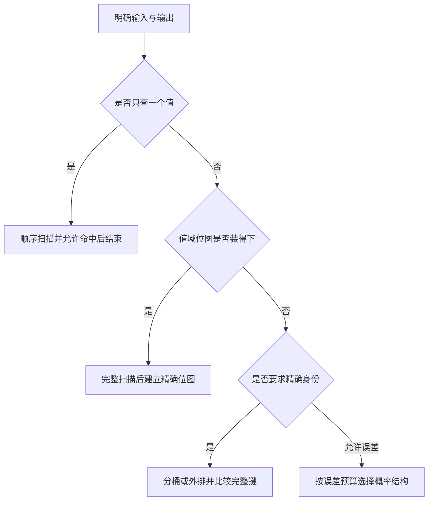
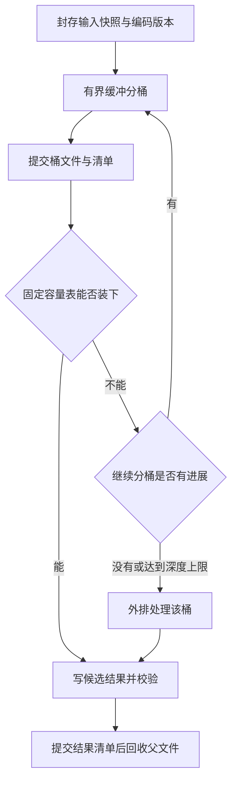
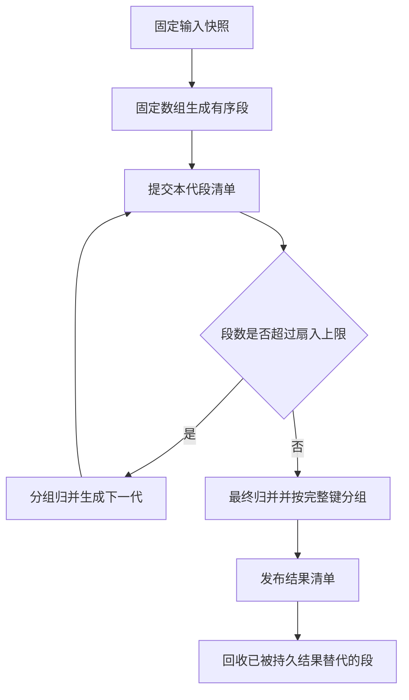

# 专题 I：海量数据、数据结构与受限内存算法

海量数据设计需要同时考虑表示空间、访问模式、内存上限、磁盘处理成本和失败恢复。记录数、值域、不同值个数与输出语义决定应采用索引、缓存、位图、分桶还是外部排序。

**案例假设：**规模、内存预算和输入分布均为假设输入。QQ 号是账号标识的题面名称，其值域必须另行确认。Java 示例采用 JDK 21 API，数据库示例采用 MySQL 8.4；算法正确性、资源上限与规模性能需要分别验证。

## I.1 先定义问题：记录数、值域、不同值个数和输出语义

面试官说“40 亿个号码放不进内存”，还没有给够选算法的条件。至少补齐以下变量。

| 符号／条件 | 含义 | 直接影响 |
| --- | --- | --- |
| N | 输入记录条数，包含重复记录 | 至少需要读取多少记录，原始文件多大 |
| U | 允许出现的不同取值的全集大小 | 完整位图需要多少 bit，不等于 N |
| D | 本次输入中实际不同值个数 | 精确哈希集合与 Bloom 的规模；D ≤ min(N,U) |
| M | 可用内存及其口径 | 是算法数组、JVM 堆，还是整个容器上限 |
| W | 原始编码的平均或固定记录宽度 | 磁盘、网络、解码成本；文本不能按 4 B 估算 |
| 查询与输出 | 一次还是反复查询，要不要排序，是否允许近似 | 扫描、预处理、位图、外排之间的选择 |
| 数据生命周期 | 静态文件、追加日志，还是可更新删除的集合 | 快照、水位、计数和恢复协议 |

N 为 40 亿时，D 可能只有 10 个，也可能接近 40 亿；U 可能是一个完整 int32 值域，也可能是长度不固定的字符串空间。前两种数据扫描量相近，但哈希去重的内存需求完全不同。位图则对整个允许值域付费，不因重复记录多就自动变小。

“去重”还至少有六种不同交付物。以下以输入 `7,7,9,11,11,11` 为例：

| 需求 | 正确输出 | 最少需要保留的状态 |
| --- | --- | --- |
| 每个不同值输出一次，即 DISTINCT | 7,9,11 | 是否出现过 |
| 只输出恰好出现一次的值 | 9 | 0、1、至少 2 次三种状态 |
| 输出所有出现过重复的值，每值一次 | 7,11 | 是否至少出现 2 次 |
| 输出第二次及以后出现的记录 | 7,11,11 | 在线是否已见；输出仍有重复 |
| 输出精确频次 | 7→2，9→1，11→3 | 不溢出的计数 |
| 每值保留第一条原记录，且保持原始顺序 | 第一条 7、第一条 9、第一条 11 | 完整记录或位置，以及最小序号 |

尤其不能在读到一个新值时马上宣称“它只出现一次”：文件后面可能再次出现。输入还没结束时，只能给暂定结果，或使用允许撤回的结果协议。



算法选择还受到数据生命周期约束：未经完整构建的位图不能用于否定查询；只保留概率结构也无法反推出所有原始号码。

## I.2 案例 I1：资料平台数据增长，先省哪一层空间

### I.2.1 假设、症状和访问模式

假设一个资料平台有 1 亿条资料记录，每条元数据平均 300 B，解析正文平均 20 KiB。逻辑元数据约 30 GB，正文约 2.048 TB，合计约 2.078 TB；若全部保留三份服务副本，约 6.234 TB，尚未计入索引、日志、备份与临时空间。这是算术示例，不是实际压缩率或数据库占用。

业务主要做三件事：按租户和资料 ID 点查；按租户与创建时间翻页；按天扫描解析质量指标。故障表现是假设中的在线库备份变慢、冷正文占用大量空间、列表查询读出不需要的大字段。先看各表／索引字节数、热点字段、真实查询投影、历史访问比例与恢复演练耗时，再决定改造。

### I.2.2 从“少存”到“存对位置”的四层决策

第一层是**不保存不需要的派生副本**。相同解析结果如果只是多个任务重复复制，可以保存带版本的产物引用；失败任务的临时文件按明确保留期回收。但任务审计、权限、用户修改记录不能仅因“占空间”而删除。是否可重建、重建要多久、原始数据是否还在，决定哪些副本可以裁减。

第二层是**缩短表示，保持业务含义**。固定范围的状态使用合适类型；低基数字段可以使用字典编码；连续或排序后的数值可考虑差分与位打包；重复连续值可考虑游程编码。Parquet 定义了字典、RLE／位打包和多种差分编码，但具体收益取决于数据分布和访问方式，不能承诺“换格式必省十倍”。[I07] 需要随机更新的事务行也不能直接照搬只读归档文件布局。

第三层是**按访问模式分层**。在线事务库保存任务、权限、元数据与对象引用；大正文和原文件进入可流式读取的对象存储；历史统计进入可按列扫描的归档；索引和缓存作为可重建派生物。正文迁出事务库主要降低在线工作集、写放大和维护负担，迁出本身不等于全系统字节数减少。新旧副本并存的迁移期反而需要更多空间。

第四层才是**扩展物理资源**。高效点查仍受单实例写入、持久化或恢复时长限制时，可以按稳定租户键／虚拟桶分到多个实例。只把同一实例改成更多表，不会增加 CPU、磁盘带宽；给应用增加实例也可能增加对同一数据库的争用。缓存主要减少重复读取，不能解决权威数据永久增长，更不能代替账号唯一约束。

### I.2.3 数据结构不是一条“越高级越快”的升级路线

链表、红黑树、B+ 树和跳表是适用于不同访问模式的候选结构，不存在通用的升级顺序。

| 结构／算法 | 有利的操作与典型场景 | 必须说明的成本与边界 |
| --- | --- | --- |
| 连续数组／排序数组 | 批处理、顺序扫描、二分搜索、紧凑保存 | 插入中间位置需要搬移；排序或更新成本不能省略 |
| 链表 | 已知节点后的插入删除、队列连接 | 查找目标节点仍可能 O(D)，指针增加空间和随机访问；Java LinkedList 按下标访问会遍历节点 [I01] |
| 哈希表 | 精确 ID 点查、分桶内去重 | 良好散列下期望 O(1)，容量、装载率、扩容峰值都占内存；不直接支持有序范围 [I02] |
| 红黑树 | 有序集合、前驱后继和范围起点 | 查找／更新 O(log D)，每个节点有指针与维护成本；TreeMap 具有这些复杂度保证 [I03] |
| B+ 树类页式索引 | 磁盘点查、按索引顺序取范围 | 多路分支减少页访问，实际成本取决于页、键宽、缓存与扫描行数；不是达到固定行数就失效 [I05] |
| 跳表 | 内存有序集合、需要并发维护的范围结构 | 通常是期望对数复杂度；层级、指针和并发协议都有成本，不能笼统说一定比树省内存 [I04][I15] |
| 普通位图 | 有界且可映射的整数存在性、集合位运算 | 空间约 U/8 B，依赖值域，不能直接存任意字符串 |
| 压缩位图 | 按块稀疏或具有结构的整数集合 | 空间依赖实际分布；Roaring 等可自适应容器，不能据此保证任意输入都小于某固定预算 [I17] |
| Bloom | 在精确后端前排除大量不存在的键 | 有假阳性，不能枚举键或单独承担精确去重 [I08][I09] |
| 外部排序 | 数据大于内存，需精确分组／全局排序 | 有多轮磁盘读写、临时空间和归并缓冲预算 [I13] |

InnoDB 的普通索引采用页式 B-tree 结构，索引记录存放在叶页，默认页大小为 16 KiB；二级索引记录还携带主键列。[I05][I06] 所以“为了覆盖查询把所有大字段加进索引”可能让读一次变少，却让索引更大、写维护更重。应从高频查询选择窄且有用的索引，而不是机械堆索引。

DFS 则回答另一类问题：资料引用图的可达性、目录树遍历、依赖环检测。完整图遍历通常为 O(V+E)，还要处理访问标记与栈空间。[I16] 普通评论列表慢，应检查访问路径、过滤选择性、排序和扫描量；“加一个深度优先搜索”不是 SQL 优化方案。若问题真是依赖图，也应避免每访问一个节点就发一次数据库请求，设计批量邻接读取或专门的图投影。

### I.2.4 失败、验证与取舍

假设改造后按租户列表变快，但缓存故障使数据库瞬间过载：根因是原先把缓存命中当作容量保证。先限制回源并发、合并相同请求，再按可接受陈旧度提供降级结果。权限撤销等不能使用过期事实的字段，必须保留权威判断。

上线前验证不同租户规模、冷热数据、冷缓存、正文损坏、产物缺失和归档恢复。比较在线库占用、全系统总字节、写入成本、P99、缓存失效后的容量和恢复耗时。压缩可能省 I/O 却增加 CPU，分片可能扩大吞吐却增加跨片查询和迁移责任，应把两者都写入结果。

应用示例：在 NoteWeave 类资料研究平台中，可用“规范化内容＋精确内容校验”寻找重复原文，用产物版本避免不同解析配置误共享。指纹只能定位候选；如果业务要求严格字节相同，最终比较原始规范化内容。跨租户共享物理内容还要保留独立权限与引用生命周期，不能把物理去重变成跨租户可读。

## I.3 案例 I2：40 亿 QQ 号，256 MiB 内存，精确输出不同号码

### I.3.1 先选择输入合同，拒绝隐藏的 32 位假设

题面只给 N=4,000,000,000，没有给 U。若额外确认号码都属于一个完整 32 位值域，存在位图才是 `2^32 / 8 = 512 MiB`；这个预算已经大于本例 256 MiB 上限。若号码是更宽整数或字符串，不能硬转 int，截断后会把不同号码错误合并。

为了给出可实施代码，本案例**另行假设**输入是非负且不超过 Long.MAX_VALUE 的规范化整数标识，采用固定 8 B 编码。因此原始二进制数据为 32 GB（十进制）。这不是对真实 QQ 编号范围的断言。若输入可超过这个范围，使用有长度上限的规范化字节串记录；分桶与外排思想不变，但内存必须按字节而非对象个数核算。

文本转换需明确前导零是否有意义、是否允许空白、编码和非法值策略。若业务把 `00123` 与 `123` 视为不同账号，就不能先转数字。解析失败记录进入有数量和原因统计的错误输出；不能静默忽略后宣称“精确处理了全部 40 亿条”。

### I.3.2 为什么 Bloom 单独使用会错误丢号

假设 D 也达到 40 亿，以目标假阳性率 p=1% 建经典 Bloom，近似位数为：

`m ≈ -D × ln(p) / (ln 2)^2 ≈ 9.585D bit`

对应约 4.79 GB，即 4.46 GiB，尚未计入结构开销；仍远大于 256 MiB。[I09] 这里的 p 是**不存在的键被判为可能存在的概率**，不是“所有阳性结果中有 1% 是错的”，后者还依赖查询中真实成员的比例。

如果流程是“Bloom 说见过就丢弃”，假阳性会把从未出现过的新号码丢掉。这只能是允许漏掉部分不同值的近似方案。精确方案可以让 Bloom 阴性跳过昂贵的存在查询，但所有输入仍需进入精确集合；阳性必须比较完整键。Bloom 的原始工作本身就讨论了空间、允许错误和必要时使用第二阶段检查的权衡。[I08]

### I.3.3 两级分桶，让每个重复类只属于一个处理单元

选择固定的编码和带版本的散列规则，把相同号码送到同一叶桶。本例演示先按 6 个散列位分为 64 桶，再逐个父桶按另外 6 位分成 64 子桶，共 4096 个叶桶。若 D=40 亿且分布均匀，每叶桶平均约 97.7 万个不同值；这只是规划估计，不能当作不会溢出的证明。

每次分桶只打开 64 个输出流，每流 256 KiB 缓冲，合计 16 MiB，再加固定输入缓冲；第二级逐父桶处理，避免打开 4096 个大缓冲。文件描述符上限与每进程并发数量仍需预检。若采取写者 LRU，也必须保证关闭前刷新、重新打开使用同一分桶纪元，评估频繁开关和随机写代价。

哈希只决定“去哪个桶”，桶内仍比较完整号码。把 64 位指纹当作原始任意长键，会引入碰撞风险；在理想均匀独立模型下，40 亿不同键映射到 64 位的期望碰撞对数约为 `D(D-1)/2^65 ≈ 0.434`。更长指纹可降低概率，也不能把概率相等写成严格相等。



### I.3.4 固定容量 Java 表：满了返回失败，不自动扩容

下面是可测试的桶内核心，保存完整 long 键和 0／1／至少 2 次状态。容量必须是 2 的幂，装载阈值固定，数组永不扩容。使用 `byte[]` 区分空槽，因此键 0 不需要特殊保留值。该实现面向单线程离线桶处理，不提供并发安全。

```java
final class FixedLongCounts {
    private final long[] keys;
    private final byte[] count2; // 0=空槽，1=一次，2=至少两次
    private final int mask, limit;
    private int size;

    FixedLongCounts(int capacity) {
        if (capacity < 2 || capacity > (1 << 26)
                || Integer.bitCount(capacity) != 1) {
            throw new IllegalArgumentException("capacity must be a bounded power of 2");
        }
        keys = new long[capacity];
        count2 = new byte[capacity];
        mask = capacity - 1;
        limit = (int) ((long) capacity * 3 / 5); // 最大 60% 装载
    }

    static long mix(long x) {
        // 固定混合规则；分桶清单必须记录编码、算法和种子版本。
        x ^= x >>> 30;
        x *= 0xbf58476d1ce4e5b9L;
        x ^= x >>> 27;
        x *= 0x94d049bb133111ebL;
        return x ^ (x >>> 31);
    }

    boolean add(long key) {
        // 与分桶散列做域分离，避免已固定的桶低位再次集中表内初始槽。
        int slot = (int) mix(key ^ 0x9e3779b97f4a7c15L) & mask;
        while (count2[slot] != 0) {
            if (keys[slot] == key) { // 比较完整键，不比较散列值
                count2[slot] = 2;
                return true;
            }
            slot = (slot + 1) & mask;
        }
        if (size == limit) return false; // 调用者改走再分桶／外排
        keys[slot] = key;
        count2[slot] = 1;
        size++;
        return true;
    }

    void reset() {
        java.util.Arrays.fill(count2, (byte) 0);
        size = 0; // 同一数组复用于下一桶，旧 keys 在空槽中不再有意义
    }

    interface Sink { void accept(long key, int occurrencesUpToTwo); }

    void emit(Sink sink) {
        for (int i = 0; i < keys.length; i++) {
            if (count2[i] != 0) sink.accept(keys[i], count2[i]);
        }
    }
}
```

取 capacity=2^22，键数组 32 MiB，状态数组 4 MiB，原始数组元素合计 36 MiB，阈值约 251.7 万个不同值。数组头、运行时、堆外缓冲、线程栈和文件缓存另计。固定原始数组比直接估算 `HashSet<Long>` 为“每元素 8 B”可靠：后者还有装箱对象、节点／桶、装载空隙和扩容峰值。[I02]

每个 worker 只持有一张表，桶间调用 reset 复用数组，避免保留多桶状态。调用者须遵守两条规则。第一，桶完整读取成功后才调用 emit，sink 必须流式写文件，不能又把结果装进无界 List。第二，任一次 add 返回 false，该次尝试不对外发布结果；从**原始完整桶**重新分桶或外排。不能只处理剩下的尾部，否则前后相同号码会分别输出。

### I.3.5 偏斜、临时空间和恢复怎样闭合

**记录数偏斜与不同值偏斜不同。**某桶有 10 亿条同一号码，文件很大，但上表只占一个槽；这时瓶颈是读取耗时，给同一号码换散列种子也无法把其重复类拆开。某桶有很多不同号码才可能超过表容量。对后者可继续用新的散列位或种子细分，但必须检测最大子桶是否缩小、达到深度上限后转外排。攻击者可构造固定散列下的坏分布，容量上限与外排后备才构成内存保证。

将一个超热重复键按来源分散计算也可以，但需要最后按键合并状态：求 DISTINCT 是 OR，求“至少两次”是饱和相加，精确频次是计数相加。没有最终归并，就不能称为全局去重。

磁盘预算至少包括：不可变输入文件、已封存待处理桶、当前重分桶的子文件、已完成输出和尚未清理的检查点。若保留 32 GB 源、32 GB 桶、一份最大 32 GB 重分桶和最多 32 GB DISTINCT 输出，示意峰值可达 128 GB，文本转换副本、校验信息和余量另算。不能将“内存只用 36 MiB”误说成整个任务资源很小。

恢复采用**阶段结果清单**：每个桶记录输入快照、父桶、哈希版本、深度、记录数、字节数、校验和、状态和输出文件名。先写唯一临时路径，刷新完整数据并校验，再提交清单；清单未提交的临时文件可删除重做，已提交的输出不能再追加一份。每次重做使用新尝试目录，避免分桶追加造成重复计数。输入没有稳定版本时，恢复不能仅依靠文件名和修改时间。

### I.3.6 验证与继续追问

验证数据包括：全相同、全不同、零值、最大合法值、同桶大量碰撞、不同文本编码、损坏尾记录、磁盘写满和分桶半途退出。小数据以独立 Map 作为参考，比对不同值集合与三态频次；大数据还要检验输入／桶记录数守恒、无缺失文件和内存峰值。

如果要求最终数值排序，不能直接按哈希桶编号拼接输出；需要对结果外排，或从一开始使用有序范围分区并保证范围不重叠。若要保留第一条原记录，桶内需要保存最小输入序号和相应位置，再按该序号外排恢复原始顺序。

## I.4 案例 I3：4 TB int32 文件，2 GB 内存，如何判断是否存在

### I.4.1 一次查询和反复查询是两份成本模型

本案例假设文件不可变，记录是固定 4 B 的有符号 int32，端序已约定，无额外文件头。若 4 TB 指十进制，则 N=10^12；若题目实际说 4 TiB，则 N=2^40。若数据是文本整数，这两个记录数推导都不成立。

只查一个值，顺序扫描并比较，命中可提前结束；要确认不存在，最坏必须读完整个文件。记录缓存只需固定 I/O 缓冲，没有必要为了一个问题先构建庞大结构。若一次收到一个很小的候选集合，可只在内存保存候选及命中标记，扫描一遍处理全部候选。

若长期反复查大量不同整数，可以扫描一次建完整存在位图。int32 值域 U=2^32，因此一位／值为 512 MiB；这个结论由值域推出，与文件有 4 TB 或 40 TB 无关。2 GB 若是十进制约等于 1.86 GiB，2 GiB 则是另一口径；二者都能容纳原始 512 MiB 位图，但仍需给 JVM、输入缓冲、查询并发和系统内存留预算。

预处理没有免费消除全文件读取。假设持续有效读取吞吐为 500 MB/s，纯读 4 TB 的理论时间约 8000 秒，即 2.22 小时；这是忽略解码、置位、竞争和持久化的教学下界估算，不是性能承诺。若只运行几个查询，预处理的总成本可能并不划算。

### I.4.2 兼容完整 32 位值域的有界核心

下面使用 `index=((long)value)-Integer.MIN_VALUE` 映射，使最小 int 对应 0，最大 int 对应 2^32−1。附录 A.5 的无符号映射同样是双射，但两种持久化格式不能混用；应记录 mapping_version。JDK BitSet 的按位 API 使用 int 下标，不能直接拿一个 BitSet 表达需要 long 下标访问的完整 2^32 范围。[I10]

```java
import java.util.function.LongConsumer;

final class DenseStates {
    enum Output { DISTINCT, ONCE, REPEATED }
    private final long universe;
    private final long[] seen;
    private final long[] repeated; // 不需要频次类别时为 null，省一半数组

    DenseStates(long universe, boolean trackRepeated) {
        if (universe <= 0 || universe > (1L << 32)) {
            throw new IllegalArgumentException("unsupported universe");
        }
        this.universe = universe;
        int words = (int) ((universe + 63) >>> 6);
        seen = new long[words];
        repeated = trackRepeated ? new long[words] : null;
    }

    private void check(long index) {
        if (index < 0 || index >= universe) {
            throw new IllegalArgumentException("index out of domain");
        }
    }

    void addIndex(long index) {
        check(index);
        int word = (int) (index >>> 6);
        long bit = 1L << (index & 63);
        if (repeated != null && (seen[word] & bit) != 0) {
            repeated[word] |= bit; // 第二次及以后保持为 1
        }
        seen[word] |= bit;
    }

    boolean containsIndex(long index) {
        check(index);
        return (seen[(int) (index >>> 6)] & (1L << (index & 63))) != 0;
    }

    long distinctCount() {
        long total = 0; // 总数可能大于 Integer.MAX_VALUE
        for (long word : seen) total += Long.bitCount(word);
        return total;
    }

    void emit(Output mode, LongConsumer out) {
        if (mode != Output.DISTINCT && repeated == null) {
            throw new IllegalStateException("frequency state was not collected");
        }
        for (int w = 0; w < seen.length; w++) {
            long bits = switch (mode) {
                case DISTINCT -> seen[w];
                case ONCE -> seen[w] & ~repeated[w];
                case REPEATED -> repeated[w];
            };
            while (bits != 0) {
                int low = Long.numberOfTrailingZeros(bits);
                out.accept(((long) w << 6) + low); // out 必须有界流式写出
                bits &= bits - 1;
            }
        }
    }

    static long indexOf(int value) {
        return ((long) value) - Integer.MIN_VALUE;
    }
}
```

只判断存在时，构造 `new DenseStates(1L << 32, false)`。需要“恰好一次”或“至少两次”时，两个位平面占原始 1 GiB：`seen=1,repeated=0` 表示一次；`repeated=1` 表示至少两次。这不能回答精确频次，也不能仅凭三态完成任意删除后的频次修正。

上述置位只供单线程构建。普通 long 数组的 `|=` 是读改写，两个线程修改同一 word 的不同 bit 也可能丢更新。可以给不同 worker 分配互不相交的 word 范围，或使用正确的原子按位操作；每线程复制一个完整位图会乘倍内存，不能在受限内存题里不计这个成本。[I10]

### I.4.3 流式读文件，必须保留跨缓冲区的残缺记录

下面是固定 1 MiB 缓冲的读取器。FileChannel 一次 read 不保证把缓冲填满；compact 保留尚不足 4 B 的尾部，下一次读补齐。读到 EOF 后若仍有残留字节，报告损坏，不能将截断记录当作正常结束。[I11][I12]

```java
import java.io.EOFException;
import java.io.IOException;
import java.nio.ByteBuffer;
import java.nio.ByteOrder;
import java.nio.channels.FileChannel;
import java.nio.channels.ReadableByteChannel;
import java.nio.file.Path;
import java.nio.file.StandardOpenOption;
import java.util.function.IntConsumer;

final class Int32Input {
    static long scan(Path input, ByteOrder order, IntConsumer accept)
            throws IOException {
        try (FileChannel channel = FileChannel.open(input, StandardOpenOption.READ)) {
            return scanChannel(channel, order, accept);
        }
    }

    // 抽出读取核心便于注入短读测试；本例用于阻塞式文件读取。
    static long scanChannel(ReadableByteChannel channel, ByteOrder order,
                            IntConsumer accept) throws IOException {
        ByteBuffer buffer = ByteBuffer.allocate(1 << 20).order(order);
        long records = 0;
        while (true) {
            int n = channel.read(buffer);
            if (n < 0) break;
            if (n == 0) continue;
            buffer.flip();
            while (buffer.remaining() >= Integer.BYTES) {
                accept.accept(buffer.getInt());
                records++;
            }
            buffer.compact(); // 将 0～3 个残留字节移到缓冲开头
        }
        if (buffer.position() != 0) {
            throw new EOFException("truncated int32 record");
        }
        return records;
    }
}
// 用法：scan(path, 已约定端序, v -> states.addIndex(DenseStates.indexOf(v)))。
// 不能把 4 TB 文件交给 readAllBytes，也不能把 accept 实现为无界结果收集器。
```

这是固定格式读取核心，生产任务还要验证输入版本、完整性摘要、预期字节数和记录数。若读取期间文件被原地覆盖，即使最终长度没变也可能得到混合快照，因此必须使用不可变对象版本、封存文件或明确的快照机制。

### I.4.4 索引发布、查询与恢复的完整边界

构建中的位图只证明“到当前读取位置为止见过”，其 0 bit 不能证明整个文件中不存在。使用 BUILDING／READY 两种索引状态，记录 dataset_id、输入版本、端序、映射版本、记录总数和校验和；只有全文件读取、校验与位图持久化均成功，才发布 READY。查询只绑定一个 READY 版本。

保存数组时采用小缓冲分段写，不先复制出另一个 512 MiB byte 数组。若崩溃后选择从头重建，保留输入文件即可；若选择从检查点恢复，检查点必须绑定“位图内容＋已处理完整记录位置”同一代次，不能先更新位置而位图未落盘。存在置位重放是幂等的，频次三态重放却会把一次误算成两次，所以二者不能复用未经设计的断点续跑。

追加型数据可让查询组合“已完成静态位图＋有明确水位的增量集合”；只有确认增量已覆盖查询时点，才能回答最新的不存在。允许删除时，一位存在位图无法判断删掉一条重复记录后是否还存在，需要计数、引用来源或重建新版本。

`mmap` 也不等于“不耗内存”：映射可以按需驻留，页错误、驻留页和文件缓存仍影响资源上限。堆外 ByteBuffer 只是换了记账位置，JDK 文档也提示其内存影响可能不明显，不能只看 Java 堆就认定满足 2 GB 限制。[I12]

### I.4.5 验证与取舍

边界值至少包括 Integer.MIN_VALUE、−1、0、Integer.MAX_VALUE，位位置 63／64、最后一个 word，以及小域末尾不足 64 个值的情况。读入验证两种端序、空文件、最后只剩 1～3 B、构建中断和错误快照。输出计数应使用 long。

性能验证分开记录首次构建耗时、索引加载耗时、常驻内存、冷启动查询和稳态查询；不能把 O(1) 位查询的延迟冒充端到端所有请求的时间。若数据只会被查一次，直接扫描通常是更容易解释和维护的方案；若值域稀疏且宽，转入分桶或外排，而不是申请完整 64 位位图。

## I.5 案例 I4：审计要求找“只出现一次”的宽 ID，怎样外排且可恢复

### I.5.1 假设与必须解决的难点

假设还是 40 亿条固定 8 B、非负 long 标识，数据静态，进程总预算 256 MiB。现在输出必须按 ID 排序，并同时支持 DISTINCT、恰好一次、重复值三个视图。值域太宽，普通位图不合适；哈希分桶后还需要排序，因此考虑直接外部归并排序。

外排把大问题分成“内存内生成有序段”和“有界扇入逐轮归并”。它优化的是块 I/O，而非假装所有数据都在内存里。外存模型区分内存容量与块传输，经典分析说明了归并和分配排序的 I/O 复杂度与适用条件。[I13]

### I.5.2 生成有序段：数组固定，排序的辅助空间也固定

规划 64 MiB 的 long 数组，每段最多 8,388,608 条；32 GB 原始文件大约生成 477 段。另留输入／输出缓冲、运行时和安全余量；这只是预算，验收仍看完整进程峰值。

如果严格要求可解释的辅助空间，不能未经核验就认定任何库排序实现都只用 O(1) 内存。下面演示非递归原地堆排序，额外空间 O(1)，比较次数 O(n log n)。它用于说明硬内存边界，不表示其吞吐必然优于经过测量的成熟排序器。

```java
final class BoundedSort {
    // 本例按非负 long 的自然顺序；uint64 需要全流程改为无符号比较。
    static void sort(long[] values, int n) {
        if (n < 0 || n > values.length) throw new IllegalArgumentException();
        for (int root = n / 2 - 1; root >= 0; root--) sift(values, root, n);
        for (int end = n - 1; end > 0; end--) {
            long tmp = values[0];
            values[0] = values[end];
            values[end] = tmp;
            sift(values, 0, end);
        }
    }

    private static void sift(long[] a, int root, int n) {
        // root < n/2 才有孩子，避免叶子位置乘 2 的溢出。
        while (root < n / 2) {
            int child = root * 2 + 1;
            if (child + 1 < n && a[child + 1] > a[child]) child++;
            if (a[root] >= a[child]) return;
            long tmp = a[root]; a[root] = a[child]; a[child] = tmp;
            root = child;
        }
    }
}
```

每次只填充数组前 n 项，排序后流式写出一个有序段，再复用同一个数组。不保存全部段内容，只维护段文件元数据；段数量特别大时，清单也写磁盘并分页扫描。为了让后续频次语义最直观，本方案中间段**保留所有原始重复记录**，最后归并才计数。

### I.5.3 多路归并：限制打开文件和每路缓冲

选扇入 k=32，每路 1 MiB 输入缓冲，共 32 MiB，加固定输出缓冲和最多 32 个队首元素。最小堆每次弹出最小 ID，推进该来源，再把其新队首放回；不要每条记录新建一个长期留存对象。477 段先归并成约 15 段，再合成最终有序流。

两轮归并仍要处理完整输入。若中间不压缩，每个完整归并轮约读 S、写 S，生成初始段还要再读写一遍。外排预算应计算“多少轮 × 多少字节”，而不只报告 CPU 的 O(N log N)。提高 k 能减少轮数，但会增加缓冲、文件描述符和对存储并发读取的压力。



### I.5.4 最终分组与多阶段频次的陷阱

最终有序流中，相同 ID 连续出现。保存 current_id 和 count 即可逐组输出，不需要装下全部不同值。只做三种视图时，count 在 2 饱和即可；要精确频次则使用能容纳 N 的 long，并进行溢出检查。

| 组的饱和计数 | DISTINCT | 恰好一次 | 重复值 |
| --- | --- | --- | --- |
| 1 | 输出该 ID | 输出该 ID | 不输出 |
| 2，表示至少两次 | 输出该 ID | 不输出 | 输出该 ID |

如果为了压缩中间段而提前局部去重，就必须把 `(ID,count)` 一起保存。两个不同段各有一次 ID=7，局部看都“只出现一次”，全局应判重复；只合并局部 singleton 输出会得到错误结果。饱和计数的合并应是 `min(2,a+b)`，精确计数则相加。只取各分区不同值集合的并集能求 DISTINCT，不能自动求“恰好一次”。

本方案固定记录为 8 B。若最终保存 `(ID,频次三态)` 的紧凑 9 B 格式，最多为 9D B；N=40 亿且 D=N 时，输出最多约 36 GB。中间轮保留源 S、旧段 S、新段 S 时约 96 GB；最终保留源 32 GB、最后段 32 GB、结果 36 GB 时约 100 GB，文件头、校验、失败尝试和余量另计。若频次改为完整 8 B long，输出上限变为 16D B，应重算空间，不能沿用原预算。

这里最多保留相邻两代中间段。若为回滚保留全部历史代次，空间会继续增长；并行多个归并任务也要合并计算。磁盘写满时停止产出并保留旧的已提交代次，不能为腾地方先删掉唯一可恢复输入。

### I.5.5 恢复协议与可核验结果

每代清单记录 job_id、输入快照、编码／排序规则、段范围、记录数、字节数、校验和以及父段集合。归并写新文件，完成后先校验，再将“新代次已完成”提交到持久元数据，最后才把父段标成可回收。中断后只重跑未提交的归并组，不能向已有成功文件无条件追加。

并行重试时，以 `(job_id,input_version,parent_generation,group_id)` 标识唯一归并责任，持久清单用事务或 CAS 从待完成变为已完成，且恰好接受一个 attempt 的结果。失败竞争者的文件是未引用暂存物，不能追加进入赢家文件。新代次必须枚举完整计划，证明每个父段恰好进入一个归并组，不能仅凭“当前已看到的任务都完成”宣布结束；分桶阶段同样需要完整子桶清单。只有已提交后继完整覆盖父输入，且没有保留中的读取或回滚依赖，父文件才可回收。租约可以减少重复劳动，结果唯一发布仍由持久清单约束。

本地 `FileChannel.force` 可以请求持久化文件修改，其保证受设备和实现条件约束；`Files.move(..., ATOMIC_MOVE)` 也可能不受支持，原子改名并不独自证明目录项已在断电后持久。[I11][I14] 因此实现须明确本地文件系统的文件与目录同步协议，或用不可变对象版本加支持事务／条件更新的持久清单服务；不能把“调用了 rename”当作整个恢复协议。

验证包括：不同段各出现一次的同键、一个键跨越所有段边界、空段、最后不满数组的段、最大合法 ID、乱序或校验失败的段，以及在“写完文件但未提交清单”和“提交清单但未清理父段”两处退出。小规模结果与独立计数器逐键比较；全量检查输入数量、最终分组总记录数、全序性和输出键唯一性。若只保存饱和计数，另保留准确输入处理总数，不能用饱和计数之和冒充 N。

外排的优势是内存上界和顺序输出容易说明；成本是磁盘空间、额外轮次和完成时间。分桶通常更适合只求无序 DISTINCT，位图更适合紧凑整数值域，没有一种方案能脱离题目条件通吃。

## I.6 十六道连续追问：把算法边界回答完整

### Q1：40 亿条号码是不是已经证明可以用 512 MiB 位图？

没有。40 亿是 N，512 MiB 来自 U=2^32。40 亿条输入可以来自一个远大于 32 位的标识空间，也可能只有几个不同号码。必须明确允许范围和编码；若只能获知最大值，也需要知道最小值以及是否可通过平移映射连续区间。完整 64 位值域的位图为 2^64/8=2 EiB，数量级已经完全不同。把号码哈希到 32 位再用位图会发生碰撞，只得到近似成员结构。

### Q2：已知是 int32，但只有 256 MiB，能不能仍然精确做？

可以分治。例如按已声明映射的高 2 位把值域分成四份，每份需要 128 MiB 存在位图，依次处理并流式输出。可以先扫一遍分四个文件，再逐文件扫描；也可以不落桶文件而扫原数据四遍，每遍只处理一个区间，以更多 I/O 换临时空间。256 MiB 是整个进程上限时，不能刚好申请 256 MiB 数组。两位频次状态需要再缩小分段，例如分八份后每段两个 64 MiB 位平面，并继续保留运行时余量。

### Q3：为什么计数和下标有的用 long，有的仍能用 int？

N=40 亿已经超过有符号 int 的最大正数；4 TB int32 文件约一万亿条，更必须用 long 记录条数、字节位置和输出计数。位图的 bit 下标可到 2^32−1，要用 long；但除以 64 后的 word 下标只到 2^26−1，可以安全转换为 int。先减 Integer.MIN_VALUE 时必须先提升到 long，否则减法先在 int 内溢出。类型应由各自的数值范围决定，而不是整个程序一律用某一种类型。

### Q4：Bloom 理论上没有假阴性，为什么线上仍可能把存在的键查成不存在？

理论前提是每个集合成员已按相同规则插入，位没有错误清除，查询使用相同参数和哈希。数据库已成功而 Bloom 插入丢失、读取旧版本、构建尚未完成或编码不一致，都会破坏这些前提。需要按输入快照与增量水位发布过滤器，明确失效时回源；不能在 Bloom 缺失时默认“全不存在”。普通 Bloom 也不能删除某键时直接清它的所有 bit，因为这些 bit 可能被其他键共享。[I08]

### Q5：既然哈希桶也有碰撞，为什么分桶仍能保证精确？

桶碰撞只会让更多键进入同一个处理单元，不会让键相等。只要相同规范化键必然路由到同一桶，而且桶内比较完整键，碰撞最多影响资源和速度。若只保存指纹、不保留完整键，就丢掉了区分碰撞的依据。分桶算法版本还必须固定：一次运行中途更换种子但未重分历史数据，可能把同一键分到不同桶，造成重复输出。种子可以因新的子任务变化，但其父桶及所有子输入必须共同遵守新规则。

### Q6：输入从 long 变成任意长字符串，固定容量表还有内存上界吗？

仅固定槽数不够，还要固定总字节预算。字符串长度、字符编码、对象头和字符／字节数组都会变化；一条超长记录就可能耗尽内存。应约定最大合法记录长度，采用有上限的流式解析器；桶内用固定字节 arena 和偏移索引，容量或 arena 满就溢写／外排。非法超长行要按合同拒绝或隔离，不能悄悄截断。外排比较的是规范化后的完整字节序列，若指定数值排序，还需要正确的数值比较规则。

### Q7：桶文件很小是否就一定能装进 HashSet？桶文件很大是否一定装不下？

都不是。前者可能因装箱、节点和扩容造成数倍内存放大；后者可能主要由同一个键的重复记录构成，D 很小。文件大小适合估计 I/O，内存应根据 distinct 数量与表示方式估计。采样和近似计数可辅助决定分桶数，但硬保证来自固定容量结构、明确的超限返回与后备算法。即便预计装得下，也应在触及阈值前停止，不能依赖捕获 OutOfMemoryError 才切换路径。

### Q8：把数据分给 100 台机器，最后把结果拼起来就行吗？

只有分区互斥且覆盖完整，并且相同键只归一个分区，才可直接拼接无序 DISTINCT。若按文件来源随意拆分，同一键会在不同机器出现，必须做第二次按键归并。各分区的“恰好一次”不能直接合并，需保留局部频次并相加；精确计数不能平均；要求全序时还要保证范围分区顺序或做全局归并。并行化必须定义可组合的中间状态，并纳入网络交换、慢分区和重试成本。

### Q9：直接写数据库唯一索引去重，是不是最省事？

如果任务需要在线持续写入、并发唯一性和可追踪状态，成熟数据库唯一约束可能正合适。一次性数十亿行离线清洗则要比较随机页写、日志、索引维护、复制和对在线业务的影响；批量有序导入也需要临时空间和恢复计划。不能因为应用代码短就认为成本低，更不能把离线任务无节制地打到生产主库。选择应比较完成时间、硬资源上限、可重跑性和后续查询需求，而不只比较代码行数。

### Q10：两个 bit 已经区分一次和重复，能不能顺便统计精确次数？

不能，状态 2 将两次和一万次合并了。完整 int32 域若每值配 32 位计数器，原始空间约 16 GiB；配 64 位则约 32 GiB。4 TB 数据中单个值出现次数可能超过 32 位无符号整数上限，因此精确计数类型也要根据 N 选择。可以按值域分段计数、使用有界桶内 long 计数或外排逐组计数，不能用更少状态凭空恢复已经丢掉的信息。

### Q11：要求保留第一条记录和原顺序，为什么普通去重输出不够？

位图只保留存在性，哈希桶顺序与输入顺序无关，按 ID 外排也改变原顺序。可以给每条记录一个稳定输入序号，按完整键聚合最小序号及原文位置，然后按最小序号再外排，最后取回原记录。多个输入文件还要先定义文件顺序和文件内偏移组成的全序；并行处理完成先后不能代表“最早”。这个需求增加索引字段、随机回读或二次顺序重排，应重新估算 I/O 和磁盘。

### Q12：进程恢复后从上次 offset 接着读，不就是断点续跑吗？

只有 offset 与相应结果状态同一代次持久化才成立。进度先落盘、数据未落盘会漏处理；数据已计数、进度未落盘会重复计数。对存在位做重复 OR 没问题，但把一次再次送入三态计数会错误变为重复。最简单的离线协议是重做未提交的桶／归并组，并只让已提交清单引用结果；未完成尝试使用独立文件，不追加到成功文件。暂存垃圾也应受配额和清理规则约束，不能让无限重试耗尽磁盘。

### Q13：能否用异或或者把所有号码相加，一遍求出去重结果？

只有题目给出非常特定的频次结构时，这类技巧才适用。例如“除一个值出现一次，其余全部恰好两次”可利用异或抵消求那个值；一般的 DISTINCT、恰好一次集合和任意频次统计不满足这个前提。出现三次的键在异或里仍会留下，多个单次值也只产生混合结果。总和与异或可作为辅助校验的一部分，但不是完整集合相等的充分证明，不能替代逐键正确性验证。

### Q14：位图本来只占 512 MiB，为什么发布新版本时仍可能 OOM？

旧版本正在服务，新版本同时构建或加载，单是两份位图就需要约 1 GiB；若再复制做序列化、每线程局部位图或创建频次平面，峰值继续上升。必须规划新旧版本交接、最大读者保留时间和释放时机，必要时让构建在隔离进程完成。查询消费者也不能长久保留每一代引用。验收看整个进程／容器峰值与刷新期间的尾延迟，不能只看稳定状态的一次数组大小。[I12]

### Q15：给两位频次位图加删除，是不是把状态 2 改回 1 就可以？

不可以。状态 2 可能表示两次，也可能表示一百次；删除一条后应分别变成一次和至少两次，单靠三态无法判断。静态快照题可以重新构建；在线集合则需要精确引用计数、每来源的存在记录，或能查询权威事实的修复流程。计数更新与成员生命周期还要解决并发、重复消息和删除重放。静态离线算法的正确性不能直接外推成动态业务状态机的正确性。

### Q16：面试中怎样证明方案正确，而不只背复杂度？

给出三个不变量：每条合法输入归入且只归入一个处理单元；相同完整键最终在同一处合并；只有完整处理并校验的结果可以发布。再说明内存上界由固定数组、有限缓冲与有限并发决定，超限转向磁盘方案；临时空间与恢复责任也必须有上限。最后用跨段重复、边界值、格式损坏和中断重放反例逐一验证。性能数字说明输入分布、单位、是否含预处理及失败恢复；小域正确性验证不能作为 4 TB 吞吐测试结果。

## I.7 解题框架与验证方法

这组题可以按“输出语义 → N／U／D／M → 表示方式 → 单元划分 → 合并规则 → I/O 与恢复 → 验证”顺序回答。四个案例分别训练存储布局、哈希分治、值域映射和外部归并，不需要把所有技术同时堆进一个方案。

实作时至少保留三张表：资源预算表，记录数组／缓冲／运行时／临时盘峰值；阶段清单表，记录输入版本与可恢复代次；验证结果表，记录独立参考结果和中断测试。这样“用了位图／Bloom／分库分表”才会变成可以解释边界、复现和验收的设计。

算法验证应覆盖小值域参考结果比对、完整 int32 映射端点、位边界 63／64 和末尾不满 word、固定容量表的超限与复用、排序边界、两种端序、短读、空文件和截断尾记录。规模验证还需测量全量扫描耗时、完整进程峰值内存、临时磁盘峰值，并演练检查点中断与恢复。

[I01]: https://docs.oracle.com/en/java/javase/21/docs/api/java.base/java/util/LinkedList.html "Java SE 21 LinkedList"
[I02]: https://docs.oracle.com/en/java/javase/21/docs/api/java.base/java/util/HashMap.html "Java SE 21 HashMap"
[I03]: https://docs.oracle.com/en/java/javase/21/docs/api/java.base/java/util/TreeMap.html "Java SE 21 TreeMap"
[I04]: https://docs.oracle.com/en/java/javase/21/docs/api/java.base/java/util/concurrent/ConcurrentSkipListMap.html "Java SE 21 ConcurrentSkipListMap"
[I05]: https://dev.mysql.com/doc/refman/8.4/en/innodb-physical-structure.html "MySQL 8.4 The Physical Structure of an InnoDB Index"
[I06]: https://dev.mysql.com/doc/refman/8.4/en/innodb-index-types.html "MySQL 8.4 Clustered and Secondary Indexes"
[I07]: https://parquet.apache.org/docs/file-format/data-pages/encodings/ "Apache Parquet Encodings"
[I08]: https://courses.cs.washington.edu/courses/csep521/21wi/readings/bloom_cacm.pdf "Burton H. Bloom: Space/Time Trade-offs in Hash Coding with Allowable Errors (1970)"
[I09]: https://redis.io/docs/latest/commands/bf.reserve/ "Redis BF.RESERVE"
[I10]: https://docs.oracle.com/en/java/javase/21/docs/api/java.base/java/util/BitSet.html "Java SE 21 BitSet"
[I11]: https://docs.oracle.com/en/java/javase/21/docs/api/java.base/java/nio/channels/FileChannel.html "Java SE 21 FileChannel"
[I12]: https://docs.oracle.com/en/java/javase/21/docs/api/java.base/java/nio/ByteBuffer.html "Java SE 21 ByteBuffer"
[I13]: https://research.ibm.com/publications/the-inputoutput-complexity-of-sorting-and-related-problems "Aggarwal and Vitter: The Input/Output Complexity of Sorting and Related Problems (1988)"
[I14]: https://docs.oracle.com/en/java/javase/21/docs/api/java.base/java/nio/file/Files.html "Java SE 21 Files: move and ATOMIC_MOVE"
[I15]: https://drum.lib.umd.edu/items/56c44671-3973-46b6-9e52-f71dc95af178 "William Pugh: A Skip List Cookbook"
[I16]: https://www.boost.org/doc/libs/1_85_0/libs/graph/doc/depth_first_search.html "Boost Graph Library 1.85: Depth-First Search"
[I17]: https://arxiv.org/abs/1402.6407 "Chambi, Lemire, Kaser and Godin: Better bitmap performance with Roaring bitmaps"
