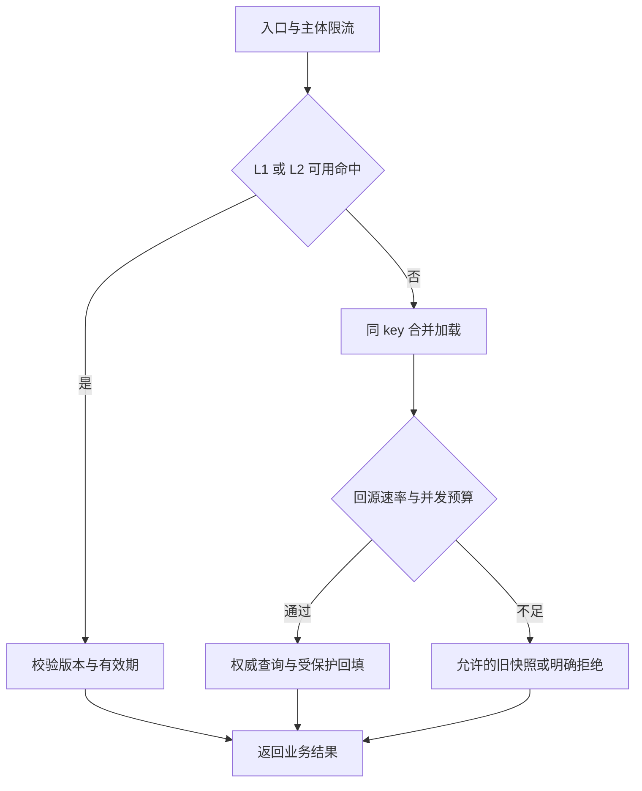
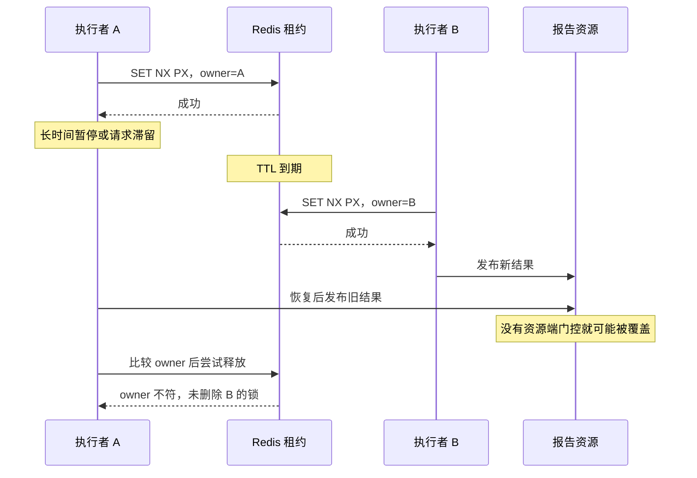
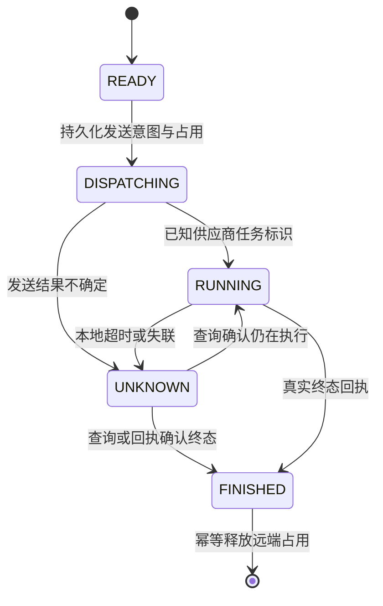

# J：高并发准入、容量保护与锁过期

高并发设计需要解决两个问题：流量很大时怎样让系统继续提供有效服务；多个执行者同时操作资源时怎样保证结果正确。前者要算请求、队列、连接与下游预算，后者要找到权威状态和原子裁决点。缓存、限流和增加实例主要解决容量问题；库存条件、唯一约束、状态机与资源端 fencing 才能说明错误结果为何不会发生。

所有规模、耗时、阈值及容量结果都是**教学假设与计算示例**。NoteWeave 用作研究任务与模型调用的假设场景。SQL 与 Java 均为带前提的协议示意。

## J.1 先把“高并发”拆成可以测量的约束

### J.1.1 QPS、在途量与排队量不是同一回事

入口每秒到达多少请求叫速率；正在占用线程、连接、内存或供应商资源的数量叫在途量；已经接收但尚未开始的数量叫排队量。一个接口原来平均耗时 20 ms，后来变成 2 s，即使 QPS 完全没有变化，在途量也可能放大 100 倍。

在稳定、口径一致的观察窗口内，可用 Little 定律估算 `平均在途量 = 有效到达速率 × 平均占用时间`。若统计的是数据库连接占用，就使用每秒实际进入数据库的调用和平均连接持有时间；不能把接口 P99 与入口 QPS 相乘，称为必须配置的数据库连接数。

因此，一个保护策略至少要写出五个预算：每秒允许进入多少；最多同时执行多少；最多等待多少、多久；每个请求允许放大多少下游工作；异常重试和恢复任务还保留多少额度。超过预算时还要有明确的业务结果。只把线程池设为 200，无法回答其余四个问题。

### J.1.2 令牌桶、滑动窗口、漏桶怎样选

| 算法 | 明确约束什么 | 允许什么突发 | 适合的场景与代价 |
| --- | --- | --- | --- |
| 固定窗口计数 | 每个对齐窗口最多 N 次 | 前一窗口末尾与后一窗口开头可挤在一起 | 成本低，适合粗保护；不能宣称任意连续一秒都不超 N |
| 精确滑动日志 | 任意最近 T 时间内最多 N 次 | 不能越过已定义窗口上限 | 用户敏感操作可用；记录每次时间，内存与清理成本随请求数增长 |
| 分桶滑动计数 | 最近若干桶的近似流量 | 桶边界存在误差 | 大量主体的近似流控；桶更细成本更高，必须说明误差口径 |
| 令牌桶 | 持续补充速率 r，最大积累 B 个令牌 | 空闲后可立即消费最多 B 个令牌 | 允许短突发的 API；还要单独限制并发和等待 |
| 漏桶整形 | 以受控速率释放排队请求 | 先吸收进有界队列，之后逐步输出 | 后台导入或受限供应商；增加排队时间，超过容量必须拒绝 |

对连续补充、初始满桶、单次消耗一个令牌的理想令牌桶，任意时长为 `Δt` 的区间通过量上界是 `B + r×Δt`。例如 r=1,000/s、B=200，不能说“每秒绝不超过 1,000”，因为空闲后第一秒可以通过约 1,200。实际实现若离散批量补充、重新启动时重置满桶，也要计算额外边界效应。Envoy 的本地限流使用令牌桶，具体共享范围由配置决定。[J01]

“漏桶”在不同实现中可能指排队整形，也可能指按欠额状态判断是否准入。NGINX `limit_req` 同时有 `burst`、`delay`、`nodelay` 配置：选择不延迟的突发放行，就不能继续承诺输出绝对均匀。[J02] 面试先说明接口是“立即通过或拒绝”，还是“接受后等待”，再报算法名。

窗口算法也需要原子地清理、统计和记入本次请求。分开执行读计数与加一会让多个请求同时认为还有容量；时间戳相同的多次请求不能在 ZSET 中共用一个 member 被覆盖。本地耗时使用单调时钟；跨实例窗口由同一个权威执行点判时，避免客户端时间任意漂移改变配额。

### J.1.3 从单机限流到全局额度

在入口先做便宜的体积、参数、身份和主体限流，再按租户、业务、热点资源及依赖分配预算。不同层解决不同问题：按 IP 能挡部分流量，却可能误伤共享出口；按用户能防单人刷接口，却不能保护万人同时请求同一个 SKU。

假设全服务预算 2,000/s，20 个实例各放行 100/s，**在实例集合固定、各自独立状态不重置的前提下**，持续速率之和才是 2,000/s；各桶突发上限也要相加。扩到 40 个实例而配置不变，预算变成 4,000/s。滚动发布时新旧实例重叠、重启后满桶、流量分配不均，都会影响瞬时通过量和利用率。

全局计数可以每次远程裁决，代价是延迟和中心热点；也可以向实例分发有编号、期限和代次的额度块。后者减少网络开销，但未用完额度会暂时闲置。额度迁移不能在旧实例仍可消费时直接重发；收回必须有可证明的失效条件或资源端拒绝旧代次。普通保护流控可接受有界超发，库存、付费额度和合约硬上限则需要可靠账本。Envoy 官方也区分全局裁决与本地粗保护的组合。[J03]

限流器失败时，“放行”必须落到一个仍有上限的应急配额，而非无限放行。公开只读页面可退回小额本地预算与旧快照；扣款或授权等路径不能跳过权威校验。配置版本、额度发放记录、额度使用量及拒绝原因都要可观测，否则出问题后只看得到一个模糊的 429。

## J.2 完整案例一：缓存命中率只降了几个点，数据库却雪崩

### J.2.1 从用户请求换算到真实数据库压力

假设某活动详情接口收到 100,000 次/s；命中 Redis 时不查数据库，未命中时每次恰好查一次。先忽略刷新、重试和其他业务，以展示基本关系：

| 缓存命中率 | 回源率 | 数据库查询量 | 相对 99% 命中时 |
| --- | --- | --- | --- |
| 99% | 1% | 1,000 次/s | 1 倍 |
| 95% | 5% | 5,000 次/s | 5 倍 |
| 90% | 10% | 10,000 次/s | 10 倍 |
| 整体不可用 | 100% | 100,000 次/s | 100 倍 |

若数据库只给本接口 2,000 次/s 的稳定预算，那么 95% 命中已经超过预算 2.5 倍。所谓“命中率只降了 4 个百分点”，对数据库却是五倍负载。通用表达是 `回源负载 = 入口速率 × 需要回源的概率 × 每次回源工作量 + 刷新/恢复工作量`；重试还会继续放大。命中率必须按接口、热点和请求类型拆开，不能用全站平均值掩盖交易接口的失效。

加入 L1 本地缓存，假设其命中 80%；L2 Redis 对剩余请求命中 95%，回源为 `100,000×20%×5%=1,000/s`。这里 95% 是**以 L1 未命中请求为分母的条件命中率**，不是另一份全站命中率。L2 挂掉时还有 20,000/s，仍是数据库预算的十倍；多加一层缓存不等于已有失效保护。

### J.2.2 改造链路与有界等待



为本接口设置例如全局 1,200 次/s 的回源预算，剩余空间留给其他工作；另设置全局最大 60 个数据库在途。若平均连接持有 20 ms，稳定 1,200/s 对应平均 24 个在途，60 只是待压测的突发容量假设。若平均持有涨到 100 ms，60 个并发在稳定条件下只能支持约 600/s，速率限制和并发限制会共同收紧有效输出。

singleflight 合并的是同一执行域内、同 key 同时存在的加载。Go 官方 `singleflight.Group` 就定义为重复调用抑制，而不是分布式锁或持久缓存。[J04] 40 个进程可以各自发起一次加载；40 个不同 key 仍是 40 次查询。等待者本身也占内存、连接和截止时间，应限定等待人数、字节和时长，并在剩余时间不足时结束等待。

不能在等待超时后立即删除共享加载状态并无上限启动下一轮：旧数据库查询可能仍在执行，新的轮次会叠加。加载任务需要独立生命周期、清理规则和真实在途计数；某个等待者取消，也不能直接取消所有其他等待者仍需要的共享任务。迟到回填继续受第 10 章的版本及删除 fence 保护。

### J.2.3 热 key、扩 Redis 与验收

Redis Cluster 按 key 所属槽分配数据，不会把同一个 Hash、ZSET 或库存计数内部自动拆到多台机器。[J05] 对一个热门活动配置，L1 缓存与小结果快照能减少网络和热点读；对库存写，复制相同库存值会制造多份可售权利，不能这样扩容。要么接受单资源串行上限，要么可靠地分配互不重叠的库存额度。

验收时分别模拟单 key 过期、大批过期、L2 超时、L1 冷启动和数据库变慢。观察回源速率是否仍在预算内、真实在途是否受控、合法请求完成率与最老等待年龄。允许旧内容的页面可返回带更新时间的快照；价格确认、权限撤销和库存成功不能借“降级”返回猜测结果。Redis 恢复后按预算预热，不让所有实例同时刷新所有 key。

## J.3 完整案例二：应用从 20 台扩到 60 台，故障反而加重

### J.3.1 找到被一起放大的资源

假设原来 20 个应用实例，每个数据库池最大 30，理论连接上限 600；扩至 60 个而池配置不变，上限变成 1,800。若数据库为这组服务预留的总连接预算只有 800，就算应用 CPU 下降，数据库仍可能因连接建立、内存和锁竞争恶化。连接池上限不是每时每刻的真实连接数，但表示部署允许制造的潜在负载；还要统计最小空闲连接和连接预建行为。

同理，每实例 HTTP 在途上限 50 会从总计 1,000 变成 3,000；每实例限流 100/s 会从 2,000/s 变成 6,000/s。自动扩容还会制造冷缓存、TLS 握手、消费者重平衡及预热查询，不能只按 CPU 一条指标判断扩容收益。

如果接口在应用层最多三次尝试，SDK 内部也最多三次，在极端失败路径下一次用户操作可能到达下游九次。速率预算必须按**真实尝试次数**记账，重试拥有独立小预算与总截止时间，不能每层都觉得自己只重试两次所以很克制。

### J.3.2 将资源预算跟着实例集合调整

总连接预算 800，若常驻实例 60、滚动发布最多额外 12 个，先按峰值 72 个实例及其他占用计算。假设全部 800 都分给这些实例，每实例最多 11 个得到 792；实际还应扣除运维与后台预留。这个算式说明如何核算上限，并不表示 792 个活跃数据库查询就是安全容量。稳定有效吞吐仍需由数据库压测和热点锁等待确定。

全局并发可以由中央网关、专用依赖代理或可靠额度分配实现；若使用本地份额，扩缩容控制面必须保证新旧额度交接有界。动态分配不是“发现实例数变化就分别除一下”这么简单：各实例看到的成员数和配置可能不一致，至少应设计代次、重叠窗口和最坏超发上界。

### J.3.3 熔断、隔离和降级在此刻分别做什么

| 机制 | 本例采取的动作 | 不能替代的责任 |
| --- | --- | --- |
| 限流 | 限制新查库、调用供应商和重试的到达速率 | 不能限制一次调用无限占用资源 |
| 并发隔离 | 搜索、支付查询、审核使用各自有限的在途与队列预算 | 隔离不意味着依赖已经恢复 |
| 熔断 | 根据失败和慢调用统计，暂时停止常规新尝试，保留有限探测 | 不能中止此前已经发出的请求 |
| 降级 | 搜索返回有限结果，审核保留待审核，订单返回可查询状态 | 不能伪造审核通过、支付成功或授权有效 |

Resilience4j 明确区分断路器的统计窗口与 Bulkhead 并发限制：窗口大小为 15，不代表只允许 15 次调用同时运行。[J06] 隔离也不一定等于每条链路建一个巨大线程池；可用信号量及独立队列控制共享执行器上的资源占用。

验证至少覆盖扩容期间、滚动发布重叠、供应商变慢和 SDK 重试开启四种组合。观察总连接、真实尝试/业务请求比、排队时间、各类有效完成吞吐及未知远端调用存量。应以故障期间核心链路仍可完成为目标，不能拿“线程更多了、CPU 更低了”证明系统更可用。

## J.4 完整案例三：抢同一座位、同人限购和跨 SKU 套餐怎样同步

### J.4.1 锁维度由不变量决定

| 业务不变量 | 资源或裁决维度 | 为什么其他维度不够 |
| --- | --- | --- |
| 一场演出的某座位最多被一个有效订单占有 | `(show_id, seat_id)` 的权威状态 | userId 锁阻止不了不同用户抢同一座位 |
| 某票档的可售数量不为负 | `(show_id, ticket_tier)` 库存或互斥额度桶 | 锁订单只能隔离同一订单，不保护共享库存 |
| 同一用户本场最多购买两张 | `(show_id, user_id)` 的累计配额 | 每个座位各自正确，用户仍可同时抢三个座位 |
| 同一请求重复提交只产生一个业务效果 | 稳定请求 ID 与参数摘要 | 同用户可能有多个合法动作，不能全部视为重复 |
| 套餐包含多个 SKU，必须一起预留 | 有序资源集合与同一事务或业务预留协议 | 活动级大锁会把不相干的所有套餐串行化 |

如果可在一个数据库事务中完成，优先使用唯一约束、条件 UPDATE 与必要的锁定读。不要为了多个应用实例同时工作，就先在外面包一个 Redis 全局锁。数据库的冲突写入本来已经有协调机制；显式 `FOR UPDATE` 适合读取多行后做依赖这些行的决策。[J14]

### J.4.2 一个可落地的双座位预留事务

设座位 101、102 已存在；用户配额行也已预建；本例只演示预留，支付与到期释放使用第 2 章的权威状态机。全链路统一“请求/订单门控、用户配额、按数值排序的座位”顺序，释放、后台修复和批处理也必须遵守。

```sql
START TRANSACTION;

-- 唯一键应覆盖租户、业务动作和 request_id；冲突时回滚并查原结果。
INSERT INTO booking_request
  (tenant_id, action, request_id, user_id, request_hash, order_id)
VALUES (:tenant, 'RESERVE', :req, :user, :hash, :order);

UPDATE purchase_quota
SET held_qty = held_qty + 2, version = version + 1
WHERE show_id = :show AND user_id = :user
  AND held_qty + paid_qty + 2 <= limit_qty;
-- 必须 affected_rows = 1，否则整个事务回滚。

-- 按统一数值顺序逐个执行，而非假定一个 IN 列表决定实际加锁顺序。
UPDATE event_seat
SET state = 'HELD', hold_order_id = :order,
    hold_until = :deadline, version = version + 1
WHERE show_id = :show AND seat_id = 101 AND state = 'AVAILABLE';
-- 必须 affected_rows = 1。
UPDATE event_seat
SET state = 'HELD', hold_order_id = :order,
    hold_until = :deadline, version = version + 1
WHERE show_id = :show AND seat_id = 102 AND state = 'AVAILABLE';
-- 必须 affected_rows = 1；失败不能留下第一张已占、配额已加的半成品。

INSERT INTO booking_hold
  (order_id, show_id, user_id, quantity, state)
VALUES (:order, :show, :user, 2, 'HELD');
INSERT INTO outbox_event (event_id, aggregate_id, type, payload)
VALUES (:event, :order, 'SEATS_HELD', :payload);
COMMIT;
```

条件更新改变的是权威资源，不是先读出“可用”再盲写。订单响应丢失后仍用原 request_id 查询；参数不匹配要拒绝复用。释放时先把对应预留从可释放状态迁移到终态，再按该订单归属释放座位与配额，不能只看到 `hold_until` 过期就覆盖已经被支付确认或再次分配的座位。

### J.4.3 锁顺序、等待和跨库边界

套餐 A 要 SKU 7、9，套餐 B 要 SKU 9、7，若按请求传来的顺序更新就可能循环等待。服务端先去重，再按统一资源类型与主键顺序获取；资源 ID 的字符串顺序和数值顺序不能混用。事务短小，等待有截止时间，任何失败回滚整个预留，并对死锁进行有界重试。MySQL 官方也要求短事务、统一操作顺序和准备重试死锁受害事务。[J07]

即使业务显式顺序一致，二级索引、唯一性检查及其他代码路径仍可能产生额外锁；不能承诺永不死锁。不要持有数据库事务等待 Redis 锁，也不要一部分路径先 Redis 后数据库、另一部分相反。能用同一数据库原子条件表达的约束，减少外部锁层通常更容易证明正确。

跨分片套餐无法靠一串 Redis 锁获得原来本地事务的提交原子性。可按业务聚合重新分片，或给各 SKU 建持久预留并由 TCC/Saga 协调。Redis 锁最多减小竞争，无法替两边数据库和消息队列同时提交。验证要注入第二个 SKU 失败、事务响应丢失、释放重复和支付迟到，检查座位归属与用户配额守恒；吞吐指标还需按最热座位/票档统计。

## J.5 完整案例四：Redis 锁没被误删，旧线程还是覆盖了新结果

### J.5.1 把 TTL 到期后的每一步说清楚

假设一个报告任务的租约为 10 s，执行者 A 与 B 都可以向报告存储写结果。数字只是演示时序，不是推荐 TTL。



A 最后安全地没有删除 B 的锁，仍然不能撤销它已经发给报告资源的旧写入。这正是“安全解锁”与“安全业务效果”的区别。暂停可以来自 GC、调度停顿、容器冻结、网络延迟或阻塞 IO；也可能业务线程已经失败，但它发出的请求仍在网络或服务端队列中。

### J.5.2 唯一 owner、续租与 fencing 分别保护什么

`SET key owner NX PX ttl` 把创建与过期放在一次命令内；owner 应为每次成功获取尝试唯一的不可预测标识，不能只用固定机器 ID。释放必须原子比较后删除，续租也必须原子比较后延长，不能先 GET 确认再独立 DEL/PEXPIRE。[J08]

```lua
-- 仅展示安全释放；它不保护数据库、文件或外部 HTTP 副作用。
if redis.call('GET', KEYS[1]) == ARGV[1] then
  return redis.call('DEL', KEYS[1])
end
return 0
```

**owner 证明锁记录是否属于这次获取；fencing token 证明受保护资源应该接受哪个执行代次。** UUID 唯一不代表有先后次序。锁状态里存了 UUID，不会使资源自动拒绝旧线程。

自动续租减少长任务超过固定 TTL 的机会，但续租线程也会暂停，网络也会分区；一次续租成功并不保证下一次副作用提交前仍有效。失去租约后应协作取消后续工作，但取消标志不能追回已经发出的请求。Redisson 的 watchdog 配置适用于未指定固定 lease timeout 的获取方式；文档中的默认 watchdog 时间为 30 s，实际行为仍以所用版本和调用重载为准。[J09]

TTL 不能只按平均任务时长设置。应看暂停、调度延迟、网络尾部、故障恢复目标，以及愿意等待旧持有者失效多久。TTL 越短，误失去租约和重复计算越多；越长，故障恢复越慢。没有一个有限 TTL 能覆盖所有无限长暂停，所以正确性不应只依赖“业务通常几秒就跑完”。

### J.5.3 fencing 必须由资源端原子执行

一般协议为：权威每次授予新所有者更大的 token；每次受保护写入携带 token；资源保存已接受的最大 token，并把比较、更新 token 和业务变更放在同一个原子操作中。原来 A=41，B=42；资源接受 42 后，后来的 41 必须被拒绝。Hazelcast 的官方 FencedLock 文档也以长暂停后的外部资源拒绝旧 token 说明这一点。[J11]

不能先去 Redis 读取“我还是 owner”再写 MySQL，两步之间仍会过期；也不能先单独更新数据库 fence，另开事务盲写业务。所有写路径，包括管理员修复、回调、批处理，都需要同一资源门控，否则旁路足以破坏保证。token 还必须来自可信授权，服务端核对它对应的资源和执行者，不能接受客户端随意传一个巨大整数。

这里有一个常被遗漏的边界：**“拒绝低于已见最大值”只在新 token 已被资源接受后生效。** B 拿到 42，但尚未让资源登记 42 时，资源仍可能接受 A 的 41。若业务要求新所有者接管完成后旧者立刻不能再写，应把“资源安装新代次”定义为接管完成的必要步骤；新者此后再读当前状态开展工作。更直接的方案是让授予代次与资源状态共享同一个权威事务。不能把“刚从另一个锁服务拿到 token”当作所有外部资源已完成切换。

一次写请求也可能先于接管拿到资源行锁、后提交。它与接管事务应按资源的串行顺序裁决，后者等待前者结束后才算接管成功。要求“墙上时钟到某毫秒后绝无旧事务提交”是更强协议，需要定义提交协调与时钟模型，不能从租约 TTL 自动推出。

### J.5.4 不能把 Redis INCR 直接叫可靠全局代次

单主正常运行时，INCR 能串行递增；但若 42 已返回却未复制，切主后新主可能从 40 再发出 41、42。旧执行者的编号可能重新合法，或者新者的编号低于资源已记录值而一直被拒绝。把锁与 INCR 放在同一 Lua 中，也没有消除复制回退。Redis 官方说明默认异步复制，WAIT 也不把 Redis 变成强一致 CP 系统。[J10]

严格 fencing 可使用满足失败模型的共识授权服务，或让权威数据库中的资源行直接递增代次。数据库方案同样必须明确单一写入权威、已确认写的持久化/故障切换保证，不能把“Redis”换成“MySQL 异步副本”就忽略回退。etcd KV 的默认线性一致性和事务可以作为协调基础，但 Watch 缓存或可陈旧读取不能充当实时授权证明。[J12]

灾难恢复也在协议内。etcd 官方专门说明从旧快照恢复可能使 revision 倒退，并提供 revision bump 等恢复机制。[J13] 如采用 `(recovery_epoch, sequence)`，epoch 必须由不会与旧状态一起回退的可靠控制面推进，资源端先切换到新 epoch，再恢复授予；不能让同一个旧备份中的 epoch 和 sequence 相互证明“仍然最新”。

本例的结果文件还应使用含 task/attempt 的不可变对象路径；fence 保护的是发布指针，不能让旧执行者覆盖新对象的物理内容。验证应暂停 A 超过 TTL，让 B 接管并发布，再恢复 A；预期 A 可以留下待清理的旧候选文件，却不能改变当前报告指针。随后重复网络延迟、续租失败和锁服务切主，检查同一性质。

## J.6 资源端 SQL 与 Java：把正确性写成能审查的协议

### J.6.1 示例前提与权威边界

下面选择较容易落地的一种：研究任务的授权代次、状态与当前发布指针同在权威数据库。Redis 如存在，只用于减少重复计算，不提供最终写入许可。每个 `resource_id` 有且仅有一条 `task_guard`，包含 `generation/owner_id/state_version/lease_until/status/result_key`；所有更新者先锁这行。`task_command` 以 `(resource_id, command_id)` 唯一，记录请求摘要与原执行结果。

领取事务锁定 guard，核对任务确实可接管后，将 generation 加一、安装新 owner 与租约并提交；提交成功才返回授权。任务处于远端副作用 UNKNOWN 时，不能只因 lease_until 到期就允许新副作用发送；可把核对职责交给新执行者，仍围绕原稳定业务标识查询。这里只展示本地计算结果发布，外部调用另在 J.7 讨论。

领取请求本身也有稳定 claim_id，提交响应丢失后先查询该次领取结果，不能凭超时断言未获取。代次通常只需在同一资源的完整生命周期内单调，不需要让全系统所有无关资源争一条计数器。guard 不得因缓存淘汰或清理被重建为零；资源删除后重建，应使用新的资源身份或可可靠区分的 incarnation，并拒绝旧身份命令。恢复旧备份时同样执行 J.5 的权威恢复协议。

发布事务如下，所有注释中的条件都由资源服务在持有行锁时执行，而非由客户端自行承诺。生产实现还要补认证、错误编码、字段长度、索引和事务异常处理。[J14]

```sql
START TRANSACTION;

SELECT generation, owner_id, state_version, lease_until, status, result_key
FROM task_guard WHERE resource_id = :resource FOR UPDATE;

-- 在持有 guard 锁时检查 task_command 的同一 command_id。
-- 若已有记录，验证请求摘要一致，返回原结果；不再次产生副作用。
-- 首次命令：验证可信调用者、owner、当前代次、业务状态、租约政策。
-- :generation 必须等于锁定行的 generation；不能以“更大”自行抢权。
-- :expected_version 必须匹配当前 state_version，避免同代次命令乱序。
-- 候选对象必须属于本 task/attempt，且有可信的不可变 READY 证据。

UPDATE task_guard
SET result_key = :immutable_result_key,
    state_version = state_version + 1,
    status = 'READY'
WHERE resource_id = :resource
  AND generation = :generation
  AND owner_id = :owner
  AND state_version = :expected_version
  AND status = 'RUNNING'
  AND lease_until > CURRENT_TIMESTAMP(6);
-- 必须 affected_rows = 1；否则回滚并返回过期代次/冲突等确定结果。

INSERT INTO task_command
  (resource_id, command_id, request_hash, applied_generation, result_json)
VALUES (:resource, :command, :hash, :generation, :result);
COMMIT;
```

此处选择在更新语句执行时检查租约，并以资源行的串行顺序决定与接管的先后；不是承诺数据库事务一定在墙钟到期前完成。表和去重记录必须处于同一本地事务。去重回执的返回仍需通过调用者授权：它可以告诉合法旧调用“原命令已完成”，但不能允许旧调用借返回回执再次修改状态。

### J.6.2 带注释的 Java 协议示例

```java
// 协议伪代码：接口与事务助手是示意，不代表完整可编译实现。
record Grant(long resourceId, long generation, String owner) {}
record Command(String id, String semanticHash,
               long expectedVersion, String immutableResultKey) {}

Receipt publish(Principal principal, Grant grant, Command cmd) {
    return database.inTransaction(tx -> {
        // 所有领取、接管、发布、取消路径先锁同一资源行。
        Guard row = tx.selectGuardForUpdate(grant.resourceId());
        authorize(principal, row);

        Receipt old = tx.findCommand(row.id(), cmd.id());
        if (old != null) {
            requireSameSemanticRequest(old, cmd.semanticHash());
            return old; // 提交响应丢失后的重试：只返回原回执。
        }

        requireTrustedGrant(principal, grant, row);
        require(row.generation() == grant.generation());
        require(row.owner().equals(grant.owner()));
        require(row.stateVersion() == cmd.expectedVersion());
        require(row.status() == RUNNING);
        // 验证事先取得、绑定 task/attempt 的不可变完成证据。
        // 不持数据库锁去调用对象存储或模型 HTTP 接口。
        requireReadyProof(cmd.immutableResultKey(), row);

        // SQL 自身检查代次、owner、版本、状态及数据库当前时间。
        int changed = tx.publishConditionally(row, grant, cmd);
        require(changed == 1);
        Receipt done = Receipt.applied(cmd.id(), row.stateVersion() + 1);
        tx.insertCommand(row.id(), cmd.id(), cmd.semanticHash(), done);
        return done; // 事务助手成功提交后才向调用者返回。
    });
}
```

`command_id` 对同一业务动作保持稳定，不能每次重试重新生成；参数摘要至少绑定动作、资源、目标内容及影响业务含义的字段。因新输入确实产生新动作时使用新命令 ID。若重试时仍在查询原命令结果，不应把重试次数或新的租约 token 混入业务摘要导致同一动作无法去重。

### J.6.3 同一个 fence 下为什么还要版本和幂等

通用高水位方案如果只接受 `incoming_fence > last_fence`，同一持有者第二条合法命令会被挡住；改成 `>=`，又会允许同一 token 的重复命令和乱序命令。需要把三个序列分清：fence 排序执行者代次；state_version 或命令序号约束该代次内状态前进；command_id 识别同一动作重试。

本例在领取时已经原子安装 generation，所以写操作采用严格相等校验；同代次多条命令可以分别携带预期版本。并发命令冲突后，调用者重新读取权威状态，判断是需要新动作还是仅查询旧回执，不能无脑换一个 expected_version 重放非幂等增量。若收到一个比当前代次还大的 token，本例会拒绝，因为发布接口不负责授予新权利。

这些机制也不替代业务条件：较新执行者携带较新 token，却根据领取前读到的陈旧余额计算并盲写，仍会丢失更新。应在资源端根据当前权威记录校验条件，或要求 expected_version。只有把执行代次和业务状态一起审查，fencing 才真正保护目标。

## J.7 完整案例五：NoteWeave 槽位到期，模型调用还在供应商执行

### J.7.1 三种“占用”需要分开记账

作为设计练习，假设研究服务允许最多 80 个远端模型调用在途。本地协调者持有租约，用于发送或核对任务。必须区分：执行者租约表示“谁负责这项工作”；本地信号量表示“客户端还保留多少本地执行资源”；供应商调用账表示“多少真实外部操作尚未确认结束”。

租约过期可以让另一个执行者接管核对职责，却不能直接把供应商在途数减一。如果本地超时就释放全局远端槽位并立即发新请求，旧调用仍可能继续。假设每秒启动 40 个请求，供应商实际执行 10 s，在稳定且均成功启动的情况下约有 400 个真实远端在途；本地只等 2 s，观察到约 80 个等待者，并没有把供应商在途控制在 80。



执行者租约可以在 DISPATCHING/RUNNING/UNKNOWN 中更换，业务状态不会因此自动回到 READY。开始远端调用前应先持久化发送责任、稳定业务 ID 与核对时间；请求尚未发出就崩溃，也必须通过协议证明“确实未发送”后才能无副作用释放，不能只因没有供应商任务 ID 就当作从未执行。

### J.7.2 资源端不同，能获得的保证也不同

对本地报告指针，J.6 的 generation 可拒绝旧发布。对供应商计费调用，如果对方支持稳定幂等键与查询接口，新执行者使用同一个业务键核对或按协议重试，避免重复创建；若业务主动重新生成另一份报告，那是新的收费操作，应另建业务记录。

供应商不接收 fencing token 时，本地“最后一秒再检查锁”依然存在检查与发送间隙。不能用自己的 Redis 锁替供应商实现一次执行。若对方也不支持幂等、查询或可确认取消，未知调用可能无法自动判定终止；只能保守保留占用、设独立未知额度、限制新增工作，并按业务选择人工核对或承担明确的重复风险。

本地 HTTP 许可可以在本地等待结束、相关资源清理完成后释放，但远端责任仍留在账本中。未知存量达到阈值应降低或停止新增发送，不能让“已经返回 202”掩盖无限增加的供应商任务。真正的迟到成功回执必须入账，即使它来自旧执行代次；归并回执与“允许旧者发布当前结果”是两种权限，不能用一条代次 CAS 丢掉真实计费事实。

### J.7.3 如何验收

暂停协调者直到租约过期，确认接管者优先查询原业务 ID；让供应商成功但响应丢失，确认远端占用仍保留；使旧回执晚于新执行者到达，确认真实费用入账而旧产物不覆盖当前结果。指标包括已授权/已发送/已知运行/未知/终态数量、未知最老年龄、实际费用和每个业务键的外部创建次数。逻辑槽位和真实供应商并发应各有统计，不能混成一个“任务数”。

## J.8 面试连续追问与详答

### Q1：接口已经限流到每秒 1,000 次，还要限制并发吗？

需要。若平均耗时从 10 ms 增长到 2 s，稳定条件下平均在途可由 10 增至 2,000；相同 QPS 对内存、连接和供应商压力完全不同。速率限制控制流入，信号量或 Bulkhead 控制同时占用，队列控制等待。三者应共同受请求截止时间约束，不能只配置一个数字。

### Q2：令牌桶 B 越大，是不是用户体验越好？

B 增大能吸收更大的短突发，也会一次放进更多工作。若下游只能处理 1,000/s，空闲后放行 5,000 个请求，剩余请求仍要排队或失败。应从可容忍的等待和剩余在途容量推导 B，并单独测冷启动、实例重启与同步流量，不能用大桶掩盖容量不足。

### Q3：滑动窗口能不能代替库存数量？

不能。窗口限制的是时间内的尝试量；库存是跨时间保存的业务资源守恒。窗口过去后额度会恢复，已经售出的库存却不会因此重新出现。限流通过也只代表获得尝试机会，是否预留成功仍由库存权威记录裁决。若准入凭证承诺一定有库存，它本身就必须对应可靠预留。

### Q4：全局限流 Redis 出故障时，全部放行能否提高可用性？

可能把短暂的限流服务故障扩大成数据库和供应商事故。先定义不同路径的应急策略：公开读可使用预分配的保守本地份额、旧快照；敏感写仍通过权威不变量。要明确总应急额度、有效期限、配置代次和恢复节奏。“fail-open”若没有剩余边界，只是取消了保护。

### Q5：每实例限流除以当前实例数，为什么还不严格？

实例集合与配置传播并不瞬时一致；新实例可能已开始工作，旧实例仍拿着旧份额，滚动发布也会短暂增加参与者。重启满桶还会补出新的突发额度。严格硬配额需要可核对的授权发放与交接；普通保护型限流可以使用近似分配，但必须计算最坏重叠量，不能假称完全精确。

### Q6：为什么增加 Redis 分片不能解决单个热 key？

该 key 仍归一个槽和负责该槽的主节点。分片改善多个独立 key 的分布，不自动拆一个对象内部的业务原子性。热读可复制允许陈旧的快照并做本地缓存；热写要区分可合并计数与库存等守恒约束。后者拆分的是可消费额度，必须保证总额不重复分配。[J05]

### Q7：singleflight 后回源还可能压垮数据库吗？

会。每个进程各自的首次加载、不同 key 的加载以及超时后尚未结束的旧加载都可能并行。请求合并不能替代全局速率和在途限制，也不能让超时数据库查询物理消失。应观察真实查询开始/结束数量，限制等待者与轮次，并且让旧回填服从当前版本门槛。

### Q8：连接池等待很久，把池从 30 改到 100 可不可以？

先区分连接不足与下游已饱和。若连接持有变长来自热点锁或慢 SQL，扩大池会让更多事务进入同一个瓶颈；若数据库确有空闲能力且应用池过小，才可能增加吞吐。需要同时核对全实例、滚动发布峰值、其他服务和后台任务的总连接预算，而不是只看当前单机池。

### Q9：秒杀究竟锁用户、订单还是 SKU？

分别回答不同不变量。用户与活动维度保护限购，订单与稳定请求 ID 保护重复执行，SKU 权威数量保护超卖。只选一个维度会漏掉其他约束；全部请求共用活动大锁又会制造过度串行。优先用数据库唯一约束和条件更新表达这些规则，再决定是否需要额外协调。

### Q10：按 SKU 排序以后就不会死锁了吗？

只能减少由相反显式顺序造成的死锁。数据库还可能锁二级索引、唯一键和其他范围，另一条后台路径也可能不遵循同样顺序。应记录死锁图、缩小事务与扫描范围，并有界重试整个失败事务。不能只重试最后一条 UPDATE，因为前面步骤可能已被回滚。[J07]

### Q11：释放锁用 Lua 比较 UUID，为什么还会出错？

它只防 A 删除后来属于 B 的锁。A 在租约到期后恢复，仍能给数据库或外部服务发送请求；Lua 并不位于这些资源的原子写入路径。业务必须有独立不变量或资源端代次校验。把“不会误删别人的锁”说成“不会有旧业务写入”，忽略了租约过期后的旧执行者写入。

### Q12：每次写入前检查锁还在不在，可以代替 fencing 吗？

不可以。检查结束后到写入生效前，锁仍会过期，线程还会暂停，请求也可能在网络中排队。除非检查授权与目标副作用处于同一原子裁决协议，否则仍有时间间隙。fencing 把判断移到目标资源实际接受写入的地方，旧请求晚到也无法绕过它。

### Q13：watchdog 一直续租，是否就永远互斥？

不能这样承诺。续租依赖调度、网络和服务可达性，进程暂停可能使续租先失败而业务线程后来恢复。需要监控续租失败、锁丢失及最大暂停，协作停止新工作，并让资源拒绝旧代次。某些 API 显式给了 lease timeout 后不会采用同一 watchdog 行为，必须看部署版本与重载语义。[J09]

### Q14：新持有者拿到 42，旧持有者的 41 是否立刻失效？

对只记“已见最大 token”的资源，要等它安装或接受 42 后才拒绝 41。拿到授权与完成资源接管是两个时刻。若要求接管返回后旧者不能再生效，接管流程必须包含资源端安装新代次，并让新者之后读取当前状态；本篇数据库同事务授权方式让这一顺序更清楚。

### Q15：UUID 唯一，加上 Redis INCR，是不是同时获得了安全释放和可靠 fencing？

UUID 可以识别获取尝试，INCR 在正常主节点上能递增，但故障切换可能回退已确认的计数。Lua 原子性不等于跨副本故障后的历史不回退，WAIT 也不是线性一致性承诺。需要根据失败模型选择权威代次来源，并保护灾难恢复后的 epoch，资源端校验仍不可省。[J10]

### Q16：同一个 token 要执行十条命令，比较符应是大于还是大于等于？

先明确协议。高水位模式用大于会挡住第二条命令；用大于等于则需要命令级幂等和顺序条件。本篇先在权威事务安装 generation，后续只接受与当前代次相等的命令，再用 state_version 和 command_id 处理顺序与重试。不能靠一个比较符同时解决三个问题。

### Q17：有 fencing 以后，业务 UPDATE 可以直接覆盖整行吗？

不可以。新代次也可能拿着陈旧输入。fence 只证明执行者相对新旧，不证明它计算的余额、库存、权限和内容是当前值。应在资源端对当前状态执行条件更新，或校验 expected_version；涉及多个字段的不变量要同事务检查。锁定读后也不应把长时间远端调用放在事务里。

### Q18：目标是邮件、短信或收费模型接口，不支持 token 怎么办？

本地 fencing 无法直接约束目标。优先使用对方支持的稳定业务幂等键、任务查询和可确认取消；本地记录发送意图、未知状态与每笔真实回执。如果这些能力都没有，超时后“不漏发”和“绝不重复”无法同时无条件保证，需要明确业务选择。重新获取 Redis 锁不能补齐信息缺口。

### Q19：槽位租约已经过期，为什么还不释放资源？

先问是哪种资源。协调职责可交接，本地线程可以清理，外部供应商任务却可能仍在消耗额度。若把租约过期当作远端完成，就会不断重发和超配。严格外部并发应由对方或可证明的调用生命周期约束；本地至少持续记录未知责任、限制未知存量并阻止无界新增。

### Q20：如何证明方案比“加 Redis 锁和加机器”更可靠？

给出可失败的验证：命中率下降时回源仍不越预算；发布扩容时总连接不越界；两个用户不能占同一座位；跨 SKU 第二步失败后全量回滚；A 过期后恢复不能覆盖 B；响应丢失重试只返回原结果；真实迟到回执仍能入账。每个结论对应一个明确状态、原子点和观测指标，才有可核验的设计依据。

## J.9 讲述时应能回答的交付边界

这类题可以沿着“流量进入多少、资源同时占多少、谁有权改变状态、失败后如何恢复责任”四个问题展开。先用容量算式证明下游没有被无限放大，再用故障时序证明旧执行者无法破坏业务结果。限流、缓存和租约分别放在它们能负责的边界内，避免把任何一个组件当成跨数据库、对象存储和第三方服务的万能事务。

落地前需要确定的参数是业务允许的陈旧与等待范围、真实下游稳定容量、全实例预算、重试和未知操作额度、授权代次的故障模型，以及所有旁路写入是否经过资源门控。上述算例用于推导方法；最终配置必须来自目标版本、真实负载和明确失败场景下的测量。

[J01]: https://www.envoyproxy.io/docs/envoy/latest/configuration/http/http_filters/local_rate_limit_filter "Envoy — Local rate limit"
[J02]: https://nginx.org/en/docs/http/ngx_http_limit_req_module.html "NGINX — ngx_http_limit_req_module"
[J03]: https://www.envoyproxy.io/docs/envoy/latest/intro/arch_overview/other_features/global_rate_limiting "Envoy — Global rate limiting"
[J04]: https://pkg.go.dev/golang.org/x/sync/singleflight "Go — golang.org/x/sync/singleflight"
[J05]: https://redis.io/docs/latest/operate/oss_and_stack/reference/cluster-spec/ "Redis — Cluster specification"
[J06]: https://resilience4j.readme.io/docs/circuitbreaker "Resilience4j — CircuitBreaker"
[J07]: https://dev.mysql.com/doc/refman/8.4/en/innodb-deadlocks-handling.html "MySQL 8.4 — How to Minimize and Handle Deadlocks"
[J08]: https://redis.io/docs/latest/develop/clients/patterns/distributed-locks/ "Redis — Distributed Locks"
[J09]: https://redisson.pro/docs/configuration/ "Redisson — Configuration: lockWatchdogTimeout"
[J10]: https://redis.io/docs/latest/operate/oss_and_stack/management/replication/ "Redis — Replication"
[J11]: https://docs.hazelcast.com/hazelcast/5.7/data-structures/fencedlock "Hazelcast 5.7 — FencedLock"
[J12]: https://etcd.io/docs/v3.6/learning/api_guarantees/ "etcd v3.6 — API guarantees"
[J13]: https://etcd.io/docs/v3.6/op-guide/recovery/ "etcd v3.6 — Disaster recovery"
[J14]: https://dev.mysql.com/doc/refman/8.4/en/innodb-locking-reads.html "MySQL 8.4 — Locking Reads"
