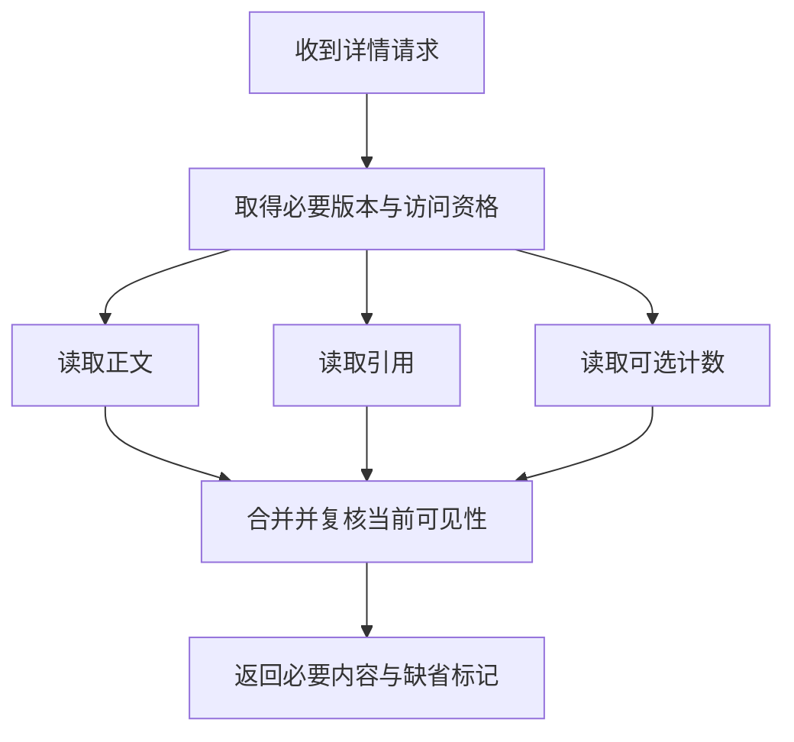

# 专题 K：慢接口诊断、关键路径与线程连接预算

慢接口诊断需要区分数据库访问、下游等待、同步处理、网络传输、JVM停顿与任务依赖，并依据关键路径分配线程、连接和截止时间预算。以下案例的规模、耗时和配置数字均为假设输入；示例采用MySQL8.4、Java21的相关语义。

## K.1 先定义“慢”的观察点，再寻找被阻塞的资源

同一业务可能有多个完成点：HTTP已受理、数据库事实已提交、后台处理已完成、结果已经可见、客户端接收完整内容。它们需要各自的SLI。上传接口很快返回task_id，不代表文件已经可检索；聊天服务器已确认入库，不代表接收设备已读；流式回答首字到达很快，也不代表完整答案更快。

一次请求的串行部分可以写成：

`端到端时间 = 入口排队 + 本地执行 + 各资源获取等待 + 外部调用 + 结果编码传输`。

并行分支要按依赖图求关键路径，不能把所有span直接相加。父span经常包含子span；把父子都加一遍会重复计算。跨机器墙钟可能有偏差，本机持续时间使用适合的单调计时，跨进程按追踪关系和相应工具约定分析。追踪上下文要显式传给线程池和消息链路；仅在日志中打印request_id还不等于已经记录每段排队时间。[H07]

统计分位数也有边界：一个请求内的阶段耗时可以求和，多个阶段各自的P99不能直接相加成为端到端P99；各实例P99也不能直接平均成为全局P99。需对同一总体的延迟分布采用可聚合的统计方式，并把成功、超时、拒绝分别报告。[H08]

### 一张能够指导下一步的诊断表

| 诊断方向 | 应收集的证据 | 证据支持后再做什么 | 容易误判的地方 |
| --- | --- | --- | --- |
| SQL访问路径不合适 | SQL指纹、真实参数、扫描/返回比、实际计划、热点分布 | 调整谓词、联合索引、分页与批量 | 看到接口慢就猜索引失效 |
| 数据库锁等待 | 阻塞事务、等待链、持锁SQL、事务年龄 | 统一锁序、缩小事务、减少热点冲突 | SQL本身快就认定数据库没问题 |
| 获取连接慢 | 池active/pending、获取耗时、连接持有时长 | 释放外部等待占用、隔离在线与批量、限制准入 | 将池上限扩大到数据库最大连接数 |
| 下游服务慢 | 连接建立、排队、首字节、完整响应、错误分类 | 截止预算、缓存、批量、熔断与隔离 | 超时后让所有层都重试 |
| 返回内容太大 | 行数、响应字节、序列化CPU、客户端读取时间 | 只取必要字段、分页、压缩或异步导出 | LIMIT只能限制行数，不能限制每行大小 |
| JVM/本地执行慢 | 分配速率、GC暂停、线程栈、锁竞争、CPU采样 | 降低驻留量、流式处理、减少复制或算法工作量 | 所有暂停都当成Full GC |
| 网络链路慢 | DNS/TCP/TLS/TTFB、重传、连接复用、代理指标 | 修复相应阶段、复用连接、减少跨区往返 | ping正常就认为应用网络正常 |
| 多分支串行等待 | 依赖图、每分支耗时、可降级项、扇出量 | 有界并行或先批量化，保留必要串行依赖 | 把存在业务依赖的两步并行执行 |

排查顺序是从用户现象到责任链，再沿最慢的一段向下。可以有多个根因：大结果集先增加分配率，GC停顿再延长连接持有时间，最后体现为大量请求等连接。找到“池满”后要继续寻找最初增加占用的原因。

## K.2 案例 K1：租户任务列表慢，为什么同时出现索引、分页和连接问题

### K.2.1 业务假设与初始查询

假设某资料处理平台有一张研究任务表，支持按租户、状态和创建时间查看最近任务。表有5000万行，正常租户有几千行，一个大型租户有800万行；正文与中间结果字段很大。初始只有tenant_id单列索引，界面允许不断增加页码。

```sql
-- 教学中的待分析查询。DATE()是否可被特定功能索引支持另论；
-- 本例只有普通tenant_id索引，不预设优化器的实际执行计划。
SELECT *
FROM research_run
WHERE tenant_id = :tenant_id
  AND state = 'READY'
  AND DATE(created_at) = :target_day
ORDER BY created_at DESC, id DESC
LIMIT 200000, 50;
```

面试官说“这里索引失效了”，可以先把问题拆开：tenant_id索引可能仍在使用，但命中该租户的候选行很多；状态和日期可能需要后置过滤；排序可能需要额外工作；大offset会丢弃前面大量结果；SELECT *又把大字段读出。是否全表扫、是否回表、是否额外排序，应由计划证实，不能把一切统称“失效”。[K01][K04]

### K.2.2 优化方案要同时明确语义

先把产品接口改成连续游标翻页，并限制每页条数与返回字节；导出走单独的可靠任务。将日期转换成半开时间区间。若存储使用UTC，区间端点在应用中按业务时区转换，避免直接对每行时间字段执行时区或日期函数。候选联合索引是：

```sql
-- 这是待评估的DDL方案，实施方式与MDL预算见E篇。
CREATE INDEX idx_run_tenant_state_time
ON research_run (tenant_id, state, created_at DESC, id DESC);

-- 后续页。第一页不带游标条件；游标必须绑定tenant/filter/order。
SELECT id, state, created_at
FROM research_run
WHERE tenant_id = :tenant_id
  AND state = 'READY'
  AND created_at >= :begin_utc
  AND created_at < :end_utc
  AND (
       created_at < :cursor_time
       OR (created_at = :cursor_time AND id < :cursor_id)
  )
ORDER BY created_at DESC, id DESC
LIMIT 50;
```

索引顺序体现本次访问模式：租户和状态是等值过滤，时间与id给出稳定顺序。若另一接口不带state，该索引对其排序的帮助不同，应按具体查询评估，不能为每种可选条件堆一组索引。常规联合索引定位遵循左前缀关系；实际版本的其他优化方式仍应以计划为准。[K01]

列表先读取小字段，正文按需批量读取。最终可见性不能仅依赖列表锚点的旧状态：资料被撤销、任务权限改变后，返回正文前仍遵循当前授权策略。游标避免大offset，并不自动冻结状态变化。若用户要求“翻完同一份稳定报表”，需明确快照、导出版本或固定结果集；若要求“始终展示当前可见任务”，就应允许列表在合法状态变化后变短或出现更新。

### K.2.3 低区分度字段是不是不能建索引

“状态只有几种”与“查询能过滤多少行”不是一回事。假设READY只占0.05%，FAILED占0.01%，COMPLETED占99%以上：状态取值少，但查FAILED可能仍有选择性。某个租户内的比例还可能与全表不同。另一方面，若查大半张表并返回很多正文，扫描二级索引再大量回表的成本可能高于其他访问方式。[K04]

因此应回答三个层次：单列值分布、联合条件下的相关分布、实际查询需要读取与排序的列。性别这样的低基数字段既不意味着“永远无用”，也不意味着值得单独索引；它在某个联合索引里是否有帮助，要结合主过滤条件和覆盖需求验证。

### K.2.4 ORDER BY与filesort怎样解释才准确

`Using filesort`表示需要额外排序步骤，不等于一定使用磁盘临时文件；数据能放入相关缓冲时可在内存排序。某个查询有额外排序也未必是首要瓶颈，需要看参与排序的数据量、是否溢写和总耗时。MySQL8.4也不能依赖GROUP BY附带预期顺序，要排序应显式声明ORDER BY。[K02]

同分或同时间记录应增加稳定的唯一排序键。为减少排序把业务要求的顺序删除，会改变结果语义；为掩盖慢查询把每连接sort_buffer任意放大，也可能在并发排序时放大内存需求。[K02][K13]

### K.2.5 怎样验证，怎样防止“优化前后”失去可比性

记录相同版本数据、相同参数分布、相同并发与缓存状态下的结果。教学观察表如下，表内是应测量的项目，不是假造的执行输出：

| 观察项 | 优化前假设 | 要验证的改善 | 同时防止的新问题 |
| --- | --- | --- | --- |
| 扫描/返回比 | 大租户扫描很多候选才返回50条 | 候选范围与结果规模更接近 | 状态稀疏、游标过滤导致继续扫描 |
| 排序工作 | 可能对大量候选额外排序 | 实际使用索引顺序或显著缩小排序集合 | 不带state的另一查询退化 |
| 返回字节 | 携带不展示的大正文 | 返回仅含列表必要字段 | 新增逐行查询形成N+1 |
| 写入成本 | 当前索引较少 | 读收益满足目标 | 新索引写放大、磁盘、复制延迟 |
| 池等待 | 热接口占连接较久 | 连接持有和获取等待减少 | 热点恢复后导出任务抢光连接 |

EXPLAIN ANALYZE会实际执行受支持的语句，并给出执行相关信息；应在受控数据和负载条件下使用，而不是把线上昂贵查询无条件再执行一遍。不同算子的时间和loops不能不加区分地相加，尤其父算子时间可能包含子算子工作。[K03]

回滚保留原接口的受控入口和新索引上线开关。接口协议变化、索引变更和数据迁移分开发布，先确认结果集合和排序正确，再扩大流量。如果只是某些租户变快、另一些变慢，应按租户分布重新评估，而不是只报全局平均值。

## K.3 案例 K2：检索聚合接口串行执行，怎样安全地并行和异步

### K.3.1 先区分三个不同动作

**并行**让独立工作在时间上重叠；**异步编程**使调用方不必一直占用同一线程等待；**异步业务受理**则允许本次请求先返回一个任务状态，业务随后完成。使用CompletableFuture不自动等于改变业务受理协议；把controller返回值改成task_id也不自动建立可靠任务。

假设一个资料详情接口的必要步骤是：先校验访问资格，再读取正文和引用；点赞计数是可缺省展示项。若正文位置依赖元数据结果，这条依赖不能并行。若正文和引用在拿到文件版本后可以独立读取，可以并行，但最终仍需执行既定的当前可见性检查。



对这条教学链路，若资格检查15ms、正文80ms、引用120ms、计数60ms、合并25ms，完全串行共300ms。忽略资源争用时，并行必要读取的关键路径约160ms；这只是单请求确定耗时的模型，不能直接宣布生产P99降低47%。引入并行后还要测请求内扇出、共享依赖压力和尾延迟。

### K.3.2 单请求快了，为什么整个系统可能更慢

假设每秒1000个详情请求，每个请求向同一下游发3次查询，则每秒产生3000次下游调用。即使三次并行，调用总量也没有减少。如果下游安全处理能力只有2000次/秒，最终仍会排队或拒绝。优先检查能否合成一次批量调用，再讨论是否并行；批量也需要限制条数与字节，不能形成超大单次请求。

对必须返回的分支，设共享请求截止时间；对可选分支，设独立较短预算并定义缺省值。不能将权限校验、库存是否已占用等必要判断降级为默认通过。不同票的查询可以独立并行，但购买相邻多个座位若要求全成全败，仍要遵循业务事务和统一锁序，详见J篇。

### K.3.3 一个有界并行的Java教学示例

下面用于只读聚合，重点是显式线程池、一次请求的统一截止时间、排队后的预算复核和明确拒绝。调用方在请求入口创建本机单调时钟截止时间，并将其传给readBoth；前置鉴权已经消耗的时间不能在聚合函数里重新获得。真实HTTP客户端还必须把获取连接、建立连接、读取响应与重试都约束在同一剩余预算内，并可靠关闭响应体。跨机器传播剩余时长或协议定义的截止信息，不能直接比较两台机器的System.nanoTime值。调用有外部副作用时，应使用D篇的持久操作协议，不能直接套这个只读模板。

```java
import java.util.concurrent.*;

// 由应用生命周期管理，不能每个请求new一个线程池。
// 8线程/32队列仅为示例；应根据调用能力与等待预算反推并压测。
final class ReadFanout implements AutoCloseable {
    private final ThreadPoolExecutor pool = new ThreadPoolExecutor(
        8, 8, 0L, TimeUnit.MILLISECONDS,
        new ArrayBlockingQueue<>(32),
        Executors.defaultThreadFactory(),
        new ThreadPoolExecutor.AbortPolicy());

    interface TimedRead<T> {
        // 实现应把budgetNanos约束到实际客户端等待，且正确释放响应资源。
        T call(long budgetNanos) throws Exception;
    }

    record Pair<A, B>(A first, B second) {}

    private static long remaining(long deadline) throws TimeoutException {
        long left = deadline - System.nanoTime();
        if (left <= 0) throw new TimeoutException("request budget exhausted");
        return left;
    }

    <T> Future<T> submit(long deadline, TimedRead<T> action) {
        return pool.submit(() -> {
            // 任务可能已在队列里等很久，此时重新检查剩余预算。
            long budget = remaining(deadline);
            if (Thread.currentThread().isInterrupted())
                throw new InterruptedException("cancelled before call");
            return action.call(budget);
        });
    }

    <A, B> Pair<A, B> readBoth(long requestDeadlineNanos,
                             TimedRead<A> a, TimedRead<B> b)
            throws Exception {
        // 在入口设置总预算，例如400ms；本子阶段只继承，不重新计时。
        long deadline = requestDeadlineNanos;
        Future<A> fa = null;
        Future<B> fb = null;
        try {
            fa = submit(deadline, a);
            fb = submit(deadline, b);
            // 两个任务已经提交；顺序get不会重新使任务串行执行。
            A ra = fa.get(remaining(deadline), TimeUnit.NANOSECONDS);
            B rb = fb.get(remaining(deadline), TimeUnit.NANOSECONDS);
            return new Pair<>(ra, rb);
        } catch (InterruptedException ex) {
            Thread.currentThread().interrupt();
            throw ex;
        } finally {
            // 第二次submit被拒绝时，第一次提交也必须收尾。
            if (fa != null && !fa.isDone()) fa.cancel(true);
            if (fb != null && !fb.isDone()) fb.cancel(true);
            // submit返回的FutureTask取消后可能暂留队列，清除已取消项。
            // 高频服务应评估purge扫描成本，采用明确的移除/周期清理策略。
            pool.purge();
        }
    }

    @Override public void close() {
        pool.shutdown(); // 真实停机流程另设等待与未结束任务的处理期限。
    }
}
```

该示例用标准Future尝试中断正在执行的任务，但中断是协作机制，不能证明远端工作已经停止。若实际库忽略中断，工作线程仍可能被占住，直到实际调用退出；不能在等待方超时的一刻就把“真正活动调用”的许可计数减掉。CompletableFuture的cancel参数也不能被理解为自动中断底层工作，其文档明确说明mayInterruptIfRunning在该实现中不用于控制处理。[K07][K08]

还有两个边界需要在面试中说清。第一，示例按fa再fb取结果，若fb早已失败而fa还在运行，可能不会最快发现失败；要求fail-fast时可增加完成队列或受控的组合逻辑，仍沿用统一截止时间。第二，示例的8个线程只约束这个池，不能自动覆盖其他服务实例、其他线程池或其他客户端，真正的下游预算还需要整体分配。

并行聚合的验证应覆盖分支同时启动、入口预算已过期、排队后预算到期，以及第二次提交被拒绝后第一次任务的取消与队列清理。还应结合实际HTTP客户端与下游协议，验证吞吐、超时率和取消后的远端行为；本地任务取消不等于远端操作已终止。

### K.3.4 改成业务异步，需要增加什么

文件解析、批量导出或较长研究任务适合评估异步受理，但需先明确“受理”的产品承诺。若承诺服务重启后仍会处理，应在返回前持久化任务和必要发布责任，并提供状态查询、取消意图、失败原因与保留期限。HTTP202仅说明请求已接受且尚未完成，本身不承诺一定执行成功。[K12]

至少分开测量：受理耗时、排队年龄、真正处理耗时、最终完成耗时、用户取消后继续耗费的工作量。只优化受理P99而使任务排队从10秒变成10分钟，不能称为用户体验整体改善。验收还要包括进程在受理后立刻退出、消息重复、权限撤销、下游超时和任务回收；这些状态机与恢复责任见第4章、D篇和G篇。

### K.3.5 验证与回滚

在相同到达率下比较串行、批量、有界并行三种版本，同时记录必要结果完整率、可选降级率、每请求实际调用数、活动连接与队列年龄。逐步提高单请求扇出只是一种实验变量，不是默认优化方向。

灰度可以先对只读请求做结果比对，再放开实际并行。回滚并行配置时，已经运行的任务不会自动消失，需要等待、取消并跟踪收尾。业务已从同步改成异步时，还必须继续处理已经受理的任务，不能只切回旧接口便停止旧任务执行器。

## K.4 案例 K3：大文件解析引起GC，为什么在线检索也变慢

### K.4.1 从对象驻留时间解释，而不是先换GC参数

假设同一Java进程承担在线检索和后台文件解析。某次发布后，解析器一次读完整文件，队列中还保留原始字节数组，解析时产生文本、图片与中间对象。单份输入64MiB，同时处理12份，仅三份等尺寸缓冲就可能占用`64×12×3=2304MiB`；解压与对象布局可能继续放大。这里的“三份”是为了说明复制成本的假设，真实驻留量应从采样与内存分析得出。

在线检索没有修改SQL，却出现更多尾延迟。可以检查：解析流量上升是否与分配速率、GC暂停、CPU占用、堆内存和线程排队同步变化；暂停时是否在线线程也停止推进。再检查队列是否把大对象作为任务参数长期持有。只看到young GC频繁并不能证明有泄漏，关键还包括回收后存活量、驻留时间和对象来源。

G1对于大对象与连续region需求有具体处理机制，极端情况下可出现总体仍有空闲内存但无法满足连续分配的情形；因此应先确认对象尺寸、分配模式和GC证据，再评估堆或region调整，不能凭接口慢就直接套一组JVM参数。[K10]

### K.4.2 先建立资源预算

先将队列元素改为可靠任务ID、文件版本和对象地址等小引用，而不是整份文件或已解析对象。执行器按字节预算领取任务，流式读取或按页处理；不能流式化的解析器则放进受限工作进程，设置输入、解压后大小、页数和执行时间等边界。任务失败要有可查询状态与重试规则。

教学预算：Java堆4096MiB，稳定业务保留1024MiB，再预留1024MiB作为波动安全空间。若受控测试表明单任务峰值增量约384MiB，则内存预算推得同时处理上限约`floor((4096−1024−1024)/384)=5`。这是其中一条约束；CPU、文件带宽、外部OCR配额可能要求更低并发。输入大小差别大时，统一“5个任务”仍不够，应使用按预计工作量领取的加权预算，并对低估情况设置硬上限和退出策略。

进程总内存不能只看-Xmx。线程栈、直接缓冲、元空间、映射文件和本地库等也会占用内存；容器预算需要为这些部分留空间。反过来，将所有剩余容器内存都给堆，可能把问题从堆内OOM变成进程被终止。

### K.4.3 用什么证据区分CPU、GC、锁和I/O

| 证据组合 | 候选解释 | 下一步 |
| --- | --- | --- |
| 分配率上升、暂停增多、队列持有byte数组 | 缓冲复制、批量过大、任务驻留 | 对照任务大小与存活对象，减小批次与预读 |
| CPU持续高、GC占比低、采样集中在解析/序列化 | 算法或编码工作量大 | 检查重复解析、重复拷贝、缓存与计算隔离 |
| CPU较低、线程等待相同连接池 | 下游或连接资源限制 | 回到池等待与实际活动调用 |
| 多次采样有相同monitor等待、持锁线程在慢I/O | 应用锁范围过大 | 缩短锁区，避免持锁跨网络；保持业务不变量 |
| 堆回收后稳定但RSS持续升高 | 堆外/本地部分值得检查 | 看直接缓冲、映射、本地库及进程内存 |
| GC不长但所有工作有空白、CPU被限额 | 调度或容器资源竞争可能参与 | 结合调度、CPU限额与操作系统指标 |

线程栈是某一时刻的切片，应在合适间隔取多份并关联指标。RUNNABLE不等于此线程始终占满CPU，WAITING也不直接等于故障；需要看它等待什么、等多久、由谁推进。观察“线程暂停”时，还要区分GC、锁、条件等待、I/O、进程调度和安全点相关证据。

以下是需要由有权限的工程人员在受控环境选择执行的诊断示例。用真实 PID 替换占位符；先用 help 核对目标 JDK 实际支持的命令，避免对全部 JVM 发送操作。[K09]

```bash
jcmd <PID> help
jcmd <PID> Thread.print -l
jcmd <PID> GC.heap_info
jcmd <PID> JFR.start name=latency settings=profile duration=60s filename=/diagnostics/latency.jfr
```

JFR录制配置、权限、目录容量和开销需要提前评估。线程转储、类直方图、堆转储也有不同影响等级；尤其不能把昂贵堆转储当成每秒一次的常规监控。先用现有指标缩小范围，再选择诊断手段。

### K.4.4 隔离与发布策略

在线检索与离线解析使用独立队列和执行资源，必要时拆成独立进程，避免共享堆成为共同故障域。拆进程后仍可能共享数据库、对象存储或OCR供应商，因此各资源总预算还要分别控制。

解析产物写入不可变的attempt路径，最终发布时校验文件版本、撤销状态和当前执行授权。旧解析进程超时后迟到，不能覆盖新版本或恢复已撤销内容；大文件性能优化也必须保留这一正确性条件。

验证应混合小文件、大文件、高压缩比文件、解析失败、取消与在线查询，比较在线尾延迟、解析完成率、峰值内存、GC分布与单位字节处理成本。若回滚到旧解析器，保持新并发上限与输入限制，不能为了代码回滚同时把资源保护全部撤掉。

## K.5 案例 K4：下游内部只用50ms，调用方为什么等了800ms

### K.5.1 把“网络问题”拆成可以验证的阶段

一次HTTPS调用可能包括客户端排队、取连接、DNS、TCP、TLS、发送请求、远端排队与处理、接收响应。服务端日志的50ms可能只覆盖业务处理，未包含代理、连接建立、客户端队列和完整返回。连接复用、重定向、代理与HTTP协议版本还会改变各阶段。

用受控GET请求做一次旁路观察可以帮助定位，但不能替代应用内实际客户端指标。示例中的example.com是占位域名；实际诊断使用已授权、只读、不会触发业务副作用的接口。

```bash
curl --silent --show-error --output /dev/null \
  --connect-timeout 2 --max-time 5 \
  --write-out 'dns=%{time_namelookup} connect=%{time_connect} tls=%{time_appconnect} first_byte=%{time_starttransfer} total=%{time_total}\n' \
  https://example.com/read-only-health
```

这些时间字段多为从传输开始到相应阶段的累计时间，不能直接相加。仅在单次无重定向、新建TCP/TLS连接等相应假设下，阶段相减才有直观意义；连接复用、HTTP/3、代理和请求上传会改变解释。TTFB还可能包含上传与服务端排队，不等于纯服务端CPU处理。[K11]

教学样本：DNS完成20ms、TCP完成60ms、TLS完成130ms、首字节600ms、全部结束800ms。此时新增的连接建立阶段约40ms，TLS阶段约70ms，首字节之后约200ms。130到600之间的470ms需要继续用服务端/代理追踪判断，不能全部归罪于业务代码。

### K.5.2 对症改造与各自代价

| 已确认的问题 | 设计动作 | 需要同时验证 |
| --- | --- | --- |
| 每请求新建TLS连接 | 生命周期内复用客户端与连接，控制空闲/存活时间 | 连接池是否拥塞、端点切换后旧连接如何淘汰 |
| 返回大JSON或文件走应用转发 | 减字段、分块/分页，合适场景直传对象存储/CDN | 授权、版本、流量费用与撤销策略 |
| 跨区多次串行往返 | 数据与计算就近、批量调用、缩短必要往返 | 主权/一致性要求是否允许本地读写 |
| 慢接收方占用缓冲 | 限制输出缓冲与连接占用，超预算结束并支持续传 | 不能丢失已承诺的聊天或任务事实 |
| 代理空闲超时与应用超时不匹配 | 梳理完整超时预算和关闭时序 | 重连是否放大流量、未知写结果是否有核对 |
| 短时失败触发大量重连与重试 | 随机退避、连接建立限速、重试总预算 | 新请求与恢复请求是否争抢同一资源 |

不能通过关闭TLS校验、跳过鉴权或永久缓存DNS来“优化延迟”。连接复用应该与健康检查、端点更新和实际协议行为配合；长连接不是永远不需要重新建立。

### K.5.3 流式回答与WebSocket的特殊指标

流式回答至少记录等待首个有效内容、完整完成、客户端接收速度、断线与恢复情况。提前发一个空事件可以保活，但不能把它当作有效首字延迟改善。模型和工具调用的依赖关系要保持可解释，工具证据尚未完成时不能靠提前输出未经验证的结论满足延迟目标。

WebSocket网关还应区分活跃连接数、真正发送消息的连接数、广播扇出和输出字节。大量空闲连接与少量极慢接收方会形成不同瓶颈。对可丢弃弹幕可以丢过期展示，对持久聊天则通过补历史恢复；对应第3章的业务成功定义不能在性能优化中被改变。

验证同时覆盖新连接与复用连接、正常和慢客户端、不同地域、大小响应、代理切换和冷启动。回滚新的连接策略时采用渐进重建，避免一次性关闭所有连接制造新的瞬时洪峰。

## K.6 线程池与连接池的资源预算

### K.6.1 七个参数怎样联系实际场景

| ThreadPoolExecutor参数 | 决定什么 | 面试中需要给出的依据 |
| --- | --- | --- |
| corePoolSize | 常驻执行能力的主要配置 | 平均负载、CPU或I/O特性、下游并发预算 |
| maximumPoolSize | 队列无法接纳后仍允许扩出的线程上界 | 峰值预算、线程内存与共享下游余量 |
| keepAliveTime | 非核心空闲线程保留时间；允许核心超时时也作用于核心 | 突发间隔与线程创建成本 |
| unit | 存活时间单位 | 与配置值配套，避免单位错误 |
| workQueue | 尚未执行工作的存放方式与上限 | 可接受等待、单任务引用大小、过期任务清理 |
| threadFactory | 线程创建与命名等属性 | 排障可识别性、生命周期管理 |
| handler | 拒绝新工作的行为 | 调用方语义、是否已可靠受理、过载响应 |

ThreadPoolExecutor通常先扩到core，再尝试入队，队列不能接纳时才继续扩到maximum，最后拒绝。因此无界队列常使maximum无法发挥期望的扩容作用，同时带来无界等待。选择有界队列也仍须根据任务尺寸、等待与负载压测。[K06]

四类常见策略要结合责任解释：Abort显式抛拒绝；CallerRuns在执行器未关闭时让提交者执行，可能阻塞网关/事件循环；Discard会丢弃新任务；DiscardOldest在执行器未关闭时丢掉队头并重新尝试。关闭状态下CallerRuns和DiscardOldest也可能直接丢弃。业务已经可靠受理时，不能用“静默丢弃”完成责任交接。使用submit返回Future时，更要防止静默拒绝使等待方拿着永远不完成的Future。自定义拒绝策略应明确报告未接纳或把责任保存在可恢复存储中，而非仅打印日志。[K06]

### K.6.2 队列大小不是凭最大内存直接算

教学例子：完成能力400任务/秒，希望常规等待不超过100ms，则`400×0.1=40`可作为量级估算；它不是对每个任务的严格等待保证，服务时间尾部、到达突发和并发批次都会影响结果。若每个队列元素只持有2KiB上下文，40个约80KiB；若闭包捕获了一份20MiB文件，40个就变成800MiB。需要测真实保留对象，而不只看队列元素数。

更直接的控制是每个任务携带截止时间，领取时跳过已经不能完成的任务，并把被跳过的业务责任按语义标为失败、过期或待重新规划。等待上限、在途上限和字节上限需要同时存在。

### K.6.3 连接总额怎样分配到实例

假设数据库给这组相关业务的经验证总安全连接预算是240个，其中后台与恢复保留60个，在线业务最多12个应用实例，则单实例在线连接池预算上界约15个。计划临时扩到20个实例时，若仍每个15个，在线总池上限变成300个，已经超过原来的180个在线份额。

这个预算是资源分配结果，不是吞吐最优值。连接越多，可能让锁、CPU、存储与内存竞争越重；连接太少则可能浪费下游能力。应从实际事务、单连接持有时间与下游服务能力进行容量测试，HikariCP也明确强调连接池大小依赖部署与负载。[K05]

区分三种时间：获取连接超时、SQL/事务执行预算、连接的空闲与最大存活时间。缩短最大存活时间不等于给业务SQL增加截止时间；长事务也不能因“池有泄漏检测”就自动回滚。实际连接池和驱动的取消、超时与连接失效语义需按所用版本核验。

### K.6.4 嵌套取连接为什么会让系统看似死锁

教学情形：8个线程各持有1个连接，又同时申请第二个；池只有8个连接，全部等不到。首先改掉持有一个连接时无必要再取另一个的结构，缩小事务、复用正确的事务连接，或调整任务依赖。

在“最多T个任务、每任务最多同时需要C个同类连接、符合相应资源申请假设”的简化模型下，`T×(C−1)+1`是避免该类资源互等的一个边界。它不是数据库最佳池大小，也不解决数据库行锁死锁、跨池循环等待或无限任务提交。[K05]

线程池也有类似问题：所有worker都在同一小池中提交子任务并阻塞等待，而子任务也只能由这批worker执行。解决办法是重构依赖或使用不会占死执行资源的组合方式，并分别限制扇出。盲目再加若干线程只对当前规模暂时有效。

## K.7 性能优化的证据与验收框架

案例证据至少分四组：业务结果是否正确；瓶颈证据是否支持根因；资源预算是否覆盖峰值；新旧方案是否用相同口径比较。

应用示例：在NoteWeave类资料研究平台中，可把“研究列表查询”“资料解析”“混合检索聚合”“流式回答”分别作为四条链，说明哪些动作串行依赖、哪些可并行、哪些允许异步受理。

| 面试追问 | 应展示的材料 | 不充分的回答 |
| --- | --- | --- |
| 怎么发现 | 端到端SLO、特定租户/请求样本、变更时间 | 用户说慢，所以加缓存 |
| 怎么定位 | Trace分段、池等待、SQL计划、JFR或网络证据 | 看CPU高，猜数据库慢 |
| 为什么这样改 | 访问路径、依赖图、容量与状态语义 | 常见方案都是这么做 |
| 怎样验收 | 同负载正确性、成功率、P99、单位资源成本 | 只比较两个平均耗时 |
| 怎样处理失败 | 超时、拒绝、取消、未知结果与恢复责任 | 失败自动重试即可 |
| 怎样回滚 | 灰度、旧协议兼容、已受理任务收尾 | 改配置回旧值就结束 |

## K.8 连续追问详答

### Q1：面试官只说接口很慢，第一句话怎么答？

先确认是偶发尾延迟还是普遍变慢、哪个业务完成点慢、从什么时候开始以及影响哪些请求。接着提出按入口等待、池等待、应用执行、下游调用和响应传输拆分证据。可以先用一个明确假设推进，不需要等所有监控齐全才讨论，但必须说明后续如何验证假设。

### Q2：索引建了，查询还是慢，怎么判断是不是“索引失效”？

先看实际访问路径与扫描/返回比。使用了索引但候选很多、回表很多、排序很多、返回字节很大，依然会慢。再检查参数类型、表达式、联合条件、统计分布与锁等待。把“完全没用索引”和“用了但成本仍高”分别处理，才知道该改谓词、索引、返回方式还是事务。

### Q3：性别、状态这些低基数字段到底能不能建索引？

判断具体取值和联合条件能够过滤多少候选，以及查询是否可利用排序或覆盖。一个只有3种取值的状态字段，稀有状态可能很有选择性；占大多数的状态则未必。还要看租户内分布、读写比例和索引维护成本，不能仅凭“种类少”决定。

### Q4：ORDER BY出现filesort，必须优化掉吗？

不必以消灭标记为目标。先看参与排序的数量、是否溢写以及它占总耗时多少；小候选集合上的内存排序可能很便宜。若排序成本确实高，再考虑符合过滤与排序模式的索引、减少候选和输出列。要维持原有排序语义，同分需要稳定键。

### Q5：为什么SELECT只返回50行，接口仍能很慢？

数据库可能扫描或排序了大量行才挑出50条，深offset也可能丢弃很多结果；50行还可能各有很大的字段。进一步还有取连接、锁等待、序列化、网络和下游聚合。LIMIT约束返回数量，不直接约束所有内部工作量。

### Q6：增加连接池能解决拿连接等待吗？

当数据库还有真实余量、任务也没有不必要地长时间持有连接时，增加池大小可能有帮助。若根因是事务里等待第三方、热点行锁或数据库已经饱和，扩大池会继续加压。应先测活动与等待、持有时间和数据库实际瓶颈，再在全实例连接预算内调整。

### Q7：怎么判断一个任务适合并行？

它不依赖另一任务的输出，并且同时执行不会破坏业务顺序与共享资源约束。读取正文和引用可以在拿到必要版本后并行；先预留库存再创建支付入口有明确先后。即使逻辑独立，也应先评估批量化能否减少调用，再决定并行度。

### Q8：顺序调用两个Future.get，会不会把已经提交的任务变成串行？

不会，任务何时运行由执行器决定，两个任务已提交且有可用执行能力时可同时执行。顺序get影响的是等待与发现失败的方式：后一个先失败，可能要等前一个返回才发现。每次get应使用同一请求剩余预算，不能各给完整400ms造成总等待超标。

### Q9：为什么Future已经取消，监控里下游调用还没结束？

取消可以只改变本地等待状态，或尝试发出中断；底层库与远端不一定停止。需要把逻辑请求结束、线程真正退出、连接归还和远端效果确定分别观测。只读慢调用也会继续消耗资源；写调用还需要持久化未知结果与核对责任。

### Q10：把文件解析改成异步，怎样证明它真的变快？

先说明优化目标。如果目标是降低受理接口等待，报告受理延迟和可靠受理率；如果目标是更早可检索，还要报告从上传结束到结果可见的完整时延。队列越来越长时，接口很快返回task_id并不能证明完成体验改善。同时检查重复、取消和恢复行为。

### Q11：用了虚拟线程，线程池与连接池预算还重要吗？

重要。虚拟线程主要改变阻塞任务等待时的线程资源使用方式，不会增加数据库、HTTP连接、供应商配额或堆内存容量。大量廉价等待者仍可能占据业务内存并形成过长队列。应继续显式限制活动工作、扇出与等待时间；具体阻塞行为按JDK和库版本核验。[H09]

### Q12：GC频繁一定是内存泄漏吗？

不是。大批量临时对象可能提高分配率但最终都可回收；泄漏更需要观察持续增长的可达对象和回收后存活集。也可能是堆外分配、对象复制或压缩文件展开造成瞬时峰值。定位时把对象来源、大小、存活时间与业务负载关联，不仅数GC次数。

### Q13：CPU不高，系统为什么还可能很慢？

大量时间可能花在锁、连接、I/O、下游等待或调度上；关键单线程饱和也可能被整机平均CPU掩盖。还可能存在某个实例或某个分片特别慢，整体平均指标不显著。沿单请求Trace找等待点，并把指标按实例、租户、分片和阶段拆开。

### Q14：能不能靠请求超时自动释放全部资源？

只有每层实现都遵守相应取消与关闭约定，才可能及时释放本地资源。应确认排队任务是否移除、运行代码是否响应中断、响应体是否关闭、数据库驱动取消如何处理、结果未知是否保存。不能把controller超时等同于下游事务回滚或远端操作取消。

### Q15：P99变好，但错误率上升，算优化成功吗？

必须一起评估。快速拒绝可能保护系统，也可能只是将原来的慢请求变成失败。应报告成功请求分布、总体成功率、拒绝/超时比例、业务完成率和错误预算。若这是过载保护，需要明确它保护了哪些已受理或高优先级工作，以及恢复正常服务的条件。

### Q16：用一分钟怎么讲完整一个慢接口案例？

按“场景与目标、证据、根因、改造、验证、失败边界”讲。示范：某租户任务列表尾延迟超目标，Trace显示取连接与大候选查询占比高；计划和结果字节证明联合条件、深分页与大字段共同放大占用；采用匹配查询的索引、稳定游标、小字段列表和有界聚合；用相同租户分布验证正确性、P99、池等待与写放大；灰度异常可回退查询入口，但继续完成已受理导出任务。实施评估应采用目标环境的实际测量数据。

[H07]: https://opentelemetry.io/docs/concepts/context-propagation/ "OpenTelemetry: Context propagation"
[H08]: https://prometheus.io/docs/practices/histograms/ "Prometheus: Histograms and summaries"
[H09]: https://docs.oracle.com/en/java/javase/21/core/virtual-threads.html "Oracle Java 21: Virtual Threads"
[K01]: https://dev.mysql.com/doc/refman/8.4/en/multiple-column-indexes.html "MySQL 8.4: Multiple-Column Indexes"
[K02]: https://dev.mysql.com/doc/refman/8.4/en/order-by-optimization.html "MySQL 8.4: ORDER BY Optimization"
[K03]: https://dev.mysql.com/doc/refman/8.4/en/explain.html "MySQL 8.4: EXPLAIN Statement"
[K04]: https://dev.mysql.com/doc/refman/8.4/en/mysql-indexes.html "MySQL 8.4: How MySQL Uses Indexes"
[K05]: https://github.com/brettwooldridge/HikariCP/wiki/About-Pool-Sizing "HikariCP: About Pool Sizing"
[K06]: https://docs.oracle.com/en/java/javase/21/docs/api/java.base/java/util/concurrent/ThreadPoolExecutor.html "Java SE 21: ThreadPoolExecutor"
[K07]: https://docs.oracle.com/en/java/javase/21/docs/api/java.base/java/util/concurrent/CompletableFuture.html "Java SE 21: CompletableFuture"
[K08]: https://docs.oracle.com/en/java/javase/21/docs/api/java.base/java/util/concurrent/Future.html "Java SE 21: Future"
[K09]: https://docs.oracle.com/en/java/javase/21/docs/specs/man/jcmd.html "Java SE 21: The jcmd Command"
[K10]: https://docs.oracle.com/en/java/javase/21/gctuning/garbage-first-garbage-collector-tuning.html "Java SE 21: Garbage-First Garbage Collector Tuning"
[K11]: https://curl.se/docs/manpage.html "curl: Command Line Manual"
[K12]: https://www.rfc-editor.org/rfc/rfc9110.html#name-202-accepted "RFC 9110: HTTP Semantics, 202 Accepted"
[K13]: https://dev.mysql.com/doc/refman/8.4/en/server-system-variables.html "MySQL 8.4: Server System Variables"
