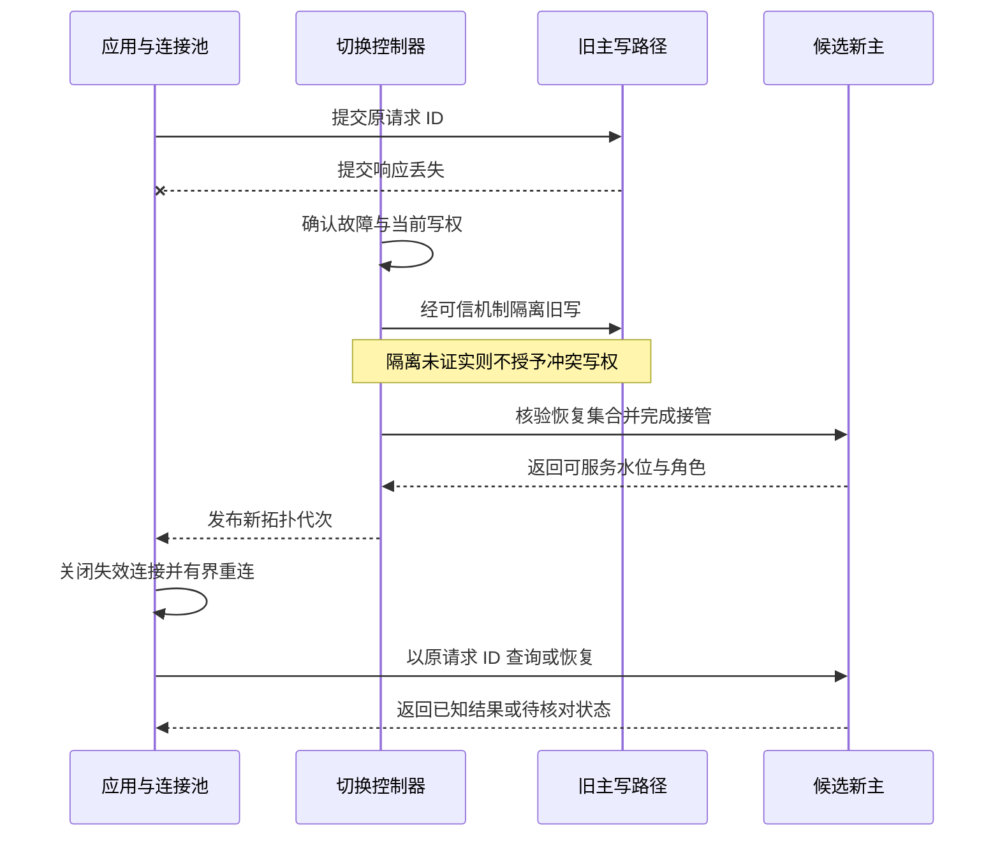
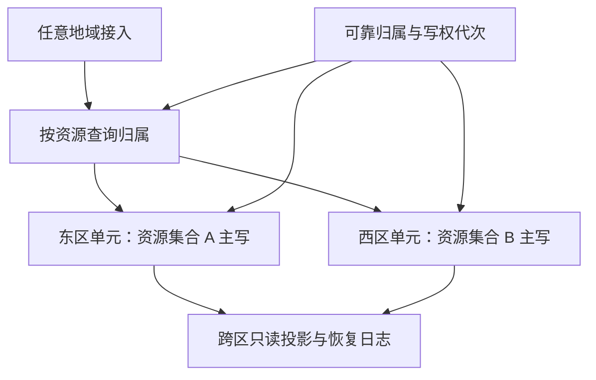
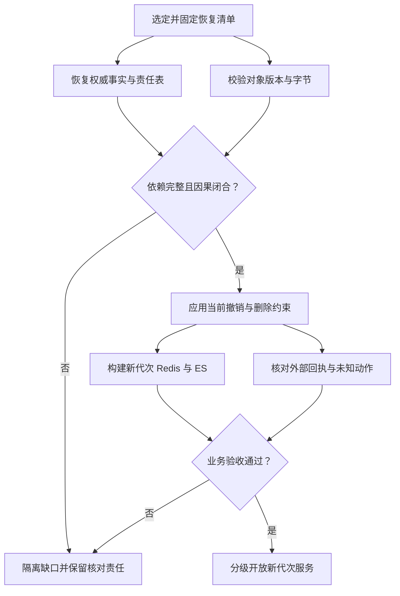

# L：高可用、异地多活与可验证恢复

高可用设计涉及异地多活、备份容灾、数据库主从、Redis 主从与哨兵、监控报警和故障响应。核心问题是：故障发生后，谁还有写入资格；哪些已经成功的请求可以恢复；多久能让用户完成预期业务动作；恢复时会不会重复执行或重新暴露已删除的内容。跨故障域写权、跨存储恢复和故障演练需要共同构成完整的保障链路。

以下架构、容量、时长和故障场景均为教学假设。MySQL 机制以 8.4 为基线，Kafka 跨集群配置以 4.1 为基线；Redis Sentinel 与开源 Cluster 按各自协议分析，不与商业产品的多活能力混用。NoteWeave 用作资料、权限、任务和索引恢复关系的假设场景。

## L.1 先回答“高可用到底保护什么”

### 五个经常混在一起的概念

| 概念 | 要解决的问题 | 成功证据 | 单靠它不能证明什么 |
| --- | --- | --- | --- |
| 高可用 HA | 约定故障下，关键业务继续服务或尽快恢复 | 用户动作成功率、延迟、故障期间的行为 | 已确认数据一定不丢、历史误删可恢复 |
| 复制 replication | 把状态或日志传到其他副本 | 接收、持久化、应用进度及复制健康 | 所有副本不会一起复制错误、复制目标一定有写权 |
| 备份 backup | 保留可独立恢复的历史数据与依赖 | 有效备份链、完整性校验、成功恢复 | 几秒内接管生产、备份中内容一定符合当前业务规则 |
| 容灾 DR | 整个故障域或数据受损后恢复工作负载 | 可执行流程及实际 RPO、RTO | 仅有异地机器就自动恢复全部依赖 |
| 可观测性 observability | 发现影响、解释原因、判断恢复是否完成 | 业务指标、日志、追踪、探测与责任清单 | 报警发出以后一定有人正确处理 |

可用性关注一段时间内的服务质量；容灾目标约束一次灾难中的数据损失和恢复时间。备份与复制都能为容灾提供输入，但保护的故障不同。AWS 的恢复策略说明也明确区分备份恢复、主备与多站点运行，并要求为复制之外的数据损坏保留恢复方案。[L01][L02]

### RPO、RTO 和 SLO 必须落在用户动作上

RPO 是可接受的恢复点损失窗口，RTO 是从服务中断到恢复服务的可接受时间。它们是目标，实际演练结果可能超标；“平均恢复很快”也不能证明每次都满足单次目标。[L01]

对一个订单动作，分别记录“提交成功”“订单可查询”“库存约束成立”“后续履约完成”。对资料上传，分别记录“字节已持久接受”“元数据可读”“权限正确”“检索可用”。这些阶段可以有不同目标，但不能只保住数据库行就宣称原始文件也达成相同 RPO。关键账本的目标可以是在所声明的单故障域损失下不丢已确认事务，分析报表则允许稍后从事实重建。

恢复点也不能只用最新一条记录的时间表示。如果最后一条订单存在，中间几百条却缺失，最大时间戳看起来仍很新。应同时给出已确认事务的覆盖集合、缺口数量、对象引用完整率和对账差额；无法证明的部分标成未知，不能按零计算。

假设按请求统计的 30 天 SLO 为 99.95%，窗口内有 1 亿次合格业务动作，则坏事件预算为 5 万次。当前坏事件比例若为 1%，燃烧率是 `1% / 0.05% = 20`。这里“合格动作”和“坏事件”要预先定义：例如是否计入超过截止时间的 200 响应、重复扣款和恢复期间的 503。不能在故障后把受影响请求从分母删掉。多窗口燃烧率用于关联短时严重影响与持续消耗；低流量业务还需要合成探测和单个高价值失败告警。[L15]

## L.2 案例一：数据库已经切主，为什么订单仍然失败

### 业务架构与不可破坏的规则

假设订单服务部署在同城三个可用区，数据库有主副本，Redis 为可重建缓存，订单与 Outbox 同事务提交。产品要求：同一业务请求不能生成两笔订单；返回成功的事务应满足约定的数据保护级别；切换期间可以明确返回稍后查询，但不能把结果未知伪装成确定失败。

故障模型不是直接关闭旧主，而是旧主到部分网络不可达，某些应用仍能连接旧主。监控同时显示副本被提升、数据库端口正常、业务错误率高。这个案例要检查的是整条接管链路，而不是只检查一个选主日志。

### 观测证据与根因分支

| 看到的现象 | 需要继续核对 | 可能的根因 |
| --- | --- | --- |
| 新主已经可连接，应用仍超时 | 连接池中的目标地址、旧连接年龄、代理拓扑版本 | 连接继续指向旧主，发现机制未更新 |
| 新主读不到刚成功的订单 | 接收日志与已应用事务集合、原请求 ID | 复制未覆盖、应用未追平，或原响应本来就未知 |
| 新旧两边都有新写 | 写入口隔离证明、成员资格、路由代次 | 只切流量，没有撤销旧主写权 |
| Redis 主节点已更新，会话行为异常 | 会话与撤销状态来源、复制进度 | 较旧状态被误当当前权威 |
| 重连后错误率再次上升 | 新连接速率、认证耗时、重试量、下游池排队 | 集中重试与冷缓存导致第二次过载 |

不要用一个“主从延迟为零”抹平这些分支。接收到日志、把日志刷到某个介质、应用事务、业务查询可见，是不同的完成点。MySQL 半同步复制的副本确认表示事务事件已写入并刷入 relay log，不等于已执行到可读状态；超时还可能退回异步复制，必须观察实际模式。[L05]

### 自动切换的完整时序

1. **确认影响与故障域。** 从多个观察位置核实失败，区分主机故障、网络分区和探测器失联；先限制重试，不让故障检测阶段制造无限流量。
2. **建立唯一写权。** 按所用数据库协议确认多数派写入资格，或通过可信的基础设施隔离旧主写路径，并处理旧在途事务。仅修改 DNS、路由表或应用配置不算完成隔离。
3. **选择满足恢复条件的候选。** 核对可恢复的提交集合、复制状态和必要日志，明确有无已确认数据缺口。若接受有损接管，必须记录损失范围与后续核对责任，不能仍声称零 RPO。
4. **让新主达到服务条件。** 完成角色转换与必要的日志应用，验证关键表、权限和幂等查询；不能见到进程变为 PRIMARY 就立即开放全部请求。
5. **更新发现与连接。** 发布代理或服务发现的新拓扑，使客户端关闭无效连接、有界重连。DNS TTL 规定的是记录缓存期限，不负责终止已经建立的连接。[L07]
6. **恢复业务，而不是重做所有业务。** 以原 request_id 查询和推进未知请求；订单、Outbox 和幂等记录一起检查。尚不能确认的操作保留 UNKNOWN，并交给核对流程。
7. **渐进放量与重建冗余。** 验证有效完成率后逐步恢复流量。旧主重新加入前先隔离审计，检查分叉写，再按当前权威状态修复；不能让它带着旧角色直接回流。



写入隔离可以来自存储共识协议，也可以来自确实阻断旧写的基础设施；它不是要求向一个已经失联的旧主发条命令就假定成功。若采用租约，必须证明时钟、暂停、租约失效和资源侧检查的边界。两个异步数据库各检查自己那份旧 epoch，仍可能同时接受写入。

MySQL Group Replication 的单主模式可自动选出新主；8.4 文档还说明，新主可能有待应用积压，事务一致性设置影响何时允许新事务通过。这个机制不能替代应用的连接发现和未知提交处理。[L06]

### Redis 的哨兵不能只答“监控”

开源 Redis Sentinel 同时承担监控、通知、自动故障转移和配置发现：提升副本、重新配置其他副本、向客户端提供新主地址。故障判定的 quorum 与授权切换所需多数 Sentinel 是两个条件，不是业务写入复制了几份。[L03]

开源 Redis Cluster 自己维护槽映射、故障检测和副本提升；Sentinel 面向非 Cluster 的主从部署，不能把二者叠成一套互相争夺角色的切换控制器。Cluster 的异步复制仍存在已确认写回退窗口，部署了 Cluster 不等于所有会话撤销、库存或锁状态都变成强一致。[L04]

### 止血、长期改造、验证与回退

止血先压制重试，隔离不明确的写入路径，把关键状态查询导向可信权威；缓存重建受单独预算约束。长期改造把探测、写权、候选水位、连接更新、业务对账串成可恢复状态机，每一步保存证据和失败重试条件。手工接管也走同一协议，不能绕过写权判断。

验证至少覆盖旧主半失联、提交响应丢失、旧连接不刷新、新主待应用积压、Redis 状态回退、恢复中的第二次故障。回退流量前先判断新主是否已接收新写；一旦出现新提交，切回也是新的主权迁移，要追平并重新隔离旧角色，不能只恢复旧 DNS。面试追问可以沿“谁判故障—谁能写—数据到哪—客户端去哪—未知请求怎么办”持续展开。

## L.3 案例二：两个地域都在线，为什么最后一张票仍然卖了两次

### 从部署形态选择业务承诺

假设东、西两区都部署购票接口。正常情况下就近接入，但两个地域之间可能断网。同一座位只能卖给一个用户，普通浏览可接受短暂旧数据。先比较三种形态，再决定哪些状态允许本地处理。

| 形态 | 请求与写入安排 | 主要收益 | 必须支付的代价 |
| --- | --- | --- | --- |
| 同城多 AZ | 多区计算，关键状态由一套明确写入协议管理 | 承受部分主机或可用区故障 | 仍有地域级共同故障；副本放置和多数派要匹配 |
| 双区主备 | 一区主写，另一区复制并准备接管 | 远端灾难恢复路径清楚 | 异步复制损失窗口、备用容量和接管耗时 |
| 单元化多活 | 两区同时承载不同单元的主权写 | 分散负载与故障影响，独立单元可并行 | 归属迁移、跨单元流程、故障后容量与依赖更复杂 |

多站点运行可以同时服务流量，但并不自动给出零 RPO 或零 RTO；同步方式、路由、依赖与接管协议决定实际结果。[L02] “两区都有数据库、都能写”只描述部署状态，没有说明同一份资源的冲突规则。

### 观测与根因：两个正确的本地事务也会形成错误的整体

假设两区数据库中某座位都显示 AVAILABLE。区间网络断开后，东区把它卖给甲，西区把它卖给乙；两个本地条件更新都成功。等复制恢复，最后写入覆盖其中一条，并不能撤回已经确认给用户的另一张票。

排查要关联 `seat_id、request_id、home_region、ownership_epoch、commit_id`，检查重叠写权和已确认回执。只看数据库冲突数可能漏掉问题，因为最终合并可能已经把一份证据覆盖。根因是同一个唯一性约束被分给两个不互相协调的权威，而不是某条 SQL 缺少行锁。

CAP 讨论的是网络分区下，线性一致性与对所有非故障节点请求都保持可用之间的约束；它不是“整个网站永久只能选 CP 或 AP”的标签。同一系统可以让公开浏览继续读旧投影，让争抢同一座位的写入等待权威或明确拒绝。[L08]

### 设计一：按单元归属写，按需要就近读

为场次或资源桶维护受可靠协议保护的 `home_region、epoch、state`。请求可以在任意地域接入，写操作路由到归属单元。不同场次、不同无共享约束的座位可以并行；同一座位的出售、取消、释放需要在共同权威上串行化判定。跨区只读副本用于浏览时应携带数据年龄，不能拿旧投影完成最终占座。



路由只负责找位置，写权必须在资源提交边界有效。可以使用保证唯一写入的共识存储组，也可以在接管前证实旧地域写路径已被隔离。不能让两个独立异步库只凭各自缓存的归属表决定自己仍是主。控制面不可达时，可继续执行已被协议证明仍有效的既有写权，不能凭空授予新写权；证明不了就停相关单元的冲突写。

主权迁移至少经过停止旧授权、处理在途提交、形成完整迁移水位、目标追平、授予新代次。每对象序列号不能取最大值充当整个桶的完成水位；如果没有桶级全序日志，就保存逐对象已封口与已应用屏障集合。故障接管无法获得完整旧提交集合时，需声明可能丢失的数据，避免在未知历史上自动释放座位。

### 设计二：把可分配库存预先拆成不重叠的使用权

对于无座位编号的 1,000 张票，假设可靠分配台账把东区额度固定为 600、西区固定为 400，两区各自在本地原子扣减自己额度。断网期间可以分别出售，但不能借用对方“看起来还剩余”的额度。可用额度、预留和已售的总量必须来自同一份可审计的分配守恒关系。

从东区转移 50 个额度到西区，应先让东区可靠冻结或扣出这 50 个，再由唯一 transfer_id 证明西区可增加一次。转移结果未知时，这 50 个保持不可用，等待核对；不能两边各自超时回补。旧地域失联也不表示其额度未使用，直接把全部额度重新分配会再次超卖。这是用预分配权换取局部可用，代价是断网时可能一边售罄、另一边仍有闲置。

### 同一原则放到会话、通知与文件权限

| 业务动作 | 可以跨区并行的部分 | 必须守住的权威或顺序 |
| --- | --- | --- |
| 登录会话 | 验证未过期凭据、提供非敏感公开内容 | 刷新令牌轮换、退出与封禁必须有明确权威；签名正确不等于未撤销 |
| 通知发送 | 不同通知独立处理，消息投影异步复制 | 同一通知的发送责任与稳定幂等键唯一；旧区可能已发但未记回执 |
| 文件上传 | 不同不可变对象可分别上传、复制 | 发布元数据要对应确切对象版本；不能把缺字节的副本标记可下载 |
| 文件与资料访问 | 可就近缓存公开内容、生成检索候选 | 私有内容在规定的权威检查点确认当前权限；缓存旧 ACL 不能决定放行 |

严格撤权要求与跨区分区同时发生时，无法确认当前授权的一侧应拒绝敏感访问，或产品预先声明可接受的撤销传播窗口。短时令牌只是收窄窗口；一个已经发出的私有文件直链若还能绕过当前检查，恢复接口上的权限正确也无法补回这条边界。对 NoteWeave，可把租户资料与权限归属同一单元，搜索只生成候选，正文与引用返回时再次经过该单元授权。

通知接管时查询原操作键，未知结果进入核对责任表；不要因为地域或恢复 epoch 变化就生成新的外部幂等键。Kafka MirrorMaker 可以跨集群复制数据与消费进度，但这种跨集群机制不同于分区内部复制，不会替业务形成“东区一定没发过短信”的证明。[L12]

### 止血、长期改造、验证与回退

发现重叠写权先关闭受影响资源的新分配，保存两个地域的回执与流水，核对已承诺结果，不能用最后覆盖的数据库值删除另一方证据。长期改造在单元内完成唯一约束，把跨单元协作表达为预留、确认、补偿和未知核对。

演练要包含区间断网但两区都能接到用户请求、归属缓存陈旧、旧执行者暂停后恢复、额度转移 ACK 丢失、通知已发送但回执未落库、权限撤销期间切流。回退采用新的主权代次和追平过程，不能回退 epoch。连续追问的核心是：哪些操作真的独立；剩下的共享约束由谁判定；不可联系时选择等待、拒绝还是预留额度内继续。

## L.4 案例三：备份全部成功，误删后为什么还是恢复出一套坏系统

### 业务架构与事故假设

假设一个资料与视频平台用 MySQL 保存对象元数据、权限、任务和 Outbox，Kafka 传播事件，对象存储保存原始文件，Redis 和 Elasticsearch 提供缓存与检索。某次程序错误把一批资料标成已删，后续清理任务又开始删除对象。数据库复制、CDC 与索引消费都很健康，于是错误很快传播到所有在线副本。

进一步考虑凭据被滥用、备份被删除或加密的场景。异地复制能帮助应对生产地域丢失，但如果攻击者同时能管理生产和恢复副本，异地位置并不构成足够隔离。NIST 的存储安全指南要求考虑独立恢复副本、管理面隔离、必要依赖和恢复验证；本案例据此设计恢复链，而不把“有一个备份目录”当完成。[L17]

### 观察、定位与第一轮止血

先区分逻辑误删、对象物理删除、权限撤销、索引不可见与密钥不可用。这几类现象都可能表现为“文件打不开”，恢复动作不同。关联错误发布版本、事务边界、event_id、对象 version_id、清理任务回执与审计记录，确定破坏从何时开始、传播到了哪里。

第一轮动作是停止错误写入与物理清理，保全日志、回执和当前副本，在隔离环境准备恢复。若属于凭据失陷，先限制受影响管理面与外部访问能力，避免新恢复环境马上再次受损。不要直接覆盖现有库或把生产消费者连接到刚恢复的旧库；这会丢失事故证据，也可能重发历史副作用。

### 从全量备份加日志，得到可解释的数据库恢复点

MySQL 时间点恢复通常先还原完整备份，再应用其后的 binlog 到选定位置。缺少中间日志、密钥或基础备份，就无法凭最后一份增量恢复完整历史。[L09]

选定点应落在完整事务边界。对于误删，不能机械回放到当前时刻，否则破坏事务也被重放。可以先恢复到已确认安全边界，再根据审查过的事实进行前向修复；错误之后的正常业务也需逐项决定如何保留，不能用一个时间过滤器猜出所有业务依赖。

如果分片之间有 Saga，某库已经记载“预留成功”，另一库只恢复到“预留请求尚未产生”，两份各自正确的快照拼起来仍会产生断裂。需选择因果闭合的事务集合，或把未闭合工作流显式恢复为待核对状态并保留证据；不具备这种元数据时，应承认只能缩小恢复范围或停止受影响流程。

### 跨存储恢复水位是一份清单，不是一个全局时间戳

建议为每次恢复创建不可变清单，记录下列事实。它表达恢复计划的证据，不声称 MySQL、Kafka、对象存储已经参加了一个全局原子事务。

| 系统 | 清单要记录的边界 | 开放前检查 |
| --- | --- | --- |
| 每个 MySQL 分片 | 一致快照标识、事务/GTID 集合、完整 binlog 边界、Schema 版本 | 业务行、Outbox、Inbox、任务责任及其约束一起恢复 |
| Kafka | 源集群与 topic/partition 身份、保留区间、可安全重读的起点、源事务与事件映射 | 日志可覆盖缺口；已恢复事实之外的事件被隔离 |
| 对象存储 | 不可变对象标识、确切 version_id、校验和、对应元数据版本 | 所有拟开放引用能读到正确字节，所需解密材料存在 |
| Redis、ES | 派生代次、构建输入水位、索引或缓存格式版本 | 投影来源与权威集合一致，旧代次不能覆盖新代次 |
| 权限、删除、外部回执 | 独立保护的撤销/删除记录、外部操作键、已知回执与未知任务 | 不能因回滚业务库而恢复旧权限或再次执行外部动作 |

```yaml
# 设计示意：每个 proof_ref 都应指向本次可核验的证据。
recovery_id: restore-run-2026-11-example
serving_epoch: new-authoritative-epoch
mysql:
  shard_03:
    snapshot_ref: verified-snapshot
    included_transactions_ref: reviewed-transaction-set
    binlog_boundary_ref: complete-transaction-boundary
kafka:
  partition_identity_ref: source-cluster-topic-partition-map
  replay_start_offsets_ref: safe-overlap-offsets
  event_to_source_transaction_ref: cdc-or-archived-mapping
objects:
  manifest_ref: exact-object-version-and-checksum-list
security:
  current_revocation_proof_ref: independently-protected-frontier
  erasure_manifest_ref: required-deletion-records
external_effects:
  receipt_and_unknown_tasks_ref: reconciled-responsibility-set
serve_gate: closed-until-validation
```

同一时钟时间并不意味着同一事务切面：对象可能先上传、元数据后提交，Outbox 可能晚些才发布，事件到达 Kafka 时又有排队。CDC 可以提供事件与源提交位置的关联；轮询 Outbox 也需要保留可追溯的事件身份与来源。不能假定事务内生成的 event_id 自带跨系统提交顺序。

Kafka 各集群的 offset 不能直接当作同一个坐标。MirrorMaker 具有 offset 映射与检查点机制；4.1 的消费组 offset 同步开关默认关闭，而且同步到目标组还有目标组未活跃消费等条件。接管要核验实际配置、映射进度与业务完成水位，不是把源 offset 原样填进目标。[L13]

对于已恢复的事实集合，选择可能重读但不跳过必要事件的起点，再按稳定 event_id、对象版本和源事务归属过滤。起点过旧增加重放成本，起点过新可能静默丢失责任。若所需事件已超过保留期，要用可审计的源事实或归档重建；若两者都没有，明确记录不可恢复缺口，不能以“从 latest 启动”结束事故。

### 先恢复权威，再恢复投影；外部现实单独核对



Redis 可从接受的事实重建。ES 若用快照加速恢复，应使用支持的 snapshot 机制并核对版本与配置；官方说明快照不是整个集群一个精确瞬时的状态，而是各分片在开始到结束区间内的状态。因此“同一时间创建了 ES 快照”不能证明它与数据库属于同一业务切面。[L14]

投影重建与重新执行业务必须分开。用于重建搜索的消费者不应拥有支付、短信或发券权限。恢复库中的 Inbox 可能回退，Outbox 也可能重新出现已发送事件；若外部扣款其实早已成功，单看恢复库的去重表会重复执行。使用跨恢复保持不变的业务操作键，结合独立回执归档和供应商查询；无法确认时保留 UNKNOWN，不因新 recovery_id 生成一笔新支付。

对象恢复也不能只用文件名。S3 Versioning 可保留多个版本并通过删除标记表达普通删除；对象锁保护的是指定版本，仍可能出现新版本或删除标记。[L10][L11] 数据库引用应指向清单中已验证的确切版本，缺失文件标为恢复中；不能取同名对象的“最新内容”代替恢复点对应的字节。生命周期已经永久删除且所有副本均无该版本时，复制与索引都不能重新创造原始文件。

### 防止恢复重新授权或复活已删除内容

恢复到上周的权限表，会把本周的撤权一起回滚。必须从不会随同一旧快照回退的受保护记录中重新应用当前撤销、封禁和删除约束，并确认其覆盖水位。一个新 epoch 只是隔离代次，不能凭空补出丢失的撤权事实；证明不完整时，受影响的私有内容保持不可访问，必要时使旧会话失效并重新认证。

墓碑要覆盖允许重放的日志、旧任务和历史备份窗口。若长期备份仍能恢复某对象，就不能仅因线上三个月未见它而把所有删除证据清掉。可以保留最小删除身份与版本门槛，让任意历史恢复都先通过当前删除清单。物理清理完成应区分在线不可见、缓存与 CDN 失效、历史版本删除和备份保留到期，不把其中一个步骤等同全部完成。

不可变备份保护恢复能力，也可能延迟物理删除。保留期限、可访问范围与删除流程应在设计时协调；不能一边保证指定期限内彻底清除所有副本，一边无限期锁定相同明文备份。已合法且不可逆清理的数据应保持不可恢复状态，恢复演练也不能把它重新发布。

### 可审查的恢复伪步骤与回退点

```text
输入：事故编号、目标业务范围、候选恢复清单、可接受数据损失
1. 保全现状；隔离错误写入、清理器和会产生外部副作用的恢复消费者。
2. 在隔离环境验证备份链、日志、密钥、软件版本及管理凭据。
3. 固定完整事务边界；恢复各权威分片及同库责任表。
4. 核对跨分片工作流依赖；缺口保留为待核对，不自动猜测成功。
5. 校验对象精确版本；应用当前撤销、删除与会话失效约束。
6. 从安全重叠起点重建投影；限制重放速率，禁止副作用重发。
7. 逐项核对外部回执；未知动作进入独立恢复扫描。
8. 完成业务与权限验收后开放新代次，逐级恢复功能和流量。
9. 保留旧环境与恢复清单到回退窗口结束；清理需单独审查。
```

验收同时看对象引用完整、订单/任务守恒、权限负向用例、去重与未知结果、投影覆盖和恢复时长。仅有行数相同或校验和一致不能证明业务正确。开放前可以废弃本次隔离环境重做；开放后若已有新写，应按新的迁移协议回退或前向修复，不能丢掉恢复期间产生的新事实。

## L.5 案例四：备用区压测能跑满，真实切换时为什么连续雪崩

### 假设、观测与根因

假设三个可用区每区在目标延迟下可安全承担 6,000 个同类数据库请求/秒，正常业务合计 9,000。单区失效后剩余能力是 12,000，而恢复瞬间叠加了原请求重试、冷缓存加载、积压追赶和副本重建。原先只测热缓存在线流量的报告，没有测这些共同竞争资源的工作。

观察有效完成率、队列年龄、数据库连接等待、复制追平、网络与存储吞吐。如果节点 CPU 并不高而连接排队不断上升，可能是数据库锁、存储或重建流量占住服务时间。若扩容依赖的镜像仓库、密钥服务、配置中心还在故障区，增加机器数量甚至无法转化为可运行实例。

### N−1 必须按故障域和每一层资源计算

对每种计划容忍的故障域 F，要求剩余各层的可用能力都能覆盖在线关键流量及分配给恢复的预算。不能只用应用实例数减一；也不能把两个不同分片的空闲容量当作一个热分片立即可用的能力。

沿上述假设，给在线请求 9,000、重试最多 900、追赶最多 1,000、预热最多 300 个同类请求/秒，总计 11,200，低于剩余 12,000，仍要验证突发、偏斜和延迟。这里各项必须先换算为对同一瓶颈资源的需求，不能把每秒消息数、网络 MB 和数据库连接数直接相加。

三 AZ 的 N−1 也不等于整地域丢失的 N−1。若恢复到另一区域，目标区域的数据库、对象读取带宽、通知供应商额度和控制面都要重新核算。多数派成员放置同样影响结果：两区部署时，如果多数票都在一区，不能声称任意一区消失都还能在本地直接形成多数；是否增加独立故障域、如何部署，必须服从所用协议。

恢复带宽还能给出硬下界。假设必须恢复 2 TB 数据，有效端到端吞吐只有 0.8 GB/s，仅搬运就约需 `2,000 / 0.8 = 2,500 秒`，约 41.7 分钟，尚未包含日志应用、索引与验证。若业务 RTO 是 15 分钟，就需要更早准备的副本、可分级开放的数据范围或不同恢复方式，不能靠把脚本写短解决。

### 把“及时处理”做成可闭环的监控与响应

| 层次 | 必须观测的信号 | 对应动作与验收 |
| --- | --- | --- |
| 用户影响 | 成功率、完成延迟、错误预算燃烧 | 判断影响范围，按关键动作优先恢复 |
| 数据责任 | 已接受未完成年龄、未知任务、对账差额 | 定位仍未闭环的业务，不以连接恢复结案 |
| 恢复能力 | 可恢复日志年龄、备份链缺口、解密与还原结果 | 在真正事故前修复恢复盲区 |
| 接管能力 | 旧写隔离、新主应用水位、路由代次、存活副本 | 防止提前开放和二次故障暴露 |
| 恢复负载 | 重试占比、预热/追赶配额、队列与池等待 | 降低恢复速率，给在线请求保留空间 |
| 响应链路 | 告警投递、值班确认、处置与升级时间 | 没人接手就升级，告警系统自身有独立探测 |

可用性探测至少包含少量真实协议路径：建立连接、认证、执行受控读写、查询结果及权限校验。探测账号与数据隔离，使用稳定测试操作标识，避免把重复执行或探测失效误当业务健康。监控本身也要有跨故障域观测与失联信号，不能与被监控系统一起静默消失。

### 演练中的时间线、止血、改造与回退

假设一次演练按串行关键路径分别用了 12 秒探测、8 秒确认旧写隔离、15 秒候选追平与接管、10 秒连接更新、20 秒业务验证、40 秒渐进放量，总计 105 秒。若实际步骤并行，应按真实关键路径而不是把所有耗时机械相加。RTO 从用户受影响开始算，到预先约定的关键功能、目标流量与延迟恢复并保持观察条件为止；端口开放和第一笔探测成功只能作为中间里程碑。

止血时暂停导出、全量预热和非关键重建，限制重试与接管速率。长期改造把备用配置、证书、容量与代码持续校验；把恢复器变成可暂停、可续跑、有配额的工作流；给控制面不可用预先设计受限模式。AWS 的演练指南强调，备用容量会随业务变化而失效，需要经常实际验证恢复路径与 RPO/RTO。[L16]

演练分为隔离恢复、受控单元切换和约定范围的故障域演练，每一层都记录未覆盖故障。停止条件包括双写权、权限越界、数据缺口不明和错误预算快速恶化。触发停止后先保住权威与证据，再降低流量或停受影响单元；已接管产生新写时不直接切回旧副本。复盘记录的是哪一步超预算、哪个依赖失效，以及下一次如何证明修复有效。

## L.6 连续追问与详答

### Q1：已经一主两从了，为什么还要异地备份？

一主两从保护的是部分节点故障，且要看它们是否共享故障域。错误删除、错误发布和被盗管理权限可能影响全部副本。独立备份保留历史恢复点，异地和管理隔离降低共同损失风险；还要能获取日志、密钥与配置并实际还原。复制健康与备份可恢复分别检查，不把其中一项当另一项的证明。[L02][L17]

### Q2：业务说 RPO=0、RTO=0，能不能直接答异地多活？

先明确故障模型、确认点和恢复范围。若已确认写只在本地存在，整个地域永久丢失时无法证明零数据损失；若跨区确认，又要承担网络延迟与分区下的写入限制。故障检测、路由和业务恢复也有实际耗时。可以给特定故障提供很小的恢复窗口，但不能把部署标签当无限故障范围内的绝对承诺。[L01][L08]

### Q3：Sentinel 已经选出新主，为什么还可能丢最近一次写？

Sentinel 的选举与配置传播解决哪台 Redis 当前负责服务，业务复制确认解决数据到了哪些副本，两者不是同一个协议承诺。异步复制窗口内，旧主接受的更新可能尚未到被提升副本。对可重建缓存从权威事实恢复；对唯一账本、会话撤销或幂等状态，应另行设计不可丢责任，不能用“切换成功”替代耐久性证明。[L03][L04]

### Q4：DNS TTL 设为 30 秒，能保证 30 秒恢复吗？

不能。TTL 只约束 DNS 记录缓存；应用可能仍持有旧 TCP 连接，故障探测、旧写隔离、新主应用和重连也各自耗时。应该测客户端使用的新拓扑比例、失效连接清理和真实请求恢复。降低 TTL 可能帮助更新地址，但没有撤销旧主权限，也没有替未知事务确定结果。[L07]

### Q5：MySQL 半同步复制是不是等于零 RPO？

不能脱离实际配置和故障模型下结论。副本确认 relay log 接收持久化与事务已应用不同；半同步超时可能退回异步。还需知道等待副本数量、故障时选择了哪一个、存储持久性、旧主隔离和日志能否完整恢复。在声明的条件内证明已确认事务可恢复，比只报一个插件名称更准确。[L05]

### Q6：多活系统是不是任何地域都能修改同一用户的数据？

任意地域接入与任意地域独立提交是两回事。可以让每个用户或租户有归属单元，入口再路由过去；也可以采用真正支持多写冲突判定的协议，并说明事务与隔离限制。两个异步库各自接受写再按时间覆盖，解决不了重复支付、唯一座位或撤权优先级。业务不变量决定哪些操作可以合并，不能反过来迁就一个通用合并规则。

### Q7：两区分配库存额度后，是否永远不需要跨区协调？

在既定不重叠额度内扣减，可以局部独立执行；额度转移、回收、重新分配与恢复却需要协调。旧区不可达时，无法推断其额度未使用。转移先减少可使用权，再由唯一转移记录增加另一侧，未知部分暂时冻结。区域内还需要幂等与原子扣减，区域接管也不能丢失已消耗额度的账本。

### Q8：控制面挂了，所有数据面必须跟着停吗？

不一定。有效既有路由和被协议证明仍有效的主权，可以让部分数据路径继续工作。但控制面失联时不能自行发放新的冲突写权；租约到期、资源侧无法验证资格或安全代次不明的路径要收缩。应分别演练“配置不能修改”“新单元不能分配”“已有单元还能读写”，不能把控制面与数据面的可用性画成一个布尔值。

### Q9：复制延迟为零，是否就能立即开放新主？

还要核对指标定义、采集是否新鲜、是否只是接收进度，以及所有必要事务是否应用。然后确认旧写权已撤销、权限与幂等记录完整、客户端已切到新拓扑。某条日志年龄接近零不代表没有较早缺口；基于完整事务集合和业务不变量的验收更可靠。新主的积压与事务一致性设置也会影响开放时机。[L06]

### Q10：让所有系统每天零点一起备份，能获得一致恢复点吗？

同时启动备份不等于同时结束，也不等于跨系统事务原子提交。文件上传、元数据提交、事件发布和索引应用可能跨越零点。需要记录每个系统的恢复坐标及关联关系，选择因果闭合的事实集合，或把跨系统缺口转成可核对状态。无法说明依赖闭合时，只能说“各系统都有历史副本”，不能说“业务已经一致”。

### Q11：切换到异地 Kafka，直接使用原消费组 offset 行不行？

不能把不同集群的 offset 数值视为同一条记录位置。需要对应的复制流、offset 映射与检查点，核对数据保留范围、实际同步配置和消费者状态。即使找到转换后的位置，外部数据库完成状态也可能比它早或晚；应从安全重叠点重放并幂等核对，不能为了避免重复跳过尚未完成的业务责任。[L12][L13]

### Q12：数据库恢复了 Inbox，为什么还会重复发送通知？

恢复的是历史 Inbox，之后成功发送的通知记录可能尚未出现在该快照里，而收件人已经收到。去重证据也有恢复窗口。稳定操作键、独立回执归档和外部查询共同帮助核对；投影重建不拥有发送权限，真正需要补发的动作经责任状态机决定。给恢复任务换个新幂等键会绕过既有的去重保护。

### Q13：旧资料恢复出来以后，按旧权限展示是否合理？

内容恢复点与当前访问许可不是一回事。故障前后来发生的撤权、账号封禁和删除要求，不能因为恢复旧库而失效。应应用独立保护的当前约束，并验证其覆盖水位；拿不到可靠证明时隔离受影响内容。重建搜索候选、缓存或旧会话，都不能代替返回正文时的有效授权判断。

### Q14：对象存储开了版本控制和 Object Lock，是不是就不用设计删除？

仍要设计。版本控制帮助恢复历史字节，对象锁保护指定版本免于相应删除或覆盖，但不决定谁能访问，也不禁止出现新版本或删除标记。在线不可见、历史版本保留和最终物理清理是不同阶段。保留策略必须与产品删除承诺协调，恢复流程还要应用当前删除约束，防止旧版本重新进入服务。[L10][L11]

### Q15：平时保留 50% 机器空闲，为什么仍然可能没有容灾能力？

空闲计算资源可能不在目标故障域，数据库热点、跨区链路和第三方额度也不一定有相同余量。接管后还有重试、复制、日志追赶和冷缓存。容量验证应按每种故障后的剩余完整路径进行，并把恢复工作量纳入同一瓶颈预算。另一份数据副本若缺少所需密钥或路由权限，有再多 CPU 也不能接管。

### Q16：怎样证明“备份与监控都做好了”，而不是只展示一张绿色看板？

演示从故障注入到业务验收的闭环：告警是否送达并被接手、隔离依据是什么、选了哪份恢复清单、缺失多少已确认数据、用了多久恢复到目标流量、未知动作如何收敛、权限负向用例是否通过。保留全过程时间戳与失败分支，下一次重跑同一场景验证改造。备份作业成功只是输入条件，真实恢复结果才是证据。[L16][L17]

## L.7 高可用系统设计的完整回答路线

可以从“单可用区失效后，用户还能否完成一次正确的下单或私有资料读取”开始，给出业务 SLO、故障范围和 RPO/RTO，再解释同城冗余与异地接管的分工。随后沿写权隔离、复制应用、路由连接、未知结果、恢复容量展开；当面试官问误删或数据损坏时，再进入备份链、跨存储清单和当前权限约束。

最后用演练记录验证方案：既统计恢复速度，也核对已确认事实、重复副作用和权限边界。这样异地多活、主从、哨兵、备份和监控不再是并列的组件名称，而是分别承担可检查的故障责任。

[L01]: https://docs.aws.amazon.com/wellarchitected/latest/reliability-pillar/disaster-recovery-dr-objectives.html "AWS Well-Architected Reliability Pillar — Disaster Recovery objectives"
[L02]: https://docs.aws.amazon.com/wellarchitected/latest/framework/rel_planning_for_recovery_disaster_recovery.html "AWS Well-Architected — REL13-BP02 Use defined recovery strategies to meet the recovery objectives"
[L03]: https://redis.io/docs/latest/operate/oss_and_stack/management/sentinel/ "Redis — High availability with Redis Sentinel"
[L04]: https://redis.io/docs/latest/operate/oss_and_stack/reference/cluster-spec/ "Redis — Redis cluster specification"
[L05]: https://dev.mysql.com/doc/refman/8.4/en/replication-semisync.html "MySQL 8.4 Reference Manual — Semisynchronous Replication"
[L06]: https://dev.mysql.com/doc/refman/8.4/en/group-replication-single-primary-mode.html "MySQL 8.4 Reference Manual — Group Replication Single-Primary Mode"
[L07]: https://www.rfc-editor.org/rfc/rfc1035 "IETF RFC 1035 — Domain names: implementation and specification"
[L08]: https://groups.csail.mit.edu/tds/papers/Gilbert/Brewer6.pdf "Seth Gilbert and Nancy Lynch — Brewer's Conjecture and the Feasibility of Consistent, Available, Partition-Tolerant Web Services"
[L09]: https://dev.mysql.com/doc/refman/8.4/en/point-in-time-recovery-binlog.html "MySQL 8.4 Reference Manual — Point-in-Time Recovery Using Binary Log"
[L10]: https://docs.aws.amazon.com/AmazonS3/latest/userguide/Versioning.html "Amazon S3 — Retaining multiple versions of objects with S3 Versioning"
[L11]: https://docs.aws.amazon.com/AmazonS3/latest/userguide/object-lock.html "Amazon S3 — Locking objects with Object Lock"
[L12]: https://kafka.apache.org/41/operations/geo-replication-cross-cluster-data-mirroring/ "Apache Kafka 4.1 — Geo-Replication: Cross-Cluster Data Mirroring"
[L13]: https://kafka.apache.org/41/configuration/mirrormaker-configs/ "Apache Kafka 4.1 — MirrorMaker Configs"
[L14]: https://www.elastic.co/docs/deploy-manage/tools/snapshot-and-restore "Elastic — Snapshot and restore in Elasticsearch"
[L15]: https://sre.google/workbook/alerting-on-slos/ "Google SRE Workbook — Alerting on SLOs"
[L16]: https://docs.aws.amazon.com/wellarchitected/latest/framework/rel_planning_for_recovery_dr_tested.html "AWS Well-Architected — REL13-BP03 Test disaster recovery implementation to validate the implementation"
[L17]: https://nvlpubs.nist.gov/nistpubs/SpecialPublications/NIST.SP.800-209.pdf "NIST Special Publication 800-209 — Security Guidelines for Storage Infrastructure"
