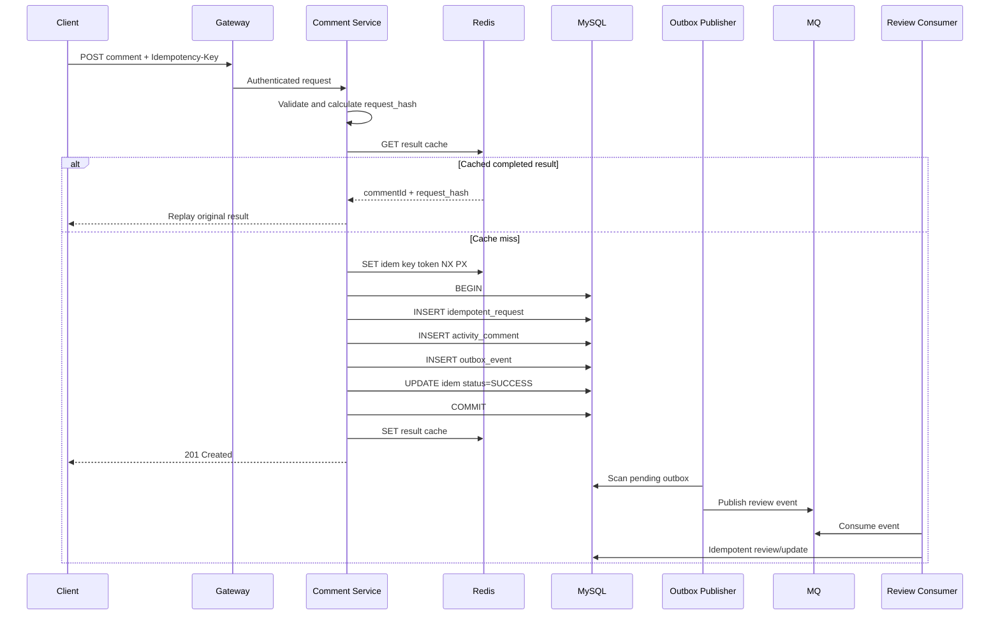

# 活动评论防重场景题：面试口述与系统设计详解

> 适用方向：Java 后端、分布式系统、接口设计、幂等、Redis、MySQL、监控告警  
> 回答视角：候选人现场口述  
> 核心原则：先区分“请求幂等、业务唯一、内容去重”，再设计数据库最终约束；Redis 只做加速和并发抑制，不能承担最终正确性。

---

## 一、题目

### 主问题

> 设计一个“活动评论防重”接口，详细说明接口流程、缓存操作和数据库操作。

### 连续追问

1. 这个接口如何做监控告警？只能选择三个核心指标，你选什么？最核心的是哪一个？
2. 什么才算该接口业务成功？埋点应该放在哪里？成功率如何计算？
3. 如果用户提交的是五万字长评论，如何利用 Redis 做内容防重？
4. 如果缓存与数据库使用延迟双删，为什么它不是强一致？需要强一致时怎么办？

---

# 二、答题前先澄清需求

## 2.1 我会先问面试官什么

我不会一上来就说“Redis SETNX”。我会先确认“防重”的业务含义，因为防重至少有三种完全不同的问题：

### 1. 请求幂等

同一次评论操作，因为以下原因被重复提交：

- 用户连续点击提交按钮；
- 前端超时后自动重试；
- 网关、RPC 框架或者消息系统重试；
- 服务端处理成功，但响应在网络中丢失。

此时要求是：**同一个业务意图只能产生一次副作用，重复请求返回第一次的结果。**

### 2. 业务唯一

例如产品规则规定：

> 一个用户在一个活动中只能评论一次。

即使两次请求使用不同的幂等键，只要用户和活动相同，也只能创建一条评论。

### 3. 内容去重

例如产品规则规定：

> 同一个用户在十分钟内不能重复提交完全相同的内容。

这属于内容级防重，通常需要正文规范化、摘要计算和时间窗口。

## 2.2 本文采用的业务假设

为了把方案讲完整，下面假设：

1. 一个用户在同一个活动中只能创建一条评论；
2. 同一次请求重试时，客户端会复用同一个 `Idempotency-Key`；
3. 评论创建后先进入 `PENDING_REVIEW`，异步审核后再公开；
4. 创建接口的成功语义是“评论和待审核责任已经可靠落库”，不是“评论已经公开展示”；
5. MySQL 是评论状态的权威数据源；
6. Redis 只用于快速拦截、结果缓存和降低数据库压力；
7. 异步审核通过 Outbox + MQ 触发，避免数据库提交与发消息双写不一致。

如果业务允许同一个用户多次评论，只需要取消 `(activity_id, user_id)` 唯一约束，并把业务唯一规则调整为产品实际定义。

---

# 三、面试现场 30 秒回答

**面试官：活动评论怎么防重？**

**我会这样回答：**

我会先区分请求幂等、业务唯一和内容去重。

对于同一次请求重试，我要求客户端传稳定的 `Idempotency-Key`，服务端保存幂等键、请求参数摘要和原始结果，相同键相同参数直接返回第一次结果，相同键不同参数返回冲突。

对于“一个用户在一个活动只能评论一次”的业务规则，我会在 MySQL 上建立：

```sql
UNIQUE KEY uk_activity_user(activity_id, user_id)
```

数据库唯一约束承担最终并发裁决。Redis 可以用 `SET NX` 做前置并发抑制和结果缓存，但不能替代数据库，因为 Redis 锁可能过期、丢失或者先成功后数据库失败。

评论、幂等结果和 Outbox 事件放在同一个数据库事务中提交。事务成功后再更新 Redis。这样即使响应丢失，客户端用原幂等键重试，也可以查询并返回第一次的评论 ID，而不会创建第二条评论。

---

# 四、完整口述回答

## 4.1 面试官：请完整设计这个接口

**我会这样回答：**

我会把这个接口拆成三层保障：

1. 客户端幂等键解决同一次业务意图的重试；
2. MySQL 唯一索引解决并发下的最终业务唯一；
3. Redis 用于快速拦截和结果缓存，不作为最终事实来源。

接口可以设计为：

```http
POST /api/v1/activities/{activityId}/comments
Authorization: Bearer <token>
Idempotency-Key: 8c91c4d4-...
Content-Type: application/json
```

请求体：

```json
{
  "content": "这次活动体验很好"
}
```

成功响应：

```json
{
  "commentId": 900001,
  "status": "PENDING_REVIEW",
  "replayed": false
}
```

同一个请求重试时返回同一个 `commentId`：

```json
{
  "commentId": 900001,
  "status": "PENDING_REVIEW",
  "replayed": true
}
```

处理流程是：

1. 完成身份认证、限流和基础参数校验；
2. 根据规范化后的请求内容计算 `request_hash`；
3. 查询幂等记录，如果已经成功，则校验请求摘要并回放原结果；
4. Redis 尝试设置一个短期并发抑制键，降低同一请求同时打到数据库的概率；
5. 开启数据库事务；
6. 插入幂等记录，数据库唯一约束决定当前请求是否获得处理权；
7. 校验活动是否存在、是否开放评论以及用户是否具备资格；
8. 插入评论，利用 `(activity_id, user_id)` 唯一索引保证一个用户只能评论一次；
9. 插入 Outbox 事件，用于事务提交后异步触发审核；
10. 把幂等记录更新为成功并保存评论 ID 和稳定响应；
11. 提交事务；
12. 事务提交后更新 Redis 结果缓存；
13. Outbox 投递器把审核事件发送到 MQ，消费者做幂等处理。

即使两个实例同时处理同一请求，最终也由数据库唯一索引裁决。即使 Redis 锁提前过期，数据库仍然不会生成两条评论。

---

# 五、接口与返回语义

## 5.1 接口定义

```http
POST /api/v1/activities/{activityId}/comments
```

请求头：

| 请求头 | 是否必填 | 说明 |
|---|---:|---|
| `Authorization` | 是 | 用户身份 |
| `Idempotency-Key` | 是 | 一次业务意图的稳定唯一键，重试必须复用 |
| `Trace-Id` | 否 | 链路追踪，可由网关生成 |

请求体：

```json
{
  "content": "评论正文"
}
```

## 5.2 推荐返回码

| 状态码 | 场景 |
|---:|---|
| `201 Created` | 首次成功创建评论 |
| `200 OK` | 重复请求被正确回放原结果 |
| `202 Accepted` | 原请求仍在明确处理中，当前只返回受理状态 |
| `400 Bad Request` | 参数格式错误 |
| `401/403` | 未登录或者无评论权限 |
| `409 Conflict` | 相同幂等键对应不同请求参数，或者产品定义为“已评论不可再次提交” |
| `429 Too Many Requests` | 用户或活动维度限流 |
| `500/503` | 系统异常或暂时不可用 |

## 5.3 为什么相同幂等键还要保存请求摘要

只保存幂等键不够。

例如客户端错误地复用同一个幂等键：

第一次：

```json
{"content":"评论 A"}
```

第二次：

```json
{"content":"评论 B"}
```

如果服务端只根据键返回第一次结果，会把第二个不同请求错误地当成第一次请求。

因此幂等记录还要保存：

```text
request_hash = SHA-256(canonical_request)
```

处理规则：

- 同键、同摘要：回放原结果；
- 同键、不同摘要：返回 `409 Conflict`，并记录客户端错误。

---

# 六、数据库设计

## 6.1 评论表

```sql
CREATE TABLE activity_comment (
    id              BIGINT       NOT NULL,
    activity_id     BIGINT       NOT NULL,
    user_id         BIGINT       NOT NULL,
    content         MEDIUMTEXT   NOT NULL,
    content_hash    CHAR(64)     NULL,
    status          VARCHAR(32)  NOT NULL,
    version         BIGINT       NOT NULL DEFAULT 0,
    created_at      DATETIME(3)  NOT NULL,
    updated_at      DATETIME(3)  NOT NULL,
    PRIMARY KEY (id),
    UNIQUE KEY uk_activity_user (activity_id, user_id),
    KEY idx_activity_status_time (activity_id, status, created_at, id),
    KEY idx_user_time (user_id, created_at, id)
) ENGINE = InnoDB;
```

### 关键约束

```sql
UNIQUE KEY uk_activity_user(activity_id, user_id)
```

它解决的是业务唯一问题：即使两个请求使用不同幂等键，只要属于同一用户和同一活动，也只能成功插入一条评论。

`status` 可以包含：

```text
PENDING_REVIEW
PUBLISHED
REJECTED
DELETED
```

## 6.2 幂等请求表

```sql
CREATE TABLE idempotent_request (
    id                BIGINT        NOT NULL,
    user_id           BIGINT        NOT NULL,
    scene             VARCHAR(64)   NOT NULL,
    request_key       VARCHAR(128)  NOT NULL,
    request_hash      CHAR(64)      NOT NULL,
    status            VARCHAR(32)   NOT NULL,
    result_id         BIGINT        NULL,
    response_snapshot JSON          NULL,
    error_code        VARCHAR(64)   NULL,
    expire_at         DATETIME(3)   NOT NULL,
    created_at        DATETIME(3)   NOT NULL,
    updated_at        DATETIME(3)   NOT NULL,
    PRIMARY KEY (id),
    UNIQUE KEY uk_idempotency (user_id, scene, request_key),
    KEY idx_expire_status (expire_at, status)
) ENGINE = InnoDB;
```

推荐状态：

```text
PROCESSING
SUCCESS
FAILED_FINAL
```

如果幂等记录和评论在同一个事务中创建，那么事务执行失败时二者一起回滚，可以减少长期残留的 `PROCESSING` 状态。

## 6.3 Outbox 表

```sql
CREATE TABLE outbox_event (
    id              BIGINT        NOT NULL,
    aggregate_type  VARCHAR(64)   NOT NULL,
    aggregate_id    BIGINT        NOT NULL,
    event_type      VARCHAR(64)   NOT NULL,
    payload         JSON          NOT NULL,
    status          VARCHAR(32)   NOT NULL,
    retry_count     INT           NOT NULL DEFAULT 0,
    next_retry_at   DATETIME(3)   NOT NULL,
    created_at      DATETIME(3)   NOT NULL,
    updated_at      DATETIME(3)   NOT NULL,
    PRIMARY KEY (id),
    KEY idx_pending_retry (status, next_retry_at, id)
) ENGINE = InnoDB;
```

评论和 Outbox 在同一个本地事务中写入：

- 事务提交：评论存在，待发送事件也存在；
- 事务回滚：二者都不存在。

这样避免：

- 评论已经创建，但审核消息没有发送；
- 审核消息已经发送，但评论事务回滚。

Outbox 只解决“业务数据和待发送事件一起落库”，MQ 仍然可能重复投递，因此消费者还要根据 `event_id` 或 `comment_id + event_type` 做幂等。

---

# 七、Redis 应该做什么，不应该做什么

## 7.1 Redis 的定位

Redis 可以承担：

1. 同一请求的短期并发抑制；
2. 已完成幂等结果的快速缓存；
3. 用户或活动维度限流；
4. 热门活动的只读信息缓存。

Redis 不应该独自承担：

1. 评论是否已经创建的最终判断；
2. 一个用户是否已经评论的唯一约束；
3. 外部副作用是否只发生一次的证明；
4. 永久内容去重的唯一依据。

## 7.2 并发抑制键

```text
comment:idem:{userId}:{requestKey}
```

写入：

```text
SET comment:idem:{userId}:{requestKey} <token> NX PX 30000
```

这个键的作用是减少相同请求同时进入数据库，不是分布式事务锁。

释放时应校验 token，不能直接 `DEL`：

```lua
if redis.call('GET', KEYS[1]) == ARGV[1] then
    return redis.call('DEL', KEYS[1])
end
return 0
```

即使这个键过期，数据库唯一约束仍然保证最终正确性。

## 7.3 结果缓存

```text
comment:result:{userId}:{requestKey}
```

缓存内容可以是：

```json
{
  "requestHash": "...",
  "commentId": 900001,
  "status": "PENDING_REVIEW"
}
```

使用流程：

1. 先查 Redis，命中后仍需校验 `requestHash`；
2. 未命中则查 MySQL；
3. 数据库事务提交成功后再写 Redis；
4. Redis 写失败不回滚评论创建，只记录修复任务或依赖后续回源。

## 7.4 为什么不能只用 Redis `SETNX`

只使用 Redis 会有以下问题：

### 情况一：Redis 成功，数据库失败

```text
SETNX 成功
数据库插入失败
```

如果 Redis 键长时间存在，后续合法重试可能被错误拦截。

### 情况二：Redis 锁过期，但原请求仍在执行

```text
请求 A 获得锁
A 执行时间超过 TTL
锁过期
请求 B 再次获得锁
A、B 同时执行
```

如果没有数据库唯一索引，就可能重复插入。

### 情况三：Redis 故障、数据淘汰或主从切换

缓存层不能成为唯一正确性边界。

### 情况四：锁存在不代表业务成功

Redis 只能说明某个请求曾经设置过键，不能证明数据库事务是否已经提交。

所以结论是：

> Redis 负责减少重复工作，MySQL 唯一约束负责最终裁决。

---

# 八、完整时序



---

# 九、伪代码与事务边界

## 9.1 Service 入口

```java
public CommentResponse createComment(CreateCommentCommand command) {
    validateBasicParameters(command);

    String requestHash = hashCanonicalRequest(command);

    // 1. 快速结果回放。这里只是优化，数据库仍是最终来源。
    CommentResponse cached = resultCache.get(
            command.userId(), command.idempotencyKey());

    if (cached != null) {
        ensureSameRequest(cached.requestHash(), requestHash);
        return cached.asReplayed();
    }

    // 2. Redis 只做并发抑制，不决定业务最终正确性。
    String token = UUID.randomUUID().toString();
    boolean acquired = guard.tryAcquire(
            command.userId(), command.idempotencyKey(), token);

    try {
        // 即使没拿到 Redis 锁，也不能直接认为业务失败。
        // 可以先短暂查询结果，再回到数据库幂等判断。
        return executeWithDatabaseIdempotency(command, requestHash);
    } finally {
        if (acquired) {
            guard.releaseIfOwner(
                    command.userId(), command.idempotencyKey(), token);
        }
    }
}
```

## 9.2 数据库事务

```java
public CommentResponse executeWithDatabaseIdempotency(
        CreateCommentCommand command,
        String requestHash) {

    try {
        CommentResponse response = transactionTemplate.execute(status -> {
            // 唯一键：(user_id, scene, request_key)
            idempotentRequestRepository.insertProcessing(
                    command.userId(),
                    "ACTIVITY_COMMENT_CREATE",
                    command.idempotencyKey(),
                    requestHash);

            // 只有获得幂等处理权之后，才执行新请求的业务校验。
            Activity activity = activityRepository.lockOrRead(command.activityId());
            validateActivityForNewComment(activity, command.userId());

            // 唯一键：(activity_id, user_id)
            long commentId = commentRepository.insert(
                    command.activityId(),
                    command.userId(),
                    command.content(),
                    "PENDING_REVIEW");

            outboxRepository.insert(
                    "COMMENT",
                    commentId,
                    "COMMENT_REVIEW_REQUESTED",
                    buildReviewPayload(commentId));

            CommentResponse result = new CommentResponse(
                    commentId,
                    "PENDING_REVIEW",
                    requestHash,
                    false);

            idempotentRequestRepository.markSuccess(
                    command.userId(),
                    "ACTIVITY_COMMENT_CREATE",
                    command.idempotencyKey(),
                    commentId,
                    result);

            return result;
        });

        // 必须在事务真正提交后写缓存。
        resultCache.put(
                command.userId(),
                command.idempotencyKey(),
                response);

        return response;
    } catch (DuplicateKeyException duplicate) {
        // 不要在已经出现约束异常、可能标记 rollback-only 的事务中继续处理。
        // 等事务退出后，在新读取中判断到底命中了哪个唯一约束。
        return resolveDuplicateOutsideFailedTransaction(command, requestHash);
    }
}
```

## 9.3 处理重复请求

```java
private CommentResponse resolveDuplicateOutsideFailedTransaction(
        CreateCommentCommand command,
        String requestHash) {

    IdempotentRequest idem = idempotentRequestRepository.find(
            command.userId(),
            "ACTIVITY_COMMENT_CREATE",
            command.idempotencyKey());

    if (idem != null) {
        if (!idem.requestHash().equals(requestHash)) {
            throw new IdempotencyConflictException(
                    "同一个 Idempotency-Key 对应了不同请求参数");
        }

        if (idem.isSuccess()) {
            return idem.toResponse(true);
        }

        // 原请求仍在执行时，可短暂等待、返回 202，
        // 或提示客户端使用同一 key 稍后查询。
        throw new RequestStillProcessingException();
    }

    ActivityComment existing = commentRepository.findByActivityAndUser(
            command.activityId(), command.userId());

    if (existing != null) {
        // 这是不同请求键触发的业务唯一冲突，不等同于原请求回放。
        throw new AlreadyCommentedException(existing.id());
    }

    // 极少数情况下可能是事务竞争尚未可见或其他唯一约束。
    // 不应盲目重新执行，需要有限重试或者返回暂时性错误。
    throw new RetryableSystemException();
}
```

---

# 十、关键并发场景推演

## 10.1 同一个请求同时到达两个实例

两个请求具有相同：

```text
user_id
scene
idempotency_key
request_hash
```

处理结果：

1. 两个实例可能都通过前置查询；
2. Redis 通常只允许一个实例先进入，但 Redis 不是最终保障；
3. 两个实例并发插入幂等记录；
4. MySQL 唯一索引只允许一个事务成功；
5. 另一个请求等待前一个事务提交后，读取原幂等结果；
6. 两个请求最终返回相同 `commentId`。

## 10.2 同一用户使用两个不同幂等键并发评论

两个请求的幂等键不同，但：

```text
activity_id 相同
user_id 相同
```

两个幂等记录都可能成功创建，但评论表的：

```sql
UNIQUE KEY uk_activity_user(activity_id, user_id)
```

只允许一个评论成功。

第二个请求属于业务重复，而不是原请求回放。根据产品规则，可以：

- 返回 `409 Already Commented`；
- 返回已有评论 ID；
- 引导用户进入编辑评论流程。

## 10.3 数据库提交成功，但响应丢失

这是幂等设计必须解决的核心情况。

执行顺序：

1. 评论事务已经提交；
2. 服务端返回响应时连接断开；
3. 客户端看到超时；
4. 客户端使用相同幂等键重试；
5. 服务端查询幂等表，发现状态为 SUCCESS；
6. 返回第一次的 `commentId`，不再插入评论。

超时表示“结果未知”，不能直接等同于业务失败。

## 10.4 Redis 锁过期，但原请求仍在执行

第二个请求可能再次进入数据库。

由于存在：

```sql
uk_idempotency(user_id, scene, request_key)
uk_activity_user(activity_id, user_id)
```

数据库仍然会阻止重复结果。

这说明 Redis 锁只是性能优化，而不是正确性唯一边界。

## 10.5 数据库提交成功，但 Redis 写入失败

评论不能因为缓存写失败而回滚。

处理方式：

1. 评论事务已经成功，正常返回业务结果；
2. 记录缓存写失败指标和日志；
3. 后续重试请求缓存未命中时回源数据库；
4. 回源后重新填充缓存；
5. 必要时通过异步任务修复热点缓存。

## 10.6 Outbox 消息重复投递

Outbox 发布器可能在“发送成功但更新发送状态前”宕机，因此同一事件可能再次发送。

审核消费者必须幂等，例如建立：

```sql
UNIQUE KEY uk_consume_event(consumer_name, event_id)
```

或者对评论状态使用条件更新：

```sql
UPDATE activity_comment
SET status = ?,
    version = version + 1
WHERE id = ?
  AND version = ?
  AND status = 'PENDING_REVIEW';
```

---

# 十一、为什么业务校验顺序很重要

## 11.1 重试应先识别原请求，再判断当前活动状态

假设：

1. 用户在 19:59 首次提交评论；
2. 评论事务成功；
3. 响应丢失；
4. 活动在 20:00 关闭；
5. 用户在 20:01 使用相同幂等键重试。

如果服务端先检查“活动已经结束”，会把一个已经成功的原请求错误地返回为失败。

正确顺序是：

1. 先根据幂等键识别是否属于已有业务意图；
2. 如果是已成功请求，回放原结果；
3. 只有确认是全新业务意图时，才按照当前活动状态执行新请求校验。

## 11.2 参数基础校验和身份校验仍然要先做

幂等回放不代表可以绕过所有安全检查。

通常可以先完成：

- 请求格式校验；
- 身份认证；
- 幂等键格式校验；
- 租户和用户归属校验。

然后识别是否为原请求，再决定是否执行当前业务状态校验。

---

# 十二、监控告警：只能选三个指标

## 12.1 面试官：你选哪三个？

**我会这样回答：**

如果只能选三个，我会选：

1. **业务意图成功率**；
2. **端到端 P99 延迟和超时率**；
3. **幂等正确性异常率**。

最核心的是业务意图成功率，但这个成功必须包含“副作用正确”，不能只看 HTTP 200。

## 12.2 指标一：业务意图成功率

统计维度不是原始 HTTP 请求数，而是按照幂等键归并后的业务意图数。

一个业务意图成功，需要同时满足：

1. 合法新请求成功创建且事务提交；或者重复请求正确回放原结果；
2. 同一个业务意图只产生一条评论；
3. 在约定时间内得到明确的最终结果；
4. 评论 ID、幂等记录和响应保持一致。

公式：

```text
业务意图成功率
= 成功完成的合法唯一业务意图数
  / 进入系统的合法唯一业务意图总数
```

业务拒绝需要单独统计，例如：

- 活动已结束；
- 用户没有资格；
- 评论内容不合法；
- 用户已经评论且产品不允许修改。

这些不应该和数据库故障、线程池耗尽、超时未知结果混成一个错误率。

## 12.3 指标二：端到端 P99 延迟和超时率

需要关注：

- P50、P95、P99；
- 超时率；
- 数据库事务耗时；
- 唯一索引冲突等待时间；
- Redis 耗时；
- 线程池排队时间。

平均耗时不能反映长尾问题。热门活动下，大量相同用户重试或唯一键竞争可能导致部分请求等待较久。

## 12.4 指标三：幂等正确性异常率

它至少包括：

```text
重复副作用率
误判重率
相同 key 不同参数冲突率
PROCESSING 长时间未结束数量
幂等记录与评论结果不一致数量
```

推荐拆分：

```text
重复副作用率
= 产生两条及以上评论的业务意图数
  / 成功业务意图数
```

```text
误判重率
= 被错误判定为重复的合法新业务意图数
  / 合法新业务意图数
```

重复拦截次数很高不一定说明系统很好，也可能表示：

- 前端发生重试风暴；
- 服务端大量超时；
- 幂等键生成方式有缺陷；
- 正常请求被错误合并。

## 12.5 为什么不把 QPS 放进前三

QPS、CPU、连接池、队列长度仍然必须监控，但如果只能保留三个最核心指标，我优先保留：

- 用户意图是否成功；
- 用户等待多久；
- 防重是否真的正确。

QPS 更适合用于解释容量和流量变化，而不是直接证明业务正确。

---

# 十三、什么才算接口成功

## 13.1 创建成功和发布成功必须区分

如果评论需要审核，创建接口返回成功通常只表示：

> 评论已经可靠落库，并进入待审核状态。

它不表示：

> 评论已经公开展示。

建议区分：

| 层级 | 定义 |
|---|---|
| 请求受理成功 | 服务端已经接受请求 |
| 创建提交成功 | 评论、幂等结果和 Outbox 已提交 |
| 审核成功 | 评论审核完成 |
| 发布成功 | 评论已经对外可见 |
| 用户感知成功 | 用户在约定时间内看到明确结果 |

面试时必须先说清当前接口承诺的是哪一层。

## 13.2 首次请求的业务成功条件

对于一个合法新请求，创建接口成功需要满足：

1. 评论表中存在且只存在一条目标评论；
2. 评论状态为 `PENDING_REVIEW`；
3. 幂等记录为 `SUCCESS`；
4. 幂等记录中的 `result_id` 与评论 ID 一致；
5. Outbox 事件已经与评论一起提交；
6. 客户端拿到成功结果，或者重试时能够恢复同一结果。

## 13.3 重复请求的业务成功条件

对于同一次请求重试：

1. 不创建第二条评论；
2. 返回第一次的相同评论 ID；
3. 返回与第一次一致的核心业务结果；
4. 可以明确标识这是 replay，但不能改变业务结果。

## 13.4 超时如何计算

超时不应该立刻被永久归类为业务失败，因为数据库事务可能已经提交。

更合理的做法是：

1. 请求超时时记录“客户端超时”；
2. 根据幂等键继续跟踪最终状态；
3. 在业务 SLO 截止时间内完成并可恢复结果，可以计入最终业务成功；
4. 超过期限仍然没有明确结果，计入业务失败或未知结果；
5. 单独统计“响应超时但最终提交成功”的数量。

因此可以同时保留两个指标：

```text
请求级技术成功率
业务意图最终成功率
```

前者反映用户当次请求体验，后者反映业务最终是否正确完成。

---

# 十四、埋点位置

## 14.1 必须埋点的阶段

### 1. 接口入口

记录：

```text
trace_id
activity_id
user_id 的脱敏值
idempotency_key 的哈希
请求到达时间
客户端版本
```

不要在普通日志中打印完整评论正文，避免隐私和日志体积问题。

### 2. 基础校验完成

区分：

```text
PARAM_INVALID
UNAUTHORIZED
FORBIDDEN
RATE_LIMITED
```

### 3. 幂等判断结果

记录：

```text
NEW_REQUEST
REPLAY_SUCCESS
SAME_KEY_DIFFERENT_PAYLOAD
REQUEST_PROCESSING
BUSINESS_DUPLICATE
```

### 4. Redis 操作

记录：

```text
缓存命中率
SET NX 成功率
Redis 耗时
Redis 异常率
```

Redis 异常不能自动等同于业务失败，系统应能够回退到数据库路径。

### 5. 数据库事务提交结果

这是核心埋点。

必须在事务真正提交之后记录成功，不能在执行完 `INSERT` 但事务尚未提交时就记录成功。

记录：

```text
comment_id
transaction_duration
constraint_conflict_type
commit_result
```

Spring 中可以使用事务同步回调，或者把成功事件放在事务外层确认后记录。

### 6. 响应完成

记录：

```text
HTTP 状态码
业务状态码
是否 replay
总耗时
是否客户端断开
```

### 7. Outbox 和审核链路

记录：

```text
Outbox 积压数量
最老事件年龄
发送重试次数
MQ 投递失败率
审核消费延迟
审核成功率
最终发布成功率
```

## 14.2 埋点不能只放在 Controller 返回前

如果 Controller 方法外层仍然存在事务，方法返回不一定等于最外层事务已经提交。

如果在数据库提交前记录成功，可能出现：

```text
监控显示成功
事务随后回滚
实际评论不存在
```

所以业务成功埋点应绑定真实提交结果。

---

# 十五、五万字长评论如何做 Redis 防重

## 15.1 面试官：评论很长，怎么防重？

**我会这样回答：**

我不会把五万字正文直接作为 Redis Key，也不会只依赖 Redis 永久判断。

如果是同一次请求重试，仍然优先使用 `Idempotency-Key`，正文长度并不改变请求幂等方案。

如果业务要求检测相同内容，我会：

1. 按业务定义规范化正文；
2. 流式计算 SHA-256；
3. 使用业务范围和摘要组成短 Redis Key；
4. Redis 做时间窗口内的快速拦截；
5. 数据库保存摘要和正文，承担最终判断；
6. 对极严格场景，在摘要相同时再比较完整正文。

## 15.2 Key 设计

```text
comment:content-dedup:{activityId}:{userId}:{sha256}
```

如果规则是同一活动全局不能出现相同评论，可以去掉 `userId`；如果只限制同一用户，则保留用户维度。

## 15.3 正文规范化

规范化规则必须由产品定义，例如：

- 统一 `\r\n` 和 `\n`；
- 去掉首尾空白；
- 统一指定的 Unicode 规范形式；
- 保留正文内部有业务意义的空格和标点。

不能擅自删除全部空格、标点或者表情，否则可能把不同内容错误合并。

## 15.4 为什么还要保存原文

SHA-256 碰撞概率极低，但摘要不是数学上的零碰撞证明。

如果业务要求理论上不误判，可以把摘要当成候选索引：

1. 先根据摘要找到候选记录；
2. 比较正文长度；
3. 必要时比较完整正文；
4. 确认完全一致后才判定重复。

## 15.5 时间复杂度

无论是否使用 Redis，计算完整正文摘要都至少要遍历一次正文，因此时间复杂度是：

```text
O(L)
```

其中 `L` 是评论长度。

优化重点不是消除遍历，而是：

- 流式读取和计算摘要；
- 避免创建多份大字符串副本；
- 限制请求体大小；
- 限制单用户并发；
- 把正文存储和后续审核异步化。

---

# 十六、延迟双删为什么不是强一致

## 16.1 典型延迟双删流程

```text
删除缓存
更新数据库
等待一段时间
再次删除缓存
```

它只能降低旧值长期存在的概率，不能保证强一致。

## 16.2 一个可以直接在面试中讲的反例

1. 读请求 R 从数据库读取旧值 `v1`；
2. R 在回填 Redis 前暂停；
3. 写请求 W 删除 Redis；
4. W 把数据库更新为 `v2`；
5. W 等待固定时间后再次删除 Redis；
6. R 恢复，把旧值 `v1` 写回 Redis。

只要 R 的暂停时间超过固定延迟，第二次删除就已经发生在旧值回填之前，缓存最终仍然是旧值。

另外还可能发生：

- 第二次删除失败；
- 进程在第二次删除前宕机；
- Redis 暂时不可用；
- 主从延迟导致读到旧数据；
- 消息通知丢失或延迟。

所以延迟双删是最终一致性优化，不是强一致协议。

## 16.3 评论场景如何处理

对于“是否允许创建评论”这种正确性判断，不应依赖缓存。

最终判断必须依赖：

```sql
UNIQUE KEY uk_activity_user(activity_id, user_id)
```

缓存中的“用户是否评论过”只能用于快速提示，不能作为唯一裁决。

## 16.4 需要更强读取一致性时怎么办

可以根据业务目标选择：

### 方案一：关键判断直接读权威数据库

创建评论时直接依赖数据库唯一索引，不依赖缓存状态。

这是最实际、最可靠的方案。

### 方案二：版本化缓存

数据库和缓存都带版本号，只允许高版本覆盖低版本。

旧读请求拿到版本 10 时，如果缓存已经是版本 11，就拒绝版本 10 回填。

还要处理删除墓碑，防止旧数据复活。

### 方案三：写后读绑定最低版本

写请求成功后把数据库版本返回给客户端。客户端后续读取携带最低版本要求：

- 缓存版本满足要求，直接返回；
- 缓存版本不足，回源权威库。

### 方案四：对关键状态不使用异步缓存一致性

如果业务要求线性一致，就需要将所有正确性判断放入同一个强一致存储或明确的一致性协议中，不能把普通 Redis Cache Aside 描述成强一致。

---

# 十七、常见错误回答与改进

## 错误一：只说 Redis `SETNX`

问题：

- 锁可能过期；
- Redis 可能故障；
- 锁成功不代表数据库成功；
- 无法恢复原请求结果。

改进：

> Redis 做并发抑制，数据库唯一约束做最终裁决，幂等表保存原结果。

## 错误二：先查“用户是否评论过”，没有唯一索引

```text
SELECT 是否存在
不存在则 INSERT
```

两个并发请求都可能查询到不存在，再同时插入。

改进：

> 可以先查优化体验，但必须由唯一索引防止并发穿透。

## 错误三：超时后生成新幂等键重试

原请求可能已经成功，新键会被当成新业务意图，导致重复副作用。

改进：

> 超时重试必须复用原幂等键，优先查询原请求结果。

## 错误四：相同幂等键不校验参数

可能把两个不同请求错误合并。

改进：

> 保存并校验规范化请求摘要。

## 错误五：在事务提交前记录成功

事务可能随后回滚，导致监控成功但实际无数据。

改进：

> 成功埋点绑定真正的事务提交结果。

## 错误六：把外部审核调用放在数据库长事务中

会导致：

- 长时间持有连接和锁；
- 外部超时扩大事务时长；
- 数据库事务也无法回滚已发生的外部副作用。

改进：

> 事务内写 Outbox，事务外异步审核。

## 错误七：把 HTTP 200 当成唯一成功标准

可能出现：

- 返回 200，但产生两条评论；
- 返回超时，但数据库已经成功；
- 创建成功，但异步审核事件丢失。

改进：

> 定义业务意图成功、请求技术成功和最终发布成功三个层级。

## 错误八：把重复拦截次数高当成防重效果好

重复请求多可能是因为接口经常超时，前端不断重试。

改进：

> 同时观察业务成功率、超时率、重复副作用率和误判重率。

---

# 十八、常见追问与候选人口述回答

## 18.1 为什么既要幂等表，又要评论表唯一索引？

**我会回答：**

两者解决的问题不同。

幂等表解决的是同一次业务意图的请求重试，可以返回第一次的完整结果，并识别同键不同参数。

评论表唯一索引解决的是业务规则。即使调用方错误地为两次请求生成了不同幂等键，同一用户在同一活动也不能创建两条评论。

## 18.2 Redis 挂了，接口还能工作吗？

**我会回答：**

应该能够降级到数据库路径，只是数据库压力和重复竞争会增加。

如果 Redis 故障就完全无法创建评论，说明缓存错误地成为了业务唯一事实源。

## 18.3 为什么不直接用分布式锁？

**我会回答：**

分布式锁可以减少并发执行，但不能替代业务唯一约束。

锁有 TTL、续期、网络分区和旧持有者恢复等问题；而数据库唯一索引可以在最终写入点做原子裁决。

因此我可以使用锁做优化，但不会只靠锁保证不重复。

## 18.4 同一个幂等键的请求仍在执行，第二个请求怎么办？

**我会回答：**

可以选择：

1. 短暂等待原请求结束；
2. 返回 `202 PROCESSING`，让客户端使用相同键查询；
3. 如果数据库唯一键竞争会自然等待，可以设置合理锁等待和接口超时。

不能让第二个请求直接重新执行副作用。

## 18.5 幂等记录保存多久？

**我会回答：**

要覆盖客户端、网关和调用链可能发生的最长重试窗口，并结合业务追溯要求。

例如评论创建可以保存数天或更久。即使清理了幂等记录，业务唯一索引仍然能防止一个用户重复评论，但无法继续完整回放第一次响应，因此清理策略要根据产品语义设计。

## 18.6 评论可以修改怎么办？

**我会回答：**

创建和修改是两个不同业务操作，应使用不同幂等场景：

```text
ACTIVITY_COMMENT_CREATE
ACTIVITY_COMMENT_UPDATE
```

修改接口可以携带评论版本号：

```sql
UPDATE activity_comment
SET content = ?,
    version = version + 1
WHERE id = ?
  AND user_id = ?
  AND version = ?;
```

影响行数为 0 表示发生并发修改或状态已经变化。

## 18.7 热门活动会不会产生热 Key？

**我会回答：**

幂等键应包含用户和请求键，因此不会把所有用户集中到同一个 Redis Key。

数据库唯一索引的前缀如果是 `activity_id`，热门活动可能导致相邻索引范围写入压力，需要结合分库分表、主键生成、写入吞吐和实际数据规模评估。

如果未来按用户分片，跨活动列表查询和审核链路也要重新设计，不能只为了“看起来分散”就提前复杂化。

## 18.8 审核消息发送失败怎么办？

**我会回答：**

评论事务内已经写入 Outbox。后台扫描 `PENDING` 事件，发送失败后根据重试次数和 `next_retry_at` 退避重试，超过阈值告警和人工处理。

消息可能重复，因此审核消费者必须幂等。

## 18.9 能不能使用 MQ 消费者直接插入评论？

**我会回答：**

可以把创建异步化，但接口成功语义就变成“请求已经可靠受理”，而不是“评论已经创建”。

此时仍需要：

- 受理记录；
- 稳定幂等键；
- 可靠消息；
- 消费幂等；
- 结果查询接口；
- 失败和积压告警。

不能仅仅返回 200 后把一切交给 MQ，而没有可查询的业务状态。

## 18.10 如果数据库唯一索引冲突，能在当前事务里继续查询吗？

**我会回答：**

不建议在捕获到约束异常后继续依赖当前事务，因为事务可能已经被标记为回滚状态。

更稳妥的做法是退出失败事务，回滚后在新的读取上下文中查询幂等记录或已有评论，再决定回放还是返回业务冲突。

---

# 十九、三分钟标准口述稿

**面试官：请你完整讲一下活动评论防重。**

**我会这样回答：**

我会先区分三种防重：同一次请求重试的请求幂等、一个用户在一个活动只能评论一次的业务唯一，以及相同正文的内容去重。三者不能只靠一个 Redis 锁统一解决。

对于请求幂等，我要求客户端传稳定的 `Idempotency-Key`，重试必须复用。服务端保存用户、业务场景、幂等键、请求参数摘要、处理状态和原始结果。相同键相同参数时返回第一次结果；相同键不同参数时返回冲突。

对于业务唯一，我在评论表建立 `(activity_id, user_id)` 唯一索引。即使两个请求使用不同幂等键并发到达，数据库也只允许一条评论成功。Redis 可以在前面用 `SET NX` 做短期并发抑制，也可以缓存完成结果，但 Redis 不是最终正确性来源，因为锁可能过期、缓存可能故障，而且 Redis 写成功不代表数据库事务已经提交。

数据库事务中，我会依次写入幂等记录、评论记录和 Outbox 事件，再把幂等状态更新为成功并保存评论 ID，最后一起提交。审核等外部操作不放在数据库长事务里，而是由 Outbox 在提交后可靠投递到 MQ。消费者根据事件 ID 做幂等。

如果事务成功但响应丢失，客户端使用原幂等键重试，服务端从幂等表读取第一次的评论 ID 并回放，不会再次插入。如果 Redis 写失败，接口仍然以数据库结果为准，后续缓存未命中再回源修复。

监控上，如果只能选三个指标，我会选业务意图成功率、端到端 P99 延迟和幂等正确性异常率。最核心的是按幂等键归并后的业务意图成功率，而不是简单的 HTTP 200 比例。成功要求只产生一次副作用，并且重复请求能够恢复同一个结果。成功埋点必须放在数据库事务真正提交之后，不能在执行完 INSERT 但还未提交时就记录成功。

---

# 二十、一分钟压缩回答

**我会这样回答：**

活动评论防重我会分三层做。

第一层是请求幂等。客户端为一次评论意图传稳定的 `Idempotency-Key`，服务端保存请求摘要和原结果。相同键相同参数返回第一次结果，相同键不同参数返回冲突。

第二层是业务唯一。假设一个用户在一个活动只能评论一次，我会在 MySQL 上建立 `(activity_id, user_id)` 唯一索引，由数据库承担最终并发裁决。

第三层是 Redis 优化。Redis 可以用 `SET NX` 做并发抑制并缓存结果，但不能替代数据库，因为锁可能过期，Redis 成功也不代表数据库事务成功。

评论、幂等结果和 Outbox 事件在同一个事务中提交，提交后再写 Redis。即使事务成功但响应丢失，客户端复用原幂等键重试，也能返回第一次的评论 ID。

监控上我重点看业务意图成功率、P99 延迟和幂等异常率。成功埋点必须发生在事务真正提交之后。

---

# 二十一、自检清单

面试前应确认自己能回答以下问题：

- [ ] 能区分请求幂等、业务唯一和内容去重；
- [ ] 能说明为什么 Redis `SETNX` 不是最终保障；
- [ ] 能写出 `(activity_id, user_id)` 唯一索引；
- [ ] 能解释相同幂等键不同请求参数为什么要返回冲突；
- [ ] 能推演“提交成功但响应丢失”的恢复过程；
- [ ] 能解释为什么超时不等于失败；
- [ ] 能说明 Redis 锁过期后为什么仍不会重复插入；
- [ ] 能说明评论、幂等记录和 Outbox 的事务边界；
- [ ] 能说明 Outbox 为什么仍要求消费者幂等；
- [ ] 能定义接口创建成功与评论发布成功的差异；
- [ ] 能说出三个核心监控指标及最核心指标；
- [ ] 能说明成功埋点为什么必须在事务提交之后；
- [ ] 能解释五万字正文如何流式计算摘要；
- [ ] 能说明延迟双删为什么不是强一致；
- [ ] 能给出至少三个并发或故障场景并说明处理结果。

