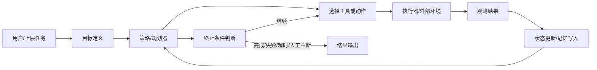
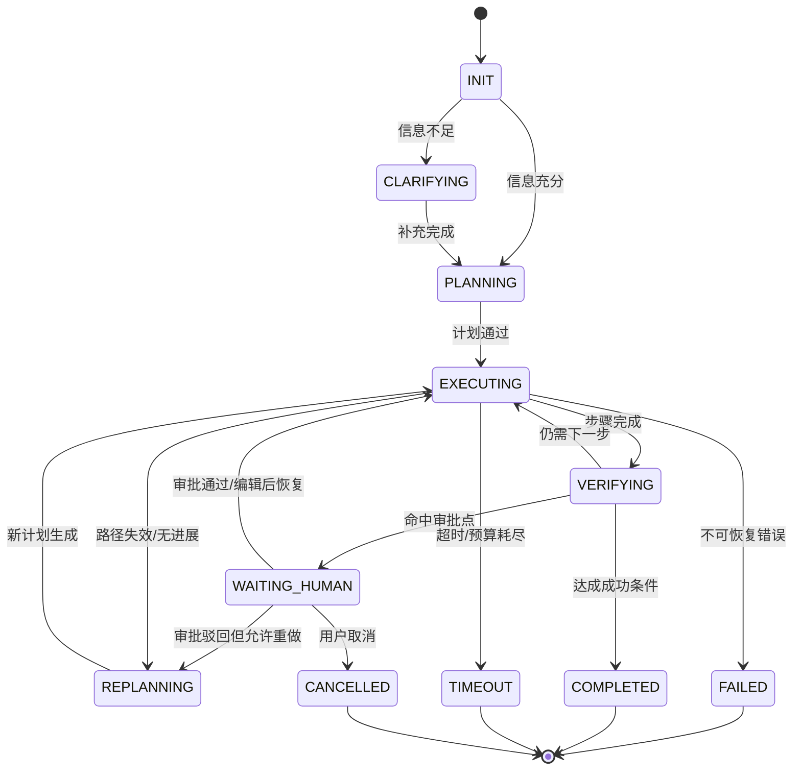

# Agent范式与设计

> **模块**：03_Agent范式与设计/03_Agent范式与设计.md  
> **构成**：7 个知识点合为一篇，按顺序编号  
> **规模**：约 2,987 行  |  **生成**：2026-11-12

## 目录

1. Agent定义与边界
2. Workflow与Agent
3. ReAct与Plan-Execute-CodeAct
4. 任务分解与Planning
5. Human-in-the-Loop
6. Agent状态机与终止条件
7. 开发框架选型

---

## 1. Agent定义与边界

### 一、这一题在面试里到底考什么

什么是 Agent几乎是所有 Agent 面试的起手题，但它真正考察的绝不是百科式定义，而是候选人有没有建立清晰的边界意识。面试官通常借这个问题判断三件事：第一，你是否真的理解 agent 和 chatbot、workflow、tool-calling app 的区别；第二，你是否知道 agent 什么时候有必要、什么时候没有必要；第三，你是否具备将看起来很智能的概念落到可上线、可治理、可控风险的工程能力。

因为近两年大家都在讲智能体，很多简历也会写做过 agent，但实际做的可能只是：给模型挂了两个工具，用 function calling 调一下搜索，然后按固定顺序执行。这样的系统不一定错，很多时候还更实用，但它未必就是一个典型意义上的 agent。面试官之所以要追问定义，不是为了抠字眼，而是为了确认：你有没有把自治多步决策基于观察更新后续动作面向目标而非单次回答这些关键特征理解到位。

从校招生视角看，最容易犯的错误有两个。**第一个错误是把任何用了大模型和工具的系统都叫 agent，导致边界完全失焦**。**第二个错误是把 agent 神化，认为 agent 比 workflow 更高级、更智能、一定更值得做**。实际上，很多官方实践都反复强调：当任务流程清晰、约束强、结果要求稳定时，workflow 往往更合适；agent 只有在路径不确定、需要动态规划或环境交互时，才真正发挥价值。这意味着，面试官心里理想的回答，不是agent 是一种很强的 AI 系统，而是agent 是在一定自治程度下围绕目标进行多步决策与动作执行的系统，但是否值得引入，要看任务的不确定性和工程约束。

如果面试官问什么是 Agent？，可以这样答：

> 💡 Agent 本质上是一个围绕目标运行的系统，而不只是一次输入输出的模型调用。它通常会在多步执行中基于当前观察结果动态决定下一步动作，并通过工具或外部环境持续推进任务完成。和普通 chatbot 相比，Agent 更强调目标驱动、多步决策、环境交互和状态持续；和 workflow 相比，Agent 的关键差异在于运行时有更高的决策自由度，而不是所有步骤都预先写死。  
> 在工程上，我会把 Agent 看成由目标、策略/规划、工具、状态/记忆、控制约束和校验机制组成。是否应该用 Agent，要看任务路径是否不确定、是否需要多轮环境交互，以及引入自治后能否接受成本、延迟和风险。

### 二、什么是 Agent：从会回答到会完成任务

先给一个足够工程化的定义：**Agent 是一种围绕任务目标运行、能够在执行过程中根据中间观察结果决定后续动作，并借助工具或外部环境持续推进任务完成的系统。**  
这个定义里有四个关键词，面试时最好展开：

#### 1. 围绕目标运行

普通聊天模型更像给定输入，生成输出；agent 更像给定目标，持续推进直到结束。  
比如把这份周报润色一下更接近一次性生成任务；而帮我收集竞品价格、汇总对比并发到指定群里就更接近 agent 任务，因为它天然包含多个步骤和中间状态。

#### 2. 在执行过程中做决策

Agent 不是只在开始时被动生成一段答案，而是在每一步都可能根据环境反馈改变路线。  
例如它先搜索资料，再发现资料不够，就继续检索；发现一个 API 返回错误，就换另一种查询方式；在工具结果与预期不符时，可能回退、重试或重新规划。

#### 3. 借助外部能力推进任务

这通常表现为工具调用，但本质是 agent 不只依赖参数里的知识，还会主动使用模型外的能力：检索、数据库、网页、代码解释器、文件系统、企业系统 API、浏览器、手机、桌面环境等。  
这也是为什么 agent 与纯对话系统的工程重心完全不同：它不只是生成文字，而是要和现实世界产生交互。

#### 4. 持续运行直到终止条件满足

Agent 往往不是一问一答结束，而是存在一个运行循环：思考、选择动作、执行、观察、更新状态、再决策，直到任务完成、失败、超时、预算耗尽或被人工中断。  
所以一旦系统进入 agent 范式，状态管理、终止条件、审计与回放能力就变得非常关键。

### 三、什么不算 Agent：边界比定义更重要

很多候选人会在这一题上吃亏，不是因为不会定义，而是因为不会说什么不算。下面给出面试中最常见的边界问题。

#### 1. 普通 chatbot 不一定是 agent

如果系统只是把用户问题喂给模型，然后直接返回一段答案，没有多步决策，没有工具使用，也没有目标推进循环，那它通常只是 LLM application，不是典型 agent。  
当然，如果这个 chatbot 内部会自动检索、调用工具、判断是否继续执行、持续处理上下文，那它就开始具有 agent 特征了。也就是说，**界面像聊天不决定是不是 agent，关键看内部运行机制。**

#### 2. 固定流程的 workflow 不一定是 agent

假设有一个程序：先做意图分类，再检索文档，再让模型总结，再输出答案。每一步都是预定义的，没有动态决定下一步的能力，那么它更像 workflow。  
很多面试官喜欢问：Workflow 算不算 agent？比较稳妥的答法是：

- 广义上，有些人会把带一点动态性的工作流也叫 agentic workflow；
- 但严格区分时，workflow 侧重预先定义路径，agent 侧重运行时自主决策。  
这种回答既承认现实里术语会混用，又保留了工程上的清晰边界。

#### 3. 只有 function calling 不足以自动成为 agent

如果系统只是让模型根据 schema 选择一个函数，然后程序执行后直接结束，这更像 tool-augmented LLM。  
只有当它具备多步循环、根据工具结果持续决策的能力，才更接近典型 agent。  
换句话说：**工具是 agent 的常见组成，不是充要条件。**

#### 4. 有记忆不等于 agent

有些应用会保存用户画像、会话历史、偏好设置，但如果没有自主行动和多步执行，仍然不一定是 agent。  
Memory 解决的是状态延续问题，agent 解决的是目标推进问题。两者经常同时出现，但不是一回事。

### 四、为什么 Agent 会火：它到底解决了什么问题

理解 agent 的价值，不能只说更智能。更准确的说法是：它解决的是**固定流程难以覆盖的开放式任务执行问题**。

#### 场景一：任务路径事先不确定

例如帮我调研最近一周行业新闻并写成分析，到底先查哪几个网站、要不要改查询词、哪些信息要交叉验证，这些步骤很难完全提前写死。  
Agent 的价值在于让模型在运行过程中适配具体情况。

#### 场景二：任务需要多轮环境交互

比如电脑操作、浏览网页、调用多个系统 API、管理文件、运行代码、读取执行结果、基于结果继续操作。  
这种场景不是靠一次文本生成能完成的，而是需要动作—观察—再动作的闭环。

#### 场景三：任务规模超过单轮上下文

例如复杂研究、长文档生成、跨多个数据源汇总、长期追踪式任务。  
此时需要规划、拆解、记忆、阶段性产物存储，agent 由此变得更合适。

#### 场景四：任务要求一定程度的自动化闭环

当系统需要从给建议升级为帮你完成，agent 的意义就上来了。  
比如客服知识问答可能只需要 RAG；但如果要识别退款诉求—调订单系统—核验规则—发起审批—通知用户，那就明显更接近 agent。

### 五、Agent 的核心构成：面试一定要会讲的最小框架

真正回答什么是 agent，最稳妥的方法不是背论文，而是给出一个最小系统框架。一个生产可理解的 agent，通常至少包括下面这些部分：

#### 1. Goal / Task

系统到底要完成什么目标。  
目标可以来自用户，也可以来自上层程序分配。目标需要尽可能明确边界，例如成功标准、限制条件、预算、时限、权限范围。

#### 2. Policy / Planner

由模型或规则决定下一步做什么。  
有时是即时反应式决策（如 ReAct），有时是先生成计划再执行（如 Plan-and-Execute），有时还会混入程序化策略。

#### 3. Tools / Environment

外部能力与外部世界接口。  
包括搜索、数据库、代码执行、浏览器、办公系统、业务系统 API、设备控制等。没有外部环境交互，很多 agent 价值发挥不出来。

#### 4. State / Memory

运行时状态、历史观测、阶段结果、用户偏好、任务上下文。  
这部分决定 agent 是否能在多步执行中保持一致性，也决定是否支持长任务恢复。

#### 5. Guardrails / Governance

权限、审批、参数校验、风险控制、日志审计、终止条件。  
这是校园面试里最容易漏掉，但工程上最关键的部分。真正上线的 agent，不可能只靠模型自己判断。

#### 6. Evaluator / Verifier

结果校验器或中间步骤检查机制。  
例如检查是否回答完整、是否满足格式、是否存在自相矛盾、是否命中了业务规则。  
很多 agent 失败，不是因为不会生成，而是因为没人验证。

把这六个部件讲清楚，面试官基本就能判断你是不是理解了 agent 的系统本质。

### 六、Agent 的自治程度：不要把全自动当成唯一答案

另一个高频追问是：Agent 一定要完全自治吗？  
标准回答是：**不一定。自治是连续谱，不是二元开关。**

可以按自治程度粗略分成四类：

#### 1. Assisted Agent

以人类为主，模型提供建议，工具执行仍然依赖人触发。  
比如 IDE 里的代码建议、审批流中的推荐决策。

#### 2. Semi-Autonomous Agent

大部分步骤可自动执行，但关键节点需要人工确认。  
比如可自动检索和草拟邮件，但发送前需要审批；可自动起草工单处理方案，但涉及退款或删库操作必须人工确认。

#### 3. Autonomous Agent

在给定权限边界内可独立完成较长链路任务。  
例如定期市场情报收集、自动化测试执行、基础级别的报表整理与推送。

#### 4. Open-Ended Agent

目标开放、环境复杂、时间跨度长，可能长期运行。  
这是研究和前沿系统更关注的方向，但在企业场景里通常最难治理。

面试里很加分的一句话是：**自治程度越高，对权限、状态、审批、终止条件和评测体系的要求越高。**  
这样回答能体现你不是在崇拜自动化，而是在做系统权衡。

### 七、Agent 适合什么场景，不适合什么场景

#### 适合的场景

##### 1. 路径不固定、需要探索

例如复杂研究、网页操作、多源信息搜集、跨系统流程执行。  
这类任务很难穷举所有路径，用 agent 能减少硬编码。

##### 2. 明显依赖中间观察结果

工具返回什么，直接影响下一步怎么做。  
比如网页某个按钮不存在、API 某个字段缺失、数据库返回空结果，都需要动态调整。

##### 3. 任务可以被拆成阶段，但阶段之间仍需动态协调

比如先搜集信息，再筛选，再归纳，再输出报告，每个阶段都可能因中间结果而调整。

##### 4. 任务价值高于控制成本

如果为了自动化一个小任务，引入 agent 会带来大量复杂性，那不值得。  
Agent 更适合那些单次成功收益较高、人工成本较高、流程变体很多的任务。

#### 不适合的场景

##### 1. 路径清晰且稳定

例如固定报表生成、标准审批流、简单表单填写。  
这些任务用 workflow 更简单、更稳、更便宜。

##### 2. 错误代价极高但又难以完全约束

例如高风险金融交易、关键生产控制、无保护措施的破坏性操作。  
不是说绝对不能做，而是要极其谨慎，通常必须加强规则、审批与沙箱。

##### 3. 数据与接口不稳定、但系统又不能容错

Agent 高度依赖工具和环境反馈，如果底层系统本身非常不稳定，agent 只会把问题放大。

##### 4. 只是为了看起来高级

这是面试里经常会遇到的陷阱。如果一个需求明明两段规则 + 一次检索就能解决，却硬做成多 agent，那会显得你缺乏成本意识。

### 九、常见误区与纠偏

#### 误区一：用了工具就是 agent

纠偏：工具增强型应用和 agent 的区别在于是否存在目标推进型运行循环，以及是否根据观察持续决策。

#### 误区二：agent 一定比 workflow 高级

纠偏：工程上没有高级一说，只有是否合适。很多场景 workflow 更优。

#### 误区三：agent 就是把 prompt 写复杂一点

纠偏：真正的 agent 设计重点不只在 prompt，而在状态、工具、约束、监控与恢复机制。

#### 误区四：只要模型够强，就不需要系统设计

纠偏：模型再强，也无法替代权限管理、幂等控制、审批机制、日志审计和终止条件。

#### 误区五：agent 的核心是思维链

纠偏：推理过程只是其中一部分。很多真实系统的关键瓶颈反而在工具可靠性、上下文管理和任务边界定义。

### 十、Agent 的最小运行闭环



### 十一、高频面试题与参考回答

#### 题 1：什么是 Agent？和普通 LLM 应用有什么不同？

参考回答：  
Agent 是围绕目标进行多步决策和动作执行的系统，不是单次文本生成。普通 LLM 应用更像输入问题，输出答案；Agent 更像给定目标，自动选择步骤、调用工具、根据观察继续执行，直到终止。

#### 题 2：带 function calling 的聊天机器人算不算 agent？

参考回答：  
不一定。如果只是一次性选择一个工具然后结束，更像 tool-augmented chatbot；如果系统会根据工具结果持续决策、多步推进任务，那就更接近 agent。

#### 题 3：Workflow 和 Agent 的区别是什么？

参考回答：  
Workflow 的路径更多是预定义的，强调稳定、可控、可回放；Agent 的路径在运行时动态决定，适合任务不确定性更高的场景。

#### 题 4：Agent 一定需要工具吗？

参考回答：  
从广义上说，不一定；但从高价值的工程应用看，几乎都需要外部能力。没有工具，agent 很难突破模型参数内知识的限制，也很难真正完成任务。

#### 题 5：什么时候你不会建议上 Agent？

参考回答：  
任务路径清晰、规则强、结果必须稳定可控、错误代价高且可通过规则系统解决时，我更倾向于 workflow 或纯程序逻辑。

#### 题 6：为什么大家总说 agent 难做？

参考回答：  
难点不在于让模型想一步，而在于如何在复杂环境里持续正确做事。包括工具可靠性、上下文污染、权限控制、长任务恢复、终止条件、评测与回放等。

#### 题 7：Agent 的核心组件有哪些？

参考回答：  
目标、策略/规划、工具、状态/记忆、控制约束、结果校验。这六块缺一不可，尤其在生产环境里。

#### 题 8：Agent 和 RAG 的关系是什么？

参考回答：  
RAG 是一种知识获取机制，解决从外部知识源取信息；Agent 是任务执行范式，解决如何基于目标多步推进。RAG 可以是 agent 的一个工具或子模块。

#### 题 9：Agent 和多 agent 是一回事吗？

参考回答：  
不是。多 agent 只是 agent 系统的一种组织方式。很多场景单 agent 足够，而且更稳。多 agent 只有在上下文隔离、角色专门化、并行化或团队分工价值明显时才值得上。

#### 题 10：怎样判断一个需求是否应该 agent 化？

参考回答：  
看三点：任务路径是否难以预先编码；是否需要多轮环境交互；自动化收益是否足以覆盖引入自治后的复杂度和风险。

### 十二、面试速记版

- Agent 的关键不是能聊天，而是能围绕目标持续行动。
- Agent 的关键特征：目标驱动、多步决策、环境交互、状态持续。
- 工具不是充分条件；循环式决策才是核心。
- Workflow 强在稳定和可控，Agent 强在处理不确定路径。
- 真正的 Agent 设计必须补齐权限、审批、日志、恢复、终止条件。
- 不是所有任务都值得 agent 化，过度 agent 化是常见反模式。

### 参考资料与延伸阅读

1. Anthropic，《Building effective agents》，2024。适合用来界定 agent 与 workflow 的边界，强调能用简单工作流解决时不要过度 agent 化。
2. Anthropic，《Effective context engineering for AI agents》，2025。非常适合补充agent 不只是 prompt engineering，而是 context engineering的近年观点。
3. Anthropic，《How we built our multi-agent research system》，2025。适合放在多 agent、任务拆解、subagent 协作章节中。
4. OpenAI，《A practical guide to building agents》，2025。适合用作工具类型、agent 运行循环、单 agent 优先、多 agent 何时有意义的工程基线。
5. LangChain / LangGraph 官方文档，《Workflows and agents》《Multi-agent》《Human-in-the-loop》《Interrupts》《Durable execution》。
6. Yao et al., *ReAct: Synergizing Reasoning and Acting in Language Models*, 2023。
7. Wang et al., *Executable Code Actions Elicit Better LLM Agents (CodeAct)*, 2024。
8. Yao et al., *Tree of Thoughts*, 2023。
9. Kim et al., *An LLM Compiler for Parallel Function Calling*, 2024。
10. Erdogan et al., *Plan-and-Act: Improving Planning of Agents for Long-Horizon Tasks*, 2025。
11. Schick et al., *Toolformer*, 2023。
12. Packer et al., *MemGPT*, 2024。
13. Park et al., *Generative Agents*, 2023。
14. Shinn et al., *Reflexion*, 2023。
15. Wu et al., *AutoGen*, 2023。
16. Cemri et al., *Why Do Multi-Agent LLM Systems Fail?*, 2025。适合补充多 agent 失败模式。
17. Mialon et al., *GAIA: A Benchmark for General AI Assistants*, 2023。适合在为什么 agent 需要工具、规划、执行时做 benchmark 背景延伸。

## 2. Workflow与Agent

### 一、两者的比较体现了目前AI的热点发展

近两年的官方最佳实践里，一个被反复强调的观点是：**不要为了更智能而盲目把系统做成 agent。** 这句话听起来像经验之谈，实际上是非常核心的系统设计原则。面试官爱问Workflow 和 Agent 有什么区别，什么时候用 workflow，什么时候用 agent，**本质上是在看你有没有工程判断力**。对校招生来说，这类问题尤其重要，因为它很能区分看过很多热词和具备系统取舍意识的候选人。

在大模型落地早期，很多团队的直觉是：既然模型变强了，就应该让它自由决定更多步骤。**但真实工程里，自由度越高，复杂度和风险往往也越高。你会遇到结果不稳定、工具误用、不可回放、难调试、成本飙升、终止失控等一系列问题**。于是行业很快形成共识：先**把确定的部分固化成 workflow，只把真正不确定、需要运行时决策的部分留给 agent**。也就是说，workflow 和 agent 不是低级 vs 高级的关系，而是确定性编排 vs 自主性决策的取舍关系。

这道题通常会有三层追问。第一层是概念层：两者分别是什么。第二层是设计层：为什么有时 workflow 更优。第三层是工程层：如何把一个系统拆成 workflow + agent 的混合结构。真正优秀的回答，应该能从任务特征、系统约束、评测方式、治理难度、可观测性、成本与延迟多个维度展开。

比如对于一个企业知识助手，在workflow和agent的取舍时，你可以这么回答

> 💡 我不会把它简单做成纯 workflow 或纯 agent，而是会拆层。对于鉴权、文档权限过滤、路由、日志、配额、结果落库、审批这些确定性步骤，我会用 workflow 固化下来；对于开放式检索、跨文档对比、后续追问澄清、是否需要继续搜索等部分，我会用受约束的 agent。  
> 如果业务只是 FAQ、制度问答、标准文档查询，那么 workflow + RAG 就足够；只有当需求升级为帮我跨系统搜集材料、整理观点、生成多阶段输出时，agent 的价值才会显著。

**不要让 architecture 选择变成宗教问题，而是变成边界划分问题。**

### 二、先给定义：Workflow 是什么，Agent 是什么

#### 1. Workflow

Workflow 可以理解为：**系统执行路径主要由开发者预先定义的流程。**  
它的特点是每个节点做什么、节点之间如何转移、在什么条件下走哪条分支，大多是程序提前写好的。模型在其中可以承担某个步骤，例如抽取、分类、总结、改写，但整体控制权主要在程序手里。

典型例子包括：

- 先做意图分类，再走检索，再生成回答；
- 先 OCR，再表格解析，再字段校验，再入库；
- 客服问答中先识别是否需要人工，再选择 FAQ 检索或工单创建。

这些都可能用到大模型，但核心仍是 workflow。

#### 2. Agent

Agent 可以理解为：**系统在运行时拥有更高的决策自由度，可以根据中间观察结果动态决定下一步动作。**  
在 agent 系统中，程序提供目标、工具、约束、状态和运行边界，而接下来做什么更多地由模型或模型+规则共同决定。  
比如面对帮我比较竞品定价并整理成报告，系统可能自主决定先搜索几个来源、提取什么字段、是否需要二次验证、是否调用代码工具做统计，以及在信息不足时是否继续探索。

#### 3. 最关键的区别

面试时一定要把这句话说出来：  
**Workflow 的核心是路径基本预定义，Agent 的核心是路径在运行时动态形成。**  
这不是说 workflow 完全没有条件分支，也不是说 agent 没有任何规则约束，而是说：

- workflow 的主要价值来自确定性编排；
- agent 的主要价值来自面对不确定环境时的适应性。

### 三、为什么很多时候 Workflow 更好

很多候选人会在这里犯一个常见错误：一上来就说 agent 更灵活、更强大。没错，但面试官更想听的是：为什么 workflow 常常是更好的默认选项。

#### 1. 更可预测

Workflow 最大的优势是稳定。  
因为路径和节点事先定义好了，你更容易知道一个请求经过哪些步骤、调用哪些服务、在哪些条件下终止。这对线上系统尤其重要，因为稳定性和可预期性本身就是产品价值的一部分。

#### 2. 更容易评测与回放

当流程固定时，你更容易为每个节点设计离线测试集、验收标准和回归测试。  
例如检索召回率、抽取准确率、格式合规率，都能拆开测。  
Agent 则容易出现明明任务完成了，但路径每次都不一样，这会让 debug 和回放变得困难。

#### 3. 成本和延迟更可控

Workflow 通常只调用固定次数的模型和工具。  
Agent 往往会有不确定的循环次数、额外思考 token、反复试错和更多上下文读写，所以成本和延迟上界更高，也更难估。

#### 4. 更易治理

权限边界、审计、审批、风控，在 workflow 里更容易做。  
因为每个动作和转移点都比较明确，你可以决定某些节点必须人工审批，某些动作只能由程序触发，某些接口必须经过白名单。  
而 agent 如果工具开放太多、决策太自由，治理难度会显著上升。

#### 5. 更容易让系统先上线

很多业务问题不需要很高的自主性。  
如果可以先用 workflow 把 80% 常见场景解决，往往是更务实的路径。后续再把真正不确定的 20% 场景 agent 化，会更稳。

### 四、什么时候 Agent 才真正有价值

如果 workflow 已经这么好，为什么还需要 agent？答案是：**有些任务的路径没法被开发者提前穷举。**

#### 1. 任务路径依赖环境反馈

例如浏览网页找信息。你不知道页面结构是不是变化了，也不知道第一轮搜索是否足够。  
Agent 的强项是根据观察结果调整下一步。

#### 2. 任务需要探索

比如开放式研究、复杂文件理解、多源对照、电脑操作、跨系统流程。  
这些任务里接下来怎么做本身就是求解的一部分。

#### 3. 任务步骤很多，且中间结果会改变计划

例如先收集候选方案，再筛选，再深入分析，再补齐数据，再输出结论。  
如果每个阶段都可能推翻前面的假设，用固定 workflow 会变得又长又脆。

#### 4. 任务规模和复杂性超过单轮输出

长上下文、分阶段交付、过程性校验、阶段性存储、阶段性纠错，这些都更适合 agent 系统。

### 五、一个高频面试点：并不是二选一，而是混合架构

真正的生产系统里，workflow 和 agent 往往不是对立关系，而是组合关系。  
面试时如果你只说这个需求用 workflow或者这个需求用 agent，答案通常不够立体。更好的说法是：**系统整体往往由 deterministic workflow 包住若干 agentic 子任务。**

举个常见的企业应用例子：员工发起帮我整理竞品分析报告并发给老板。  
一个合理的系统可能这样设计：

1. 外层是 workflow

   - 鉴权
   - 任务登记
   - 配额检查
   - 创建 trace 和任务 ID
   - 根据任务类型路由到研究子流程
   - 最终发送前做人类审批  
   这些部分最好都固定、可控、可审计。
2. 中间的研究子流程用 agent

   - 自主决定搜索关键词
   - 阅读多个来源
   - 判断信息是否充分
   - 必要时重规划
   - 生成中间笔记与草稿  
   这一段需要更高的灵活性。
3. 最后收口仍回到 workflow

   - 校验格式
   - 落库存档
   - 调用邮件系统
   - 记录结果与耗时
   - 通知发起人

这类回答很加分，因为它显示你理解自治应被包裹在确定性边界内。

### 六、从系统设计角度看，如何判断该选哪一种

面试里很实用的一种答法是给出比较维度。下面这些维度几乎都能用。

#### 1. 任务路径可否预先编码

这是第一性问题。能预先编码，就优先 workflow；不能，才考虑 agent。

#### 2. 结果容忍度

如果错误代价高、过程需要严格可控，workflow 通常更优。  
如果允许一定探索和试错，agent 更有空间。

#### 3. 环境不确定性

网页结构多变、工具返回复杂、数据源质量参差不齐时，agent 的适应能力更重要。

#### 4. 可解释性与审计要求

越需要为什么这样做、走了哪一步、在哪一步失败，越倾向 workflow 或受约束 agent。

#### 5. 成本与延迟预算

如果 SLA 很紧、预算很低，agent 需要谨慎，因为它的调用次数和上下文长度更不确定。

#### 6. 迭代阶段

初期验证场景时，先 workflow 往往更容易看到可控收益。  
当 workflow 的硬编码规则越来越复杂、维护成本过高时，再引入 agent 更合适。

### 七、Workflow 和 Agent 的典型架构对照

#### 方案一：纯 Workflow

特点：固定节点，模型只是某些步骤的子能力。  
适合：表单处理、意图路由、固定知识问答、结构化抽取、简单审批流。  
优点：稳定、易测、成本可控。  
缺点：面对未知情况容易僵住。

#### 方案二：纯 Agent

特点：模型主导大部分下一步决策，程序只给工具、状态和边界。  
适合：开放式研究、电脑操作、复杂调试、跨系统探索。  
优点：灵活，覆盖长尾场景能力强。  
缺点：不稳定、难治理、难预估成本。

#### 方案三：Workflow 包裹 Agent

特点：外层确定、内层自主。  
适合：企业落地中最常见。  
优点：既保留灵活性，又保住治理与审计。  
缺点：设计边界时需要经验，否则会出现两头都不纯的复杂系统。

#### 方案四：Agent 生成 Workflow

特点：先由 agent 规划，再把计划编译成可执行 DAG 或任务图，由 workflow runtime 负责执行。  
适合：复杂任务拆解、并行执行、长期任务。  
优点：有机会兼顾规划灵活性与执行确定性。  
缺点：系统复杂度高，对状态和任务表示要求高。

### 八、面试高频追问：为什么先用简单方案是正确原则

很多官方实践都强调先从简单可控的东西开始。这背后的逻辑非常朴素：  
**复杂度本身就是成本。**

一个典型问题是：如果一个任务你既可以用 4 个固定步骤的 workflow，也可以上一个通用 agent，哪个更好？  
标准答案通常不是看团队喜好，而是：

1. 先看任务是否真的需要运行时决策自由度；
2. 如果不需要，自由度只会增加不稳定性；
3. 在相同业务价值下，复杂度更低的系统更容易上线、评测、调试、回归和治理；
4. 只有当 workflow 的规则系统已经开始显著膨胀、难以维护，或者长尾场景太多时，agent 才显示优势。

这其实就是工程上的奥卡姆剃刀：**能写死的先写死，不能写死的再交给模型。**

### 九、常见反模式

#### 反模式一：过度 agent 化

明明是一个稳定流程，却硬让模型决定每一步。  
结果是成本更高、错误更多、回放更难。

#### 反模式二：表面 workflow，实质乱跳

有些系统名义上叫 workflow，但中间塞了多个让模型自由决定接下来做什么的节点，导致流程图看似稳定，实际不可控。  
这种设计最难调试，因为你以为自己做的是工作流，实际上已经进入半 agent 状态。

#### 反模式三：agent 没有外部约束

自由度给了，但没有权限、审批、预算、停止条件。  
这会让系统在 demo 时显得很聪明，上线后则非常危险。

#### 反模式四：把异常兜底也交给 agent

例如接口失败、权限不足、超时重试等问题完全交给模型决定。  
好的系统会把基础设施问题尽量留给程序层解决，而不是让模型猜。

### 十、Workflow 与 Agent 的控制权差异


### 十二、高频面试题与参考回答

#### 题 1：Workflow 和 Agent 最核心的区别是什么？

参考回答：  
Workflow 的主要控制逻辑由开发者预先定义，路径基本可预测；Agent 的主要路径在运行时由模型根据环境反馈动态形成。

#### 题 2：为什么很多官方建议先从 workflow 开始？

参考回答：  
因为 workflow 更稳定、易测、可控、可回放、成本更可预测。只有在任务不确定性高到固定流程难以覆盖时，agent 的额外复杂度才值得引入。

#### 题 3：是不是所有调用多个工具的系统都算 agent？

参考回答：  
不是。如果工具调用顺序和条件都是程序写死的，那仍然更像 workflow。关键看运行时是否存在多步自主决策。

#### 题 4：一个系统可以同时有 workflow 和 agent 吗？

参考回答：  
可以，而且这是非常常见、也很推荐的做法。外层 workflow 负责治理与流程稳定，内层 agent 负责处理开放式、不确定性高的子任务。

#### 题 5：什么时候 workflow 会开始不够用？

参考回答：  
当规则越来越多、分支爆炸、长尾场景无法穷举、环境反馈强烈影响路径时，workflow 会变得臃肿和脆弱，此时 agent 的适应性更有价值。

#### 题 6：什么时候 agent 反而不如 workflow？

参考回答：  
当任务步骤简单稳定、错误代价高、需要严格审计、预算和时延敏感时，agent 的不确定性通常得不偿失。

#### 题 7：如何把一个 workflow 改造成更 agentic 的系统？

参考回答：  
不是整体重写，而是识别那些路径无法预编码的环节，把这些环节抽成 agent 节点，并在外层保留 workflow 的边界控制。

#### 题 8：Workflow 和 Agent 在评测上有什么区别？

参考回答：  
Workflow 更适合分节点离线评测和回归测试；Agent 更需要过程级 trace、成功率、平均步数、工具错误率、人工接管率等综合指标。

#### 题 9：设计题里怎么体现自己有取舍意识？

参考回答：  
先说明需求中哪些部分确定、哪些部分不确定；再说明为什么确定的部分应该程序化，为什么不确定的部分才交给 agent；最后补上权限、审批、状态和终止条件。

#### 题 10：一句话总结你的选择原则？

参考回答：  
能写死的先写死，不能写死的再交给 agent；把自治限制在真正需要它的地方。

### 十三、面试速记版

- Workflow：预定义路径，强调稳定与可控。
- Agent：运行时动态决策，强调适应性与目标推进。
- 不是对立，而是常常混合。
- 默认先 workflow，再在必要处引入 agent。
- 控制权越放给模型，治理成本越高。
- 设计题里最加分的是边界划分，不是热词堆砌。

### 参考资料与延伸阅读

1. Anthropic，《Building effective agents》，2024。适合用来界定 agent 与 workflow 的边界，强调能用简单工作流解决时不要过度 agent 化。
2. Anthropic，《Effective context engineering for AI agents》，2025。非常适合补充agent 不只是 prompt engineering，而是 context engineering的近年观点。
3. Anthropic，《How we built our multi-agent research system》，2025。适合放在多 agent、任务拆解、subagent 协作章节中。
4. OpenAI，《A practical guide to building agents》，2025。适合用作工具类型、agent 运行循环、单 agent 优先、多 agent 何时有意义的工程基线。
5. LangChain / LangGraph 官方文档，《Workflows and agents》《Multi-agent》《Human-in-the-loop》《Interrupts》《Durable execution》。
6. Yao et al., *ReAct: Synergizing Reasoning and Acting in Language Models*, 2023。
7. Wang et al., *Executable Code Actions Elicit Better LLM Agents (CodeAct)*, 2024。
8. Yao et al., *Tree of Thoughts*, 2023。
9. Kim et al., *An LLM Compiler for Parallel Function Calling*, 2024。
10. Erdogan et al., *Plan-and-Act: Improving Planning of Agents for Long-Horizon Tasks*, 2025。
11. Schick et al., *Toolformer*, 2023。
12. Packer et al., *MemGPT*, 2024。
13. Park et al., *Generative Agents*, 2023。
14. Shinn et al., *Reflexion*, 2023。
15. Wu et al., *AutoGen*, 2023。
16. Cemri et al., *Why Do Multi-Agent LLM Systems Fail?*, 2025。适合补充多 agent 失败模式。
17. Mialon et al., *GAIA: A Benchmark for General AI Assistants*, 2023。适合在为什么 agent 需要工具、规划、执行时做 benchmark 背景延伸。

## 3. ReAct与Plan-Execute-CodeAct

### 一、这三者的概念与区别比较就是Agent面试的经典八股

如果说什么是 Agent考的是边界意识，那么 ReAct、Plan-and-Execute、CodeAct 有什么区别考的就是你对 agent 运行范式的理解深度。这类问题已经成为大模型应用开发面试里的标准题型，因为它直接触达一个核心问题：**当系统需要多步完成任务时，到底应该怎样组织思考—行动—观察—再思考的过程。**

很多候选人知道 ReAct，也听过 Plan-and-Execute，简历里甚至会提 CodeAct，但真正被问到工程取舍时就容易混乱。面试官通常不会满足于你只说ReAct 是边想边做，Plan-and-Execute 是先计划再执行，CodeAct 是用代码动作。他们往往会继续追问：

- ReAct 为什么简单但容易陷入局部最优？
- 先规划是不是一定更好？
- 计划过时了怎么办？
- 为什么代码执行在某些任务上会比自然语言动作更稳？
- 这三种模式能不能混合？
- 如果工具有副作用，比如发邮件、改数据库，哪种模式更安全？

所以，这一题真正考的是：你能否从运行控制结构的角度理解 agent，而不是只会背论文名字。

### 二、先把 ReAct 讲明白：最经典也最容易上手

#### 1. ReAct 的核心思想

ReAct 可以概括为：**在每一步交替进行 Reasoning（推理）和 Acting（行动），并利用行动后的 Observation（观察）继续推进任务。**  
它的经典形式就是：

1. 思考当前情况；
2. 决定下一步动作；
3. 执行动作；
4. 获得观察结果；
5. 基于新结果再次思考。

这比先想完整个答案再输出更适合工具使用，因为模型不必一次性把所有步骤都想清楚，而是可以边做边调整。

#### 2. ReAct 为什么有效

因为很多真实任务不是静态问答，而是互动求解。  
比如网页检索、数据库查询、代码调试、电脑操作，都需要先做一点，再看结果，再继续。  
ReAct 的优势就在于它把模型从单轮生成器变成了交互式求解器。

#### 3. ReAct 的优点

第一，简单直接，上手快。  
第二，非常适合工具调用链路，容易集成到函数调用和工具执行器中。  
第三，天然支持在每一步利用新观察修正方向。  
第四，过程可 trace，便于调试 agent 做了哪些决策。

#### 4. ReAct 的缺点

ReAct 最大的问题不是不会做，而是走一步看一步。  
这会带来几个典型风险：

- 容易局部贪心：模型可能只根据当前观察做短视决策，而没有全局规划；
- 容易重复：如果没设计好终止条件，可能在两个工具之间来回跳；
- 上下文膨胀：每一步的思考、动作、观察都写进上下文，长任务会越来越重；
- 难以并行：它的默认节奏是串行循环，不适合天然可并行的任务。

#### 5. ReAct 适合什么场景

- 问题中等复杂，但需要多轮环境交互；
- 不确定性来自环境反馈，而不是超长计划依赖；
- 需要快速构建一个可运行 agent 原型；
- 希望保留清晰的过程 trace。

### 三、Plan-and-Execute：先规划，再执行

#### 1. 为什么需要先规划

ReAct 的问题在于每一步都只看眼前，所以当任务更长、更复杂时，很多研究和工程实践会加入 planning。Plan-and-Execute 的核心思想是：**先生成一个相对全局的计划，再按计划逐步执行，必要时再重规划。**

它常见的运行方式是：

1. Planner 根据目标生成步骤计划；
2. Executor 按步骤执行；
3. 每一步把结果反馈回来；
4. 如果执行受阻或计划失真，再触发 replanning。

#### 2. 它解决了 ReAct 的什么问题

它试图解决的是长任务中的全局性缺失。  
有了计划后，系统不容易每一步都只做局部最优选择，而是更容易对齐最终目标、识别依赖关系、减少无意义探索。

#### 3. 它的优点

- 更有全局视角，尤其适合长链任务；
- 容易做任务拆解和职责分离；
- 可以为后续并行化提供基础，因为计划能暴露步骤依赖关系；
- 便于插入检查点、审批点和阶段性产物管理。

#### 4. 它的缺点

- 计划可能从一开始就是错的，或者很快过时；
- 规划本身也要消耗 token 和延迟；
- 如果执行器死板地按照计划跑，系统会变得不灵活；
- 计划表达不好时，执行阶段反而会困惑。

#### 5. 工程上常见的改造

真实系统很少做只计划一次然后死执行。更常见的是：

- 初始规划 + 分阶段重规划；
- 计划只是软约束，不是硬约束；
- 计划和执行之间有 verifier 检查；
- 关键路径固定，细节步骤 agent 自主化。

#### 6. 适用场景

- 长链任务；
- 存在明显的子任务依赖关系；
- 需要阶段性交付；
- 希望在执行前先暴露总体路线以便审核或并行。

### 四、CodeAct：为什么代码动作会更强

#### 1. CodeAct 的核心思想

CodeAct 关注的是：**让模型通过生成可执行代码的方式表达动作，而不是只用自然语言描述下一步。**  
它的直觉很强：对很多复杂任务，代码比自然语言更适合表示过程、控制流、变量引用、循环、条件判断和外部工具调用。

#### 2. CodeAct 为什么会强

因为自然语言动作有两个问题：  
一是模糊；二是不可复用。  
比如去把 A 文件里的数据整理一下，然后统计平均值，再画图这种描述对人类好懂，但对执行系统来说不够精确。  
而如果模型生成一段 Python：

- 读取文件；
- 清洗字段；
- 计算指标；
- 输出可视化；  
那么这个动作就更结构化、可执行、可复查、可复用。

#### 3. 它适合什么任务

- 数据分析；
- 代码修复；
- 软件工程代理；
- 需要多步精确操作的任务；
- 可在沙箱环境中安全执行的任务。

#### 4. 它的优势

- 表达力强，适合复杂控制流；
- 代码本身就是一种中间表示，可检查、可测试；
- 执行结果更客观，错误更容易定位；
- 适合和代码解释器、Notebook、软件工程环境结合。

#### 5. 它的风险

- 代码执行带来安全问题；
- 需要沙箱、资源限制、文件权限控制；
- 模型可能生成高权限或破坏性动作；
- 错误分成代码语法错误运行时错误逻辑错误，调试链路更复杂。

#### 6. 和 ReAct、Plan-and-Execute 的关系

CodeAct 不一定是 ReAct 的替代品，也不一定和 planning 冲突。  
更准确地说，它是动作表达形式的升级：

- 你可以做 ReAct + CodeAct：每一步根据观察生成代码动作；
- 也可以做 Plan-and-Execute + CodeAct：先规划，再让执行器把每一步翻译成代码或脚本执行。  
所以面试时最好说：**ReAct / Plan-and-Execute 更像运行控制结构，CodeAct 更像动作表示与执行方式。**

### 五、三者如何比较：面试一定要会的对照表述

#### 1. 控制结构维度

- ReAct：局部闭环、边做边想；
- Plan-and-Execute：全局先行、分步落地；
- CodeAct：不主要定义控制结构，而是让动作通过代码表达。

#### 2. 全局性

- ReAct：弱；
- Plan-and-Execute：强；
- CodeAct：取决于外层是否有规划。

#### 3. 灵活性

- ReAct：高；
- Plan-and-Execute：中，高度依赖是否支持 replanning；
- CodeAct：动作层灵活，但执行环境约束更强。

#### 4. 并行化潜力

- ReAct：低，天然串行；
- Plan-and-Execute：高，因为计划可暴露并行子任务；
- CodeAct：如果代码层做任务编排，也能支持较强并行。

#### 5. 上下文负担

- ReAct：高，trace 容易越来越长；
- Plan-and-Execute：中，可以把计划和阶段产物分开管理；
- CodeAct：如果用代码作为中间表示，有时反而能减少冗余自然语言。

#### 6. 工程安全性

- ReAct：要防止错误动作和循环；
- Plan-and-Execute：要防止计划失真；
- CodeAct：要额外防止代码执行越权和资源滥用。

### 六、一个真正加分的点：三种模式不是互斥，而是可以组合

优秀候选人通常会补一句：**这三者经常组合使用。**  
因为真实系统并不是教科书里的纯范式。

#### 常见组合一：Plan-and-Execute + ReAct

先做粗规划，再让每个子任务内部用 ReAct。  
适合研究任务、复杂检索、企业知识分析等场景。

#### 常见组合二：ReAct + CodeAct

每一轮观察后生成一段代码或脚本作为动作。  
适合数据分析、自动化测试、代码代理。

#### 常见组合三：Planner 生成 DAG，Executor 用代码并行执行

这更接近 agent runtime 或 LLMCompiler 的思路。  
适合明确存在并行子任务的复杂操作。

#### 常见组合四：计划前置 + 关键动作审批

规划完成后先让人审核计划，再执行；涉及发送邮件、下单、改配置等高风险动作再做人类确认。  
这对生产系统非常常见。

### 七、如何回答你会怎么选

面试里很常见的问题是：面对一个复杂任务，你会在 ReAct、Plan-and-Execute、CodeAct 里怎么选？  
比较稳的答法是按任务特征分：

#### 1. 如果任务短、探索性强、依赖实时反馈

优先 ReAct。  
例如网页检索、简单工具链交互、即时问题求解。

#### 2. 如果任务长、步骤依赖明显、需要全局路径

优先 Plan-and-Execute。  
例如多阶段研究、复杂报告生成、长流程业务执行。

#### 3. 如果动作本身需要精确操作、控制流或计算

优先引入 CodeAct。  
例如数据处理、代码修复、自动化测试。

#### 4. 如果既长又复杂，还需要精确执行

常见答案不是单选，而是Plan-and-Execute 外挂 CodeAct，并在子任务里保留 ReAct 式局部修正能力。

### 八、一个高频追问：为什么 ReAct 会容易循环，怎么治

这是特别容易被问到的工程问题。答案要从机制上讲，而不是只说加个上限。

#### 原因

- 没有清晰的成功判定；
- 工具结果不理想，模型不断尝试相似动作；
- 历史上下文里没有有效总结，导致反复探索同一无效路径；
- 缺乏失败记忆或去重机制；
- 模型没有预算感知。

#### 治法

1. 设最大步数、时间预算、token 预算；
2. 对工具调用做去重检测；
3. 每轮总结已经试过什么、为什么失败；
4. 加 verifier，判断是不是应该停止或重规划；
5. 对高风险动作要求人工确认；
6. 用 planner 在较长任务前提供全局导向。

### 九、三种范式的控制结构


### 十、场景题：让 Agent 帮你修复一个线上报错，你会怎么设计

这是很适合用来展示你理解深度的题。一个较成熟的回答可以这样说：

> 如果只是根据日志做一次性分析，我会先用 ReAct，因为它需要边看错误、边查代码、边搜索信息。  
> 但如果任务升级成定位问题、修改代码、运行测试、生成修复说明、提交 PR 草稿，我会更倾向于 Plan-and-Execute + CodeAct。先让 planner 把任务拆成日志定位、相关文件检索、修复候选生成、测试验证、PR 总结几个阶段，再让执行器通过代码与命令行动作在沙箱里完成每一步。  
> 同时我会限制代码执行权限，要求高风险动作如 git push、修改生产配置必须人工确认，并为每阶段记录结构化产物和回滚点。

**范式如何落到真实软件工程任务，才是我们在这类框架选择的场景题该回答的。**

### 十一、高频面试题与参考回答

#### 题 1：ReAct 的核心思想是什么？

参考回答：  
在每一步交替进行推理与行动，依据行动后的观察结果持续更新后续决策，从而完成多步任务。

#### 题 2：ReAct 最大的问题是什么？

参考回答：  
缺乏全局规划，容易局部贪心、重复试错、上下文膨胀和循环调用。

#### 题 3：Plan-and-Execute 比 ReAct 好在哪里？

参考回答：  
它在长任务中更有全局视角，更适合任务拆解、依赖管理、阶段性交付和潜在并行化。

#### 题 4：Plan-and-Execute 一定更强吗？

参考回答：  
不一定。它也有规划成本，而且计划可能很快过时。若任务较短或环境变化快，过度规划反而浪费。

#### 题 5：CodeAct 和 ReAct 是替代关系吗？

参考回答：  
不是。ReAct 更多描述控制循环，CodeAct 描述动作表达方式。两者完全可以结合。

#### 题 6：为什么代码动作有时比自然语言动作更好？

参考回答：  
因为代码更精确、结构化、可执行、可复查，尤其适合计算、数据处理和软件工程任务。

#### 题 7：什么时候你会优先用 ReAct？

参考回答：  
任务不太长，但强依赖实时环境反馈，需要快速迭代试探时。

#### 题 8：什么时候优先用 Plan-and-Execute？

参考回答：  
任务较长、步骤依赖清晰、阶段目标明确、需要全局路线和中间产物管理时。

#### 题 9：什么时候需要 CodeAct？

参考回答：  
当动作本身涉及计算、条件控制、脚本执行、文件处理或代码修改时。

#### 题 10：如果任务既长又复杂，你会怎么设计？

参考回答：  
通常会采用混合模式：先规划，再执行；执行中保留 ReAct 式局部修正；对复杂计算或系统操作用 CodeAct；对高风险动作做人类审批。

### 十二、面试速记版

- ReAct：边想边做，简单、灵活、适合交互式求解。
- Plan-and-Execute：先计划再执行，适合长链任务和阶段化管理。
- CodeAct：动作以代码表达，适合精确执行与软件/数据任务。
- ReAct 的痛点是局部贪心和循环。
- Plan-and-Execute 的痛点是计划失真和额外开销。
- CodeAct 的痛点是执行安全与运行环境治理。
- 工程里常见的是混合而不是单选。

### 参考资料与延伸阅读

1. Anthropic，《Building effective agents》，2024。适合用来界定 agent 与 workflow 的边界，强调能用简单工作流解决时不要过度 agent 化。
2. Anthropic，《Effective context engineering for AI agents》，2025。非常适合补充agent 不只是 prompt engineering，而是 context engineering的近年观点。
3. Anthropic，《How we built our multi-agent research system》，2025。适合放在多 agent、任务拆解、subagent 协作章节中。
4. OpenAI，《A practical guide to building agents》，2025。适合用作工具类型、agent 运行循环、单 agent 优先、多 agent 何时有意义的工程基线。
5. LangChain / LangGraph 官方文档，《Workflows and agents》《Multi-agent》《Human-in-the-loop》《Interrupts》《Durable execution》。
6. Yao et al., *ReAct: Synergizing Reasoning and Acting in Language Models*, 2023。
7. Wang et al., *Executable Code Actions Elicit Better LLM Agents (CodeAct)*, 2024。
8. Yao et al., *Tree of Thoughts*, 2023。
9. Kim et al., *An LLM Compiler for Parallel Function Calling*, 2024。
10. Erdogan et al., *Plan-and-Act: Improving Planning of Agents for Long-Horizon Tasks*, 2025。
11. Schick et al., *Toolformer*, 2023。
12. Packer et al., *MemGPT*, 2024。
13. Park et al., *Generative Agents*, 2023。
14. Shinn et al., *Reflexion*, 2023。
15. Wu et al., *AutoGen*, 2023。
16. Cemri et al., *Why Do Multi-Agent LLM Systems Fail?*, 2025。适合补充多 agent 失败模式。
17. Mialon et al., *GAIA: A Benchmark for General AI Assistants*, 2023。适合在为什么 agent 需要工具、规划、执行时做 benchmark 背景延伸。

### 补充 · ReAct（B 套）

> 来源：购买资料 B（原文第 1307–1475 行）

#### **4 ReAct**

这是一个很简单的知识点，确实一个在各种框架里面都广泛运用的技术。这里讲的不多，但是都是精髓，配一个讲解视频，我觉得你应该可以理解这个概念。最常见的面试真题就是：ReAct如何实现的？我也附在了后面。

##### 4.1 ReAct 是什么

ReAct 是 **Reasoning（推理）+ Acting（行动）** 的结合。它让 Agent 在完成任务时交替进行推理和行动，并根据行动结果继续判断下一步。

其核心过程是：

```Plain Text
Reason → Act → Observation → Reason → …… → 完成任务
```

**关键概念**

- **Reason（推理）**：模型分析当前任务和已有信息，**制定计划**，或者根据上一次行动结果进行**反思**，判断下一步应该做什么。
- **Act（行动）**：模型决定调用某个工具，并提供调用工具所需的参数。
- **Observation（观察）**：外部框架执行工具后返回的真实结果。模型根据这个结果继续推理和行动。

---

##### 4.2 ReAct 如何实现

几乎主流的框架，比如DeepSeekHarness，ClaudeCode，Openclaw，他们的Agent内核都是用的ReAct。面试最常考的是它是如何实现的。先看看这个图，理解它的流程：


核心思路：

1. 提示词告诉AI，让他思考下一步做什么，任务做完没有，要不要调用工具。
2. 外部写一个Harness循环，处理模型吐出的结果。如果模型认为没做完，要调用工具，那么就调用工具（这对应ReAct概念里**Act**)。**如果模型认为做完了，流程结束。**
3. 外部调用工具后，将结果返回给模型（这对应ReAct概念的**Observation），**模型继续思考：下一步做什么，任务做完了吗(对应ReAct里面的**Reasoning**)，进入循环。

```Plain Text
while (任务未结束) {

    模型回答 = 调用模型(
        用户问题 + 对话历史 + 工具列表
    )

    if (模型要求调用工具) {
        工具结果 = 框架执行工具()
        把工具结果加入对话历史
        continue
    }

    // 没有工具调用，普通文本就是最终答案
    结束流程
}
```

##### 4.3 面试真题

（选自[202607 宇树科技Agent开发一面](https://my.feishu.cn/docx/NCsodvrcJoVDfVxjNDEcqfeEnSb#doxcnqPJtNR8nrx9mnBJxJ1t0ph)）

###### **4.3.1 ReAct 的核心思想是什么？他是如何实现的？**

**💡思路：** 这个问题问得很具体了，如果面试官直接问，**你介绍一下什么是React**，也可以按这个提问的思路介绍（是什么，如何实现的。） 

答题思路是先把ReAct的概念讲清楚就好了，Reasoning 和 Act，分别是什么，概念讲清楚。（答案中第一段）

 然后我这里补了一个工程上的实现（答案中第二段），以开源框架DSH为例，具体举例，引经据典，把话题引到你熟悉的框架上。当然你也可以替换成你熟悉的其他框架。

**📝答案：**

ReAct 是 Reasoning，也就是推理，和 Acting，也就是行动的结合。它的核心思想是让 Agent **把推理和行动交替进行**：模型先判断下一步应该做什么，再通过工具采取行动，然后根据行动结果继续判断，而不是只依靠模型内部知识一次性生成答案。

**这里的 Reason 主要包含两部分**：一部分是**规划**，也就是分析当前任务、判断下一步应该做什么；另一部分是**反思**，也就是拿到工具执行结果以后，判断结果是否有效、任务是否已经完成，以及是否需要调整原来的计划。

**Act 是采取行动**。在现在的 Agent 系统中，通常表现为模型选择一个工具，并生成对应的调用参数。比如模型发现缺少实时信息，就可以调用搜索工具；需要验证代码，就可以调用代码执行工具。工具执行后，外部框架会把真实结果返回给模型。

**在工程实现上**，外部框架会把用户问题、历史消息和可用工具交给模型。模型如果认为需要调用工具，就返回**结构化的 tool-call**；框架负责执行工具，并把执行结果加入对话历史，再次调用模型。如果模型认为信息已经足够，就不再调用工具，而是直接返回普通文本答案，这时框架结束流程。

比如 DSH 的 **ReactLoopAgent** 就是这样实现的：模型负责推理、选择工具以及判断任务是否完成，外部框架负责执行工具、回传结果和维持整个循环。这样 Agent 就可以在执行过程中根据真实结果不断调整，而不是从一开始就固定一套计划执行到底。

###### 4.3.2 ReAct 循环中，如何检测并跳出无效的“思考—行动”循环?

（选自[202607 宇树科技Agent开发二面](https://my.feishu.cn/docx/NCsodvrcJoVDfVxjNDEcqfeEnSb#Vsr1dwsMrovxXYxsJLJcQsqdnlchttps://my.feishu.cn/wiki/DAOdwyTfniHViPknEg0c0H2hnxg#Bn6KdKBBko0pTQxYbUic9ZQgn6m)）

💡思路

我这里是参考《AI Engineering》中关于执行后评估、失败反思与重新规划的讨论，以及 DeepSeek Harness（DSH）和 OpenAI Codex 的开源实现，可以发现它们在应对重复执行和失败恢复上的思路相近。综合起来，可以按 **检测、纠偏、停止兜底** 三层回答。但它们的实际实现和覆盖范围不同，以下是综合整理的设计思路，不代表两个框架都完整实现了所有措施。

📝 **答案：**

我会分成三层处理： **检测发现问题，纠偏尝试解决，停止控制损失。**

**第一层：检测——判断是否陷入无效循环。**

ReAct 不断进行“思考—行动—观察”，但持续执行不代表任务持续推进。因此，需要记录每一步的工具调用、参数、Observation 和任务状态，关注两类信号：

- **重复行为**：相同工具和参数连续出现，或者在几个动作之间周期性往返。
- **没有有效进展**：连续多步没有获得有效的新信息、没有完成子目标，或者始终遇到同一个未解决的错误。

检测可以由 Harness 的程序逻辑完成，也可以由 LLM 辅助判断，或者两者结合。规则明确的重复调用、错误次数由程序检测；有明确任务指标时，可以检查测试通过数、子目标完成情况；对于“新信息是否有价值”“是否仍被同一个问题阻塞”等语义问题，可以由 Harness 收集执行轨迹，再交给 LLM 评估。

**判断“有没有进展、是不是卡住了”仍属于检测；决定“接下来换什么方法”才属于纠偏。** 不能只比较思考文本是否相似，也不能把正常轮询、分页查询等重复操作直接判定为无效循环。

实际案例：DSH 默认按“工具名＋规范化参数”统计连续重复次数，在第 **3、5、8** 次触发提醒。它不比较工具返回结果，因此属于重复调用检测，而不是完整的语义无进展检测。

**第二层：纠偏——改变当前策略，尝试继续完成任务。**

检测到异常后，不必立即终止整个任务，而是先打断原样重复，把已尝试的动作、返回结果和失败原因反馈给 Agent，根据原因调整：

- **参数错误**：根据工具返回的错误修正参数。
- **暂态故障**：有限重试，必要时退避等待。
- **策略错误**：分析失败原因，换查询条件、换工具或重新规划。
- **缺少关键信息**：请求用户澄清，而不是继续猜测和重试。

关键是 **下一步要有实际策略变化，而不只是思考文本换一种说法**。纠偏和重规划本身也应有次数限制，并继续受同一个全局预算约束，避免形成新的无限循环。

实际案例：DSH 会向后续模型请求注入提醒，要求分析上次结果，选择不同动作、不同参数，或在证据足够时结束。这与《AI Engineering》中根据反馈反思并生成新计划的思路相呼应。但它是软纠偏，不会直接阻止工具调用，也不能保证模型一定采纳。

**第三层：停止兜底——恢复无效时控制损失。**

如果纠偏后仍然无法推进，或者遇到不可恢复的问题，就需要停止路径，防止无限消耗时间、Token 和费用。设计上可以在 Harness 中设置最大执行步数、总耗时、累计 Token 或费用预算，以及同类失败和恢复尝试的次数上限，并支持用户取消。

达到条件后，由 Harness 停止继续执行，报告已完成部分、未解决问题、停止原因，以及需要用户补充的信息或人工处理的事项。**停止是控制损失，不代表任务成功完成。** 预算耗尽、用户取消或遇到不可恢复问题时，可以直接停止，不必等纠偏手段全部尝试完；预算耗尽本身也不等于证明任务陷入了无效循环。

实际案例：Codex 在特定场景下有真正的停止保护，例如 Goal 执行失败达到条件后停止自动续跑，Guardian 审批拒绝达到阈值后中断回合。但这些是局部保护，不能泛化为所有 ReAct 循环都有统一硬上限。DSH 的默认重复提醒器也没有“重复到一定次数就强制退出”的机制。

📝 **简化答案（面试照答版）：**

我会从 **检测、纠偏和停止兜底** 三层处理。核心是看任务有没有实际进展，而不是模型有没有一直在思考。这些机制需要由外部执行框架，也就是 Harness 配合实现，不能只靠提示词让模型自己避免死循环。

**第一，检测是否卡住。** 我会记录每一步的工具、参数、返回结果和任务状态，主要看两类信号：一类是重复，比如连续使用相同参数调用同一个工具；另一类是没有进展，比如多次搜索没有新信息，或者反复修改代码，测试仍然报同一个错误。明确的重复行为可以用程序规则判断，任务进展可以看测试结果、子目标完成情况，必要时再让模型辅助评估。但要结合场景，不能把正常轮询、分页查询误判成死循环。

**第二，发现问题后先纠偏。** 把已经尝试的方法和失败结果反馈给模型，让它分析原因，而不是原样再试。参数错了就修正参数，临时网络故障可以有限重试；方法不对就换工具、换查询条件或重新规划；缺少用户信息就主动澄清。比如连续搜索都没有找到资料，就应该调整关键词或数据源，而不是反复提交同一个查询。关键是下一步的行动要有变化，不能只是换一种说法继续思考，重新规划本身也要限制次数。

**第三，设置硬性停止条件。** 在框架中设置最大步数、总耗时、Token 或费用预算，以及同类失败的次数上限。如果纠偏后仍然无效，或者达到预算，就由框架停止执行，不能指望模型一定会主动停下来。停止后要告诉用户哪些已经完成、哪里卡住、还需要什么信息，必要时转人工，而不是把停止当成任务成功。

总结就是： **检测发现问题，纠偏尝试解决，停止控制损失。** 既给 Agent 调整和恢复的机会，也保证它不会无限消耗资源。

###### 4.3.3 用户问题模糊或有歧义时，如何做澄清性对话？

（选自[202607 宇树科技Agent开发二面](https://my.feishu.cn/docx/NCsodvrcJoVDfVxjNDEcqfeEnSb#doxcn7y1Tbm2wFkT6p8UXG7pOlc)）

💡 **思路：**

采用 **“提示词约束 + 模型判断 + 工具调用”** 的方式，将澄清作为 ReAct 循环中的一种工具交互。 **模型负责决定“是否要问、问什么”，执行框架负责“展示问题、等待回答、将答案交回模型”。** 不一定需要单独训练歧义分类器。

📝 **答案：**

我会给 Agent 提供一个澄清工具，比如 `ask_user_question`，让模型在需求不明确时主动提问。具体分四步：

1. **提示词约束：明确什么时候需要澄清。**

在提示词中要求模型先看上下文，能自己查清楚的就不问；如果还有影响下一步的歧义，或缺少需要用户决定的关键信息，就提问，不要猜。

1. **模型判断：决定是否调用澄清工具，并生成问题。**

模型判断信息不足时，调用澄清工具。问题要具体，优先问最关键的信息，必要时给出选项，不要一次问太多。

1. **工具交互：界面展示问题，当前任务等待用户回答。**

执行框架把问题展示给用户，让当前任务等待回答。这里暂停的只是当前任务，不影响系统处理其他请求，也不是结束整个 ReAct 循环。

1. **结果回传：把答案作为工具结果，继续原任务。**

用户回答后，框架把答案作为工具结果放回上下文，模型根据补充信息继续执行。如果仍有关键歧义，就继续追问；信息足够就不再问。

比如，用户说“帮我增加报表导出功能”，模型看完现有代码仍不确定格式，就问“需要 CSV 还是 Excel？”用户选了 Excel，模型就根据这个结果继续处理。涉及高风险操作时，仍需单独确认授权。

**总结：提示词规定什么时候问，模型决定问什么，框架负责展示问题和回传答案。整个流程就是“提问 → 等待 → 回传 → 继续”。**

---

## 4. 任务分解与Planning

### 一、面试官为什么要单独问任务拆解与规划

很多候选人对 planning 的理解停留在先让模型列个步骤。这远远不够。真正的面试考点是：**你是否把 planning 当成一个结构化的系统能力，而不是一句提示词。**  
当面试官问Agent 为什么需要 planning任务拆解怎么做什么时候需要 replanning计划和 workflow 是什么关系，他在考察的是你能不能**把开放式任务变成可执行、可管理、可恢复的任务图**。

在真实系统里，任务拆解和 planning 至少承担五个作用。第一，降低单步认知负担，把大问题分成更小、更稳定的子问题。第二，显式暴露依赖关系，让系统知道哪些步骤必须先做，哪些步骤可以并行。第三，给执行器提供方向，减少纯 ReAct 式局部贪心。第四，为监控、审批、回放和评测提供结构化抓手。第五，在长任务中形成阶段性产物，避免所有中间信息都堆在一个上下文里。

所以，这一题真正要回答的不是规划有没有用，而是规划是如何表示、如何执行、如何更新、如何失败、如何恢复。

一个推荐的面试话术表述：

> 💡 我理解的任务拆解与 planning，不是让模型先列步骤，而是把开放目标转成可执行、可管理、可恢复的任务结构。它的关键点有三个：第一，拆解粒度要合适，过粗会失控，过细会脆弱；第二，计划最好是可消费的结构，而不是只是一段自然语言；第三，planning 是闭环能力，要支持检查、执行、观测和 replanning。真正好的 planning，不是写出一个好看的计划，而是让系统更稳地完成复杂任务。

### 二、为什么需要任务拆解：从大目标到可执行子任务

大模型擅长语言模式匹配，但面对复杂开放式目标时，如果不给它结构，它很容易出现三种问题：

1. 把问题看得过粗，一步跨太大，导致遗漏关键约束；
2. 把问题看得过细，在低价值小动作上浪费步数；
3. 在复杂任务中没有阶段概念，做着做着就迷失。

任务拆解的核心价值，就是把一个开放目标转成更稳定的执行单元。  
例如帮我做一份某行业竞品研究报告这个目标，本身并不可直接执行。一个成熟的系统通常会拆成：

- 明确研究范围与评价维度；
- 搜集候选公司与来源；
- 提取价格、功能、市场策略等信息；
- 对数据做交叉验证；
- 归纳发现与差异；
- 输出结构化报告；
- 根据缺口做补充检索。

这意味着 planning 不是写出目录，而是让执行链路拥有结构。

### 三、任务拆解的常见粒度：拆得太粗和拆得太细都不行

面试里一个很好的回答点是：**任务拆解的难点不只是会拆，而是确定合适粒度。**

#### 1. 拆得太粗的问题

如果子任务仍然很大，例如去研究竞品作为一个步骤，那执行器内部还是会重新面临复杂开放式问题，planning 形同虚设。  
过粗的拆解会导致：

- 执行器难以明确成功标准；
- 无法并行；
- 无法复用中间结果；
- 无法在失败时精确回退。

#### 2. 拆得太细的问题

如果把任务拆到诸如打开网页滚动页面点击某个按钮这种级别，规划会非常脆弱。  
环境稍有变化，计划就过时。  
过细的拆解还会导致：

- planning token 开销过大；
- 调度与状态管理负担上升；
- 高层目标被埋没在微动作里；
- 系统变得像脚本录制器而不是智能体。

#### 3. 合适的粒度

一般来说，一个好的子任务应该满足三个条件：

- 有清晰的输入和输出；
- 有相对稳定的成功判定；
- 在必要时可由不同执行器完成。

比如从 5 个来源收集产品定价并标准化到统一表结构就是一个相对合适的子任务，因为它边界清晰、结果可校验、还可以考虑并行。

### 四、Planning 的表示形式：不是只有步骤列表

很多同学一想到计划，就是让模型输出一个 numbered list。但在工程上，计划可以有多种表示形式，不同形式决定了后续执行和治理能力。

#### 1. 线性步骤列表

最简单，也最常见。  
适合依赖关系基本是串行的任务。  
优点是易于理解和实现，缺点是表达力有限，不适合并行和分支。

#### 2. 树状计划

常见于从目标到子目标的层级分解。  
例如总任务拆成几个阶段，每个阶段再拆子任务。  
适合做分层规划，但执行时需要额外机制把树转换成运行顺序。

#### 3. DAG（有向无环图）

当任务中存在依赖但也存在并行可能时，DAG 很合适。  
例如先并行收集多个来源信息，再在下游统一汇总。  
这类表示非常适合后续 runtime 做调度、并行执行和失败重试。

#### 4. 状态空间 / 搜索树

在研究型 planning 里，有些方法更像搜索过程，比如 Tree of Thoughts。  
系统会探索多个候选路径，对路径进行打分或剪枝。  
这适合复杂推理问题，但在企业生产中要注意成本。

#### 5. 程序化计划

有时计划不是自然语言，而是结构化 schema、JSON、DSL，甚至直接编译成执行图。  
这种方式更适合和 agent runtime 集成，因为执行器不需要猜计划含义。

面试里很加分的一句话是：**计划的价值不在于写下来，而在于能否被执行器、监控器和治理层真正消费。**

### 五、Planning 的核心流程：不是一次性生成，而是闭环

一个成熟的 planning 链路，通常包含下面几个阶段：

#### 1. 目标澄清

系统先把任务边界定义清楚，包括成功标准、范围、限制条件、预算与时间约束。  
很多 planning 失败，根源其实不是不会规划，而是目标本身不够清楚。

#### 2. 初始分解

把任务拆成候选子任务，形成初始计划。  
这里可以要求模型输出：

- 子任务名称；
- 输入依赖；
- 预期输出；
- 成功判定；
- 需要的工具类型；
- 可否并行。

#### 3. 计划检查

不是所有模型生成的计划都应该直接执行。  
一个成熟系统往往会在执行前做静态检查：

- 是否遗漏关键约束；
- 是否存在循环依赖；
- 是否把不可执行动作写进计划；
- 是否越权；
- 是否有成本明显过高的路径。

#### 4. 执行与观测

执行器按计划推进，每个步骤产生结果、日志和状态更新。  
这时 planning 的职责不是消失，而是持续提供为什么做这一步的上层语义。

#### 5. 进度评估与 replanning

当某一步失败、环境变化、信息不足、目标变化时，要决定是否重规划。  
这一步非常关键，因为规划一次跑到底的系统在真实环境中通常不够鲁棒。

#### 6. 收口与复盘

任务结束后，可以把过程产物存档，提炼可复用经验，例如下次类似任务的默认模板、失败模式、工具适配建议等。

### 六、静态规划与动态规划：面试最爱追问的点

#### 1. 静态规划

开始时生成完整计划，然后按计划执行。  
优点是全局性强、便于审批和分析；缺点是对环境变化适应差。

#### 2. 动态规划

执行中不断调整计划，或者先做粗规划、局部细化。  
优点是灵活，缺点是系统复杂度更高，也更难回放。

#### 3. 工程上的折中

多数生产系统会选择折中：

- 先生成高层计划；
- 每个阶段开始前再做局部细化；
- 关键节点根据结果决定是否 replanning。

这种方式兼顾全局性与灵活性，是最实用的设计之一。

### 七、什么时候需要 Replanning

这是面试里非常高频的问题。一个优秀回答应该给出明确触发条件。

#### 1. 执行失败且错误不可局部修复

比如某个数据源失效、页面结构变化、接口权限不足。  
如果只是参数错误，可局部重试；如果是原路径整体失效，就应该 replanning。

#### 2. 新观察推翻原先假设

例如原本以为可以从官网拿到所有数据，后来发现官网不完整，需要改成多源交叉验证。  
这时继续按旧计划执行只会浪费步数。

#### 3. 目标发生变化

用户中途增加限制，例如只看过去一个月的数据不要包含国外市场。  
这通常需要重规划，而不仅是局部修改。

#### 4. 成本或时间预算接近上限

即使还能继续跑，也可能需要规划一个更省资源的替代路径。

#### 5. 出现更优路径

例如在早期步骤中发现一个更高质量的数据源，原来的多源抓取计划可以简化。

一个很加分的表达是：**Replanning 不只是失败后补救，也是利用新信息重新优化路径。**

### 八、Task Decomposition 与 Workflow 的关系

很多人会把任务拆解误当成 workflow。实际上两者有关，但不等价。

- Workflow 更强调预先编码的流程控制；
- Task decomposition 更强调把复杂目标拆成可执行单元；
- Planning 介于两者之间，它可能生成 workflow，也可能驱动更灵活的 agent 执行。

所以面试中可以这样说：  
**任务拆解是认知层面的结构化；workflow 是执行层面的确定性编排；planning 则是在两者之间把目标翻译成可运行结构。**

### 九、面试高频点：Planning 和 Prompt Engineering 有什么关系

有些候选人会把 planning 讲成写个 prompt，让模型先列计划。这是不够的。  
更好的回答是：

1. Prompt engineering 可以影响 planning 的质量；
2. 但 planning 本身是系统能力，不只是提示词技巧；
3. 真正有效的 planning 需要配合结构化输出、状态管理、执行器、验证器、回滚和 replanning 机制；
4. 否则模型只是说了一个计划，系统却未必真的按这个计划可控地运行。

### 十、工程实践：如何让 planning 真的有用

#### 1. 让计划结构化

尽量不要只输出自然语言。  
推荐输出包括：

- step_id
- 描述
- 前置依赖
- 所需工具
- 输入来源
- 预期输出
- 成功判定
- 风险等级
- 是否允许并行

这样后续执行、监控、审批都更顺畅。

#### 2. 区分高层计划和执行动作

高层计划不应直接细化到每个微动作，否则环境稍变就失效。  
应当保持一定抽象度，把微动作留给执行器。

#### 3. 给每一步定义完成条件

如果没有完成条件，执行器很难判断某一步是应该继续努力还是已经足够。  
这也是防止无穷探索的关键。

#### 4. 保留阶段产物

不要让每一步结果只存在于上下文里。  
最好把中间结果结构化存储，例如笔记、表格、候选结论、证据链。  
这样 replanning 时就不会从零开始。

#### 5. 加入 plan verifier

可以用规则、第二个模型或混合方式检查计划是否：

- 遗漏关键约束；
- 逻辑自相矛盾；
- 存在明显不可执行步骤；
- 风险动作没有审批。

#### 6. 支持 partial completion

长任务中不要非黑即白。  
即使计划未全部完成，也应允许阶段性输出，告诉用户：

- 已完成什么；
- 还缺什么；
- 为什么停止；
- 如果继续需要什么资源或审批。

### 十一、Planning 的典型失败模式

#### 失败模式一：计划很好看，但不可执行

自然语言计划经常写得像报告，但执行器无法据此可靠行动。

#### 失败模式二：子任务之间接口不清

例如上游输出不是下游真正需要的格式，导致中间产物无法复用。

#### 失败模式三：过度规划

对简单任务先规划一大堆，结果规划成本比任务本身还高。

#### 失败模式四：不重规划

明明环境已经变化，系统仍死守旧计划。

#### 失败模式五：把计划当真理

计划应当是指导而非神谕。现实世界的 agent 需要留出校正空间。

### 十二、Mermaid 图：Planning 闭环


### 十三、高频面试题与参考回答

#### 题 1：为什么 Agent 需要 task decomposition？

参考回答：  
因为复杂目标通常不能直接执行。拆解能降低单步复杂度、暴露依赖关系、支持并行与阶段性交付，并提升可控性与可评测性。

#### 题 2：任务拆解时最重要的是什么？

参考回答：  
不是拆得越多越好，而是拆到合适粒度。每个子任务都应有清晰输入输出、成功标准和相对稳定的执行边界。

#### 题 3：Planning 和 Workflow 是一回事吗？

参考回答：  
不是。Planning 是把目标转成执行结构，Workflow 是确定性编排。Planning 可以生成 workflow，也可以为 agent 提供运行指导。

#### 题 4：什么时候需要 replanning？

参考回答：  
当关键假设被新观察推翻、执行失败无法局部修复、目标变化、预算紧张或发现更优路径时。

#### 题 5：计划应该用自然语言还是结构化表示？

参考回答：  
工程上更推荐结构化表示，至少要包含步骤、依赖、输入输出、工具、成功判定等字段，便于执行与治理。

#### 题 6：为什么不能把计划拆得太细？

参考回答：  
因为过细计划会脆弱、昂贵、难维护，而且容易把高层目标淹没在微动作里。

#### 题 7：为什么也不能拆得太粗？

参考回答：  
因为执行器仍然会重新面对一个复杂开放问题，计划失去作用，也难以评测和回滚。

#### 题 8：计划失败最常见的原因是什么？

参考回答：  
目标不清、步骤不可执行、依赖关系不明、没有完成条件、环境变化后不重规划。

#### 题 9：如何让 planning 真正提高系统质量？

参考回答：  
结构化计划、计划检查、阶段产物持久化、明确完成条件、支持重规划和部分完成交付。

#### 题 10：一句话总结你对 planning 的理解？

参考回答：  
Planning 不是让模型写一个好看的步骤列表，而是把开放任务转成可执行、可监控、可恢复的任务结构。

### 十四、面试速记版

- 任务拆解的目标是把开放问题变成可执行单元。
- 计划粒度要适中，过粗无用，过细脆弱。
- 计划可以是列表、树、DAG、结构化 schema，甚至编译成执行图。
- Planning 是闭环能力，不是一次性产物。
- Replanning 是常态，不是异常。
- 计划必须能被执行器、监控器和治理层消费。
- 真正好的 planning 会降低系统复杂度，而不是制造文档负担。

### 参考资料与延伸阅读

1. Anthropic，《Building effective agents》，2024。适合用来界定 agent 与 workflow 的边界，强调能用简单工作流解决时不要过度 agent 化。
2. Anthropic，《Effective context engineering for AI agents》，2025。非常适合补充agent 不只是 prompt engineering，而是 context engineering的近年观点。
3. Anthropic，《How we built our multi-agent research system》，2025。适合放在多 agent、任务拆解、subagent 协作章节中。
4. OpenAI，《A practical guide to building agents》，2025。适合用作工具类型、agent 运行循环、单 agent 优先、多 agent 何时有意义的工程基线。
5. LangChain / LangGraph 官方文档，《Workflows and agents》《Multi-agent》《Human-in-the-loop》《Interrupts》《Durable execution》。
6. Yao et al., *ReAct: Synergizing Reasoning and Acting in Language Models*, 2023。
7. Wang et al., *Executable Code Actions Elicit Better LLM Agents (CodeAct)*, 2024。
8. Yao et al., *Tree of Thoughts*, 2023。
9. Kim et al., *An LLM Compiler for Parallel Function Calling*, 2024。
10. Erdogan et al., *Plan-and-Act: Improving Planning of Agents for Long-Horizon Tasks*, 2025。
11. Schick et al., *Toolformer*, 2023。
12. Packer et al., *MemGPT*, 2024。
13. Park et al., *Generative Agents*, 2023。
14. Shinn et al., *Reflexion*, 2023。
15. Wu et al., *AutoGen*, 2023。
16. Cemri et al., *Why Do Multi-Agent LLM Systems Fail?*, 2025。适合补充多 agent 失败模式。
17. Mialon et al., *GAIA: A Benchmark for General AI Assistants*, 2023。适合在为什么 agent 需要工具、规划、执行时做 benchmark 背景延伸。

## 5. Human-in-the-Loop

### 一、为什么 Human-in-the-Loop 不是最后点一下确认

很多候选人一听到 Human-in-the-Loop，第一反应就是高风险动作前让用户确认一下。这当然没错，但如果面试里只答到这里，通常不够。因为在真正的 agent 系统里，Human-in-the-Loop（HITL）不是一个孤立按钮，而是一套把**人类判断力、责任边界和系统自治能力**结合起来的设计机制。  
面试官问这部分，通常是在考几个层面：

1. 你是否理解 agent 不应在所有场景都全自动；
2. 你是否知道人类应在什么节点介入，而不是只会说最后确认；
3. 你是否能把人工审批、编辑、接管、纠错、恢复运行这些过程设计成系统机制；
4. 你是否能考虑审计、责任、用户体验与效率之间的平衡。

对于企业级 Agent，这一题非常关键。原因很简单：真正高价值的动作往往带有风险，例如发邮件、批量更新数据、审批报销、触发退款、执行脚本、修改代码、发布内容、调用内部系统。纯自治当然很酷，但真正能上线的系统，通常需要在关键节点让人类保有最终决定权，或者至少保有纠偏权。

### 二、Human-in-the-Loop 到底是什么

Human-in-the-Loop 可以理解为：**在 agent 的运行过程中，让人类在关键节点对计划、动作、状态或结果进行审批、编辑、驳回、澄清或接管。**  
这里有两个关键词很重要：

#### 1. 关键节点

不是每一步都让人看，否则自动化就没意义；  
也不是完全不让人看，否则风险不可控。  
所以核心问题不是要不要有 HITL，而是插在哪些节点。

#### 2. 介入形式

人类介入不只有 approve。常见形式还包括：

- reject：拒绝执行；
- edit：修改计划、参数、结果；
- clarify：补充信息；
- takeover：直接接管；
- override：覆盖系统结论；
- defer：延后、挂起、等待更多信息。

### 三、为什么 Agent 系统需要 HITL

#### 1. 风险控制

对有副作用、高成本、不可逆的动作，人类审批是最直接的安全阀。  
例如发正式邮件、执行退款、删除数据、提交代码、修改生产配置。

#### 2. 责任与合规

在很多企业场景里，决策责任不能完全交给模型。  
审批、审计、授权链路都要求有人类责任主体。

#### 3. 信息不完备

有些时候 agent 缺少上下文，而人类知道关键隐含信息。  
例如这个客户虽然满足规则，但最近在谈续约，先不要发强硬催款邮件。

#### 4. 组织偏好与风格校正

模型能生成正确的东西，不代表符合组织风格。  
人类反馈可以把组织规范逐渐显式化。

#### 5. 逐步建立信任

很多系统上线初期会采用更强 HITL，等积累足够评测数据和信任后，再逐步放宽自治范围。  
所以 HITL 也是一种渐进式发布策略。

### 四、Human-in-the-Loop 的几种典型介入点

这是面试中最应该展开的部分。

#### 1. 计划审批（Plan Approval）

在执行前先让人看计划是否合理。  
适合：

- 长任务；
- 高成本任务；
- 涉及多个系统或多个角色的任务；
- 任务目标模糊，容易跑偏。

优势是错得早发现，而不是等动作已经做出去再后悔。

#### 2. 工具动作审批（Action Approval）

对高风险工具调用，在执行前让人审批。  
例如：

- 发送邮件；
- 修改数据库；
- 创建或关闭工单；
- 发布内容；
- 执行高权限命令。

这是最常见、也最容易理解的一类 HITL。

#### 3. 中间结果审核（Checkpoint Review）

长任务执行到阶段节点时，让人检查当前方向是否正确。  
适合复杂研究、长报告、多阶段项目任务。

#### 4. 最终结果确认（Final Sign-off）

输出前让人确认内容质量与业务风险。  
适合对外发送、正式入库、提交给上级的内容。

#### 5. 异常升级（Exception Escalation）

当系统遇到未知错误、权限不足、工具反复失败、冲突证据时，自动升级给人类。  
这类 HITL 的意义在于：人类不是一直盯着，而是在系统真正需要时介入。

#### 6. 交互式澄清（Clarification Loop）

有些介入不是审批，而是补上下文。  
例如 agent 发现最近销售情况这个说法太模糊，于是主动向人类询问时间范围、指标口径或输出格式。

### 五、Approve / Edit / Reject：为什么三种都要支持

很多系统只做 approve/reject，这其实不够好。  
因为在真实场景里，人类最常做的往往不是同意或完全拒绝，而是改一下。

#### 1. Approve

直接通过。  
适合低风险或结果已经很接近要求的情况。

#### 2. Edit

人类修改计划、参数或输出，然后系统继续执行。  
这是非常高价值的模式，因为它把人类经验转化成机器后续可执行的输入。  
例如把邮件语气改得更正式，或把查询时间范围从最近改成过去 30 天。

#### 3. Reject

彻底驳回该动作或该方案。  
系统此时应支持：

- 停止；
- 返回上一步；
- 触发 replanning；
- 要求人类补充理由。

优秀系统通常还会把 reject 的原因沉淀为经验信号，帮助未来少犯类似错误。

### 六、Human-in-the-Loop 不只是 UI 功能，它和 Runtime 深度耦合

面试里很加分的一点是：**HITL 的本质不是一个前端弹窗，而是 runtime 的中断—等待—恢复能力。**

一个真正可用的 HITL 系统至少需要支持：

#### 1. 中断（Interrupt）

当触发审批点时，agent 执行必须暂停，而不是继续偷偷往下跑。

#### 2. 状态持久化

暂停时必须保存：

- 当前任务状态；
- 即将执行的动作；
- 上下文快照；
- trace；
- 等待哪个人或角色审批。

#### 3. 恢复（Resume）

审批通过、编辑或拒绝后，系统需要从正确位置恢复，而不是重头再跑。  
这通常要求 durable execution 或检查点机制。

#### 4. 分叉处理

人类 edit 后，系统应能基于新输入继续，而 reject 则可能需要回退或重规划。  
这意味着状态机里要有明确分支，而不是简单把审批结果当文本拼回 prompt。

### 七、如何决定哪些节点要插 HITL

这是一个很典型的设计题。比较成熟的回答通常会从风险—成本—不确定性三维来讲。

#### 1. 风险高就插

动作不可逆、对外可见、涉及金钱、隐私、权限、生产环境时，应强制审批。

#### 2. 不确定性高就插

例如信息不足、证据冲突、任务目标模糊、模型置信度低、历史上失败率高。  
这类场景不一定危险，但很容易跑偏。

#### 3. 成本高就插

某些动作一旦执行会带来较大资源消耗，如批量运行测试、调用昂贵服务、长时间浏览器自动化。  
即使无风险，也可能需要人确认是否值得继续。

#### 4. 组织要求就插

有些组织流程天然要求审批。  
不要试图让 agent 绕开业务制度。

### 八、Human-in-the-Loop 与用户体验的平衡

一个成熟回答不能只讲安全，还要讲体验。  
因为审批太多，系统就变成人工流水线；审批太少，又失去治理。

#### 1. 不要把低风险动作全部拦住

例如普通检索、只读查询、草稿生成，通常无需审批。

#### 2. 批处理审批

多个相似动作可以合并审批，减少打扰。

#### 3. 提供充分上下文

审批界面应展示：

- 为什么建议执行这个动作；
- 参数是什么；
- 风险是什么；
- 预期结果是什么；
- 可选修改点是什么。  
否则人类也很难判断。

#### 4. 支持异步审批

不是所有审批都要实时。  
长任务和跨团队流程往往需要挂起等待。

#### 5. 支持角色审批

不同动作可能需要不同审批人，而不一定是最终用户本人。

### 九、HITL 与评测、学习闭环的关系

这是很多候选人不会主动提，但非常加分的点。  
人类审批、编辑、驳回，实际上构成了非常高质量的监督数据：

- 哪些动作经常被驳回；
- 哪些计划总被改；
- 哪些参数经常填错；
- 哪类结果人类总要补证据。

这些数据既可以用于：

- 优化 prompt；
- 改进 schema；
- 调整审批点；
- 训练或微调评分器；
- 更新 memory。

所以 HITL 不只是让系统更安全，也能让系统越来越懂组织习惯。

### 十、HITL 中断与恢复链路


### 十一、高频面试题与参考回答

#### 题 1：什么是 Human-in-the-Loop？

参考回答：  
是在 agent 运行过程中引入人类对计划、动作、状态或结果的审批、编辑、驳回、澄清或接管，从而在保留自动化收益的同时控制风险和责任边界。

#### 题 2：为什么 HITL 不是只做最后确认？

参考回答：  
因为很多错误应该在计划阶段或动作阶段更早暴露；有些场景需要中间 checkpoint 或异常升级；只在最后确认可能已经太晚。

#### 题 3：哪些动作最适合强制审批？

参考回答：  
对外发送、支付退款、删除修改数据、执行高权限命令、发布内容、提交代码、修改生产配置等高风险副作用动作。

#### 题 4：为什么要支持 approve/edit/reject 三种模式？

参考回答：  
因为真实业务里人类最常做的是改一下，而不是纯通过或纯拒绝。edit 能把人类经验转成系统可继续执行的输入。

#### 题 5：HITL 对 runtime 有什么要求？

参考回答：  
必须支持中断、状态持久化、等待审批、基于审批结果恢复执行，以及 reject 后的回退或重规划。

#### 题 6：如何决定哪些节点插入 HITL？

参考回答：  
看风险、成本、不确定性和组织制度要求。不是所有节点都要插，也不是只看最终输出。

#### 题 7：HITL 会不会损失自动化效率？

参考回答：  
会，所以要精确地把它插在真正关键的节点，并对低风险动作减少打扰。好的设计是在安全和效率间做平衡，而不是一味加审批。

#### 题 8：HITL 数据有什么额外价值？

参考回答：  
审批、编辑、驳回数据是高质量监督信号，可用于优化 prompt、工具 schema、风险规则、memory 和评测体系。

#### 题 9：如果审批人迟迟不处理怎么办？

参考回答：  
系统应支持挂起、超时、提醒、转派和部分完成状态，而不是无限等待或默认继续执行。

#### 题 10：一句话总结你对 HITL 的理解？

参考回答：  
它是把人类判断力嵌入 agent runtime 的机制，不是一个简单的确认按钮。

### 十二、面试速记版

- HITL 的本质是把人类判断嵌入 agent 运行闭环。
- 介入形式不只有 approve，还有 edit、reject、clarify、takeover。
- 介入点包括计划、动作、中间检查点、最终结果和异常升级。
- HITL 依赖 runtime 的中断、持久化和恢复能力。
- 不是审批越多越好，要平衡安全与效率。
- 人类反馈是高质量监督数据。
- 企业级 agent 几乎都离不开 HITL。

### 参考资料与延伸阅读

1. Anthropic，《Building effective agents》，2024。适合用来界定 agent 与 workflow 的边界，强调能用简单工作流解决时不要过度 agent 化。
2. Anthropic，《Effective context engineering for AI agents》，2025。非常适合补充agent 不只是 prompt engineering，而是 context engineering的近年观点。
3. Anthropic，《How we built our multi-agent research system》，2025。适合放在多 agent、任务拆解、subagent 协作章节中。
4. OpenAI，《A practical guide to building agents》，2025。适合用作工具类型、agent 运行循环、单 agent 优先、多 agent 何时有意义的工程基线。
5. LangChain / LangGraph 官方文档，《Workflows and agents》《Multi-agent》《Human-in-the-loop》《Interrupts》《Durable execution》。
6. Yao et al., *ReAct: Synergizing Reasoning and Acting in Language Models*, 2023。
7. Wang et al., *Executable Code Actions Elicit Better LLM Agents (CodeAct)*, 2024。
8. Yao et al., *Tree of Thoughts*, 2023。
9. Kim et al., *An LLM Compiler for Parallel Function Calling*, 2024。
10. Erdogan et al., *Plan-and-Act: Improving Planning of Agents for Long-Horizon Tasks*, 2025。
11. Schick et al., *Toolformer*, 2023。
12. Packer et al., *MemGPT*, 2024。
13. Park et al., *Generative Agents*, 2023。
14. Shinn et al., *Reflexion*, 2023。
15. Wu et al., *AutoGen*, 2023。
16. Cemri et al., *Why Do Multi-Agent LLM Systems Fail?*, 2025。适合补充多 agent 失败模式。
17. Mialon et al., *GAIA: A Benchmark for General AI Assistants*, 2023。适合在为什么 agent 需要工具、规划、执行时做 benchmark 背景延伸。

## 6. Agent状态机与终止条件

### 一、状态机与终止条件是最能区分工程深度的话题

很多校招生在 Agent 面试里会把注意力集中在 prompt、规划和工具上，但真正懂工程的面试官通常还会问一个看似不起眼、实则非常关键的问题：**你的 agent 怎么知道什么时候该停？任务中断后怎么恢复？为什么它不会死循环？**  
这就是状态机与终止条件。

从系统视角看，一个 agent 只要进入多步运行，就不再是一次函数调用，而是一个**持续演化的状态系统**。只要是状态系统，就必然有：

- 当前处于什么阶段；
- 下一步允许去哪里；
- 哪些条件下停止；
- 出错后如何回退或挂起；
- 被人工中断后怎样恢复；
- 失败和成功如何判定。

如果这些东西不显式建模，系统初期可能还能跑 demo，但一旦接入真实工具、异步任务、审批流、长任务和多 agent，很快就会出现下面这些问题：

- 在两个工具之间反复跳；
- 因一次暂时失败而无休止重试；
- 中途崩掉后无法从上一步继续；
- 人类审批后不知道恢复到哪一步；
- 完成标准模糊，明明该停了却还在探索；
- 状态混乱，日志里看不出任务到底发生了什么。

所以这道题真正考的是：你能不能把 agent 当成一个**可控的运行系统**而不是一个会自己想的 prompt。

### 二、为什么 Agent 一定要有显式状态

#### 1. 多步任务天然有阶段

例如一个企业知识 agent 可能经历：

- 初始化；
- 澄清需求；
- 规划；
- 检索；
- 工具执行；
- 验证；
- 等待审批；
- 汇总输出；
- 结束。

如果没有显式状态，系统就很难判断当前应该做什么、能做什么、不能做什么。

#### 2. 状态决定可恢复性

当一个长任务执行到一半失败，如果你不知道已经完成了哪些步骤、哪些产物已经落库、哪些审批已通过，就无法安全恢复。

#### 3. 状态是治理的抓手

权限、预算、超时、审批、人工介入、日志审计，都需要以状态为依附。  
例如等待审批状态就天然意味着不能继续自动执行高风险动作。

#### 4. 状态是防循环和防越界的重要手段

系统不能只靠模型自己判断该停了。  
程序层必须有明确边界：某些状态下只允许某些动作，某些条件下必须终止或升级。

### 三、什么是 Agent 状态机

一个简洁但很有力的定义是：  
**Agent 状态机就是把 agent 运行过程表示为一组离散状态以及状态之间在特定条件下的转移规则。**

这不是说 agent 要做成非常僵硬的传统有限状态机，而是说：  
即使内部某些步骤由模型自由决策，系统外层仍应有明确的阶段与转移控制。  
这就是局部自治，外层受控。

#### 典型状态示例

- `INIT`：初始化与鉴权；
- `CLARIFYING`：向用户补充询问；
- `PLANNING`：生成或更新计划；
- `EXECUTING`：调用工具或执行子任务；
- `WAITING_HUMAN`：等待审批或输入；
- `VERIFYING`：检查结果与约束；
- `REPLANNING`：原路径失效后的重规划；
- `COMPLETED`：成功结束；
- `FAILED`：失败终止；
- `CANCELLED`：被用户或系统取消；
- `TIMEOUT`：超时收束。

这些状态不一定每个系统都要有，但你最好能说明：**状态是服务于控制目标的，不是为了画图好看。**

### 四、终止条件为什么不能只写max_steps

很多初学者会说给个最大步数就好了。当然最大步数是必要的，但远远不够。  
因为真正健康的 agent 终止条件应该是**多维的**。

#### 1. 成功终止

最理想的终止条件是任务已经满足成功标准。  
例如：

- 所需字段已全部收集；
- 验证器确认答案完整；
- 高风险动作已审批并成功执行；
- 结果已落库并通知成功。

#### 2. 失败终止

当任务已不可继续推进，应明确失败。  
例如：

- 必要资源不可用；
- 权限不足且无法升级；
- 多次修复无效；
- 输入本身不合法。

#### 3. 预算终止

包括最大步数、时间预算、token 预算、费用预算。  
这些都是防止无限探索和资源失控的硬边界。

#### 4. 风险终止

当系统判断继续执行风险过高，如证据冲突、工具异常、副作用动作缺审批、越权可能性存在时，应停止或升级给人类。

#### 5. 人工终止

用户取消、审批驳回、管理员中断。  
这类终止必须是一级公民，而不是靠把一段话放进上下文让模型自己理解。

#### 6. 无进展终止

如果连续若干步没有实质进展，例如重复查询、重复失败、重复在同一页面兜圈子，也应停止或重规划。  
这是防循环的关键。

### 五、如何定义完成：这是面试里的隐藏难点

很多 agent 死循环，不是因为工具有 bug，而是因为完成这个概念没有被定义清楚。  
例如让 agent 帮我调研一下，如果没有明确：

- 调研哪些维度；
- 需要多少个来源；
- 结果输出到什么粒度；
- 是否必须交叉验证；  
那系统就很难知道什么时候算够了。

所以一个成熟设计会在任务入口就定义 success criteria，例如：

- 至少 3 个可信来源；
- 覆盖价格、功能、市场定位三类字段；
- 输出一份表格和一段总结；
- 若有冲突信息必须标记不确定。

面试时非常加分的一句话是：  
**终止条件的前提是成功标准显式化，否则 agent 只会不断探索而不知道何时足够。**

### 六、状态机设计中的几个关键实践

#### 1. 状态与动作解耦

状态表示系统此刻处在哪个阶段，动作表示当前阶段可以采取什么操作。  
不要把状态和动作混成一锅，否则图会非常乱。

#### 2. 状态转移最好显式化

即使内部由模型决定某些分支，最终也最好映射到显式事件，例如：

- `tool_call_succeeded`
- `tool_call_failed`
- `approval_granted`
- `approval_rejected`
- `budget_exceeded`
- `goal_satisfied`  
这样才能做可靠控制和回放。

#### 3. 给每个状态定义不变量

例如：

- 在 `WAITING_HUMAN` 状态下，不允许继续执行高风险动作；
- 在 `COMPLETED` 状态下，只允许查询日志，不允许修改结果；
- 在 `FAILED` 状态下，如果要重试，必须经过新事件触发。  
不变量是治理层的重要抓手。

#### 4. 保存检查点

在状态迁移关键点保存检查点，尤其是：

- 规划完成后；
- 高风险动作前后；
- 审批前后；
- 阶段产物落库后。  
这样系统崩溃或被中断后才能恢复。

#### 5. 支持挂起与恢复

长任务、异步任务、人类审批，都意味着不是一路跑到结束。  
状态机必须支持挂起，并在恢复时知道从哪里继续。

### 七、如何防止 Agent 死循环

这是非常高频的工程追问，必须答透。

#### 1. 最大步数只是底线，不是全部

必须有，但不能只依赖它。

#### 2. 检测重复动作

如果连续出现相同工具、相似参数、相同失败结果，要触发去重或升级。

#### 3. 跟踪进展指标

例如：

- 新获取了多少有效证据；
- 是否推进了任务图；
- 是否减少了不确定性；
- 是否完成了新的子任务。  
如果若干轮都没有进展，就停止或 replanning。

#### 4. 摘要失败历史

让模型显式知道已经尝试过什么，为什么无效，可以减少重复犯错。

#### 5. 引入 verifier

由规则或第二模型判断：当前是否应该结束、重试、换路、还是交给人。

#### 6. 对高风险动作引入审批或 dry-run

这能避免 agent 因为不确定而反复尝试真实动作。

### 八、异步任务、长任务与 Durable Execution

很多真实任务不是秒级完成的，例如长时间网页操作、数据管道、审批流等待、批量测试。  
这时状态机必须和 durable execution 结合。

#### 1. 什么是 durable execution

可以理解为：任务在中断、进程重启、等待外部事件后，仍能从保存的状态继续执行，而不是从头开始。

#### 2. 为什么需要它

- 等待人类审批；
- 等待外部系统回调；
- 长耗时工具运行；
- 服务重启或容器迁移；
- 需要跨天执行。

#### 3. 需要保存什么

- 当前状态；
- 历史事件；
- 中间产物引用；
- 已执行副作用动作记录；
- 预算消耗；
- 待恢复入口。

#### 4. 恢复时要防什么

最重要的是防止副作用重复执行。  
如果一个邮件已经发出，恢复时不能再发一次；  
如果一个工单已经创建，也不能因为状态丢失再创建一遍。  
所以 durable execution 必须和幂等机制结合。

### 九、状态机与 Human-in-the-Loop 的关系

这是很强的结合点。  
HITL 本质上会引入一个非常重要的状态：`WAITING_HUMAN`。  
它说明系统当前不能继续自动推进，而必须等待某个事件。  
审批通过会触发恢复，驳回会触发取消或重规划，编辑会触发状态更新后继续。  
所以你可以说：  
**没有状态机，HITL 很容易沦为前端弹个框；有了状态机，HITL 才能成为 runtime 的一等机制。**

### 十、Mermaid 图：状态机与终止路径



### 十一、高频面试题与参考回答

#### 题 1：为什么 Agent 需要状态机？

参考回答：  
因为多步运行意味着系统有阶段、有转移、有暂停与恢复需求。状态机能把这些阶段和允许的转移显式化，从而支持控制、治理、恢复和调试。

#### 题 2：终止条件只设置 max_steps 够吗？

参考回答：  
不够。还需要成功判定、失败判定、预算限制、风险终止、人工终止和无进展终止等多维条件。

#### 题 3：如何定义任务完成？

参考回答：  
要在任务入口显式定义 success criteria，例如覆盖范围、最少证据数、结果格式、校验要求，而不是让模型自己猜什么时候算够。

#### 题 4：Agent 为什么会死循环？

参考回答：  
常见原因包括完成标准不清、缺乏进展感知、重复工具调用、错误历史没有被总结、没有无进展终止和重规划机制。

#### 题 5：如何防止死循环？

参考回答：  
最大步数、时间和费用预算只是底线；还要检测重复动作、跟踪进展、总结失败历史、加入 verifier，并在必要时重规划或升级人工。

#### 题 6：状态机和工具调用有什么关系？

参考回答：  
状态机决定在什么状态下允许什么工具动作，以及动作成功或失败后状态如何转移。工具调用不是散点事件，而应纳入状态演化框架。

#### 题 7：什么是 durable execution？

参考回答：  
是在长任务、中断、等待审批或系统重启后，能基于持久化状态从正确位置继续执行的能力，而不是从头重跑。

#### 题 8：恢复执行时最容易出什么问题？

参考回答：  
副作用动作重复执行，所以必须结合检查点、幂等键和已执行动作日志。

#### 题 9：Human-in-the-Loop 为什么需要状态机支持？

参考回答：  
因为审批意味着系统进入等待状态，审批结果会触发恢复、回退或取消。没有状态机就很难可靠处理中断和恢复。

#### 题 10：一句话总结你对状态机与终止条件的理解？

参考回答：  
它们是把 agent 从会跑的 demo变成可控的生产系统的关键基础设施。

### 十二、面试速记版

- Agent 一旦多步运行，就必须显式管理状态。
- 状态机解决阶段、转移、挂起、恢复、治理和回放问题。
- 终止条件应是多维的，不只是 max_steps。
- 成功标准不清是死循环的重要根源。
- Durable execution 让长任务和审批流可恢复。
- 状态机是 HITL、重试、回滚、审批和幂等的共同基础。
- 这是区分会写 prompt和懂系统工程的关键题。

### 参考资料与延伸阅读

1. Anthropic，《Building effective agents》，2024。适合用来界定 agent 与 workflow 的边界，强调能用简单工作流解决时不要过度 agent 化。
2. Anthropic，《Effective context engineering for AI agents》，2025。非常适合补充agent 不只是 prompt engineering，而是 context engineering的近年观点。
3. Anthropic，《How we built our multi-agent research system》，2025。适合放在多 agent、任务拆解、subagent 协作章节中。
4. OpenAI，《A practical guide to building agents》，2025。适合用作工具类型、agent 运行循环、单 agent 优先、多 agent 何时有意义的工程基线。
5. LangChain / LangGraph 官方文档，《Workflows and agents》《Multi-agent》《Human-in-the-loop》《Interrupts》《Durable execution》。
6. Yao et al., *ReAct: Synergizing Reasoning and Acting in Language Models*, 2023。
7. Wang et al., *Executable Code Actions Elicit Better LLM Agents (CodeAct)*, 2024。
8. Yao et al., *Tree of Thoughts*, 2023。
9. Kim et al., *An LLM Compiler for Parallel Function Calling*, 2024。
10. Erdogan et al., *Plan-and-Act: Improving Planning of Agents for Long-Horizon Tasks*, 2025。
11. Schick et al., *Toolformer*, 2023。
12. Packer et al., *MemGPT*, 2024。
13. Park et al., *Generative Agents*, 2023。
14. Shinn et al., *Reflexion*, 2023。
15. Wu et al., *AutoGen*, 2023。
16. Cemri et al., *Why Do Multi-Agent LLM Systems Fail?*, 2025。适合补充多 agent 失败模式。
17. Mialon et al., *GAIA: A Benchmark for General AI Assistants*, 2023。适合在为什么 agent 需要工具、规划、执行时做 benchmark 背景延伸。

## 7. 开发框架选型

### 10.1 主流框架和选型策略

#### 10.1.1 框架速览

这一小节快速带大家了解，2026年8月，市场上流行的主流框架有哪些，建立初印象。

我们用 **GitHub 官方代表仓库的 Stars 数量**衡量开源社区关注度，数据通过 GitHub API 查询，统计时间为 **2026 年 8 月 11 日**。相比笼统地写“高”或“较高”，Stars 至少提供了一个公开、可复查的量化依据。

不过，Stars 只能作为热度参考，不能直接等同于生产成熟度或企业采用率，原因包括：

- 项目发布时间不同，较早发布的项目天然更容易积累 Stars；
- Dify、LangChain 等面向更广泛的 AI 应用用户，受众规模与纯 Agent 运行时不同；
- Claude Agent SDK、Google ADK 等项目采用多语言分仓，单个 Python 代表仓库可能低估整体生态；
- GitHub Stars 无法反映闭源企业使用、云平台内部使用、API 稳定性、安全性和维护质量；
- Stars 是累计值，不能单独反映近期增长速度和当前活跃度。

因此，下表把 Stars 称为**开源社区关注度**，而不是“框架质量分”或“市场占有率”。对于多仓库项目，统一选择最具代表性的官方主仓库，不对多个语言仓库的 Stars 求和。


按本次统计的代表仓库 Stars 排序，前三名是 **Dify（152.1k）**、**LangChain（143.9k）** 和 **CrewAI（56.9k）**。这说明它们在开源社区中的关注度较高，但由于三者分别属于低代码平台、高层应用框架和多 Agent 框架，不能据此判断谁在技术上更适合某个具体项目。

---

#### 10.1.2 各框架使用方式

先讲解各个Agent框架使用方式，这是最直观理解不同框架的特点的角度了。

##### 10.1.2.1 方法一：组装组件——定义 Agent、工具和输出

使用这类框架时，你通常先选择模型，再创建一个 Agent，为它写系统指令，并把搜索、数据库查询、发送邮件等函数注册成工具。如果结果需要固定格式，还会定义一个输出数据结构。运行后，模型可以返回工具调用请求；框架执行对应函数，再把结果交回模型，直到模型给出最终答案或达到开发者设置的停止条件。

换句话说，你开发的主要形式是：**配置 Agent + 挂载 Tools + 调用 run()**。这里的“模型决定下一步”只限于一次 Agent 运行循环：模型决定此刻直接回答，还是请求调用某个已注册工具。工具的具体实现、允许调用哪些工具、调用次数、权限以及外层业务流程仍然由代码控制。代表框架：**LangChain、PydanticAI、OpenAI Agents SDK**。


##### 10.1.2.2 方法二：搭建状态图——定义 State、Node 和 Edge

使用 LangGraph 时，你不是只创建一个 Agent 然后让它自由运行，而是先定义一份 **State**，用来保存消息、任务结果和执行进度；再把每一步操作写成 **Node**，例如“模型判断”“调用搜索工具”“人工审核”；最后用 **Edge** 把节点连接起来，并定义什么条件下走哪条边。

程序运行时，State 在节点之间不断传递和更新。开发者真正搭建的是一张可循环、可分支的执行图。它的开发形式可以概括为：**定义状态 → 编写节点 → 连接边 → 编译并运行图**。代表框架：**LangGraph**。


##### 10.1.2.3 方法三：组织 Agent 团队——定义 Role、Task 和协作关系

使用 CrewAI 一类框架时，你首先要做的不是画流程，而是创建多个 Agent。每个 Agent 都要定义自己的**角色、目标、背景说明和可用工具**，例如研究员负责搜集资料，作者负责写作，审核员负责检查。然后再定义每个角色要完成的 Task，以及任务按顺序执行、并行执行还是由管理者动态分派。

这种方法写出来的程序很像在组建项目团队：**定义 Agents → 分配 Tasks → 设置协作方式 → 启动 Crew**。任务在不同角色之间流转，每个 Agent 只处理自己负责的部分。代表框架：**CrewAI、AgentScope**。


##### 10.1.2.4 方法四：配置工作环境——给 Agent 任务和可操作的电脑

使用长任务 Agent Harness 时，开发者通常不需要把几十个步骤全部预先写出来。你要做的是给 Agent 一项总体任务，配置它可以使用的**环境和权限**，例如**文件系统**、**终端**、浏览器、代码仓库，以及必要的工具和子 Agent。Agent 收到任务后，会自己制定计划、读写文件、执行命令、检查结果，并根据中间产物继续工作。

这种开发方式更像给一位数字员工准备工作台：**描述目标 → 配置环境与工具 → 设置权限 → 让 Agent 持续执行**。代表框架：**Deep Agents、Claude Agent SDK**。


##### 10.1.2.5 方法五：搭建知识管道——定义数据源、索引和查询流程

使用 LlamaIndex 时，开发往往分成两部分。第一部分是准备知识：接入 PDF、网页或数据库，把内容切分成节点并建立索引；第二部分是使用知识：定义检索器或查询引擎，让 Agent 在回答问题或调用工具前先找到相关资料。

因此，你主要开发的不是角色或流程图，而是一条数据进入 Agent 的管道：**加载数据 → 切分与索引 → 检索相关内容 → 交给 Agent 回答或行动**。代表框架：**LlamaIndex**。


##### 10.1.2.6 方法六：在平台中编排并发布——配置工作流和应用

使用平台型框架时，你面对的通常不是单一的代码库，而是一套把开发、调试、发布和观测放在一起的完整平台：先选择模型，填写 Agent 指令，添加工具或知识库，再用代码或可视化画布连接处理步骤。完成后，可以直接在平台内测试、评估、部署为 API 或聊天应用，并查看运行日志。

所以，这一类框架的核心区别不只是“前面写代码，这里拖拽界面”，而是**框架是否把 Agent 的全生命周期一起打包了**：既管怎么搭，也管怎么测、怎么发、怎么监控。它关注的是一个完整应用，而不只是 Agent Loop：**配置 Agent → 编排 Workflow → 调试评估 → 部署应用 → 查看日志**。代表框架：**Dify**。


#### 10.1.3 框架核心特点

上面从框架使用方式角度介绍，这里从框架最核心的特点介绍，每个框架用一句话，说明它的最核心的特点。

- **LangChain：生态最丰富的通用工具箱。** 接模型、工具和检索非常方便，适合快速做原型；但抽象较多，复杂流程容易变得不透明。
- **LangGraph：控制力最强的状态图框架。** 状态持久化、检查点、恢复和“时间回溯”能力突出；代价是建模最复杂，开发者要自己设计 State、Node 和 Edge。
- **Deep Agents：为长任务准备好的 Agent 骨架。** 自带规划、工作区、上下文压缩和子 Agent，适合研究与多文件任务；短任务使用它会显得偏重。
- **OpenAI Agents SDK：轻量且容易上手的官方 SDK。** Agent、工具和 Handoff 概念简洁，与 OpenAI 的语音、追踪和评测结合自然；深度使用后会增加 OpenAI 生态绑定。但是缺点是编排能力比较弱，不支持并行和循环。
- **Claude Agent SDK：最擅长操作电脑环境。** 文件读写、Shell、搜索和代码修改能力开箱即用，特别适合编码 Agent；同时必须认真处理权限、沙箱和执行安全。
- **Google ADK：最像传统软件工程的 Agent 框架。** 它允许开发者用顺序、并行和循环等代码结构组织多个 Agent，把模型的自主判断嵌入确定性流程，并配套会话、记忆、产物和评估能力；优点是结构完整、适合复杂工程，缺点是概念较多，简单任务使用会显得偏重。
- **Microsoft Agent Framework：最适合微软技术栈的企业框架。** 对 Azure、Microsoft 365、身份治理和 .NET 团队友好；非微软技术栈使用它的优势会明显减弱。
- **CrewAI：最直观的角色型多 Agent 框架。** 用研究员、作者、审核员等角色组织任务很容易理解；多个 Agent 也会带来更高的 Token、延迟和调试成本。
- **PydanticAI：最强调类型安全的轻量 Python 框架。** 工具参数、依赖和输出结构清晰，适合 API 与结构化数据任务；它不是复杂工作流或长任务运行时。最大的特点是类型安全，使用FASTAPI编程方式。
- **LlamaIndex：数据与 RAG 能力最突出。** 文档接入、切分、索引和检索链路完整，适合知识库与数据密集型 Agent；但接上向量库不等于检索质量自然可靠。
- **Dify：最容易快速做出可用应用。** 通过拖拽即可组合模型、知识库、工具和工作流，并直接发布；画布复杂后，测试、复用和深度定制会比较困难。
- **AgentScope：更贴近国内企业环境的多 Agent 框架。** 对国产模型、Python/Java、私有化和国内云生态更友好；国际社区与第三方生态相对较弱。

记住这些核心特点后，再阅读每个框架的详细介绍，就可以把更多功能理解为对这条主线的补充，而不必一次记住所有概念。

---

#### 10.1.4 各框架特点详细介绍

我通过1.1.1\~1.1.3 是想让大家能够对这些框架建立一个印象。你不要背，也能够轻松知道常见的一些框架，对它有一个印象。某种程度也是为这个小节做铺垫，这个小节很枯燥，但是是面试问题：讲讲你了解的Agent框架。**该背还是得背一下，有了前面的小节，应该背起来容易一点**。但你不用都背，这个小节就是防止面试官问：你知道什么Agent框架，讲一下？所以你是要挑你项目使用的，或者关注的几个背就行了。

这个小节每一个框架下面我都穿插了面试问题，供大家检验。

##### 10.1.4.1 LangChain：高层 LLM 应用工具箱

**定位**：LangChain 主要负责连接模型、消息、工具、结构化输出、检索和高层 Agent。它适合快速组装应用，但不应被理解为所有复杂 Agent 系统的统一底座。

**核心特性**：多模型与多工具集成、标准化消息和 Prompt、结构化输出、高层 Agent 接口、检索与文档组件，并可与 LangGraph 组合。

**优点**：生态广、资料多、接入快，适合验证模型、工具和数据链路。

**局限**：抽象较多；只使用高层 Agent 时，复杂控制流不如显式状态图清晰；集成数量多也不代表每个组件都具有相同的生产质量。

**适用场景**：通用 Agent、快速原型、集成驱动型应用。严格持久化、恢复、审批和复杂状态控制通常应进一步使用 LangGraph 或其他工作流运行时。

**写入简历后要掌握**：实际使用了哪些模块；为什么没有直接调用模型 SDK；复杂流程是否引入 LangGraph；模型、工具和检索抽象为项目减少了哪些工作。

> **面试小卡片｜请简单介绍一下你了解的 Agent 框架**
> 
> **核心特点。** 我了解的 LangChain 是一个通用的 LLM 应用开发框架。它把模型、Prompt、消息、工具、结构化输出和检索封装成可组合组件，开发者可以为 Agent 注册搜索、数据库等工具，再由模型在运行过程中选择是否调用。它更像一个连接各种 LLM 能力的标准工具箱，重点是减少不同模型、工具和数据源之间的适配工作，而不是强制开发者采用某一种固定流程。
> 
> **优缺点。** 它最大的优势是生态丰富、资料多，接入不同模型和第三方服务都比较快，切换模型或替换工具时也能复用一部分上层代码。缺点是抽象层较多，组件版本和行为边界需要认真理解；只使用高层 Agent 时，复杂分支、状态变化和失败恢复不够直观，这类需求通常会再结合 LangGraph。
> 
> **适用场景。** 我会把它用于通用工具 Agent、RAG 应用、模型与工具集成，以及需要快速验证想法的早期原型。如果业务流程非常固定，我可能直接写普通代码；如果流程复杂且必须恢复，我会让 LangChain 负责模型和工具接入，让 LangGraph 负责运行控制。

---

##### 10.1.4.2 LangGraph：显式状态与流程控制

**定位**：LangGraph 是面向有状态、可恢复、长时间运行 Agent 工作流的编排运行时。核心价值是控制力和可靠执行，而不是让模型本身更聪明。

**核心特性**：Node、Edge、State；条件分支、循环、并行；Checkpoint（检查点）和状态持久化；Interrupt、恢复执行、Human-in-the-loop；流式事件和多 Agent 编排。

**优点**：控制流显式，复杂流程更容易理解、审计和恢复，也更适合将不确定的模型决策嵌入确定性业务流程。

**局限**：学习和建模成本较高；开发者仍需自己设计 State Schema、重试、幂等和副作用隔离；对简单问答可能过重。

**适用场景**：审批、供应链、金融流程、多阶段研究、长任务和必须恢复的业务。

**写入简历后要掌握**：State 保存什么；节点和条件边如何设计；Checkpoint 存在哪里；服务重启后如何恢复；怎样防止重试导致重复写库或重复扣款；为什么不用普通代码或高层 Agent。

> **面试小卡片｜请简单介绍一下你了解的 Agent 框架**
> 
> **核心特点。** 我了解的 LangGraph 是一个用状态图编排 Agent 的运行时。开发者先定义保存消息和业务数据的 State，再把模型调用、工具执行和人工审核写成 Node，最后通过 Edge 和条件分支规定节点之间怎样流转。每个节点读取并更新同一份状态，因此循环、重试、人工审批和多 Agent 交接都可以明确地画进执行图中。
> 
> **优缺点。** 它最大的优势是控制力和恢复能力强，支持 Checkpoint、Interrupt、持久化和时间回溯，任务中断后可以从历史状态继续，也能查看某一步之前的状态。缺点是建模成本较高，框架只提供运行机制，不会替开发者自动解决 State Schema、重试、幂等和副作用隔离等业务设计问题。
> 
> **适用场景。** 它适合审批、金融流程、多阶段研究和长时间运行任务，尤其适合执行失败后不能简单从头重跑的业务。比如贷款审核进行到人工复核时可以暂停，收到审核结果后再从原状态继续，而不需要重新执行前面的查询和判断。

---

##### 10.1.4.3 Deep Agents：面向长任务的 Agent Harness

**定位**：Deep Agents 是面向长时间、开放式任务的高层 Agent Harness。它与 LangGraph 不是简单竞争关系：前者偏开箱即用的长任务骨架，后者偏可定制的底层状态运行时。

**核心特性**：任务规划、待办管理、文件系统和工作区、上下文压缩、中间结果卸载、子 Agent 委派、工具和 MCP 接入，以及底层运行时提供的持久化和人工审批能力。

**优点**：不必从零搭建长任务所需的结构，适合多文件、大量中间结果和开放式目标。

**局限**：对短任务较重；默认行为不一定适合所有业务；涉及 Shell、代码和文件操作时仍需安全沙箱和权限策略。

**适用场景**：深度研究、编码、长报告、多文件分析。若流程非常明确并要求逐节点控制，直接使用 LangGraph 自定义可能更合适。

**写入简历后要掌握**：为什么任务属于长任务；如何管理工作区、上下文和中间产物；子 Agent 的职责边界；如何做权限与沙箱；为什么没有直接用 LangGraph 自建。

> **面试小卡片｜请简单介绍一下你了解的 Agent 框架**
> 
> **核心特点。** 我了解的 Deep Agents 是一个面向开放式长任务的 Agent Harness。它预置任务规划、待办管理、文件工作区、上下文压缩、中间结果卸载和子 Agent 委派，让 Agent 可以持续推进一个不能一次完成的目标。它和 LangGraph 不是简单替代关系：LangGraph 更像底层可恢复运行时，Deep Agents 则是在上面准备好了一套长任务工作方式。
> 
> **优缺点。** 它的优势是不用从零搭建长任务骨架，Agent 可以把大量中间内容写入文件，并通过子 Agent 分担不同部分，避免所有信息都挤在一次上下文中。缺点是对简单短任务偏重，默认规划方式不一定适合所有业务，任务跑得越久，成本、错误累积和文件工具的安全风险也越需要管理。
> 
> **适用场景。** 它适合深度研究、长报告、多文件分析，以及需要拆分任务、保存大量中间结果并持续执行的复杂工作。例如让 Agent 阅读几十份资料、分别生成研究笔记，最后再汇总成一份完整报告，就比普通的一次性 Agent Loop 更适合使用 Deep Agents。

---

##### 10.1.4.4 OpenAI Agents SDK：轻量的 OpenAI Agent SDK

**定位**：OpenAI Agents SDK 与 OpenAI 的模型、Responses、Realtime、Tracing 和 Evals 生态紧密结合，也是 Swarm 之后更适合新项目的官方方向。

**核心特性**：Agent、工具调用、Handoff、Agent-as-tool、输入输出 Guardrails、Session、Tracing、Evals、实时语音和 MCP 接入。

**优点**：概念少、上手快；Handoff 适合客服路由和专家接管；与 OpenAI 实时语音、Trace 和评测链路结合自然。

**局限**：使用厂商特有能力越多，迁移成本越高；核心抽象不是显式状态图；Guardrails 也不能替代完整业务权限和安全治理。

**适用场景**：已确定使用 OpenAI，需要快速构建工具调用、客服分流或语音 Agent 的项目。

**写入简历后要掌握**：Handoff 与 Agent-as-tool 的区别；Guardrails 能防什么；Session 与 Trace 怎么用；为什么接受 OpenAI 生态绑定；复杂流程如何补持久化和恢复。

> **面试小卡片｜请简单介绍一下你了解的 Agent 框架**
> 
> **核心特点。** 我了解的 OpenAI Agents SDK 是 OpenAI 官方提供的轻量 Agent SDK，核心能力包括工具调用、Handoff、Agent-as-tool、Guardrails、Session 和 Tracing。Handoff 可以把当前对话和控制权交给另一个专业 Agent，而 Agent-as-tool 则是由主 Agent 调用其他 Agent 完成子任务后继续统一回答，这两种方式适合不同的协作关系。
> 
> **优缺点。** 它的优势是概念少、上手快，并且与 OpenAI 的 Realtime、Tracing 和 Evals 结合自然，开发者可以比较方便地追踪 Agent 和工具的调用链路。缺点是核心抽象不是显式状态图，Guardrails 也不能代替业务权限；复杂流程、持久化和恢复需要额外设计，深度使用后还会增加 OpenAI 生态绑定。
> 
> **适用场景。** 它适合工具调用 Agent、客服分流、专家接管和实时语音应用，特别适合已经确定使用 OpenAI 模型的项目。例如客服 Agent 可以根据问题把会话 Handoff 给退款、技术支持或销售 Agent，并用 Trace 查看整个交接过程。

---

##### 10.1.4.5 Claude Agent SDK：Claude Code 风格的完整 Harness

**定位**：Claude Agent SDK 将 Claude Code 风格的 Agent 能力嵌入自己的产品和服务。它不是普通模型 API SDK，而是带 Agent Loop、内置工具、上下文管理、权限和会话能力的 Harness。

**核心特性**：文件读写和编辑、Shell、Glob、Grep、Web Search 等内置工具；MCP 与自定义工具；会话、上下文、流式事件；权限、Hooks、人工审批和子 Agent。

**优点**：构建编码和文件系统 Agent 时开箱即用，可以复用成熟的工具循环、权限和上下文管理方式。

**局限**：主要围绕 Claude 生态；SDK 提供 Harness，但通常仍由使用方负责部署和执行环境；文件、Shell 和代码执行必须配套沙箱与最小权限。

**适用场景**：代码助手、代码库分析、自动修改、CLI 和研发自动化。简单客服、表单抽取或普通 RAG 通常不需要完整 Harness。

**写入简历后要掌握**：Claude Agent SDK 与普通 Anthropic SDK / Tool Runner 的区别；使用了哪些内置工具；怎样限制路径、命令和网络；会话如何恢复；为什么选择它而不是 Deep Agents 或手写循环。

> **面试小卡片｜请简单介绍一下你了解的 Agent 框架**
> 
> **核心特点。** 我了解的 Claude Agent SDK 是把 Claude Code 风格的 Agent Harness 嵌入自己应用的开发工具。它不只是发送 Prompt 的普通模型 SDK，还内置文件读写、代码编辑、Shell、Glob、Grep、Web Search、会话、Hooks、权限控制和子 Agent，Agent 可以在真实工作目录中连续搜索、修改并验证结果。
> 
> **优缺点。** 它的优势是工具循环、会话和上下文管理比较完整，做代码 Agent 时不需要从零实现文件、终端、权限和结果回传。缺点是主要围绕 Claude 生态，而且文件修改和 Shell 都是高权限操作；SDK 提供权限机制并不等于应用已经安全，仍要增加审批、命令允许列表、最小权限和隔离沙箱。
> 
> **适用场景。** 它适合代码助手、代码库分析、自动修改与测试、CLI 工具以及其他研发流程自动化任务。例如可以让它定位一个跨文件 Bug、修改相关代码、执行测试，再根据失败结果继续修复；普通客服或简单结构化抽取通常不需要这么完整的 Harness。

---

##### 10.1.4.6 Google ADK：完整的 Agent 工程体系

**定位**：Google ADK（Agent Development Kit）面向 Agent 的开发、运行、评估和部署。它不仅能定义 LLM Agent，也能通过顺序、并行和循环等方式组织确定性 Workflow（工作流）。

**核心特性**：Agent、Tool、Runner；Sequential、Parallel、Loop Workflow；Session、Memory、Artifact；多 Agent、评估、观测、部署，以及 Gemini、Vertex AI 和 Google Cloud 集成。

**优点**：开发到部署链路较完整，兼顾模型自主决策和确定性流程，对 Google Cloud、Gemini 和多语言企业团队友好。

**局限**：深度使用 Google 特有服务会增加迁移成本；简单本地脚本可能不需要整套体系；不同语言 SDK 的能力和稳定等级需按版本核验。

**适用场景**：Gemini、Vertex AI、Cloud Run 或 GKE 已经是标准栈的企业，以及需要多语言 Agent 体系的团队。

**写入简历后要掌握**：Agent、Runner、Session、Memory、Artifact 的职责；确定性 Workflow 与 LLM Agent 如何组合；如何评估和部署；使用了哪些 Google Cloud 能力；怎样控制锁定风险。

> **面试小卡片｜请简单介绍一下你了解的 Agent 框架**
> 
> **核心特点。** 我了解的 Google ADK 更像是用传统软件工程的方式组织一套 Agent 程序。它既支持让 LLM Agent 自主判断，也提供 Sequential、Parallel 和 Loop 等确定性结构来组合多个 Agent，同时通过 Runner、Session、Memory 和 Artifact 管理运行过程。也就是说，开发者既可以让模型决定如何使用工具，也可以明确规定哪些步骤必须按顺序、并行或循环执行。
> 
> **优缺点。** 它的优势是体系比较完整，可以把模型自主决策嵌入固定业务流程，并配套会话、记忆、产物、评估和部署能力，适合用工程化方式管理多个 Agent。缺点是需要理解的概念较多，简单工具 Agent 使用它会偏重；虽然框架并非只能使用 Gemini，但深度使用 Vertex AI 和 Google Cloud 服务后仍会形成一定平台绑定。
> 
> **适用场景。** 它适合采用 Gemini 或 Google Cloud，需要组合多个 Agent、确定性工作流和企业工程能力的复杂项目。例如可以让资料搜集 Agent 并行工作，再由写作 Agent 顺序生成报告，最后由审核 Agent 循环检查和修改。

---

##### 10.1.4.7 Microsoft Agent Framework：微软企业 Agent 方向

**定位**：Microsoft Agent Framework 面向 Python 和 .NET 的 Agent、多 Agent 协调与工作流。更准确的理解是它为 AutoGen、Semantic Kernel 相关 Agent 使用者提供新的收敛和迁移方向，而不是简单把两个项目改名。

**核心特性**：Python/.NET 双栈、Agent 与多 Agent 协调、企业工作流和部署，并可结合 Azure、Microsoft 365、身份与治理体系。

**优点**：对 .NET/C# 企业团队友好，容易接入微软身份、云和企业工具链。

**局限**：框架演进和迁移期要关注版本稳定性；对非 Python/.NET 团队吸引力较弱；深度绑定微软特有能力会增加迁移成本。

**适用场景**：Azure、Microsoft 365、.NET 和企业身份治理占主导的组织。

**写入简历后要掌握**：项目使用的准确版本；它与 AutoGen、Semantic Kernel 的关系；用了哪些 Azure 或 Microsoft 能力；工作流和多 Agent 如何组织；为什么没有选择 LangGraph 或 Google ADK。

> **面试小卡片｜请简单介绍一下你了解的 Agent 框架**
> 
> **核心特点。** 我了解的 Microsoft Agent Framework 是微软面向 Python 和 .NET 提供的 Agent、多 Agent 协调与工作流框架，也可以把它理解为 AutoGen、Semantic Kernel 相关 Agent 能力的收敛方向。它不仅关注模型和工具调用，也强调 Agent 如何接入企业身份、业务系统和微软现有的开发部署体系。
> 
> **优缺点。** 它的优势不是某一种 Agent 算法，而是可以自然接入 Azure、Microsoft 365、企业身份和治理体系，对 .NET 团队尤其友好，也更容易沿用企业原有的权限和运维方式。缺点是框架仍在演进，需要确认项目使用的准确版本及稳定性；如果企业不采用微软技术栈，这些优势就不明显，深度绑定后的迁移成本也较高。
> 
> **适用场景。** 它适合以 Azure、Microsoft 365、.NET 和企业身份治理为标准技术栈的大型组织。例如构建能够访问企业账号、Teams、SharePoint 或内部业务系统的 Agent 时，它比单纯的通用 Python Agent SDK 更符合现有架构。

---

##### 10.1.4.8 CrewAI：角色驱动的多 Agent 框架

**定位**：CrewAI 使用 Role、Goal、Task、Crew 等概念把业务团队映射为 Agent 协作，并通过 Flow 增加状态化和事件驱动控制。

**核心特性**：角色、目标、任务、Crew、Agent 委派、Flow、状态、工具和知识接入。

**优点**：业务表达直观，容易把“研究员—编辑—审核员”建模为虚拟团队，多 Agent 原型开发较快。

**局限**：多 Agent 会增加 Token、延迟、调试难度和错误传播；现实岗位不一定应该映射成独立 Agent；严格事务和复杂恢复仍需显式工作流设计。

**适用场景**：市场调研、内容生产、销售运营和虚拟专家团队。若角色不需要独立上下文、权限或目标，单 Agent 加工具通常更简单。

**写入简历后要掌握**：为什么必须用多个 Agent；每个 Agent 的独立职责、上下文和权限；Crew 与 Flow 的区别；怎样减少无效对话；多 Agent 是否真的提高成功率。

> **面试小卡片｜请简单介绍一下你了解的 Agent 框架**
> 
> **核心特点。** 我了解的 CrewAI 是一个角色驱动的多 Agent 框架。开发时会为不同 Agent 定义 Role、Goal、Backstory、Tools 和 Task，例如研究员搜集资料、作者生成内容、审核员检查结果，再通过 Crew 组织角色协作，或者使用 Flow 增加状态和事件驱动的流程控制。
> 
> **优缺点。** 它的优势是业务表达直观，现实团队的职责很容易映射成 Agent，任务委派和多角色原型搭建也比较快。缺点是 Agent 越多，Token、延迟、调试难度和错误传播都会增加，而且角色之间反复对话未必真的提高结果质量，所以不能为了形式而拆分角色。
> 
> **适用场景。** 它适合市场调研、内容生产、销售运营和虚拟专家团队，前提是不同角色确实拥有独立目标、上下文或权限。如果只是同一个 Agent 依次调用几个工具，通常没有必要为了“多 Agent”再拆成多个角色。

---

##### 10.1.4.9 PydanticAI：类型安全的 Python Agent

**定位**：PydanticAI 是 Python-first、类型安全优先的 Agent 框架，强调让 Agent 应用像普通 Python 服务一样具备清晰的依赖、工具签名、结构化输出和测试边界。

**核心特性**：Pydantic 结构化结果校验、类型化依赖注入、根据函数签名生成工具 Schema、多模型提供商抽象、流式输出和测试支持。

**优点**：对 Python 后端友好；工具参数和模型输出具有清晰类型边界；便于结构化数据处理、测试和 Schema 演进；比大型编排框架轻量。

**局限**：类型安全只能保证数据形状，不能保证模型决策正确；自动重试可能增加 Token 和延迟；它不是完整的分布式长任务运行时。

**适用场景**：结构化抽取、API 型 Agent、数据库操作和 Python/FastAPI 服务。

**写入简历后要掌握**：输入、依赖、工具和输出怎样建模；校验失败如何处理；重试成本如何控制；切换模型后行为是否一致；类型安全不能解决哪些可靠性问题。

> **面试小卡片｜请简单介绍一下你了解的 Agent 框架**
> 
> **核心特点。** 我了解的 PydanticAI 是一个 Python-first、强调类型安全的轻量 Agent 框架。它使用 Pydantic 定义依赖、工具参数和结构化输出，还可以根据函数签名生成工具 Schema，让 Agent 更接近普通 Python 服务的开发方式。比如可以明确规定工具只能接收某种参数，最终结果必须符合指定的数据模型。
> 
> **优缺点。** 它的优势是输入、依赖、工具和输出的类型边界清晰，便于校验、单元测试和 Schema 演进，也方便集成到现有 Python 后端。缺点是类型安全只能保证数据形状，不能保证模型决策和业务事实正确；校验失败后的自动重试还会增加 Token 和延迟，它也不提供完整的分布式长任务运行时。
> 
> **适用场景。** 它适合结构化抽取、API 型 Agent、数据库操作，以及基于 Pydantic 或 FastAPI 的 Python 后端项目。例如把合同内容抽取为严格的数据对象，或者让 Agent 调用内部 API 并返回可直接写入业务系统的结构化结果。

---

##### 10.1.4.10 LlamaIndex：以数据和 RAG 为中心

**定位**：LlamaIndex 是数据与知识库优先的 LLM 应用框架。它也能构建 Workflow 和 Agent，但选择它的首要理由通常是数据连接、文档摄取、索引、检索和 RAG（检索增强生成）。

**核心特性**：数据连接器、文档摄取、切分与元数据、索引、Retriever、Query Engine、RAG、数据上的 Workflow 与 Agent，以及评测集成。

**优点**：数据源和检索生态丰富，适合快速建立企业知识库，并将企业数据作为 Agent 上下文或工具。

**局限**：仍需认真处理数据清洗、权限、版本和召回质量；接上向量库不等于 RAG 已可靠；强状态业务编排可能需要搭配 LangGraph 等运行时。

**适用场景**：合同、研报、企业文档、知识助手和数据密集型 Agent。

**写入简历后要掌握**：如何切分、索引和增量更新；Retriever 和重排序怎样设计；如何做权限过滤；用什么指标评估 RAG；为什么不用自研、Haystack 或 LangChain 检索组件。

> **面试小卡片｜请简单介绍一下你了解的 Agent 框架**
> 
> **核心特点。** 我了解的 LlamaIndex 是一个以数据和 RAG 为核心的 LLM 应用框架。它重点解决数据连接、文档摄取、切分、元数据、索引、Retriever 和 Query Engine，并可以把检索能力作为 Agent 的上下文或工具。它的基本思路是先把企业资料组织成可查询的数据层，再让模型基于检索到的证据回答或行动。
> 
> **优缺点。** 它的优势是数据源和检索生态完整，能较快把企业私有数据接入应用，并且对 Retriever、Query Engine 等数据组件的抽象比较成熟。缺点是接上向量库并不代表 RAG 就可靠，数据清洗、权限同步、增量更新、召回、重排序和评测仍然需要专门设计；复杂业务状态控制也可能需要搭配 LangGraph 等运行时。
> 
> **适用场景。** 它适合合同、研报、企业文档问答、知识助手以及其他数据密集型 Agent。例如面对持续更新的大量内部资料，需要按部门权限检索并给出证据来源时，LlamaIndex 的价值会比普通工具调用框架更明显。

---

##### 10.1.4.11 Dify：低代码 AI 应用平台

**定位**：Dify 是低代码 AI 应用开发与运营平台，而不只是一个 Python SDK。它通过可视化工作流、知识库、模型和工具管理，帮助团队快速发布 Web 应用或 API。

**核心特性**：可视化 Workflow 和 Agent、知识库与 RAG、模型工具和插件管理、运行日志、Web 应用/API 发布、云服务和自托管。

**优点**：从原型到可用应用速度快，产品、运营和工程人员可以共同参与，常见知识助手场景开箱即用。

**局限**：复杂逻辑堆积在画布后，测试、复用和代码审查会变困难；深度定制不如代码框架；开源、托管和企业版能力边界要按版本核验。

**适用场景**：内部知识助手、运营自动化、快速业务验证和非纯工程团队。不适合把强事务、强实时的核心领域逻辑全部放进画布。

**写入简历后要掌握**：为什么项目需要低代码；Workflow、知识库、工具和发布如何配合；自托管数据和凭据怎么管；怎样做版本与测试；复杂逻辑如何下沉到独立服务。

> **面试小卡片｜请简单介绍一下你了解的 Agent 框架**
> 
> **核心特点。** 我了解的 Dify 是一个低代码 AI 应用平台。开发者可以在可视化画布中组合模型、Prompt、知识库、工具和 Workflow，并直接发布成 Web 应用或 API，同时在平台中管理模型配置、凭据和运行日志。它与普通 SDK 的区别是，不只提供代码组件，还提供了可以直接使用的应用搭建和运营界面。
> 
> **优缺点。** 它最大的优势是上手快，从原型到可用应用的路径很短，而且产品、运营和开发可以共同参与，知识库类应用尤其容易落地。缺点是流程复杂以后画布会越来越难维护，测试、复用、代码审查和深度定制都不如代码框架灵活；低代码降低的是开发门槛，并不会自动解决业务复杂度。
> 
> **适用场景。** 它适合内部知识助手、运营自动化、快速业务验证和需要非工程人员参与搭建的项目。例如业务团队可以自己调整 Prompt 和知识库，而开发团队只提供外部 API 工具；强事务和高并发的核心业务逻辑通常仍应放在独立服务中。

---

##### 10.1.4.12 AgentScope：国内模型与企业生态候选

**定位**：AgentScope 面向 Agent 和多 Agent 应用，强调透明、可控以及 Python/Java 和国内模型、云服务生态的适配，常被国内企业纳入私有化和国产模型项目候选集。

**核心特性**：Agent、多 Agent 协作、工具、消息、记忆、工作流、Python/Java 支持，以及国内模型和阿里生态集成。

**优点**：对国内模型、Java 团队和阿里云环境更友好，适合具有私有化、数据驻留和国产化要求的候选场景。

**局限**：国际社区、英文资料和第三方生态与部分海外热门框架存在差异；支持私有化不等于自动满足合规；协议、模型和部署能力应按版本实测。

**适用场景**：国内企业、国产模型、Python/Java 混合团队和阿里云场景。

**写入简历后要掌握**：使用了哪些核心模块；选择它是否因为 Java、国产模型、阿里云或私有化；数据是否真正留在企业边界；与 LangGraph、Google ADK 或 Dify 有何区别。

> **面试小卡片｜请简单介绍一下你了解的 Agent 框架**
> 
> **核心特点。** 我了解的 AgentScope 是一个支持 Agent、多 Agent、消息、工具、记忆和工作流的框架。它比较鲜明的特点是兼顾 Python 和 Java，并重视国产模型、国内云服务和私有化部署适配，因此不只是研究型多 Agent 框架，也考虑了国内企业的实际技术环境。
> 
> **优缺点。** 它的优势是更贴近国内企业技术栈、国产模型和数据驻留需求，对 Java 团队和阿里云环境也更友好。缺点是国际社区、英文资料和第三方生态相对较弱，不同模型与部署能力需要按版本实测；而且可以私有化部署只代表系统能部署在企业边界内，并不代表自动满足安全与合规要求。
> 
> **适用场景。** 它适合国内企业、国产模型、阿里云环境，以及 Python 和 Java 混合团队的多 Agent 项目。例如企业要求数据不离开内网，同时需要接入国产模型并让多个专业 Agent 协作时，可以把 AgentScope 纳入候选方案。

---

#### 10.1.5 框架选型策略

选框架不需要比较一张密密麻麻的功能表。按照下面四步逐层筛选，通常可以把范围缩小到一个主框架，或者最多两个候选。

团队技术栈 → 核心业务场景 → 部署平台 → 模型偏好

**第一步：看团队技术栈**

先排除团队难以长期维护的框架。

- **.NET / C# 团队：** 优先选 **Microsoft Agent Framework**。
- **Java 团队：** 国内企业优先看 **AgentScope**；Google Cloud 团队看 **Google ADK**。
- **Python 团队：** 12 个框架基本都能选择，继续看业务场景。
- **TypeScript 团队：** 通用 Agent 看 **LangChain**，复杂状态流程看 **LangGraph JS**，OpenAI 项目看 **OpenAI Agents SDK**。
- **产品、运营人员也要参与搭建：** 直接优先保留 **Dify**。

这一步结束后，不要选出最终框架，只需要留下团队真正能够开发和维护的候选。

**第二步：看核心业务场景**

这是最关键的一步。只问一个问题：**这个项目最难解决的是什么？**

- **通用工具调用、快速原型：** **LangChain、OpenAI Agents SDK、PydanticAI**。

  - 需要多模型和工具生态选 LangChain；
  - 已确定使用 OpenAI 选 OpenAI Agents SDK；
  - Python 项目重视类型和结构化输出选 PydanticAI。
- **复杂流程、状态、暂停和恢复：** **LangGraph**。
- **长任务、深度研究、多文件处理：** **Deep Agents**。
- **代码库、文件编辑和 Shell 自动化：** **Claude Agent SDK**。
- **企业文档、知识库和复杂 RAG：** **LlamaIndex**。
- **角色化多 Agent 协作：** **CrewAI**；国内模型或 Java 环境看 **AgentScope**。
- **低代码搭建并快速发布应用：** **Dify**。
- **需要用顺序、并行和循环组织多个 Agent：** **Google ADK**；微软企业技术栈则看 **Microsoft Agent Framework**。

走完这一步，候选通常只剩两三个。

**第三步：看部署平台**

如果公司已经确定云平台，这一步可以直接进一步收窄候选。

- **Azure / Microsoft 365：** **Microsoft Agent Framework**。
- **Google Cloud / Vertex AI：** **Google ADK**。
- **阿里云、国产模型或国内私有化环境：** **AgentScope**；需要低代码平台时选 **Dify**。
- **本地服务器自托管，业务人员还要参与：** **Dify**。
- **没有固定云平台：** 保留第二步的候选，不要为了云厂商更换更符合业务场景的框架。

例如核心问题是复杂 RAG，即使部署在 Google Cloud，仍然可以选 LlamaIndex，而不是因为使用 Google Cloud 就强行改选 Google ADK。

**第四步：看模型偏好**

模型已经确定时，优先选择与该生态结合最自然的框架；没有确定时，优先保留模型相对中立的方案。

- **OpenAI：** **OpenAI Agents SDK**，尤其适合 Handoff、Tracing 和实时语音。
- **Claude：** 编码、文件和 Shell 任务选 **Claude Agent SDK**。
- **Gemini：** **Google ADK**。
- **国产模型：** **AgentScope**；低代码应用可选 **Dify**。
- **需要随时切换不同模型：** 根据场景保留 **LangChain、PydanticAI、LangGraph、Deep Agents 或 LlamaIndex**，避免把业务逻辑写死在厂商特有接口中。

走完前四步，通常已经可以锁定一个主框架，或者最多留下两个候选。


更简单一点的策略：

- 复杂状态与恢复 → **LangGraph**
- 长任务与研究 → **Deep Agents**
- Claude 编码与文件任务 → **Claude Agent SDK**
- 企业数据与 RAG → **LlamaIndex**
- 角色型多 Agent → **CrewAI / AgentScope**
- 低代码快速发布 → **Dify**
- Python 类型安全 Agent → **PydanticAI**
- OpenAI 与实时语音 → **OpenAI Agents SDK**
- Google Cloud 工程体系 → **Google ADK**
- Azure / .NET 企业体系 → **Microsoft Agent Framework**
- 通用模型、工具和检索集成 → **LangChain**

---

#### 10.1.6 面试问题

Agent 框架相关的面试问题，最常见的主要有两个：**一是考察你是否了解常见框架，二是追问你的项目为什么选择某个框架。**第一个问题其实已经在 [1.1.4 各框架特点](https://my.feishu.cn/docx/NCsodvrcJoVDfVxjNDEcqfeEnSb#doxcnI0QlUSNmmODIV4pEw5OKCf)详细介绍展示过了，现在我们就解析第二个问题：**你的项目为什么选择某个框架？**

这个问题是一个开放性问题，没有标准答案，也许你是拍脑袋就定了你的项目Agent框架。但是即使如此，你回答这个问题的时候，也要根据我们上面的各个框架的特点，选型策略，结合自己项目来回答。很好的一个方法就是把你的项目和上面的这些文档，丢给AI，让它基于这些问题帮你起草一个答案，你以后就照着用就好：

**参考案例：**[**SmartAppointment 项目**](https://my.feishu.cn/docx/NCsodvrcJoVDfVxjNDEcqfeEnSb#doxcnu86JrcvsdmGnmVkeCu7tTe)**（我们笔记的Agent项目）为什么选择 LangGraph？**

**参考回答**

> 我们这个项目是一个企业售后智能客服与预约系统。它不只是让模型调用几个工具，而是要在一次会话中**完成咨询、故障判断、服务人员匹配和预约处理**，并且在**多个 Agent 之间传递用户信息**。项目最关键的问题是如何管理一个持续变化、能够暂停和恢复的业务状态。
> 
> 我选择 **LangGraph，首先是因为它可以把这套流程明确建模为状态图**。我们会在 State 中统一保存用户和会话标识、消息历史、当前意图、预约时间、服务类型、工程师偏好、RAG 证据、当前处理 Agent、工具结果和确认状态。主管 Agent、咨询 Agent、预约 Agent、用户行为分析、工具执行和用户确认分别对应不同 Node，再通过条件 Edge 决定下一步进入咨询、继续补充预约信息、调用预约工具，还是等待用户确认。
> 
> **第二个原因是预约任务天然需要循环和中断**。例如用户只说“帮我预约维修”，时间、地址或服务类型可能不完整，流程需要回到槽位补全节点继续询问；创建、修改和取消预约属于有副作用的操作，执行前要通过 Interrupt 暂停，让用户确认关键参数。使用 Checkpoint 保存状态后，即使用户稍后回复或者服务重启，也可以从确认前的状态继续，而不必重新进行前面的咨询和信息收集。
> 
> 我也比较过其他方案。LangChain 很适合接模型、工具和 RAG，我们仍然可以使用它的部分组件，但只使用高层 Agent 时，预约状态、条件分支和恢复逻辑不够显式。CrewAI 用角色描述咨询、预约和分析 Agent 会很直观，但这个项目的核心不是让多个角色自由讨论，而是保证预约流程按照业务状态可靠流转。Dify 可以更快做出可视化 Demo，但随着槽位状态、权限确认、幂等写入和自动化测试增加，代码式状态图会更容易维护。
> 
> LangGraph 的代价是开发复杂度更高。我们需要自己设计 State Schema、Checkpoint 存储、节点重试和幂等机制，特别是创建或取消预约时，要通过业务幂等键防止恢复或重试造成重复写入。同时还需要记录节点流转、工具参数和状态变化，方便定位到底是路由、RAG、槽位提取还是工具执行出现问题。
> 
> 所以我们的选择依据不是“LangGraph 支持多 Agent”，而是这个系统同时需要共享状态、条件路由、多轮补全、人工确认和中断恢复。**LangGraph 能把不确定的模型判断放进可控制、可追踪的预约流程中，这一点与项目的核心需求最匹配。**

---

#### 10.1.7 讲解视频

https://www.bilibili.com/video/BV1ZogE6GE4V/?spm_id_from=333.1387.homepage.video_card.click&vd_source=144bec9c3f54e465073138bed788be1b

---

### 10.2 LangChain

#### 10.2.1 LangChain 核心设计理念和框架

（算是基本概念，得背）

Langchain 的核心思想是 通过模块化组件： **Prompt, Memory, Tool, Chain 将LLM与外部数据源，工具（向量数据库，多种LLM）结合**，形成**可复用的“链式逻辑**“。特点是灵活，生态丰富，适合快速原型开发。

特点是：**以链为核心，逻辑是线性和简单分支**，不擅长复杂状态管理。

#### **10.2.2 LangChain的版本**

（面试官偶尔会问你使用的是哪个Langchain版本，因为Langchain版本更新的确实比较频繁，我知道大家可能有时没太关注版本，我这里整理了一个表格，你需要根据表格里对应Langchain的时间来推断出你当时大概用的哪个版本，要心里有数。从这个表中，大概率可以看出在25年中的时候，我开发的项目，使用的是v0.3.6的Langchain版本，也是在这个时候引入了Graph的概念。弄清楚你用的哪个版本是我们要掌握的）


#### **10.2.3 LangChain 1.0新版本**

(LangChain在25年11月份发布了新版本，其实是大的变化。如果你已经做完了项目，并不是说你就要用最新的版本再做一遍，讲起来Langchain的时候，你还是按照我上面设计的答案去回答就行，然后面试官可能会问你新版本你了解吗？你再给讲讲1.0版本的特性。如果你还没做项目，现在开始做，那么推荐你直接用1.0。现在这个还不是硬性要求的，面试很多时候其实并没有一定要考察你新版本，他这个刚刚发布，可能面试官都没太用。暂时我们先粗略了解1.0的新特性就够了，如果后面我发现面试官开始倾向于问1.0的问题，我再来总结更多新版的知识。

我这里的复习思路是**大概理解一下新特性思路和思想就好了，不用太深入研究，**因为目前问的不多，面试官最多问道你知不知道langchain新版本。 如果你想要深入学习一下，可以看https://mp.weixin.qq.com/s/asAiFhl8mWIl01s-LSD9VA）

Langchain v1.0的升级 标志着 LangChain 已经走出“实验阶段”，成为一个稳定、可用于生产的框架。具体来讲，在这次升级，引入了以下新特性：

1. 智能体（Agent）的全新创建方式

   - 之前的 Agent 创建方式比较复杂，需要手动配置多个组件。
   - v1.0 提供更简洁的 API，通过标准化的构建流程，开发者可以快速定义 Agent 的行为、工具调用逻辑，并且支持更复杂的任务编排（比如多步骤推理、条件分支）。
2. 中间件机制（Middleware）

   - 类似 Web 框架的中间件概念，可以在执行链路中插入逻辑。
   - 应用场景：日志记录、性能监控、错误重试、缓存、权限控制。
   - 好处：开发者无需修改核心逻辑，就能在执行过程中添加这些功能，提升可维护性。
3. 结构化输出

   - 之前 LLM 输出是纯文本，容易出现格式错误。
   - v1.0 支持 JSON Schema 和 Pydantic 类型验证，可以强制模型输出符合预期结构。
   - 好处：减少 LLM 不确定性，适合生产环境，尤其是需要严格数据格式的场景（如 API 响应、数据库写入）。
4. 标准内容块

   - 提供标准化的 Prompt 模板、工具接口、链组件。
   - 好处：降低重复开发，开发者可以直接复用官方标准块，减少定制成本。
5. 全新的包结构与模块化设计

   - 命名空间重构：拆分为 `langchain_core`（核心逻辑）、`langchain_community`（社区集成）、`langchain_experimental`（实验功能）。
   - 好处：模块职责更清晰，升级和维护更方便，避免以前版本中“包太大、依赖混乱”的问题。

#### 10.2.4 LangChain 不方便的地方

（ 这个问题相比前面的Langchain的基本问题，肯定没有出现的那么频繁。不过这个题目是我从面试真题截取来的，而且这个问题其实也不止被问到一次，反映了面试官想了解你对Langchain的理解是不是浮于表面，有没有一些更深的理解，建议也需要掌握，即使面试官不主动问，你在和面试官聊Langchain的时候也可以找个时机回答出来这两点，体现你其实对这个框架有一些深入的思考，答出来一定会加分。当然这个问题的反面题，你觉得Langchain有没有一些方便的地方，这个你可以回答它集成了各种方法，比如RAG的召回优化，RAGAS的评测方法等，之前笔记我都写出来了）

**1.依赖过多，复杂度高**

LangChain集成了大量向量数据库，模型提供商和工具，虽然理论是可选，但是实际使用中很多功能需要安装一堆依赖，导致项目臃肿，容易出现"依赖地狱", 对于只需要简单功能的项目，这种设计显得过度。

**2.频繁更新，接口不稳定**

LangChain迭代速度太快，但是带来大量破坏性更新，API接口经常变化，文档滞后，导致开发需要不断重构代码，维护成本高。

**3.性能和延迟问题**

LangChain的链式调用每一步都可能涉及外部API， 导致延迟明显，尤其是需要实时响应的场景中表现不佳，链式调用其实也增加了出错概率和调试难度。

**4.不够灵活，定制困难**

高度抽象导致很多底层逻辑无法轻易改变，遇到特殊需求时，开发者往往需要绕过框架，甚至重写部分功能。

---

### 10.3 LangGraph

（LangGraph 相关知识，深入学习可以看这个，很全面 + 有代码示例https://mp.weixin.qq.com/s/XhFbLTLcSjDj0r3KGT9EOg）

#### 10.3.1 LangGraph 介绍/主要模块

（基本概念，肯定得背）

LangGraph 通过将任务组织为 **有向图**，而不是线性链，来解决 LangChain 在复杂任务中的局限。它支持 **条件分支、循环、并行执行和状态共享**，并且能够实现多 Agent 协作和复杂工作流。核心模块包括：

Graph：整体工作流的图结构

Node：图中的计算单元

State：共享状态，用于节点间传递上下文

Edge：连接节点，定义控制流和数据流

这种设计使 LangGraph 在处理动态逻辑和多步骤推理时更灵活、更可扩展。

#### 10.3.2 LangGraph 过程是如何流转的？

**定义图结构**：用 `StateGraph` 添加节点和边，指定入口节点（`set_entry_point()`）和结束条件（`END`）。

**编译图**：调用 `graph.compile()`，生成一个**可执行图对象**（相当于执行器，负责调度和状态管理）。

**启动执行**：通过 `invoke(initial_state)` 或 `stream(initial_state)` 开始运行，传入初始状态。

**执行逻辑**： 

- 从入口节点开始执行。
- 根据边决定下一个节点，如果多个节点同时满足条件，就**并行执行**。
- 每个节点跑完后，把输出合并到共享状态。
- 重复调度，直到路由到 `END` 或没有后续节点。

**结束**：返回最终状态，或者用 `stream()` 观察每一步的状态变化。

---

### 10.4 面试真题

#### 10.4.1 LangChain / LlamaIndex 解决了什么问题，有哪些局限？

💡 **思路：** 感觉纯八股题，看了我们主流框架介绍的笔记，应该对这些有一个印象。我倒是不建议大家专门抽时间去学习对应框架的内容，我的思路看看我们框架讲解的视频，对于这些八股内容，出现了就背一下，而且框架本身内容，在我看来考的不是特别多，我们也一直在总结面试问题，遇到了面试问题出现的，我都会总结到笔记中的。

📝 **答案：**

LangChain 和 LlamaIndex 本质上都在解决一个问题：**大模型只提供基础的生成能力，而一个完整的 LLM 应用还需要连接模型、私有数据、外部工具、会话状态和执行流程**。它们通过统一抽象和现成组件，减少重复的工程开发。不过两者最初的侧重点不同，现在的能力已经有较多重叠。

**LangChain 更偏应用与 Agent 编排**。它对不同模型、Prompt、工具、结构化输出和中间件提供统一接口，并支持把这些组件组织成 Chain 或 Agent。比如开发一个能够查询数据库、调用搜索 API、根据结果继续决策的 Agent，LangChain 可以帮助我们完成模型接入、工具封装、工具调用和执行循环。复杂且需要持久化、状态管理的工作流，还可以使用 LangGraph 来实现。

**LlamaIndex 更偏数据与 RAG**。它重点解决私有数据如何进入大模型应用的问题，提供数据连接器、文档解析与切分、索引、Retriever、Query Engine 和 Agent 等组件。比如把 PDF、数据库和知识库接入系统，建立索引，再根据用户问题检索相关内容并交给大模型生成答案，LlamaIndex 能够快速搭建这条数据和检索链路。

可以简单概括为：**LangChain 更擅长“模型和工具如何协作、任务流程如何执行”，LlamaIndex 更擅长“数据如何接入、组织和检索”**。

它们的局限主要有以下几点。

第一，**抽象在提高开发效率的同时也会增加复杂度**。简单需求使用框架很方便，但复杂业务往往仍需理解底层模型、检索和工具调用机制；一旦需要深度定制，框架抽象可能发生“泄漏”，排查问题时还要继续追踪框架内部的调用链。

第二，**版本和接口迭代较快**。示例代码可能随版本升级失效，组件之间也可能存在兼容性问题，会带来学习和维护成本。对框架封装依赖过深，还可能形成迁移成本。

第三，**框架不能自动保证效果**。使用 LlamaIndex 不代表 RAG 一定准确，仍然需要自己优化文档质量、Chunk、Embedding、混合检索和 Rerank；使用 LangChain 也不代表 Agent 一定稳定，仍要处理错误工具调用、循环、超时、重试和状态一致性等问题。

第四，**通用封装可能带来额外开销并降低可观测性**。对于性能敏感或流程固定的系统，直接调用模型 SDK、向量数据库和业务 API，代码有时会更轻、更容易控制。生产环境仍需自行补充评测、Tracing、权限隔离、安全防护、成本控制和容错机制。

总结来说，LangChain 和 LlamaIndex 的价值是通过标准组件帮助团队快速搭建 LLM 应用：前者侧重**应用和 Agent 编排**，后者侧重**数据接入与 RAG**；它们适合快速开发和验证，但不能替代对底层原理、效果评测与生产工程的掌控。

选自[202607宇树科技 Agent开发一面](https://my.feishu.cn/docx/NCsodvrcJoVDfVxjNDEcqfeEnSb#doxcnvw7PCVeVxrKh7g2VEoixKb)

---
