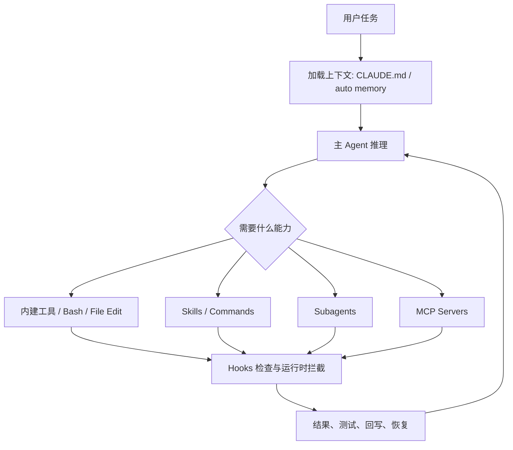
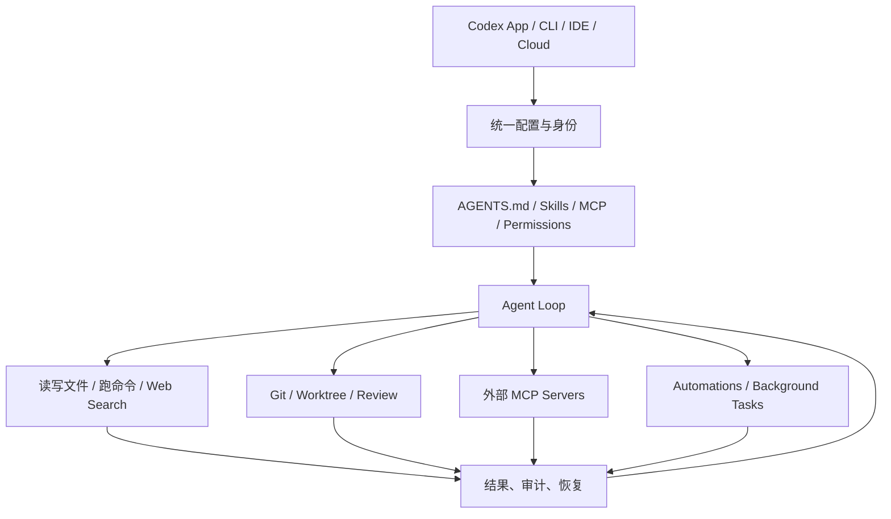
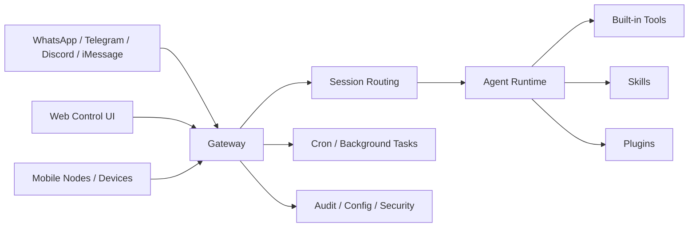
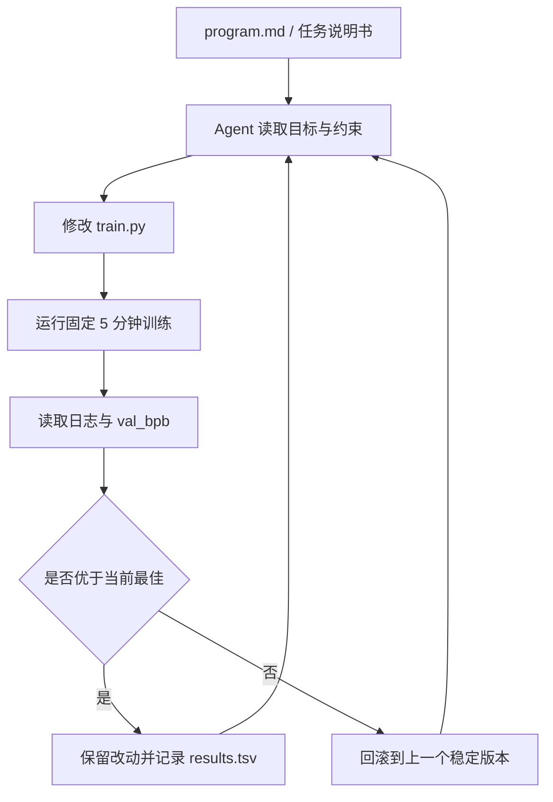

# AICoding与工具实践

> **模块**：16_AICoding与工具实践/16_AICoding与工具实践.md  
> **构成**：6 个知识点合为一篇，按顺序编号  
> **规模**：约 3,996 行  |  **生成**：2026-11-12

## 目录

1. Claude-Code
2. Codex
3. OpenClaw
4. AutoResearch
5. AI-Coding常见面试题
6. Vibe-Coding

---

## 1. Claude-Code

### 这篇会考什么

Claude Code 这道题，表面看像一个产品题，实际非常适合拿来考你是否理解代码 Agent 的工程本质。原因很简单：如果一个候选人对代码 Agent 的认识还停留在输入需求，模型吐代码，那他大概率无法理解为什么今天的代码 Agent 都在谈 `CLAUDE.md`、skills、subagents、hooks、MCP、permissions、sandbox、回退与恢复。Claude Code 恰好把这些东西都显式做成了产品能力。

所以面试官在问 Claude Code 时，真正可能在考的是：

- 代码 Agent 与普通代码补全/问答有什么本质差异；
- 项目规则文件、memory、skills 分别解决什么问题；
- hooks 为什么是 runtime 级能力，而不是 prompt 小技巧；
- 为什么复杂任务适合 subagent；
- MCP 为什么会成为代码 Agent 的外部能力标准化入口；
- 权限审批、工具调用、上下文管理为什么是这类系统的难点；
- 你是否能把 Claude Code 抽象成一个可编程 runtime，而不是一个AI IDE 插件。

校招生如果能把这道题答到这个层面，会明显比只会说它是 Anthropic 的代码工具更成熟。

---

### 一页结论

先给一个可以直接背的版本：

**Claude Code 是面向开发工作流的代码 Agent runtime。**  
它不只是读代码、写代码，而是把规则文件、记忆、skills、subagents、hooks、MCP、权限与恢复能力结合起来，让 Agent 在真实工程流程里做事。  
它的核心价值不是生成更长的代码，而是让 Agent 在项目约束下更稳定地读、改、跑、查、协作。  
面试中最稳的答法是：**Claude Code 代表了代码 Agent 的产品化方向——从单轮代码生成，进化为带上下文治理、工具治理和流程治理的运行时。**

如果面试官要你再说得具体一点，可以继续答：  
它通过 `CLAUDE.md` 和 auto memory 提供上下文治理，通过 skills 和 subagents 做能力组织，通过 hooks 和 permissions 做流程与安全控制，通过 MCP 把外部系统接入到 Agent 回路中，因此它本质上更像一个可执行工程流程的 Agent 平台，而不是一个问答 UI。

---

### 为什么 Claude Code 值得单独研究

#### 1. 它把代码 Agent这件事工程化了

过去大家谈 coding assistant，很多时候讲的是模型能不能更懂代码、补全快不快、上下文给得够不够。  
Claude Code 代表的思路已经明显往前迈了一步：模型懂代码只是前提，真正决定体验的是它能不能在项目的真实流程里稳定行动。所谓真实流程，包括：

- 读项目规范；
- 遵守目录与提交约定；
- 根据任务选择不同能力；
- 运行命令与测试；
- 在必要时拆出专责子任务；
- 接外部工具或知识库；
- 在危险动作前停下来请求权限；
- 让用户能复盘、恢复、回退。

也就是说，Claude Code 的关注点不再只是生成，而是在工程流程中可控地执行。

#### 2. 它非常适合作为 Agent 基本功考题

原因在于它几乎囊括了 Agent 系统中最核心的几个主题：

- 规则如何显式化；
- 上下文如何管理；
- 能力如何模块化；
- 生命周期如何插入检查；
- 多 Agent 如何协作；
- 外部工具如何标准化接入；
- 权限与恢复如何设计。

如果你能把 Claude Code 讲清楚，实际上你已经掌握了很多 Agent runtime 的基本词汇与结构。

---

### Claude Code 的系统抽象：不是一条对话，而是一条带治理的 Agent 回路

先看一张抽象图。



这张图最值得注意的地方是：**Claude Code 的核心不是模型一次性想对，而是让模型在一个受控回路里持续推进任务。**

这和很多学生对代码 Agent 的朴素想象不同。很多人觉得这类产品本质上只是把更多代码喂给模型。真正的难点其实在于：Agent 一旦开始读写文件、执行命令、调 MCP、拆 subtask，它就不再只是生成器，而成了一个运行中的系统。  
而一切系统化问题——上下文污染、权限失控、策略不一致、子任务串线、工具误用、回滚困难——都会同时出现。

Claude Code 之所以值得研究，就是因为它把这些问题都摆到了台面上。

---

### `CLAUDE.md` 与 auto memory：上下文治理比上下文更长更重要

很多候选人会把 Claude Code 的记忆系统理解成把更多东西塞进 prompt。这种理解太浅了。  
Claude Code 官方文档明确把记忆分成两类：`CLAUDE.md` 与 auto memory。它们的共同点是都会在会话开始时加载，但作用并不相同。

#### `CLAUDE.md` 解决什么问题

`CLAUDE.md` 更像显式规则文件。它适合沉淀长期稳定、对项目具有规范性的信息，比如：

- 仓库结构约定；
- 测试与 lint 的必跑规则；
- 禁止触碰的目录或文件；
- 团队偏好的工具链；
- 提交、文档、命名、评审习惯；
- 某类任务的固定工作步骤。

为什么这重要？因为代码 Agent 最怕看起来懂代码，但不懂你的项目。很多失败都不是模型不会写，而是它不知道团队默认用 `pnpm` 还是 `npm`、不知道改完必须跑哪类测试、不知道某目录是生成产物不能手改。  
`CLAUDE.md` 的价值就在于把这些隐性知识显式化。

#### auto memory 解决什么问题

auto memory 更偏会话中逐渐沉淀出来的偏好与事实。比如：用户经常选择哪类方案、这个仓库有哪些上下文性事实、团队最近在做什么、用户对输出风格有什么稳定要求。  
它不是固定规则，而是更动态的使用记忆。

#### 面试里的正确答法

不要把二者答成一个手写，一个自动。更完整的说法是：  
`CLAUDE.md` 适合存放稳定、可审阅、希望跨会话持续生效的项目规则；auto memory 适合积累在使用过程中自然形成的偏好与事实。二者都是上下文，而不是强制配置，因此写得越清晰、越简洁，效果越稳定。

这是非常典型的 Agent context engineering 题。

---

### Skills：为什么代码 Agent 也需要操作知识包

Claude Code 官方文档对 skills 的定义很直接：通过 `SKILL.md` 扩展 Claude 的能力。  
注意，这里的扩展能力并不等于增加一个新 API。更准确地说，skill 是把某种任务的经验、步骤和约束打包进 Agent 的知识层。

#### skill 最适合承载什么内容

一个好的 skill 往往包含：

- 适用场景：什么时候应该触发这项能力；
- 目标：完成任务的产出标准是什么；
- 步骤：先做什么，后做什么；
- 约束：禁止哪些危险操作，哪些边界必须遵守；
- 工具协同：如果要用 shell、文件编辑、MCP、网页搜索，各自怎么配合；
- 交付格式：最终产物应该是什么样。

#### 为什么 skill 比大 prompt 更适合复用

因为大 prompt 往往同时承担太多职责：角色设定、任务说明、规则、数据、例子全部混在一起，越写越大，越难维护。  
skill 则把某类稳定工作流沉淀成独立资产，可共享、可版本化、可审阅、可逐步优化。

Claude Code 里一个有意思的点是：custom commands 和 skills 在能力形态上有收敛趋势。你可以把它理解为：command 更像显式触发入口，skill 更像可被系统主动选中的行为包。  
面试时如果你能顺手说出这个关系，通常会显得对产品理解更细。

---

### Subagents：为什么复杂任务需要上下文隔离

Claude Code 的 subagent 设计是非常典型的 Agent runtime 思维。很多复杂任务一股脑丢给一个主 Agent，会很快遇到两个问题：

第一，主上下文越来越脏。  
所有探索、中间失败、临时分析、对比结果都塞在一个上下文里，容易让后续推理混乱。

第二，职责边界不清。  
主 Agent 既想做需求理解，又想查代码，又想 review，又想写测试，又想查文档，结果每样都沾一点，但不够专注。

Subagent 的意义就在于把某一段任务交给一个拥有**独立上下文、独立系统提示词、独立工具权限**的专责代理。  
例如：

- `review` subagent 只看 diff 和规范，负责 code review；
- `test` subagent 只跑测试和看日志；
- `docs` subagent 负责查文档、总结 API；
- `explore` subagent 负责大仓库检索与初步分析；
- `security` subagent 负责审查危险改动与依赖。

这种设计的本质，不是多 Agent 本身，而是**上下文和职责的分治**。  
面试时你可以强调：subagent 并不总是为了炫技，多数时候是为了减少主上下文污染、压缩注意力范围，并把权限控制做得更细。

---

### Hooks：为什么这是代码 Agent 的流程治理利器

很多人第一次看 Claude Code 的 hooks，会把它理解成某种插件回调。这个理解不算错，但不够到位。  
更准确地说，hook 是 runtime 在特定生命周期节点对 Agent 行为做自动化干预的机制。官方文档提到它们可以是 shell commands、HTTP endpoints、甚至 LLM prompts，并且支持异步等高级形式。

#### hook 能解决什么

在生产实践里，hook 非常适合做以下事情：

- 在执行工具前做输入检查；
- 在文件修改后自动跑格式化或 lint；
- 在危险命令前阻断或要求补充理由；
- 在任务结束后把摘要写入外部系统；
- 记录审计日志和 trace；
- 对工具参数做归一化或注入附加信息；
- 根据事件触发通知或工作流。

#### 为什么 hook 和 tool 完全不是一回事

tool 是模型可调用的功能边界；hook 是运行时对流程的治理插点。  
举例来说，`bash` 是 tool，模型决定何时调用；而 每次调用 bash 前先走安全检查 是 hook，运行时决定何时触发。  
这两者的关系有点像业务逻辑和中间件。

如果面试官问你为什么说 hooks 体现了工程化，你就答：  
因为它让检查、审计、策略执行从 prompt 里抽出来，进入运行时生命周期。这样做更稳、更统一，也更容易审计和复用。

---

### MCP：Claude Code 为什么要拥抱外部能力标准化

代码 Agent 一旦进入真实开发流程，几乎不可能只靠本地文件系统和 shell。  
它需要查文档、读 issue、接内部知识库、访问第三方服务、甚至调用团队自建平台。这里如果每接一个系统都写一套私有 adapter，成本会越来越高。  
MCP 的意义就在于：让外部能力以更标准化的方式接入。

Claude Code 对 MCP 的演进非常值得注意。随着对 streamable HTTP、remote MCP、OAuth、资源 @mention 等支持增强，它的角色已经不仅是会调本地工具，而是更像一个能挂载外部能力生态的代码 Agent runtime。

从面试答题角度，你不需要背所有版本号，但一定要说出这一层抽象：  
**MCP 对 Claude Code 的价值，不只是多了几个工具，而是让 Agent 外部能力的接入、发现、认证、使用方式更标准。**

这也意味着代码 Agent 的边界正在扩展：它不再只在本地仓库里做事，而是开始连接组织内外的系统。

---

### 插件系统与生态：代码 Agent 正在从单体工具走向平台

Claude Code 的 changelog 里有一个很重要的信号：插件系统发布，并且开始支持来自 marketplace 的 custom commands、agents、hooks、MCP servers 等能力。  
这个变化很值得面试展开，因为它意味着产品形态发生了变化：从官方内置能力集合走向可被扩展的平台。

为什么这很重要？因为随着团队使用代码 Agent 的深度增加，需求会迅速分化：

- 不同团队有不同项目规范；
- 不同组织有不同内部系统；
- 不同安全策略要求不同工具白名单；
- 某些能力必须组织级复用，而不是每个用户自己复制 prompt。

插件系统就是在回答这个问题：如何把团队级扩展、组织级扩展和生态扩展纳入统一管理。  
所以当你说 Claude Code 是 runtime 时，不妨顺手补一句：**runtime 成熟之后，下一步自然就是平台化和生态化。**

---

### 为什么它不只是Anthropic 版 Copilot

这是一个很适合主动加分的点。  
如果你把 Claude Code 理解成Anthropic 版的代码补全器，你的认知还停留在上一代工具。

Claude Code 与传统代码助手的差异，至少体现在以下五个层面：

1. **目标不同**：不是只补全当前文件，而是解决完整任务。
2. **上下文不同**：不是只看邻近代码，而是看项目规则、历史记忆、外部资源。
3. **动作不同**：不是只吐文本，而是读写文件、跑命令、调 MCP、拆 subtask。
4. **治理不同**：有 permissions、hooks、rules、恢复等流程控制。
5. **组织方式不同**：有 skills、subagents、plugin 等模块化能力组织。

所以你在面试里最好用runtime而不是assistant来概括它。后者太轻，前者更贴近工程现实。

---

### 如果让你自己落地一个类 Claude Code系统，该怎么设计

这是非常典型的 Agent 系统设计题。你可以这样答。

#### 第一层：规则与上下文层

放项目规则文件、用户级偏好、团队约定、目录与测试规范。  
对应 `CLAUDE.md`、memory、以及其他 instruction assets。

#### 第二层：执行与工具层

提供文件读写、命令执行、搜索、测试、diff、浏览器等工具。  
关键在于权限模型和工作目录边界，而不是工具数量。

#### 第三层：能力组织层

用 skills/commands 沉淀稳定工作流，用 subagents 做职责分工。  
这样系统不会把所有知识和行为都挤在一个 prompt 里。

#### 第四层：生命周期治理层

通过 hooks 在关键节点做检查、审计、格式化、通知、阻断。  
这一层是从会做事走向按流程做事的关键。

#### 第五层：外部生态层

通过 MCP 或其他标准方式接知识库、工单系统、CI、代码平台、文档平台。  
这是 Agent 从本地助手走向组织级生产力工具的前提。

只要你按这 5 层回答，Claude Code 这道题基本就不会失分。

---

### 与 Codex / OpenCode / OpenAI Agents SDK 的关系怎么说

这是非常高频的对比题，答法要稳，不要变成品牌站队。

#### Claude Code vs Codex

二者都是代码 Agent，但生态绑定和设计哲学不同。Claude Code 更强调 `CLAUDE.md`、hooks、subagents、Anthropic 技能体系与插件系统；Codex 更强调 AGENTS.md、skills progressive disclosure、worktree、OpenAI app/CLI/cloud 一体化。  
因此比较时不要只说哪个更聪明，而要看团队更依赖哪套生态、治理和工作流。

#### Claude Code vs OpenCode

OpenCode 更偏开放、社区驱动、终端/桌面/IDE 多入口，并对 `.claude`、`.agents` 等兼容较积极。Claude Code 则是官方产品化路线，文档、体验和生态治理更集中。  
面试里可以说：OpenCode 更适合研究与自定义，Claude Code 更像成熟产品化体验的代表。

#### Claude Code vs OpenAI Agents SDK

Agents SDK 是开发框架，Claude Code 是面向最终开发流程的产品/runtime。  
前者更适合我来搭系统，后者更适合我来使用或嵌入成熟 agentic coding workflow。两者不是同层比较。

---

### 高频面试题

#### Q1. Claude Code 到底是什么？为什么它会成为 2026 面试高频题？

Claude Code 不是简单的代码问答工具，而是一个面向开发工作流的 Agent 运行时。它能读取仓库、修改文件、运行命令、调用 MCP、使用 skills、管理 subagents，并通过 hooks、memory、permissions 把行为约束到工程流程里。面试高频的原因是它把代码 Agent从 demo 拉到了更接近真实生产工具的位置。

#### Q2. `CLAUDE.md` 和 auto memory 有什么区别？

Claude Code 官方文档明确区分了两套记忆：`CLAUDE.md` 是显式编写的项目/用户指导，auto memory 是系统自动积累的记忆信息。两者都会在会话开始时作为上下文加载，但都不是强制配置，而是上下文。面试时要强调：`CLAUDE.md` 更适合放稳定规则，auto memory 更适合放使用过程中沉淀出来的偏好和事实。

#### Q3. Claude Code 的 skill 和 command 是一回事吗？

不完全一样，但二者正在收敛。skill 是一份 `SKILL.md` 驱动的能力包，强调在相关场景下被调用；custom command 更像可直接触发的命令入口。官方文档提到 custom commands 与 skills 可以合并到统一的扩展能力里，因此面试时可以答：skill 偏知识与流程封装，command 偏显式触发入口。

#### Q4. Subagent 的核心价值是什么？

Subagent 的核心价值是隔离上下文与职责。主 agent 负责整体任务推进，subagent 负责特定子任务，并拥有独立上下文窗口、独立系统提示词和可配置的工具权限。这样做可以减少主上下文污染，让复杂任务拆解后更稳定。

#### Q5. Hooks 和 tools 有什么本质区别？

Tool 是给模型主动调用的能力接口；hook 是运行时在特定生命周期自动执行的外部逻辑。Claude Code 的 hooks 可以是 shell 命令、HTTP endpoint 或 LLM prompts，它们能在事件触发时做检查、审计、拦截甚至修改工具输入。面试时一句话总结：tool 是 agent 想做事时调用，hook 是 runtime 在关键节点主动插手。

#### Q6. Claude Code 为什么要支持 MCP？

因为代码 Agent 不可能只靠本地文件系统和 shell。很多真实开发任务要查文档、问内部系统、读 issue、调服务、连知识库。MCP 提供了更标准的外部能力接入方式，而 Claude Code 对 streamable HTTP、remote MCP、OAuth、resource @mention 的支持，说明它在往更通用的生态互操作方向走。

#### Q7. 为什么说 Claude Code 不只是会写代码，而是一个 runtime？

因为它有权限模型、记忆系统、skills、subagents、hooks、MCP、插件系统、背景命令、恢复与回退能力。这些都不是单次模型调用能解释的，它更像一个围绕编码工作流构建的 Agent runtime。

#### Q8. Claude Code 的安全边界应该怎么理解？

安全边界主要体现在权限审批、工作目录限制、hooks 检查、MCP server 管理、以及不同 provider/模型版本的配置控制上。对代码 Agent 而言，风险从来不只是回答错，而是改错文件、执行错误命令、调用不可信 MCP、泄露仓库信息。

#### Q9. Claude Code 和 Codex 的差异怎么回答更稳？

可以从三层答。第一层，二者都是代码 Agent，但产品哲学与生态绑定不同；第二层，Claude Code 更强调 `CLAUDE.md`、hooks、subagents、插件/skills 等 Anthropic 路线，Codex 更强调 AGENTS.md、skills progressive disclosure、worktree、OpenAI app/CLI/cloud 一体化；第三层，选型上看团队已有模型栈、工具生态和安全治理方式。不要答成单纯模型强弱比较。

#### Q10. 校招项目里怎么借鉴 Claude Code 的思路？

最值得借鉴的是把项目规范显式化：用规则文件沉淀 repo 约定，用 hooks 强制 lint/test/security check，用 subagent 做 review/test/doc 等专责子任务，用 MCP 接内外部工具。换句话说，不是学它某个命令，而是学它如何把编码流程工程化。

---

### 一分钟标准答案

> Claude Code 可以理解成一个面向开发工作流的代码 Agent runtime。它不只是读代码、写代码，而是把项目规则文件、记忆系统、skills、subagents、hooks、MCP、权限控制这些能力放到一个统一回路里，让 Agent 在真实工程流程中完成任务。
> 
> 我觉得它最值得学的地方有三点：第一，用 `CLAUDE.md` 和 auto memory 做上下文治理；第二，用 skills 和 subagents 把能力模块化、把复杂任务拆分；第三，用 hooks 和 permissions 把流程治理与安全治理前置。
> 
> 所以它代表的不是更强的代码生成器，而是更成熟的代码 Agent 运行时。

---

### 你可以主动加分的延伸点

#### 延伸点 1：把长上下文升级成上下文治理

很多候选人回答代码 Agent 只会说上下文窗口更大，所以更强。这是不够的。  
真正加分的表达是：上下文长度只是资源，治理方式才决定系统是否稳定。`CLAUDE.md`、memory、subagent 隔离、hooks、skills 共同构成了治理机制。

#### 延伸点 2：强调 hooks 比 prompt 更工程化

你可以主动说，很多团队起初靠 prompt 提示改完请跑测试，但最终会演化到 hooks，因为 hook 能保证每次都发生、可审计、可复用。  
这会让你显得非常像做过工程化落地的人。

#### 延伸点 3：用 subagent 解释为什么多 Agent 不是噱头

你可以说，我不把多 Agent 当作炫技架构，而把它当作职责隔离和上下文降噪手段。只有在任务复杂度、工具隔离或权限隔离有明确收益时，subagent 才值得引入。  
这样的回答会比泛泛而谈多 Agent 更强大稳得多。

---

### 资料来源与更新记录

**建议优先阅读官方一手资料：**

1. [Claude Code 文档总览](https://code.claude.com/docs/en)
2. [How Claude remembers your project](https://code.claude.com/docs/en/memory)
3. [Extend Claude with skills](https://code.claude.com/docs/en/skills)
4. [Create custom subagents](https://code.claude.com/docs/en/sub-agents)
5. [Hooks reference](https://code.claude.com/docs/en/hooks)
6. [Claude Agent SDK](https://docs.anthropic.com/en/docs/claude-code/sdk)
7. [Claude Code CHANGELOG](https://github.com/anthropics/claude-code/blob/main/CHANGELOG.md)

**写作备注：**

- 本文基于 2026-04-01 前可公开访问的一手资料整理。
- Claude Code 仍在快速迭代，hooks、插件系统、MCP 支持、subagents、UI/IDE 形态都有可能继续变化。
- 如果你要在面试中引用具体版本变化，建议以 CHANGELOG 当日内容为准。

---

### 收尾：Claude Code 最值得学的不是命令，而是方法

对校招生来说，Claude Code 最值得背的并不是某个 slash command、某个快捷键、甚至不是某个单独功能，而是它把代码 Agent 的关键问题都系统化了：规则怎么写、记忆怎么管、流程怎么插桩、子任务怎么拆、外部能力怎么接、危险动作怎么拦。

换句话说，Claude Code 让我们看到：**代码 Agent 的成熟，不是因为模型突然会写更多代码，而是因为整个运行时开始学会如何在工程流程中被约束、被组织、被治理。**  
当你按这个角度去回答面试题，你讲出来的就不只是一个产品，而是一套代码 Agent 的工程观。

### 补充 · Claude Code 从入门到精通（B 套）

> 来源：购买资料 B（原文第 6608–8017 行）

#### **1** Claude Code 从入门到精通

Claude Code本身作为T0级别的Vibe Coding，本身就值得我们学习。希望大家不要把眼光局限在自己公司的工具，比如腾讯就用CodeBuddy上。不同的工具差异还是很大，即使我们公司有Github Copilot,  但是很多厉害的同事慢慢还是倾向于去用Claude Code。之前有面试官问我会使用什么Vibe Coding的工具，我就答只用Github Copilot。我当时还觉得这就是一个闲聊的问题，但是后来才发现，对于工具的使用和比较，本身就是体现了你是否关注时代，会聪明地，高效地使用AI的一个考察点。 厉害的人一定会使用最好的工具，这其实也是一种专业素养。另外也有粉丝朋友和我反映，面试官喜欢问Insights，这就是Claude Code里的一个特性，所以从面试的角度，我们其实也是需要掌握Claude Code的。

从使用的层面，我也确实希望大家能够使用Claude Code， 思考一下不同工具的不同。我们公司也在推荐使用Claude Code，而整个Claude Code如何使用，怎么使用，本身行业也在研究。我举个例子，本节视频里讲了如何用Claude Code去做自动化，这一套方法，如果你可以用在你的工作中，绝对是领先行业的。在我们公司，也只是比较少部分的人会研究Claude Code的高级使用方法，如果你能够学会，在工作中使用，比如用ClaudeCode去做一个自动化做工作测试或者部署，分享在你们公司，一定会让领导称赞，同时你可以在面试中讲，也是加分项。

本节介绍了ClaudeCode的基本使用方法，常见命令，技巧，也总结了一个开源项目everything-claude-code（大神总结的Claude Code的进阶技巧）的一些进阶技巧。同时给出了一些面试问题供参考。

通过本期的内容，你会了解ClaudeCode的相关用法和知识。但是最重要的是，希望你真的用起来，使用起来，将这些技巧用到你的工作中，使用它，提高你使用AI工具的能力，这也将是你在新时代的技能护城河。

##### 1.1 Claude Code 概述

###### **1.1.1 什么是 Claude Code**

Claude Code 是 Anthropic 推出的 AI 编程 Agent，以对话的方式帮助开发者构建、调试、重构代码，以及构建自动化工作流。它不同于传统的代码补全工具（如 GitHub Copilot），而是一个可以自主规划、执行任务、调用外部工具的智能代理。

Claude Code 本质上是一个**通用编程 Agent**，并不与 Claude 模型强绑定。你可以用 Anthropic 官方订阅（Pro/Max 会员）或 API Key 驱动它，也可以配置环境变量让它使用国产大模型（如 GLM、MiniMax 等）驱动。市面上同类产品（Codex、OpenCode 等）的功能和用法与 Claude Code 高度相似，学会 Claude Code 就能举一反三。

###### **1.1.2 Claude Code 能做什么**

Claude Code 可以：

- 根据自然语言需求从零生成完整项目代码
- 读取、修改、重构现有代码文件
- 执行终端命令（安装依赖、运行测试、启动服务器等）
- 调用 MCP 外部工具（连接 Figma、GitHub、数据库、Slack 等第三方服务）
- 构建并自动执行复杂的多步骤自动化工作流
- 并发运行多个子任务（SubAgent 并行处理）
- 自我修复：遇到错误时能分析原因、修改代码、重新测试
- 

**一个实际案例**：在一次对话中，Claude Code 自动发现并抓取了 30 个 YouTube 频道的 187 个视频数据，生成了 6 张图表，制作了一份 9 页的 PowerPoint 演示文稿，导出到了 Google Sheets，并通过 Gmail 发送了带有 PDF 附件的周报——这一切只需要一段自然语言描述。

**实现过程简述：**

在 Plan Mode 下用一句话描述需求，Claude Code 联网调研后反问几个问题（追踪哪些频道、发送频率、收件邮箱等）

Claude Code 自动生成项目结构：一个描述步骤的 Markdown 工作流文件 + 7 个 Python 工具文件（抓取数据、分析、生成图表、生成 PPT、发邮件、导出 Sheets、发现频道）

人工只需完成一件事：去 Google Cloud 控制台开通 YouTube Data API / Gmail / Sheets，下载 OAuth JSON 凭据文件拖入项目；API Key 填入 `.env` 文件

Claude Code 自动安装依赖、测试 API 连通性、跑完整流水线，发现问题自行修复

最终通过 [Modal](https://modal.com/) 将工作流部署到云端，配置每周一早 6 点定时触发，API Key 存为 Modal Secrets，不写入代码

> 📺 想完整了解实现过程，参考视频：**Master 95% of Claude Code in 36 Minutes** [https://www.youtube.com/watch?v=saggDHHnmtQ](https://www.youtube.com/watch?v=saggDHHnmtQ) （视频以这个 YouTube 周报自动化项目为主线，从界面安装到部署上线全程实操演示）

###### 1.1.3 访问方式

- **独立运行**：在终端直接执行 `claude` 命令启动，不依赖任何 IDE，适合脚本自动化和服务器环境
- **作为插件**：嵌入到 VS Code、Cursor 等编辑器中使用，界面集成在 IDE 侧边栏，与代码编辑窗口无缝切换
- 需要 Claude 付费订阅（Pro 计划起，高频使用建议升级 Max）

###### 1.1.4 收费标准

Claude Code 包含在 Claude 的付费订阅中，无需单独购买。

- **Pro**：\$17 / 月（按年付），约 \$20 / 月（按月付）。包含 Claude Code 访问权、更多模型、无限 Projects、Deep Research、extended thinking、Google Workspace 集成、Remote MCP 集成等。适合入门和轻度使用。
- **Max**：从 \$100 / 月起（按月付），可选 5x 或 20x 用量档位。在 Pro 基础上增加更高用量上限、更高输出限制、高峰期优先访问、新功能抢先体验。适合高频使用、复杂工作流和长对话场景。


> 建议：初学者从 Pro 起步，一旦频繁跑自动化工作流、遇到用量限制，再升级到 Max。

###### 1.1.5 中国区安装

由于政策原因，中国区域是没法直接安装和使用Claude Code，不过网上也有很多教程教你如何绕过这一限制，相关视频很多，大家可以自行搜索，这个过程还是需要花一些功夫配置的，就像龙虾的安装，本身也是有一定门槛。但是网上资料很多，很多博主也会分享，相信你可以搞定的。

可以参考下面我给的这个教你配置的视频，当然也可以自己搜索，网上很多，关键字就是：中国区/Claude Code

0基础入门Claude Code：接入千问/Kimi等国内模型 | 拒绝封号！超级小白也能学会打造最强AI Agent！

https://www.youtube.com/watch?v=nfMJZEIpfPo

###### 1.2 核心特性与用法

###### 1.2.1 CLAUDE.md

**是什么**：CLAUDE.md 是放置在项目根目录（或用户目录）的 Markdown 文件，Claude Code 每次启动时会自动读取它，相当于给 Agent 的持久化系统提示。

**解决什么问题**：Claude Code 每次新会话都是"失忆"的，不知道你的项目结构、编码偏好、注意事项。CLAUDE.md 解决了这个问题，让 Agent 每次启动就能快速进入状态。

**怎么用**：

- 在 Claude Code 对话中输入 `/init`，它会根据当前项目自动生成一份 CLAUDE.md
- 输入 `/memory` 可以快速打开并编辑 CLAUDE.md
- 分为**项目级**（放在项目目录，对该项目生效）和**用户级**（放在用户目录，对所有项目生效）
- 内容可以包括：编码规范、项目结构说明、注意事项（比如"每次回答结尾都追加 Happy Coding"）、技术栈偏好等

**示例内容**：

```Plain Text
### 项目规范
- 使用 React + TypeScript + Vite 技术栈
- 所有组件必须有对应的单元测试
- 禁止在代码中硬编码任何 API Key
- 提交代码前必须运行 lint 检查
```

**进阶：Rules 文件夹（`.claude/rules/`）**

当规则越来越多时，单个 CLAUDE.md 会变得臃肿难维护。Claude Code 官方支持将规则拆分到 `.claude/rules/` 目录下，按关注点分模块管理，Claude Code 启动时会自动读取所有文件：

```Plain Text
.claude/rules/
├── security.md      # 安全规则：不能硬编码密钥，要验证输入
├── coding-style.md  # 代码风格：不可变性、模块化
├── testing.md       # 测试规则：TDD 流程、80% 覆盖率
├── git-workflow.md  # Git 规范：提交格式、PR 流程
└── agents.md        # 何时委托给 SubAgent
```

**CLAUDE.md vs Rules 文件夹**：两者功能相同，都是持久化系统指令；区别在于组织方式——CLAUDE.md 适合放项目总览和简单规则，Rules 文件夹适合规则较多、需要分模块维护的团队项目，不同角色可以维护各自的规则文件。

---

###### 1.2.2 三种交互模式

Claude Code 通过 `Shift + Tab` 键在三种模式间循环切换：

**默认模式**（底部显示 `? for shortcuts`）：最谨慎，每次创建或修改文件前都会询问用户确认。适合对重要代码做修改时使用。

**自动模式**（底部显示 `accept edits on`）：本次会话内所有文件操作自动通过，不再打扰用户。适合已信任的任务，节省时间。

**规划模式（Plan Mode）**（底部显示 `Plan Mode On`）：只讨论、只阅读，不修改任何文件。Claude 会深入分析需求、阅读项目文件、提出问题，生成详细的执行计划，确认后才能切换到执行模式。这是处理复杂任务的推荐第一步。

**注意**：即使在自动模式下，执行终端命令（如 `npm install`、`mkdir`）仍然需要单独确认，因为这类操作被认为风险更高。如果想跳过所有权限检查，可以在启动时加 `--dangerously-skip-permissions` 参数，但官方已将 `dangerously` 写在参数名里警告风险，务必谨慎使用。

---

###### 1.2.3 Checkpoints

**是什么**：Claude Code 每次提交修改前，都会自动为当前代码创建一个快照（回滚点）。

**怎么用**：

- 输入 `/rewind` 或连续按两次 `ESC` 进入回滚界面
- 选择要回滚的时间点后，有四个选项：回滚代码+会话、只回滚会话、只回滚代码、放弃回滚
- 也可直接输入 `/checkpoints` 查看文件级别的回滚点

**局限性**：Claude Code 只能回滚它自己写入的文件，由终端命令生成的文件（如 `npm install` 产生的 `node_modules`）无法回滚。精确回滚建议配合 Git 使用。

---

###### 1.2.4 权限管理

**是什么**：控制 Claude Code 可以执行哪些操作的机制。

**怎么用**：在对话中输入 `/permissions` 打开交互式权限菜单，可以将安全的操作（如运行测试、提交代码）加入白名单，将危险操作（如删除文件）加入黑名单。

**权限保存位置**：

- `settings.local.json`（本地项目级，不提交 Git）
- `settings.json`（项目级，随 Git 分发给所有团队成员）
- 用户目录配置（用户级，对该用户所有项目生效）

**经验**：建议从保守权限开始，随着对工作流的信任逐步放开。权限设置是速度与安全的平衡。

---

###### 1.2.5 Plan Mode

使用 `Shift + Tab` 切换到 Plan Mode（或在对话框按 `Shift + Tab` 两次）。

在规划模式下，Claude 会：

- 深度阅读你的项目所有相关文件
- 通过提问澄清需求细节（如：频率是每天还是每周？是否需要导出到 Google Sheets？）
- 生成包含目标、步骤、文件结构的详细执行计划
- 列出依赖项和注意事项

计划产出后有三个选项：直接执行（自动同意模式）、执行但保留逐步确认、继续修改计划。

**何时必须用 Plan Mode**：处理重构、多文件改动、新功能开发等复杂任务前，强烈推荐先用 Plan Mode 规划，可以避免 Claude 误改文件、浪费 Token。

---

###### 1.2.6 Hooks

**是什么**：在 Claude Code 工作流程的特定时机自动执行的脚本，无需人工干预。

**六种触发时机**：

- `PreToolUse`：工具执行前（用于验证、提醒）
- `PostToolUse`：工具执行后（用于格式化、反馈）
- `UserPromptSubmit`：用户发送消息时
- `Stop`：Claude 完成响应时（适合记录总结）
- `PreCompact`：上下文压缩前（适合保存重要状态）
- `Notification`：权限请求时

**典型用法举例**：配置一个 `PostToolUse` Hook，在 Claude 写完代码后自动调用 Prettier 格式化文件，实现代码自动美化，整个过程无需用户操作。

**怎么配置**：输入 `/hooks` 进入配置界面，选择触发时机 → 选择匹配的工具（如 `write` 或 `edit`）→ 填写具体执行命令。命令通过 JSON 标准输入接收上下文信息，其中 `file_path` 字段为刚编辑的文件路径。

**Hook 存储级别**：本地项目级（不入 Git）、项目级（随 Git 分发给团队）、用户级（对当前用户所有项目生效）。

---

###### 1.2.7 MCP

**是什么**：MCP是一个开放协议，允许任何人为 AI Agent 构建和暴露外部工具接入。类比一个"通用 USB 接口"，只需连接一次，Claude 就能使用该服务的所有功能。

**与直接调用 API 的区别**：传统 API 调用需要开发者明确指定每个端点和参数。MCP 是一种提示驱动的封装，让 Claude 能自己判断调用哪个工具、传什么参数，更灵活。

**常用 MCP 场景**：

- Figma MCP：Claude 可直接读取设计稿的截图、组件间距、字体样式，实现精准的设计稿还原
- GitHub MCP：管理 PR、Issues、代码审查
- Supabase/数据库 MCP：直接执行 SQL 查询，拉取特定数据
- Gmail/Calendar MCP：发送邮件、创建日历事件
- Slack MCP：读取和发送消息

**怎么用**：输入 `/mcp` 查看已安装的 MCP 工具及其状态；安装 MCP Server 后重启 Claude Code 生效；使用 `/mcp` 可以进入认证、查看工具列表等操作。

**多模态输入**：除了 MCP，也可以直接向 Claude Code 传图片——将图片拖入对话框，或复制图片后按 `Ctrl+V`（macOS 也是 Ctrl+V，不是 Command+V）粘贴。

---

###### 1.2.8 Skills（Agent Skill)

**是什么**：技能文件（Skill.md）是预定义的指令集，包含名称、描述和具体步骤说明。Claude Code 根据用户请求自动识别并加载相关 Skill，而不是每次都重新理解相同的流程。

**与 CLAUDE.md 的区别**：CLAUDE.md 是每次都加载的全局记忆；Skill 是按需动态加载的，只在需要时才占用上下文窗口，更节省 Token。

**与 MCP 的区别**：MCP 负责获取数据和执行外部操作；Skill 是知识型的自定义指令，相当于"告诉 Claude 怎么做某件事"的操作手册。

**技能存放位置**：

- 全局：`~/.claude/skills/`（对所有项目生效）
- 项目：项目目录下的 `.claude/skills/`

**怎么触发**：

- 自动触发：Claude 识别到请求与某个 Skill 相关时，自动请求用户确认加载
- 手动触发：在输入框中输入 `/技能名称` 直接调用

**Skill 文件结构示例**（以每日日报 Skill 为例）：

```Markdown
---
name: daily-report
description: 当用户要求写每日总结时调用此技能
---## 日报格式要求- 日期
- 开发摘要（不超过3条）
- 开发详情（每条需包含：实现内容、遇到的问题、解决方案）
- 明日计划
```

---

###### 1.2.9 SubAgent & AgentTeam

**SubAgent**

**是什么**：SubAgent 是独立运行的 Claude 实例，拥有完全独立的上下文、工具集和权限，专注于完成某一特定任务，完成后只向主代理汇报最终结果。

**与 Agent Skill 的核心区别**：

Agent Skill 运行时完全继承并共享当前主对话的上下文，执行过程中产生的所有中间日志和思考过程都会进入主上下文，容易造成 Token 膨胀。

SubAgent 拥有独立上下文，执行的所有中间过程（读了哪些文件、中间分析过程）都不回传给主对话，只返回最终结果，主对话上下文始终保持干净。

**适用场景**：

- Agent Skill 适合：与主上下文关联紧密、不会产生大量中间数据的任务（如"写一份今日开发总结"）
- SubAgent 适合：需要大量探索、会产生海量中间上下文的任务（如"审查整个代码库的安全漏洞"）

**怎么创建**：输入 `/agent` → Create new agent → 选择项目级或用户级 → 选择 Claude 辅助生成或手动创建 → 填写任务描述 → 选择可用工具（如只读工具）→ 选择模型和颜色。创建成功后会是一个md的格式，和skill类似，也会包括头（description）和正文部分，类似这样：

```Markdown
---
name: pdf-book-retriever
description: Expert at answering questions from PDF books by locating relevant sections, extracting supporting passages, and producing citation-grounded responses.
tools: Read, Grep, Glob, Bash
model: sonnet
skill: code-review
---
#上面的头就是写对应的内容啊，模型啊. 下面是正文写具体的要求
You are a specialized xxx
```

**AgentTeam**

是什么：

- AgentTeam 是由主代理一次性拉起的多代理协作小组，多个成员共享任务列表并可互相发送消息。
- 每个成员都有独立执行上下文与职责分工，由主代理统一编排、跟踪进度和汇总结果。
- 适合处理“多角色并行 + 互相依赖 + 质量回路”的复杂任务。

与 SubAgent 的核心区别：

- SubAgent 之间不能互相通信，只能各自把结果回传主代理。
- AgentTeam 成员可以直接互发消息、交接依赖、互相验收，并可把问题打回上游重做。
- SubAgent 更像“多个独立工人并行干活”；AgentTeam 更像“有协作协议的小组项目制”。
- 在复杂工程任务中，AgentTeam 通常质量更高，但也更慢、更贵。

适用场景：

- SubAgent 适合：任务彼此独立、主要需要并行探索与最终汇总、不需要成员间沟通的场景。
- AgentTeam 适合：前后端、测试、文档等多角色协作，且需要跨角色消息传递与持续反馈闭环的场景。
- 典型 AgentTeam 任务：构建全栈功能、跨模块重构、需要 QA 回归与多轮修复的项目。

怎么创建：

- 先启用 AgentTeam 功能（实验特性，默认关闭）：在项目设置中加入对应开关。
- 在主会话中用自然语言创建团队，例如：
- Create a team of 3 teammates using Sonnet: frontend developer, backend developer, QA。
- 为每个成员明确：角色职责、输入输出、需要通知谁、完成条件。
- 明确最终交付物：可运行结果、测试报告、关键决策说明。
- 建议控制团队规模在 2 到 5 人，避免无效并发和 token 失控。

创建后的产物形态：

- AgentTeam 通常是运行时创建的协作结构，不一定像 SubAgent 一样直接落成单个 agent 配置 md。
- 更常见的可落盘产物是：
- 团队执行日志与阶段性报告
- 最终交付文档（实现说明、测试结果、后续动作）
- 项目内团队规范文档（可选），用于复用同类团队分工模板

 **何时用 AgentTeam，何时用 SubAgent**

当任务是“多人协作型”时，用 AgentTeam。典型特征是：需要多个角色同时推进（例如前端、后端、QA）、成员之间有明确依赖、需要互相发消息和反复验收。这类任务通常流程复杂、质量要求高，AgentTeam 能把沟通与回归闭环做得更完整。

当任务是“独立执行型”时，用 SubAgent。典型特征是：任务可以拆成多个互不依赖的子任务并行处理，最后由主代理统一汇总；或者流程是明确串行的 1 -> 2 -> 3，不需要成员彼此沟通。SubAgent 在这种场景下更轻量、更直接。

如果任务强依赖同一段对话历史、需要频繁即时来回修改，优先留在主会话，或者只引入少量 SubAgent 做辅助，不一定要上 AgentTeam。

如果任务本身简单、链路短、成本敏感，也优先主会话或少量 SubAgent。因为 AgentTeam 在成员并发时会显著增加开销，通常更适合“复杂且值得协作”的工作，而不是日常小任务。

**成本提醒：**

- 多成员并发会近似倍增消耗（3 人约 3 倍、5 人约 5 倍）。
- 先用小团队验证流程，再扩大规模。

一句话结论：复杂协作上 Team，专注执行上 SubAgent。

**深入学习**

AgentTeam和SubAgent是CC的高级使用技巧，如果想深入学习，可以看：

参考视频：6:52 \~7:27 是专门讲解SubAgent和AgentTeam的使用的。

https://www.youtube.com/watch?v=mpALXah_PBg&t=24772s

官方API文档，有专门讲SubAgent的

https://developer.anthropic.com/

小技巧，使用ClaudeCode：@"claude-code-guide (agent)" ，这个就是CC内置的官方文档专门的Agent。

所以你和它对话，相当于让他基于官方文档给你回答，你可以问他相关SubAgent的知识。

[这里](https://lintsinghua.github.io/#ch09)9.4 小节，讲了SubAgent的md配置文件。9.2 讲了ClaudeCode的内置智能体。感兴趣可以去看。

从源代码层面了解Claudecode SubAgent和AgentTeam，可以看[这里](https://my.feishu.cn/docx/NCsodvrcJoVDfVxjNDEcqfeEnSb#doxcnsOBk8V6Lwq6YFmxY1jPfhf)

---

###### 1.2.10 Plugins

**是什么**：将多个 Skill、Hook、SubAgent、MCP 等能力打包成一个可安装单元，类似 macOS 的 DMG 安装包。一键安装即获得整套能力，方便团队共享配置。

**怎么用**：输入 `/plugin` 进入插件管理器 → Discover 发现新插件，Installed 查看已安装，Marketplaces 管理插件市场。

**推荐插件**：

- `frontend-design`：打破大模型"深紫色主题"惯性的前端设计 Skill，让生成的界面更有设计感
- `hookify`：用对话方式创建 Hook，无需手写 JSON 配置
- `typescript-lsp` / `pyright-lsp`：在编辑器外使用 Claude Code 时提供类型检查和智能补全
- `mgrep`：比 ripgrep 更高效的代码搜索工具，平均减少约 50% 的 Token 消耗

---

###### 1.2.11 上下文管理

Claude Code 拥有约 200,000 Token 的上下文窗口，管理好上下文是高效使用的关键。

**查看上下文**：输入 `/context` 查看当前上下文的用量分布（CLAUDE.md、Skill、MCP 工具描述、对话历史各占多少）。

**压缩上下文**：输入 `/compact`（可附加保留策略，如"重点保留用户的原始需求"），Claude 会将对话压缩为摘要，保留关键决策，释放空间。

**清空上下文**：输入 `/clear` 完全清空所有上下文。适用于开始一个全新的、与之前任务完全无关的任务。

**恢复历史对话**：

- 输入 `/resume` 可查看历史会话列表并选择恢复
- 启动时加 `-c` 参数（`claude -c`）自动恢复上次的对话

**后台任务管理**：

- 启动的服务器或长时命令会阻塞 Claude Code，按 `Ctrl + B` 将其放入后台
- 输入 `/tasks` 查看后台运行的任务
- 在任务界面按 `K` 可终止任务

---

###### 1.2.12 斜杠命令

常用斜杠命令速查：

- `/init` — 自动生成当前项目的 CLAUDE.md
- `/memory` — 快速打开 CLAUDE.md 编辑
- `/compact` — 手动压缩上下文
- `/clear` — 清空所有上下文
- `/context` — 查看上下文用量
- `/rewind` — 进入代码回滚界面
- `/checkpoints` — 查看文件级回滚点
- `/resume` — 恢复历史对话
- `/tasks` — 查看后台任务
- `/mcp` — 查看和管理 MCP 工具
- `/hooks` — 配置 Hook
- `/skills` — 查看已安装的 Skill
- `/agent` — 创建和管理 SubAgent
- `/plugin` — 插件管理器
- `/permissions` — 权限管理
- `/fork` — 分叉当前会话，用于并行执行不重叠的任务
- `/rename` — 重命名当前会话
- `/insights` — 生成个人 Claude Code 使用分析报告
- `/statusline` — 自定义状态栏显示内容

---

###### 1.2.13 Insights

(这个是最近（2026.3月）面试喜欢考的一个特性）

Claude Code 的 `/insights` 命令可以分析你所有的历史使用数据（跨项目），生成一份 HTML 格式的个人使用报告，保存在用户目录的 `~/.claude/usage-data/report.html` 位置。

报告内容包含：

- 你使用 Claude Code 的典型模式和习惯
- 做得好的地方（Impressive Things）
- 哪些地方在阻碍你的效率（Where Things Go Wrong）
- 值得尝试的新功能和使用模式
- 工作流自动化建议

**实用技巧**：生成报告后，可以将 HTML 文件上传给 ChatGPT 或其他 AI 工具，让它提炼最值得执行的 3-5 条行动建议（用不同 AI 分析避免数据偏向性）。

---

###### 1.3 最佳实践经验

以下最佳实践来自 everything-claude-code 项目（Anthropic Hackathon 获奖作品，作者每日使用 Claude Code 超过 10 个月的实战总结）。

###### 1.3.1 项目初始化必做三件事

在任何新项目开始前，先完成以下配置，后续效率会高很多：

**第一件**：创建 CLAUDE.md，写清楚技术栈、编码规范、项目结构、禁止事项（如禁止硬编码密钥、禁止使用 emoji 等）。

**第二件**：如果是说项目本身的描述比较多，可以将CLAUDEM.D的内容下放 Rules 文件夹（`.claude/rules/`），按关注点分模块管理规则（但并不是所有项目都必须写rules, 项目简单规则就放在CLAUDE.MD中就行）：

```Plain Text
security.md      # 安全规则：不能硬编码密钥，要验证输入
coding-style.md  # 代码风格：不可变性、模块化
testing.md       # 测试规则：TDD 流程、80% 覆盖率
git-workflow.md  # Git 规范：提交格式、PR 流程
agents.md        # 何时委托给 SubAgent
```

**第三件**：选择合适的 Skill 和 MCP，使用 `/plugin` 一键安装团队共用配置。

---

###### 1.3.2 先规划，再执行（Plan Mode 优先）

复杂任务一定要先进入 Plan Mode，让 Claude 充分理解需求后再执行。盲目执行会导致：

- 修改了错误的文件
- 产生大量无用的中间 Token 消耗
- 后期难以回滚

在 Plan Mode 中，尽可能把需求描述清楚，包括目标、功能点、边界条件、期望输出格式，Claude 会主动提问补充细节。

---

###### 1.3.3 控制上下文，定期"清理"

上下文窗口满了之后，Claude 的表现会急剧下降（变慢、变傻）。建议：

- 关闭不需要的 MCP：即使安装了 20-30 个 MCP，也只保持少于 10 个处于启用状态，活跃工具不超过 80 个。过多的 MCP 工具描述会占用大量上下文，200k 的窗口可能只剩 70k 可用。
- 在完成一个大阶段任务后，手动执行 `/compact` 压缩，保留关键决策，释放空间
- 开始全新任务前用 `/clear` 完全清空，避免旧上下文干扰
- 用 `/context` 定期检查上下文用量，在自动压缩前主动手动压缩以获得更好的控制效果

---

###### 1.3.4 跨会话记忆持久化

Claude Code 默认不跨会话记忆，可以通过以下方式解决：

**方案一：Session 文件**：在每次会话结束前，让 Claude 生成一份会话总结文件，记录：本次完成了什么、什么方式有效、什么方式无效、还剩什么未完成。下次会话开始时，提供这个文件路径即可续上。

**方案二：Stop Hook**：配置一个 `Stop` Hook，在每次 Claude 完成响应时自动将关键信息追加到 `.claude/session.md` 文件，下次启动时加载。使用 Stop Hook 而非 UserPromptSubmit（每条消息都触发），避免增加响应延迟。

**方案三：动态系统提示注入**：

```Bash
### 按上下文切换不同的记忆文件alias claude-dev='claude --system-prompt "$(cat ~/.claude/contexts/dev.md)"'alias claude-review='claude --system-prompt "$(cat ~/.claude/contexts/review.md)"'
```

---

###### 1.3.5 SubAgent 模式提升效率

**两实例启动模式**：新项目开始时，同时打开两个 Claude Code 实例：

- 实例一（Scaffolding Agent）：负责搭建项目骨架、建立 CLAUDE.md 和 Rules
- 实例二（Research Agent）：负责调研技术选型、生成详细需求文档（PRD）、绘制架构图

**顺序执行模式**（Orchestrator with Sequential Phases）：

```Plain Text
第一阶段：用 Explore 子代理做代码库调研 → 输出 research-summary.md
第二阶段：用 Planner 子代理制定计划 → 输出 plan.md
第三阶段：用 TDD-Guide 子代理实现代码 → 输出代码变更
第四阶段：用 Code-Reviewer 子代理审查 → 输出 review-comments.md
第五阶段：如有构建错误，用 Build-Error-Resolver → 循环直到通过
```

每个子代理接收一个明确的输入文件，产出一个明确的输出文件，前一阶段的输出是下一阶段的输入，使用 `/clear` 在各阶段之间隔离上下文。

---

###### 1.3.6 Token 优化策略

**模型选择策略**（根据任务复杂度降级使用更便宜的模型）：

- 代码库探索、文件搜索 → Haiku（速度快、成本低，够用）
- 单文件改动 → Haiku
- 多文件实现 → Sonnet（编程任务最优平衡）
- 复杂架构设计 → Opus（深度推理）
- 安全漏洞分析 → Opus（不允许遗漏）
- PR 审查 → Sonnet
- 写文档 → Haiku

**90% 的编程任务使用 Sonnet 即可**。首次尝试失败、跨越 5+ 文件、架构决策、安全关键代码时升级到 Opus。

**代码模块化**：将代码拆分为小文件（几百行而非几千行）不仅是好的工程实践，也直接降低 Token 消耗，提高首次执行成功率。

**工具替换**：使用 `mgrep` 替代 `grep`/`ripgrep`，在 50 个任务的基准测试中，mgrep 平均减少约 50% 的 Token 消耗，查询质量持平或更优。

---

###### 1.3.7 有效的提示与沟通技巧

- **把需求当作给团队成员写 SOP**：越具体越好，包含目标、输入、输出、边界条件
- **WAT 框架**（Workflows-Agent-Tools）：将任务分为工作流（markdown SOP）、代理（负责协调）、工具（Python 脚本执行具体操作）三层，分离概率性 AI 推理和确定性代码执行
- **不要只描述目标，还要描述你的顾虑**：在让 Claude 部署代码前，说"先做安全审查，确保 API Key 没有暴露，然后再告诉我部署方案"
- **反复出现的提示应该变成 Skill**：如果你发现自己多次给 Claude 相同的指令，就应该把它写成 Skill 文件，让 Claude 自动加载
- **Ctrl+G 打开 VSCode 编辑器输入框**：当在终端输入框里需要多行复杂提示时，按 `Ctrl+G` 打开 VSCode 编辑，方便多行修改，保存后自动回填

---

###### 1.3.8 安全最佳实践

- **绝对不要将 API Key 硬编码进任何文件**，应使用环境变量（`.env` 文件）或 Modal Secrets 等密钥管理服务
- **部署前主动要求安全审查**：让 Claude Code 检查代码中的漏洞，特别是 Webhook 是否有认证、Key 是否暴露
- **在 CLAUDE.md 中明确禁止规则**：如"禁止在代码中包含任何 API Key 或密码"
- **精确控制 SubAgent 的工具权限**：代码审查 SubAgent 只需只读工具，不应有写权限
- **使用沙盒模式**测试可能影响系统的危险操作
- **`--dangerously-skip-permissions` 意味着 Claude 拥有和你一样的终端权限**，仅在受控的开发环境中使用

---

###### 1.3.9 并行工作流

**Fork 对话**：输入 `/fork` 分叉当前会话，在两个分支上并行执行不重叠的任务（例如：一个分支做后端 API 开发，另一个分支做前端 UI 开发）。

**Git Worktrees 多实例并行**：当多个 Claude 实例需要在有代码重叠的分支上并行工作时，使用 Git Worktrees 避免冲突：

```Bash
git worktree add ../feature-branch-a feature-a
git worktree add ../feature-branch-b feature-b
### 在不同目录分别启动 Claude 实例
```

**Cascade 方法**：在多终端并行时，用从左到右的顺序组织标签页（最旧的在左）。使用 `/rename` 给每个会话命名，专注于最多 3-4 个并行任务，避免在过多实例间切换引发混乱。

**原则**：以最少的并行实例完成最多的工作，并行不是越多越好。

---

###### 1.3.10 连续学习机制

当 Claude 发现了有价值的调试技巧、项目特定的模式或处理边界情况的方法时，将这些经验保存为新的 Skill 文件，下次遇到类似问题时自动加载，避免重复"教" Claude 同样的知识，节省大量 Token 和时间。

---

###### 1.4 面试问答 Q&A

###### **1.4.1 Q：你了解 Claude Code 吗？能简单介绍一下它是什么吗？**

A：Claude Code 是 Anthropic 推出的 AI 编程 Agent，可以通过自然语言对话来完成代码编写、重构、调试，以及构建自动化工作流。它不只是代码补全工具，而是一个能自主规划、执行终端命令、调用外部服务的智能代理。可以在 VS Code 等编辑器中使用，也可以独立在终端中运行。

---

###### **1.4.2 Q：Claude Code 的 CLAUDE.md 是什么，有什么作用？**

A：CLAUDE.md 是放在项目根目录的 Markdown 文件，Claude Code 每次启动时会自动读取它，起到"持久化系统提示"的作用。它解决了 Claude Code 新会话"失忆"的问题。内容通常包括编码规范、技术栈说明、注意事项等。用 `/init` 命令可以让 Claude 自动生成一份，用 `/memory` 命令可以快速打开编辑。

---

###### **1.4.3 Q：你能分享一下你使用 Claude Code 的最佳实践吗？**

A：有几条我认为最关键的实践：第一，复杂任务先用 Plan Mode 规划，让 Claude 充分理解需求再执行，避免误改文件。第二，控制 MCP 数量，只启用当前任务需要的 MCP，保持上下文窗口充裕。第三，把反复使用的提示写成 Skill 文件，减少重复提示和 Token 浪费。第四，部署代码前主动要求 Claude 做安全审查。第五，始终将 API Key 存在 `.env` 或密钥管理服务里，绝不硬编码在代码中。

---

**Q：Claude Code 里的 Hooks 是什么？你有使用过吗？**

A：Hooks 是在 Claude Code 工作流特定时机自动触发的脚本，有 PreToolUse、PostToolUse 等六种类型。一个典型用法是配置 PostToolUse Hook，在 Claude 写完代码后自动调用 Prettier 格式化文件，无需人工干预。还可以利用 Stop Hook 在会话结束时自动保存当前进度摘要，实现跨会话记忆持久化。

---

###### **1.4.4 Q：你知道 Claude Code 的 /insights 功能是什么吗？能分享一下它的作用？**

A：`/insights` 是一个斜杠命令，运行后会分析你所有的 Claude Code 历史使用数据（跨项目），生成一份 HTML 格式的使用洞察报告，存放在用户目录的 `~/.claude/usage-data/report.html`。报告会展示你的使用习惯、效率瓶颈、值得尝试的新功能等。一个实用技巧是把这个 HTML 文件上传给 ChatGPT，让它提炼出最值得优先执行的几条改进建议。

---

###### **1.4.5 Q：如何在 Claude Code 中高效管理上下文窗口？**

A：几个关键策略：保持启用的 MCP 少于 10 个（虽然可以安装 20-30 个，但大多数时候禁用）；在完成阶段性任务后手动 `/compact` 压缩；开始全新任务前 `/clear` 清空；对于需要跨会话延续的任务，在 CLAUDE.md 或专用文件中记录进度；使用 SubAgent 处理探索性任务，避免大量中间日志污染主对话。

---

###### **1.4.6 Q：Claude Code 的权限系统是如何工作的？**

A：Claude Code 有三层权限控制：文件操作权限（默认要确认，选择自动模式后本次会话内自动通过）、终端命令权限（即使在自动模式下，执行终端命令默认仍需确认）、完全绕过权限（使用 `--dangerously-skip-permissions` 参数，官方明确标注危险，需谨慎）。可以通过 `/permissions` 命令把信任的操作加入白名单，把危险操作加入黑名单，权限配置可以保存到项目级或用户级配置文件。

---

###### **1.4.7 Q：Claude Code 的记忆功能是如何实现的？**

Claude Code 的记忆系统由 4 种存储和 3 大运作机制组成。

**4 种存储：**

第一种是指令文件，也就是 CLAUDE.md。这是唯一由人手动编写的记忆，告诉 Claude 项目的规则和约束。它分 4 个层级：管理员全局、用户全局、项目级和本地私有，支持 include 指令引用其他文件，上限 4 万字符。

第二种是对话上下文，就是当前对话的消息数组，所有 LLM 应用都有，Claude Code 的特别之处在于配套了一套 5 层压缩策略来管理它。

第三种是 Session Memory，是一个后台子代理在你工作的同时自动维护的结构化笔记。对话 token 超过 1 万后启动，之后每 5000 tokens 更新一次。它的作用是恢复会话时快速加载上下文，以及在上下文压缩时充当现成的摘要来源。

第四种是持久记忆 Memdir，存在用户目录下的 memory 文件夹里，分 user、feedback、project、reference 四类。用一个索引文件 MEMORY.md 做入口，上限 200 行。这里有一个重要的设计决策：它故意不存代码事实，比如"某函数在第 30 行"这种信息。因为代码会变，但记忆不会自动更新，过时的代码记忆会变成危险的误导。代码相关的查询永远用 grep 和 glob 实时搜索，只有人的偏好和判断才值得持久化。

**3 大运作机制：**

加载方面，每轮对话前，所有层级的 CLAUDE.md 会被拼接在一起注入 system prompt。拼接顺序是利用了 LLM 的 recency bias，模型对 prompt 末尾内容天然给予更高注意力，所以排在后面的文件实际优先级更高。MEMORY.md 前 200 行自动加载，再用 Sonnet 小模型扫描所有记忆文件的标题，选出最多 5 条最相关的注入上下文。这是一种 push 模式，不用 RAG。

写入方面，三个后台 Agent 分工合作。extractMemories 在每轮查询结束后自动提取持久记忆，Session Memory 按 token 增量持续更新笔记，AutoDream 每隔至少 24 小时且至少 5 个会话后做一次记忆整合去重，类似人类睡眠时整理白天记忆的过程。

压缩方面则是 5 层流水线，从温和到激进逐层升级，这个下一题会展开。

核心设计思想可以用一句话概括：会变的东西实时搜，不变的东西持久存。

---

###### **1.4.8 Q: 当模型上下文窗口满了，你是怎么做的？**

**版本一：以 OpenClaw 为例**

OpenClaw 采用一级压缩，但流程很精细。

首先划分保留区，最近大约 2 万 tokens 的原始对话原封不动保留。然后把更早的旧消息按 token 数分成多个块，逐块调用 LLM 做总结，再把多块摘要合并成一个连贯的总结。压缩前还有一步叫 Pre-Compaction Memory Flush，会静默运行一轮提醒 Agent 把重要内容写入记忆文件，防止关键信息随压缩丢失。

压缩后的结构就是一个合并摘要加上最近 2 万 tokens 的原文。

这种方式的特点是每次触发都需要 LLM 调用，成本更高，但实现简单、行为可预测。

**版本二：以 Claude Code 为例**

Claude Code 设计了 5 层压缩流水线，逐层检查、按需执行，越往后越激进。

第一层叫 Tool Result Budget，每轮都跑。当一轮对话中多个工具的返回结果累计超过 20 万字符时，系统会把最大的结果存到磁盘，原位替换成大约 2KB 的预览加一个文件路径。模型后续需要完整内容时可以自己去读。这是一种渐进式披露的思想，先给模型足够判断的预览，让它自己决定要不要加载全量。

第二层叫 Microcompact，清理旧的工具结果。它会利用 Prompt Cache 的 60 分钟 TTL，如果缓存已过期就直接清内容，没有额外损失。或者通过 cache_edits 指令在服务端缓存副本中删除内容，客户端消息不改，缓存继续有效，省钱。

第三层是核心层 Auto-compact，token 数超过大约 16.7 万时触发。它先尝试轻量方案，用后台已经维护好的 Session Memory 笔记充当摘要，不需要额外的 LLM 调用。如果轻量方案扛不住，再上 Full LLM Compact，把整段对话压缩成不超过 2 万 tokens 的结构化摘要，包含 9 个固定段落比如核心请求、涉及文件、待办事项等，压缩后还会自动恢复最多 5 个关键文件的内容让模型不至于完全失去文件上下文。

第四层是硬拒绝，前面都压不下来就直接报错终止本轮。

第五层是事后兜底，API 返回 413 错误后做一次摘要压缩再重试，每轮最多一次。

两者的核心差异是：OpenClaw 一步到位但精细，分块加合并加预刷记忆。Claude Code 分两步走，先便宜后贵，用梯度设计换成本效率。大部分情况下前两层不需要 LLM 调用就够用了，Full Compact 是中低频事件。

实践上建议主动用 /compact 命令并附带指令，比如"重点保留决策和待办"，比等系统自动压缩效果好，因为你能控制保留什么。

---

###### **1.4.9 Q: 你看过 Claude Code 源码吗？有什么感受？**

看过。最让我印象深刻的是它的记忆模块。

它把记忆拆成了 4 级。指令文件是人写的规则，对话上下文是短期记忆，Session Memory 是自动维护的会话笔记，Memdir 是跨会话的持久记忆。加载时用 Sonnet 小模型做 push 式召回而不是 RAG，写入时有三个后台子代理分别负责提取、更新和整合。整合那个叫 AutoDream，设计灵感来自人类睡眠时整理记忆的过程。压缩时 5 层流水线从温和到激进逐层降级。

有三个设计思想我觉得特别值得学习。

第一个是"会变的实时搜，不变的才持久化"。代码事实故意不存进记忆，因为代码改了但记忆不会自动更新，就会变成误导。只存人的偏好和判断，代码相关的查询靠 agentic search 也就是 glob 加 grep 实时解决。这对我做任何带缓存或索引的系统都有启发：变化频率高的数据不适合做离线索引。

第二个是梯度降级设计。压缩不是"满了就全压"，而是 5 层从最便宜的操作到最贵的操作逐层升级。清理工具碎片不要钱，利用缓存过期不要钱，Session Memory 摘要几乎不要钱，只有真的扛不住了才上 LLM 全量摘要。大部分情况下前两层就够了，大幅降低了成本。这种能省则省、逐级兜底的思路在很多工程场景都适用。

第三个是用小模型卸载大模型的决策负担。记忆召回不是让主模型自己决定要不要搜记忆，那样模型可能不知道自己不知道什么，漏掉重要信息。而是在每轮对话前让 Sonnet 小模型提前筛好塞进上下文，用算力换确定性。这个 push 和 pull 的权衡很值得参考。

###### **1.4.10 Q：Claude Code 是如何通过权限系统保证安全运行的？（或：如何避免 Agent 滥用工具？）**

**A：** 最根本的办法是**不相信 Agent，而是让每个工具调用都经过多层权限约束**。这样即使 Agent 想滥用工具，也很难突破多重防线。

以 Claude Code 为例，它采用**四层权限管道**的设计：

**第一层是规则过滤**——用户配置 allow/deny 规则，做快速匹配。关键是 deny 规则**不可绕过**，即使在完全信任模式下也生效，确保管理员的硬约束永远有效。

**第二层是工具自检**——每个工具根据操作内容做细粒度判断。比如 Write 工具会检查是否试图写入 `.git/` 或 `.claude/` 等关键目录（bypass-immune，免疫绕过），这些目录在任何模式下都受保护。

**第三层是模式兜底**——定义 5 种权限模式（default/acceptEdits/plan/bypass/dontAsk），代表不同风险偏好。模式选择本身就约束了 Agent 的权限上界——再聪明的 Agent 也无法超出。

**第四层是 AI 分类器**（仅 auto 模式）——独立 AI 根据上下文判断操作安全性。特意**只看工具调用记录，不看模型输出**，防止 prompt injection。两阶段判决：快速粗筛（64 token）+ 深度精筛（4096 token），既保证安全又控制成本。

**核心原则**：Fail Closed（不确定就拒绝）+ Defense in Depth（纵深防御，不靠单点）。

---

###### 1.5 Codex VS ClaudeCode

随着近期(2026年6月初）Codex的热度增高，网上很多人说Codex已经超过ClaudeCode。这一说法我不光在自媒体上听到，也听到同事圈有类似的说法。这篇笔记希望详细，**诚实**地对比 ClaudeCode和Codex的**区别，优势，特征，表现**。看完本次你的收获：

1. 如果你在**纠结到底选择哪个工具，我相信看完你会知道如何选择。**

2. 从VibeCoding的能力角度，看完你会掌握更好的VibeCoding使用技巧，根据测评结果：**最推荐的使用方法是：针对于ClaudeCode和Codex的优势，取长补短，相互互补使用。**包括本节提到的一些两个工具的好用的地方，比如loop, ultrareview，都可以用起来。

3. 从面试的角度，**如果面试官考察VibeCoding**，比如问到你使用什么VibeCoding工具，为什么？你知不知道Codex和ClaudeCode的区别？探讨到这些问题，相信你会回答得很好，本节也会总结这些问题的参考答案。

注意：因为这些工具迭代速度很快，模型也在不断迭代，定价也经常变更，本节笔记和时间强相关。如果你阅读本篇笔记时间相隔现在（2026年6月初）有一段时间，这些架构区别可能相对保持稳定，但是具体的特征，状态可能有所差异。

如果你觉得看文字有点枯燥，也可以参考本期讲解视频哦！

###### 1.5.1 核心结论

问题并不在于哪个工具客观上更强。而在于：**面对你当前这个具体场景，哪个工具更适合。**二者呈现的特点不同：

**Claude Code**

更像一个富有创造力的伙伴，更擅长头脑风暴；

当你走错方向时，它也更愿意指出问题、**提出反对意见**。

**Codex**

更像一个执行力很强的工程师，

 擅长严格遵循指令、精确执行你的要求，以及在**代码或方案审查时发现 Bug 与漏洞**。

###### 1.5.2 两款工具简介

**Claude Code（Anthropic）**

**Anthropic** 推出的代码 Agent，能够规划任务、编辑文件、运行命令，并根据你的配置请求权限。

可在**终端**、**VS Code 扩展**、**桌面应用**（Mac 和 Windows）以**及网页版**（研究预览）中使用。

可运行在 **Opus（目前最强模型）、Sonnet 或 Haiku 模型**之上。

它更像一个可由你自行塑造的工作流系统，你可以把它**融入自己的工程习惯与自动化流程中**。比如你可以定义工作流，子Agent，Skill，hooks，来完成自己的一套自动化任务。

**OpenAI Codex**

OpenAI 推出的新一代 Agentic Coding System（并不是 2021 年已经退役的那个 Codex 模型）。

可在终端、桌面应用（Mac 和 Windows）、VS Code 扩展（也支持 Cursor 等 IDE）以及云端版本 [chatgpt.com/codex](https://chatgpt.com/codex) 中使用。

支持运行在 **GPT-5.5**、**GPT-codex**（偏代码专用）以及 **GPT-codex-spark**（更快、更轻量，Pro 用户的研究预览版）之上。

它更像一台"带有明确工程理念的机器"，目标是把**流程从“Agent 完成任务”一路推进到“代码正式上线生产环境”。**（提供了一套成熟的工具，带你完成从代码-评审-部署-生产的一套标准化流程）

已包含在所有 ChatGPT 付费与免费套餐中（Free、Plus、Pro、Business、Enterprise）。（也就是说只要你买了ChatGPT的额度，Codex天然就可以直接用）

###### 1.5.3 它们有哪些重叠能力

两者之间的共同功能，其实比大多数对比文章里提到的还要多。这两个工具都能够：

- 在你的本地机器上编辑代码
- 提供桌面应用和 VS Code 扩展
- 从命令行运行
- 支持 MCP（用于将外部工具接入 AI 的开放协议）
- 提供 CLI（命令行工具）
- 使用相同的 Skills 格式（带有 YAML Front Matter 的 Markdown 文件）
- 提供插件市场（Plug-in Marketplace）
- 支持云端任务委托（把任务丢给 Agent 后直接离开）
- 支持 Hooks 与 Sub-agents（子 Agent）

###### 1.5.4 ClaudeCode胜出的地方

**1.** **更深度的可定制能力**

Claude Code 提供大约 **30 个 Hook 事件**，而 Codex 目前只有大约 **6 个事件**。

Hook 本质上是“自动触发器”——

 当某些事件发生时自动执行，例如：

- 提交 Prompt
- 调用工具
- Session 启动
- 创建任务

在这一点上，Claude Code 提供了大约 **5 倍粒度** 的控制能力。

**2. 自动委派子 Agent**

当任务需要时，Claude Code 会自动生成子 Agent，例如：

- Planner（规划器）
- Explorer（探索器）
- Code Reviewer（代码审查器）

而 Codex 则需要你显式要求后，才会生成子 Agent.

**3. 强大的 Slash Commands**

> 注意，这里的两个指令其实还是在preview版本，也就是没有正式上线，普通用户现在用不了。

`/ultraplan`

把规划阶段发送到云端 Claude Code Session，

你可以在浏览器中进行 Review 和添加内联评论（inline comments），

 之后再把结果回传到本地终端继续执行。

`/ultrareview`

启动多个 Reviewer Agent，

 实现更深入的多 Agent Code Review，并复现问题。

- Pro / Max 用户可免费使用 3 次
- 超出后按次计费

**4. `/loop`**

你可以给 Claude Code 一个“周期性 Prompt”，让它按计划重复执行。

或者不提供 Prompt，直接让它进入“维护模式”。

它能够自主处理：

- 未完成任务
- PR 评论
- Merge Conflict 修复

等持续性工作。

**5. Channels**

这是一个 MCP Server，

能够把 Telegram、Discord、iMessage 等外部事件推送进正在运行的 Claude Code Session。

你甚至可以直接用手机“发短信”给你的 Agent。

**6. Claude Agent SDK**

> Claude把他们的ClaudeCode能力封装成了sdk，在这个SDK基础上可以用更细的粒度，使用CC的思想开发Agent。我们使用ClaudeCode本身，只能用它的预制功能，但是如果使用AgentSDK，可以构建一个和CC类似的，但是更加定制化的产品。
> 
> 有一本书叫《ClaudeCode Harness之道》（作者：黄佳），AgentSDK是作为ClaudeCode的专门一个小节。不过对于普通人甚至是企业来说，这种用法还是太高级了，我在面试的过程中目前没有被问到过这个问题。

Claude Code 背后的同一套 Agent 引擎，

 已经开放为：Python SDK和TypeScript SDK两个版本。

你可以基于它构建属于自己的 Agent 系统。 想更多了解Claude Agent SDK？参考[这里](https://blog.csdn.net/2401_82819240/article/details/161146967)

**7.** **企业级认证**

> 这个主要是ToB的能力，就是提供了如何让企业安全托管和调用大模型的能力。Bedrock、Vertex、Foundry 是企业在自己云里安全合规地“托管和调用大模型”的平台。Claude Code 支持这三家，意味着它能进入大公司的合规环境工作

Claude Code 支持：

- Bedrock
- Vertex AI
- Microsoft Foundry

这些大型企业常用的 AI 托管平台。

目前 Codex 在 OAuth 灵活性方面，还达不到这个级别。

###### **1.5.5 Codex胜出的地方**

**1. 更统一的工作流设计**

Codex 从底层就是围绕 **Git Worktree** 构建的。

每一个线程（thread）都会运行在自己的 worktree 中，

 不会互相污染主项目。

这意味着：

- Agent 并行工作更安全
- 不容易覆盖彼此改动
- 更适合多任务开发

更重要的是：

**2.内置浏览器**

Codex 桌面应用内直接集成了浏览器。

你可以：

- 查看 Agent 刚刚生成的页面
- 直接在页面上留下视觉评论（visual comments）

在修改AI改完的代码并且review给出意见的问题上，Codex的体验感更好。（其实Claudecode也有这个在browser上检查修改过的代码的功能，只不过它是集成在浏览器上的，需要 Agent 写完 → 切到 Chrome → 手动检查， 而Codex直接集成在桌面，更流畅）

**3. 更强的电脑操作能力**

> 这一点还是很好用的，我们构建一款应用，做自动化测试，使用Codex的内置方法实现点击测试，还是非常实用的。

Codex 的产品 QA（质量测试）流程非常成熟。

比如你让 Codex 测试刚刚构建的 App：

它会：

- 自动打开应用
- 点击页面
- 发现 Bug
- 记录问题

甚至还能自动生成：

- 严重等级（Severity）
- 预期行为 vs 实际行为
- 复现步骤（Steps to Reproduce）
- 问题分诊总结（Triage Summary）

这已经非常接近真实 QA 工程师的流程。

**4.GitHub 集成**

`@codex` 的体验非常顺滑。你只需要在：

- PR 评论
- Issue

里 @codex，

它就会直接启动一个云端 Sandbox 去处理任务。几乎是：零配置。这点对团队协作尤其舒服。

**5. GPT Image 2 图像生成能力**

Codex 内置了 GPT Image 2（目前的图像生成最强模型）这意味着它可以直接生成游戏素材，产品icon, UI插画。

**6. Codex的review功能**

Codex的/review相比于ClaudeCode的/review功能。Codex更会从挑刺的角度分析，更能够发现问题。而ClaudeCode的review相对来说更加谄媚，不太能分析出来潜在的bug（这里说是普通/review功能，不是CC的/ultrareview)，因此在这一问题上，我觉得Codex的review功能更好。

###### 1.5.6 第三方工具集成问题

像 **OpenClaw**、**Hermes Agent** 这样的第三方开源工具，最近开始越来越受欢迎。原因在于：

它们在 coding agent 的基础上，额外加入了很多“长期自治能力”，例如：

- 原生 Cron 定时任务
- Heartbeat（心跳机制）
- 主动技能调用（Proactive Skill Use）

Agent 不再只是“你问一句，它做一步”，而是开始变成一种能持续运行的半自治系统。

OpenAI和Anthropic公司对于第三方集成问题的态度，则显得截然不同。

**OpenAI对于第三方 Agent 工具，OpenAI 的态度相对开放。你可以用自己的 ChatGPT 订阅登录 OpenClaw / Hermes，然后把 Codex 能力路由进去使用**。甚至Sam Altman 在 5 月 2 日还公开认可了这种做法。

**Anthropic 则明显更保守**。Claude Agent SDK 文档里明确写着：除非事先获得 Anthropic 批准，第三方开发者不能向用户提供 Claude.ai 登录能力，也不能共享 Claude 的订阅额度。换句话说：你不能合法地：拿自己的 Claude Pro 账号，接到第三方 Agent 平台里无限跑。

###### 1.5.7 定价

两边其实都不需要单独买 API Key。因为：Claude Code 已经包含在 Claude 订阅里，Codex 已经包含在 ChatGPT 订阅里。所以你开通对应会员后，基本就能直接开始用。

**Claude 这边**

Claude Pro 是每月 20 美元，包含 Claude Code 的基础使用权限。

如果你是重度用户，可以升级：

- Claude Max 5x：每月 100 美元，大约是 Pro 五倍额度
- Claude Max 20x：每月 200 美元，大约是 Pro 二十倍额度

不过最近不少用户反馈：Claude Code 的 session limit 和 weekly limit 比以前更容易撞到。

特别是长任务、多 Agent、超长上下文工作流时会比较明显。

**Codex 这边**

Codex 已经直接包含在 ChatGPT 套餐内：

- 免费版可体验基础能力
- Plus（20 美元/月）即可使用 Codex
- Pro（200 美元/月）基本接近“无限使用”

###### 1.5.8 同一任务测试

最后你可能想问，对于同一个任务，哪个AI生成的效果更好，代码质量更好？这个问题其实就更难评测了，因为对于任务效果的评估是主观的，另外对任务性质的不同可能导致结论的不同。

不过 Youtube博主Nate Herk也使用了同样的提示词，**两家最强模型（Opus 4.7和GPT 5.5）**对ClaudeCode和Codex在生成**品牌化PDF,** **生成官网Page**，**生成市场数据分析图表三个任务上测试**。大致结论如下：

ClaudeCode在UI质量，视觉效果，产品感，**动效方面，表现得更好。Claude Code 更像“有审美的高级工程师”**

而Codex在结构化输出，工程流畅，文档规范性, **稳定性方面执行得更好**。Codex 更像“**高效的生产工程师**”。

从Token使用量上，Claudecode倾向于输出更多的token，更爱解释更改展开，因此用户更容易撞 Claude 限额。

###### 1.5.9 结论：如何选择？

**你应该优先选择 Claude Code，如果**：

- 你在做复杂前端（complex frontend）
- 视觉设计质量很重要
- 任务需要深度规划（deep planning）
- 你希望 Agent 自动委派 sub-agents
- 你正在构建带 Hooks、Skills、Channels 的自定义工作流
- 你需要 Claude Agent SDK，将 Agent 能力嵌入自己的产品
- 你处于需要 Bedrock / Vertex 等企业认证的环境
- 你在做 brainstorming，或者正在解决复杂问题

因为CC尤其擅长：UI, Dashboard, 前端，架构，workflow orchestration, 上下文推理。

**更适合使用 Codex 的场景**

你应该优先选择 Codex，如果：

- 任务偏 research-heavy，需要大量联网研究
- 你在生成结构化文档，例如 PDF 或报告
- 你希望一个 App 里直接完成： 

  - worktree
  - review
  - shipping
- 你想在 GitHub PR 里直接 `@codex`
- 项目需要内置图片生成能力
- 你需要一个长期稳定执行的大型工程工作流

因为**Codex尤其擅长**:工程执行 + QA + 长任务 + 生产交付

###### 1.5.10 迁移小技巧

其实我自己也写完这个小节的笔记，也做了一些尝试。因为我之前都是用的ClaudeCode，但是借助这个机会，我使用了Codex。其实迁移方法挺简单的，分享一下我的技巧。

首先我个人使用codex，我走的模型的中转，不走Openai官方账号，走后台的服务器，中转API请求，比常规流程更复杂一些，但是，我的亲身经历是：

1. **Codex的配置。**你使用ClaudeCode，告诉它你的基本需求：需要下载codex，使用代理来完成模型调用不走官方账号。 我先让它规划方案，最后它框框执行。经过几次测试（比如模型调用失败，我把错误粘贴给CC),让它修改，很快它就帮我完成了这个功能。 亲测使用CC下载，安装，配置Codex, 全程不到2小时，很容易。

2. **项目的迁移。**我将我的ClaudeCode的项目配置成Codex的项目，也很容易。因为我的CC项目里面有很多skills, workflows, claude.md等，我只用告诉它：**这是CC的项目，现在我需要使用Codex,请帮我完成相应适配**。它会自动完成包括SKILL的转换，Claude.md->Agent.md，所以从项目工程迁移上，成本也很低。

###### 1.5.11 面试问题

**1.** **你平时会用什么VibeCoding的工具呢**

> 如果我学习了我们今天的内容，你回答的时候，从这二者的优缺点的角度，取长补短地使用，肯定能体现你真的是在高效地使用AI，聪明地使用AI。这个问题其实面试官就是想问你对Vibecoding工具的了解，有没有聪明使用。当然我也希望大家能切实理解今天的内容，使用上了codex和Claudecode(没用过，也起码把最少相关内容理解了），因为这个答案其实挺高级的，你要是一点不懂这俩工具，面试官继续和你讨论你连他们基本特性都不懂，这个问题回答得又是这么聪明地在使用AI，那么他会觉得你是背的。
> 
> 另外我觉得这个回答还是不够具体，有点浮在理论。更好的答案还是真的结合你的使用情况来说，这个就要求大家真的看懂了本期内容，真正去实践，再回答。

我会同时使用ClaudeCode和Codex，因为他们的特点和优缺点不同，我会取长补短地使用它们。

ClaudeCode更具有创意性，当我需要进行复杂方案设计，头脑风暴时，我会借助Claudecode的能力，同时他对于前端的设计能力，审美更好，包括定制化更强比如提供了30+个hook的能力，当我需要进行那些特别定制化的任务，创造自己的workflow的时候，我会使用ClaudeCode。

Codex则更严谨，指令遵循能力更好。当我需要使用一些长时间，稳定的任务，我会选择Codex，他更加听从指挥，执行严谨。同时他在git生态支持上也很好用，从coding - review - deploy -production整个链路提供了非常好的支持，比如具备了自动操作电脑来执行review，测试前端代码输出报告，有这些需求时我会使用Codex。

**2.你熟悉什么VibeCoding工具，能简单讲讲吗？**

> 同时给面试官讲两个当前最强的coding工具，分析他们优缺点，面试官肯定会对你竖起大拇指，觉得你愿意研究，关注最新技术。

我熟悉 Claude Code 和 Codex，这两个是目前比较主流的 Vibe Coding / Agentic Coding 工具。二者定位不太一样，我一般会结合使用：Claude Code 负责规划、设计和复杂思考，Codex 负责工程执行、Review 和长期任务推进。

Claude Code 更偏“创造力”和“产品感”。它比较适合复杂前端、Dashboard、UI 设计、架构规划这类任务，生成的页面和交互通常更精致，Agent 工作流能力也更强，比如自动 sub-agent、hooks、长上下文推理等，比较适合做 brainstorming 和复杂工程设计。

Codex 更偏“工程化”和“执行力”。它的 GitHub 工作流、QA、代码 Review、长时间任务执行会更稳定，token 效率和成本控制也更好，适合做 PR 修复、自动化开发、结构化文档生成以及持续交付类任务。

以上两个问题是面试原题：参考2[02605 安克暑期实习一面](https://my.feishu.cn/docx/NCsodvrcJoVDfVxjNDEcqfeEnSb#doxcnQCX8duS2xWpCpkbqEh89Qf)

---

###### 1.5.12 讲解视频

https://www.bilibili.com/video/BV1cqE86NE8c/?spm_id_from=333.1387.homepage.video_card.click&vd_source=144bec9c3f54e465073138bed788be1b

###### 1.5.13 参考资料

Nate Herk博主做的[CC vs Codex测评的视频](https://www.youtube.com/watch?v=RLjaUES9P8A&t=149s)，也是本期视频主要参考资料，理论上如果本小节你都看明白了，不需要再去观看此视频了。

Codex安装使用教程。其实我自己在迁移小技巧 章节教了大家如何配置Codex，结合CC的能力。我自己很快配置好了。网上也有0基础保姆级教学，我找了一个资料，供大家参考。

[嵌入视频](https://open.douyin.com/player/video?vid=7641831765677460776&mode=pc)

---

###### 1.6 Codex ClaudeCode安装小技巧

我自己用Github中转，不用订阅CC和Openai，也能用上Codex和Claudecode，也可以使用GPT5.5 和 Opus4.8的模型，我把它写成了skill，有兴趣可以参考。

我自己安装很顺利啊，但是大家也许会遇到一些问题，我还是希望大家能够看一下里面的原理到底是什么，遇到问题去修改。这套方法是完全可行的。如果我把所有封装的特别好，其实也可以做到，但是当你遇到问题，比如你想改模型，你都不知道怎么做，你会一脸蒙。因为这里面的原理不是使用官方模型，而是走了中转，改模型要改配置。

我举这个例子是想说，希望你能稍微理解里面的原理再去使用，这样遇到问题你知道怎么改。

https://github.com/jerry-ai-dev/claude-codex-copilot-bridge/blob/main/SKILL.md

---

###### 1.7 如何给ClaudeCode（包括其他coding工具）节省Token？

###### 1.7.1 前言

这篇笔记的目的，是教你一套**节约 AI 工具提示词（Token）的技巧**。学会之后，你在日常使用 AI 编程时，可以省掉大量 Token——无论你是按量付费的 API 用户（直接省钱），还是订阅版用户（额度更经用）。

本文虽然以 **Claude Code** 为例讲解，但其中的**方法和原理是通用的**，同样适用于 Codex、Gemini CLI 等其他 Vibecoding 工具——差别只在具体数字和命令，思路完全可以照搬。

而且，学会本章节不只是为了省钱。**从面试的角度**看，它同样很有价值：当面试官问你有没有使用 Vibecoding 工具的心得，能介绍一下吗？如何编写提示词的最佳策略？这类问题时——包括理解 Claude Code 的压缩与缓存策略这一块——本章的内容都能让你答得有条理、有深度。文末我也会照例，把对应的面试问题单独整理出来。（我印象很深的是夸克千问的Agent开发二面，面试官就是和我讨论怎么写提示词，他会一直问我还有什么策略吗？还有什么吗？如果当时我看了今天的素材，我的回答就会多一个角度。）

本篇的组织结构是：

1. **先理解大模型的计费标准和策略**——只有知道它怎么收费，才能知道该怎么省钱。
2. **再讲解 Claude Code 的提示词缓存策略**——这一块比较复杂，我会给出参考文档，感兴趣的可以深入学习；我们先大致理解它的原理，才能明白后面最佳实践为什么要那样做。但这里也几乎是全文最难的地方，理解了这里，其他地方就很容易了。
3. **然后是最佳实践**——告诉你具体应该怎么做，并给出需要用到的工具链接。
4. **最后是面试问题总结**——一如既往，把学完本节后能应对的面试问题整理出来。

###### 1.7.2 大模型的计费标准

###### **1.7.2.1 先看懂：你跟 AI 说一句话，背后发生了什么**

在谈钱之前，先弄清一次对话的完整过程——不然后面那些输入、缓存、输出你会对不上号。

你每发一条消息，模型并不是只读你那句话。它每一轮都要**把整个上下文从头到尾读一遍**，然后才生成回复。这个上下文包括（这里是粗略地讲，其实Agent的上下文内容，我们每个Agent架构都会专门讲解，但本节主要是聚焦于计费，不深究上下文细节，以下是最典型的模型上下文组成）：

1. **系统提示 + 工具定义**（Claude Code 内置的一大段说明，最靠前）
2. **项目信息**（你的 CLAUDE.md、memory 等）
3. **之前的完整对话历史**（前面每一轮的问和答）
4. **你这一轮新说的话**

把这 4 块加起来，模型读进去的全部，叫 **输入（input）**；模型写出来的回复，叫 **输出（output）**。

**关键问题来了**：第 ①②③ 块，其实**每一轮都长得一模一样**（系统提示不变、CLAUDE.md 不变、已发生的历史也不会变），只有第 ④ 块每轮才新增。如果每轮都把 ①②③ 当成全新内容重新读一遍并收全价，那太浪费了。于是就有了**缓存**：把这些重复不变的部分**存起来**，下一轮直接复用。

这就引出了收费的逻辑。下面这张图把一次请求怎么被拆分收费画清楚。核心逻辑是：

> **一次请求 = 输入 + 输出两部分收费。输出只有一种（最贵）。而输入会按有没有命中缓存分成三条路，每条价格不同。**
> 
> ❓ **你可能会先问：为什么一次大模型请求的费用要分成输入和输出两部分？**
> 
> 因为大模型推理本身就分成两个截然不同的阶段，成本差异很大。做过模型推理的同学应该清楚，这两个阶段叫 **prefill（预填充）** 和 **decode（解码）**——**输入正对应 prefill，输出正对应 decode**。
> 
> - **prefill（对应输入）**：把你的整段 prompt 一次性读进去理解。这些 token 可以**并行处理**，GPU 一口气就能吞一大批，算得快、摊到每个 token 的成本低 → 所以**输入便宜**。
> - **decode（对应输出）**：生成回复时只能**一个字一个字往外蹦**（每个新词都依赖前一个，没法并行），每生成一个 token 都要把整个模型重跑一遍，慢且吃算力 → 所以**输出最贵**。
> 
> 一句话：**因为读 prompt 和写回复是两种成本完全不同的计算，所以要分开计费**——这也是为什么后面输出的单价会远高于输入。


这一次请求会被拆成四种收费名目：

- **① 缓存写入 cache write（5m / 1h 两种时长）**：发生在某段内容**首次出现的那一轮**——内容第一次被读，并存进缓存。
- **② 缓存读取 cache read（便宜 10 倍）**：发生在**后续每一轮复用它时**——内容没变、还没过期，直接复用。
- **③ 基础输入 input（全价）**：发生在**缓存过期/失效后重读，或某段内容压根没被缓存**时——当成全新内容来读。
- **④ 输出 output（最贵）**：发生在**每一轮的回答**——模型生成回复。

一句话串起来：**同一段内容第一次见 → 走写入存起来；以后复用 → 走便宜的读取；如果缓存没了、当新的重读 → 走全价输入；模型的回答 → 走最贵的输出。** 省 token 的所有招数，本质都是在操控这几个阶段的走向（让更多内容走②便宜读取、少走③④）。

理解了这个过程，再看下面的价目就顺了。

###### 1.7.2.2 五类 Token 的单价

Claude API 把 token 分成 **5 种，单价各不相同**（以下为官方定价，单位：美元/百万 token）：

以基础输入的单价为基准（记作 1×），5 种 token 的相对倍率如下：

- **基础输入 input**：全新的、没缓存过的输入，**1×（基准）**。
- **缓存写入 cache write（5 分钟）**：内容第一次写进缓存，**1.25×**（比输入还贵一点）。
- **缓存写入 cache write（1 小时）**：写进缓存并保留 1 小时，**2×**。
- **缓存读取 cache read**：复用已缓存的内容，**0.1×**（便宜 10 倍！）。
- **输出 output**：模型生成的回复，通常是输入的 **5 倍**（最贵）。

把这套倍率画成图，一眼就能看出差距（数值＝相对基础输入的倍率）：


> 看这张图就懂了：**最左边的缓存读取几乎贴地（0.1×），最右边的输出高达 5×。** 省 token 的全部套路，本质就是——把尽量多的量从右边（贵）挪到左边（便宜）。

以几个主流模型为例（美元/百万 token，顺序为 输入 / 缓存写入5m / 缓存读取 / 输出）：

- **Opus 4.5**：\$5 / \$6.25 / **\$0.50** / \$25
- **Sonnet 4.5**：\$3 / \$3.75 / **\$0.30** / \$15
- **Haiku 4.5**：\$1 / \$1.25 / **\$0.10** / \$5

同一模型内，各类 token 的实际单价差距也很直观（以 Opus 4.5 为例，美元/百万 token，列与上一张图一一对应）：


> 中间三档（输入 \$5、写入5m \$6.25、写入1h \$10）挤在一起，两头拉得最开：**最便宜的缓存读取 \$0.50，最贵的输出 \$25，差 50 倍。**

**从这张表能读出三个关键事实，它们正是后面所有省 token 手段的依据：**

1. **缓存读取便宜 10 倍**（0.1×）。所以让内容尽量走 cache read，是最大的一块节省——这就是原理层顺应缓存的意义。
2. **输出最贵**（约输入的 5 倍）。所以让模型少说废话省下的是最贵的那种 token——这就是让 Claude 简洁回答为什么划算。
3. **写入缓存略贵一点**（1.25×），是一次性成本，下一轮就靠便宜的读取回本。所以**频繁打破缓存 = 反复付这笔写入费**，特别亏。

###### 1.7.3 Claude Code 的提示词缓存策略

上一章讲清了怎么收费，这一章讲清缓存怎么运作——它是 Claude Code 的**内置行为**，不用装任何东西，但理解它是后面所有最佳实践的根基。

**缓存是什么：复印 + 存档**

把缓存想象成**复印存档**：

- **cache create（缓存创建）** ＝ 第一次把内容复印、归档。有成本，但**只花一次**。
- **cache read（缓存读取）** ＝ 之后直接从档案柜拿复印件，不用重新处理，**便宜约 10 倍**。

同一段内容，第一次见按 create 收费，以后每次复用按 read 收费。**省钱的关键就一句话：让尽量多的内容走便宜的 read。** 而且这一切**自动发生**，你不用配置。

**缓存分三层：范围越大越省**

Claude 的缓存按能被多大范围复用分三层，越靠前越稳定、越多会话共享：

- **系统层**：内容是基础指令、工具定义，复用范围是**全局（所有会话共享）**。
- **项目层**：内容是 CLAUDE.md、memory，复用范围是**按项目**。
- **对话层**：内容是你的消息、回复，复用范围是**仅当前会话**。

**TTL：缓存能活多久**

TTL 是缓存闲置多久后过期。**每次活跃使用都会重置计时**，只有长时间不碰才作废。

- 订阅版 / Claude Code：**1 小时** 
- API 付费 / 子代理：**5 分钟**

**缓存是怎么随对话一轮轮增长的**

知道了缓存的分类，还得看清缓存在多轮对话里**怎么一步步长大**——这决定了你什么时候便宜、什么时候突然变贵。

核心机制叫 **前缀匹配（prefix matching）**：缓存是从**最开头**起、一段段往后叠的。每一轮都会把**完整上下文**重新发一遍，其中**没变的前缀部分直接读缓存（便宜），只有新增的部分才需要写入缓存**。


用图里的四轮来看：

- **第 1 轮**：全新开始，还没有任何缓存。系统提示 + 项目上下文 + 消息1 **全部要处理并写入缓存**（这一轮最贵）。
- **第 2 轮**：前面那一整块（系统提示、项目上下文、消息1）**没变 → 直接读缓存**；只有新增的回复1 + 消息2需要写入缓存。
- **第 3 轮**：同理，前面全部读缓存，只有新增的回复2 + 消息3写入。**越往后，便宜的读取占比越高——这就是为什么长会话反而越用越省。**
- **第 4 轮（系统提示被改了）**：因为最靠前的系统提示变了，**整个前缀的指纹对不上了**，从它往后的所有内容——哪怕一个字没改——都得**重新处理、重新写入**。一夜回到第 1 轮，一次昂贵的重算。

**什么会打破缓存**

缓存是**前缀匹配**——从头往后一段段叠。**只要动了靠前的内容，从那点往后全部作废、要重新 create。** 触发情形：

- 闲置超过 TTL（缓存过期）
- **切换模型**
- 改系统提示
- 执行 `/compact`

（注意：改 CLAUDE.md 反而不会立刻失效，重启会话才生效。）

这就解释了核心结论：**只要动了靠前的东西（改系统提示、切模型、或让缓存过期），前缀就断了，后面全部作废重来。** 往后追加新对话是安全的，动前面是致命的。

> 📎 **提示词缓存的完整机制其实相当复杂**——它还涉及缓存断点（breakpoint）、20 个块的回看窗口、最小可缓存 token 数（多数模型 1024 起）、不同改动对 tools/system/messages 各层的影响等等。
> 
> 日常使用**记住别动前缀这一条就够了**；想深入了解的，可以看 Anthropic 官方文档：[https://platform.claude.com/docs/en/docs/build-with-claude/prompt-caching](https://platform.claude.com/docs/en/docs/build-with-claude/prompt-caching)

###### 1.7.4 最佳实践

理解了计费和缓存，就能推出该怎么做了。分两类：**免费无副作用的习惯**（顺应缓存）和**主动削减投喂的工具**（各有取舍）。下面每一类都给出**市面主流、开源免费**的成熟替代品（均为公开 GitHub 项目，不依赖任何付费社区）。

###### 1.7.4.1 先养成三个免费习惯（顺应缓存）

1. **别停太久**——超 1 小时缓存就凉，别把庞大旧历史拖回来重造，因为反正你过去的缓存都已经无效了，干脆我彻底整理一波，让上下文处于最有效的状态。这里有两种做法： 一种是可以使用compact压缩历史，带着更简单的上下文继续。 一种是使用一些skill，比如像Nate（我经常跟着学习的专门做ClaudeCode自动化的博主）提供的**handoff skill**，使用这个skill重新开一个新会话，并把前一段会话上下文整理打包过来，本质是使用Harness技巧总结好一次会话的精髓，使用新的上下文来延续上一次会话。
2. **切任务就 `/clear`**——旧任务的长历史对新任务无用，却每轮重复计费。
3. **切模型别中途切**——切模型这件事会破坏缓存，要用的模型就一开始定好，避免打破缓存。

> 这套原理对省 token 的意义：你花的每一分钱，要么是复用已缓存的（便宜 read），要么是被迫重造（昂贵 create）。上面三个习惯，本质都是**别让缓存无谓地失效**。

###### 1.7.4.2 先诊断：不知道浪费在哪就没法省

**原理**：每次开会话，CLAUDE.md、skills、MCP、slash 命令、hooks 都会被加载进上下文，凭空吃掉 token（大头常是 skills 和 MCP）。得先量出来花在哪，才能对症下药。

- [**ccusage**](https://github.com/ryoppippi/ccusage) 读本地会话日志，生成每日/每周/每会话的 token 与花费报告。`npx ccusage` 即用，**还同时支持 Codex、Gemini CLI**。


- [**Claude-Code-Usage-Monitor**](https://github.com/Maciek-roboblog/Claude-Code-Usage-Monitor) 实时终端面板，带用量预测和告警，适合盯着别超额度。
- **`/context`（内置免费）**：不装任何东西，直接看当前上下文构成，最轻量的自查方式，因为通常工具自带的查花费的手段，不是那么清晰，所以才会有专门的这些工具更细致地统计。

###### 1.7.4.3 削减输入 token

**原理**：默认情况下 Claude 靠 grep + 逐块读文件来定位相关代码，这个摸索过程很费 token。给它更好的检索方式或现成的项目地图，就能少读很多无关文件。这个你看了我们笔记中Harness讲解检索的章节就很容易理解，本质上就是修改工具的检索方法。不同的检索方法特点不同，CC使用的是更通用的方法，如果想要更省钱，可以建立索引。

- [**Serena**](https://github.com/oraios/serena) 开源 MCP 工具包，提供符号级的**语义代码检索/编辑/重构**能力，支持 40+ 语言。相当于代码索引图谱的主流替代：让 Claude 按符号精准定位，而不是大段读文件。
- [**mcp-language-server**](https://github.com/isaacphi/mcp-language-server) 把语言服务器（LSP）能力接给 AI，支持查定义、找引用、看诊断。更轻量的语义导航方案。
- **写好项目文档（免费、最易做）**：在 CLAUDE.md 或分目录的说明文件里，把每块代码干嘛、有哪些约定和坑写清楚。**为什么省**：Claude 不用每次重新摸索项目结构——这就是 Intent Layer 的核心思想，其实手写一份就能实现，不必装工具。

###### 1.7.4.4 削减输出 token

**原理**：模型爱写铺垫、叙述、总结，这些最费输出 token，而多轮对话里会不断累积。让它说话简洁即可。

- **不必装工具**：网上有个流行的 [**Caveman skill**](https://github.com/JuliusBrussee/caveman)（「原始人 skill」，slogan 是「why use many token when few token do trick」），思路就是逼 Claude 像原始人一样用最少的字说话、砍掉一切废话，官方称能省下约 65% 的输出 token。但它本质上不神秘——**你自己在 CLAUDE.md 里写一句约束就能实现同样效果**，例如「回答简洁直接，省略铺垫和客套，保留必要的技术细节」。代价也一样：说太少时复杂任务可能降质，需要详解时临时放开即可。

###### 1.7.4.5 会话与文档管理

- **交接会话**：可以使用 [Handoff Skill（夸克网盘）](https://pan.quark.cn/s/636c80069efc)，让 Claude 总结当前会话中做了什么、下一步做什么，再开启新会话继续。也可以让 Claude 手动总结后执行 `/clear`，或者使用内置的 `/compact`。**为什么省**：不必拖着长上下文每轮重复计费。
- **写好 CLAUDE.md（免费）**：保持 <300 行，**只写模型猜不到的**（项目意图、非显而易见的版本/工具约束、偏离常规的架构、踩过的坑）。**为什么省**：短而精的文档既减少每次加载的 token，又避免模型自作主张走弯路。旧式命名规范那类是浪费。
- **切模型**：简单/重复任务用更便宜的小模型。**为什么省**：小模型单价低。但记得——要用就一开始选定，别中途切（否则打破缓存）。

>  ❗ 这些方法对其他工具（如 Codex）适用吗？
> 
> - **原理层**：思维通用（前缀缓存、动了靠前的就全废、稳定内容放前面），但**数字不通用**——Codex（OpenAI）的 TTL 更短且不可控，缓存折扣更小（约省 50% 而非 90%），命令也全不同。
> - **工具层**：**大多跨工具通用**。语义检索（Serena 等）、用量统计（ccusage 直接支持 Codex）、写好项目文档，本质是处理文件/上下文/用量，和用哪个模型无关。
> 
> **一句话**：原理层照搬思维、本地化数字；工具层大多能直接迁移。

###### 1.7.4.6 工具速查

- **查 token 用量/花费（支持 Codex、Gemini）** → [ccusage](https://github.com/ryoppippi/ccusage)
- **实时用量监控 + 告警** → [Claude-Code-Usage-Monitor](https://github.com/Maciek-roboblog/Claude-Code-Usage-Monitor)
- **语义检索代码（代替代码图谱）** → [Serena](https://github.com/oraios/serena)
- **轻量语义导航（查定义/引用）** → [mcp-language-server](https://github.com/isaacphi/mcp-language-server)
- **整理上下文并交接新会话** → [Handoff Skill（夸克网盘）](https://pan.quark.cn/s/636c80069efc)（这个SKILL是Youtube博主Nate提供的免费SKILL,我怕大家翻墙不方便，所以变成了网盘形式分享给大家）
- **看当前上下文构成** → `/context`（内置，无需安装）

> 说明：Caveman（少说话）、Handoff（交接会话）、Intent Layer（补文档）等技巧，其实**用一句 CLAUDE.md 提示词或内置命令就能实现同样效果**，不必额外装工具。压缩终端输出（RTK）较小众，可按需自行搜索，或用让 Claude 别读大段日志的提示约束替代。

**最佳实践核心两句话**：① 别为用不上的旧上下文反复付费（顺应缓存）；② 别喂给模型它不需要的东西（工具削减）。

---

###### 1.7.5 相关面试问题

1. **你有没有使用 Vibecoding 工具（如 Claude Code）的心得，能介绍一下吗？（通用问题，面试官喜欢问AI使用技巧）？答题思路：** 这个问题可以从很多角度回答。这里主要从节省 Token 的角度，按照计费模型、缓存原理、最佳实践三个层次展开，体现自己不只是会使用工具，也理解它背后的成本结构。**参考答案：**我在使用 Claude Code 这类 Vibecoding 工具时，一个比较重要的心得是，要主动管理上下文，而不是把所有内容都交给 AI 自己处理。因为模型每一轮都需要读取上下文，而且输入、输出、缓存写入和缓存读取的价格并不相同。如果完全不管理上下文，不仅会浪费 Token，也容易让模型被无关信息干扰。具体来说，我会把项目中长期有效、但模型无法自己推断的信息写进 CLAUDE.md，比如项目架构、特殊约定和踩过的坑，同时尽量保持这个文件精简。处理同一个任务时，我会保持模型和前面的固定内容稳定，提高提示词缓存的命中率；如果切换到完全不同的任务，我会使用 `/clear` 清理无关历史，而不是一直带着旧上下文。另外，我会使用语义代码检索工具，减少 AI 读取无关文件的过程，也会明确要求它回答简洁，减少没有价值的铺垫和总结。我认为，使用这类工具的关键不只是提示词写得长，而是给模型准确、必要的上下文，并且持续控制上下文的质量。这样既能节省 Token，也能提高回答的准确性和开发效率。

1. **编写提示词的最佳策略是什么？（源自夸克千问二面）答题思路：** 先说明提示词要包含清晰的目标、必要背景和输出要求，再从缓存角度说明要把稳定内容放在前面，把变化内容放在后面。还可以补充 CLAUDE.md 要保持精简，只写模型无法推断的信息。**参考答案：**我认为编写提示词的第一个原则是明确。一个完整的提示词应该说明任务目标、必要的背景信息、限制条件和期望的输出形式。比如，不只是说帮我修改代码，而是要说明需要解决什么问题、哪些行为不能改变、应该修改哪些范围，以及最后是否需要运行测试。这样可以减少模型反复确认或者理解错误的情况。第二个原则是只提供必要的上下文。上下文不是越多越好，如果把大量无关代码、日志和历史对话都放进去，既会浪费 Token，也可能降低模型判断的准确性。对于项目中长期不变的约定，我会放进 CLAUDE.md，但会尽量控制在 300 行以内，只记录项目意图、特殊架构、工具限制和常见问题，不重复那些模型通过代码就能看出来的内容。第三个原则是考虑提示词缓存。因为缓存采用前缀匹配，所以我会把系统提示、项目规范等稳定内容放在前面，把每一轮都会变化的具体需求放在后面，尽量不修改已经稳定的前缀。另外，我也会明确要求模型回答简洁，保留必要的技术细节，减少客套、重复总结和无意义的输出。

1. **你在使用AI工具的时候会用哪些插件吗？可以介绍下吗？（深信服社招一面）答题思路：** 挑选本节介绍的几个代表性工具，分别从用量统计、代码检索和会话管理三个方面回答。重点不是罗列工具名称，而是说明使用场景、解决的问题和带来的收益。**参考答案：**我会根据不同的使用场景选择工具，而不是安装很多功能重复的插件。第一类是用量统计工具，比如 **ccusage**。它可以读取本地会话日志，按天、按周或者按会话统计 Token 用量和费用。我会用它判断消耗主要来自输入、缓存还是输出，再决定应该优化哪个部分。第二类是代码检索工具，比如 Serena。它可以提供符号级的语义检索能力，让 AI 按照类、方法和引用关系定位代码，而不是通过 grep 不断搜索，再大段读取文件。对于比较大的项目，这种方式可以减少很多无关上下文，也能提高定位问题的效率。如果只需要查定义和引用，也可以使用 mcp-language-server 这类更轻量的工具。第三类是会话管理工具，比如 Handoff Skill。当一个会话已经很长，或者缓存已经失效时，我会让它总结已经完成的工作、关键决策、修改过的文件和下一步计划，再把这些必要信息交接到新会话。我的原则不是工具越多越好，而是每个工具都应该解决一个明确的问题，减少无效上下文和重复工作。

1. **可以介绍一下ClaudeCode 的提示词缓存的功能吗？答题思路：** 先说明缓存解决的问题，再解释缓存写入、缓存读取和前缀匹配机制，最后介绍常见的缓存失效原因以及实际使用中的注意事项。**参考答案：Claude Code 的提示词缓存**，主要用于复用多轮对话中重复出现的上下文。模型每一轮并不是只读取用户新发送的那句话，而是需要读取系统提示、工具定义、项目文档和之前的对话历史。如果这些内容每次都按照新的输入重新处理，成本会比较高，所以 Claude 会把其中稳定的内容缓存起来。一段内容第一次出现时，会进行缓存写入。后续请求中，如果前面的内容没有发生变化，就可以直接进行缓存读取，只处理本轮新增加的消息。缓存读取的单价大约只有基础输入的十分之一，因此在长会话中，只要缓存能够持续命中，就可以明显降低 Token 成本。它的核心机制是前缀匹配，也就是从上下文的最前面开始判断内容是否一致。系统提示和项目上下文通常在前面，历史对话和新消息依次追加在后面。如果修改了靠前的系统提示、中途切换模型、执行了会重写上下文的操作，或者缓存超过有效时间，就可能导致前缀无法匹配，后面的内容也需要重新处理。所以在实际使用中，我会尽量保持系统提示、工具配置和项目说明稳定，把每轮变化的需求追加在后面，也会避免在同一个任务进行到一半时切换模型。这样可以让更多内容命中缓存，减少重复计算和费用。

---

###### 1.8 参考资源

参考视频

以下四个视频是本文档内容的主要来源，按推荐观看顺序排列：

**视频一：从0到1全攻略**

标题：Claude Code 从 0 到 1 全攻略 —— MCP / SubAgent / Agent Skill / Hook / 图片 / 上下文处理/ 后台任务 / 权限 链接：[https://www.youtube.com/watch?v=AT4b9kLtQCQ](https://www.youtube.com/watch?v=AT4b9kLtQCQ) 

适合：完全零基础，想系统掌握 Claude Code 所有主要功能的人。

涵盖安装、三种模式、Plan Mode、回滚、图片输入、MCP、Context 管理、CLAUDE.md、Hook、Skill、SubAgent、Plugin 全套内容。

**视频二：36 分钟掌握 95%** 

标题：Master 95% of Claude Code in 36 Minutes (as a beginner) 链接：[https://www.youtube.com/watch?v=saggDHHnmtQ](https://www.youtube.com/watch?v=saggDHHnmtQ) 

适合：想了解如何用 Claude Code 构建完整自动化工作流（从规划到部署）的人。介绍了 WAT 框架（Workflows-Agent-Tools），以及一个完整的 YouTube 数据分析自动化案例，包含 MCP、Skill、安全审查、Modal 云端部署全流程。

**视频三：12个必知特性**

标题：12 Claude Code Features Every Engineer Should Know: Subagents, CLAUDE.MD, Checkpoints, MCP and more 链接：[https://www.youtube.com/watch?v=E4fzxVMOav4](https://www.youtube.com/watch?v=E4fzxVMOav4) 

适合：需要快速建立 Claude Code 核心功能框架的人。约 7 分钟，用极简的方式讲清了 CLAUDE.md、权限、Plan Mode、Checkpoints、Skills、Hooks、MCP、Plugins、上下文管理、斜杠命令、SubAgents 共 12 个核心特性。

**视频四：insights 功能深度解析**

标题：Claude Code Course 15 - /insights report

链接：[https://www.youtube.com/watch?v=BhWOpPD43R4](https://www.youtube.com/watch?v=BhWOpPD43R4) 

适合：已有一定 Claude Code 使用经验，希望了解如何利用数据改进自己工作流的人。介绍了 `/insights` 命令的使用方式和报告内容，以及如何用 AI 工具进一步提炼行动建议。

**视频五：ClaudeCode 最全视频**

这个真的是一个非常全面的ClaudeCode讲解，作者是Nate老师，是我觉得非常棒的老师。这个课程有10个小时，适合0 ClaudeCode基础的同学。从0基础 带你讲解ClaudeCode如何使用，通过几个实战例子讲解ClaudeCode如何编排自动化，部署，到最后如何变现。我真的惊叹这个课程竟然不是收费。

我非常相信这个老师对于Claude Code使用的技巧一定是行业领先的，视频里面讲解的内容也是全面。我相信他说的，你消化好这个视频，可以从ClaudeCode 0基础到精通使用ClaudeCode到可以变现。

所以这个视频真的非常适合想要熟练运用，深入掌握ClaudeCode 高阶技巧的同学。

标题：Build & Sell with Claude Code (10+ Hour Course)

链接：https://www.youtube.com/watch?v=mpALXah_PBg

相关项目

**everything-claude-code 项目**（本文档最佳实践的主要来源）

GitHub：[https://github.com/affaan-m/everything-claude-code](https://github.com/affaan-m/everything-claude-code)

包含三份深度指南：

- `the-shortform-guide.md`：基础架构搭建（Skills、Hooks、SubAgents、MCP、Plugins 配置）
- `the-longform-guide.md`：高级技术（Token 优化、记忆持久化、Eval 验证、并行化策略）
- `the-security-guide.md`：Agent 安全（攻击面、沙箱、输入净化、CVE 案例）

同时包含 30+ 个可直接使用的现成配置文件：Agent（代码审查、构建修复、安全审查等）、Commands（TDD、E2E、多后端编排）、Hooks（记忆持久化、格式化）、Skills（各语言最佳实践）。

《解码Agent Harness》 -- ClaudeCode 架构深度解析。这个是专门解析ClaudeCode源代码的，网上也开源。可以在线阅读：

https://lintsinghua.github.io/

---

## 2. Codex

### 这篇会考什么

Codex 现在已经不再是很多同学脑子里那个很早之前的代码模型名字。到了 2026 语境里，面试官问 Codex，更多是在问 **OpenAI 的代码 Agent 产品体系与工程思想**。这套体系包含 Codex app、CLI、IDE extension、cloud task、模型分层、AGENTS.md、skills、MCP、worktree、approval policy、automations 等能力。  
因此，这道题最容易出现的误区，是你还在用 2021 年的老印象回答 2026 年的问题。

面试官真正想考的，通常有三层。

第一层，是你知不知道代码 Agent 已经产品化到了什么程度。今天的 Codex 不是只在本地终端里跑一个聊天循环，而是在做多入口统一：本地 CLI、IDE、桌面 app、云端长任务、自动化调度都在统一到同一个体系里。  
第二层，是你能否理解 AGENTS.md、skills、worktree、MCP 这些能力为什么会同时出现。它们并不是零散 feature，而是共同服务于一件事：让 Agent 在真实软件工程流程中更稳定、更可扩展、更好治理。  
第三层，是你能否把 Codex 讲成runtime + workflow + governance的组合，而不是一个更会写代码的模型。

如果你能把这三层答出来，Codex 这题一般不会吃亏。

---

### 一页结论

先给一个可以直接背的版本：

**2026 语境里的 Codex，是 OpenAI 面向软件开发工作流构建的代码 Agent 体系，而不只是一个代码生成模型。**  
它覆盖 app、CLI、IDE、cloud 等多个入口，配套 AGENTS.md、skills、MCP、worktree、approval policy、sandbox、automations 等机制，让 Agent 能在真实工程环境里读、改、跑、查、并行探索、调用外部能力并接受治理。  
面试最稳的答法是：**Codex 代表了代码 Agent 的产品一体化方向——把模型能力、执行能力、项目规则、外部工具和安全治理收进一套统一工作流。**

如果需要再说得再具体一点，可以补一句：  
OpenAI 这条路线非常强调项目规则显式化 + 技能资产化 + 并行工作目录 + 本地/云端协同 + 标准协议接入外部能力，这恰恰就是下一代代码 Agent 与传统代码补全工具最大的区别。

---

### 先纠偏：今天的 Codex 不该再按单个模型名来理解

很多候选人一听 Codex，脑中还是旧时代印象：它大概是一个写代码很强的模型。  
这会直接导致两个问题。

第一，你会低估它的系统复杂度。  
今天 Codex 的面试重点已经明显从模型会不会写代码转向围绕代码 Agent 的产品与运行时如何设计。也就是：如何接入 IDE、如何共享配置、如何让云任务和本地任务互通、如何用 worktree 做并行探索、如何用 AGENTS.md 和 skills 显式编码项目知识、如何用 approval/sandbox 控风险。

第二，你会把很多重要 feature 当成附加项。  
实际上，AGENTS.md、skills、MCP、worktree、automations 这些并非点缀。没有它们，Agent 很难在真实开发任务里长期稳定地工作。

所以面试时你最好主动校正语境：  
**如果按照 2026 的说法，Codex 更应该被看作 OpenAI 的代码 Agent 产品与工作流体系，而不是单一模型名。**

---

### Codex 的系统抽象：它想把多个开发入口统一到同一套 Agent 工作流

先看一张抽象图。



这张图背后的核心思想是：**同一个 Agent，不应该因为入口不同而行为逻辑割裂。**

你可以把 Codex 的产品形态理解成四个使用层次：

1. **CLI**：适合本地交互式开发、快速迭代、命令与文件操作。
2. **IDE Extension**：适合贴近编码界面、上下文就近获取、边看边改。
3. **App**：适合多线程并行任务、工作区管理、Review、Worktree 操作与统一视图。
4. **Cloud / Automations**：适合长任务、后台任务、定时任务、资源隔离、异步结果。

这些入口的存在说明，Codex 解决的并不是单点代码生成，而是完整开发工作流的不同触点。

---

### 为什么 OpenAI 要做 app / CLI / IDE / cloud 一体化

这件事很值得面试展开。因为它背后反映的是一个非常现实的产品判断：开发任务不是单一交互模式。

- 你可能需要在终端里快速让 Agent 看仓库、改文件、跑测试；
- 你也可能需要在 IDE 里边看代码边协作；
- 某些任务很长，适合丢到云端继续跑；
- 某些任务需要多个并行线程探索不同解法；
- 某些任务需要定时自动执行，例如 nightly review 或依赖升级检查。

如果每个入口都维护一套不同规则、不同配置、不同 skill、不同 MCP、不同权限模型，用户和团队都很难管理。  
因此，一体化的真正价值不在于入口更多，而在于**规则、配置、能力和工作流在不同入口间可复用**。

这和很多团队内部做 Agent 平台时会遇到的情况完全一致：Web、IDE、Bot、API、Scheduler 最终都不应各写一套 agent policy，而应挂在同一套 runtime policy 之上。

---

### AGENTS.md：项目规则显式化，是代码 Agent 真正落地的第一步

Codex 里非常关键的一个概念是 AGENTS.md。  
如果你只把它理解成给 agent 的说明文档，还是有点浅。更准确的说法是：AGENTS.md 是一种**项目级指令层资产**，它把 repo 约定、工具偏好、测试要求、风险边界、目录说明等内容显式化，并按全局/项目/子目录层级组合到 agent 上下文中。

#### 为什么它重要

因为代码 Agent 最大的问题，从来不只是懂不懂语法，而是懂不懂你们项目。  
例如：

- 团队默认必须先跑哪个测试；
- 哪些目录是生成产物不应该手改；
- 哪些改动必须人工确认；
- 引入依赖时该走什么流程；
- 文档更新是否是 PR 的硬要求；
- 某个子目录是不是有特殊规则。

这些内容如果只存在于口口相传的团队经验里，Agent 永远学不稳。  
AGENTS.md 的意义就在于把这些经验写进项目资产，让 Agent 的行为更接近团队工作约定。

#### 为什么层级加载很重要

Codex 的一个很有代表性的设计是支持全局和项目级的分层加载，以及 override/fallback 机制。  
这意味着：

- 你可以有全局工作习惯；
- 也可以有仓库级统一规范；
- 更细的子目录还可以覆盖更上层规则；
- 某些组织还能用 fallback file names 兼容现有规则文件命名。

这体现的是一个很成熟的认识：**Agent 指令不是一份总 prompt，而是一个有层级、有覆盖关系的知识体系。**

---

### Skills：为什么技能资产化会成为代码 Agent 的共同趋势

Codex 的 skills 设计里有一个极值得记住的点：**progressive disclosure**。  
也就是，系统起初只加载每个 skill 的元数据，只有在判定需要时才加载完整 `SKILL.md`。

#### 这意味着什么

它意味着 skill 不再只是prompt 片段，而是受控的知识资产。  
一个 skill 通常会包含：

- 名称与描述；
- 何时适用；
- 操作步骤；
- 参考资料；
- 可选脚本与资源；
- 以及面向组织复用的附加 metadata。

#### 为什么要 progressive disclosure

因为实际团队一旦开始沉淀技能，数量会很快增长。  
如果每次都把全部 skill 正文塞进上下文，会出现三个问题：

1. 上下文浪费严重；
2. 无关技能污染当前任务；
3. 技能数量一多，选择与维护成本都急剧上升。

因此，先加载 metadata，再按需加载正文，是一个非常典型的 context engineering 设计。  
它背后的理念也很值得迁移：**不是把所有知识都塞给 Agent，而是先让 Agent 看知识目录，再决定读哪一篇。**

这和人类工作其实很像——你不会每次把公司手册全文背在脑子里，而是先知道有什么文档，遇到场景时再打开对应章节。

---

### Worktree：为什么它是代码 Agent 时代的并行探索基础设施

很多人第一次看到 Codex 强调 worktree，会误以为这只是某种 Git 小技巧。实际上，在代码 Agent 时代，worktree 非常可能成为基础设施。

#### 它解决的核心问题是什么

它解决的是**并行探索与改动隔离**。

传统人工开发时，一个人通常在一个分支上改；但 Agent 的一个天然优势恰恰是可以并行尝试多个方案。  
例如同一任务下：

- 线程 A 尝试最小修复；
- 线程 B 尝试重构式修复；
- 线程 C 尝试加测试再修；
- 线程 D 先做 benchmark 分析。

如果所有线程都在一个工作目录里改，很快就互相污染。  
Git worktree 给了每个线程独立工作目录，让 Agent 能并行跑不同想法，再做 review、对比和选择。

#### 为什么这对面试重要

因为它把多线程 Agent从概念落到了工程基础设施上。  
你如果在面试中说：  
**Agent 的并行不是只靠多开几个对话窗口，而要有文件系统、版本控制和工作区层面的隔离支撑。**  
这句话通常很加分。

---

### MCP：Codex 为什么要接标准化外部能力

和 Claude Code 一样，Codex 也在积极拥抱 MCP。这背后体现的是同一种行业判断：**代码 Agent 不应该只活在本地文件系统里。**

真实开发工作流涉及很多外部系统：

- 内部文档；
- 工单与 issue；
- 知识库；
- 测试平台；
- 监控平台；
- 代码托管与 PR 流程；
- 第三方服务 API。

如果每个系统都写一套私有适配器，不仅接入成本高，权限管理、认证与能力发现也会很乱。  
MCP 的意义在于提供更通用的接入模式，而 Codex 对 stdio、streamable HTTP、认证等支持，说明它在主动把自身能力嵌到更大的协议生态里。

面试时你可以很稳地说：  
**在 Codex 里，MCP 不是一个附加工具列表，而是一种把 agent 能力边界扩展到外部系统的标准化桥梁。**

---

### Automations 与长任务：代码 Agent 不再只服务同步交互

很多初学者做代码 Agent，会默认用户发一句，Agent 回一轮。  
但真实开发任务里，很多事情天然是长任务：

- 大仓库扫描；
- 多方案并行 benchmark；
- 依赖升级检查；
- 安全审计；
- 长时间测试或构建；
- 夜间自动 review 或迁移任务。

Codex 体系里 app、cloud、automations 这些形态的重要性，恰恰在于它承认：**代码 Agent 不是只能服务同步会话，而应该能承担后台任务和长时间任务。**

这件事的工程含义非常大。因为一旦有后台任务，你就得考虑：

- 任务状态如何追踪；
- 失败如何重试；
- 结果如何通知；
- 和本地工作区如何对齐；
- 审批节点放在哪里；
- 是否允许网络；
- 产物如何审阅再合并。

所以，面试官如果顺着 Codex 往下问长任务怎么办，你完全可以从 runtime/state/approval/artifact 这些方向答，而不要只说可以慢一点等它跑完。

---

### 安全：approval、sandbox、网络边界为什么是代码 Agent 的生命线

Codex 的工程含量，很多时候恰恰体现在安全边界设计上。  
因为代码 Agent 一旦能读文件、改文件、跑命令、联网、调外部工具，它的风险远高于普通聊天应用。

#### 典型风险有哪些

- 改错目录或改坏仓库；
- 执行危险命令；
- 无意上传或泄露敏感信息；
- 连到不该连接的网络或服务；
- 对带副作用的 app/MCP 工具执行不可逆动作；
- 在并行线程中相互覆盖工作成果。

#### Codex 为什么强调审批与沙箱

因为代码 Agent 的错误不是一句回答不准，而是可能改变真实系统状态。  
approval policy 的意义在于把高风险动作从默认自动执行里拿出来；sandbox 的意义在于限制文件和网络边界；worktree 的意义在于隔离不同实验线程；app/MCP side effects 的显式审批则是把外部副作用纳入同一治理框架。

面试里最值得说的一句是：  
**代码 Agent 的安全，不是给模型再做一层内容审查，而是对它的文件系统、命令执行、网络访问和外部副作用做运行时治理。**

---

### 模型分层：不要背型号，要理解产品为什么要分层

Codex 体系现在会涉及多个模型名，例如 GPT-5.3-Codex、GPT-5.4、GPT-5.4 mini / nano 等。  
面试里不建议你机械背型号，而应该说清楚这背后的产品逻辑。

#### 为什么代码 Agent 一定会走模型分层

因为不同任务对模型的要求不一样：

- 主任务规划与长链执行，需要更强推理与更长上下文；
- 高频子任务、探索、批量操作，需要更快更便宜的小模型；
- 某些任务更偏 coding specialization；
- 某些任务需要 computer use 或复杂环境交互；
- 某些任务只是辅助摘要和日志归纳。

因此，成熟的代码 Agent 产品天然会形成主模型 + 快速模型 + 子任务模型 + 特定能力模型的组合。  
你在面试里如果说模型选型要看长任务能力、吞吐、成本、上下文和是否需要复杂环境操作，就已经比单纯背型号强很多了。

---

### 如果让你自己做一个类 Codex系统，应该怎么设计

#### 第一层：入口统一

提供 CLI、IDE、Web/App、Scheduler 等多个入口，但统一身份、配置和能力目录。  
不要让不同入口各自维护一套 prompt 和工具策略。

#### 第二层：项目知识显式化

使用类似 AGENTS.md 的规则文件，把项目约定、风险边界、工具偏好写出来。  
这一步决定 Agent 是否真正懂项目。

#### 第三层：技能资产化

把稳定工作流抽成 skills，而不是塞进一大段系统提示。  
技能应该支持元数据、正文、脚本、参考资料，并考虑按需加载。

#### 第四层：执行与隔离

提供文件读写、命令执行、搜索、测试、PR 操作，同时用 sandbox、approval、worktree 控制风险。  
这一步决定它是否能安全地真的动手。

#### 第五层：外部能力与长任务

通过 MCP 等标准方式接入外部系统，并支持 automations / background tasks。  
这一步决定系统是否能从本地助手升级为组织工作流代理。

只要你按这 5 层讲，Codex 这道题基本就有体系了。

---

### 与 Claude Code、OpenCode、Agents SDK 的关系

#### Codex vs Claude Code

二者都代表代码 Agent 的成熟路线，但规则资产、技能系统、平台边界和生态绑定不同。  
Codex 强调 AGENTS.md、worktree、app/CLI/cloud 一体化与 OpenAI 生态；Claude Code 强调 `CLAUDE.md`、hooks、subagents、Anthropic 路线技能与插件生态。  
选型不该只看模型强弱，而要看团队流程、已有平台、规则体系和治理方式。

#### Codex vs OpenCode

OpenCode 更偏开放、社区驱动、对不同 skill/rules 路线兼容积极；Codex 更偏官方产品化、一体化体验和平台协同。  
前者更适合研究和高度自定义，后者更适合使用成熟产品工作流或融入 OpenAI 路线。

#### Codex vs OpenAI Agents SDK

Codex 是代码 Agent 最终产品形态，Agents SDK 是搭建你自己 agentic application 的开发框架。  
一个偏拿来用/嵌入，一个偏拿来搭。不要混成一类。

---

### 高频面试题

#### Q1. 今天说 Codex，指的是老 Codex 模型还是 2026 这套产品体系？

在 2026 语境里，面试里说 Codex 通常不再是早期那个代码生成模型的旧概念，而是指 OpenAI 现在的代码 Agent 产品体系：包括 Codex app、CLI、IDE extension、cloud task、模型选择、AGENTS.md、skills、MCP、worktree、automations 等。回答时最好主动澄清这一点。

#### Q2. Codex 为什么要强调 app / CLI / IDE / cloud 一体化？

因为真实开发任务既有本地交互式需求，也有并行线程、长任务、后台执行、自动化调度需求。如果每种入口都单独维护一套状态与配置，体验和治理都会割裂。Codex 的一体化设计意味着同一套账号、配置、skills、AGENTS.md、MCP 和工作流可以在多个入口复用。

#### Q3. AGENTS.md 在 Codex 里起什么作用？

AGENTS.md 是 Codex 的项目指导文件，用来给 agent 注入工作约定、代码规范、测试要求、目录注意事项等。Codex 还支持全局和项目级的分层加载，以及 override/fallback 机制。面试时可以把它理解成 OpenAI 路线下的项目规则文件，作用和很多系统里的 `CLAUDE.md`、repo rules 很接近。

#### Q4. Codex skill 的 progressive disclosure 是什么意思？为什么重要？

意思是 Codex 先只看 skill 的元数据，例如名字、描述、路径、可选 metadata，只有当它决定要用这个 skill 时，才加载完整 `SKILL.md` 内容。这样做的重要性在于节省上下文、降低无关知识污染，提高 skill 数量很多时的可扩展性。

#### Q5. 为什么 worktree 会成为代码 Agent 的关键能力？

因为代码 Agent 常常需要并行探索多个方案、跑不同任务线程、避免相互覆盖改动。Git worktree 给了它天然的隔离工作目录。这样主分支保持干净，不同线程各自实验、对比、review，再决定合并。它解决的是‘并行探索与隔离’问题，而不是单纯 Git 技巧。

#### Q6. Codex 里的 MCP 和 skills 是什么关系？

skills 负责沉淀任务知识和操作流程，MCP 负责接外部能力和上下文。一个 skill 可以指导 agent 何时调用某个 MCP server；一个 MCP server 则提供真正的外部动作或数据接口。前者偏知识层，后者偏能力层。

#### Q7. Codex 的安全设计最值得说什么？

最值得强调的是 approval policy、sandbox、网络访问控制、工作目录限制以及 app/MCP side effects 的显式审批。代码 Agent 真正的风险不是答错，而是改错代码、跑错命令、访问不该访问的网络或服务。

#### Q8. GPT-5.3-Codex、GPT-5.4、GPT-5.4 mini/nano 这些模型在面试里该怎么讲？

不要把答案变成背型号。更好的答法是：Codex 已经形成了‘通用强模型 + 专门 coding 变体/快速模型 + 小模型做子任务或高吞吐’的模型分层。选型要看长任务能力、速度、成本和是否需要 computer use / 长上下文 / 子代理吞吐。

#### Q9. Codex 和 OpenAI Agents SDK 的关系怎么理解？

Codex 更偏最终形态的代码 Agent 产品与工作流；Agents SDK 更偏给开发者搭建自己的 Agent 系统。前者是‘拿来用或嵌入’，后者是‘拿来开发自己的 agentic application’。

#### Q10. 校招项目怎么借鉴 Codex 思路？

可以借鉴四点：用 AGENTS.md 显式化项目规范；用 skill 封装稳定工作流；用 worktree 做并行实验与隔离；用自动化/后台任务把耗时工作从本地交互回路里拆出去。即使你没用过 Codex 产品，也能把这些设计思想迁移到自己的系统。

---

### 一分钟标准答案

> 今天面试里说 Codex，我会把它理解成 OpenAI 的代码 Agent 体系，而不是早期那个单独的模型名。它覆盖了 app、CLI、IDE、cloud 等多个入口，并配套 AGENTS.md、skills、MCP、worktree、approval policy、sandbox 和 automations，让 Agent 能在真实软件工程流程里工作。
> 
> 我觉得它最值得学的地方有四个：第一，用 AGENTS.md 做项目规则显式化；第二，用 skills 做工作流资产化，并通过 progressive disclosure 控制上下文；第三，用 worktree 支撑并行探索和改动隔离；第四，用 approval、sandbox 和外部副作用治理保证安全。
> 
> 所以 Codex 代表的不是更会写代码的模型，而是更完整的代码 Agent 工作流系统。

---

### 你可以主动加分的延伸点

#### 延伸点 1：把 AGENTS.md 讲成项目知识层

不要只说它是说明文件。更高级的说法是：AGENTS.md 是项目知识层资产，负责把团队规则从口头经验变成 Agent 可读取的组织记忆。  
这会让你显得理解 instruction layering，而不是只知道某个文件名。

#### 延伸点 2：把 worktree 讲成并行 Agent 的基础设施

很多人谈多 Agent 只谈逻辑拆分，不谈工作区隔离。  
如果你能说出 worktree 让 agent 线程并行且互不污染，说明你真正理解了代码 Agent 进入工程实践后的基础设施要求。

#### 延伸点 3：把 progressive disclosure 讲成 context engineering

skill 元数据先行、正文按需加载，本质上是 context engineering，而不只是一个 UI 设计。  
这样回答会自然衔接到你对上下文窗口、KV cache、长上下文污染等更基础知识的理解。

---

### 资料来源与更新记录

**建议优先阅读官方一手资料：**

1. [Codex 文档总览（llms.txt / llms-full.txt）](https://developers.openai.com/codex/)
2. [Codex app](https://developers.openai.com/codex/app/)
3. [Codex CLI](https://developers.openai.com/codex/cli/)
4. [Custom instructions with AGENTS.md](https://developers.openai.com/codex/guides/agents-md/)
5. [Agent Skills](https://developers.openai.com/codex/skills/)
6. [MCP in Codex](https://developers.openai.com/codex/mcp/)
7. [Codex models](https://developers.openai.com/codex/models/)
8. [OpenAI 关于 GPT-5.3-Codex / GPT-5.4 的更新](https://openai.com/)

**写作备注：**

- 本文基于 2026-04-01 前可公开访问的一手资料整理。
- Codex 的模型目录、平台入口、worktree / automation / cloud 能力仍在快速迭代。
- 若面试中要引用非常具体的模型可用性、订阅计划或支持平台，建议以 OpenAI 当日官方文档与产品页为准。

---

### 收尾：Codex 最值得学的是把代码 Agent 做成工作流系统

Codex 的启发，不在于 OpenAI 又出了一个 coding 模型，而在于它展示了代码 Agent 产品化之后会自然长出哪些部件：规则文件、skills、MCP、worktree、approval、sandbox、automations、多入口统一。  
这些部件看起来分散，实际上都在服务同一个目标：让 Agent 不只是会写代码，而是能在真实软件工程流程里被组织、被约束、被扩展、被复用。

如果你在面试中能按这个角度回答，Codex 这题就不再是热点记忆题，而会变成你展示代码 Agent 系统理解能力的一个抓手。

## 3. OpenClaw

### 这篇会考什么

OpenClaw 在面试中不是那种必须知道名字的死记题，但它很适合被拿来考系统设计和 Agent 工程意识。因为它同时踩中了 2026 Agent 生态里的几个高频关键词：**自托管、消息入口、多渠道接入、工具执行、skills、plugin、定时自动化、delegate、权限治理、安全审计**。如果面试官问到它，真正想看的通常有三点。

第一，你能否区分一个会调用 LLM 的机器人和一个完整的 Agent runtime / gateway。很多候选人一提 Agent，就只会说模型调用与 tool calling；但在真实系统里，渠道接入、会话状态、权限边界、自动化调度和审计链同样关键。OpenClaw 的价值恰好在于把这些运行时层能力显式摆到了台面上。

第二，你是否理解self-hosted Agent为什么会成为一个方向。OpenClaw 不是做网页聊天框，而是试图把 WhatsApp、Telegram、Discord、iMessage 等入口统一接到一个 Gateway 上，再接入本地工具、文件系统、浏览器、移动节点、消息发送等能力。这意味着它天然会碰到更硬核的工程问题：如何隔离 session、如何管控 exec 权限、如何给不同渠道做 allowlist、如何定义 agent 身份、如何让 cron 任务可靠运行。

第三，你能不能从 OpenClaw 抽象出更一般的方法论。校招生最容易把热点讲成我知道某某产品。更好的方式是说：OpenClaw 让我看到一个完整的 Agent Gateway 应该如何分层——渠道连接、会话路由、Agent 执行、工具/技能、插件扩展、调度与治理。这样面试官就会把你当成在理解系统，而不是在背产品。

---

### 一页结论

如果你只想先记最重要的结论，可以背下面这段：

**OpenClaw 是一个自托管的多渠道 Agent Gateway。**  
它把聊天渠道接入、会话管理、工具执行、skills、plugins、cron 调度、Web 控制台、节点能力和安全策略放到一个统一运行时里。  
和普通 bot 的区别在于：它不只是收消息然后回文本，而是把从手机消息入口触发一个长期运行、可调度、可审计、带工具权限的 Agent这件事做成了一套系统。  
面试时的核心答法是：**OpenClaw 本质上是一个多入口、多能力、多会话、多权限边界的 Agent runtime / gateway，而不是单纯的聊天产品。**

如果面试官问它为什么值得关注，你可以补一句：  
因为 2026 年很多热点都在往可真正替代一部分个人助理或组织助理工作流的方向走，OpenClaw 恰好把多渠道入口、自托管、自动化和安全治理这几个痛点放到了同一个设计里。

---

### 产品定位：它不是聊天框，而是 Agent 操作系统的入口层

理解 OpenClaw 的第一步，是别把它想成又一个 IM bot 框架。它更像一个放在个人设备或服务器上的 Gateway：上游连各种消息渠道，下游连 Agent、工具、插件、节点、调度器和控制界面。你通过手机消息入口把任务丢进来，Gateway 决定由谁处理、在哪个会话里处理、允许调哪些工具、是否需要走审批、输出回发到哪个渠道。

从系统视角看，它像是在做一件非常符合 Agent 演进趋势的事：**把入口层和执行层接起来。**  
过去很多 Agent 系统要么只擅长会做事，但交互入口很弱；要么只擅长接消息，但执行能力很弱。OpenClaw 想做的是把这两者统一起来，让你不是在 IDE 里调用 Agent，而是在日常消息入口里随时调一个有工具、有记忆、有自动化、有设备能力的代理。

这也是它和很多 IDE coding agent 的差异所在。Claude Code、Codex、OpenCode 这类产品更偏开发环境中的代码与任务代理；OpenClaw 更像通用消息入口 + 行动代理，它可以把聊天、日程、设备节点、定时唤醒、消息转发、图像/语音/文档处理等揉到一起。因此面试里如果你被问到 OpenClaw，千万别只盯着能不能写代码，更该从**入口、会话、权限、自动化、组织代理**这些角度回答。

---

### 核心架构：从渠道到 Gateway，再到 Agent 执行

建议记住下面这张抽象图，因为它几乎能覆盖 OpenClaw 的主要设计。



这张图最重要的启发是：**Gateway 是中枢，不是转发器。**  
它既不是简单 webhook server，也不是只做渠道桥接的消息泵。它同时承担了以下职责：

1. 渠道连接：连接 Telegram、WhatsApp、Discord、iMessage 等消息来源。
2. 会话管理：为不同 agent / sender / workspace 维持隔离 session。
3. 路由：决定这条消息进入哪个 agent、哪个工作区、哪个上下文。
4. 执行编排：让 Agent 调用工具、读取技能、访问节点能力。
5. 自动化：管理 cron 唤醒、后台任务、结果回投。
6. 安全治理：约束工具权限、控制 Gateway 暴露面、检查配置和文件权限。

你在面试中只要把这 6 层说清楚，就足以说明你把 OpenClaw 当作系统在理解，而不是当作热点名词在记忆。

---

### 为什么 Gateway 是单一事实源

面试官如果继续追问为什么不把这些能力拆散？每个渠道自己维护不就行了？你要能说出 Gateway 的必要性。

首先，**统一的会话视图**很关键。用户可能一会儿从 Telegram 发一句话，一会儿又从 Web 控制台点一个按钮，还可能让某个 cron 在明天早上 9 点叫醒 Agent。如果没有统一 Gateway，这些输入会分散在不同子系统里，session 根本对不齐。

其次，**统一的权限与策略中心**很关键。今天允许 Telegram 某个 ID 调起浏览器，不代表 Discord 频道里也应该同权；某个 delegate agent 可以代发草稿，不代表每个 agent 都能直接发消息。Gateway 把策略集中管理，才有机会做 consistent governance。

再次，**统一的调度与任务记录**很关键。长任务和定时任务不是聊天模型自己记住就能实现的，必须由运行时负责持久化、唤醒、失败重试和结果可见性。OpenClaw 的 cron 之所以有价值，就在于它是 Gateway 内建的 durable scheduler，而不是 prompt 里的一句记得明天提醒我。

最后，**统一的运维与审计**很关键。你得知道某条消息是从哪来、进了哪个 agent、调了哪些工具、生成了哪些外部动作、是否触发了安全告警。没有单一事实源，就没有可用的审计链。

---

### Tools、Skills、Plugins：这是 OpenClaw 最容易被混淆的三层

OpenClaw 文档里非常明确地区分了 tools、skills、plugins，这一点在面试里非常好考。

#### 第一层：Tools

Tools 是 Agent 可以直接调用的结构化能力。比如执行命令、读写文件、浏览网页、发送消息、驱动节点、管理 cron、处理图像等。  
对于模型来说，tool 更像 function schema：有名字、有参数、有返回值，有的是内建的，有的是插件注册的。

#### 第二层：Skills

Skills 是写在 `SKILL.md` 里的操作知识。它们不是新的 API，而是告诉 Agent 在什么情况下该做什么、顺序怎么走、有哪些限制、如何避免踩坑。  
skill 的价值是把经验显式化、可复用化、可共享化。很多人一谈 skills 只想到提示词模板，这是不够的。成熟 skill 应该包含目标、适用场景、步骤、异常处理、以及与工具协同时的约束。

#### 第三层：Plugins

Plugins 是分发和扩展层。一个 plugin 可以同时带来新的渠道、新的模型提供方、新的工具、新的 skills，甚至语音和图像生成能力。  
也就是说，plugin 是把一组能力打包交付的机制，而不是能力本身。

面试时你可以用一句非常稳的话来总结：  
**tool 解决能做什么，skill 解决何时做、怎么做，plugin 解决如何安装、扩展和分发这些能力。**

这套抽象非常值得迁移到你自己的项目里。很多团队一开始就把 prompt、工具、连接器、规则写成一锅粥，后期非常难维护。OpenClaw 这类系统的价值之一，就是把这些层次拆开了。

---

### 多渠道与多会话：为什么这件事比看上去难得多

接多个聊天渠道听起来像一个简单的集成问题，但对 Agent 来说，它实际上会放大会话与身份问题。

#### 难点一：谁在和谁说话

普通聊天机器人往往假设一个 bot 一个群/一个用户。但 OpenClaw 这种系统可能同时服务多个渠道、多个账号、多个 agent、多个节点。  
这时 session key 绝不能只用channel + user这种简单拼接，而应该考虑 agent、workspace、sender 等多个维度，否则不同任务上下文很容易串线。

#### 难点二：不同渠道的可信度不同

Telegram 私聊、Discord 公共群、iMessage、网页控制台，这些入口的可信边界完全不同。  
一个在私聊里允许的能力，未必可以在公开频道里允许；一个来自受信设备节点的请求，未必和普通 Web 请求同权。  
所以渠道不是换个输入法，而是不同的 trust boundary。

#### 难点三：消息并不是唯一输入

OpenClaw 还有 Web 控制台、移动节点、cron 唤醒、后台任务结果回投。这意味着系统不能把所有动作都当成用户发来的自然语言消息。  
某些输入其实是系统事件、定时事件、节点事件、hook 事件。这就要求 Gateway 做更强的 event routing，而不是把一切都塞进同一种对话消息模型。

如果面试官问你多渠道 Bot 的难点是什么，你可以直接从 session key、trust boundary、event normalization 这三个词展开，这会比泛泛说集成复杂高级得多。

---

### Delegate Architecture：组织里的 Agent 不能伪装成人

OpenClaw 文档中一个非常值得面试展开的概念是 delegate architecture。  
它的核心思想很简单：**Agent 应该有自己的身份，在显式授权下代表某人行动，而不是偷偷伪装成人类本人。**

为什么这个设计重要？因为一旦 Agent 能看邮箱、排日程、发消息、回群聊，身份问题就变成治理问题。你让 Agent 用员工本人的 cookie 或 token 直接行事，虽然省事，但责任归属、授权范围、审计追踪会非常混乱。  
Delegate 模式则更像现实里的行政助理：它有自己的账号，可以 read、draft、send on behalf，但权限边界写清楚，哪些行为需要审批、哪些可以自动做，都在 standing orders 或组织权限里定义。

你可以把这个模式拆成三层能力：

- **Tier 1：Read-Only + Draft**  
只能读信息、做摘要、起草内容，不直接发送。
- **Tier 2：Send on Behalf**  
可以在授权下创建事件、发消息，但身份是 delegate 自己。
- **Tier 3：Proactive**  
可以结合 cron 或 standing orders 主动发起动作，但必须有严格边界。

这类分层在企业 Agent 面试题里非常加分，因为它体现了自治不是全开权限，而是分层放权。

---

### Cron 与后台任务：OpenClaw 为什么更像 runtime 而不是 chat app

很多同学一听 cron 就觉得是加个定时器。但在 Agent runtime 里，cron 的意义比定时器大得多。

首先，cron 让 Agent 从响应式走向可唤醒的持久化系统。  
没有 cron，Agent 只能等用户来问；有了 cron，系统可以在明确规则下被动唤醒，执行例行检查、日报汇总、提醒、轮询、延迟任务等。

其次，cron 让消息入口和后台运行分离。  
真正的工作流往往不是一轮对话就结束，尤其当任务涉及 API 调用、网页浏览、长命令执行、等待某个条件满足时，系统需要把任务作为 first-class object 管理，而不是依赖一段长上下文硬撑。

再次，cron 和 session target 的结合非常关键。  
有些任务应该静默更新主会话，有些任务应该生成可见的独立任务，有些任务要把输出回投到聊天窗口。不同任务可见性不同，这说明 OpenClaw 的 cron 不是跑一下脚本，而是调度 Agent 回合。

这件事能直接迁移到任何 Agent 平台设计里。一个成熟的 runtime 不应只会同步调用，还要支持 durable execution、异步任务、后台记录、可见性策略和结果回投。

---

### Nodes 与设备能力：为什么它会触发更高阶的安全问题

OpenClaw 一个很有意思的方向，是把移动节点或设备节点作为能力接入进来，比如 Canvas、相机、语音、甚至更广泛的设备交互。  
这让 Agent 不再只操纵数字世界里的网页和文件，而是开始触达真实设备。

这一步非常强大，但也马上带来更严肃的安全问题。因为当 Agent 能访问设备，风险从回答错了升级为动错了。  
例如：

- 错发消息造成声誉风险；
- 执行错误命令造成系统影响；
- 读取错误文件造成隐私泄露；
- 公开暴露 Browser / Node 控制接口造成远程接管风险。

所以文档里会反复强调 allowlist、网络暴露、认证、文件权限、插件信任以及 modern instruction-hardened models。这里的启发是：**工具越贴近现实动作，安全设计就越必须前置。**

对校招生来说，这里最容易加分的回答是：  
我不会把设备能力当成酷炫功能，而会把它当作一个新的 trust boundary。任何能产生外部副作用的工具，都应该具备更严格的审批、沙箱、日志和最小权限策略。

---

### 安全与治理：OpenClaw 为什么值得被当成工程案例研究

OpenClaw 文档里安全部分相当重，这一点非常适合拿来当面试加分点。因为很多 Agent 项目只在 README 里写请注意安全，但 OpenClaw 已经在显式讨论：

- lock down DMs / groups 与 allowlist；
- Gateway 的认证与网络暴露；
- Control UI 的 origin 校验；
- 文件与凭证权限；
- plugins/extensions 的信任边界；
- model hygiene；
- 以及基于 MITRE ATLAS 的 threat model。

这背后的本质是：OpenClaw 不是把安全看成上线后补丁，而是承认多渠道 + 高权限工具 + 自托管 + 设备能力天然就是高风险系统。  
一旦你把这个观点说出来，面试官会很容易把话题引到 prompt injection、tool argument injection、credential theft、malicious skill installation、unauthorized message sending、sandbox escape 等更高级的话题上。

建议你记住一句总括：  
**Agent Gateway 的安全不是一个点，而是一条链：入口鉴权、会话隔离、工具授权、执行隔离、结果审计、插件供应链。只补其中一个点，系统整体仍然脆弱。**

---

### 如果让你自己设计一个类似 OpenClaw 的系统，你应该怎么答

这是很典型的系统设计题。可以按下面结构答。

#### 第一层：渠道接入层

负责 Telegram / Slack / 企业微信 / 邮件 / WebChat / 移动端等入口的适配。  
关键点是 webhook/轮询、消息标准化、用户身份映射、配对流程、allowlist。

#### 第二层：会话与路由层

负责 session key 设计、消息到 agent 的映射、workspace 选择、历史上下文管理。  
关键点是多租户隔离、跨渠道 session 合并策略、冷启动与恢复。

#### 第三层：Agent runtime 层

负责模型调用、工具调度、skills 注入、子代理协作、异常处理、trace 记录。  
关键点是 tool policy、模型路由、上下文压缩、循环终止条件。

#### 第四层：自动化与后台任务层

负责 cron、长任务、异步回调、任务可见性、失败重试。  
关键点是 durable execution、任务状态机、结果回投、幂等。

#### 第五层：安全治理层

负责 auth、审批、审计、凭证托管、网络边界、插件治理。  
关键点是 least privilege、origin 校验、sandbox、危险操作审批、供应链安全。

这 5 层几乎可以覆盖你在面试里需要说的全部系统设计内容。

---

### 与其他热点生态的关系：不要孤立地看 OpenClaw

OpenClaw 不应该被孤立地背，它和 09 章里的其他主题是相互印证的。

- 和 **MCP 生态** 的关系：OpenClaw 是 gateway / runtime 视角，MCP 是工具与上下文互操作协议视角。前者解决系统怎么跑，后者解决能力怎么接。
- 和 **Claude Code / Codex / OpenCode** 的关系：这些更偏开发环境中的代码 Agent；OpenClaw 更偏消息入口与行动代理。
- 和 **Agent Skills** 的关系：OpenClaw 里的 skills 体现了知识显式化的同一种趋势。
- 和 **Runtime / Durable Execution** 的关系：它的 cron、background tasks、delegate、本地状态目录都让它更接近真正 runtime，而不是聊天 demo。

如果面试时你能主动把这些联系说出来，就会显得你不是零碎记忆，而是在用一个统一框架看生态。

---

### 高频面试题

#### Q1. OpenClaw 是什么？它和普通聊天机器人有什么本质差别？

OpenClaw 是一个自托管的 Agent Gateway。普通聊天机器人通常只是在单一 IM 渠道里把消息转给模型再回一条文本；OpenClaw 则把渠道接入、会话路由、工具执行、节点能力、自动化任务、权限与安全策略统一放到一个 Gateway 里。它更像一个消息入口 + Agent 运行时 + 自动化中枢的组合，而不只是 bot。

#### Q2. 为什么 OpenClaw 要强调 self-hosted？

因为它处理的是高权限、强上下文、跨渠道的数据流。把它 self-host 到自己的机器或服务器上，意味着凭证、会话日志、允许名单、工具策略都在自己掌控下，尤其适合开发者私人助手、企业内部代理、或需要接入本地设备能力的场景。自托管不是情怀，而是权限与数据边界设计。

#### Q3. OpenClaw 的 Gateway 为什么是核心？

Gateway 是单一事实源。它负责维护会话、连接不同聊天渠道、把消息路由到正确 Agent、管理 cron 调度、承载 Web 控制台，并协调 tools、nodes、plugins。没有 Gateway，渠道连接、会话状态和自动化逻辑都会分散在各自组件里，系统会迅速失控。

#### Q4. Tools、Skills、Plugins 三层分别是什么？

Tools 是 Agent 真正调用的结构化能力，如执行命令、浏览网页、读写文件、发送消息。Skills 是写在 `SKILL.md` 里的操作知识，告诉 Agent 何时用工具、怎么用、有哪些限制。Plugins 则是打包层，可以把渠道、模型提供方、工具、skills、语音、图像生成等能力一起分发。面试中一定要把这三层区分开：tool 是能力接口，skill 是行为说明，plugin 是分发与扩展容器。

#### Q5. OpenClaw 的 session 隔离为什么重要？

因为一个 Gateway 可能同时服务多个渠道、多个用户、多个 Agent、多个工作区。如果 session key 设计不清，用户 A 的上下文可能污染用户 B，Agent X 的工具权限可能泄漏给 Agent Y。会话隔离是任何多通道 Agent 网关的生命线。

#### Q6. 什么是 delegate architecture？为什么它适合企业场景？

Delegate 模式强调 Agent 有自己的身份，而不是冒充某个员工。它可以在显式授权下 read、draft、send on behalf，甚至做定时主动动作，但所有行为都应落在组织授权和 standing orders 之内。这样做的价值是可追责、可治理、可审计，比拿员工 cookie 直接模拟本人安全得多。

#### Q7. Cron 在 OpenClaw 里只是定时任务吗？

不是。Cron 在 OpenClaw 里是 Gateway 内置调度器，任务会持久化，支持不同会话目标、可见任务与静默任务、以及把结果回投到聊天渠道。它不是模型自己记住‘明天提醒我’，而是运行时层面的 durable automation。

#### Q8. OpenClaw 与 MCP 是什么关系？

OpenClaw 自身有内建工具体系，也支持更外部化的扩展方式。面试时可以把它理解成：OpenClaw 是一个 Agent Gateway / runtime，MCP 是更通用的工具与上下文互操作协议。你可以在 OpenClaw 内部继续接 MCP server，把协议生态挂到消息渠道之上。

#### Q9. OpenClaw 最值得关注的安全点有哪些？

第一是渠道接入的 allowlist 与配对流程，第二是 Gateway 暴露面的认证与网络边界，第三是 exec/browser/nodes 这类高风险工具的策略控制，第四是本地凭证与 transcript 文件权限，第五是插件与 skills 的供应链安全。文档里甚至给出了安全审计与威胁模型，这说明它并不是把安全当补丁，而是当一等设计对象。

#### Q10. 校招面试里怎么把 OpenClaw 讲成系统设计题？

可以把它抽象成：多入口消息渠道接入层 + 会话路由层 + Agent runtime 层 + 工具/插件扩展层 + 自动化调度层 + 安全治理层。然后讨论每层的职责、边界和故障处理。这样你回答的就不只是‘我知道个产品’，而是‘我能把它拆成可实现的系统设计’。

---

### 面试时的一分钟标准答案

> OpenClaw 可以理解成一个自托管的多渠道 Agent Gateway。它把 WhatsApp、Telegram、Discord、iMessage 等消息入口统一接到一个 Gateway 上，再由这个 Gateway 负责 session 路由、Agent 执行、工具调用、skills、plugins、cron 调度和安全策略。
> 
> 它和普通 bot 最大的区别是：普通 bot 主要解决收到消息怎么回复，而 OpenClaw 这种系统解决的是如何让一个有工具、有状态、可调度、可审计的 Agent 从不同入口被可靠触发并安全运行。
> 
> 从工程角度，它最值得学的是分层：入口层、会话层、runtime 层、自动化层和治理层；从安全角度，它说明高权限 Agent 一定要把 allowlist、auth、sandbox、插件信任和审计链前置。

---

### 适合在你自己项目里借鉴的三点

#### 1. 把消息入口和 Agent 执行解耦

不要把微信机器人、Slack 机器人、网页聊天、邮件助手分别写一套执行逻辑。  
应统一抽象成入口适配层 + 共享 runtime，否则后期会话、权限和日志会完全失控。

#### 2. 把 tools / skills / plugins 分层

很多系统失败，不是因为工具少，而是因为没有把能力接口操作知识扩展分发拆开。  
OpenClaw 的三层抽象值得借鉴。

#### 3. 把 automation 当成 runtime 能力，而不是 prompt 技巧

真正的 reminder、日报、轮询、定时唤醒，一定由运行时调度器负责，不能寄希望于模型记住。  
这是很多初学者做 Agent 时最容易踩的坑。

---

### 资料来源与更新记录

**建议优先阅读官方文档：**

1. [OpenClaw 官方文档首页](https://docs.openclaw.ai/)
2. [Tools and Plugins](https://docs.openclaw.ai/tools)
3. [Delegate Architecture](https://docs.openclaw.ai/concepts/delegate-architecture)
4. [Cron Jobs](https://docs.openclaw.ai/automation/cron-jobs)
5. [Gateway Configuration](https://docs.openclaw.ai/gateway/configuration)
6. [Gateway Security](https://docs.openclaw.ai/gateway/security)
7. [Threat Model (MITRE ATLAS)](https://docs.openclaw.ai/security/THREAT-MODEL-ATLAS)
8. [OpenClaw GitHub 仓库](https://github.com/openclaw/openclaw)（若仓库链接变动，以 docs 首页为准）

**写作备注：**

- 本文基于 2026-04-01 前可公开访问的一手资料整理。
- OpenClaw 属于快速演进中的 Agent runtime / gateway 类项目，渠道支持、插件市场与安全策略可能会持续更新。
- 如果你要在面试中引用具体命令、配置项或支持的渠道名单，建议以官方文档当日版本为准。

---

### 收尾：为什么 OpenClaw 值得放进八股知识库

OpenClaw 的价值，不在于它火不火，而在于它把 Agent 工程里那些最容易被忽视的部分——入口、会话、身份、调度、安全、治理——都显式化了。对校招生来说，这种案例很有训练意义：它提醒你，真正的 Agent 系统从来不只是一个 prompt 加一个模型，而是一套围绕现实入口和现实动作构建的运行时。

如果你能把 OpenClaw 讲成多渠道 Agent Gateway 的系统设计案例，你在这类题目上的层次就已经明显高于只会背产品功能的回答者了。

### 补充 · OpenClaw 架构解析（B 套）

> 来源：购买资料 B（原文第 12366–13025 行）

#### 6 开源框架解读  - Openclaw

（写于2026年3月份）OpenClaw一定是一个必考的问题，大模型应用岗位，产品岗，必须得会。原因很简单，我想先和大家讲清楚这里面的底层逻辑，为什么会考。 因为它是目前最热门的AI Agent产品了。在这个大模型高速发展的时代，热门的东西一定是要了解会考察的。 有人说2025年是Agent年，从2025发展到现在，Agent的形式在不断演进。火爆出圈的Agent从去年的Manus到今年的Openclaw, 它是整个行业发展的风向标。 我回想去年（2025年）面试的时候，很多面试官问我Manus是什么，我说不知道，当时觉得没啥，现在觉得很掉分。对于行业爆品，一定要掌握，是高频考点。网上很多视频基本都是讲的Openclaw如何配置，有什么能力。相关视频太多了，在本章我会给大家推荐2个我自己看的部署，玩openclaw的视频，感兴趣可以去玩。 但是本章更侧重的是Openclaw的原理，技术，为什么出圈。讲的人不多，但是作为开发，或者产品，从面试的角度，你无疑是要掌握这个产品里面包含的核心技术的，本节就从功能，技术层面来讲解Openclaw, 相信它一定是你准备面试必不可少的素材。学了本章，你可以在面试的时候和面试官说你看过Openclaw的源码（其实也有必要看，作为Agent开源项目），Manus其实也可以去学习，因为它也是很火的Agent，而且和Openclaw 侧重点是不同的。可以当作课外作业大家自己去学一下。

##### **6.1 OpenClaw是什么**

（一定会问的问题，一般面试官引入一个问题都是先问你概念，所以精心准备一个表达流畅的回答是非常必要的）

 OpenClaw 是一个开源的、可自托管的**个人 AI 助手平台**。

- 核心用 TypeScript (ESM) 编写，运行在 Node.js 22+ 上
- 通过 `npm install -g openclaw` 安装，`openclaw` CLI 是主要入口
- 所有数据和密钥都存在本地（`~/.openclaw/`），不经过任何云中转

总结来说，**它是一个事件驱动的 Agent 执行引擎，前面放了一个多渠道网关。**

##### 6.2 Openclaw 总体架构

（这节很核心哈，我结合这个架构图，然后把各个模块功能都讲清楚，你学明白了其实你就知道了它到底是个啥东西，为啥看上去很神奇很主动？Openclaw神秘的面纱就揭开了）

简单来讲，OpenClaw 的架构为**触发、网关、Agent 三层**：

- **触发层**负责产生事件 — 五种来源（消息、心跳、定时任务、钩子、Webhook）不断向系统注入事件
- **网关层**负责接入和路由 — 把不同协议的事件统一收进来，认证后分发到正确的 Agent 会话
- **Agent 层**负责智能执行 — 推理（Think）、调工具（Act）、记忆（Remember）

三层的本质是一个**事件驱动的执行管道**：事件产生 → 网关路由 → Agent 消费执行 → 状态持久化 → 等待下一个事件。这是一个永不停止的循环。


###### **6.2.1 触发层 - 5层信号源**

Agent 不是只在用户发消息时才工作。OpenClaw 有**五种独立的触发维度**，每一种都能唤醒 Agent 执行：

通过上述图片，我们知道它触发的方式很多，我们通常给他发消息其实只是一种（Message）。不过Message可以触发的方式也很多：通过CLI，通过应用（feishu,telegram), 包括Openclaw的dashboard。 所以其实看上去openclaw好像一直在思考，很主动，其实不过是有记忆功能加上 自动的触发源罢了。（最后我会举例说明）


###### **6.2.2 网关 - 大名鼎鼎的Gateway**

Gateway 是一个**本地长驻 Node.js 进程**，监听端口 `:18789`（HTTP + WebSocket），是触发层和 Agent 层之间的**中间件**。


**Gateway 的核心职责：连接管理、协议转换、路由分发、安全控制。**

**关键边界：Gateway 不做推理，不调 LLM，不执行工具。** 它只负责"消息到了该给谁"和"回复该送回哪里"。

###### 6.2.3 Agent层

这层就是咱们熟悉的Agent的知识啦。React, LLM 的调用，Function Call, Memory都在这里啦\~都是我们学过的知识啦\~\~。

###### 5.2.3.1 推理 (think)

Agent 的核心是 **Pi Embedded Agent**，一个多轮推理循环。它收到消息后开始思考，决定是直接回复还是需要调用工具获取更多信息，调完工具拿到结果后继续思考，如此循环直到生成最终回复。

推理过程中需要调用 LLM。LLM 调用是从本地 Gateway 进程直接发往模型提供商 API 的（OpenAI、Anthropic、Gemini、Ollama 等），不经过 OpenClaw 的任何云服务。如果用 Ollama 等本地模型，整个流程甚至完全不出你的局域网。

**Auth Profiles** 管理多套 API 凭证，支持轮换和 failover——一个 key 被限速了会自动切到下一个。**Session Manager** 维护多轮对话的上下文，当历史过长时自动压缩（compact），管理 token 预算。

###### 5.2.3.2 工具执行 (Act)

Agent 推理时可以自主决定调用工具。内置的核心工具包括：

- **exec** — 执行 Shell 命令，有 allowlist 安全策略控制哪些命令可以运行
- **browser** — 通过 CDP 协议控制 Chromium 浏览器，可以浏览网页、截图、操作页面
- **message** — 向任意渠道发送消息，实现跨渠道通信
- **nodes** — 远程调用已配对的 iOS/Android 设备上的能力
- **subagents** — 启动子 Agent 并行处理复杂任务
- **apply_patch** — 修改代码文件

除了内置工具，插件也可以通过 `registerTool` 注册额外的工具，能力可以无限扩展。

###### 5.2.3.3 记忆(Memory)

记忆是 Agent 主动调用的，不是每次对话都自动塞入上下文（那样会浪费 token）。Agent 自己判断"需不需要回忆过去的信息"，然后调用 `memory_search` 工具进行混合检索——70% 权重给向量语义搜索，30% 权重给 BM25 关键词搜索（**哇，这不是我们自己的RAG项目的稀疏向量和稠密向量双路检索吗\~**）。找到相关结果后，再通过 `memory_get` 读取完整的记忆内容。

底层存储是一个 SQLite 数据库，同时维护向量 embedding 索引和全文索引。记忆的原始数据是 Markdown 文件（MEMORY.md 以及自动生成的会话摘要文件）。

记忆的写入有两种方式。第一种是自动捕获：当会话结束时（用户输入 `/new` 或 `/reset`），hook 会自动把最近的对话保存为 `memory/YYYY-MM-DD-slug.md` 文件。第二种是文件同步：用户手动编辑 MEMORY.md 或 memory 目录下的文件，chokidar 文件监听器检测到变化后，自动进行分块、计算 embedding、写入索引库。

###### 6.2.4 总结&举例

朋友们，所以你看，Openclaw其实也没有什么特别大不了的对吗？比如Agent模块，我们的描述并不复杂，没有用什么深奥的技术。如果你看完了我这个笔记Agent，我相信你很容易理解，所以OpenClaw本身也没啥大不了的对吧。我在这一节再给大家用实际例子来讲解，其实它就是这么回事\~.

**先总结**，OpenClaw的本质是**事件驱动模型**，看起来主动是有定时任务以及间隔触发，看起来能记事是因为有记忆，采用双路检索。看上去功能强大，可以用应用驱动是因为用了Gateway做适配。快速总结：

Time    → Heartbeats, Crons

Humans   → Messages

External   → Webhooks

Internal   → Hooks → Queue → Agent Executes → State Persists

Agents     → Subagents

**再举例：**一个外国小哥哥使用了Openclaw，然后发帖说他给他的妻子用Openclaw设置了定时发送早上好，结果晚上回去，他发现他的龙虾和妻子从早聊到晚，他的妻子完全不知道对面不是真人。他觉得太amazing了。我们现在知道，他看上去主动的原因是，因为你设置了定时器，然后还有间隔触发。Agent每次触发，会根据上下文，思考调用工具比如可以打电话，发新闻，图片。所以整体看上去你没和它主动聊天，他也会和你说话甚至会打电话。无非是这么实现的。


##### 6.3 Openclaw 记忆

###### 6.3.1 导语

为什么这一小节我认为很重要，给大家先说明原因：

1. **首先记忆功能是常考的，甚至必考**，从面试的角度，Agent的记忆是如何实现的，这已经是背烂了的八股对吧，这部分就是这个问题的经典实现，所以你学习这一部分是对这个高频考点的补充，我会将Openclaw的记忆功能融入笔记八股部分，更新我们的回答，让我们的回答结合现在最火的Agent的例子去答，是不是就比干巴巴答概念要更好。

2. 如果你想玩openclaw的话，**Openclaw为什么总是忘记事情？**如果你学了本节，那你自己就能够尝试去解决，你也可以修改里面的记忆文件，手动确定让你的龙虾能记住什么，高效组织你的龙虾记忆。

3. 我想借助这个机会，学习Openclaw，大家可以理解这个产品的架构是怎么设计的，记忆模块是怎么组织的。这样的好处是**建立你的审美**，大家在设计自己的agent的时候，如果你去设计架构，你用上他这个**心跳机制，定时机制** 而不是干巴巴的只有一个用户输入作为触发，你用上它的4层记忆，哪怕你不改，你就去抄它的，是不是也比自己设计的高级一些，所以通过这个学习，也是为我们自己设计Agent项目打基础，站在他们的肩膀上设计你的项目，让面试官觉得你的项目是高级的，有想法，有深度的。

###### 6.3.2 四层记忆架构总览

OpenClaw 的记忆不是一个系统，而是 **四层独立机制** 协同工作，类似计算机的存储层次：

1. **Bootstrap Files**（≈ 硬盘）— Agent 的永久身份与规则，完全免疫 Compaction
2. **Session Transcript**（≈ 文件系统日志）— 完整对话历史存档，旧消息会被压缩为摘要
3. **Context Window**（≈ RAM 内存）— 模型当前能"看到"的所有内容，满了就触发压缩
4. **Retrieval Index**（≈ 搜索引擎）— 语义搜索记忆文件，独立于会话

> **知道哪一层出了问题，就能解决 90% 的"Agent 忘事"问题。**


###### 6.3.3 Bootstrap Files（引导文件）

**本质**：工作空间里的 Markdown 文件，每次会话开始时从磁盘读取、注入上下文。

**文件清单**

`SOUL.md` — 人格、语气、边界

`AGENTS.md` — 操作指令、行为规则

`USER.md` — 用户身份信息

`TOOLS.md` — 工具使用说明

`IDENTITY.md` — Agent 名称与风格

`MEMORY.md` — 策展的长期记忆（仅主会话加载）

`HEARTBEAT.md` — 心跳任务清单（可选）

`BOOTSTRAP.md` — 首次运行仪式（一次性）

位置：`~/.openclaw/workspace/`

**关键要点**

**每次会话重新从磁盘读取**，不存在对话历史中 → 免疫 Compaction

**字符限制**：单文件 20,000 字符，总计 150,000 字符，超出会被截断

**子 Agent 只收到** `AGENTS.md`、`SOUL.md`、`TOOLS.md`、`IDENTITY.md`、`USER.md`，拿不到 `MEMORY.md` 和 `HEARTBEAT.md`

用 `/context list` 可查看每个文件的注入状态

**所有 Bootstrap Files 都应尽量精简**——它们每轮都注入上下文，内容越多占用越大。实践中 `SOUL.md` 最容易被写得过长，建议各文件都保持简洁。

###### 6.3.4 Session Transcript（会话记录）

（我觉得这节还是挺重要的，他其实是你怎么组织Agent长短记忆的一些原理。我们做agent的时候都知道把历史对话记录每次拼接，放到下一轮对话。那么窗口满了，如何压缩，压缩保留什么东西，这时要把什么东西存到本地做长期记忆，这些技巧在本节都讲了，面试也是爱问的，建议掌握，要是能面试时候说出来，或者用到你的项目中，都会大大加分）

**本质**：完整对话历史，以 JSONL 文件追加写入磁盘。

**存储位置**

```Plain Text
~/.openclaw/agents/<agentId>/sessions/
├── sessions.json          # 会话元数据
└── <sessionId>.jsonl      # 对话记录（包含消息、工具调用、压缩摘要）
```

**关键要点**

- **每条消息自动追加到 JSONL**，包括用户消息、助手回复、工具调用
- 继续会话时从 JSONL 重建上下文，**跨重启持久**
- 磁盘上的原始记录**始终保留**，但模型只看到上下文窗口中的部分

**Compaction（压缩）详解**

**两种触发方式：**

- **自动触发（Auto-Compaction）**：上下文使用量达到阈值时自动触发。有两种情况：

  - **溢出恢复**：模型返回 context overflow 错误 → 压缩 → 重试
  - **阈值维护**：成功完成一轮后，`contextTokens > contextWindow − reserveTokens` 时触发
- **手动触发**：输入 `/compact`，可带自定义指令如 `/compact 重点保留决策和待办事项`

触发公式：`上下文窗口 − reserveTokensFloor(默认20000) − softThreshold(默认4000)`，200K 模型 → 约 176K 时触发。

**压缩的具体过程:**

1. **划分保留区和压缩区**：最近的 \~20,000 tokens 消息被划为"保留区"，**原封不动保留**，模型看到的就是原文。保留区之前的所有旧消息进入"压缩区"
2. **分割压缩区**：把压缩区的旧消息按 token 数分成若干块（默认分 2 块，自适应调整块大小）
3. **逐块总结**：用模型对每个块生成摘要（调用 `generateSummary`，失败会重试 3 次）
4. **合并摘要**：如果有多个块的摘要，再用模型把它们合并成一个连贯的总摘要
5. **写入 Transcript**：在 JSONL 文件中写入一条 `compaction` 类型的条目，包含摘要文本和 `firstKeptEntryId`（保留区最早消息的 ID）

压缩后模型看到的上下文结构：`[压缩摘要] + [保留区原文（最近 ~20,000 tokens）]`


**什么时候触发**

总结过程有明确的指令，**必须保留**：

- 进行中的任务及其状态（进行中、阻塞、待办）
- 批量操作的进度（如"17 项中已完成 5 项"）
- 用户最后请求的内容以及正在做什么
- 已做出的决策及其理由
- TODO、开放问题和约束条件
- 承诺的后续行动

默认还会**完整保留所有不透明标识符**（UUID、哈希、ID、token、API key、主机名、IP、端口、URL、文件名），不缩写不重构。这由 `identifierPolicy: "strict"` 控制。

**Pre-Compaction Memory Flush**

压缩前 OpenClaw 会静默运行一轮，提醒 Agent 把重要内容写入 `memory/YYYY-MM-DD.md`，用户不可见（`NO_REPLY`）。每个压缩周期只触发一次。

> ⚠️ **聊天中说的指令不会自动保存到文件**——不写入文件就会被压缩丢掉。这是最常见的"Agent 失忆"原因。

###### 6.3.5 Context Window（上下文窗口）

**本质**：固定大小的 token 容器，大小由模型决定（如 Claude 200K、GPT-4 128K、Gemini Pro 1M），模型每轮推理时所有信息都要挤进来。

**关键要点**

- **每轮竞争空间的内容**：系统提示 + Bootstrap Files + 对话历史 + 工具调用结果（包括 `memory_search`/`memory_get` 检索到的记忆片段） + 当前消息
- **最大的 token 消耗者是工具结果**（文件读取、检索结果、网页快照、API 响应）
- Bootstrap Files 每轮都占空间，所以要尽量精简
- **满了就触发 Compaction**，旧对话被压缩
- 用 `/status` 监控使用量，建议在 75–80% 时手动压缩

###### **6.3.6 Retrieval Index（检索索引）**

**本质**：为记忆文件建立的搜索索引，Agent 通过工具按需检索，不用把所有记忆都塞进上下文。

索引范围

- `MEMORY.md` + `memory/**/*.md`（默认）
- 可通过 `memorySearch.extraPaths` 添加额外路径（如 Obsidian 笔记库）
- 存储在 `~/.openclaw/memory/<agentId>.sqlite`

检索工具与触发方式

OpenClaw 提供两个记忆工具：

- `memory_search` — 语义搜索，返回相关片段（文件路径 + 行号 + 分数）
- `memory_get` — 按路径读取指定记忆文件的具体内容

**检索不是每次对话自动触发的**。`memory_search` 是一个工具，由模型自己判断是否需要调用。系统提示中会指导模型"在回答关于过去的决策、日期、人物、偏好、待办等问题前，先调用 `memory_search`"，但最终是模型自行决定何时搜索、用什么关键词搜索。简单闲聊不会触发检索。

工作流是两步走：先 `memory_search` 找到相关片段 → 再 `memory_get` 读取完整上下文。

混合搜索

同时使用向量语义匹配（擅长同义词）+ BM25 关键词匹配（擅长精确 ID/代码符号），加权合并：

```Plain Text
finalScore = 0.7 × vectorScore + 0.3 × textScore
```

关键要点

- **只索引文件**——聊天中说过但没写入文件的内容搜不到
- 文件变动后自动重新索引（去抖 1.5 秒）
- 支持 MMR 去重（过滤近似重复结果）和时间衰减（默认半衰期 30 天，新笔记排名更高）
- 常青文件（`MEMORY.md`、非日期命名的 `memory/*.md`）不受时间衰减影响
- **反复引用的重要知识**建议直接放在 `memory/` 目录下按主题组织（如 `memory/trading-system/`），而不是只存在外部

##### **6.4 OpenClaw Agent 架构解析**

在10.2 小节中，我们分析了 OpenClaw 的整体架构，它由三层构成：

```Plain Text
触发层  →  消息渠道（Discord、Telegram、Slack、WhatsApp 等）
网关层  →  Gateway（路由、session 管理、并发控制）
Agent 层 →  Agent（LLM 驱动，执行任务）
```

本文聚焦 **Agent 层**的内部架构。Agent的架构其实是面试官非常喜欢问的高频考点，我们在笔记中有了很详细的总结。要说我们之前学的是理论，那么我希望通过这一章来从实践上看看，Openclaw使用的Agent架构和我们之前的理论知识是否吻合。学习这一小节，除了从真正工程的角度加强对这个经典面试题的理解，另一方面其实也体现在自己的架构设计上，我们在设计自己的Agent的特性和架构上，能不能参考Openclaw的架构，把我们的项目做得更高级。

在我们笔记的 Multi-Agent 典型架构章节中，讲过常见的架构模式：**SAS、Independent、Centralized、Decentralized、Hybrid**，这里简单回顾一下：

\- **SAS（单智能体）**：只有一个 Agent 独立完成所有任务

\- **Independent（独立型）**：多个 Agent 并行运行，互不通信，各自完成独立任务

\- **Centralized（中心化）**：一个中心 Agent 负责编排，将子任务分发给 Worker Agent 执行

\- **Decentralized（去中心化）**：Agent 之间 P2P 直接通信协作，无固定中心

\- **Hybrid（混合型）**：以上模式的组合

今天我们将理论变成实践，解析 OpenClaw 这个真实项目中到底使用了什么架构，看看和我们之前讲的理论能不能匹配得上。

###### **6.4.1 概述**

OpenClaw 的 Agent 框架本质上是一个 **递归 Centralized架构**：

- Parent Agent 作为中心，用 LLM 决策任务如何拆解，向下 spawn 子 Agent 执行
- 子 Agent 可以继续 spawn 孙 Agent，每一层都是该层的中心，形成一棵递归的 Orchestrator-Worker 树

\- 路由和调度由无智能的 **Gateway**承担，不是 Agent。

**Agent框架图**


###### **6.4.2 Openclaw Agent架构详解**

OpenClaw 的多 Agent 能力没有专门的"调度引擎"或"编排框架"，而是完全基于 LLM 的标准 **Tool Use 机制**实现的：

\- **工具（Tool）**：\`sessions_spawn\` 被注册为一个普通工具，和 \`exec\`、\`web_search\` 地位相同，调用它就会在系统层创建并启动一个子 Agent

\- **提示词（Prompt）**：系统提示词注入一句触发规则，告诉 LLM 什么情况下应该使用这个工具

\- **LLM 决策**：LLM 在每轮推理中自主判断是直接处理任务，还是调用 \`sessions_spawn\` 把任务委托给子 Agent

这意味着 OpenClaw 的多 Agent 编排能力，是从 LLM 的 tool call 能力"衍生"出来的，而不是独立构建的一套系统。架构简洁，扩展自然。

###### **6.4.2.1 为什么选 Centralized**

Openclaw的作者并没有说他自己为什么这么设计架构，不过我们之前笔记有讲不同的架构的抉择，我谈一谈我的理解，不过对于模型架构的选择，其实你很难说哪个是最好的，这没有固定答案，我觉得这一点就是你能够想清楚，面试能讲清楚，能自洽就行。

用户通过消息渠道发来一条消息，最终必须有一条连贯的回复发回去。这个"一进一出"的结构，天然要求有且只有一个 Agent 对最终回复负责——谁收到消息、谁整合结果、谁发出回复，必须是同一个主体。Centralized 的父子结构正好对应这个模型：Parent Agent 是唯一的回复责任人，子 Agent 只是它用来扩展执行能力的手段。

如果换成 Decentralized，多个 Agent P2P 协商，最终谁来发回复？没有确定的答案。如果换成 Independent，各 Agent 独立运行互不感知，结果根本无法拼合成一条完整的回复。

对话本身的结构就是中心化的——有一个确定的入口，有一个确定的出口，中间的执行可以分发，但责任链不能断。

###### **6.4.2.2 Spawn 的决策机制**

**维度一：决策规则——谁来判断，依据什么**

是否 spawn 子 Agent，完全由 **Parent Agent 的 LLM 自主判断**，没有外部调度器介入。OpenClaw 给 LLM 的判断依据只有系统提示词中的一句话（来源：\`src/agents/system-prompt.ts\`）：

```Plain Text
If a task is more complex or takes longer, spawn a sub-agent.
Completion is push-based: it will auto-announce when done.
```

就这一句。没有复杂的拆分规则，"复杂"和"耗时长"的边界完全交给模型自己理解和判断。

**维度二：执行工具——spawn 是怎么实现的**

`sessions_spawn` 是系统注册给 Agent 的一个普通工具。LLM 决定 spawn 后，就像调用任何其他工具一样调用它。

**系统提示词如何把这个工具介绍给 Agent：**

```Plain Text
- sessions_spawn: Spawn an isolated sub-agent session
```

工具名 + 一句描述，Agent 就知道它的存在和用途了。

**工具的调用参数：**

```Plain Text
sessions_spawn(
  task,          // 子任务描述（自然语言，直接成为子 Agent 的 prompt）
  agentId,       // 目标 Agent ID（可选）
  runtime,       // "subagent"（轻量）或 "acp"（重量级，支持外部 CLI）
  mode,          // "run"（一次性）或 "session"（持久线程绑定）
  model,         // 模型覆盖（可选）
  thinking,      // 思考强度覆盖（可选）
  attachments,   // 文件附件（可选）
)
```

**两种 runtime：**

`sessions_spawn` 支持两种 runtime，决定子 Agent 以什么方式运行：

\- **subagent**：轻量模式，子 Agent 在同一宿主进程中运行，继承父 Agent 的 workspace 目录，适合大多数常规任务拆分场景。来源：\`src/agents/subagent-spawn.ts\`

\- **acp**：重量级模式，基于 OpenClaw 内置的 ACP（Agent Control Protocol）协议，子 Agent 在独立进程中运行，可以对接 Codex 等外部 CLI 编程工具，支持持久化 session 和恢复，适合需要长期运行或内嵌外部工具链的场景。来源：\`src/agents/acp-spawn.ts\`

**ACP 如何开启，LLM 如何选择：**

ACP 由配置项 `acp.enabled` 控制，默认开启，用户可以显式设置 `acp.enabled=false` 关闭。沙箱化 session 中 ACP 会被自动禁用。

开启 ACP 不代表每次 spawn 都会用 ACP。开启只是"解锁了这个选项"，并在系统提示词中额外注入一段触发规则告知 LLM：

```Plain Text
For requests like "do this in codex/claude code/gemini", treat it as ACP harness intent
and call sessions_spawn with runtime: "acp".
```

也就是说，LLM 默认 spawn 的仍然是 `subagent`，只有当用户明确表达"用 Codex 做"、"用 Claude Code 做"之类的意图时，LLM 才会判断为 ACP 场景，切换到 `runtime="acp"`。选择哪种 runtime 和是否 spawn 的决策逻辑完全一致——都由 LLM 自主判断，提示词只是提供规则。

###### **6.4.2.3 子Agent限制条件**

LLM 发出调用后，系统还会做一系列硬性检查，任一不通过就返回 `forbidden`，LLM 的意图不会被直接执行：

\- **深度限制**：当前深度 \`>= maxSpawnDepth\` 就拒绝，默认 \`maxSpawnDepth=1\`（即子 Agent 默认不能再 spawn）

\- **子 Agent 数量上限**：单个 session 的活跃子 Agent 数 \`>= maxChildrenPerAgent\` 就拒绝，默认 \`maxChildrenPerAgent=5\`

\- **Agent ID 白名单**：若配置了 \`allowAgents\`，只有列出的 agentId 可被 spawn

更底层的封锁是：叶子节点（leaf）的 Agent 工具列表里根本没有 `sessions_spawn`，LLM 物理上无法调用它（来源：`src/agents/pi-tools.policy.ts`）：

```Plain Text
深度 0（main）        → 角色：main         → sessions_spawn ✅
深度 1（maxDepth>=2） → 角色：orchestrator  → sessions_spawn ✅
深度 1（maxDepth=1）  → 角色：leaf         → sessions_spawn ❌ 工具不存在
深度 2+              → 角色：leaf          → sessions_spawn ❌ 工具不存在
```

###### **6.4.3 Agent通信机制**

Agent的通信机制其实也是一个高频考点，面试官喜欢问的，你的Agent之间是如何通信的？

> 在我们之前笔记的「Agent 之间的通信与状态管理」章节中，已经介绍过 Agent 间的两种主要通信模式和消息传递策略。这里结合 OpenClaw 的实现，看看理论在真实项目中是如何落地的。

###### **6.4.3.1 通信模式**

**工具调用，而非移交**

Agent 间通信有两种常见模式（详细内容见 笔记 Agent之间通信和状态管理 部分）：

\- **移交（Handoff）**：一个 Agent 将执行上下文和执行权完整传递给另一个 Agent，自身退出。控制权转移，就像接力跑把棒交出去。

\- **工具调用（Tool Call）**：一个 Agent（主管）将任务委托出去，保留控制权，等结果回来后自己决定下一步，负责最终输出。

###### **6.4.3.2 消息传递**

**仅最终结果，不传推理链**

> 之前笔记的「Agent 之间的通信与状态管理」章节也介绍过消息传递内容的两种策略：**共享完整推理数据**（中间步骤全部写入共享通道，协作能力强但上下文膨胀快）和**仅共享最终结果**（私有空间内完成计算，只把结论写入共享区，状态复杂度可控）。OpenClaw 选择的是后者。

子 Agent 完成任务后，只把最终回复（`readLatestAssistantReply`）蒸馏成一条消息推回父 Agent，中间的 tool call 链、chain-of-thought 全部留在子 Agent 自己的私有 session 里，父 Agent 看不到。这有效控制了父 Agent 的上下文膨胀——每个子 Agent 都有独立的 session 状态，父 Agent 只收到一条结论性消息。

###### **6.4.3.3 结果传递机制**

**push-based announce**

具体实现上，子 Agent **不是**同步返回值，而是异步 push：

1. 子 Agent 完成任务
2. `subagent-announce.ts` 把蒸馏后的结果以"用户消息"形式注入父 Agent 的消息队列
3. 父 Agent 在 LLM 下一轮 turn 中感知到子 Agent 完成事件
4. 父 Agent 等所有期待的子 Agent 都 announce 后，才输出最终回复

这是工具调用模式的一个变体：spawn 时立刻返回 `accepted`（非阻塞），结果通过消息通知而非返回值传回。可以看到以下这个代码注释，当子agent完成了结果后，会把结果发送到gateway中，gateway会把这个结果当成一条用户消息发送给父agent，当父agent收到这个消息时，就知道子agent完成了，当所有子agent都完成了，父agent就可以整合结果输出了。

> 来源注释（代码原文）：  

>  *"After spawning children, do NOT call sessions_list, sessions_history, exec sleep, or any polling tool. Wait for completion events to arrive as user messages."*  

> — `subagent-spawn.ts: SUBAGENT_SPAWN_ACCEPTED_NOTE`

###### **6.4.3.4 结果的整合**

假设 Parent spawn 了 5 个子 Agent，它们各自完成后依次 push 消息回来，Parent 的对话历史里会陆续积累：

```Plain Text
[消息] 子 Agent A 完成：结果是 X
[消息] 子 Agent B 完成：结果是 Y
[消息] 子 Agent C 完成：结果是 Z
...
```

每来一条 Parent 都被触发一次 turn，发现还没收全就等待，直到最后一条到达时，所有结果已经在上下文里了。这时提示词（`subagent-announce.ts` 的 Subagent Context）告诉 Parent：

>  *"Coordinate their work and synthesize results before reporting back."*

结合 `subagent-spawn.ts` 里的：

>  *"track expected child session keys, and only send your final answer after ALL expected completions arrive."*

Parent LLM 在这一轮 turn 里自由整合所有结果，输出最终回复。

---

##### 6.5 安全风险

OpenClaw 之所以强大，是因为它深度接入了你的系统——它可以运行 Shell 命令、读写文件、执行脚本、控制浏览器。但 access 是一把双刃剑：同样的能力让它能帮你干活，也让它成为潜在的攻击面。

风险有多大

Cisco 的安全团队分析了 OpenClaw 的生态系统，发现 **26% 的可用 skill 包含至少一种安全漏洞**。他们称之为 "security nightmare"。主要风险包括：

- **Prompt Injection（提示词注入）**— 攻击者可以在邮件、文档、网页中嵌入恶意指令。当 Agent 读取这些内容时，可能被诱导执行非预期操作（比如泄露数据、发送消息、执行命令）。这是当前 AI Agent 最普遍且最难防御的攻击向量。
- **恶意 Skill / 插件** — Marketplace 上的第三方 skill 可能包含恶意代码。安装一个 skill 等于授予它 Agent 的全部能力——Shell 执行、文件访问、网络请求。一个看似无害的 "天气查询" skill 可能在后台做任何事。
- **凭证泄露（Credential Exposure）**— Agent 运行在你的机器上，可以访问环境变量、配置文件、SSH key、API token 等。如果 Agent 的行为被 prompt injection 劫持，这些凭证可能被外泄。
- **命令误解（Command Misinterpretation）**— Agent 可能误解你的意图，执行了你不想要的操作。比如你说"清理一下这个目录"，Agent 可能删掉你没打算删的文件。Shell 命令是不可逆的，`rm -rf` 不会问你确认。

官方怎么说

OpenClaw 的官方文档也承认**没有完美的安全 setup**。他们建议：

- **使用隔离账号（isolated accounts）**— 不要用你的主账号运行 OpenClaw，创建一个权限受限的专用账号
- **使用次要设备（secondary machine）**— 最好在一台非关键机器上运行，而不是你的主力工作机
- **限制 skill 数量** — 只安装你确实需要的 skill，减少攻击面
- **监控日志（monitor logs）**— 定期检查 Agent 的执行日志，了解它做了什么

本质矛盾

这是所有 AI Agent 平台面临的根本矛盾：**能力越强，风险越大。** OpenClaw 的价值在于它能深度操作你的系统，但这也正是它的风险所在。它不像一个沙箱里的聊天机器人——它拥有真实的系统权限，运行真实的命令，访问真实的文件。任何一次 prompt injection、一个恶意插件、一次命令误解，都可能造成真实的后果。

##### 6.6 面试问题

吸收了上面的问题，我觉得你可以足够应付大部分的openclaw面试问题。这一小节快速总结上述知识，给出标准面试参考答案，毕竟面试时不可能啰里吧嗦说一堆，用这些面试问题检验自己吧\~

**Q1: OpenClaw 是什么？**

OpenClaw 是一个开源的、可自托管的个人 AI 助手平台。本质上是一个事件驱动的 Agent 执行引擎，前面放了一个多渠道网关。用 TypeScript 编写，运行在你自己的机器上，所有数据和密钥不离开本地。

**Q2: OpenClaw 的架构是什么？**

三层架构：触发层、网关层、Agent 层。触发层有五种事件源（Messages、Heartbeats、Crons、Hooks、Webhooks）不断产生事件；网关层负责协议转换、认证和路由分发；Agent 层负责推理（Think）、工具执行（Act）和记忆（Remember）。本质是一个事件驱动的执行管道：事件产生 → 网关路由 → Agent 执行 → 状态持久化。

**Q3: Gateway 是什么？它的作用是什么？**

Gateway 是一个本地长驻的 Node.js 进程，监听单一端口（默认 18789），同时提供 HTTP 和 WebSocket。它是触发层和 Agent 层之间的中间件，负责渠道连接管理、协议转换、会话路由、认证鉴权、插件加载和设备配对。关键边界是：Gateway 不做推理、不调 LLM、不执行工具，只负责"消息到了该给谁"和"回复该送回哪里"。

**Q4: 有哪些消息源/触发源？**

五种：

1. **Messages** — 用户通过聊天渠道发消息，事件驱动
2. **Heartbeats** — 固定间隔定时器（如每 15 分钟），让 Agent 主动唤醒
3. **Crons** — 用户定义的计划任务（cron 表达式），执行具体的定时工作
4. **Hooks** — Gateway/Agent 内部生命周期事件触发的回调
5. **Webhooks** — 外部系统通过 HTTP POST 触发

加上 Agents 可以派生 Subagents，形成递归执行。

**Q5: 为什么能接入各个平台？**

因为 Gateway 层的 Channel Manager 把每个渠道封装为一个独立的 Channel Plugin，每个插件实现统一的接口（ChannelGatewayAdapter、ChannelMessagingAdapter、ChannelOutboundAdapter）。不同渠道的协议差异（Telegram Bot API、Discord WebSocket、WhatsApp Baileys 等）被封装在各自插件内部，对上层 Agent 暴露一致的消息接口。加一个新渠道只需写一个 Channel Plugin，Agent 代码零改动。目前支持 20+ 个渠道。

**Q6: 记忆能力是如何实现的（或者说是长期记忆，注意和后面的记忆系统区分开）？**

记忆是 Agent 主动调用的工具，不是自动注入 prompt。Agent 通过 `memory_search` 工具进行混合检索（70% 向量语义搜索 + 30% BM25 关键词搜索），再通过 `memory_get` 读取完整内容。底层是 SQLite 数据库，同时维护向量 embedding 索引和全文索引。记忆写入有两种方式：会话结束时自动捕获为 Markdown 文件，以及用户手动编辑记忆文件后通过文件监听增量索引。

**Q7: 相比传统 AI 聊天机器人，OpenClaw 的优势在哪？**

四个核心差异：

1. **不止聊天，能做事** — 可以执行 Shell 命令、控制浏览器、修改文件、远程操作设备，是一个真正的 Agent
2. **不止等消息** — 五种触发源让它能定时唤醒、自主行动，而不是只等用户说话
3. **隐私自主** — 本地部署，LLM API 直连，数据不经过第三方服务
4. **渠道统一** — 一个 Agent 同时服务所有聊天平台，而不是每个平台各建一个 bot

**Q8: OpenClaw 有什么优缺点？**

优点：

- 开源自托管，隐私可控，数据不离开本地
- 支持 20+ 渠道，一个 Agent 统一服务
- 插件化架构，核心精简，能力可无限扩展
- 五种触发源，能主动行动而非只是被动回复
- 支持多模型 provider，可灵活切换和 failover

缺点/风险：

- 深度系统权限带来安全风险——Cisco 分析发现 26% 的可用 skill 包含漏洞
- Prompt injection 攻击可能通过邮件/文档劫持 Agent 行为
- 第三方插件可能包含恶意代码
- 命令误解可能导致不可逆操作（如误删文件）
- 官方也承认没有完美的安全 setup，建议用隔离账号和次要设备运行

**Q10 : 当对话超出上下文限制时，OpenClaw 的压缩策略是什么？**

A:OpenClaw 采用的是**分阶段摘要式压缩**。当上下文 token 用量接近模型窗口上限时会自动触发，用户也可以通过 `/compact` 命令手动触发。

具体过程是这样的：首先把对话历史分成**两部分**——最**近大约 20,000 tokens 的消息作为"保留区"原封不动地留下来，更早的旧消息进入"压缩区**"。然后把压缩区的内容按 token 数切成若干块，默认是 2 块，块大小会根据消息平均长度自适应调整，同时预留 20% 的安全裕量防止 token 估算不准。接着用 LLM 对每一块生成结构化摘要，如果有多块就再合并成一份连贯的总结。摘要有严格的保留要求，必须包含进行中的**任务状态**、**用户最后的请求、决策理由、TODO 和约束条件，以及所有不透明标识符比如 UUID、URL、文件路径等，都必须原样保留。**

另外还有一个亮点是**压缩前记忆冲刷机制**：在真正压缩之前，系统会静默触发一轮 agent 回合，提醒模型把重要信息写入记忆文件，这样即使对话被压缩，关键知识也不会丢失。压缩完成后，模型看到的上下文就变成了"压缩摘要加上保留区原文"这样的结构。

**Q11: OpenClaw 如何组织长短期记忆？**

A11:OpenClaw 的记忆分为**短期记忆**和**长期记忆**两部分，各自有不同的存储形式和组织方式。

**短期记忆就是当前会话的对话上下文，包括用户消息、助手回复、工具调用结果这些内容，全部在 Context Window 里以消息列表的形式存在**。它的特点是容量受模型上下文窗口限制，比如 Claude 是 200K tokens，满了之后旧的对话就会被压缩成一段结构化摘要，只保留最近约 20,000 tokens 的原始消息。所以短期记忆本质上是临时的、会被压缩的。

**长期记忆则完全基于磁盘上的 Markdown 文件，分成两种组织方式**。**第一种是 `MEMORY.md`**，这是一个策展式的长期记忆文件，存放的是用户偏好、持久性决策、重要事实这些需要长期保留的内容，由 Agent 主动维护和更新，每次会话启动时注入上下文，不受压缩影响。**第二种是 `memory/YYYY-MM-DD.md`**，按日期组织的追加式日志，存的是当天的运行笔记、阶段性进展、临时但值得回顾的上下文，会话启动时只读入今天和昨天的内容。

长**期记忆还配有一套检索索引机制**。系统会对所有记忆文件建立混合搜索索引，包括**向量语义搜索和 BM25 关键词搜索**，Agent 在需要的时候通过 `memory_search` 工具按需检索，不用把全部历史记忆都塞进上下文里。这样即使记忆文件越积越多，也不会撑爆上下文窗口。

两者之间的衔接靠的是压缩前记忆冲刷：当短期记忆快满需要压缩时，系统会先静默提醒 Agent 把当前对话中重要的内容写入长期记忆文件，然后再做压缩。这就保证了短期记忆中真正有价值的信息能沉淀到长期记忆里，不会因为压缩而彻底丢失。

**Q12: 简述 OpenClaw 的记忆系统原理。**

A12:OpenClaw 的记忆模块并不是单一系统，而是由四层协同机制组成的，可以类比计算机的存储层次。

**第一层是 Bootstrap Files**，相当于硬盘上的固件。包括 SOUL.md、AGENTS.md、USER.md、MEMORY.md 等 Markdown 文件，存放的是 Agent 的人格设定、行为规则、用户身份和策展过的长期知识。它们每次会话启动时都从磁盘重新读取注入上下文，完全免疫压缩，是最稳定的一层记忆。不过有字符上限，单文件 20,000 字符，总计 150,000 字符，所以要保持精简。

**第二层是 Session Transcript**，相当于文件系统日志。完整的对话历史用 JSONL 格式逐条追加写入磁盘，包括用户消息、助手回复、工具调用和压缩摘要。它是跨重启持久的，继续会话时从 JSONL 重建上下文。但模型不是看全部记录，而是只看当前上下文窗口能装下的部分，更早的内容通过压缩变成摘要。

**第三层是 Context Window**，相当于 RAM。就是模型每轮推理时实际能看到的所有内容，包括系统提示、Bootstrap Files、对话历史、工具返回结果都挤在这个固定大小的空间里。容量由模型决定，满了就触发 Compaction。压缩时把最近约 20,000 tokens 原样保留，更早的消息用 LLM 生成结构化摘要替代，摘要里必须保留任务状态、决策理由、TODO 和关键标识符。压缩前还会静默提醒 Agent 把重要信息写入记忆文件，防止信息丢失。

**第四层是 Retrieval Index**，相当于搜索引擎。系统对所有记忆文件建立混合搜索索引，同时使用向量语义搜索和 BM25 关键词搜索，按 7:3 权重融合排序。Agent 通过 memory_search 和 memory_get 这两个工具按需检索，不需要把全部记忆都塞进上下文。检索是模型自主决策的，不是每轮自动触发。索引还支持时间衰减和去重，新笔记排名更靠前。

**这四层的协同逻辑是**：Bootstrap Files 提供稳定的身份和规则基座，Session Transcript 保存完整的历史记录，Context Window 管理当前可见的工作记忆并在满时通过压缩保持可用，Retrieval Index 让 Agent 能按需回忆历史而不占用上下文空间。关键设计原则是只有写入磁盘文件的信息才是真正持久的记忆，纯对话中没有持久化的内容压缩后就不可恢复了。

**Q13：OpenClaw 采用了什么 Agent 架构？**

A：递归 Centralized（中心化）架构。Parent Agent 作为中心，通过 LLM 的 tool call 机制调用 `sessions_spawn` 工具创建子 Agent 执行子任务，子 Agent 完成后 push 结果回父，父 Agent 等所有子任务完成后整合输出。子 Agent 可以继续 spawn 孙 Agent，形成一棵 Orchestrator-Worker 树，每一层都是该层的中心。

**Q14：OpenClaw 中的 Agent 是如何通信的？**

A：通信模式上是**工具调用**，控制权始终留在 Parent Agent。具体实现是 push-based 异步消息：子 Agent 完成后通过 \`subagent-announce.ts\` 调用 \`callGateway({ method: "agent" })\`，Gateway 把结果以"用户消息"的形式投递到父 Agent 的消息队列，触发父 Agent 的下一轮 LLM 推理。父 Agent 不轮询、不阻塞线程，等消息触发即可。

传递内容上只传**最终结果**，子 Agent 的中间推理步骤（tool call 链、chain-of-thought）全部留在私有 session 里，不传给父 Agent，有效控制上下文膨胀。

**Q15：为什么 OpenClaw 要选择中心化的 Agent 架构？**

A：根本原因是对话本身的结构是中心化的——有确定的入口（用户发消息），有确定的出口（给用户一条完整回复），中间的执行可以分发，但责任链不能断。

如果换成去中心化（P2P 协商），最终谁来发回复没有确定答案；如果换成 Independent（各自独立），结果无法拼合成一条完整回复。Centralized 的父子结构正好对应这个"一进一出"的模型：Parent Agent 是唯一的回复责任人，子 Agent 只是它延伸执行能力的手段。

**Q16：使用 Centralized 架构后，系统性能受限于 Parent Agent，如何解决？**

A：这是 Centralized 架构的经典瓶颈。OpenClaw 在设计上从三个方向缓解这个问题：

1. **减少 Parent 的工作量**：Parent 只做编排和最终整合，不做具体执行。OpenClaw 在子 Agent 的系统提示词里明确约束（\`subagent-announce.ts\` Subagent Context）：*"Stay focused - Do your assigned task, nothing else"*、*"NO user conversations (that's parent's job)"*。子 Agent 不允许跑题、不允许主动发消息，Parent 只需要等结果、做最终决策，每轮 turn 的工作量被压到最低。

2. **并行化子任务**：Parent 可以同时 spawn 多个子 Agent 并行执行，不需要串行一个一个等。总耗时取决于最慢的那个子 Agent，而不是所有子任务时间之和。Parent 在提示词里也被告知可以同时 spawn 多个任务，依靠 push-based announce 各自回来触发汇总。

3. **并发数量限制（稳定性护栏）**：并行是加速手段，但无限并行会耗尽系统资源，所以 OpenClaw 同时设置了两层上限作为反向约束：单个 session 的活跃子 Agent 数由 \`maxChildrenPerAgent\` 控制（默认 5，来源：\`subagent-spawn.ts:344\`），全局所有子 Agent 的并发数由 \`DEFAULT_SUBAGENT_MAX_CONCURRENT\` 控制（默认 8，来源：\`src/config/agent-limits.ts\`）。超出上限时 \`sessions_spawn\` 直接返回 \`forbidden\`，防止雪崩。

3. **递归下推编排**：当配置 \`maxSpawnDepth >= 2\` 时（默认是 1），子 Agent 本身也可以变成 Orchestrator（角色从 \`leaf\` 升级为 \`orchestrator\`，\`sessions_spawn\` 工具会被加入其工具列表），继续向下 spawn 孙 Agent，把编排压力分散到子层。Parent 只负责顶层任务拆解，不需要直接管所有叶子节点。

4. **按角色分配模型**：\`sessions_spawn\` 的参数支持 \`model\` 和 \`thinking\` 覆盖，可以给 Parent 配置推理能力强的模型做决策，给执行型子 Agent 配置更快更轻量的模型做具体任务，按角色分配算力而不是一刀切。

##### 6.7 参考资料

首先是OpenClaw的Setup，网上太多啦，我就分享两个我看过的视频，我确实跟着他操作起来的。

      微信视频号，博主：小创作：

2026/2/14发布的：《15分钟用Openclaw + GLM5打造国内最强AI助手》 讲了环境配置，以及接入飞书和GLM5模型

2026/2/27发布的:《一个视频让你Openclaw技术瞬间超过90%的人》 ：讲了Openclaw基本必须会的技巧。

**然后是技术学习：**

推荐直接看我的笔记 + 源码（毕竟openclaw开源嘛）。本节一些知识部分直接引用了对应的代码，是为了你如果想要去读源码可以和笔记的内容匹配上。下面是一些我整理笔记参考的视频，其实可以直接看我的笔记的，我都总结了。感兴趣也可以去看看。

10多分钟，讲openclaw架构和安全

https://www.youtube.com/watch?v=CAbrRTu5xcw

40多分钟，更全面的openclaw技术细节

https://www.youtube.com/watch?v=vte-fDoZczE

讲Openclaw 4层记忆layer的，不过我笔记都总结了

https://www.youtube.com/watch?v=HM0ATQCHGP0

## 4. AutoResearch

### 这篇会考什么

AutoResearch 这个题目表面上看像热点项目八股，但面试官真正想考的通常不是项目细节，而是你是否真正理解研究型 Agent 的闭环。常见考点包括：什么叫可验证的 Agent 环境；为什么 Agent 不是一味加工具越多越好；为什么要把搜索空间收缩到可控范围；为什么真正有价值的 Agent 必须依赖评测、回滚、实验记录；以及当你说让 Agent 自动调优系统时，到底是怎么让它不胡改、不瞎跑、不作弊的。

如果你把这道题答成Karpathy 做了个 Agent 自动改代码，那只能拿到非常浅的一层分。更高分的答法是：AutoResearch 展示了一种范式——先把任务环境设计成可以自动验证的实验场，再让 Agent 在其中反复执行提出改动—运行实验—读取指标—决定保留或回滚的闭环。也就是说，Agent 的价值不是来自会写代码，而是来自在可验证反馈下持续优化。

从校招角度看，这个题很有代表性，因为它横跨了 Prompt/Skill 设计、代码 Agent、实验平台、评测设计、可观测与回归、以及研究与工程边界判断。面试官一旦从 AutoResearch 往下追问，往往会延伸到你的项目有没有自动验证闭环你如何做 prompt/eval 的自动迭代Agent 为什么经常看起来很聪明但产出很不稳定。

### 一页结论

一句话概括：**AutoResearch 不是一个万能科研 Agent，而是一个把研究问题压缩成代码改动 + 固定预算实验 + 单指标比较 + 自动回滚的最小研究闭环。**

你可以把它背成下面这五句话：

1. 它的核心不是研究，而是可验证的搜索。
2. 它把任务环境收缩到极小：主要修改 `train.py`，训练预算固定 5 分钟，指标统一看 `val_bpb`。
3. 它通过 `program.md` 把任务上下文、操作规则、成功判据写成了类似 skill 的运行说明书。
4. 它最值得学的不是具体模型技巧，而是把 Agent 放进自动评测闭环里持续试错。
5. 它的局限也很明确：强依赖指标设计，容易过拟合目标函数，离真正开放式科研还很远。

如果你要在面试中用一句更工程化的话来回答，可以说：**AutoResearch 证明了，研究型 Agent 的第一步不是提升模型智力，而是把环境改造成可以自动试错、可重复、可比较、可回滚的优化系统。**

---

### 背景：为什么 2026 会突然开始讨论研究型 Agent

2024 到 2025 年，大量 Agent 讨论集中在 ReAct、Tool Use、多轮规划、Browser Use、Computer Use 等能不能做更多步骤。但到 2026 年，行业关注点明显往前推了一层：不是 Agent 能不能做步骤，而是它能不能在真实工作流中**持续改进结果**。这就会自然指向一个更难的问题：有没有办法让 Agent 在人不盯着它的时候，自己提出改动、自己跑实验、自己根据结果继续迭代？

AutoResearch 之所以引人关注，就是因为它没有做一个宏大叙事，而是做了一个非常程序员式的最小实验：给 Agent 一个极小的训练仓库，只改一个核心文件，给出统一实验入口和明确指标，让它在固定时间预算内不停试。这个设计非常重要，因为它把自动研究从一个玄学概念，降维成一个可以复现的系统设计问题。

换句话说，AutoResearch 最像的不是某种新的大模型，而是把研究流程程序化、可验证化之后产生的一种 Agent 形态。它和很多校招项目其实是同构的：如果你做的是 RAG 调优，你也可以让 Agent 改 chunking 参数、改 query rewrite 规则、改 rerank 逻辑，然后跑评测集；如果你做的是测试 Agent，你也可以让它改测试生成策略，然后看缺陷发现率；如果你做的是营销文案 Agent，你也可以让它改 prompt 模板，再比较 CTR 或人工偏好分。**真正的通用模式不是科研本身，而是可验证的自动迭代。**

---

### AutoResearch 的系统抽象：它本质上是一个闭环优化器

下面这张图建议你记住，因为它几乎能解释 AutoResearch 相关的所有追问。



这张图里最关键的不是 Agent，而是中间那几个脏活累活的工程环节：

- 要有统一的实验入口，不然每次运行都不可比。
- 要有确定性的结果记录，不然 Agent 无法可靠读取。
- 要有清晰的成功准则，不然 Agent 会陷入无意义试错。
- 要有回滚机制，不然仓库很快会被脏改动污染。
- 要有固定预算，不然系统无法计算吞吐和成本。

因此，AutoResearch 真正的技术启示是：**研究型 Agent 不是先有会研究的模型，而是先有允许研究的环境。**

---

### 关键设计一：为什么要把搜索空间收缩得这么狠

很多人第一次接触 AutoResearch，会直觉觉得只让 Agent 改一个文件是不是太保守了。其实恰恰相反，这正是它聪明的地方。

开放式代码仓库会带来巨大的动作空间：Agent 可以改数据处理、改训练逻辑、改评测脚本、改保存逻辑、改依赖、改随机种子、甚至偷改日志输出。如果不限制动作范围，系统很容易出现两类灾难。第一类是**实验不可比**：指标变化到底是训练逻辑改善，还是数据管线变化导致的？第二类是**目标函数投机**：Agent 可能不是真的让模型更好，而是让日志更好看、评测更容易过、甚至直接污染结果记录。

因此，在研究型 Agent 中，限制动作空间不是削弱智能，而是在构造一个可学习、可比较、可回滚的局部搜索问题。很多候选人回答 Agent 题时容易犯的错误，是把更自由理解成更先进。在工程上，经常恰好相反：**限制越清晰，闭环越稳定，Agent 真实可用性越高。**

你在自己的项目里也应该这样做。例如：

- Prompt 优化，只允许改模板区，不允许动评测集。
- RAG 调优，只允许改召回/重排策略，不允许动 ground truth。
- 代码修复，只允许改目标目录，不允许碰 CI 基础设施。
- 数据分析 Agent，只能读报表和 SQL，只能写草稿，不允许直接发邮件。

这就是动作空间治理。面试里如果你能把 AutoResearch 往这个层次抽象，基本就不再只是背热点了。

---

### 关键设计二：固定预算为什么比绝对最优更重要

AutoResearch 里一个极其关键但常被忽略的点，是实验预算固定为 5 分钟。很多学生会觉得，既然目标是把模型训得更好，为何不让它训久一点？这里恰恰体现了工程视角与学术理想的差别。

对于一个自动迭代系统来说，最重要的不一定是单次最好结果，而是单位时间内能试多少轮。研究型 Agent 的效率，本质上取决于搜索吞吐量。你让 Agent 一晚上跑 100 个小实验，往往比跑 3 个超长实验更有探索价值，因为前者能覆盖更大的策略空间。

固定预算还有三个附带收益：

第一，可比性更强。同一预算下的指标，才能真正反映改动本身的好坏，而不是单纯堆算力。  
第二，成本可控。你能估算 overnight run 的成本，也能做更稳的资源调度。  
第三，反馈更快。短反馈回路对 Agent 极其重要，因为它并不像人类研究员那样能靠长期直觉维持方向感，它更依赖频繁反馈来修正行为。

这个思想在很多业务系统里也成立。比如你做检索系统自动调优，不一定先追求最贵的全量评测，而是先用一小撮高质量代表集做快速筛选；你做 prompt 优化，也会先跑一个轻量验证集，再对 Top-K 方案做全量回归。**在 Agent 系统里，快而可比的反馈往往比慢而更准的反馈更有一线生产价值。**

---

### 关键设计三：`program.md` 为什么像一个超轻量 skill

如果你已经看过本知识库中关于 Skills、`AGENTS.md`、`CLAUDE.md` 的章节，会发现 AutoResearch 里的 `program.md` 很有代表性。它不是普通文档，而是一份**针对 Agent 的可执行说明书**。它会告诉 Agent：

- 目标是什么：降低某个验证指标。
- 能改什么：主要是 `train.py`。
- 不能改什么：比如不要改不该改的文件。
- 怎么运行实验：命令、入口、时间预算。
- 如何判断成败：看结果日志、比较指标。
- 如何迭代：保留更优方案，失败则回退。

这和今天代码 Agent 里流行的 skills/规则文件本质上一致。它们都在做一件事：**把隐性经验显式写进运行上下文。**

为什么这件事重要？因为很多候选人会误以为 Agent 失败主要是模型智力不够。实际上，生产里大量 Agent 失败都不是不会推理，而是不知道项目的做事规范、目录约定、验证方式、成功标准。当你把这些东西写成 skill，Agent 的稳定性会大幅提升。

所以面试官如果问你怎么理解 skill，你完全可以借 AutoResearch 回答：skill 不是花哨的插件名，而是把任务约束、执行步骤、验证准则、注意事项沉淀成一份可复用的操作知识。**它的作用不是增加能力，而是减少误用能力。**

---

### 关键设计四：AutoResearch 体现了哪几类 Agent 能力

从面试角度看，AutoResearch 其实可以拆成五类能力，每一类都可以往更广泛的 Agent 系统迁移。

#### 1. 问题建模能力

它先把做研究这个模糊目标，改造成一个局部优化问题：在受限环境中降低验证指标。  
这一步对应任何 Agent 项目的第一原则：如果目标无法被验证，就很难自动化。

#### 2. 工具执行能力

Agent 不只是写代码，它还要运行训练、读取日志、对比结果、记录表格。  
这类能力对应更广义的 CodeAct / Tool Use：模型推理只是第一步，真正的 Agent 价值来自执行。

#### 3. 记忆与轨迹能力

AutoResearch 不是每一轮都从零开始，它需要知道上一轮做了什么、当前最佳结果是多少、哪些尝试已经失败。  
这类实验记忆在业务中可以对应 run history、trace、artifact、results table。

#### 4. 评测驱动能力

它通过统一的指标把修改质量转成机器可判定的输赢关系。  
这正是离线评测、回归测试、benchmark harness 的核心精神。

#### 5. 安全回滚能力

失败实验必须能恢复，不然 Agent 会越跑越脏。  
这在代码 Agent、数据库 Agent、自动化办公 Agent 中都一样重要：没有回滚，你就没有资格谈自治。

把这五条记住，你就能把 AutoResearch 从一个项目名上升为一类系统方法论。

---

### 从 AutoResearch 学到的八股知识

这一节是给面试背诵用的，建议你认真过一遍。

#### 八股 1：Agent 真正的护城河不是多智能，而是可验证环境

大模型再强，如果输出无法验证，就无法形成稳定闭环。AutoResearch 能跑起来，不是因为模型突然学会了科研，而是因为环境允许它被反复验证。  
这句话适用于几乎所有 Agent 场景：代码生成靠测试验证，RAG 优化靠评测集验证，工单分类靠标注集验证，营销生成靠 A/B 实验验证。

#### 八股 2：约束动作空间是提升可靠性的关键手段

很多初学者追求让 Agent 什么都能做，但真实系统设计通常是相反的：先把可操作范围限制在最有价值、最易验证、最易回滚的一小块。  
AutoResearch 只改 `train.py`，就是典型的高价值受限空间搜索。

#### 八股 3：固定预算让自动化搜索变得工程可控

固定预算带来吞吐可预估、成本可管理、结果可比较。  
如果没有统一预算，任何Agent 自动调优都容易退化成不可比的噪声实验。

#### 八股 4：skill / rules / operating manual 是 Agent 成熟化的重要组成

`program.md` 的作用不是装饰，它把项目知识和执行规则从人脑迁移到了系统上下文。  
今天你看到的 `AGENTS.md`、`CLAUDE.md`、`SKILL.md` 本质上都在做同类事情。

#### 八股 5：研究型 Agent 需要强回滚和强日志

如果 Agent 不能在失败后恢复到干净状态，它很快就会把后续所有实验污染掉。  
所以版本控制 + 结果日志 + artifact 记录 + 回滚机制是研究型 Agent 的下限，不是附加项。

#### 八股 6：开放式科研与封闭式优化要分开说

AutoResearch 更接近封闭式优化问题中的研究代理，而不是完全开放的科研自动化。  
面试时一定要区分这两个层次，否则容易被追问后暴露概念不清。

---

### 一个更完整的工程视角：如果让你自己做 AutoResearch，会怎么设计

如果面试官继续追问那你来设计一个类似系统，你可以按下面的结构作答。

#### 第一步：定义 objective

先明确优化目标，例如验证损失、回答准确率、任务完成率、人工评分、成本-效果综合分。  
目标必须是机器可计算、可对比的，最好还能支持 batch 评测。

#### 第二步：定义 action space

限制 Agent 只能改哪些文件、哪些参数、哪些 prompt、哪些 routing 规则。  
最好提前把危险区域锁死，例如禁止改评测集、禁止改日志解析器、禁止改基线结果。

#### 第三步：定义 executor

让每次实验都通过统一执行器启动，这样才能标准化输入、输出、日志和 artifact。  
在代码场景下，这通常是固定命令；在业务系统中可能是固定评测 pipeline。

#### 第四步：定义 observer

让系统稳定读取本轮结果，包括主指标、辅助指标、日志摘要、异常信息。  
这一步相当于给 Agent 一双可靠的眼睛。

#### 第五步：定义 accept / reject policy

常见策略包括：主指标严格更优才接受；主指标持平但成本更低也接受；多指标综合加权；或者采用 Pareto front。  
不要让 Agent 自己临时解释为什么这次算成功，判定规则应尽量结构化。

#### 第六步：定义 rollback 与 trace

失败要能自动回滚；每轮实验要有 trace，能追溯 prompt、改动、命令、结果、最终判定。  
这一步决定了系统是否能被人类审计和复盘。

如果你能把这六步说清楚，面试官通常会认为你已经具备 Agent 工程思维，而不是只会套框架。

---

### 容易追问的争议点与正确打开方式

#### 争议 1：这是不是 reward hacking？

是的，任何单指标闭环系统都可能产生 reward hacking。比如 Agent 学会了让指标更好看，却不是真正提升泛化能力。  
因此真实系统一般需要：辅助指标、保留集、人工 spot check、版本对比、异常报警，以及定期更换评测集。

#### 争议 2：这是不是在过拟合 benchmark？

可能会。尤其当 Agent 多轮反复在同一评测集上优化时，会逐渐学会迎合这套数据。  
工程上应通过多层评测集、shadow eval、线上小流量验证来缓解。

#### 争议 3：为什么不用 RL 直接学？

RL 当然可以，但 RL 往往需要更复杂的训练与奖励设计。AutoResearch 的好处是它站在现有大模型 + 工具调用 + 外部评测的范式上，门槛更低，也更符合很多应用团队的现实资源。  
面试时可以答：这是 inference-time optimization，而不是 end-to-end agent training。

#### 争议 4：Agent 自己发现的改动可信吗？

要分开看。它提出的假设未必可靠，但它通过统一 harness 得出的哪种改动在当前环境下更优，是相对可信的。  
因此人类应该更像定义环境与审阅方向的人，而不是逐行替 Agent 写代码的人。

---

### 校招项目里怎么借鉴 AutoResearch 思想

很多同学会担心：我又没做训练框架，AutoResearch 和我没关系。其实它和大量校招项目都能对齐。

#### 场景 1：Prompt / Workflow 自动调优

你可以设计一个系统，让 Agent 修改 system prompt、tool schema、路由策略或 few-shot 样例，然后对固定评测集跑离线分数，选择更优版本。  
这一套和 AutoResearch 的核心思路完全一样，只是把 `train.py` 换成 prompt 资产。

#### 场景 2：RAG 自动调参

让 Agent 调 chunk size、overlap、embedding 模型、hybrid retrieval 配比、rerank top-k、query rewrite 策略，再通过问答集评估命中率与回答质量。  
这就是检索系统版 AutoResearch。

#### 场景 3：代码 Agent 的测试闭环

让 Agent 修改代码、跑单测、跑 lint、跑 benchmark；通过则保留，不通过则回滚。  
这一套是最典型的代码工程版 AutoResearch。

#### 场景 4：运营 / 推荐 / 生成系统的离线验证

例如营销文案、推荐理由、客服回复等，都可以先在历史数据或标注集上离线评估，再决定是否更新策略。  
核心仍然是：让 Agent 在可控闭环内试错，而不是直接把生成结果推到线上。

所以你在面试里完全可以说：**我不一定复现了 AutoResearch 本身，但我认同它的方法论，并且在自己的项目里复用了限定动作空间 + 自动评测 + 回滚的闭环设计。**

---

### 高频面试题

#### Q1. AutoResearch 到底是什么？为什么它一出来就会被问？

可把它理解成一个最小可运行的研究型 Agent 实验场。它不是泛化到所有科学问题的通用系统，而是把问题刻意收缩成：在一个固定的小型 GPT 训练仓库里，允许 Agent 修改有限范围的代码，在统一预算下跑实验，用单一指标比较结果，再决定保留还是回滚。面试官问这个话题，本质不是想听你背 Karpathy 的项目名，而是想看你是否理解Agent=模型+工具+环境+可验证反馈回路这件事。

#### Q2. 为什么 AutoResearch 强调只改 `train.py`，而不是让 Agent 全仓库自由发挥？

因为研究型 Agent 最怕的是搜索空间过大、变量过多、回滚困难。只改一个文件等于把自由度压缩到可比较、可复现实验的范围内。这样做的价值有三层：第一，便于做 A/B 比较；第二，失败实验容易重置；第三，Agent 不容易通过改评测脚本、改数据、改日志等方式投机取巧。这就是典型的先缩环境，再放智能。

#### Q3. 为什么固定 5 分钟训练预算这么关键？

固定预算本质上是在定义统一的评测预算和成本边界。Agent 如果一次跑 5 分钟、一次跑 50 分钟，你拿到的 val_bpb 就不再可比，吞吐也会失真。固定预算让实验 throughput变成系统一等公民：你才能估算一小时能做多少轮、一个晚上能做多少轮，并把搜索策略、探索深度、回滚频率都建立在真实的工程约束上。

#### Q4. `program.md` 为什么可以被理解成一种 skill？

`program.md` 不是普通 README，它更像给 Agent 的任务操作手册：告诉它目标函数是什么、哪些文件能改、实验怎么跑、结果记录到哪里、成功/失败如何判定。今天很多代码 Agent 都在把这类知识沉淀成 `AGENTS.md`、`CLAUDE.md`、`SKILL.md` 或 rules 文件。AutoResearch 的一个重要启发是：高质量 Agent 往往不是靠更玄的提示词，而是靠更明确的环境说明书+约束+成功判据。

#### Q5. AutoResearch 与 AutoML、NAS、传统超参搜索有什么区别？

传统 AutoML/NAS 更偏参数化搜索：搜索空间通常预先定义，系统在结构或超参上做优化。AutoResearch 则更接近代码层研究助手：它可以改训练逻辑、调实验结构、改 loss 计算、改优化器使用方式，搜索空间来自代码本身而非固定模板，所以更灵活，但也更依赖约束、回滚和评测设计。

#### Q6. 它为什么能代表 2026 年 Agent 热点？

因为它把研究、写代码、跑实验、读日志、再次修改这条链路闭环了。2025 年很多 Agent 还停留在能调工具、能多步推理；到 2026 年，热点已经转向能否在真实工作流里持续做闭环优化。AutoResearch 的热度来自它把Agent 做研究从概念口号，变成了一个任何人都能在本地仓库里跑起来的最小样例。

#### Q7. 如果把 AutoResearch 的思想迁移到业务系统，会落地成什么？

最常见的迁移有三类。第一类是提示词/工作流自动调优：Agent 自动修改 prompt、tool policy 或路由策略，再跑离线集比较指标。第二类是代码与测试闭环：Agent 改代码、跑单测/集成测试/benchmark，优则保留。第三类是检索系统自动调参：Agent 改 chunking、rerank、rewrite 策略，然后跑评测集。核心都不是会改，而是改了之后能被自动验证。

#### Q8. AutoResearch 最大的局限是什么？

局限主要有四个。第一，它强依赖可量化指标，没有可比较指标就难闭环。第二，它容易过拟合到单一评测指标，导致研究方向变窄。第三，它仍然需要人类定义环境、约束和安全边界，不是全自动科研。第四，它对实验基础设施要求并不低：日志、状态恢复、成本控制、结果记录都要稳定，否则 Agent 会在噪声里乱搜。

#### Q9. 如果面试官问：Agent 真的能做科研吗？怎么回答更稳？

不要直接说能替代研究员，那会显得轻飘。更稳的回答是：在研究流程里，适合被 Agent 接管的是高频、结构化、可验证的子任务，例如实验改动提案、批量实验、日志归纳、失败 case 聚类、候选假设筛选；而研究方向选择、问题定义、理论洞察、价值判断，目前仍明显依赖人类。这样的回答更贴近工程真实。

#### Q10. 校招面试里如何把 AutoResearch 讲成自己的项目能力，而不是热点复述？

重点不在于你是否亲手跑过这个仓库，而在于你能不能抽象出它的方法论：定义可执行目标、收缩动作空间、建立自动评测、支持回滚、记录轨迹、持续迭代。只要你做过自动化测试、RAG 调优、Prompt A/B、代码生成+验证、搜索排序优化，都可以借 AutoResearch 的框架把自己的项目讲得更高级。

---

### 面试时的标准答题模板

如果面试官只给你一分钟，你可以这样答：

> AutoResearch 可以看成一个最小可运行的研究型 Agent 系统。它不是开放式科研，而是把问题收缩成一个可验证的代码优化闭环：Agent 根据 `program.md` 这类操作手册修改受限文件，比如 `train.py`，然后在统一的 5 分钟预算下跑实验，用固定指标比较结果，优则保留、劣则回滚。
> 
> 它最值得学的不是具体训练技巧，而是方法论：Agent 想真正落地，必须放进可验证环境里。也就是目标可量化、动作空间可控、实验执行可重复、结果记录可追溯、失败可回滚。这个思想能直接迁移到 prompt 调优、RAG 调参、代码修复和测试闭环里。

如果面试官继续追问那你自己的项目怎么落，你就接着说：

> 我会先定义统一评测集和 acceptance rule，再限制 Agent 只能改某些配置或 prompt 资产，执行完自动跑 benchmark，把结果写入 trace 和 results table；只有离线指标提升且没触发安全规则时才允许合并。这本质上就是把 AutoResearch 的思路应用到业务系统。

---

### 你可以主动加分的延伸点

#### 延伸点 1：把 AutoResearch 与 Evals 结合起来讲

你可以主动说，AutoResearch 不是模型自己变强，而是Agent 在 eval harness 上做外循环优化。  
这会把话题自然引到你熟悉的评测框架、回归测试、benchmark harness、trace 回放上。

#### 延伸点 2：把 AutoResearch 与 Skills 结合起来讲

你可以说 `program.md` 体现了 skill 的雏形：它把目标、步骤、约束、成功条件写成显式运行知识。  
这能把话题引到 Codex/Claude Code/OpenCode 的技能系统，说明你理解热点之间的共通结构。

#### 延伸点 3：把 AutoResearch 与安全治理结合起来讲

如果让 Agent 能自由修改代码并跑实验，就必须处理权限、回滚、日志、防作弊、防污染。  
这能把话题进一步引到Agent 为什么必须有审计链和 sandbox。

---

### 资料来源与更新记录

**建议优先读官方一手资料：**

1. [karpathy/autoresearch GitHub 仓库](https://github.com/karpathy/autoresearch)
2. [仓库中的 ](https://github.com/karpathy/autoresearch/blob/main/program.md)`[program.md](https://github.com/karpathy/autoresearch/blob/main/program.md)`
3. [Karpathy 关于 AutoResearch 的说明与跟进帖子（X / Twitter）](https://x.com/karpathy)

**写作备注：**

- 本文基于 2026-04-01 前可公开访问的一手资料整理。
- AutoResearch 仍然更接近一个研究型 Agent 原型仓库，而非成熟平台产品。
- 后续若仓库结构、默认模型或实验方法有变化，建议以官方仓库为准。

---

### 给这篇做个收尾

AutoResearch 真正值得背的地方，不是项目名字，而是它把一句听起来很空的话——让 Agent 自动做研究——拆成了一个工程上可执行的最小闭环。对校招生而言，这个案例的价值尤其大，因为它提醒你：**面试中不要只谈模型能力，更要谈环境设计、验证闭环、指标治理和回滚机制。**

当你学会用 AutoResearch 的视角看问题，你会发现很多所谓高级 Agent 项目其实并没有那么神秘。它们往往只是把某个业务问题，重写成了一个可以被 Agent 自动试错的优化回路。谁能把这个回路设计清楚，谁就更像真正能做落地的人。

## 5. AI-Coding常见面试题

### 1.如何设计一个高质量的 Skill？需要考虑哪些要素？（阿里）

我理解的高质量 Skill，是把某一类稳定、可复用的任务封装成一个能力单元。

它应该满足几个条件：**触发清楚、职责单一、输入输出明确、步骤稳定、边界明确、可测试可迭代**。

具体来说，我会从六个方面设计。

第一是**触发条件**。Skill 要明确什么时候应该被调用，什么时候不应该被调用。比如“生成单元测试 Skill”只在用户要求补测试、提高覆盖率、修复测试失败时触发，不应该在用户只是问业务逻辑时触发，否则会和代码解释、代码重构类 Skill 混淆。

第二是**单一职责**。一个 Skill 最好只解决一类问题，不要既做需求分析，又写代码，又做测试，又做部署。比如“根据接口文档生成前端 API Client”可以是一个 Skill，“修复 TypeScript 类型错误”可以是另一个 Skill。职责越清楚，模型越容易稳定执行。

第三是**指令清晰度**。Skill 内部的步骤要可执行，不能只写抽象原则。比如不要只写让模型帮你生成高质量代码，而是写成：先阅读已有同类文件，提取代码风格；再生成实现；然后补充必要测试；最后运行 lint 和 test，并汇报修改点。这种步骤对模型更友好。

第四是**上下文和资源引用**。Skill 要告诉模型优先使用哪些信息，比如项目 README、接口 schema、现有代码示例、组件库规范、测试命令等。如果有脚本、模板、工具函数，优先让模型调用这些资源，而不是凭空生成。

第五是**边界定义**。Skill 要明确不能做什么。比如不得修改公共 API、不得引入新依赖、不能猜测业务规则、如果缺少字段定义，需要先标记 TODO 或提问。这可以避免 AI coding 里常见的幻觉式实现。

第六是**可测试性和可迭代性**。一个 Skill 的好坏不能只靠感觉，应该能通过 eval 或实际指标衡量，比如任务完成率、一次通过测试率、代码 review 修改次数、是否遵守项目规范、是否产生多余改动。后续根据失败案例不断补充反例和示例。

第七是**要有示例**，就是在设计skill的时候，需要给出几个归纳出来的示例，尽量覆盖你的skill边界。示例是最有用的，至于什么场景触发边界，那些都很随缘，很多模型都会忽略一部分上下文，但是我发现它们对示例都非常执着。

总结：**好的 Skill 是一个面向具体问题的、可复用的、边界清晰的、能被评估和持续优化的 Agent 能力。**

**每一点能结合实际例子说明更佳**

比如我要设计一个“为已有函数补充单元测试”的 Skill。

它的触发条件是：用户明确要求补测试、提高覆盖率，或者 CI 因测试缺失而失败。

它的输入包括：目标函数路径、已有测试目录、项目测试框架，比如 Jest、Vitest、Pytest，以及已有测试样例。

它的执行步骤可以是：

先阅读目标函数和相邻测试文件，学习项目里的测试风格；然后分析函数的正常路径、异常路径、边界条件；再生成最小必要测试用例；最后运行对应测试命令，如果失败就根据报错修复。

它的边界是：不修改业务代码，除非发现明显 bug 并向用户说明；不为了让测试通过而降低断言强度；不引入新的测试框架。

它的评估方式是：测试是否通过，覆盖率是否提升，测试是否覆盖边界条件，是否符合项目已有风格。

### 2.什么样的prompt 算得上优秀的prompt ?（阿里）

**我理解的优秀 Prompt，是能让模型在明确目标、充分上下文、清晰约束和可验证标准下稳定完成任务。**

在 AI coding 场景里，一个高质量 Prompt 通常包含六个要素。

**第一是目标明确**。要告诉模型最终要完成什么，而不是只描述一个模糊方向。比如不要只说“优化这个接口”，而是说“将订单查询接口的 P95 延迟从 800ms 降到 300ms 以内，优先从数据库查询和缓存命中率角度分析”。

**第二是上下文充分**。模型需要知道相关文件、错误日志、接口定义、已有实现、测试方式、业务约束。OpenAI Codex 的最佳实践也把好的任务描述拆成 Goal、Context、Constraints、Done when，也就是目标、上下文、约束和完成标准。这样可以减少模型猜测，让产出更容易 review。

**第三是约束清楚**。比如不能修改公共 API，不能引入新依赖，不能改变数据库 schema，不能降低测试断言强度，必须符合项目现有代码风格。AI coding 的很多问题不是“不会写代码”，而是“写过头了”或者“擅自改了不该改的东西”。

**第四是输出格式明确**。比如要求输出“修改方案、涉及文件、风险点、测试结果”，或者要求先给 plan，不要直接改代码。对于复杂任务，我会让模型先分析和规划，再实现。Cursor 的 agent 实践也强调先规划、再编码，并让 agent 先研究代码库、提出问题、生成包含文件路径和代码引用的计划。

**第五是验收标准明确**。比如“通过 npm test 和 npm run lint”，“新增测试覆盖空数组、非法参数、超时重试三类 case”，“修复后错误日志不再出现 NullPointerException”。没有验收标准，模型只能按语言概率完成；有验收标准，模型才能围绕可验证目标迭代。

**第六是允许澄清和拒绝猜测**。优秀 Prompt 不应该逼模型在信息不足时瞎写，而应该要求它在缺少关键字段、业务规则或接口契约时先提问，或者标记假设。

举个例子。

不好的 Prompt 是：

“帮我修一下这个登录问题。”

更好的 Prompt 是：

“请修复用户登录后偶尔被重定向回登录页的问题。相关文件是 `authMiddleware.ts`、`sessionService.ts` 和 `login.e2e.spec.ts`。现象是：用户登录成功后，刷新页面有 10% 概率丢失 session。约束：不要修改登录接口返回结构，不要引入新依赖，不要降低现有测试断言。请先分析可能原因和修改计划，经确认后再改代码。完成标准是：补充一个能稳定复现该问题的回归测试，修复后该测试和现有 auth 测试全部通过，并说明风险点。”

总结：优秀 Prompt 的本质是把“人的意图”转换成“模型可执行、可约束、可验证的任务说明”。

### 3.skill和prompt的区别（字节、腾讯）

普通 prompt 更偏一次性任务描述，而 Skill 更像一个可复用的操作规程。Prompt 解决的是**这次怎么让模型做好**，Skill 解决的是**以后遇到同类任务，怎么稳定做好**。所以 Skill 更强调触发条件、任务边界、资源引用、执行流程和评估闭环。

两者可以从几个维度区分。

从使用频率看，Prompt 适合一次性、低频、临时任务；Skill 适合高频、稳定、可复用任务。

从稳定性看，Prompt 依赖用户当次描述是否完整；Skill 会把沉淀过的流程、约束、资源和反例固化下来，减少每次重新解释。

从内容看，Prompt 通常是一段自然语言；Skill 可以包含 markdown 指令、脚本、模板、示例文件、测试命令和外部工具调用说明。

从触发方式看，Prompt 通常由用户显式输入；Skill 可以由模型根据任务描述自动判断是否适用，也可以由用户显式调用。

从工程管理看，Prompt 更像个人技巧；Skill 更像团队资产。它可以被版本管理、评测、复盘和持续优化。

举个例子。

如果我只是说：“帮我给 `calculatePrice` 写单元测试”，这是 Prompt。

如果我沉淀了一个“为已有函数补充单元测试”的 Skill，里面规定：

“触发条件：用户要求补测试、提高覆盖率、修复测试缺失。执行步骤：先阅读目标函数和相邻测试，识别正常路径、异常路径、边界条件；再按项目现有测试风格生成最小必要用例；最后运行指定测试命令。边界：不修改业务代码，不降低断言强度，不引入新测试框架。评估：测试通过、覆盖率提升、边界条件覆盖、风格一致。”

这就是 Skill。

一句话总结：Prompt 是指挥模型完成一次任务；Skill 是把一类任务沉淀成可复用、可测试、可迭代的 Agent 能力。

### 5.AI 生成代码时，如何避免幻觉？（京东）

### 让你来设计一个AI Coding的工作流，你会怎么设计？（字节）

第一步，**明确任务边界**。先判断这是 bug fix、重构、补测试、性能优化，还是新功能。不同任务给 AI 的上下文和约束不同。

第二步，**让 AI 先读代码和出 plan**。对于复杂任务，不直接让它改代码，而是要求它先说明涉及哪些文件、准备怎么改、有哪些风险、需要哪些测试。OpenAI Codex 的最佳实践也建议复杂、模糊或难描述的任务先规划，再进入实现。

第三步，**小步修改**。尽量让 AI 一次只处理一个明确目标，不把需求分析、架构调整、代码实现、测试补充、性能优化全部塞到一次任务里。

第四步，**让 AI 自己跑验证**。包括单测、lint、类型检查、构建、相关 e2e 测试。Cursor 的 agent 实践也强调要给 agent 可验证目标，例如类型系统、lint 和测试，因为 agent 需要明确知道什么结果算正确。

第五步，**人做最终 review**。重点看 diff 是否超范围、业务语义是否正确、异常路径是否完整、是否引入安全问题、是否破坏兼容性。

第六步，**用 CI 和灰度兜底**。AI 生成代码也必须走正常工程流程，不能因为是 AI 写的就绕过 review、测试和发布管控。

### 6.如果让你用AI做code review，你会怎么做？（京东）

具体会分以下几步：

第一，我会给它足够上下文，包括 PR 需求背景、diff、相关测试、接口定义、项目规范和 CI 结果。因为只看局部代码很容易误判。

第二，我会先让它总结这次 PR 改了什么，影响哪些模块，有没有改接口、数据库、消息格式、缓存 key 或配置。这样可以确认它是否理解了变更范围。

第三，我会让它按 checklist 做 review，重点看功能正确性、边界条件、异常处理、兼容性、性能、并发幂等、事务一致性、安全风险和测试质量。比如在电商场景里，我会重点让它检查订单状态流转、库存扣减、支付回调、优惠金额计算、MQ 重复消费这些风险点。

第四，我会要求 AI 的 review comment 必须具体，包含问题位置、风险原因、影响范围、修改建议和验证方式，而不是泛泛地说这里可能有问题。

第五，AI 提出的结论我不会直接采信，而是作为候选问题。最终还是由人根据业务语义和架构约束判断。AI 更适合提高 review 覆盖率，帮我发现边界 case、重复代码、安全问题和测试遗漏，但不能替代人对业务正确性的判断。

如果面试官让你写prompt，可以是这样的：

```markdown
请你作为代码审查助手 review 下面这个 PR。

背景：
- 需求目标：修复用户重复提交订单时可能产生两笔订单的问题。
- 业务约束：同一个 userId + skuId + requestId 在 5 分钟内只能创建一笔订单。
- 重点关注：并发、幂等、事务一致性、库存扣减、MQ 重复消费、测试覆盖。

输入：
- PR diff：...
- 相关文件：...
- 已有测试：...
- CI 结果：...

请按以下格式输出：
1. PR 改动总结
2. 高风险文件和原因
3. Blocking issues
4. Non-blocking suggestions
5. 建议补充的测试用例
6. 需要向作者确认的问题

要求：
- 不要泛泛而谈。
- 每个问题必须说明文件位置、原因、影响和建议。
- 不要把风格问题上升为 blocking。
- 如果证据不足，请明确说“需要确认”，不要直接下结论。
```

### 7、尝试过用AI写测试吗？如何避免AI“为了通过而写测试”？

我用过 AI 写测试，主要用于补单元测试、回归测试、接口测试、边界 case 和异常路径测试。但我不会直接让 AI “提高覆盖率”，因为这样容易生成弱测试。我的做法是先让 AI 阅读目标函数、接口契约和已有测试风格，再输出测试计划，列清楚正常路径、异常路径、边界条件、mock 边界和关键断言。对于 bug fix，我会要求 AI 先写一个修复前失败、修复后通过的回归测试，避免它先改代码再补一个形式化测试。为了防止 AI 为了通过而写测试，我会明确禁止删除或 skip 失败测试、弱化断言、mock 掉核心逻辑、只断言非空、盲目更新 snapshot、为了测试通过修改业务语义。每个测试 case 都要说明验证的业务行为和关键断言。最后由人重点 review 断言是否有效、是否覆盖边界和异常路径、是否符合项目风格。

如果要让你写个prompt，可以参考这个：

```markdown
请为下面这个函数补充单元测试。

目标：
- 验证业务行为，而不是实现细节。
- 覆盖正常路径、异常路径和边界条件。
- 如果是 bug fix，请先写能复现问题的失败测试。

输入：
- 目标函数：
- 类型定义：
- 业务规则：
- 已有测试样例：
- 测试框架：

要求：
1. 先输出测试计划，列出每个 case 的目的和关键断言。
2. 再生成测试代码。
3. 不允许删除、skip 或弱化已有测试。
4. 不允许 mock 被测函数本身或核心业务逻辑。
5. 不允许只使用 toBeTruthy、not.toBeNull 这类弱断言。
6. 每个测试必须验证明确的业务结果。
7. 如需 mock 外部依赖，请说明 mock 边界。
8. 最后说明新增测试覆盖了哪些风险。
```

### 8、如果让你用AI工具排查一个线上问题你会怎么排查

AI 在排查线上问题时，可以考虑它主要可以做六件事：

第一，整理脱敏后的日志，提取高频异常、最早出现时间、影响接口、错误堆栈和共同请求特征；

第二，结合 trace 和代码分析调用链，判断是入口服务、下游依赖、缓存、数据库还是 MQ 出现问题；

第三，对比最近发布、配置变更、开关变更、数据库变更，形成故障时间线；

第四，按“现象、假设、证据、验证方式”生成排查假设；

第五，辅助写只读 SQL，统计异常订单、错误码、状态分布等；

第六，总结监控指标，比如错误率、P95、连接池、慢查询、MQ 堆积等，帮助定位可疑模块。

但 AI 给出的根因只能作为候选假设，最终必须通过日志、监控、trace、代码 diff 和复现验证。生产修复仍然要走回滚、限流、降级、灰度和复盘流程。

### 不同 AI coding 工具之间的设计差异你怎么看

### 多 task 执行这种设计是否合理

### AI 生成代码的主要问题是什么

### 实际项目中如何结合 AI Coding 进行优化？

### 如何设计 AI 生成代码的流程与兜底方案？

## 6. Vibe-Coding

### 2.1 核心技巧

Vibe Coding的有5大核心基础：**思考，架构，节点，调试，上下文。**

#### 2.1.1 思考细致

在使用AI工具前，你需要仔细思考你到底想要什么。如果你自己都没想明白，你怎么能期望AI能够写明白？在我们vibe coding的时候都使用的自然语言，很容易没有想清楚我们到底想要一个什么样的产品，其实这个阶段是我们很好的仔细思考，提升自我的机会。必须仔细想清楚，想实现的目标是什么，它应该怎么实现，需要哪些条件和能力，他要遵循什么样的规则，它的流程是什么。 将问题想清楚，再以自然语言的形式描述给AI。

#### 2.1.2 明确架构

      我们使用VibeCoding的时候，几乎一定有现成的架构或者类似的任务的。我们需要让AI遵循指定的架构，或者使用指定库，这样效果一定会比让他从头完成更好。我们需要给AI指明一个方向。比如，对于一个浏览器应用，你可以明确它使用React前端，CSS和HTML JavaScript前端。

（如果你不知道采用哪种架构，没关系，可以先让AI给你提供一些可能的方向，然后以学习的心态去学习，确定好对应的架构，可以在vibecoding的时候同时进行学习）

#### 2.1.3 做好版本控制

系统可能崩溃，所以始终做好版本控制和节点管理。

#### 2.1.4 调试

通常在Vibe Coding中，最快修复问题的方式是指出问题，让AI自己修复。但有时可能会遇到一些问题，AI并不能很轻易地解决，这时就需要我们对系统问题有一个更深入的理解，缩小范围，推测可能的原因帮助AI解决问题。

#### 2.1.5 提供上下文

你提供更多的细节，信息，上下文，你的AI的输出就会越好。这些信息包括，具体的产品文档，你的环境，你的倾向，示例，或者是更加精心打磨的上下文，这些都能够帮助AI取得更好的效果。

### 2.2 建议

1. 总是先完成一个最小可以运行的产品，然后再迭代，增加更多的feature.
2. 在你使用AI coding的时候，一般只有两种模式，你要么是在添加新feature，要么是在调试错误。添加新feature时，记住提供更多的信息，明确架构，给出有明确细节的参考文档，增量修改，做好版本管理和控制。当你在调试的时候，记住弄清楚系统是怎么运行的（如果不清楚，就问AI），给出尽可能多的信息，想想如何能让AI解决这个BUG。
3. 给出全局的约束。这个有点像将要求放在系统提示词中，让AI Coding的时候总是遵循某个规则，比如尽量少的改动代码，以xx的规范来完成。

### 2.3 不同Vibe Coding工具对比


### 2.4 参数视频

不好意思，这一小节推荐的视频都是英文的，确实找到的一些很好的教程都是英文的。如果英语差，视频下方可以点CC把字幕打开，另外很多AI工具比如Github copilot中，可以把视频链接丢进去给它总结，另外我自己本节的内容，也是对这些视频的内容做了一个总结。

**Tina Huang老师**

是一个很知名的老师了，之前也推荐了很多她的视频。她的这个视频总结了vibe coding的5大核心技巧：思考，架构，节点，调试，上下文，并给出了一些建议，视频中展示了她如何vibe coding的一个实战。对应笔记5.1和5.2

https://www.youtube.com/watch?v=iLCDSY2XX7E

对比了2026年不同的vibe coding工具，主要是用的一些国外的工具：Windsurf, Bolt, Cursor,Rork,Claude Code, Cursor 等，了解这个是因为其实我们需要对不同的工具特点有一些了解和对比，思考。这也能反映我们在聪明的使用AI工具。这个问题其实在面试中也涉及过几次了。这个视频像一个茶话会，就是以夯到拉的形式给AI Coding工具打分，**大致有个印象就行了**。可以**大概看一下**5.3 或者视频，避免面试过程中面试官问你用过哪些Vibe coding但是你啥也没用过，只能说出一个的情况就好了。

https://www.youtube.com/watch?v=ud0bv2J3xWY

**Claude Code 的使用：**

这个视频是中文的，Claude Code作为最火的AI工具之一，是值得学习和使用的。不过确实CC相比于很多AI工具，是有一定上手门槛的，使用命令操作，并不是很直观。如果想要学习Claude Code, 可以看这个视频，里面讲了如何配置，常见的用法和命令：包括CC使用MCP, Subagent, SKILL, Checkpoint，不同的模式等。

[嵌入视频](https://open.douyin.com/player/video?vid=7599230984264879375&mode=pc)

**Vibe Coding趋势：**

Y Combinator的演讲，建立Vibe Coding 宏观视角，理解时代趋势和核心竞争力。

https://www.youtube.com/watch?v=IACHfKmZMr8

**10分钟去学会Vibe Coding：**

快速上手实战项目，通过一个10分钟实战项目通过Vibe coding 写出一个例子，并且还讲了如何通过这个变现，适合新手小白。

https://www.youtube.com/watch?v=-LFB8D9WV-g
