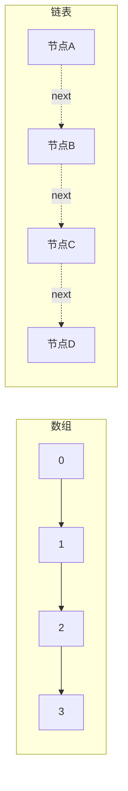
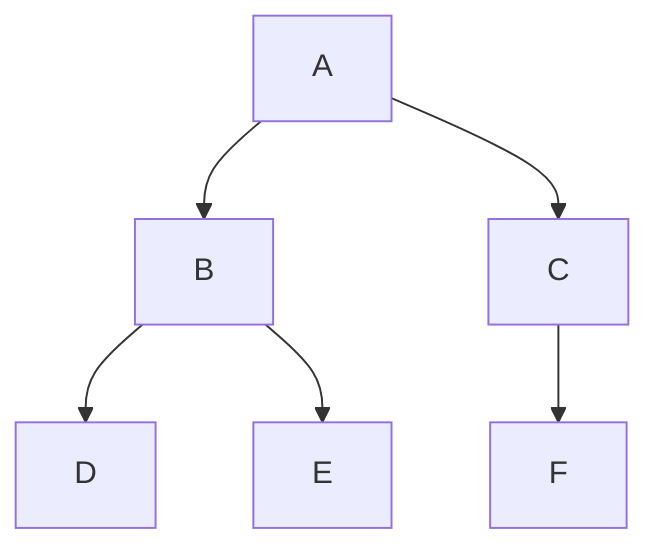
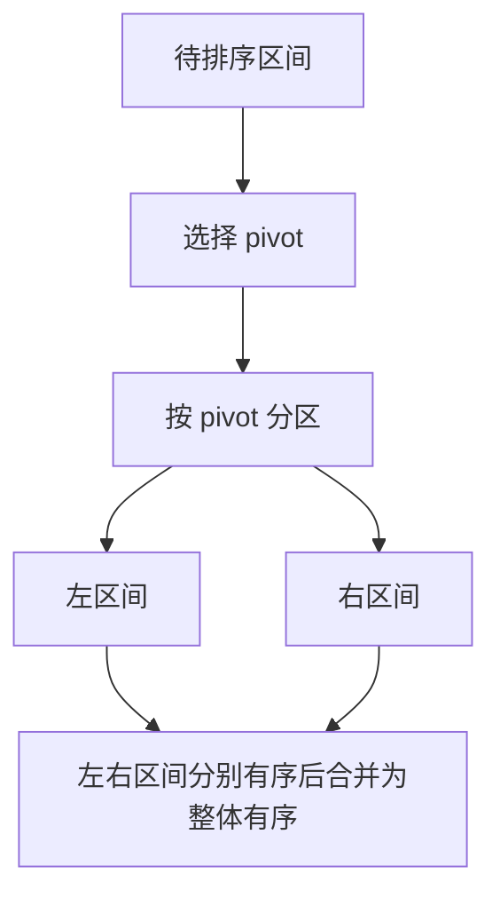
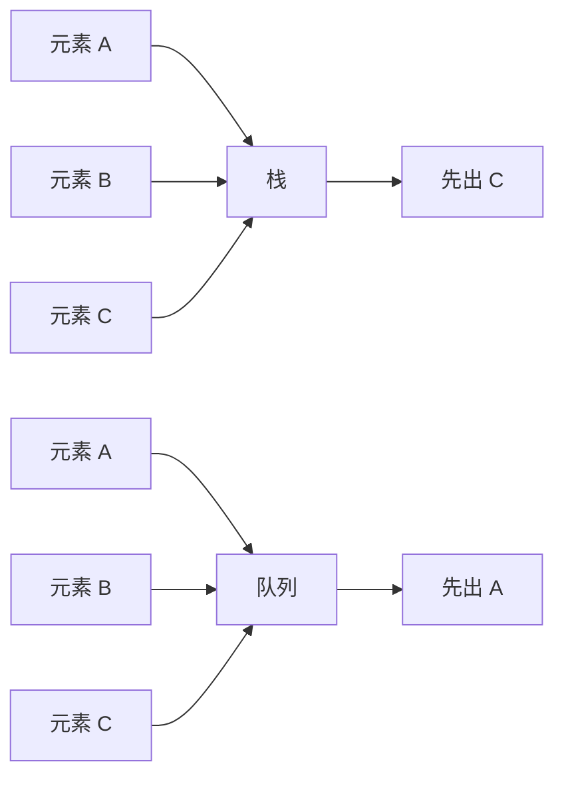
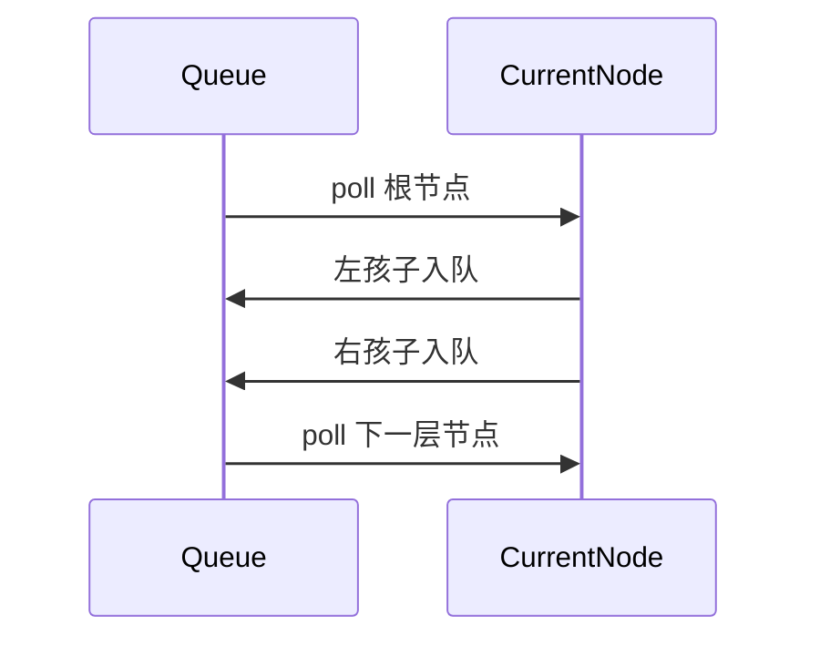

# 数据结构与算法

> **模块**：11_后端八股/12_数据结构与算法.md  
> **来源**：购买资料 A（4 个源文件）— 数组链表/树堆哈希/排序/栈队列  
> **规模**：约 1009 行  |  **生成**：2026-11-12  
> **状态**：已合并（多源合一）

## 本篇包含

01. 数组链表与复杂度
02. 树堆与哈希
03. 排序算法
04. 栈与队列

## 01 数组链表与复杂度

以下这些都是面试里比较经常问的

- 时间复杂度和空间复杂度怎么理解
- 数组和链表到底差在哪
- `ArrayList` 和 `LinkedList` 怎么答
- 二分查找为什么总容易写错
- 链表题常见套路有哪些

### 时间复杂度和空间复杂度是什么

> 💡 **Q：什么是时间复杂度和空间复杂度？**

> 📝 时间复杂度表示：
> **随着输入规模** `n` **增长，算法执行次数大致怎么变化。**
> 空间复杂度表示：
> **随着输入规模** `n` **增长，算法额外占用的存储空间怎么变化。**
> 这里关注的不是某一次运行具体花了多少毫秒，而是增长趋势。  
> 所以我们才会用 `O(1)`、`O(logn)`、`O(n)`、`O(nlogn)`、`O(n^2)` 这类记法来描述。

### 常见复杂度怎么理解

| 复杂度 | 典型含义 | 常见例子 |
|-|-|-|
| O(1) | 基本不随数据量变化 | 数组按下标访问、栈顶操作 |
| O(logn) | 每次规模减半 | 二分查找、堆调整 |
| O(n) | 扫一遍数据 | 遍历数组、链表查找 |
| O(nlogn) | 高质量排序常见级别 | 快排、归并、堆排 |
| O(n^2) | 双重嵌套扫描 | 冒泡、选择、插入最坏情况 |

> 🔎 **追问1：为什么分析复杂度时通常忽略常数和低阶项？**

因为复杂度关注的是规模变大后的主导趋势。  
当 `n` 很大时，`3n + 10` 和 `n` 的增长级别本质一样，所以都记作 `O(n)`。

### 数组和链表的本质区别

> 💡 **Q：数组和链表的本质区别是什么？**

> 📝 **数组** 的核心特征是连续内存。  
> **链表** 的核心特征是节点通过指针连接，内存不要求连续。
> 这会直接带来一组差异：
> - 数组支持按下标随机访问，链表不行
> - 数组插入删除可能要搬移元素，链表主要改指针
> - 数组缓存友好，链表指针跳转多
> - 数组扩容有成本，链表按需分配更灵活
> 所以二者不是谁绝对更强，而是适用场景不同。

### 数组和链表怎么对比

| 对比维度 | 数组 | 链表 |
|-|-|-|
| 内存布局 | 连续 | 非连续 |
| 随机访问 | O(1) | O(n) |
| 头部插入删除 | O(n) | O(1) |
| 中间插入删除 | O(n) | 找到节点后 O(1) |
| 扩容 | 需要申请新空间 | 按需分配 |
| 缓存局部性 | 好 | 差 |

> 🔎 **追问1：为什么链表说插入删除快，但很多题还是不一定比数组快？**

因为链表“改指针”本身确实快，但前提是 **你已经拿到了待操作位置**。  
如果还得先从头遍历去找那个位置，那么查找成本仍然是 `O(n)`。

### 动态数组怎么理解

> 💡 **Q：动态数组是什么？为什么** `ArrayList` **能自动扩容？**

> 📝 动态数组本质上还是数组，只是它会在容量不够时：
> 1. 申请一块更大的连续内存
> 2. 把旧数据拷贝过去
> 3. 替换底层引用
> 所以动态数组“看起来大小可变”，但底层仍然依赖连续内存。
> 这也是为什么：
> - 普通访问很快
> - 但扩容那次成本会比较高
> 不过因为扩容不是每次都发生，所以均摊下来，尾部追加通常仍可认为是 `O(1)`。

> 🔎 **追问1：为什么 Java 里的** `ArrayList` **不每次只扩 1 个？**

如果每次只扩 1 个，会导致频繁申请新内存和复制旧数据，整体成本太高。  
按比例扩容能在空间利用率和扩容次数之间做折中。

### `ArrayList` 和 `LinkedList` 怎么回答

> 💡 **Q：**`ArrayList`**和**`LinkedList` **有什么区别？**

> 📝 这是 Java 面试里特别经典的桥接题。
> 比较稳的回答是：
> - `ArrayList` 底层是动态数组，查询快，尾插均摊快，随机访问强
> - `LinkedList` 底层是双向链表，理论上插入删除更灵活
> - 但实际业务和算法题里，`ArrayList` 的使用频率通常更高
> 原因在于：
> - 很多场景访问多于修改
> - `ArrayList` 的缓存局部性更好
> - `LinkedList` 有额外节点和指针开销
> 所以不要机械背“链表增删快”，更稳的说法是：
> **链表适合已知位置的插删，数组适合高频访问和遍历。**

### 单链表、双向链表、循环链表怎么区分

> 💡 **Q：单链表、双向链表、循环链表分别是什么？**

> 📝 **单链表：**
> - 每个节点只有一个 `next`
> - 结构简单
> **双向链表：**
> - 节点既有 `next`，也有 `prev`
> - 更方便从两边移动和删除当前节点
> **循环链表：**
> - 尾节点重新指向头节点
> - 没有天然的 `null` 终点
> 面试里最常见的是单链表和双向链表。  
> 如果追问 `LinkedList`，通常可以顺带提一句：Java 中 `LinkedList` 是双向链表。

### 链表题为什么经常用双指针

> 💡 **Q：链表题为什么常用快慢指针？**

> 📝 因为链表不支持随机访问，下标法不好用，所以很多问题会转成“两个指针以不同方式走”。
> 常见套路有：
> - 快慢指针找中点
> - 快慢指针判断环
> - 前后指针删除倒数第 `k` 个节点
> - 两个指针判断链表相交
> 所以链表题的核心往往不是“链表结构本身”，而是你能不能想到合适的指针关系。

### 反转链表怎么理解

> 💡 **Q：反转链表的核心是什么？**

> 📝 反转链表最核心的动作只有一个：
> **把当前节点的** `next` **指向前一个节点。**
> 但在修改之前，一定要先保存原来的下一个节点，不然链表就断了。
> 所以经典迭代写法通常会维护三个变量：
> - `prev`
> - `cur`
> - `next`
> 这题几乎是链表面试的入门题。

### 二分查找什么时候能用

> 💡 **Q：二分查找的前提是什么？**

> 📝 二分查找最关键的前提是：
> **数据具有单调性。**
> 最常见的形式是：
> - 有序数组中查某个值
> - 有序数组中查左边界或右边界
> - 答案空间具有单调性时做“二分答案”
> 如果没有单调性，直接用二分通常就不成立。

### 二分查找为什么总容易写错

> 💡 **Q：二分查找为什么是经典易错题？**

> 📝 因为二分真正难的不是“想到”，而是边界细节特别多：
> - 区间到底是左闭右闭，还是左闭右开
> - `mid` 怎么取
> - 查到目标后继续往哪边收缩
> - 最后返回 `left` 还是 `right`
> 所以面试里二分最稳的做法不是临场瞎写，而是固定一套自己熟悉的模板。

> 🔎 **追问1：为什么** `mid`**常写成**`left + (right - left) / 2`**？**

为了避免 `left + right` 直接相加时发生整数溢出。  
虽然现代很多场景里不一定真会溢出，但这是经典写法，面试里最好养成习惯。

### 二分查找有哪些常见变种

> 💡 **Q：二分查找除了“找某个值”，还有哪些变种？**

> 📝 最常见的变种有三类：
> 1. 找目标值是否存在
> 2. 找左边界
> 3. 找右边界
> 再往上一个层级，就是：
> 1. 二分答案
> 比如：
> - 最小满足条件的值
> - 最大可行值
> - 某个容量、速度、时间的最优边界
> 这类题的本质不是查数组，而是查 **满足条件的分界点**。

### 面试里基础结构题怎么答

> 💡 **Q：面试官问数组、链表、复杂度，怎么答得更完整？**

> 📝 比较稳的结构是：
> 1. 先说本质特征
> 2. 再说复杂度差异
> 3. 再说适用场景
> 4. 最后补一个 Java 或题型视角
> 比如问“数组和链表区别”，可以答：
> 这样会比单独背复杂度表更像真的理解。

### 速记版

> 📝 - 时间复杂度看增长趋势，不看一次运行的具体毫秒数
> - 数组：连续内存，随机访问快，插删慢
> - 链表：不连续存储，访问慢，已知位置插删灵活
> - `ArrayList` 常用，`LinkedList` 不要只会背“增删快”
> - 二分查找前提是单调性，难点在边界模板
> - 链表题高频套路：反转、快慢指针、删除倒数第 `k` 个、找中点、找环
> 基础题真正拉开差距的地方不是“背定义”，而是：
> **你能不能把复杂度、结构特征、场景和题型一起讲出来。**

## 02 树堆与哈希

树、堆、哈希是数据结构面试里的第二层内容。很多同学基础只停留在数组链表，一到树和哈希就开始碎。实际上这几类结构各自解决的问题非常明确：

- 树：表达层级关系
- 堆：快速拿最值
- 哈希：快速定位

### 树是什么

> 💡 **Q：树结构的核心特点是什么？**

> 📝 树是一种层级结构。
> 和线性结构相比，树最大的特点是：
> - 一个节点可以有多个子节点
> - 数据之间不是单一前后关系，而是父子关系
> 面试里最常见的是二叉树。  
> 很多题只要一出现“层级”“左右子树”“祖先”“路径”，基本就在树的语境里了。

### 二叉树的常见概念

> 💡 **Q：二叉树有哪些基础概念？**

> 📝 常见基础词汇有：
> - 根节点
> - 叶子节点
> - 父节点、子节点、兄弟节点
> - 节点深度
> - 树高度
> - 左子树、右子树
> 还有几类常考树形态：
> - 满二叉树：每层都满
> - 完全二叉树：除了最后一层，前面都满，最后一层尽量靠左
> - 平衡二叉树：左右子树高度差不大
> 堆这种结构，一般就建立在完全二叉树之上。

### 二叉树遍历怎么理解

> 💡 **Q：前序、中序、后序、层序遍历分别是什么？**

> 📝 这是树题的绝对基础。
> - 前序：根 -> 左 -> 右
> - 中序：左 -> 根 -> 右
> - 后序：左 -> 右 -> 根
> - 层序：按层从上到下、从左到右
> 最值得记住的点是：
> - 前序适合先处理当前节点
> - 中序在 BST 中会得到有序序列
> - 后序适合先处理子树再处理根
> - 层序通常配合队列使用

> 🔎 **追问1：为什么很多树题最后都能转成“遍历”？**

因为树的问题常常需要你在每个节点上做事。  
而遍历，本质上就是“按照某种顺序访问所有节点”。  
所以很多树题的核心，不是死记模板，而是想清楚：

**我是在进入节点时做事，还是在处理完子树后做事。**

### 二叉搜索树是什么

> 💡 **Q：什么是二叉搜索树，为什么它查找快？**

> 📝 二叉搜索树，也就是 `BST`，满足：
> - 左子树所有节点值都小于根
> - 右子树所有节点值都大于根
> 这意味着查找时可以像二分一样不断缩小范围。
> 如果树比较平衡，查找、插入、删除的时间复杂度通常是 `O(logn)`。  
> 如果树严重退化成链表，复杂度就会退化成 `O(n)`。

> 🔎 **追问1：BST 的中序遍历为什么有序？**

因为中序遍历顺序是“左、根、右”，而 BST 恰好又满足左边都小、右边都大。  
两者一叠加，结果天然就是有序序列。

### 平衡树、AVL、红黑树怎么答

> 💡 **Q：为什么需要平衡树？红黑树和 AVL 怎么区分？**

> 📝 BST 的问题在于，如果插入顺序很差，比如一直递增，树就可能退化成链表。  
> 平衡树的目标就是尽量让树高保持在 `logn` 级别。
> **AVL 树：**
> - 平衡要求更严格
> - 查询性能更稳定
> - 插入删除时旋转更频繁
> **红黑树：**
> - 平衡要求没那么严格
> - 插入删除调整成本相对更低
> - 工程里更常见
> 所以很多语言或框架里的有序映射结构，更偏向选择红黑树。

> 🔎 **追问1：Java 里哪些地方会用到红黑树？**

常见回答可以带上：

- `TreeMap`
- `TreeSet`
- `HashMap` 在链表过长时也会树化成红黑树

### 堆是什么

> 💡 **Q：什么是堆？**

> 📝 堆本质上是一棵完全二叉树，同时满足堆序性质。
> 常见有两种：
> - 大顶堆：父节点大于等于子节点
> - 小顶堆：父节点小于等于子节点
> 堆的核心价值不是“有序”，而是：
> **可以在 `O(1)`时间拿到堆顶，在`O(logn)` 时间插入和删除堆顶。**
> 所以堆非常适合：
> - 优先队列
> - `TopK`
> - 动态维护最值

### 堆和二叉搜索树有什么区别

> 💡 **Q：堆和二叉搜索树有什么区别？**

> 📝 这是一个高频对比题。
> **堆：**
> - 只保证父子之间有大小关系
> - 不保证整棵树局部有序
> - 优点是堆顶最值特别好拿
> **二叉搜索树：**
> - 保证左小右大
> - 支持更高效的范围查找和有序遍历
> - 但不一定像堆一样方便拿全局最值后继续维护
> 一句话说：
> - 要最值，优先想到堆
> - 要有序查找，优先想到搜索树

### 优先队列和普通队列有什么区别

> 💡 **Q：优先队列和普通队列有什么区别？**

> 📝 普通队列按进入顺序出队。  
> 优先队列按优先级出队。
> 所以优先队列底层通常不是普通链表队列，而是堆。
> 常见应用包括：
> - 定时任务
> - 任务调度
> - `TopK`
> - Dijkstra 最短路
> - 合并多个有序链表

### 哈希表是什么

> 💡 **Q：哈希表为什么查找这么快？**

> 📝 哈希表的核心是：
> **通过哈希函数，把 key 映射到数组下标附近。**
> 这样查找时就不需要从头遍历，而是直接定位到目标桶，再在桶里继续确认。
> 理想情况下，哈希表的插入、删除、查找平均复杂度都可以做到 `O(1)`。
> 但这不是绝对的。  
> 一旦冲突严重，性能就会下降。

### 哈希冲突怎么处理

> 💡 **Q：什么是哈希冲突？常见怎么处理？**

> 📝 哈希冲突就是：
> **不同 key 经过哈希计算后，落到了同一个位置。**
> 常见处理方式有两类：
> 1. 拉链法
> 
>    - 每个桶后面挂链表或其他结构
> 2. 开放寻址法
> 
>    - 冲突后继续探测其他空位
> Java 面试里最常答的是拉链法，因为 `HashMap` 就是这一路思路。

> 🔎 **追问1：为什么 `HashMap` 里链表太长会树化？**

因为如果某个桶里的链表太长，查找效率就会越来越接近 `O(n)`。  
树化之后可以把这个桶内的查找复杂度优化到 `O(logn)`。

### 负载因子和扩容怎么理解

> 💡 **Q：哈希表为什么需要负载因子和扩容？**

> 📝 桶太少，元素太多，冲突就会明显增加。  
> 所以哈希表一般会设置一个负载因子阈值。
> 当：
> **元素数量 / 桶数量** 超过阈值时，就会扩容并重新分布元素。
> 这也是为什么哈希表平均查找很快，但扩容那一下成本不低。  
> 不过扩容不会每次都发生，所以均摊下来整体仍然高效。

### 哈希表和树怎么选

> 💡 **Q：哈希表和树结构在查找问题里怎么选？**

> 📝 如果只是追求平均快速查找，通常优先想到哈希表。  
> 如果还需要：
> - 保持有序
> - 范围查询
> - 找前驱后继
> 那树结构通常更合适。
> 所以不能机械地说“哈希表比树更强”，而是要看需求是不是只需要精确定位。

### Trie 和并查集要不要会

> 💡 **Q：面试里 Trie 和并查集算高频吗？要怎么理解？**

> 📝 这两个结构没有数组、链表、树、哈希那么高频，但也值得有基本概念。
> **Trie：**
> - 又叫前缀树
> - 适合处理字符串前缀匹配、词典检索
> **并查集：**
> - 适合处理连通性问题
> - 核心操作是“查所属集合”和“合并集合”
> 如果题目出现：
> - 字典前缀、搜索推荐
> - 社交关系连通、岛屿合并、连通块
> 就可以往这两个结构上想。

### 面试里怎么把树、堆、哈希串起来

> 💡 **Q：面试里如果被连续追问树、堆、哈希，怎么回答不散？**

> 📝 可以按“它们分别解决什么问题”来组织：
> - 树：表达层级和结构化关系
> - BST / 红黑树：解决有序查找
> - 堆：解决快速拿最值
> - 哈希：解决快速定位
> 这样答的好处是，不会陷入一堆定义里出不来，而是把结构和用途绑定起来。

### 速记版

> 📝 - 二叉树：层级结构，遍历是基础
> - BST：左小右大，中序有序
> - 平衡树：避免 BST 退化
> - 红黑树：工程里更常见
> - 堆：完全二叉树，适合最值和 `TopK`
> - 哈希表：平均 `O(1)` 查找，核心问题是冲突处理和扩容
> - 树适合有序和范围，哈希适合快速精确定位
> 面试里不要只背定义，最好能回答：
> **为什么需要这个结构、解决什么问题、和相邻结构怎么区分。**

## 03 排序算法

排序是算法面试里的基础题库。很多面试官并不要求你把所有排序都手写一遍，但一定会问你：

- 常见排序怎么分类
- 时间复杂度和空间复杂度怎么比较
- 哪些稳定、哪些不稳定
- 快排、归并、堆排分别适合什么场景
- `TopK`、海量数据排序、链表排序该想到什么

### 排序算法整体怎么分类

> 💡 **Q：常见排序算法怎么分类？**

> 📝 常见分类方式有两种。
> 第一种，按是否基于比较：
> - 比较排序：冒泡、选择、插入、希尔、快排、归并、堆排
> - 非比较排序：计数排序、桶排序、基数排序
> 第二种，按是否稳定：
> - 稳定排序：冒泡、插入、归并、计数、桶、基数
> - 不稳定排序：选择、快排、堆排、希尔
> 面试里最常问的重点通常是：
> - 插入排序
> - 快速排序
> - 归并排序
> - 堆排序
> 如果题目带有“数据范围固定”“整数范围不大”“按位处理”这类条件，再考虑计数、桶、基数排序。

### 常见排序复杂度对比

| 排序算法 | 平均时间复杂度 | 最坏时间复杂度 | 空间复杂度 | 稳定性 | 典型特点 |
|-|-|-|-|-|-|
| 冒泡排序 | O(n^2) | O(n^2) | O(1) | 稳定 | 思想直观，基本不在工程里用 |
| 选择排序 | O(n^2) | O(n^2) | O(1) | 不稳定 | 交换次数少，但整体慢 |
| 插入排序 | O(n^2) | O(n^2) | O(1) | 稳定 | 小规模、近乎有序时表现好 |
| 快速排序 | O(nlogn) | O(n^2) | O(logn) | 不稳定 | 平均性能最好，面试最常考 |
| 归并排序 | O(nlogn) | O(nlogn) | O(n) | 稳定 | 时间复杂度稳定，适合链表和外排 |
| 堆排序 | O(nlogn) | O(nlogn) | O(1) | 不稳定 | 适合 `TopK`、优先级问题 |
| 计数排序 | O(n+k) | O(n+k) | O(k) | 稳定 | 适合范围可控的整数 |

### 快排、归并、堆排怎么区分

> 💡 **Q：快排、归并、堆排分别有什么特点？**

> 📝 这是排序题里最值得背熟的一组对比。
> **快速排序：**
> - 平均时间复杂度最好，通常是工程里最常用的比较排序之一
> - 原地排序，额外空间相对少
> - 最坏会退化成 `O(n^2)`
> - 不稳定
> **归并排序：**
> - 时间复杂度稳定，最坏也是 `O(nlogn)`
> - 稳定排序
> - 需要额外辅助空间
> - 特别适合链表排序、外部排序、统计逆序对
> **堆排序：**
> - 时间复杂度稳定，空间复杂度低
> - 不稳定
> - 单次排序不一定比快排快，但非常适合维护“当前最值”或 `TopK`
> 一句话记忆：
> - 追求平均性能，优先想到快排
> - 追求稳定和确定性，优先想到归并
> - 追求堆顶最值和 `TopK`，优先想到堆

### 冒泡排序

> 💡 **Q：冒泡排序的核心思想是什么？**

> 📝 冒泡排序的本质是：
> **每一轮通过相邻比较，把当前最大值“冒”到末尾。**
> 如果数组长度是 `n`：
> - 第一轮结束，最大值到最后
> - 第二轮结束，次大值到倒数第二
> - 依次类推
> 优点是思路非常直观，代码也好写。  
> 缺点是时间复杂度高，工程价值不大。

> 🔎 **追问1：冒泡排序为什么稳定？**

因为它只交换逆序的相邻元素。  
如果两个元素值相等，通常不会主动交换它们的先后顺序，所以是稳定排序。

### 选择排序

> 💡 **Q：选择排序的核心思想是什么？**

> 📝 选择排序每一轮都会在未排序区间里找到最小值，然后放到当前起始位置。
> 它和冒泡排序的区别是：
> - 冒泡是不断交换，把大值一点点推到后面
> - 选择是先找到最小值，再一次性交换
> 选择排序的交换次数相对更少，但整体复杂度仍然是 `O(n^2)`，而且不稳定。

> 🔎 **追问1：为什么选择排序不稳定？**

因为它会把后面找到的最小值直接和前面元素交换，这个操作可能打乱相同元素的相对顺序。

### 插入排序

> 💡 **Q：插入排序的核心思想是什么？**

> 📝 插入排序可以理解成“打扑克牌整理手牌”。
> 它默认前面的区间已经有序，然后不断把新的元素插入到正确位置。
> 它的特点是：
> - 实现简单
> - 稳定
> - 原地排序
> - 当数组本身接近有序时，性能很好
> 所以插入排序虽然理论复杂度不高，但在“小规模 + 近乎有序”的场景下非常有价值。

> 🔎 **追问1：为什么很多库排序在小区间会退化用插入排序？**

因为当数据量很小时，快排和归并的递归、分治、额外控制逻辑反而会带来额外常数开销。  
这时插入排序虽然复杂度看起来更差，但常数更小，实际更快。

### 快速排序

> 💡 **Q：快速排序的核心思想是什么？**

> 📝 快速排序的核心是 **分治 + 分区**。
> 步骤通常是：
> 1. 选一个基准值 `pivot`
> 2. 把数组分成两部分
> 
>    - 左边都小于等于 `pivot`
>    - 右边都大于等于 `pivot`
> 3. 对左右两边递归继续排序
> 它的关键不在“递归”，而在 **分区质量**。  
> 如果每次都能把数组分得比较均匀，复杂度就是 `O(nlogn)`；如果每次都极度不均匀，就会退化成 `O(n^2)`。

> 🔎 **追问1：快排为什么快？**

因为它通常具备三个优势：

- 平均情况下分区比较均匀
- 原地排序，额外空间少
- 顺序扫描数组，缓存友好

所以很多场景下，快排的综合表现非常好。

> 🔎 **追问2：快排最坏情况是什么？**

如果每次选到的 `pivot` 都是当前区间最大值或最小值，那么划分会严重失衡，比如一边 `n-1`，另一边 `0`。  
这时递归深度会退化到 `n`，时间复杂度也会退化成 `O(n^2)`。

> 🔎 **追问3：怎么优化快排退化问题？**

常见手段有：

- 随机选 `pivot`
- 三数取中
- 对重复元素很多的场景用三路快排
- 小区间切换插入排序

### 归并排序

> 💡 **Q：归并排序的核心思想是什么？**

> 📝 归并排序的核心是 **分治 + 合并两个有序区间**。
> 基本过程是：
> 1. 把数组不断二分，直到每个子区间长度为 1
> 2. 再把两个有序子区间不断合并
> 3. 最终得到整体有序数组
> 它最大的特点是：
> - 时间复杂度稳定
> - 是稳定排序
> - 适合链表排序
> - 很适合外部排序和多路归并

> 🔎 **追问1：归并排序为什么稳定？**

因为在合并两个有序区间时，如果两个元素相等，先取左边元素，就能保证相同元素的原始相对顺序不变。

> 🔎 **追问2：为什么链表排序经常想到归并排序？**

因为链表：

- 不支持高效随机访问，不适合快排那种频繁按下标操作
- 但很适合从中间断开，再把两个有序链表合并

所以“链表排序”几乎是归并排序的经典应用题。

### 堆排序

> 💡 **Q：堆排序的核心思想是什么？**

> 📝 堆排序依赖堆这种结构。
> 如果是升序排序，通常会构建大顶堆：
> 1. 先把数组建成大顶堆
> 2. 取出堆顶最大值，放到数组末尾
> 3. 调整剩余区间，重新维护堆
> 4. 重复直到排序完成
> 它的特点是：
> - 时间复杂度稳定为 `O(nlogn)`
> - 原地排序
> - 不稳定
> 但比起“完整排序”，面试里更常问堆的地方是：
> - `TopK`
> - 优先级队列
> - 海量数据找最值

> 🔎 **追问1：堆排序为什么不稳定？**

因为在建堆和交换堆顶的过程中，相同元素的相对顺序可能改变。

### 计数排序、桶排序、基数排序怎么理解

> 💡 **Q：非比较排序什么时候用？**

> 📝 这类排序的关键前提不是“更高级”，而是 **数据本身有额外结构信息**。
> **计数排序：**
> - 适合整数范围不大
> - 先统计每个数出现次数，再按顺序回填
> **桶排序：**
> - 适合数据分布比较均匀
> - 先分桶，桶内再排序
> **基数排序：**
> - 适合按位或按关键字排序
> - 从低位到高位或从高位到低位逐步排序
> 这几类排序在特定场景下可以做到比 `O(nlogn)` 更好，但适用范围明显更窄。

### 二分、快排、归并、堆排在工程里的典型场景

> 💡 **Q：工程里什么时候会想到这些排序或查找方式？**

> 📝 常见回答方式可以这样组织：
> - 数据量一般、追求平均性能：想到快排
> - 需要稳定性，或者要处理链表、外部文件：想到归并
> - 需要随时拿最值或做 `TopK`：想到堆
> - 有序数组里做查找：想到二分
> 面试里不要只背定义，最好把“题型和场景”带上。  
> 这样会显得你知道这类结构是拿来解决什么问题的。

### `TopK` 问题怎么回答

> 💡 **Q：海量数据找前 K 大，通常怎么做？**

> 📝 `TopK` 是排序板块特别高频的追问。
> 最经典的做法是 **维护一个大小为 K 的小顶堆**：
> 1. 先把前 `K` 个元素放进小顶堆
> 2. 后面每来一个元素，就和堆顶比较
> 3. 如果比堆顶大，就替换堆顶并重新调整堆
> 4. 遍历结束后，堆里剩下的就是前 `K` 大
> 这样时间复杂度是 `O(nlogk)`，比完整排序的 `O(nlogn)` 更适合 `K` 远小于 `n` 的场景。

> 🔎 **追问1：什么时候直接排序更划算？**

如果 `K` 接近 `n`，或者你本来就需要完整有序结果，那么直接排序可能更简单。

### 速记版

> 📝 - 快排：平均最快，最坏退化，不稳定
> - 归并：稳定、复杂度稳定、适合链表和外排
> - 堆排：复杂度稳定，适合 `TopK` 和最值维护
> - 插入：小规模、近乎有序时很好用
> - 计数/桶/基数：依赖数据范围和分布，不是通用排序
> 排序题不要只背定义，要能说出：
> **复杂度、稳定性、适用场景、典型追问。**

## 04 栈与队列

栈和队列本身并不复杂，但它们在面试里出现频率极高。很多题目表面上问的是括号匹配、滑动窗口、层序遍历，底层其实都在考你对栈和队列的理解。

### 栈和队列的区别

> 💡 **Q：栈和队列有什么区别？**

> 📝 **栈** 是后进先出，也就是 `LIFO`。  
> **队列** 是先进先出，也就是 `FIFO`。
> 可以把它们理解成两种完全不同的“取数据规则”：
> - 栈：最后放进去的元素先出来
> - 队列：最早放进去的元素先出来
> 它们的核心不是“存数据”，而是 **控制顺序**。  
> 这也是为什么很多算法题明明不叫“栈题”或“队列题”，却依然会用到它们。

### 栈常见应用场景

> 💡 **Q：栈常见应用场景有哪些？**

> 📝 栈常见在以下几类问题里：
> - 函数调用栈、递归
> - 括号匹配
> - 表达式求值
> - 浏览器前进后退
> - 单调栈
> - DFS 的非递归写法
> 面试里如果只说“后进先出”还不够，最好顺手举一个算法场景。  
> 比如：
> - 校验括号合法性
> - 求下一个更大元素
> - 维护递增或递减序列

### 队列常见应用场景

> 💡 **Q：队列常见应用场景有哪些？**

> 📝 队列常见在以下几类问题里：
> - BFS 层序遍历
> - 任务调度
> - 生产者消费者模型
> - 消息缓冲
> - 单调队列
> - 线程池任务排队
> 算法题里最经典的应用是：
> - 二叉树层序遍历
> - 图的广度优先搜索
> - 滑动窗口最大值

### 栈和队列各自的基本操作复杂度

| 结构 | 常见操作 | 时间复杂度 |
|-|-|-|
| 栈 | `push / pop / peek` | O(1) |
| 队列 | `offer / poll / peek` | O(1) |
| 双端队列 | 头尾插入删除 | O(1) |

### 栈和队列底层一般怎么实现

> 💡 **Q：栈和队列底层通常怎么实现？**

> 📝 它们都可以用数组或链表实现。
> **数组实现：**
> - 优点：连续内存，访问局部性好
> - 缺点：容量可能受限，队列如果设计不好会涉及搬移
> **链表实现：**
> - 优点：扩容灵活
> - 缺点：每个节点有额外指针开销，缓存局部性差
> 在 Java 里，面试更推荐你回答：
> - 栈通常用 `Deque`
> - 队列通常也用 `Deque` 或专门的 `Queue`
> - 一般不推荐老的 `Stack` 类

> 🔎 **追问1：为什么 Java 里经常推荐 `ArrayDeque`？**

因为它比 `Stack` 和 `LinkedList` 更现代，也更符合栈和队列的常见使用方式：

- 头尾操作高效
- API 清晰
- 没有 `Stack` 的历史包袱

### 双端队列是什么

> 💡 **Q：什么是双端队列？**

> 📝 双端队列，也就是 `Deque`，可以在队头和队尾都做插入、删除操作。
> 它比普通队列更灵活，所以很多题目都会用它：
> - 当栈用：只在一端操作
> - 当队列用：一端入队，另一端出队
> - 当单调队列用：两端都可能调整
> 所以你可以把 `Deque` 看成是“栈和队列的通用版工具”。

### 递归和栈是什么关系

> 💡 **Q：为什么递归本质上也和栈有关？**

> 📝 因为递归调用本质上依赖函数调用栈。
> 每进入一层递归，系统就会把当前方法的局部变量、返回地址等信息压栈；  
> 递归返回时，再一层层弹栈。
> 所以很多递归题都可以改写成“显式栈”版本。  
> 这也是面试里经常会追问：
> - 递归和迭代能不能互相改写
> - DFS 为什么既能递归写，也能用栈写

### 单调栈怎么理解

> 💡 **Q：什么是单调栈？**

> 📝 单调栈不是新的数据结构，而是 **带约束的栈**。
> 它要求栈内元素保持单调递增或单调递减。
> 常见用途是解决：
> - 下一个更大元素
> - 下一个更小元素
> - 柱状图最大矩形
> - 每日温度
> 本质原因是：
> 当我们维护单调性后，就能在元素出栈时，快速确定它和左右边界的关系。

> 🔎 **追问1：什么时候会想到单调栈？**

如果题目在问：

- 某个元素左边第一个比它大/小的元素
- 右边第一个比它大/小的元素
- 区间最值边界

就很容易联想到单调栈。

### 单调队列怎么理解

> 💡 **Q：什么是单调队列？**

> 📝 单调队列和单调栈类似，也是“带约束的队列”。
> 它最常见的用途是：
> **在滑动窗口移动过程中，维护窗口最值。**
> 为什么不用普通队列？
> 因为普通队列只能保证“先入先出”，但不能保证队头永远是当前窗口最大值或最小值。  
> 单调队列通过在尾部剔除不可能成为答案的元素，让队头始终保留候选最值。

### BFS 为什么天然适合用队列

> 💡 **Q：为什么层序遍历、BFS 一般用队列？**

> 📝 BFS 的目标是 **按层推进**。
> 队列的先进先出特性正好保证：
> - 先进入当前层的节点，先被处理
> - 当前层处理完后，自然轮到下一层
> 所以：
> - 树的层序遍历用队列
> - 图的最短步数问题也常用队列
> - 多源 BFS 也还是队列

### 常见高频题

#### 用两个栈实现队列

> 💡 **Q：怎么用两个栈实现队列？**

> 📝 核心思路是：
> - 一个栈负责入队
> - 一个栈负责出队
> 当出队栈为空时，把入队栈中的元素依次弹出并压入出队栈。  
> 这样顺序就被反转了，最终实现先进先出。
> 这个题本质上考的是：
> **两次 LIFO 叠加后，可以得到 FIFO。**

#### 用两个队列实现栈

> 💡 **Q：怎么用两个队列实现栈？**

> 📝 常见思路是：
> - 新元素先进空队列
> - 再把原队列中的旧元素依次追加到后面
> - 然后交换两个队列的角色
> 这样队头永远是最近插入的元素，就实现了后进先出。

#### 最小栈

> 💡 **Q：最小栈怎么设计？**

> 📝 最经典的做法是维护两个栈：
> - 一个正常存数据
> - 一个同步维护当前最小值
> 每次入栈时，把“当前元素”和“当前最小值”做比较，再把较小值压入辅助栈。  
> 这样取最小值时就是 `O(1)`。

#### 有效括号

> 💡 **Q：为什么括号匹配问题通常用栈？**

> 📝 因为括号匹配天然符合“后出现的左括号，要先被最近的右括号匹配”。
> 这就是典型的后进先出。
> 常见做法是：
> - 遇到左括号就入栈
> - 遇到右括号就检查栈顶能否匹配
> - 最终栈为空才表示完全合法

#### 滑动窗口最大值

> 💡 **Q：滑动窗口最大值为什么常用单调队列？**

> 📝 因为窗口每次只移动一步，但我们不希望每次都把整个窗口重新扫描一遍。
> 单调队列能做到：
> - 新元素进入时，剔除尾部所有更小元素
> - 旧元素滑出时，如果它正好在队头，就把它弹出
> - 队头始终是当前窗口最大值
> 这样整个过程是线性的 `O(n)`。

### 面试里怎么比较栈、队列、堆

> 💡 **Q：栈、队列、堆有什么本质区别？**

> 📝 这三个结构的核心区别在于“取元素规则”不同。
> - 栈：按最近插入顺序取
> - 队列：按最早插入顺序取
> - 堆：按当前优先级最高或最低取
> 所以：
> - 栈适合处理嵌套、回退、最近关系
> - 队列适合处理排队、分层、调度
> - 堆适合处理最值、优先级、`TopK`

### 速记版

> 📝 - 栈：后进先出，适合括号匹配、递归、单调栈
> - 队列：先进先出，适合 BFS、任务调度、单调队列
> - `Deque`：栈和队列的通用形态
> - 单调栈：求左右第一个更大/更小元素
> - 单调队列：维护滑动窗口最值
> 面试里如果被追问，一定要带上：
> **场景、题型、复杂度、为什么要这么设计。**

---

## 来源档案（原始文件，仅供溯源）

- `04_后端八股整理/11_数据结构与算法/00_数组链表与复杂度.md`
- `04_后端八股整理/11_数据结构与算法/01_树堆与哈希.md`
- `04_后端八股整理/11_数据结构与算法/02_排序算法.md`
- `04_后端八股整理/11_数据结构与算法/03_栈与队列.md`
