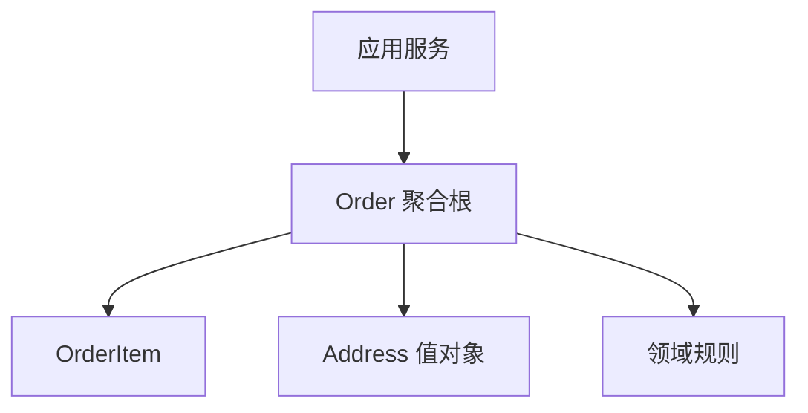

# 分布式与架构

> **模块**：11_后端八股/08_分布式与架构.md  
> **来源**：购买资料 A（8 个源文件）— 分布式理论/微服务/DDD/高并发/服务治理/分库分表（trace 与可观测已移至 08_评测与可观测）  
> **规模**：约 854 行  |  **生成**：2026-11-12  
> **状态**：已合并（多源合一）

## 本篇包含

01. 概念与分片键
02. 查询与常见问题
03. 分片算法
04. 分布式理论
05. 微服务架构与拆分
06. DDD与领域建模
07. 高并发系统设计
08. 服务治理与高可用

## 01 概念与分片键

### 为什么要分库分表

> 💡 **Q：什么时候需要分库分表？**

> 📝 当单库单表已经无法承载数据量或并发压力时，就要考虑分库分表。
> 典型触发点包括：
> - 单表数据量太大
> - 索引太大，查询性能下降
> - 写入压力太高
> - 单机资源达到瓶颈

### 什么是分片键

> 💡 **Q：分片键应该怎么选？**

> 📝 分片键就是决定一条数据落到哪个库、哪张表的关键字段。
> 选择分片键时，通常希望它满足：
> - 分布尽量均匀
> - 查询场景高频使用
> - 尽量避免热点
> 很多业务里常见会选：
> - 用户 ID
> - 订单 ID
> - 商户 ID

## 02 查询与常见问题

### 非分片键查询怎么办

> 💡 **Q：如果按用户 ID 分片，但现在要按订单状态查怎么办？**

> 📝 这就是典型的非分片键查询问题。
> 常见解决思路包括：
> - 先查索引表再回源
> - 建冗余字段或宽表
> - 借助搜索引擎
> - 业务上尽量避免跨片查询
> 所以分库分表不是银弹，它会把很多简单查询变复杂。

### 分库分表的常见问题

> 💡 **Q：分库分表后会带来哪些问题？**

> 📝 常见问题包括：
> - 分布式事务更复杂
> - 跨库 join 变难
> - 聚合查询更麻烦
> - 分页和排序更复杂
> - 扩容迁移成本高
> 所以分库分表一定是“业务量逼出来”的方案，不是项目一开始就该默认上。

## 03 分片算法

### 常见分片算法

> 💡 **Q：常见分片算法有哪些？**

> 📝 常见的有：
> - 范围分片
> - 取模分片
> - 一致性哈希
> **范围分片** 直观，但容易热点集中。  
> **取模分片** 简单高效，但扩容时数据迁移成本高。  
> **一致性哈希** 扩容更友好，但实现会复杂一些。

### 一致性哈希适合什么场景

> 💡 **Q：一致性哈希为什么适合扩容场景？**

> 📝 因为它能在节点变更时，把需要迁移的数据量控制得更小。  
> 这比普通取模分片“扩容几乎全量重算”的代价要低得多。

## 04 分布式理论

分布式理论是大厂面试的进阶面试题，面试官通常会问"CAP 理论"和"如何保证分布式事务"。

### CAP理论

> 💡 **Q：什么是 CAP 理论？**

> 📝 面试官你好，CAP 理论是分布式系统的基础理论，由 Eric Brewer 提出。CAP 代表三个特性：
> **第一个是 C（Consistency，一致性）**，所有节点在同一时间看到的数据是一致的。比如我在节点 A 写入数据，立即在节点 B 读取，应该能读到最新的数据。
> **第二个是 A（Availability，可用性）**，系统在任何时候都能响应请求，不会出现请求超时或拒绝服务的情况。
> **第三个是 P（Partition Tolerance，分区容错性）**，系统在网络分区（部分节点无法通信）的情况下，仍然能够继续工作。
> **CAP 理论的核心**：在分布式系统中，**最多只能同时满足 CAP 中的两个特性**，无法三者兼得。
> **为什么无法三者兼得**：
> 在分布式系统中，网络分区是不可避免的（P 是必须满足的）。当网络分区发生时，我们只能在 C 和 A 之间做选择：
> - **选择 CP（一致性 + 分区容错性）**：牺牲可用性。当网络分区发生时，为了保证一致性，系统会拒绝服务，直到网络恢复。比如 ZooKeeper、HBase。
> - **选择 AP（可用性 + 分区容错性）**：牺牲一致性。当网络分区发生时，系统继续提供服务，但可能返回旧数据。比如 Cassandra、DynamoDB。
> **实际应用**：
> 大多数分布式系统都是 AP 或 CP，没有完全的 CA 系统（因为 P 是必须的）。
> - **金融系统**：通常选择 CP，保证数据一致性，宁可牺牲可用性。
> - **社交网络**：通常选择 AP，保证可用性，允许短暂的数据不一致。

> 🔎 **追问1：CAP 理论有什么局限性？**

CAP 理论虽然经典，但也有一些局限性：

第一个是**过于绝对**。CAP 理论说只能选择两个，但实际上可以在 C 和 A 之间做权衡，不是非黑即白。

第二个是**没有考虑延迟**。CAP 理论只考虑了一致性、可用性、分区容错性，没有考虑延迟（Latency）。

第三个是**没有考虑一致性的程度**。一致性有强一致性、最终一致性等不同程度，CAP 理论没有区分。

所以后来提出了 **BASE 理论**，作为 CAP 理论的补充。

### BASE理论

> 💡 **Q：什么是 BASE 理论？**

> 📝 面试官你好，BASE 理论是对 CAP 理论的补充，它是 **Basically Available（基本可用）**、**Soft State（软状态）**、**Eventually Consistent（最终一致性）** 的缩写。
> **第一个是 BA（Basically Available，基本可用）**，系统在出现故障时，允许损失部分可用性，但核心功能仍然可用。比如系统响应时间变长、部分功能降级，但不会完全不可用。
> **第二个是 S（Soft State，软状态）**，系统允许存在中间状态，数据可以在一段时间内不一致。比如订单状态从"待支付"到"已支付"，中间可能有一个"支付中"的状态。
> **第三个是 E（Eventually Consistent，最终一致性）**，系统不要求数据实时一致，但保证在一段时间后，数据最终会达到一致状态。
> **BASE 理论的核心思想**：
> 牺牲强一致性，换取更高的可用性和性能。这是对 CAP 理论中 AP 的具体实现。
> **实际应用**：
> 大多数互联网应用都采用 BASE 理论，比如：
> - **电商系统**：下单后，库存可能不会立即扣减，而是异步扣减，最终保证一致。
> - **社交网络**：点赞数、评论数可能不是实时更新的，但最终会一致。
> - **分布式缓存**：缓存和数据库的数据可能短暂不一致，但最终会一致。

### 分布式事务

> 💡 **Q：什么是分布式事务？有哪些解决方案？**

> 📝 面试官你好，分布式事务是指事务的参与者、支持事务的服务器、资源服务器分布在不同的节点上，需要保证多个节点的操作要么全部成功，要么全部失败。
> **分布式事务的解决方案**主要有以下几种：
> **第一种是 2PC（两阶段提交）**，它分为准备阶段和提交阶段。协调者先询问所有参与者是否可以提交，如果都同意，再通知所有参与者提交；如果有一个拒绝，就通知所有参与者回滚。
> **优点**：实现简单，保证强一致性。
> **缺点**：性能差，同步阻塞，协调者是单点故障。
> **第二种是 3PC（三阶段提交）**，它是 2PC 的改进版，增加了超时机制和 CanCommit 阶段，减少了阻塞时间。
> **第三种是 TCC（Try-Confirm-Cancel）**，它分为三个阶段：Try（尝试执行）、Confirm（确认执行）、Cancel（取消执行）。每个服务需要实现这三个接口。
> **优点**：性能好，不需要长时间锁定资源。
> **缺点**：实现复杂，需要业务代码配合。
> **第四种是 Saga**，它是一种长事务解决方案，将一个分布式事务拆分成多个本地事务，每个本地事务都有一个补偿事务。如果某个本地事务失败，就执行前面所有事务的补偿事务，回滚到初始状态。
> **优点**：适合长事务，性能好。
> **缺点**：实现复杂，需要设计补偿逻辑。
> **第五种是本地消息表**，它是一种基于消息的最终一致性方案。在本地事务中，同时写入业务数据和消息表，然后异步发送消息到消息队列，其他服务消费消息，执行本地事务。
> **优点**：实现简单，性能好。
> **缺点**：只能保证最终一致性，不能保证强一致性。
> **第六种是 MQ 事务消息**，比如 RocketMQ 的事务消息。它保证消息的发送和本地事务的执行是原子的。

> 🔎 **追问1：2PC 有什么问题？**

2PC 主要有三个问题：

**第一个是同步阻塞**。在准备阶段，所有参与者都需要等待协调者的指令，期间资源被锁定，无法处理其他请求，性能很差。

**第二个是单点故障**。协调者是单点，如果协调者宕机，整个事务就无法继续，所有参与者都会一直等待。

**第三个是数据不一致**。在提交阶段，如果协调者发送提交指令后宕机，部分参与者收到指令提交了，部分参与者没收到指令，就会导致数据不一致。

所以 2PC 在实际应用中很少使用，通常使用 TCC、Saga 或消息队列来实现分布式事务。

### 分布式锁

> 💡 **Q：什么是分布式锁？如何实现？**

> 📝 面试官你好，分布式锁是指在分布式系统中，多个节点需要访问共享资源时，通过锁机制保证同一时间只有一个节点能访问资源。
> **分布式锁的实现方式**主要有以下几种：
> **第一种是基于数据库**，利用数据库的唯一索引或行锁来实现。
> **优点**：实现简单，不需要额外的组件。
> **缺点**：性能差，数据库压力大，不支持锁的自动过期。
> **第二种是基于 Redis**，利用 Redis 的 SETNX 命令来实现。
> **优点**：性能好，支持锁的自动过期，实现简单。
> **缺点**：在 Redis 主从架构下，可能出现锁丢失的问题（主节点宕机，从节点还没同步锁数据）。
> **第三种是基于 ZooKeeper**，利用 ZooKeeper 的临时顺序节点来实现。
> **优点**：可靠性高，支持锁的自动释放（客户端断开连接，临时节点自动删除）。
> **缺点**：性能比 Redis 差，实现复杂。
> **第四种是基于 Redisson**，它是 Redis 的 Java 客户端，提供了分布式锁的实现，支持锁的自动续期（看门狗机制）。
> **推荐使用 Redisson**，因为它实现了看门狗机制，可以自动续期，避免锁过期导致的问题。

> 🔎 **追问1：Redis 分布式锁有什么问题？如何解决？**

Redis 分布式锁主要有以下几个问题：

**第一个是锁过期问题**。如果业务执行时间超过锁的过期时间，锁会自动释放，其他线程可能获取到锁，导致并发问题。

**解决方案**：使用 Redisson 的看门狗机制，自动续期。

**第二个是锁误删问题**。线程 A 获取锁后，锁过期了，线程 B 获取到锁，然后线程 A 执行完业务，删除了线程 B 的锁。

**解决方案**：释放锁时，先判断锁是否是自己的（通过唯一标识），再删除。使用 Lua 脚本保证原子性。

**第三个是主从同步问题**。在 Redis 主从架构下，主节点获取锁后，还没同步到从节点就宕机了，从节点升级为主节点，其他线程可能获取到锁。

**解决方案**：使用 **Redlock 算法**，在多个独立的 Redis 节点上获取锁，只有在大多数节点都获取成功时，才认为获取锁成功。

### 分布式ID

> 💡 **Q：如何生成分布式 ID？**

> 📝 面试官你好，分布式 ID 需要满足以下几个特性：全局唯一、趋势递增、高性能、高可用。
> **常见的分布式 ID 生成方案**：
> **第一种是 UUID**，它是通用唯一识别码，由 128 位组成。
> **优点**：实现简单，性能高，本地生成，不需要网络请求。
> **缺点**：无序，不适合作为数据库主键（影响索引性能）；占用空间大（36 个字符）。
> **第二种是数据库自增 ID**，利用数据库的 AUTO_INCREMENT 特性。
> **优点**：实现简单，有序递增。
> **缺点**：性能差，数据库压力大；单点故障；扩展性差。
> **第三种是 Snowflake（雪花算法）**，它是 Twitter 开源的分布式 ID 生成算法，生成 64 位的 Long 型 ID。
> **结构**：
> - 1 位：符号位，固定为 0。
> - 41 位：时间戳（毫秒级），可以使用 69 年。
> - 10 位：机器 ID（5 位数据中心 ID + 5 位机器 ID），支持 1024 台机器。
> - 12 位：序列号，同一毫秒内可以生成 4096 个 ID。
> **优点**：性能高（每秒可以生成 400 万个 ID），有序递增，占用空间小（8 字节）。
> **缺点**：依赖系统时钟，如果时钟回拨，可能生成重复 ID。
> **第四种是 Redis**，利用 Redis 的 INCR 命令生成自增 ID。
> **优点**：性能高，实现简单。
> **缺点**：依赖 Redis，单点故障；不支持趋势递增（只是递增，不是按时间递增）。
> **第五种是美团的 Leaf**，它提供了两种模式：Leaf-segment（号段模式）和 Leaf-snowflake（雪花算法模式）。
> **推荐使用 Snowflake 算法**，因为它性能高、有序递增、占用空间小，适合大多数场景。

> 🔎 **追问1：Snowflake 的时钟回拨问题如何解决？**

时钟回拨是指系统时间被调整到过去的时间，可能导致生成重复的 ID。

**解决方案**：

第一种是**拒绝生成 ID**。检测到时钟回拨时，拒绝生成 ID，抛出异常，等待时钟恢复。

第二种是**等待时钟追上**。检测到时钟回拨时，等待一段时间，直到时钟追上上次生成 ID 的时间。

第三种是**使用备用机器 ID**。检测到时钟回拨时，切换到备用的机器 ID，继续生成 ID。

第四种是**使用逻辑时钟**。不依赖系统时钟，使用逻辑时钟（如 Lamport 时钟），保证 ID 的单调递增。

### 分布式Session

> 💡 **Q：如何实现分布式 Session？**

> 📝 面试官你好，在分布式系统中，用户的请求可能被负载均衡到不同的服务器，如果 Session 存储在单个服务器的内存中，就会导致 Session 丢失。
> **分布式 Session 的解决方案**：
> **第一种是 Session 复制**，将 Session 复制到所有服务器。
> **优点**：实现简单，不需要额外的组件。
> **缺点**：占用大量内存和网络带宽，扩展性差。
> **第二种是 Session 粘滞（Sticky Session）**，通过负载均衡器，将同一个用户的请求始终路由到同一台服务器。
> **优点**：实现简单，不需要修改代码。
> **缺点**：如果服务器宕机，Session 会丢失；负载不均衡。
> **第三种是 Session 集中存储**，将 Session 存储在 Redis、Memcached 等缓存中间件中。
> **优点**：扩展性好，高可用，性能好。
> **缺点**：需要额外的组件，增加了系统复杂度。
> **第四种是 Token（JWT）**，不使用 Session，而是使用 Token。用户登录后，服务器生成一个 Token，客户端每次请求都携带 Token，服务器验证 Token 的有效性。
> **优点**：无状态，扩展性好，不需要存储 Session。
> **缺点**：Token 无法主动失效（除非设置过期时间）；Token 泄露风险。
> **推荐使用 Redis 存储 Session**或**JWT Token**，因为它们扩展性好，性能高。

> 🔎 **追问1：JWT 有什么优缺点？**

**JWT（JSON Web Token）** 是一种无状态的认证方式。

**优点**：

第一个是**无状态**。服务器不需要存储 Session，减少了服务器的压力，扩展性好。

第二个是**跨域友好**。JWT 可以在不同的域之间传递，适合微服务架构。

第三个是**性能好**。不需要查询数据库或缓存，直接验证 Token 的签名即可。

**缺点**：

第一个是**无法主动失效**。JWT 一旦签发，在过期之前一直有效，无法主动撤销。如果用户退出登录或修改密码，Token 仍然有效。

**解决方案**：设置较短的过期时间，或者维护一个黑名单（但这样就失去了无状态的优势）。

第二个是**Token 泄露风险**。如果 Token 被窃取，攻击者可以冒充用户。

**解决方案**：使用 HTTPS 传输，设置较短的过期时间，使用 Refresh Token 机制。

第三个是**Token 体积大**。JWT 包含了用户信息和签名，体积比 Session ID 大，增加了网络传输量。

### 微服务调用链日志追踪分析

> 💡 **Q：微服务场景下，怎么做调用链追踪？**

> 📝 在微服务里，一个请求往往会经过网关、订单服务、库存服务、支付服务等多个节点。  
> 如果没有统一的 TraceId，就很难把一次请求完整串起来。
> 所以调用链追踪的核心做法是：
> - 给每次请求分配一个全局 TraceId
> - 在服务调用链路中透传这个 TraceId
> - 让日志、监控、链路平台围绕这个 TraceId 聚合
> 常见方案包括：
> - Sleuth + Zipkin
> - SkyWalking
> - OpenTelemetry

### 负载均衡

> 💡 **Q：什么是负载均衡？常见策略有哪些？**

> 📝 负载均衡的目的，是把请求尽量均匀地分发到多个服务节点上，避免某个节点被打爆。
> 常见策略包括：
> - 轮询
> - 加权轮询
> - 随机
> - 一致性哈希
> - 最少连接
> 如果是通用业务流量，轮询和加权轮询很常见；  
> 如果是缓存、分片这类需要“同一类请求尽量落同一节点”的场景，一致性哈希更合适。

## 05 微服务架构与拆分

### 【进阶】微服务架构与拆分

微服务是进阶面试里很容易被追问的一块。  
这里最怕的不是“不知道”，而是把“拆服务”说成一句空话，所以一定要能讲出拆分依据、服务边界和落地代价。

#### 什么是微服务

> 💡 **Q：什么是微服务？**

> 📝 微服务可以理解成：  
> 把一个大系统拆成多个围绕业务能力组织的小服务，每个服务独立开发、部署、扩容。
> 它强调的不是“服务一定要很小”，而是：
> - 边界清晰
> - 职责单一
> - 可以独立演进
> 所以面试里更稳的表述是：
> **微服务本质上是按业务能力做拆分，用分布式协作替代单体内部调用。**

#### 为什么要拆微服务

> 💡 **Q：什么时候会从单体演进到微服务？**

> 📝 常见触发点有四类：
> - 团队变大，单体代码协作成本太高
> - 某些模块流量特别大，需要独立扩容
> - 不同业务节奏差异大，希望独立发布
> - 单体模块耦合严重，改一个地方容易影响全局
> 但注意，不是所有系统都该拆。  
> 如果业务还很早期、团队不大、复杂度不高，单体反而更快。

> 🔎 **追问1：微服务一定比单体好吗？**

不一定。  
单体的优势是开发简单、调用链短、事务天然好处理。  
微服务只有在系统规模、团队规模、复杂度都上来之后，收益才会显现。

#### 微服务怎么拆

> 💡 **Q：微服务拆分一般按什么维度来做？**

> 📝 最常见的拆分维度有三个：
> - 按业务领域拆，比如用户、订单、库存、支付
> - 按核心链路拆，比如交易链路、营销链路、履约链路
> - 按通用能力拆，比如搜索、推荐、消息通知
> 最不推荐的，是按技术层拆，比如“Controller 服务”“Service 服务”“DAO 服务”。  
> 因为这种拆法没有业务闭环，只会制造大量跨服务调用。
> 面试时最好强调一句：
> **服务拆分不是按代码层次拆，而是按业务边界拆。**

#### 服务粒度怎么控制

> 💡 **Q：服务是不是越小越好？**

> 📝 不是。  
> 服务太大，会退化成“小单体”；服务太小，会导致：
> - 调用链变长
> - 维护成本上升
> - 事务变复杂
> - 排查困难
> 判断粒度是否合适，可以看三个点：
> - 服务是否有清晰业务边界
> - 大多数高频调用是否还在服务内部
> - 这个服务是否真的有独立扩容和独立发布价值

#### 微服务之间怎么通信

> 💡 **Q：微服务之间常见的通信方式有哪些？**

> 📝 常见方式主要有两类：
> - `同步调用`：HTTP / RPC
> - `异步调用`：MQ / 事件驱动
> 选择思路通常是：
> - 结果要立刻拿到，用同步
> - 解耦、削峰、异步通知，用消息
> 很多系统不是二选一，而是混合使用：
> - 下单时同步调用库存校验
> - 下单成功后异步发消息做积分、通知、埋点

#### 微服务为什么更强调无状态

> 💡 **Q：为什么微服务里经常强调服务无状态？**

> 📝 因为服务一旦无状态：
> - 可以随时水平扩容
> - 请求落到任意节点都能处理
> - 节点挂掉时影响更小
> 如果会话状态放在应用本地内存，就会带来：
> - 扩容困难
> - Session 丢失
> - 节点迁移麻烦
> 所以微服务里常见方案是：
> - Session 集中存储到 Redis
> - 直接改成 Token / JWT

#### 微服务拆分后最常见的问题

> 💡 **Q：单体拆成微服务后，最容易踩什么坑？**

> 📝 最常见的问题有：
> - 服务边界模糊，互相直连，调用网变蜘蛛网
> - 一个请求串很多服务，链路太长
> - 分布式事务处理不好
> - 日志、监控、追踪没跟上，出了问题查不出来
> - 组织结构没变，技术拆了但协作方式还是单体时代
> 所以微服务不是只拆代码，还要配套：
> - 服务治理
> - 链路追踪
> - 配置中心
> - 灰度发布
> - 容错降级

#### 项目里怎么说

> 💡 **Q：如果面试官问你项目里为什么拆微服务，你怎么答？**

> 📝 可以按下面的结构说：
> 1. 先讲原来的瓶颈，比如单体模块耦合、发布风险高、订单流量压力大
> 2. 再讲拆分依据，比如按用户、订单、库存、支付这些业务边界拆
> 3. 再讲拆分后的问题，比如事务、调用链、治理成本
> 4. 最后讲你的配套方案，比如注册发现、网关、MQ 解耦、链路追踪
> 这样会让面试官觉得你不是只会背“微服务优点”，而是真的知道拆分后会多什么麻烦。

#### 高频追问补充

> 🔎 **追问1：拆数据库和拆服务谁先做？**

多数情况下先按服务边界拆业务能力，再逐步推动数据隔离。  
如果一上来强行完全拆库，但边界没梳理好，反而容易把复杂度提前引爆。

> 🔎 **追问2：微服务是不是一定要上 Spring Cloud 或 Kubernetes？**

不一定。  
这些只是治理工具，不是微服务本身。  
即使不用这些框架，只要系统按业务能力拆分、独立部署和协作，本质上也是微服务。

## 06 DDD与领域建模

DDD 很容易被说得特别虚，所以这篇的目标不是讲“术语大全”，而是把它还原成一套更有工程感的建模方法。

### 什么是 DDD

> 💡 **Q：什么是 DDD？**

> 📝 DDD 是 `Domain-Driven Design`，中文通常叫领域驱动设计。
> 它的核心不是某种框架，而是：
> - 先理解业务领域
> - 再围绕业务概念建模
> - 最后让代码结构尽量贴合业务结构
> 所以 DDD 不是“让代码更复杂”，而是当业务足够复杂时，用更清晰的模型去承载复杂度。

### 什么是统一语言

> 💡 **Q：DDD 里为什么一直强调统一语言？**

> 📝 统一语言指的是：  
> 产品、业务、开发、测试讨论同一个业务对象时，尽量使用同一套词汇。
> 比如：
> - 是叫“订单关闭”还是“订单取消”
> - 是叫“履约”还是“发货”
> - 是叫“支付成功”还是“记账成功”
> 如果语言不统一，代码里的命名和业务语义就会越来越混乱。  
> DDD 很强调把这套语言直接沉淀到代码模型里。

### 什么是限界上下文

> 💡 **Q：什么是限界上下文？**

> 📝 同一个词，在不同业务边界里含义可能不同。  
> 限界上下文就是给这些概念划边界。
> 比如“订单”这个词：
> - 在交易域里，它强调下单和支付
> - 在履约域里，它强调发货和签收
> - 在售后域里，它强调退款和退货
> 所以 DDD 会强调：
> **不要试图用一个超级大对象表示全世界的“订单”，而要在不同上下文里定义自己的模型。**

### 实体、值对象、聚合

> 💡 **Q：实体、值对象、聚合分别是什么？**

> 📝 这几个是 DDD 高频基础概念。
> - `实体（Entity）`：有唯一标识，关注的是“它是谁”
> - `值对象（Value Object）`：没有唯一标识，关注的是“它是什么值”
> - `聚合（Aggregate）`：一组强关联对象的边界，保证内部一致性
> - `聚合根（Aggregate Root）`：聚合对外暴露的唯一入口
> 比如订单场景里：
> - `Order` 是实体，也是聚合根
> - 收货地址可以设计成值对象
> - 订单项可能属于订单聚合内部成员

### 仓储、领域服务、应用服务怎么区分

> 💡 **Q：仓储、领域服务、应用服务分别做什么？**

> 📝 这几个概念特别容易混。
> - `仓储（Repository）`：负责聚合的持久化和重建
> - `领域服务（Domain Service）`：放不适合放进实体/值对象的领域规则
> - `应用服务（Application Service）`：负责编排流程、事务边界、调用外部系统
> 简单理解：
> - 领域层放“业务规则”
> - 应用层放“流程编排”

### DDD 适合什么场景

> 💡 **Q：是不是所有项目都适合上 DDD？**

> 📝 不是。
> DDD 更适合：
> - 业务规则复杂
> - 概念多且容易混
> - 团队规模较大
> - 系统生命周期长
> 如果只是 CRUD 后台、流程很简单的小系统，硬上 DDD 往往只会增加理解成本。
> 所以面试里一定不要说“DDD 适用于一切项目”。

### 贫血模型和充血模型

> 💡 **Q：什么是贫血模型，为什么 DDD 不太喜欢它？**

> 📝 贫血模型指的是：
> - 实体里只有字段和 getter/setter
> - 所有业务规则都堆在 Service 里
> 这样代码虽然看起来分层了，但业务规则并没有真正沉淀到模型中。  
> DDD 更希望模型本身能表达业务约束，也就是更偏“充血模型”。
> 但也不要绝对化。  
> 有些团队会采用折中方案：关键聚合做充血，外围模块保持简单。

### 项目里怎么说

> 💡 **Q：如果面试官问你项目里有没有用 DDD，你怎么答？**

> 📝 最稳的答法不是说“我们全量 DDD”，而是说：
> 1. 哪些复杂业务模块用了领域建模思路
> 2. 怎么划分上下文和聚合边界
> 3. 哪些规则沉淀到了领域对象里
> 4. 哪些模块没用，为什么没必要
> 这种回答会比“我们项目用了 DDD 框架”更有说服力。

### 高频追问补充

> 🔎 **追问1：DDD 和微服务是什么关系？**

DDD 不是微服务，但它常常能为微服务拆分提供边界参考。  
很多团队会先做领域划分，再决定服务边界。

> 🔎 **追问2：DDD 一定要分很多层吗？**

不一定。  
核心是建模是否贴合业务，而不是目录一定要分成多少层。

### 补充

建议看下我项目笔记里面大营销里关于DDD的面试题。

## 07 高并发系统设计

很多进阶面试最后都会落到方案设计题。  
真正拉开差距的，不是你能不能说出“Redis、MQ、分库分表”这些词，而是你能不能把它们按问题顺序组织起来。

### 高并发设计先看什么

> 💡 **Q：拿到一个高并发设计题，第一步看什么？**

> 📝 不要一上来就说技术栈，先看问题本身：
> - 读多还是写多
> - 峰值 QPS 有多大
> - 是否允许异步
> - 数据一致性要求多高
> - 热点是否集中
> - 核心瓶颈在 CPU、IO、数据库还是下游依赖
> 面试里最加分的点是：
> **先抽象业务约束，再谈架构方案。**

### 高并发系统常见手段

> 💡 **Q：高并发系统常见优化手段有哪些？**

> 📝 常见手段可以按层次理解：
> - 流量层：CDN、网关、限流
> - 计算层：无状态扩容、多实例部署
> - 缓存层：本地缓存、Redis、热点隔离
> - 存储层：读写分离、分库分表
> - 异步层：MQ 削峰填谷
> - 业务层：幂等、降级、兜底
> 不要把这些手段当“固定套餐”，而要看瓶颈在哪里。

### 秒杀系统怎么讲

> 💡 **Q：秒杀系统设计题一般怎么答？**

> 📝 秒杀题最经典的思路是：
> 1. 流量拦截在前面：验证码、限流、排队、静态化
> 2. 库存判断前移：Redis 预扣减
> 3. 下单流程异步化：请求写入 MQ
> 4. 数据最终落库：异步创建订单
> 5. 防止超卖和重复下单：幂等 + 状态校验
> 核心目标通常有三个：
> - 抗瞬时高峰
> - 防止库存超卖
> - 保证系统不被打穿

### 为什么要削峰填谷

> 💡 **Q：什么叫削峰填谷？**

> 📝 削峰填谷的本质是：
> 把瞬时大量请求先缓冲起来，再按系统能承受的速度慢慢处理。
> 消息队列就是非常典型的工具。
> 它的价值在于：
> - 让数据库和核心服务不直接承受峰值洪峰
> - 把同步高峰请求改成异步处理
> - 为重试、失败转移、补偿提供空间

### 热点问题怎么处理

> 💡 **Q：高并发系统里的热点问题怎么处理？**

> 📝 热点通常表现为：
> - 某个商品被疯狂访问
> - 某个 key 被集中打爆
> - 某张表或某行数据成为争抢点
> 常见处理方式：
> - 多级缓存
> - 热点 key 拆分
> - 本地缓存 + Redis
> - 请求合并
> - 分桶、分片
> - 降级和兜底

### 性能优化一般从哪里下手

> 💡 **Q：接口性能优化一般怎么做？**

> 📝 推荐按“先定位、再优化”的思路来讲：
> 1. 先看监控，定位是 CPU、内存、IO、锁竞争还是数据库慢
> 2. 再看调用链，判断慢在哪一层
> 3. 最后按瓶颈选择优化手段
> 常见方向有：
> - 减少不必要的远程调用
> - 缓存热点数据
> - 异步化非核心流程
> - SQL 和索引优化
> - 批量化、池化、并行化

### 设计题回答框架

> 💡 **Q：面试里方案设计题怎么组织回答更稳？**

> 📝 可以固定用下面这个框架：
> 1. 明确业务目标和约束
> 2. 估算流量、数据量、峰值
> 3. 识别核心瓶颈
> 4. 给出整体架构
> 5. 解释关键模块和关键取舍
> 6. 补充一致性、可用性、容灾、监控、降级
> 这样回答的好处是，不容易一上来就散。

### 项目里怎么说

> 💡 **Q：如果面试官让你讲一次高并发优化经历，你怎么答？**

> 📝 建议按“问题 -> 定位 -> 方案 -> 结果”来讲：
> - 问题是什么，比如大促时订单接口 RT 飙升
> - 怎么定位，比如慢 SQL、线程池打满、下游依赖抖动
> - 采取了什么方案，比如缓存、限流、异步化、SQL 优化
> - 效果怎么样，比如 RT 从多少降到多少、错误率下降多少
> 尽量把故事讲成闭环，而不是罗列技术词。

### 高频追问补充

> 🔎 **追问1：是不是所有高并发问题都要上分库分表？**

不是。  
很多时候问题根本不在存储层，而在缓存、调用链、线程模型、下游依赖。

> 🔎 **追问2：异步化是不是万能解法？**

不是。  
异步会带来最终一致、排查复杂、重试补偿、顺序性等新问题。

## 08 服务治理与高可用

系统拆成微服务之后，真正难的部分不是“能调用”，而是“在流量波动、节点故障、依赖超时的时候还能稳住”。  
这篇主要解决的就是服务治理和高可用问题。

### 什么是服务治理

> 💡 **Q：什么是服务治理？**

> 📝 服务治理可以理解成：  
> 围绕服务注册、发现、路由、容错、限流、降级、监控等问题建立一整套运行机制。
> 简单说，微服务解决的是“怎么拆”，服务治理解决的是“拆完怎么稳”。

### 注册发现是做什么的

> 💡 **Q：为什么微服务里需要注册中心？**

> 📝 因为服务实例通常会动态扩缩容，IP 和端口经常变化。  
> 如果服务之间把地址写死，维护成本会非常高。
> 注册中心的职责通常包括：
> - 服务注册
> - 服务发现
> - 健康检查
> - 实例上下线通知
> 常见实现有：
> - Eureka
> - Nacos
> - Consul
> - ZooKeeper

### 负载均衡策略

> 💡 **Q：常见负载均衡策略有哪些？**

> 📝 常见策略包括：
> - 轮询
> - 加权轮询
> - 随机
> - 最少连接
> - 一致性哈希
> 选择思路：
> - 普通无状态流量，多数场景用轮询或加权轮询
> - 对会话、缓存路由、分片定位有要求时，一致性哈希更合适

### 超时、重试、熔断、降级是什么关系

> 💡 **Q：超时、重试、熔断、降级分别是什么？**

> 📝 这几个概念经常一起问，建议按“控制风险传播”的逻辑来回答。
> - `超时`：调用不能无限等，超过阈值就结束
> - `重试`：请求失败后再尝试几次
> - `熔断`：检测到失败率过高时，临时拒绝继续调用故障服务
> - `降级`：核心链路优先，非核心能力返回兜底结果
> 它们的关系是：
> **超时控制等待成本，重试提高成功率，熔断防止雪崩，降级保证核心功能。**

### 为什么重试有风险

> 💡 **Q：请求失败重试不是更稳吗，为什么还有风险？**

> 📝 重试不是越多越好。  
> 如果下游本来就已经很慢或快挂了，盲目重试会把压力再放大一轮。
> 所以重试一定要配合：
> - 明确的超时
> - 幂等保障
> - 限制重试次数
> - 指数退避
> 面试时最好顺带补一句：
> **对写请求做重试时，要特别注意幂等问题。**

### 什么是限流和隔离

> 💡 **Q：限流和隔离分别解决什么问题？**

> 📝 `限流` 解决的是“流量太大，系统扛不住”的问题。  
> `隔离` 解决的是“某类请求把整个系统资源耗尽”的问题。
> 常见限流算法：
> - 计数器
> - 滑动窗口
> - 漏桶
> - 令牌桶
> 常见隔离思路：
> - 线程池隔离
> - 信号量隔离
> - 资源池隔离
> - 核心和非核心链路隔离

### 什么是高可用

> 💡 **Q：高可用一般怎么理解？**

> 📝 高可用不是一句“有主有备”就够了，它至少包含：
> - 节点故障能自动摘除
> - 单点故障不会导致全站不可用
> - 流量高峰时系统有保护机制
> - 发布、扩容、故障恢复过程中业务可连续运行
> 常见手段包括：
> - 多实例部署
> - 主从/主备
> - 多机房或多可用区部署
> - 健康检查和自动摘流
> - 限流、降级、熔断

### 灰度发布和健康检查

> 💡 **Q：为什么灰度发布也是服务治理的一部分？**

> 📝 因为很多事故不是机器坏了，而是“新版本上线把自己搞挂了”。
> 灰度发布的核心价值是：
> - 小流量先验证
> - 快速回滚
> - 降低全量发布风险
> 健康检查则用于判断一个实例是否还能继续接流量，常见有：
> - 存活检查
> - 就绪检查
> - 依赖检查

### 项目里怎么说

> 💡 **Q：如果面试官问你怎么做服务治理，你怎么答？**

> 📝 建议按“调用稳定性”来回答：
> 1. 用注册中心做服务发现和实例上下线
> 2. 用网关做统一路由、鉴权、限流
> 3. 服务间调用配置超时、重试、熔断、降级
> 4. 核心链路和非核心链路做隔离
> 5. 用监控和链路追踪持续观察错误率、RT、QPS
> 如果你能再补一句“重试必须建立在幂等前提上”，基本就不是背稿水平了。

### 高频追问补充

> 🔎 **追问1：为什么限流和降级通常一起出现？**

因为限流拦的是入口流量，降级保的是核心功能。  
单独做其中一个，通常都不够。

> 🔎 **追问2：注册中心自己挂了怎么办？**

正常情况下会通过集群部署、持久化、客户端本地缓存、保护阈值等机制降低影响。  
而且服务注册与发现通常要和业务调用解耦，不能让注册中心短暂抖动直接打爆业务链路。

---

## 来源档案（原始文件，仅供溯源）

- `04_后端八股整理/07_进阶内容/06_分库分表/00_概念与分片键.md`
- `04_后端八股整理/07_进阶内容/06_分库分表/01_查询与常见问题.md`
- `04_后端八股整理/07_进阶内容/06_分库分表/02_分片算法.md`
- `04_后端八股整理/07_进阶内容/00_分布式理论.md`
- `04_后端八股整理/07_进阶内容/01_微服务架构与拆分.md`
- `04_后端八股整理/07_进阶内容/02_DDD与领域建模.md`
- `04_后端八股整理/07_进阶内容/04_高并发系统设计.md`
- `04_后端八股整理/07_进阶内容/05_服务治理与高可用.md`
