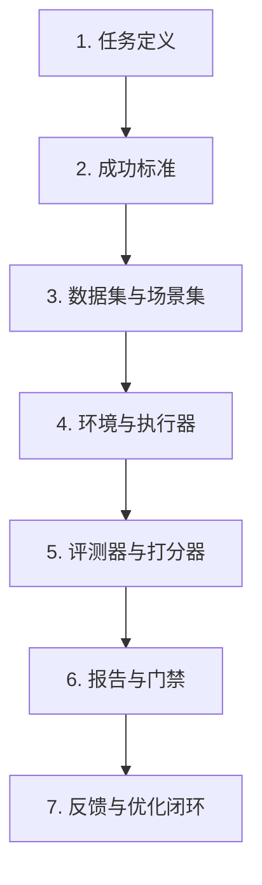
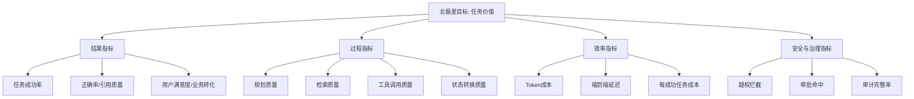
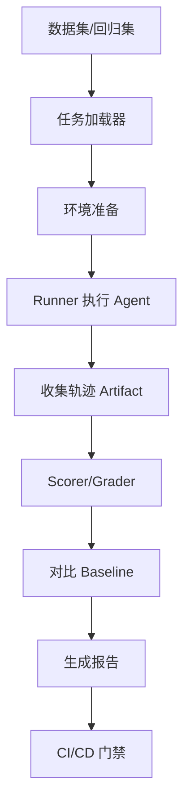
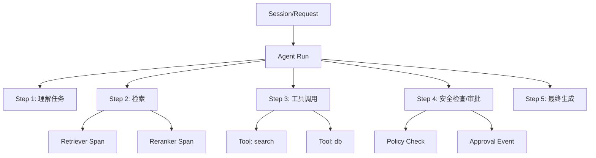
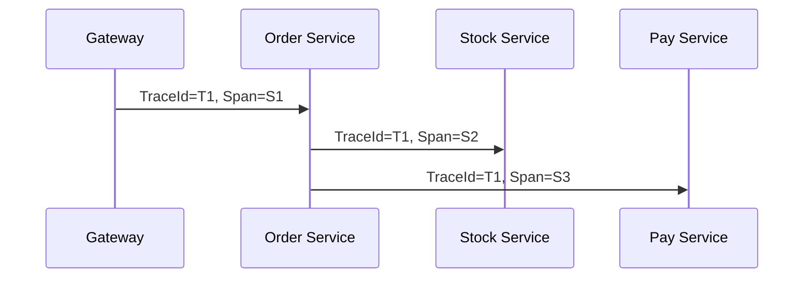

# 评测与可观测

> **模块**：08_评测与可观测/08_评测与可观测.md  
> **构成**：6 个知识点合为一篇，按顺序编号  
> **规模**：约 4,007 行  |  **生成**：2026-11-12

## 目录

1. 评测框架
2. 离线评测与在线评测
3. 过程指标与结果指标
4. Benchmark与回归测试
5. 可观测与Trace回放
6. 评测全景图与实战

---

## 1. 评测框架

### 一、面试官在这一题里真正想考什么

当面试官问你怎么评估一个 Agent，他往往不是想听你罗列几个指标，更不是想听我会看准确率、人工满意度、成功率这种泛化回答。他想知道的是，你是否理解 Agent 的评测对象已经从单个模型输出扩展成了多步系统行为。

单轮问答时代，很多问题可以通过看最终答案来判断。但 Agent 不一样。一个 Agent 往往会经历规划、检索、调用工具、读取外部上下文、结构化输出、状态转移、多轮自我修正，最后才产生一个结果。于是，评测对象天然变成了多层结构：

- 最终结果是否正确？
- 中间过程是否可靠？
- 是否正确选择了工具？
- 是否过度规划或无效循环？
- 是否遵守了安全边界？
- 成本和延迟是否可接受？
- 对业务 KPI 有没有正向影响？

因此，**Agent 评测的本质，是把什么叫一个好的系统行为定义清楚，并把它变成可重复、可比较、可自动化执行的质量体系。**

如果你想在面试里答得更上一个层次，必须先把一句话讲出来：

> Agent 评测不是只评答案，而是要评任务、轨迹、工具、环境交互、安全与业务效果。

下面给一个可以直接背诵、再根据项目替换细节的标准答案。

> 💡 我会把 Agent 评测分成七个部分。第一先定义任务和成功标准，明确最终完成什么算成功、哪些行为算失败。第二按核心场景、边界场景、历史失败场景和对抗场景构造数据集。第三设计评测环境，决定工具是真实调用还是 mock、检索语料是否固定快照。第四设计打分器，能规则判的优先规则判，比如结构化输出、工具参数、测试通过率；开放式质量再引入 LLM-as-a-Judge；关键高风险 case 保留人工复核。第五指标上我会同时看结果指标和过程指标，因为 Agent 失败很多时候不是最终答案错，而是规划、检索、工具选择或权限控制出了问题。第六把评测接到门禁，比如 PR 回归、版本对比、灰度门限。第七把失败 case 沉淀回数据集，形成持续优化闭环。这样做的目标不是得到一个孤立分数，而是建立一套可上线、可回归、可解释的质量体系。

### 二、为什么 Agent 评测比普通 LLM 评测更难

Agent 评测之所以难，不是因为指标更多这么简单，而是它同时具备下面几个特点。

#### 1. 轨迹不唯一

同一个任务，Agent 可能存在多条都能成功的路径。比如帮我预订明天下午去上海的高铁票，有的系统会先查日期、再查车次、再校验余票；有的会先问补充信息；有的会并发查询多个接口。也就是说，**Agent 的正确性往往不是唯一轨迹的正确，而是多种可接受策略中的任一成功轨迹。**

这意味着你不能简单用中间步骤和参考答案一模一样去判定对错。

#### 2. 外部环境会变化

Agent 常常与搜索、数据库、企业系统、浏览器、代码仓库、工单系统等外部环境交互。环境会变，返回结果会变，权限会变，接口会抖动，页面会改版。一个离线看起来完美的任务，到了线上可能因为网页 DOM 变化、API 限流、权限收紧而失败。

所以 Agent 评测必须考虑环境耦合，而不是只考虑模型本身。

#### 3. 结果和过程都重要

有些系统最终答对了，但过程很差：绕了十步才完成、本来一个工具就能做完却调用了五个工具、对敏感操作差点越权、重复检索三次才拿到结果。对企业来说，这不是表现良好，而是勉强成功，但效率与风险不可接受。

#### 4. 安全与治理已经成为评测维度

Agent 能动手，风险就成倍上升。你不能只问它会不会做，还要问它会不会在不该做的时候做。所以现代 Agent 评测必须把安全评测、权限边界评测、审批链路评测纳入体系。

#### 5. 业务价值不一定与技术指标线性对应

一个客服 Agent 如果答案更长、更像人，也许技术评测分数更高，但真实业务上可能降低转化率、增加用户等待时间、提高人工复核成本。评测框架最终要服务业务目标，而不是服务论文指标。

### 三、先给出一套最实用的总框架

在校招面试里，你可以把 Agent 评测框架总结成七层。这个框架既容易记忆，也便于展开。



#### 第 1 层：任务定义

先定义你评的到底是什么任务。不是评一个 Agent，而是评具体的任务单元，比如：

- 企业知识问答中的政策问答
- 工单助手中的工单归类 + 回复建议
- 代码 Agent 中的根据 issue 修复 bug
- 浏览器 Agent 中的在指定网站完成表单填写
- 办公自动化 Agent 中的拉取报表并生成摘要

任务定义不清，后面所有指标都会漂浮。

#### 第 2 层：成功标准

成功标准是评测的核心。要明确回答：什么叫成功，什么叫失败，什么叫部分成功。比如：

- 最终答案必须正确且引用充分；
- 必须使用指定工具或禁止使用某些工具；
- 必须在 5 步内完成；
- 必须返回合法 JSON；
- 不允许泄露敏感信息；
- 涉及外部写操作时必须先发起审批。

很多候选人答题时最大的问题，就是指标先行、目标后置。正确顺序应当是：先定义成功，再选择指标。

#### 第 3 层：数据集与场景集

Agent 评测不能只靠一两个 demo case，而要有分层场景集。常见分法包括：

- 黄金集：最典型、最重要、可重复的核心任务；
- 边界集：长上下文、歧义输入、缺信息输入；
- 失败集：历史上出过问题的 case；
- 对抗集：恶意输入、越权诱导、提示注入；
- 线上回放集：从真实流量中抽样沉淀；
- Benchmark 映射集：用公共 benchmark 作为外部参照。

#### 第 4 层：环境与执行器

对 Agent 来说，评测不是单纯给 prompt 看输出，而是需要一个执行环境。你要考虑：

- 工具是 mock 还是真实调用？
- 检索语料是否固定快照？
- 浏览器页面是否稳定？
- API quota 是否充足？
- 随机性是否需要固定？
- 是否支持多次重复试验？

环境设计决定结果是否可复现。

#### 第 5 层：评测器与打分器

这层决定怎么判分。常用方法包括：

- 规则评分：精确匹配、结构校验、字段完整性；
- 程序评分：执行测试、运行单元测试、SQL 执行验证；
- 轨迹评分：是否调用了正确工具、是否发生死循环；
- 模型评分：LLM-as-a-Judge / model grader；
- 人工评分：小样本高价值 case 复核；
- 混合评分：规则优先 + 模型补充 + 人工兜底。

#### 第 6 层：报告与门禁

评测不是为了出一张表，而是为了做决策。所以最终必须回答：

- 这个版本能不能上线？
- 哪些维度变好，哪些维度变差？
- 退化是否在容忍区间内？
- 是否要阻断 merge / deploy？
- 哪些 case 需要人工复核？

#### 第 7 层：反馈与优化闭环

评测的终点不是打分，而是找到优化方向。一个成熟系统会把失败 case 送回：

- Prompt 优化
- Tool schema 优化
- 检索链路优化
- 权限边界优化
- 路由策略优化
- 数据集扩充
- 评测器修正

这样才能形成真正的 eval flywheel。

---

### 四、Agent 评测要评哪些维度

下面这张表是面试里非常常用的回答框架。你不一定真的用表格呈现，但脑子里必须有这几类维度。

#### 1. 任务结果质量

这是最直观的维度，问的是任务做成了吗。常见指标包括：

- task success rate / completion rate
- answer correctness
- groundedness / citation coverage
- patch pass rate（代码任务）
- structured output validity
- business acceptance rate

它回答的是终局是否合格。

#### 2. 过程质量

这是 Agent 区别于普通问答系统的关键。常见指标包括：

- 规划是否合理
- step 数是否过多
- 是否存在重复行动
- 是否选择了正确工具
- 是否过度调用工具
- 是否在中间状态卡死
- 自我修正是否有效

它回答的是它是怎么做成或做失败的。

#### 3. 效率与资源消耗

企业很关心值不值得跑。常见指标包括：

- 总 token 消耗
- 每成功任务成本
- 端到端延迟
- 工具调用次数
- 并发下稳定性
- cache hit rate
- 重试次数

它回答的是代价是否可接受。

#### 4. 安全与合规

能做不等于该做。常见指标包括：

- 危险工具误调用率
- 越权请求拦截率
- 注入攻击成功率
- 审批缺失率
- 敏感信息泄露率
- 不当内容触发率
- 审计日志完整率

它回答的是有没有越界。

#### 5. 稳健性与泛化

有些系统在标准样例上很好，但输入一变就崩。要看：

- 对歧义输入的稳定性
- 对缺信息输入的追问能力
- 对外部工具错误的恢复能力
- 对页面变化 / schema 变化的鲁棒性
- 多轮上下文下的一致性
- 不同租户 / 不同知识域上的泛化表现

它回答的是遇到现实世界的脏数据和变化还能不能活。

#### 6. 业务效果

这是最高层。比如：

- 工单处理时长是否下降
- 人工接管率是否降低
- 用户满意度是否提升
- 转化率 / 成交率是否改善
- 首解率是否上升
- 审批成本是否减少

它回答的是这个 Agent 是否真正创造价值。

在面试里，如果你能把这六类维度按结果—过程—效率—安全—稳健性—业务讲出来，往往就已经是高质量回答。

---

### 五、评测单元应该怎么切

Agent 评测的另一个关键点是：**你评测的对象粒度是什么。**

很多系统出了问题，是因为把所有东西都塞到最终成功率里，导致定位不了问题。更科学的做法是把评测单元拆成四层。

#### 1. Response-level

评估单个模型输出，比如某一次分类、某一次 JSON 结构化结果、某一次工具参数生成。适合看底层能力。

#### 2. Step-level

评估 Agent 单步行为，比如这一步是否应当调用工具、调用了哪个工具、参数是否正确、是否应该继续规划。适合分析过程质量。

#### 3. Episode-level

评估整个任务 episode 是否完成，包括多步轨迹、环境交互、最终结果。很多 Agent benchmark 的基本单元都是 episode。

#### 4. Session / Business-level

评估更长时间尺度上的用户会话和业务目标，比如一次多轮客服会话是否最终解决问题、一个工作流是否真正流转成功、一个用户在一周内是否满意。

不同层级对应不同的指标与打分器。面试官很喜欢问你如何定位失败，实际上他想听到的就是你是否知道不同层级需要不同观测点。

### 六、怎样设计一套校招也能说清楚的 Agent 评测流程

如果让你回答你会怎样从零设计一个 Agent 评测体系，一个很实用的说法是下面六步。

#### 第一步：定义业务目标和任务边界

先问业务方或自己：这个 Agent 是干什么的？成功意味着什么？失败会带来什么代价？是否涉及真实写操作、审批、用户数据？

#### 第二步：拆出关键能力

不要一上来就测全链路。先把系统拆成几个能力层：

- 理解输入
- 任务规划
- 检索 / 读上下文
- 工具选择
- 参数生成
- 输出生成
- 审批与安全控制

这样做的好处是，当全链路退化时，你知道先去看哪一层。

#### 第三步：构造分层数据集

至少准备四类 case：

- 核心高频 case
- 历史失败 case
- 边界 case
- 对抗 / 风险 case

没有失败集的评测体系，几乎一定会高估系统质量。

#### 第四步：选择评测器

按能规则判就规则判，规则不够再用模型判，实在关键再人工判的顺序。理由是规则最稳定、成本最低、可解释性最好。LLM judge 很强，但不是第一选择。

#### 第五步：建立基线与门禁

任何评测都需要 baseline。否则你只是在看一个孤立数字，不知道它是变好还是变差。建立 baseline 后，要明确：

- 哪些维度必须不下降；
- 哪些维度允许小幅波动；
- 哪些维度需要显著提升才值得上线；
- 哪些 case 的失败属于 blocker。

#### 第六步：把结果接回开发循环

评测报告最终要转成行动：

- 加入新的回归 case；
- 修 Prompt；
- 改 tool description；
- 调路由；
- 改安全策略；
- 做环境 mock；
- 拆能力边界。

这一步没做，评测就会退化成形式主义。

---

### 七、规则评测、模型评测、人工评测怎么组合

这是面试中的高频追问。最好的回答方式不是偏袒某一种，而是说明它们的边界。

#### 1. 规则评测

适用于：

- 分类标签是否正确
- JSON / schema 是否合法
- 数值是否落在范围内
- 引用字段是否齐全
- 工具参数是否满足格式要求
- 代码 patch 是否通过测试

优点是稳定、便宜、可解释。缺点是覆盖不了开放式质量。

#### 2. 模型评测（LLM-as-a-Judge / model grader）

适用于：

- 答案是否切题
- 解释是否完整
- 回复语气是否符合要求
- 总结是否覆盖关键点
- 多候选答案的 pairwise 比较
- 模糊正确性的开放式任务

优点是可扩展、能覆盖开放任务。缺点是自身也会漂移，需要做校准、一致性测试和 prompt 版本管理。

#### 3. 人工评测

适用于：

- 高风险业务
- 难以自动判分的复杂任务
- 新任务早期基线建立
- Judge 校准与抽检
- 线上事故复盘

优点是最符合真实偏好，缺点是慢且贵。

#### 最佳组合思路

在实际系统里，通常是：

**规则评分做底座，模型评分补开放维度，人工复核做关键抽样。**

这句话建议直接背下来。它几乎适用于所有 eval 话题。

### 八、为什么说失败分类是评测框架的一部分

成熟团队做评测，绝不会只看分数，还会看失败是怎么失败的。因为不同类型的失败对应完全不同的改法。你可以把失败粗分成下面几类：

1. **理解失败**：用户意图都没识别对；
2. **规划失败**：知道要做什么，但步骤安排错了；
3. **检索失败**：没拿到正确上下文；
4. **工具选择失败**：该调 A 调成 B，或根本不该调工具却调了；
5. **参数失败**：工具选对了，但参数构造错；
6. **执行失败**：外部 API / 页面 / 权限 / 超时问题；
7. **整合失败**：拿到信息后最终答案组装错；
8. **安全失败**：越权、泄露、危险调用；
9. **效率失败**：虽然做成，但成本和延迟不可接受；
10. **治理失败**：缺审批、缺审计、状态不一致。

面试时，如果你能说我不会只统计失败率，还会做 failure taxonomy，面试官会很容易判断你真的做过复杂系统，或者至少理解复杂系统是如何被管理的。

### 九、Agent 评测框架如何映射到不同项目类型

#### 1. RAG Agent

重点评：

- 命中正确证据的能力；
- 引用覆盖；
- 答案与证据一致性；
- 无依据臆造率；
- 检索失败后的追问或降级能力。

#### 2. 工具型 Agent

重点评：

- 工具选择准确率；
- 参数构造正确率；
- 工具链路成功率；
- 无效工具调用率；
- 风险操作确认率。

#### 3. 浏览器 / GUI / Computer-use Agent

重点评：

- 环境适应能力；
- UI 选择器或页面理解能力；
- 任务 episode 成功率；
- 页面变化下的稳健性；
- 错误恢复能力；
- 多步长任务中是否出现迷航。

#### 4. 代码 Agent

重点评：

- 是否理解 issue；
- patch 是否通过测试；
- 是否引入新 bug；
- 修改范围是否过大；
- tool / repo / terminal 使用是否安全；
- 单任务 token 与耗时是否可接受。

#### 5. 企业工作流 Agent

重点评：

- 状态机是否正确推进；
- 审批链是否遵守；
- 数据写入是否一致；
- 幂等、重试、回滚是否可靠；
- 审计字段是否完整。

这类项目映射很适合在面试中展示你知道方法怎么迁移。

### 十、常见追问与拆解

#### 追问 1：为什么不能只看任务成功率？

因为任务成功率是结果指标，只告诉你成没成，不告诉你为什么没成。Agent 往往是多组件系统，定位问题必须看过程指标和 trace。

#### 追问 2：为什么不全部用人工评测？

因为昂贵、慢、不可扩展。系统一旦高频迭代，需要自动化门禁。人工更适合用于关键 case、抽检和 judge 校准。

#### 追问 3：LLM-as-a-Judge 会不会不稳定？

会，所以要做几件事：固定 judge prompt 与版本、构建校准样本、做一致性抽检、必要时多次采样或 pairwise 比较，并用规则评分兜底关键维度。

#### 追问 4：公共 benchmark 和内部评测哪个更重要？

内部评测更重要，因为它直接对应你的业务目标；公共 benchmark 更像外部参照系，用来判断你的系统处于什么水平、关注什么任务族群。

#### 追问 5：评测框架会不会限制创新？

不会。真正成熟的评测体系不是为了束缚模型，而是为了让团队在快速试验时仍然知道哪些变化安全、哪些退化不可接受。

---

### 十一、校招生最容易掉进的坑

1. 把评测说成测试模型；
2. 只提成功率，不提过程；
3. 不区分离线和在线；
4. 不区分规则判分和模型判分；
5. 不考虑安全 / 权限 / 审批；
6. 没有 failure taxonomy；
7. 没有 baseline，只会说绝对分数；
8. 没有说数据集从哪里来；
9. 没有说如何接到工程流水线；
10. 没有讲评测结果如何反哺系统优化。

### 十二、高频面试题

#### 1. 为什么 Agent 评测不能只看最终答案？

因为 Agent 是多步系统，最终答案只是表面现象。失败可能来自规划、工具、检索、权限或环境。

#### 2. 你会如何设计一个 Agent 评测框架？

从任务定义、成功标准、数据集、环境、打分器、门禁、反馈闭环七层来设计。

#### 3. Agent 评测里结果指标和过程指标分别有哪些？

结果指标如任务成功率、正确率、业务转化；过程指标如 step 数、工具调用正确率、重试率、回退率、审批触发率。

#### 4. 为什么要保留失败集和对抗集？

因为平均样例会掩盖系统最脆弱的边界，而生产事故往往都来自边界和历史失败模式。

#### 5. 什么时候用规则评分，什么时候用 LLM Judge？

结构、格式、测试通过率等优先规则；开放式、主观式、多候选比较用 judge；关键高风险 case 加人工复核。

#### 6. 你怎么避免评测集被刷分？

按时间和风险分层维护数据集，保留隐藏集、线上回放集和新失败样本，避免只优化公开样例。

#### 7. 公共 benchmark 的作用和局限是什么？

作用是提供外部参考；局限是与业务不完全同构，且容易被过拟合。

#### 8. 为什么 baseline 很重要？

没有 baseline，你无法判断一次改动是提升、波动还是退化。

#### 9. 为什么评测器本身也要版本管理？

Judge prompt、规则逻辑、数据集都在变，不做版本管理就无法解释分数变化来自模型还是来自评测器。

#### 10. 如果系统上线后效果下降，你会先看哪几类信息？

先看线上结果指标、过程指标和 trace，再看发布变化、环境变化、权限变化、知识库变化和外部 API 状态。

---

### 十三、参考资料与延伸阅读

- OpenAI, *Working with evals*
- OpenAI, *Evaluation best practices*
- OpenAI, *Testing Agent Skills Systematically with Evals*
- OpenAI, *Getting Started with OpenAI Evals*
- OpenAI, *Eval Driven System Design - From Prototype to Production*
- Anthropic, *Define success criteria and build evaluations*
- Anthropic, *Using the Evaluation Tool*
- LangSmith, *Evaluation concepts*
- Braintrust, *Autoevals / Create scorers*

---

### 十四、最后的总结

把这一篇压缩成一句话就是：

**Agent 评测框架的核心，不是找到一个万能指标，而是把任务、轨迹、工具、环境、安全和业务效果变成一套可重复、可解释、可持续迭代的质量系统。**

如果你把这个总框架建立起来，后面的离线与在线评测、过程与结果指标、Harness、可观测、安全、治理、灰度和回滚，都会自然接上。

## 2. 离线评测与在线评测

### 一、面试官为什么总爱问离线评测和在线评测的区别

因为这是一个非常好的分层问题。它能快速看出候选人到底把 Agent 当成实验室里的模型调用，还是当成持续运行的生产系统。

很多同学的第一反应会是：

- 离线评测就是拿数据集跑一下；
- 在线评测就是上线后看用户反馈。

这个说法不能算错，但太浅。真正重要的是：**离线评测解决的是可重复、可对比、可回归的问题；在线评测解决的是真实环境、真实流量、真实业务效应的问题。** 这两个问题并不相同，所以两套机制都不可或缺。

面试官真正想考的是下面几件事：

1. 你知不知道离线评测是上线前的门禁系统；
2. 你知不知道在线评测是上线后的监控系统；
3. 你能不能解释为什么离线高分不等于线上好用；
4. 你有没有把线上真实数据再沉淀回离线数据集形成闭环。

所以，回答这个题时最稳妥的一句总述是：

> 我会把离线评测当成可重复的实验环境，把在线评测当成真实世界中的持续验证，两者构成版本上线的前后闭环，而不是二选一。

可以用这一段话回答

> 💡 我一般会把离线评测和在线评测当成一条上线漏斗的前后两端。离线评测主要解决可重复、可对比、可回归的问题，所以我会用黄金集、失败集、边界集和对抗集，在固定环境里比较模型、Prompt、工具链和策略变化，作为上线前门禁。在线评测主要解决真实流量和真实环境下的问题，我会通过 shadow、灰度、线上指标、抽样复核和 trace 分析，观察真实任务成功率、人工接管率、成本、延迟和安全事件。两者不是替代关系，而是闭环关系：线上发现的新失败样本要回灌到离线数据集中，形成下一轮回归测试。这样系统才会越来越稳。

### 二、先说结论：离线与在线分别负责什么

#### 离线评测的职责

离线评测的关键词是：

- 可控环境
- 固定样本
- 可重复执行
- 可横向对比
- 适合回归测试
- 适合在开发、提测、灰度前做决策

它擅长回答的问题是：

- 新模型是否比旧模型更好？
- 新 Prompt 是否造成了退化？
- 新工具 schema 会不会导致调用失败？
- 新知识库索引是否让核心问题回答更准确？
- 新的安全规则是否阻断了应当允许的正常行为？

#### 在线评测的职责

在线评测的关键词是：

- 真实流量
- 真实用户输入
- 真实环境波动
- 真实成本与延迟
- 真实业务反馈
- 持续监控与预警

它擅长回答的问题是：

- 用户真实输入分布下，系统是否仍然稳定？
- 外部 API 波动、页面变化、权限变化会不会影响成功率？
- 用户是否真的更满意？
- 真实任务完成率是否提升？
- 成本和延迟在上量后是否仍可接受？
- 安全风险是否在生产中暴露出来？

你会发现，离线和在线看的是同一系统的不同维度：一个强调实验可控，一个强调现实有效。

---

### 三、为什么离线评测做得很好，线上仍然可能翻车

这是校招面试里的高频追问。这里必须说清楚几个原因。

#### 1. 离线样本分布与真实用户分布不一致

离线样本往往更干净、更标准、歧义更少。而线上用户输入会有口语化、省略、拼写错误、历史上下文污染、混合目标、情绪化表达。Agent 在线上的输入复杂度几乎总是高于离线集。

#### 2. 线上环境是不稳定的

离线评测可以用固定知识库快照、固定 mock 工具、固定页面。但线上环境会发生：

- 搜索结果更新；
- API 限流；
- 页面改版；
- 数据库脏数据；
- 审批系统延迟；
- 权限策略变化；
- 第三方工具返回异常。

因此，线上失败很多时候不是模型退化，而是系统环境变化。

#### 3. 业务目标与技术指标并不完全一致

离线中你可能优化了答案完整度，但线上用户只想更快拿到一个可执行建议。离线评测提升，不代表真实满意度一定提升。

#### 4. 用户会探索系统边界

离线集通常覆盖主路径，而线上用户天然会试探边界、绕提示、诱导模型、提交脏数据、故意输入高风险内容。这会暴露出安全和治理层面的短板。

#### 5. 上量后资源瓶颈才会显现

离线阶段可能并发很低，一切都很顺畅；真实流量一来，rate limit、缓存击穿、外部依赖抖动、工具队列堆积、trace 存储压力、审批积压都会出现。

所以，一个成熟的团队不会说离线已经 90 分，所以可以放心上线，而会说离线达到门禁，再通过 shadow、canary 和在线监控验证真实表现。

---

### 四、把离线和在线放进一条统一的发布漏斗

面试中如果你能给出发布漏斗概念，层次会明显更高。


这条链路非常重要，因为它体现了离线与在线并不是并排关系，而是串联关系。

#### 阶段 1：离线构建

在实验室条件下用固定数据、固定环境尽可能把系统做对。这个阶段强调的是可重复。

#### 阶段 2：Shadow / Replay

把真实线上请求以只读、无副作用的方式回放给新版本，观察输出和轨迹，但不真正影响用户。这个阶段是从离线向在线过渡的桥梁。

#### 阶段 3：小流量灰度

给一小部分用户或租户放量，观察真实任务完成率、错误率、人工接管率、成本和延迟。这是在线评测真正开始发挥作用的阶段。

#### 阶段 4：全量运行与持续监控

系统稳定后进入持续监控阶段，在线评测不再只是看 dashboard，而是持续发现失败模式、抽样复核、触发告警、推动下一轮离线集更新。

这个漏斗思想在面试里非常加分，因为它说明你知道线上不是一个开关，而是一段过程。

---

### 五、离线评测到底应该怎么做

#### 1. 用什么数据

离线数据不能只有一类。至少应该覆盖：

- 核心高频 case：最能代表业务主路径；
- 边界 case：长输入、歧义输入、缺失信息；
- 历史失败 case：事故、投诉、人工接管样本；
- 对抗 case：注入、越权、危险诱导；
- 回归 case：过去已经修过的问题，防止再次出现；
- 线上沉淀 case：从真实流量中抽样清洗得到。

#### 2. 用什么环境

不同项目要决定环境真实性程度。比如：

- 结构化抽取任务：可以完全离线；
- RAG：最好冻结语料快照；
- 工具 Agent：核心工具可 mock，关键路径保留真实调用；
- 浏览器 Agent：需要固定环境或容器化页面；
- 代码 Agent：需要固定 repo 版本、依赖版本和测试环境。

#### 3. 用什么评分方式

常用方式分三层：

- 规则评分：schema、字段、数值、测试通过率；
- Judge 评分：开放式质量、可用性、完整性；
- 人工抽检：关键样本、分数边界样本、疑难样本。

#### 4. 如何看结果

离线评测不是看一个总分，而是至少看：

- 总体表现；
- 各任务子类表现；
- 风险 case 表现；
- 与上一版本差异；
- 与 baseline 差异；
- 失败样本聚类。

如果只看平均分，很容易掩盖关键问题。

#### 5. 离线评测的价值

离线最大的价值不是预测线上全部表现，而是：

- 快速试错；
- 安全回归；
- 版本横向对比；
- 在低成本环境里找到明显退化；
- 为是否进入灰度提供门禁。

---

### 六、在线评测到底应该怎么做

#### 1. 在线评测不是单一指标

很多人把在线评测理解成 NPS、点赞率、差评率，这太窄了。在线评测更像一套持续运行的质量侦测系统，包括：

- 真实任务成功率；
- 用户是否继续追问；
- 是否转人工；
- 是否出现二次修改；
- 是否出现越权尝试；
- 是否触发安全告警；
- 实际成本与延迟；
- 执行轨迹是否异常；
- 用户是否中途放弃。

#### 2. 在线评测的主要手段

常见做法包括：

##### 实时指标监控

比如成功率、错误率、P95 延迟、平均步数、tool error rate、人工接管率。

##### 线上抽样复核

对一定比例的真实流量做 LLM judge 或人工复核，补足结果对不对这类难以自动从日志中直接读出的质量信息。

##### Shadow / Side-by-side 比较

让旧版本和新版本同时处理同一请求，只把旧版本结果返回给用户，对比两个版本的输出与轨迹差异。

##### 小流量 A/B 测试

对不同用户群体分配不同版本，观察业务指标差异。对 Agent 来说，A/B 除了看点击和满意度，还要看任务完成率、人工接管率、成本和安全事件。

##### 线上异常检测

通过 trace 与规则检测发现：

- 步数突然变长；
- 某个工具突然高频失败；
- 某类任务大量进入人工接管；
- 某租户出现高风险操作增长；
- 某版本成本突然飙升。

#### 3. 在线评测的最大价值

在线评测最大的价值不在于打分，而在于让系统有机会面对真实世界，并且让团队尽早发现：离线没有覆盖到的输入分布、环境波动和业务行为模式。

---

### 七、离线与在线如何分工协作

最好的说法不是离线评技术，在线评业务，虽然这有一定道理，但太粗。更精确的分工如下。

#### 离线更擅长

- 早期迭代；
- Prompt / model / tool schema 对比；
- 回归测试；
- 风险 case 穷举；
- 数据集驱动优化；
- 在成本可控条件下做大量实验。

#### 在线更擅长

- 验证分布外输入；
- 观察真实环境耦合；
- 测业务价值；
- 看用户是否真的接受；
- 看放量后的资源与稳定性；
- 发现新的失败模式。

#### 它们如何闭环

成熟团队会这样做：

1. 在线发现问题；
2. 抽取失败样本；
3. 清洗并标注；
4. 加入离线失败集或回归集；
5. 重新离线评测；
6. 修复后再灰度上线。

这一套闭环非常重要。你可以把它记成一句：

**在线负责发现现实问题，离线负责可控修复与验证。**

---

### 八、什么样的指标适合离线，什么样的指标更适合在线

#### 更适合离线的指标

- exact match / F1 / accuracy；
- JSON schema valid rate；
- 单元测试通过率；
- tool parameter correctness；
- retrieval hit rate；
- 引用覆盖率；
- judge-based correctness on fixed set；
- prompt regression score。

这些指标依赖固定样本和可复现环境，离线测更有意义。

#### 更适合在线的指标

- 真实任务成功率；
- 用户中途放弃率；
- 人工接管率；
- 工单重复打开率；
- 用户满意度；
- 平均实际成本；
- P95 / P99 端到端延迟；
- 生产安全事件率；
- 审批等待时长；
- 多租户下的稳定性。

这些指标只有在真实流量和真实系统中才有意义。

#### 两边都适合，但定义不同的指标

有些指标两边都能看，但目的不同。例如成功率：

- 离线成功率：用于版本对比和门禁；
- 在线成功率：用于业务监控和异常预警。

同一个名字，语境不同，含义和用法都不同。

---

### 九、在线评测中的几个难点

#### 难点 1：缺少标准答案

很多真实请求没有明确 ground truth。这时候通常会引入：

- 用户反馈；
- 人工审核；
- LLM judge；
- 后续行为信号（如是否继续追问、是否重复提交）；
- 业务 outcome（是否完成下单、是否关闭工单）。

#### 难点 2：反馈延迟

有些业务效果要几小时甚至几天后才能看到，比如用户是否真正解决问题、审批链是否最终通过、代码修复是否引发新 bug。在线评测因此常常既有实时指标，也有滞后指标。

#### 难点 3：样本偏差

主动点赞或点踩的用户往往不是平均用户；被抽样人工审核的 case 也可能偏向高风险 case。所以在线评测结果要结合采样策略看。

#### 难点 4：实验伦理与安全

不能为了测试新版本，把高风险能力直接暴露给真实用户。对有写操作、资金、数据删除、隐私访问的系统，必须先经过足够离线验证和灰度控制。

#### 难点 5：分布漂移

今天的线上流量和下个月的线上流量可能不一样。在线评测不是一次性项目，而是持续运行的监测体系。

### 十一、不同项目里怎么做离线与在线

#### 1. 知识库问答 Agent

离线看：

- 引用命中率；
- 事实正确性；
- 无依据编造率；
- 格式合规率。

在线看：

- 用户是否继续追问；
- 是否转人工；
- 实际阅读完成率；
- 用户反馈分；
- 敏感文档越权尝试。

#### 2. 代码 Agent

离线看：

- benchmark / internal repo task pass rate；
- patch 是否通过测试；
- 文件改动范围；
- step 数与 token 成本。

在线看：

- 开发者是否接受 patch；
- 是否回滚提交；
- 实际修复成功率；
- IDE 响应速度；
- 危险命令拦截情况。

#### 3. 办公自动化 / 工作流 Agent

离线看：

- 状态转移正确率；
- 结构化输出合法率；
- 工具参数正确率；
- 审批规则覆盖。

在线看：

- 工单流转完成率；
- 审批等待时长；
- 失败重试率；
- 人工接管率；
- 实际流程阻塞点。

---

### 十二、常见误区

#### 误区一：觉得离线评测可以替代在线评测

离线永远无法完整覆盖真实用户分布和环境波动。

#### 误区二：觉得在线评测就是看点赞点踩

点赞点踩只是信号之一，很多时候还要结合轨迹、转人工、后续行为和业务 outcome。

#### 误区三：把线上事故样本留在工单里，不回灌离线数据集

这会让同类问题不断重复发生。

#### 误区四：在线直接大流量测试新版本

没有足够离线验证就全量放出，非常容易把系统问题变成用户问题。

#### 误区五：离线集只做主路径，不做失败集和对抗集

这会高估系统质量，尤其在安全与治理问题上。

---

### 十三、高频面试题

1. 离线评测和在线评测的区别是什么？
2. 为什么离线高分不等于线上效果好？
3. 如果只能做一套评测，你会优先做离线还是在线？
4. Shadow traffic 和 A/B test 有什么区别？
5. 在线评测没有标准答案怎么办？
6. 线上用户反馈为什么不能直接当作唯一质量指标？
7. 如何把线上失败样本沉淀到离线数据集中？
8. 高风险 Agent 为什么不能直接通过在线实验验证？
9. 你会怎样设计一个上线前的评测漏斗？
10. 对于有写操作的 Agent，离线与在线的边界怎么划？

---

### 十四、记忆口诀

**离线负责可重复地看清变化，在线负责在真实世界中检验变化。**  
**离线做门禁，在线做监控；在线发现问题，离线沉淀问题。**

### 十五、参考资料与延伸阅读

- OpenAI, *Working with evals*
- OpenAI, *Evaluation best practices*
- OpenAI, *Monitoring stored completions*
- OpenAI, *Responses evaluation / Tools evaluation / MCP evaluation*
- Anthropic, *Using the Evaluation Tool*
- Anthropic, *Define success criteria and build evaluations*
- LangSmith, *Online Evaluation*
- LangSmith, *LLM-as-a-judge online evaluators*
- Braintrust, *Evaluate systematically / Autoevals*

---

### 十六、最后总结

离线评测和在线评测最大的区别，不在于一个在本地，一个在线上，而在于它们分别承担了不同的系统责任：

- 离线保证你在可控环境里不会盲目迭代；
- 在线保证你在真实世界里不会自我感觉良好。

真正成熟的 Agent 团队，一定是把两者串成同一条质量闭环，而不是只做其中一半。

## 3. 过程指标与结果指标

### 一、这道题为什么特别能区分有没有做过工程

如果说你怎么评估 Agent考的是总框架，那么过程指标与结果指标有什么区别考的就是你能不能真正定位问题。

很多校招生在这里会有一个典型回答：  
结果指标就是准确率、成功率，过程指标就是中间过程，比如 tool call 次数。

这个回答方向对，但太薄。它没有回答出两个核心问题：

1. 为什么 Agent 需要专门强调过程指标？
2. 过程指标和结果指标怎样一起用于定位、优化和发布决策？

在传统软件里，很多系统是确定性的，只要输入相同，输出大概率一样，问题定位可以更多依赖异常日志和单元测试。但 Agent 不同。Agent 的失败往往不是一步错全盘错，而是出现在多步轨迹中某个环节：

- 计划绕远了，导致 token 与延迟暴涨；
- 检索结果拿到了，但没有被正确使用；
- 工具选对了，参数却错了；
- 该追问时没追问，直接臆断；
- 高风险动作没有触发审批；
- 最终任务失败只是表象，根因是中途状态机卡死。

于是，**结果指标负责告诉你系统有没有达成目标，过程指标负责告诉你系统为什么达成或没有达成目标。**

这两类指标就像医院里的结论和化验单：

- 结果指标像是否康复；
- 过程指标像血压、血糖、心率、影像、炎症指标。

一个只看结果指标的团队，能知道系统出问题了，但不知道怎么修；一个只看过程指标的团队，能看到很多细节，但不一定知道业务是否真的变好。成熟系统一定是两者同时看。

面试中可以用这么一段话描述：

> 💡 对 Agent 系统，我会把指标分成结果指标和过程指标两层。结果指标回答的是任务有没有完成、最终质量是否合格、业务是否受益，比如任务成功率、正确率、人工接管率、用户满意度、每成功任务成本等。过程指标回答的是系统是怎么完成或失败的，比如意图识别是否正确、是否及时追问、规划步数是否合理、检索是否命中、工具选择和参数是否准确、是否发生重复调用、审批是否触发、状态机是否卡死。结果指标更适合作为业务目标和发布门禁，过程指标更适合作为定位问题和优化抓手。真正成熟的做法不是二选一，而是建立一棵指标树：结果指标定义价值，过程指标解释价值，效率和安全指标作为约束条件

### 二、先下定义：什么是结果指标，什么是过程指标

#### 结果指标

结果指标关注的是任务最终产出或业务最终效应，典型问题是：

- 任务最后完成了吗？
- 用户最后拿到了正确结果吗？
- 业务目标最终实现了吗？
- 这次任务的最终输出是否合格？

常见例子：

- task success rate
- answer correctness
- 工单一次解决率
- 补丁通过测试率
- 用户满意度
- 转人工率
- 成交 / 转化率
- 最终结构化输出合法率
- 引用正确率
- 安全事故率

#### 过程指标

过程指标关注的是任务执行轨迹中的行为质量与中间状态，典型问题是：

- 规划合理吗？
- 工具调用得对吗？
- 有没有无效循环？
- 检索到了正确证据吗？
- 追问是否及时？
- 重试是否过多？
- 是否触发了正确审批？
- token 消耗是否失控？
- 中途状态转换是否符合预期？

常见例子：

- 平均 step 数
- 计划展开深度
- 重复工具调用率
- 工具参数正确率
- 工具成功率
- retrieval hit rate
- rerank 命中率
- 无效重试率
- 自我修正成功率
- 审批触发率
- trace 完整率
- 平均上下文长度
- 人工介入前步数

---

### 三、为什么 Agent 必须重视过程指标

#### 1. Agent 是多阶段链路，最终失败往往不是根因

如果一个 Agent 最终任务失败，你只知道 success=0，但不知道失败发生在哪里。可能是：

- 第一步理解错了用户意图；
- 第三步检索没有拿到证据；
- 第五步工具超时；
- 第六步没有处理工具异常；
- 第七步整合答案时漏掉关键约束。

如果你没有过程指标，就只能把所有失败都归因给模型不行，这在工程上没有任何可操作性。

#### 2. 很多最终成功其实过程很差

有些任务最后成了，但成本和风险高得离谱：

- 本来 2 步能完成，走了 8 步；
- 本来不用工具，却调用了 4 个工具；
- 明明答案已经足够，却重复检索两次；
- 高风险动作本来应走审批，但被模型绕过去了；
- 任务虽然完成，但延迟太高，用户体验很差。

如果只看结果指标，这些低质量成功会被误判为系统表现良好。

#### 3. 过程指标是优化的抓手

模型优化、Prompt 优化、工具优化、检索优化、路由优化，最终都需要落在某个可观测的中间环节上。过程指标可以帮助你回答：

- 优化后，是不是 step 变少了？
- tool selection 是否更准了？
- 追问行为是否更合理了？
- 检索证据是否更早命中？
- 风险动作触发审批是否更稳定了？

#### 4. 过程指标能发现未来事故的前兆

很多线上事故在结果层面爆发前，过程层面已经出现异常信号，例如：

- 平均 step 数持续上升；
- 某工具错误率缓慢变高；
- 某类任务的人工接管前步数突然增加；
- 审批触发率异常下降；
- token 消耗变高但成功率没提升。

这些都属于leading indicators，可以比最终业务损失更早发出预警。

---

### 四、最实用的指标树：从北极星指标到诊断指标

真正好用的指标体系不是一堆平铺的数字，而是一棵指标树。你可以把它理解为业务目标向下分解到系统行为的过程。



#### 北极星目标

北极星目标通常是业务语言，比如：

- 提高任务完成率；
- 降低人工处理时长；
- 提升研发修复效率；
- 提升知识问答可用性；
- 降低流程流转出错率。

#### 结果指标

结果指标要尽量直接映射北极星目标，比如：

- 核心任务成功率；
- 人工接管率；
- 用户满意度；
- 一次解决率；
- 转化率；
- 事故率。

#### 过程指标

过程指标负责解释结果指标为什么变化。例如成功率下降背后可能是：

- 计划质量下降；
- 某检索器命中率下降；
- 某工具参数错误率上升；
- 某审批规则没触发。

#### 效率指标

Agent 很容易在更聪明和更昂贵之间失衡。效率指标必须单列，常见包括：

- 平均 token 成本；
- 平均步数；
- P95 延迟；
- 每成功任务成本；
- cache hit rate；
- 工具并发效率。

#### 安全与治理指标

很多团队直到出事才补这部分。其实对于 Agent，这类指标应从一开始就作为一等公民存在。比如：

- 高风险动作确认率；
- 越权拦截率；
- 敏感信息脱敏率；
- 审计日志完整率；
- 危险命令拦截率。

---

### 五、过程指标可以分成哪几大类

面试里最稳的方式，是把过程指标分成几个模块来讲，而不是想到什么说什么。

#### 1. 输入理解与澄清类

这类指标回答系统是否正确理解任务。

典型指标：

- 意图识别正确率；
- 缺信息情况下的追问触发率；
- 误判为可执行任务的比例；
- 对歧义输入的澄清率；
- 用户约束提取完整率。

举例：用户说帮我订明天下午的票，如果系统没有识别出缺少出发地、到达地、偏好座位等约束，后续全部行为都会建立在错误前提上。

#### 2. 规划类

这类指标回答系统在展开任务时是否合理。

典型指标：

- 计划步骤数；
- 计划与最终任务的一致性；
- 无效计划分支率；
- 过度规划率；
- 计划中止后恢复成功率。

注意：规划指标不一定越大越好。步骤多可能意味着更细致，也可能意味着在绕路。要结合任务难度看。

#### 3. 检索与上下文使用类

这类指标回答系统有没有拿到并用好正确上下文。

典型指标：

- retrieval hit rate；
- rerank top-k 命中率；
- 被引用证据中有效证据占比；
- 上下文利用率；
- 冗余上下文比例；
- 未命中时的补救行为（再次检索、追问、降级）发生率。

很多 RAG Agent 的问题不在检索本身，而在拿到了证据却没用进去或者上下文太多导致注意力稀释。

#### 4. 工具调用类

这是 Agent 最有代表性的过程指标模块之一。

典型指标：

- tool selection accuracy；
- tool call precision / recall；
- 参数构造正确率；
- 工具执行成功率；
- 重复工具调用率；
- 不必要工具调用率；
- tool retry rate；
- 工具超时率。

如果是多工具系统，还可以看：

- 工具链切换成本；
- 常见失败工具 Top N；
- 工具调用顺序合理性。

#### 5. 状态机与控制流类

对 workflow-heavy 或 enterprise agent 特别重要。

典型指标：

- 状态转换正确率；
- 卡死状态占比；
- 重试后恢复率；
- 回滚触发率；
- 幂等冲突率；
- timeout 后补偿成功率。

#### 6. 自我修正与恢复类

Agent 一个重要能力是出错后能不能救回来。

典型指标：

- 自我识错率；
- 自我修正成功率；
- 失败后切换策略成功率；
- 工具失败后的回退质量；
- 用户澄清后恢复成功率。

#### 7. 人工接管与治理类

这类过程指标常被忽略，但非常重要。

典型指标：

- 审批触发率；
- 高风险动作确认率；
- 人工接管前平均步数；
- 审批后继续执行成功率；
- 审计日志字段完整率；
- 越权请求拦截率。

---

### 六、结果指标可以分成哪几大类

#### 1. 任务完成指标

最直接也最常见。

典型指标：

- task success rate
- completion rate
- pass@1 / pass@k
- structured output valid rate
- issue resolution rate

#### 2. 答案质量指标

适用于问答、总结、分析型任务。

典型指标：

- correctness
- factuality
- groundedness
- completeness
- citation quality
- hallucination rate

#### 3. 用户体验指标

适用于直接面对终端用户的 Agent。

典型指标：

- 满意度
- 是否继续追问
- 是否中途退出
- 再次打开同一问题的比例
- 回答可执行性评分

#### 4. 业务结果指标

面试时只要能举出一两个业务化例子，就很加分。

例如：

- 客服首解率；
- 平均处理时长；
- 工单关闭率；
- 运营任务完成时长；
- 研发 issue 修复周期；
- 内容审核人工工作量下降幅度。

#### 5. 安全与合规结果指标

这类指标关注的是最终有没有造成不可接受的后果。

例如：

- 敏感信息泄露率；
- 错误外部写入率；
- 未审批危险操作执行率；
- 合规违规事件数；
- 高风险误执行率。

---

### 七、过程指标和结果指标如何配对使用

好的指标体系不是各看各的，而是要能形成因果分析路径。下面给几个典型配对。

#### 例 1：任务成功率下降

先看结果指标发现 success rate 下降，再看过程指标：

- 是检索命中率下降？
- 还是工具执行成功率下降？
- 还是 step 数增加导致超时？
- 还是审批触发逻辑异常？

#### 例 2：用户满意度下降，但正确率没变

这时候可能是：

- 延迟变长；
- 追问次数太多；
- 输出太冗长；
- 风险控制过严导致可用性下降。

说明只看 correctness 不够。

#### 例 3：成本上升，但成功率没提升

先看过程指标：

- 平均 step 数是否上升？
- 重复检索是否变多？
- 工具调用是否更频繁？
- 上下文是否膨胀？
- 是否引入了过于复杂的 reasoning 模式？

#### 例 4：安全事故增加

要看过程指标中：

- 越权拦截率是否下降；
- 审批触发率是否异常；
- 某类工具是否被错误放宽；
- 不可信输入是否进入了高权限上下文。

所以你会发现，结果指标更像报警器，过程指标更像CT 扫描。

---

### 八、如何避免只优化过程，不优化结果或者反过来

#### 1. 警惕 Goodhart’s Law

当一个指标成为目标，它就可能失去原本代表意义。比如：

- 盲目减少 step 数，可能导致系统跳过必要验证；
- 盲目提高工具调用率，可能让系统过度依赖工具；
- 盲目提高审批触发率，可能把用户体验拖垮。

#### 2. 用成组指标而不是单指标

不要只盯一个指标。建议至少同时看：

- 成功率；
- 每成功任务成本；
- 平均步数；
- 高风险误执行率；
- 用户满意度或人工接管率。

#### 3. 给不同指标设定角色

可以把指标分成三类：

- 北极星指标：最终要优化的；
- 约束指标：不能恶化的；
- 诊断指标：帮助定位问题的。

例如：

- 北极星：任务成功率；
- 约束：成本、延迟、安全事件率；
- 诊断：工具参数正确率、重复检索率、审计完整率。

#### 4. 结果为主，过程为因

一个很稳的工程原则是：  
**结果指标定义价值，过程指标解释价值。**  
不要本末倒置。

---

### 九、不同项目中的指标设计示例

#### 1. 企业知识 Agent

结果指标：

- 问题解决率；
- 引用正确率；
- 人工转接率；
- 用户满意度。

过程指标：

- 检索命中率；
- rerank 命中率；
- 引用覆盖率；
- 无依据生成率；
- 平均上下文长度；
- 追问触发率。

#### 2. 代码修复 Agent

结果指标：

- patch 通过测试率；
- issue 解决率；
- 人工接受率；
- 回滚率。

过程指标：

- 平均文件修改数；
- 平均 tool call 数；
- 测试重跑次数；
- 错误命令拦截率；
- 平均 token 成本；
- 自我修正成功率。

#### 3. 工作流 / 办公 Agent

结果指标：

- 流程完成率；
- SLA 达成率；
- 人工处理时长下降；
- 错单率。

过程指标：

- 状态转换正确率；
- 审批触发率；
- 外部写操作成功率；
- 回滚率；
- timeout 恢复率；
- trace 完整率。

### 十一、常见误区

1. 只看成功率，不看原因；
2. 只看准确率，不看成本和延迟；
3. 只看平均值，不看长尾（如 P95、P99）；
4. 只看最终结果，不看高风险过程；
5. 把所有过程指标都堆上去，没有优先级；
6. 过程指标优化后不验证结果是否真的提升；
7. 忽略人工接管、审批与审计这类治理指标；
8. 不按任务类型设计指标，一套指标打天下。

### 十二、高频面试题

1. 过程指标和结果指标的区别是什么？
2. 为什么 Agent 系统需要专门看过程指标？
3. 结果指标高、过程指标差，能不能上线？
4. 过程指标好、结果指标一般，说明了什么？
5. 你会怎样设计一个 Agent 的指标树？
6. 什么是 leading indicator，什么是 lagging indicator？
7. 如何防止团队为了某个过程指标刷分？
8. 平均 step 数下降一定是好事吗？
9. 为什么安全与治理指标也应该纳入指标体系？
10. 如果 success rate 下降，你会优先排查哪些过程指标？

---

### 十三、可直接背诵的一句总结

**结果指标负责回答值不值得，过程指标负责回答为什么会这样；没有结果指标，你不知道方向；没有过程指标，你不知道怎么修。**

---

### 十四、参考资料与延伸阅读

- OpenAI, *Evaluation best practices*
- OpenAI, *Working with evals*
- OpenAI, *Eval Driven System Design - From Prototype to Production*
- OpenAI, *Graders*
- Anthropic, *Define success criteria and build evaluations*
- LangSmith, *Evaluation concepts / Online evaluation*
- Braintrust, *Create scorers / Autoevals*

## 4. Benchmark与回归测试

### 一、为什么这道题在 Agent 面试里越来越常见

这几年 Agent 生态里出现了很多 benchmark：GAIA、SWE-bench、OSWorld、WebArena、VisualWebArena、TheAgentCompany 等。很多同学会关注排行榜，也会在项目里提到“参考了某某 benchmark”。但企业面试官真正想听的，通常不是你能背多少 benchmark 名字，而是你是否理解：

- 公共 benchmark 的作用是什么；
- 为什么公共 benchmark 不等于可上线评测；
- 内部 Harness 到底是什么；
- 如何用 Harness 做回归测试、版本比较和发布门禁。

换句话说，面试官想看你是不是能从“知道 benchmark”升级为“知道如何搭评测基础设施”。

你可以先记住一句非常适合开场的回答：

> Public benchmark 解决的是外部参照问题，Harness 解决的是内部可重复执行问题，回归测试解决的是版本演进中的质量守恒问题。

这句话展开以后，就是完整的工程化视角。

可以用这么一段话给面试官讲清楚区别

> 💡 Benchmark 和 Harness 不是一回事。Benchmark 更像公开定义好的任务集和评分方式，主要解决外部参照问题；Harness 是我内部的评测执行框架，包含数据集、环境准备、runner、scorer、artifact 收集、基线对比和门禁逻辑。对 Agent 来说，仅仅跑 public benchmark 不够，因为业务任务、权限边界、工具链和风险场景都不一样。我会基于核心主路径、历史事故、风险对抗和长尾场景构建回归集，并把 Harness 接到 CI/CD 里：轻量集跑在 PR，重型集跑在 nightly，全量或高风险集跑在发布前。回归测试的重点不是看绝对分数，而是确保这次改动没有把原本好的能力弄坏。

### 二、先把三个概念讲清楚

#### 1. Benchmark

Benchmark 是公开定义好的任务集、环境和评分方式，用来衡量系统在某类能力上的表现。比如：

- GAIA 关注通用助理型任务；
- SWE-bench 关注真实 GitHub issue 修复；
- OSWorld 关注真实计算机环境中的多模态代理执行；
- WebArena / WebArena-x 关注网页代理任务。

Benchmark 的价值在于提供外部坐标系，让大家用相对统一的方式比较方法和系统。

#### 2. Harness

Harness 可以理解成“评测执行框架”或“评测跑台”。它不仅包含数据集，还包含：

- 数据加载器；
- 环境准备逻辑；
- 任务运行器；
- 工具 / 浏览器 / 检索依赖；
- 打分器；
- artifact 收集；
- 报告生成；
- 基线对比；
- 门禁决策。

也就是说，Harness 不是“题库”，而是“把题跑起来并得出可比较结论的一整套执行基础设施”。

#### 3. 回归测试

回归测试关注的是版本变化后，原本没问题的能力是否退化。对于 Agent 来说，任何一个变化都可能引发回归：

- 换模型；
- 改 Prompt；
- 改 tool schema；
- 改路由；
- 改检索索引；
- 改权限规则；
- 改 memory 策略；
- 改审批流程；
- 改 stop 条件。

所以回归测试的核心不是“系统现在有多强”，而是“这次变化有没有把以前好的地方弄坏”。

---

### 三、为什么只看公共 benchmark 远远不够

#### 1. 业务任务与 benchmark 不完全同构

公开 benchmark 再强，也只能覆盖某一类任务分布。企业自己的任务通常有：

- 特定领域知识；
- 特定工具链；
- 特定权限约束；
- 特定 SLA；
- 特定风险边界；
- 特定组织流程。

一个在公开 benchmark 上表现优异的系统，未必能在你的企业工单、文档审批、数据库查询、代码仓库、客服会话中表现同样优秀。

#### 2. benchmark 的目标往往偏“能力验证”，企业目标偏“上线可靠”

Benchmark 更像“这个系统能不能做某类任务”；企业更关心“它能不能持续、稳定、安全、低成本地做这些任务”。

#### 3. benchmark 很少覆盖你真正的风险场景

比如：

- 你自己的 Prompt Injection 场景；
- 你自己的越权路径；
- 你自己的审批链；
- 你自己的知识库脏数据；
- 你自己的租户隔离问题。

这些必须靠内部 Harness 和内部回归集覆盖。

#### 4. benchmark 容易被过拟合

任何公开数据集一旦广泛流传，都有被针对性优化甚至“刷分”的风险。企业如果完全依赖公开 benchmark，很容易陷入“榜单上很好，线上没价值”的错觉。

因此，最稳妥的回答一定要强调：

**public benchmark 是外部参照，不是内部真相。**

---

### 四、公共 benchmark 应该怎么看

在面试里，提 benchmark 最好的方式不是堆名字，而是说清楚“它测什么、不测什么、适合拿来做什么”。

#### 1. GAIA

GAIA 更像“通用 AI 助理” benchmark，覆盖现实世界中的综合型问题，强调工具、检索、推理、网页信息获取等混合能力。它适合作为“通用代理能力”的外部参考，但不一定映射你的垂直业务。

#### 2. SWE-bench

SWE-bench 把真实 GitHub issue 修复转成评测任务，非常适合代码 Agent、开发者工具、AI coding 场景。它的优势是结果可通过测试来验证，缺点是主要反映代码修复任务，不代表通用 Agent。

#### 3. OSWorld

OSWorld 关注真实计算机环境中的代理执行，是 computer-use / desktop automation 场景的关键 benchmark。它能暴露多模态感知、长轨迹决策和环境交互问题，但环境复杂也意味着评测成本高、波动性更强。

#### 4. WebArena / WebArena-x

这类 benchmark 聚焦网页操作型 Agent，适合浏览器代理、表单填写、站点导航、信息检索等任务。它的优点是真实交互强，缺点是与某些企业内网系统不完全对应。

#### 5. 其他 benchmark

你还可能会遇到 VisualWebArena、TheAgentCompany、AndroidWorld、OSWorld-Verified、SWE-bench Multilingual 等扩展 benchmark。回答时不要强求面面俱到，重点是知道 benchmark 选择应与任务类型对齐。

一个很好的面试表达是：

> 选 benchmark 不是看谁最火，而是看它的环境、任务结构、评测单元和我的目标系统是否同构。

---

### 五、Harness 到底长什么样



一个成熟的 Harness 通常包含以下几个组件。

#### 1. 数据集层

包括：

- 黄金集；
- 历史失败集；
- 风险对抗集；
- 线上回放集；
- benchmark 映射集；
- 隐藏评测集。

每个数据集都应有版本号和元数据，比如场景标签、风险等级、预期输出、环境依赖说明。

#### 2. 环境层

决定任务在什么世界里运行。例如：

- 固定检索快照；
- 固定网页镜像；
- 容器化桌面环境；
- 指定 repo commit；
- mock 工具或半真实工具；
- 指定 API sandbox。

没有环境控制，评测结果很难复现。

#### 3. Runner 层

Runner 负责真正调用你的 Agent，把任务跑起来，并记录：

- 输入；
- 中间 step；
- tool call；
- 输出；
- token 用量；
- 时延；
- 错误信息；
- 审批事件；
- 安全拦截事件。

#### 4. Scorer 层

Scorer 负责判分。它可能是：

- 规则校验；
- 测试执行；
- LLM judge；
- 多 scorer 融合；
- 人工复核接口。

#### 5. Artifact 层

Agent 评测不能只存一个分数，必须保留 artifact，便于复盘。常见 artifact 有：

- 最终输出；
- 中间轨迹；
- tool 参数；
- 检索片段；
- 截图 / DOM 快照；
- patch diff；
- 日志和异常栈；
- 审批记录。

#### 6. 报告与门禁层

最终输出必须能支持决策：

- 与上个版本相比是否退化；
- 哪些任务子类变差；
- 哪些风险 case 失败；
- 是否阻断 merge 或 deploy；
- 哪些 case 需要人工复核。

---

### 六、回归测试的本质是什么

回归测试不是“重复跑一次评测”，而是“确认本次变化没有破坏系统既有能力”。它有三个核心问题：

1. **变了什么？**  
是模型、Prompt、Tool、检索索引还是审批规则？
2. **以前哪里不能坏？**  
哪些核心场景是不可退化的，哪些是可容忍轻微波动的？
3. **如果变坏了，怎么发现并阻断？**  
需要清晰的基线、阈值和 blocker 规则。

对于 Agent，回归测试最容易被忽略的点有两个：

- 非功能性回归：成本、延迟、轨迹长度、安全边界；
- 交叉回归：一个模块优化可能伤害另一个模块，比如增加安全规则后成功率下降，压缩上下文后引用质量下降。

---

### 七、怎样设计一套适合 Agent 的回归集

#### 1. 核心主路径回归集

覆盖最重要、最常见、最不能出问题的 case。它们通常数量不需要太大，但必须稳定、代表性强。

#### 2. 历史事故回归集

凡是线上出现过的问题，只要能复现，就应该进回归集。真正成熟的团队会把每一次事故都转化为未来的护城河。

#### 3. 风险对抗回归集

包括提示注入、越权诱导、恶意工具输出、危险命令诱导等。这类 case 数量不一定多，但优先级很高。

#### 4. 环境变化回归集

比如：

- 网页改版；
- API 返回空值；
- 工具超时；
- 权限不足；
- 检索无结果；
- 审批拒绝。

这些能测试 Agent 的恢复能力和降级能力。

#### 5. 长尾回归集

覆盖低频但复杂的 case，适合检验系统泛化与稳健性。

一个好习惯是给每个 case 打标签：

- 任务类型；
- 风险等级；
- 数据来源；
- 上次失败版本；
- 是否 blocker；
- 是否需要人工复核。

---

### 八、Agent Harness 设计时最难的几个问题

#### 1. 不确定性怎么处理

Agent 输出和轨迹本身可能有随机性。解决思路包括：

- 固定随机种子（如果环境支持）；
- 多次运行取平均或区间；
- 对开放式结果使用容忍式评分；
- 对关键 blocker case 要求更严格；
- 对环境强依赖 case 做 snapshot 或 mock。

#### 2. 环境太贵怎么办

比如 browser / GUI / code benchmark 很重。这时候要做分层：

- PR 级别跑轻量回归；
- Nightly 跑中量任务；
- 周期性跑全量 benchmark；
- 高风险改动额外触发全链路评测。

#### 3. 评分器本身会漂移怎么办

如果用 LLM judge，judge prompt、judge model、reference 样本都在变。你要对 scorer 本身做版本管理，甚至对 scorer 做回归。

#### 4. 结果无法精确判分怎么办

优先把任务拆成更多可规则判定的中间点；剩下的开放式质量再交给 judge 和人工抽检。不要一上来就把所有问题都丢给 judge。

---

### 九、如何把 Harness 接到工程流水线

这是非常容易加分的一部分。你可以这样说：

#### PR 阶段

- 跑轻量回归集；
- 检查结构化输出、工具参数、核心 blocker case；
- 如果退化则阻断 merge。

#### Staging 阶段

- 跑中等规模离线集；
- 对比基线版本；
- 检查成本、延迟、安全对抗样本。

#### Pre-release / Canary 阶段

- 跑 shadow traffic；
- 跑高风险回归集；
- 检查环境耦合问题。

#### Nightly / Weekly 阶段

- 跑全量 benchmark 与内部集；
- 更新趋势报告；
- 发现隐藏退化和长尾问题。

这样做的核心意义是：**让评测从“研究活动”变成“持续交付活动”。**

---

### 十、不同项目里的 Harness 长什么样

#### 1. RAG Agent Harness

包含：

- 固定语料快照；
- 检索组件；
- 引用评分器；
- groundedness judge；
- 历史失败问答集；
- 权限隔离测试。

#### 2. 代码 Agent Harness

包含：

- 固定 repo commit；
- issue 数据；
- 沙箱执行环境；
- 测试运行器；
- patch diff 收集；
- 危险命令安全策略。

#### 3. 浏览器 / GUI Agent Harness

包含：

- 固定网页或模拟桌面环境；
- episode runner；
- 截图 / DOM 采集；
- 动作序列收集；
- 成功条件检测；
- 超时与恢复策略。

#### 4. 工作流 Agent Harness

包含：

- 状态机模拟；
- 审批服务 mock；
- 任务队列；
- 幂等与回滚检查；
- 审计字段校验。

### 十二、常见误区

1. 把 benchmark 当成上线标准；
2. 只存分数，不存 artifact；
3. 不做数据集版本管理；
4. 不控制环境，导致结果不可复现；
5. 不区分轻量回归和重型 benchmark；
6. 不把历史事故转成回归 case；
7. 没有 blocker case 概念；
8. 只测功能正确率，不测成本、延迟、安全与治理。

---

### 十三、高频面试题

1. Benchmark、Harness、回归测试分别是什么？
2. 为什么只跑公共 benchmark 不够？
3. 什么样的 case 应该进入回归集？
4. LLM 系统的回归测试和传统软件的回归测试有什么不同？
5. 为什么评测时要保留 artifact？
6. Agent Harness 里为什么环境层很重要？
7. 评分器本身也要做版本管理吗？为什么？
8. 如何处理 Agent 评测中的随机性？
9. PR 级回归和 Nightly benchmark 应该如何分工？
10. 你会如何为一个代码 Agent 搭建内部 Harness？

---

### 十四、参考资料与延伸阅读

- GAIA benchmark / leaderboard
- SWE-bench official docs & leaderboard
- OSWorld / OSWorld-Verified
- WebArena / WebArena-x
- OpenAI, *Working with evals*
- OpenAI, *Testing Agent Skills Systematically with Evals*
- OpenAI, *Evaluation best practices*
- LangSmith, *Evaluation concepts*
- Braintrust, *Evaluate systematically*

---

### 十五、最后总结

把这一篇压缩成一句最有用的话就是：

**Benchmark 提供外部坐标，Harness 提供内部跑台，回归测试提供版本演进中的质量护栏。**

如果你能把这三层关系说清楚，面试官通常会觉得你已经具备把 Agent 评测真正接入工程流程的意识。

## 5. 可观测与Trace回放

### 01 ★★★ 可观测-日志-Trace-回放

#### 一、为什么 Agent 系统比传统服务更需要可观测性

很多刚开始做大模型应用的同学，会把可观测理解成“多打点日志”。对于简单的单轮问答应用，这么做勉强还行；但对 Agent 来说，远远不够。

原因在于 Agent 天然具备以下特征：

- 多步执行；
- 会调用多个工具；
- 会读取外部上下文；
- 可能在中间做规划和重试；
- 可能跨多个状态机节点运行；
- 可能经历人工审批和人工接管；
- 可能和浏览器、文件系统、代码仓库、数据库等真实环境交互。

这意味着，一个 Agent 任务的失败往往不是一句错误信息能解释的。你可能需要知道：

- 第一步它是怎么理解用户意图的；
- 第二步为什么选了这个工具；
- 第三步工具返回了什么；
- 第四步为什么它误解了工具结果；
- 第五步为什么又重试了一次；
- 第六步为什么没有触发审批；
- 第七步为什么最终答案还说“成功”。

如果你只有日志，没有 trace，就很难把这些事件串成一个完整因果链。于是对 Agent 而言，可观测不是“锦上添花”，而是基本生存条件。

一句适合面试开场的话是：

> 传统日志回答“发生了什么事件”，Agent trace 回答“这些事件如何组成一次完整任务执行”。

一段话回答可以这么说：

> 💡 我会把 Agent 的可观测分成 log、metric、trace、replay 四层。metric 用来做成功率、延迟、成本和安全告警等趋势监控；log 用来保留原始事件和底层错误细节；trace 是最关键的，因为一次 Agent 任务往往跨多个 step、模型调用、检索、工具调用、审批和外部系统，没有 trace 很难做因果定位；replay 则是在 trace 基础上复现真实请求，用于事故复盘、版本对比和沉淀回归样本。设计 trace 时我会重点记录版本字段、输入输出摘要、tool 参数、检索命中、审批和安全事件、token 与耗时等信息，并且和评测、发布、回滚系统打通。这样线上问题才能被看见、被解释、被复现、被修复。

#### 二、先把四个概念分清：log、metric、trace、replay

##### 1. Log（日志）

日志是离散事件记录，通常包含时间、级别、消息、上下文字段。它适合记录：

- 错误堆栈；
- 工具返回码；
- 关键状态变化；
- 安全拦截事件；
- 审批事件；
- 异常说明。

日志适合搜索和排错，但不擅长展示完整链路。

##### 2. Metric（指标）

指标是可聚合的数值时间序列，适合回答：

- 成功率有没有下降？
- P95 延迟有没有升高？
- 某工具错误率是不是突然飙升？
- token 成本是否超预算？
- 审批等待是否变长？

指标适合监控趋势和告警，但不擅长解释单次任务为什么失败。

##### 3. Trace（链路追踪）

Trace 是把一次任务执行中的多个相关操作，按因果关系串成一棵树或一个 DAG。它通常由多个 span 组成。对 Agent 来说，span 可以代表：

- 一次 Agent run；
- 一次 step；
- 一次模型调用；
- 一次工具调用；
- 一次检索；
- 一次审批；
- 一次安全检查；
- 一次外部 API 请求。

Trace 的价值在于：你能从“单个事件”跳到“完整任务路径”。

##### 4. Replay（回放）

Replay 是在尽量保持上下文和环境的前提下，把某次真实任务重新执行或近似重现，用于：

- 复盘故障；
- 对比新旧版本；
- 分析高风险事故；
- 做 shadow 测试；
- 将线上失败沉淀为离线回归样本。

Replay 可以基于 trace、日志、输入输出和环境快照构建，但它不是 trace 的替代品，更多是 trace 之上的复现能力。

---

#### 三、为什么说“没有 trace 就没有真正的 Agent 调试”

##### 1. Agent 问题通常是链路问题，不是单点问题

比如用户问一个企业政策问题，系统最后回答错了。根因可能是：

- 检索没有命中；
- 命中了但 rerank 排序不对；
- 上下文给得太多，模型忽略了关键段；
- 模型调用参数被错误路由；
- 工具返回结构变了；
- 审批状态没有写回；
- 最后答案生成没使用前面结果。

没有 trace，这些只能靠猜。

##### 2. Agent 的中间状态价值极高

对于确定性服务，中间状态未必那么重要；但 Agent 的“想法—行动—观察—再行动”本身就是系统行为的一部分。你需要知道：

- 它看到了什么；
- 它选了什么；
- 它为什么继续；
- 它在哪里停住；
- 它什么时候切换策略；
- 它什么时候请求人工帮助。

这些都天然属于 trace 视角。

##### 3. 多组件耦合无法靠单点日志解释

今天很多 Agent 系统同时接入模型服务、向量库、搜索、工具网关、浏览器环境、审批服务、数据库和队列。问题可能跨越多个系统边界。trace 能把这些边界穿起来。

##### 4. 观测结果必须支持优化

没有 trace，你很难回答：

- 这个 Prompt 为什么会让工具调用多一倍？
- 为什么改了 rerank 后平均 step 数下降？
- 为什么某个租户的延迟异常高？
- 为什么安全策略放宽后高风险动作增加？

也就是说，没有 trace，就很难做高质量闭环优化。

---

#### 四、Agent Trace 应该长什么样



一个典型的 Agent trace 可以有如下层级。

##### 1. Session / Conversation 层

表示一次用户会话或一次任务上下文，是最外层的业务容器。适合记录：

- user/session id（脱敏后）；
- tenant；
- product surface；
- 会话开始结束时间；
- 风险级别；
- 版本信息。

##### 2. Run 层

表示这次 Agent 真正开始执行的一个 run。适合记录：

- agent name；
- route / policy version；
- prompt version；
- model version；
- run status；
- 端到端耗时；
- token 成本；
- 成功 / 失败原因。

##### 3. Step 层

表示单步决策或执行单元。适合记录：

- step index；
- step type（plan / tool / retrieve / answer / approval）；
- 输入摘要；
- 决策结果；
- 状态转移；
- 重试次数。

##### 4. 子操作层

包括：

- 模型调用；
- 检索调用；
- rerank；
- 工具调用；
- 外部 API；
- DB query；
- 审批请求；
- 安全审查。

这里需要的字段非常具体，因为这层最常被拿来定位问题。

---

#### 五、Agent 系统里哪些字段必须打到 trace 里

很多团队一开始只打 model、latency、token，后来发现完全不够。对 Agent 来说，建议至少覆盖以下字段。

##### 1. 版本字段

这是最容易被忽略、但最关键的一类。

- model version
- prompt version
- route version
- tool schema version
- knowledge snapshot version
- scorer / eval version
- policy version

没有这些字段，你几乎无法解释“为什么昨天和今天不一样”。

##### 2. 输入输出字段

- 用户输入摘要；
- 系统 / developer 指令版本；
- 工具参数；
- 工具输出摘要；
- 检索命中文档 ID；
- 最终输出摘要；
- 结构化输出 JSON；
- 错误信息。

注意：真实场景要考虑脱敏和最小记录原则，尤其涉及隐私和敏感数据时。

##### 3. 资源消耗字段

- input/output tokens；
- latency；
- queue wait；
- network time；
- retry count；
- cache hit/miss；
- 每个 span 的成本估算。

##### 4. 安全与治理字段

- risk level；
- 是否触发审批；
- 审批结果；
- 是否被策略阻断；
- 是否涉及敏感资源；
- 是否发生越权尝试；
- 审计事件 ID。

##### 5. 业务字段

- tenant；
- task type；
- user segment；
- experiment cohort；
- request source；
- business outcome。

这些字段决定你的 trace 能不能真正服务业务分析，而不只是工程排错。

---

#### 六、log、metric、trace 各自负责什么

这是面试里的一个高频比较题。最好的回答方式是按“看趋势—看个案—看原始事件”来讲。

##### Metric 负责看趋势

比如：

- 今天任务成功率下降了 3%；
- 某工具的 P95 延迟翻倍；
- 成本超出预算阈值；
- 审批等待时间过长。

它适合做 dashboard 和报警。

##### Trace 负责看个案和因果链

比如：

- 为什么这个任务失败了？
- 为什么某个租户延迟高？
- 为什么这个 Prompt 导致重复调用工具？
- 为什么某一次危险操作没有触发审批？

它适合做根因分析。

##### Log 负责保留细节与原始证据

比如：

- 工具错误堆栈；
- API 返回码；
- 审批服务错误信息；
- 数据库异常信息；
- 更底层的执行细节。

它适合详细检索和底层 debug。

你可以把三者总结为：

**metric 看面，trace 看链，log 看点。**

---

#### 七、Replay 为什么重要

很多人直到线上出了复杂事故才意识到 replay 的价值。Replay 主要有四种用途。

##### 1. 事故复盘

线上某个高价值 case 失败了，只看 trace 可能知道“哪一步错了”，但 replay 能帮助你回答“在当前代码与环境下能否复现”。

##### 2. 版本对比

把同一条真实请求 replay 给旧版本和新版本，比较：

- 轨迹差异；
- 工具调用差异；
- 延迟差异；
- 安全策略触发差异；
- 最终结果差异。

##### 3. 数据集沉淀

线上失败请求经过脱敏、清洗和标注后，可以进入离线回归集。Replay 让这个过程更容易自动化。

##### 4. 训练与演练

对于高风险 Agent，团队可以用 replay 做：

- 演练安全事故；
- 演练回滚流程；
- 评估新 guardrail；
- 评估新审批策略。

---

#### 八、Replay 有哪些层次

##### 1. 输入回放

最简单。只把同样的输入再喂给系统。优点是容易做，缺点是环境如果变了，结果可能完全不同。

##### 2. 轨迹回放

保留原始 trace，在某些节点固定中间输出或工具返回，观察系统其它部分行为。适合分析链路变化。

##### 3. 环境快照回放

对知识库快照、网页镜像、repo commit、工具响应进行固定，再回放。复现度更高，但成本也更高。

##### 4. Shadow 回放

把真实线上请求复制给新版本执行，但不把结果返回给用户。它本质上是一种生产环境下的 replay。

面试中如果能提到“不同 replay 层次对应不同复现成本和真实性”，会很加分。

---

#### 九、观测体系如何帮助优化

观测不是为了堆数据，而是为了支撑优化闭环。下面给几个典型例子。

##### 例 1：step 数过高

通过 trace 发现任务常在“检索—工具—再检索”之间来回绕。优化方向可能是：

- 改 planning prompt；
- 提供更明确 tool description；
- 加 stop condition；
- 改检索召回质量。

##### 例 2：延迟长尾严重

通过 trace 拆开发现：

- 模型推理时间正常；
- 主要是审批队列等待过长；
- 或某外部工具经常超时。

这时候优化就不是“换模型”，而是优化队列和外部依赖。

##### 例 3：安全事件增多

trace 显示某类工具调用前没有触发 policy check，或审批 span 缺失。说明问题在治理层，而不是答案生成层。

##### 例 4：成本上升

trace 显示上下文长度暴涨、重复调用工具、重复 reasoning。优化方向可能是：

- 上下文裁剪；
- Prompt caching；
- 更严格的 tool gate；
- 路由小模型；
- 并发或批处理。

---

#### 十、Agent 可观测性的最佳实践

##### 1. 从 day 1 开始设计 trace schema

不要等系统复杂了再补。session、run、step、tool、retrieval、approval、policy 这些概念要从一开始就有统一 schema。

##### 2. 所有版本都要可观测

prompt version、model version、tool version、policy version、knowledge snapshot 都要进 trace。否则无法做跨版本对比。

##### 3. trace 与 eval 绑定

最有价值的做法是让每个线上 case 都能映射到：

- 评测标签；
- judge 分数；
- 人工反馈；
- 发布版本；
- 回归集条目。

##### 4. 观测字段做脱敏和分层

隐私数据不能裸奔。应做到：

- 用户标识脱敏；
- 敏感字段最小化记录；
- 高风险内容分级访问；
- 审计读取 trace 的权限控制。

##### 5. 让可观测服务于动作，而不是只服务于展示

任何 dashboard 最终都应该指向一个动作：

- 告警；
- 阻断发布；
- 触发回滚；
- 纳入回归集；
- 派发人工复核；
- 调整路由或 guardrail。

---

#### 十一、常见工具与生态

现代 Agent 观测通常会使用以下几类能力：

- OpenAI Agents SDK 提供 tracing 能力；
- OpenTelemetry 提供通用的 trace / metric / log 语义与传输标准；
- Langfuse、LangSmith、W&B Weave、Arize Phoenix 等提供 LLM / Agent 场景化观测平台；
- 企业内部也常会在 OTel 基础上自建观测和回放系统。

在面试里，不需要把每个工具细节都说全，更重要的是说明你理解“标准化语义 + 平台化查询 + 评测联动”的组合价值。

#### 十三、常见误区

1. 把可观测等同于打印日志；
2. 只记录最终输出，不记录中间 step；
3. 不记录版本字段；
4. 不记录审批和安全事件；
5. 只做 dashboard，不做告警和动作闭环；
6. 回放时不固定环境，导致“复盘”其实不可复现；
7. 没有脱敏和访问控制，观测系统本身变成数据风险源。

---

#### 十四、高频面试题

1. log、metric、trace、replay 的区别是什么？
2. 为什么 Agent 比传统服务更需要 trace？
3. Agent trace 应该至少包含哪些字段？
4. 没有 trace 会带来什么问题？
5. replay 和 shadow traffic 的关系是什么？
6. 怎样用 trace 定位 success rate 下降的根因？
7. 为什么版本字段必须进入 trace？
8. 如果某个任务“成功了但很贵”，trace 能看到什么？
9. 观测和评测之间是什么关系？
10. 观测数据如何做隐私与权限控制？

---

#### 十五、参考资料与延伸阅读

- OpenAI, *Agents SDK*
- OpenTelemetry, *Traces / Specification*
- Langfuse, *Observability Overview*
- Langfuse, *Get started with tracing*
- W&B Weave docs
- Arize Phoenix, *Tracing Overview*
- LangSmith Observability docs

---

#### 十六、最后总结

可以把这一篇记成一句话：

**日志记录事件，指标监控趋势，trace 串起因果链，replay 复现真实任务；对 Agent 来说，trace 是连接评测、运维、安全和优化的中枢。**

### 02 trace与可观测

系统一旦拆成多个服务，排查问题就不再是“看一台机器的日志”这么简单了。  
这时候链路追踪和可观测性就会变成进阶面试的高频题。

#### 什么是可观测性

> 💡 **Q：什么是可观测性？**

> 📝 可观测性可以理解成：  
> 当系统出现异常时，我们能否从外部输出快速判断它内部到底发生了什么。
> 常见的三大支柱是：
> - `Metrics`：指标
> - `Logs`：日志
> - `Traces`：链路追踪
> 它们分别回答不同问题：
> - 指标告诉你“哪里不正常”
> - 日志告诉你“发生了什么”
> - 链路告诉你“问题是沿着哪条调用链传播的”

#### 什么是链路追踪

> 💡 **Q：什么是调用链追踪？**

> 📝 调用链追踪的目标是：  
> 把一次请求在多个服务之间的完整路径串起来。
> 比如一个请求可能经过：
> - 网关
> - 订单服务
> - 库存服务
> - 支付服务
> 如果没有统一的 TraceId，就很难把这些节点上的日志和耗时串到一起。
> 所以链路追踪的核心是：
> - 为一次请求分配全局 `TraceId`
> - 每个调用节点生成自己的 `Span`
> - 在跨线程、跨服务调用时持续透传上下文

#### TraceId 和 SpanId 是什么

> 💡 **Q：TraceId 和 SpanId 分别是什么？**

> 📝 - `TraceId`：标识一整条调用链
> - `SpanId`：标识链路上的某一个调用片段
> 可以把它理解成：
> - TraceId 是“整条树”
> - SpanId 是“树上的一个节点”
> 父子 Span 之间会形成调用层级，这样你就能看到一个请求在各个服务、各个方法、各个中间件里的耗时分布。



#### 上下文传播为什么重要

> 💡 **Q：为什么调用链系统一定要强调上下文传播？**

> 📝 因为链路追踪不是只在一个方法里打点，而是要把同一次请求在：
> - HTTP 调用
> - RPC 调用
> - MQ 消费
> - 线程池切换
> 这些场景里都串起来。
> 如果上下文没有正确透传，就会出现：
> - Trace 断链
> - 日志关联不上
> - 一个请求被拆成多段孤立链路

#### 常见方案有哪些

> 💡 **Q：Java 项目里常见的链路追踪方案有哪些？**

> 📝 常见方案包括：
> - Zipkin
> - SkyWalking
> - OpenTelemetry
> 简单理解：
> - `Zipkin`：经典链路方案，概念直观
> - `SkyWalking`：Java 场景里很常见，APM 能力比较完整
> - `OpenTelemetry`：现在越来越通用，强调标准化埋点和生态兼容
> 如果面试官继续追，Java 场景里还可以补一句：
> **OpenTelemetry 官方更推荐从 Java Agent 这类自动埋点方式入手，再按需补手工埋点。**

#### 日志、指标、链路怎么关联

> 💡 **Q：日志、指标、链路三者怎么配合？**

> 📝 实际排障时常见链路是：
> 1. 先看指标，发现错误率、RT、QPS 异常
> 2. 再点进 Trace，看慢在了哪一跳
> 3. 最后顺着 TraceId 去日志里找详细异常栈
> 所以很多团队会做：
> - 日志自动打印 TraceId
> - 监控面板支持从指标跳转 Trace
> - Trace 再跳转到对应日志
> 这才叫完整闭环。

#### 只打日志为什么不够

> 💡 **Q：为什么不能只靠日志排查？**

> 📝 因为分布式系统里，一个请求可能跨 5 到 10 个服务。  
> 只看日志会有几个问题：
> - 很难手工拼出完整调用链
> - 很难快速知道到底哪一跳慢
> - 线程池、异步任务、消息消费会让排查更碎
> 所以链路追踪不是替代日志，而是用来把日志组织起来。

#### 项目里怎么说

> 💡 **Q：如果面试官问你项目里怎么做调用链追踪，你怎么答？**

> 📝 可以按下面的顺序回答：
> 1. 网关入口生成或接收 TraceId
> 2. 服务间通过 HTTP Header、RPC 附件、MQ Header 透传
> 3. 日志打印 TraceId，便于检索
> 4. 通过 SkyWalking 或 OpenTelemetry 统一汇总链路
> 5. 把指标、日志、链路打通，用于排障和性能分析
> 如果你能再补一句“线程池和异步场景里要特别注意上下文传递”，会更像真实项目经验。

#### 高频追问补充

> 🔎 **追问1：链路追踪会不会影响性能？**

会有一定开销，所以通常要配合采样策略。  
高流量场景下不可能所有请求都 100% 全量采集。

> 🔎 **追问2：MQ 场景下怎么不断链？**

关键是把 Trace 上下文放到消息头里，生产端写入，消费端继续解析并创建子 Span。

---

### 来源档案（原始文件，仅供溯源）

- `07_Agent八股整理/04_评测-观测-安全-治理/04_05-可观测-日志-Trace-回放（重要）.md`
- `04_后端八股整理/07_进阶内容/03_trace与可观测.md`

## 6. 评测全景图与实战

### 11.1 Agent评估vs传统行业评估

#### 11.1.1 从TDD到EDD

在传统软件里，测试是写完代码之后的一道工序；但在 Agent 系统里，**评估本身就是开发的起点和方向盘**。

《AI Engineering》提出了一个核心主张——**评估驱动开发（Evaluation-Driven Development）**，它类比于测试驱动开发（TDD）：在你动手搭一个 Agent 之前，应该**先把"怎么算成功"定义清楚**。原因很现实：大模型是概率性的，同样的输入两次运行可能给出不同结果，你无法像传统程序那样"读一遍代码就知道它对不对"，唯一能依靠的就是一套可量化、可重复的评估体系。

这本书甚至直言：**"评估是 AI 工程中最难的问题"**，并用了整整两章（第 3、4 章）来讲它。换句话说，谁掌握了评估，谁才真正掌握了 Agent 的质量。评估的价值贯穿全生命周期：

- **选型时**：靠评估在一堆模型里选出最合适的；
- **开发时**：靠评估判断每次改动是变好还是变坏；
- **上线时**：靠评估做 A/B 测试、灰度放量；
- **生产时**：靠评估（监控）发现线上退化、漂移和安全问题。

> 一句话：在 Agent 时代，**评估不是质检环节，而是研发的指南针**。
> 
> 💬 **【面试卡片】** **Q：TDD 你了解过吗？你自己用 TDD 做过完整开发吗？**（这个题目是**202606社招 雄帝科技Agent二面的题目**，是粉丝朋友在小红书上分享面试题。本篇所有笔记几乎就是在讲TDD，想告诉大家的是如果学好了这篇笔记，如果问到TDD的内容你就可以引经据典了）
> 
> **A：** TDD 我了解，也实践过。传统 TDD 就是测试先行：先写测试用例让它失败，再写最小代码让它通过，然后重构，靠测试来驱动设计，而不是写完再补测试。不过在 Agent 项目里它没法直接照搬，因为大模型是概率性的、输出又是开放式的，同一个输入跑两次结果都可能不一样，没法像传统代码那样断言"输出等于期望值"。所以我用的是它在 Agent 时代的升级版——评估驱动开发（EDD），内核和 TDD 一样：动手之前先把"怎么算成功"定义清楚，再用一套可量化、可重复的评估来驱动每次改动，只是"断言相等"换成了打分、相似度、通过率这类度量。
> 
> 具体落地，我是顺着三个阶段做的。第一个阶段是模型确定，先选对地基模型：用成本、延迟、隐私这些硬约束把候选缩小，再用业务私有数据集做终筛，避免被公开榜单的数据污染带偏。第二个阶段是开发阶段，这一段最能体现 TDD 的思想——我会先把各个环节怎么评估定清楚，再去搭 Pipeline。先做组件级评测，把 Prompt、RAG、工具调用、规划推理各自的失败模式逐个测出来；再做集成级评测，用端到端成功率、轨迹评测、多轮对抗、多 Agent 协作验证整机能不能稳定完成任务；等这些维度的测法和指标都定清楚了，我才把评测集和评估 Pipeline 一起组装出来，并设一道发布闸门，质量、延迟、成本、安全都过线才能上。第三个阶段是上线，把同一组指标搬到真实流量里持续监控，做 A/B 灰度、盯漂移和成本安全告警，一旦发现新问题就回灌评测集重新跑回归。
> 
> 总结来说，传统 TDD 我用过，在 Agent 里我用它的升级版 EDD，把评估贯穿到模型确定、开发、上线这三个阶段——尤其在开发阶段是先把各环节怎么评估定清楚、再组装 Pipeline 和发布闸门，让评估全程驱动开发，而不是事后补测。

---

#### 11.1.2 Agent评估和传统评估的不同

为什么不能拿传统软件测试那一套来测 Agent？四份资料从不同角度指出了同一件事：**Agent 打破了传统测试赖以成立的前提**。可以从五个维度看清两者的根本差别：

- **确定性**：传统软件测试同样输入必得同样输出、可断言相等；Agent 评测则是概率性输出，同一输入多次结果不同。
- **任务性质**：传统测试是封闭式（close-ended），输出落在预定义值域内（如分类只能输出有限的几个类别）；Agent 评测是开放式（open-ended），同一输入有无数种可能的正确回答。
- **判定方式**：传统测试有唯一/可枚举的标准答案，把输出与它比对、相等即对（可自动断言）；Agent 评测无法枚举所有正确答案，只能用打分、相似度、通过率去度量"好不好"。
- **评测对象**：传统测试看单个函数的返回值；Agent 评测看一条多步"轨迹"：规划→调工具→观察→再规划。
- **失败形态**：传统测试的失败是抛异常、返回错值；Agent 的失败是工具用错、目标跑偏、自以为完成、绕圈子……

最关键的一条是：**传统测试断言"输出 == 期望值"，而 Agent 的输出根本无法这样断言**。《Agentic Design Patterns》明确指出，正因为 Agent 是非确定性的，传统"通过/失败"的测试不足以保证可靠性，必须转向"对效能、效率、合规做持续测量"的思路。


> 💬 **【面试卡片】** **Q：你觉得 Agent 行业的测试和传统行业有哪些不同？**
> 
> **A：** Agent 的测试和传统软件测试有几个根本不同。
> 
> **第一，确定性不同**：传统软件同样的输入必然得到同样的输出，可以直接断言"输出等于期望值"；而 Agent 是概率性的，同一个输入多次运行结果都可能不一样，没法这样断言。
> 
> **第二，任务性质不同**：传统软件多是封闭式（close-ended）任务，输出只能落在预定义的值域里，有唯一或可枚举的标准答案，可以直接拿输出和标准答案比对、相等就算对；而 Agent 是开放式（open-ended）任务，同一个输入有无数种可能的正确回答，无法列出一份完整的标准答案来比对，所以只能用打分、相似度、通过率这类方式度量"好不好"，而不是简单地判"对不对"。
> 
> **第三，评测对象不同**：传统测试看的是单个函数的返回值，而 Agent 要看的是一条"规划→调用工具→观察→再规划"的多步轨迹。
> 
> **第四，失败形态不同**：传统软件的失败是抛异常或返回错值，而 Agent 的失败是用错工具、目标跑偏、自以为完成、绕圈子等。归根到底，传统测试能拿输出和标准答案断言"相等即对"，而 Agent 开放式输出列不出标准答案，所以必须从"通过/失败"转向对效能、效率、合规的持续度量。

---

#### 11.1.3 Agent评估5大困境

综合四份资料，Agent 评测之所以难，集中在五个"坑"上。这五条建议在面试里能直接说出来：

1. **非确定性，传统 pass/fail 失效。** 同一输入多次运行结果不同，无法用"等于期望值"来判定对错。
2. **不能只看结果，要看"会怎么失败"。** 《AI Engineering》提出一个关键视角：**评估 Agent = 识别它的失败模式，并量化每种失败发生的频率**。一个 Agent 可能最终答对了，但中间用错了工具、绕了远路——只看结果会漏掉这些。
3. **失败面更多、更新。** Agent 比单纯的 LLM 多出了规划、工具调用、多轮交互、多智能体协作等环节，每个环节都是新的失败来源。任务越复杂，失败点越多。
4. **Benchmark 会被"污染"，榜单不可尽信。** 公开 benchmark 的题目可能已经混进了模型的训练数据（数据污染 / contamination），导致分数虚高。选型时不能只看排行榜名次。
5. **"裁判"本身也有偏见。** 现在普遍用 LLM 给 Agent 打分（LLM-as-a-judge），但《AI Engineering》系统揭示了裁判模型自身的偏差：**自我偏好**（偏向自己生成的答案）、**首位偏差**（偏向排在前面的选项）、**冗长偏差**（偏向更长的回答）。还有一条警告——**比较式评估里"偏好 ≠ 正确"**：人类投票选出的"更喜欢"，不等于"更正确"，如果投票者不是内行，甚至会把 Agent 训练成"讨好型"而非"正确型"。

> 这五条困境，正是后面所有评测方法要去解决的问题。可以把它们当成贯穿全文的"问题清单"。
> 
> 💬 **【面试卡片】** **Q：Agent 行业的测试面临着哪些困难？**
> 
> **A：** Agent 测试主要面临五大困难。
> 
> 第一，非确定性导致传统的"通过/失败"判定失效，同一输入多次运行结果不同，无法用"等于期望值"来判对错。第二，不能只看最终结果，还要看它"会怎么失败"——评估 Agent 本质上是识别它的失败模式、并量化每种失败发生的频率，因为一个 Agent 可能答对了，但中间用错了工具、绕了远路。
> 
> 第三，失败面更多也更新，Agent 比单纯的大模型多了规划、工具调用、多轮交互、多智能体协作等环节，每一个都是新的失败来源，任务越复杂失败点越多。
> 
> 第四，公开 benchmark 会被数据污染，测试题可能已经混进了训练数据导致分数虚高，所以选型时不能只看排行榜名次。
> 
> 第五，用来打分的"裁判"本身也有偏见，LLM-as-a-judge 存在自我偏好、首位偏差、冗长偏差，而且比较式评估里，“偏好”不等于“正确”：人类投票选出的“更喜欢的回答”，不一定是事实更准确、任务完成得更好的回答。如果评审者
> 
> 总结来说，Agent 测试的难点不仅是判断最终结果对不对，还包括衡量多次运行的稳定性、识别执行过程中的失败模式，以及保证评测数据和评判标准本身可信。

---

### 11.2 Agent评估全景图

在深入每一种具体的评测方法之前，我们先建立一张“评测全景地图”，让你直观地看清：**一个 Agent 从立项、开发到上线运行，评测到底分布在哪些环节？**

本章是全篇报告的“指引篇”──它先明确解答“哪里要测”**，第 3.3 章再对仗讲清楚**“怎么测”。

#### 11.2.1 一条主线

为什么评测会散布在开发的每一个角落？《AI Engineering》在第 1章极富洞见地指出，评测之所以贯穿始终，是因为要达成以下 **四个核心目的**：

```Plain Text
① 挑选模型 ───→ ② 标记进展 ────→ ③ 决定上线 ───→ ④ 生产监控
 (选型期)         (开发期)          (发布期)         (运行期)
```

这些目的恰好落在开发时间线的不同位置上，把它们半闭环地串联起来，就是一条**完整的评测生命周期**。

这本书还有一个更根本的主张，被称为：

> 💡 **核心观点：评估驱动开发（Evaluation-Driven Development）** 在你动手搭建一个 Agent 之前，**必须先定义“怎么才算成功”**。类比于传统软件的测试驱动开发（TDD），**先定义评估标准，再动手开发；待各维度测法清晰后，再把它们组装成可自动运行的评估 Pipeline。**

因此，评测决不是开发末尾临时拥抱的防黑天鹅工序，而是一路延续到下线的主航道。其余三份资料也各自深度呼应了这条“评估主线”：

- **《Agentic Design Patterns》**：强调评估要“贯穿到线上生产监控，并最终沉淀为可问责的工程治理”；
- **《AI Agents in Action》**：直接把“评估”做成了与推理、记忆、规划并列的 **Agent 四大核心组件**之一；
- **美团龙猫**：示范了如何将这套系统性评估思想凝结成一个真实场景下的生活服务评测基准（VitaBench）。

#### 11.2.2 上线前验证 → 上线后监控

沿着真实交付生命周期，评测不应该简单分成"开发期测质量、上线后测稳定和安全"。更准确的分法是两层：

- **上线前验证**：用离线评测集、仿真环境、压测、红队用例和发布闸门判断"能不能上线"；
- **上线后监控**：用真实流量、日志、trace、metrics、用户反馈判断"上线以后有没有退化、漂移、成本失控或被攻击"。

成本、效率、延迟、安全、合规不是生产期才出现的指标，而是**横向贯穿两层**：上线前它们是准入门槛，上线后它们是持续监控项。

下面按这条主线，逐一穿透每个阶段测什么、对应第 3.3 章哪一节：


**🛠️ 贯穿全程的「通用武器库」（对应 §3.3.1）**

在探讨具体阶段前，必须先掌握三件"通用武器"（LLM-as-a-judge、比较式评估、基础度量）。它们没有固定归属，而是在模型选型、组件调试、发布闸门和生产监控里被反复调用。

**✅ 上线前验证：回答"能不能上线"（对应 §3.3.2 \~ §3.3.6）**

上线前不是只测"答案对不对"，而是要把模型、组件、整机、资源消耗和安全红线一起放进发布闸门。

- **选型期：挑对地基模型（对应 §3.3.2）**  
公开榜单只作粗筛；用 License、限价、延迟、隐私等硬约束缩小候选池；最后用业务私有数据集终筛。这里已经要看成本和延迟，不能等上线后才发现用不起、太慢。
- **开发期前置标准：先定义"怎么算好"（对应 §3.3.3）**  
按《AI Engineering》的四类标准圈定方向：领域能力、生成能力、指令遵循、成本与延迟；同时补上 Agent 项目必须有的安全/合规红线。
- **组件评测：逐个测零件（对应 §3.3.4）**  
Prompt、RAG、工具调用、规划推理分别隔离评估。Prompt 安全、RAG 忠实度、工具乱调、规划绕路，都属于上线前必须暴露的问题。
- **系统评测：测整机能不能稳定完成任务（对应 §3.3.5）**  
用端到端成功率、轨迹评测、多轮用户模拟、多 Agent 协作评测，检查系统整体可靠性。效率也在这里进入评分：步数过多、绕远路、超时，不能算真正可用。
- **评测集 + Pipeline + 发布闸门（对应 §3.3.6）**  
把前面各维度的测法组装成可自动回归的评估流水线，并设上线阈值：质量分、Pass^k、P95 延迟、token/成本预算、最大步数、安全红队通过率、误拒率等。

**📡 上线后监控：回答"真实流量下有没有变坏"（对应 §3.3.7）**

上线不是开始测试成本和安全，而是把上线前已经定义好的指标迁移到真实流量里持续观测。

> 🎯 **警言：监控的目标和评估的目标，本质上是同一个。** 区别在于：上线前主要用准备好的数据、仿真和压测；上线后用真实用户流量、日志、trace、metrics 和反馈。

- **A/B 测试与灰度发布**：小流量分发，用留存率、转化、满意度、投诉率等线上业务指标作终审，并设置回滚线；
- **监控与可观测性**：用 logs、traces、metrics 记录每次运行，并在这套观测底座上持续监控质量、漂移、异常、成本、延迟、安全和合规。

把两层主线连起来读，就是一个 Agent 评测的完整故事：

> 💡 **全景流串联：** **上线前先把"能不能上线"测透**：选模型 → 定成功标准 → 测组件 → 测整机 → 组装评测集和 Pipeline → 用质量、成本、延迟、效率、安全、合规做发布闸门；  
> **上线后再把同一组指标搬到真实流量里持续监控**：A/B 灰度 → logs/traces/metrics → 漂移和异常检测 → 成本/延迟/安全告警 → 回灌评测集重新回归。

> 💬 **【面试卡片】**  
> **Q：你认为在 Agent 系统中，应该测试/评估哪些东西？**
> 
> **💡 答题思路：**  
> 先以“Agent 系统与传统软件的根本不同（如概率性、开放式输出、无唯一标准答案）”作为宏观背景切入，说明为什么无法靠单一测试满足要求。接着，不要把"成本/延迟/安全"误归成上线后才测，而要按 **上线前验证 → 上线后监控** 展开：上线前它们是发布闸门，上线后它们是持续监控项。重点把开发期的次序讲清——**真正前置的只有一份轻量的"成功标准清单"，而评测集和评估 Pipeline 要等组件、集成各维度怎么测定完，才一起组装出来**（因为评测集的标注依赖这些指标）。
> 
> **👨‍💻 标准回答：**  
> 在 Agent 系统中，由于大模型天然是概率性的、且其输入输出是开放性的，我们没有办法像传统软件那样依靠唯一的标准答案进行 `assert` 断言。因此，Agent 系统不能采用单纯的“黑盒通过性测试”，而是需要将评估与测试融入到**整个开发的生命周期中**。我会按 **上线前验证** 和 **上线后监控** 两层来组织：
> 
> 1. **【选型期·模型自身评测】**：挑选合适的地基大模型。我们会使用硬性约束（如成本、延迟、隐私等）进行初筛，然后再使用业务私有数据集对模型的推理和专项能力进行终审测试，防止公开榜单的“数据污染”虚高。
> 2. **【开发期·组件级评测（零件测试）】**：对构成 Agent 的核心零件进行独立单测，核心是识别各组件特有的失败模式。这里主要包含四大零件的测试：**Prompt**（测试鲁棒性）、**RAG检索**（测试召回与回答忠实度）、**工具调用**（测试调错率与填参率）和**规划推理**（测试反思与多步规划）。
> 3. **【开发期·集成级评测（整机测试）】**：把零件拼装起来，对 Agent 作为整机端到端表现开展高压集成测试。主要包括：任务最终端到端成功率（通过高压 Passk^*k* 指标测试稳定性）、关键工具行动路径对齐的轨迹评测（Trajectory）、引入用户模拟器的多轮对抗鲁棒性测试、以及多智能体协作时的分工损耗及协同效率评估。
> 4. **【上线前·组装评测集 + 评估 Pipeline + 发布闸门】**：当上面组件、集成各维度"怎么测、用什么指标"定完，才把**评测集**与**评估 Pipeline** 一起组装出来——先据这些指标标注评测数据集（单测 `test file` + 全场景回归 `evalset`），再选打分法、绑定业务北极星指标、设定可用阈值。发布闸门不只看质量，还要看 P95 延迟、token/成本预算、最大步数、安全红队、提示注入、误拒率等。**之所以放在最后，是因为评测集每条样本的期望输出/评分标准，正是用前面各维度的指标标注的——指标先行，数据才有依据。**
> 5. **【上线后·真实流量监控】**：
> 
>    - 上线时，采用 **A/B 测试 / 灰度发布**分流，用线上真实业务指标进行版本裁决，并设置回滚线。
>    - 上线后，建立以 Logs、Traces、Metrics 为核心的 **可观测性系统**，持续监控质量漂移、异常行为、TTFT/TPOT、token 成本、工具循环、越狱/提示注入攻击、guardrail 触发率、误拒率和合规审计记录。
> 
> 总结来说，Agent 的测试并不是单一指标能解决的，它是由“上线前验证发布闸门”和“上线后真实流量监控”共同构成的**全生命周期闭环评估网络**。成本、效率、延迟、安全、合规都不是上线后才测，而是上线前先验收，上线后持续盯。

越往后走，评测的场景便越具体，直接接触生产中极易在 Edge Cases 上坍塌的“深水区”。**接下来的章节，就把这条主线上的每个环节逐一摊开，讲清每一处"怎么测、用什么工具"。**

---

#### 11.2.3 评估体系的质量与数据分布

前面我们讲了，我们需要构建一个黄金测试集，一个评估标准来评价开发过程中的各个环节。**通过测试来指导开发**。

但是黄金测试集和评估标准的方法，需要**准确，科学**。才能正确指导我们后续的开发。要保证本身这个测试系统的准确性，我们需要从两个维度思考:

1. 我们的**评估体系本身是否科学**，能够反应数据集的好坏？

2. 我们准备的黄金数据集，**比例，分布是否合理，是否具有代表性**？

（温馨提示：这个小节的内容，是我在整理2026年9月阿里淘天秋招实习时，从本次面试中抠出来的考点，并补充到我们评测章节的笔记中的）

##### 11.2.3.1 如何判断评估体系的好坏

这一部分关注评价标准和打分方法本身：能否正确评价 Agent 的表现，结果是否稳定、是否受无关因素影响，以及评估是否实用、可追溯。可以从以下六个方面判断；测试集的分布在第二部分单独讨论。

**1. 有效性与判断正确性：测得对不对**

评估指标要**真正反映我们关心的能力**，评估结果也应**与可信的人类判断或标准答案基本一致**。

以 Agent 评测为例，不能只看最终回复是否流畅，还要看**任务是否完成、工具是否调用正确、结果是否真实可用**。**分数提高，应当意味着 Agent 的实际表现确实变好**。

**2. 区分能力：能否正确区分不同质量**

评估系统的打分需要**具有区分度**。

例如，以coding agent为例，正确修复了问题，没有引入回归的例子；修复了主要问题，但是漏掉了边界；完全没有解决问题。 这三类例子，评估的系统给出的**分数要能够拉开差距，体现区别**。

**3. 可靠性与一致性：相同条件下是否稳定**

在输入、评分标准和配置不变时，**多次评估的结果应基本一致**，不能一次合格、一次不合格。

例如，对同一条 Agent 执行轨迹重复评分时，**分数和结论不应大幅波动**，否则会造成误判。

**4. 稳健性与偏差：是否受无关因素干扰**

只改变**与目标质量无关的因素**时，评估结果**不应发生不合理变化**。

例如，交换两个 Agent 的展示顺序、隐藏模型名称，或者把同一结果写得更长，不应改变胜负。（前提是这些因素本身不属于评分标准。）

**5. 成本与实用性：是否值得使用**

评估不仅要准确，还要在**费用、耗时和人工复核成本上可接受**，特别是引入了llm-as-a-duge, 评估带来的模型花费值得注意。

**6. 可追溯性与持续维护：变化能否解释**

评估过程要**能够复现和解释**，并随着 Agent、工具和业务变化**持续更新**。

需要记录**任务集、评分标准、模型版本、提示词、工具环境和运行配置**。当分析某一个问题时，可以根据日志**回溯，重放，定位**，为修复问题提供依据。

> 💬 **【面试卡片】 Q：你如何判断你的评估体系是好的？**
> 
> **A：** 我会先构建一批**人工标注的校准样本**，验证评分体系本身，而不是只看它给 Agent 打了多少分。比如 Coding Agent，我会收集完全修复、部分修复和修复失败的补丁与轨迹，能跑测试的用测试验收，开放性的部分由人工按统一标准判断。
> 
> 然后主要检查六个方面：**测得准不准**，是否与测试证据和人工判断一致；**分得开不开**，不同质量的结果能否拉开差距；**评得稳不稳**，同一条轨迹重复评分是否一致；**有没有无关偏差**，是否受展示顺序、模型名字或回答长度影响；另外还看评估的成本、耗时，以及日志能否支持复现和定位。发现误判后，我会调整规则、评分标准或裁判提示词，再用**没有参与调整的独立样本验证**。这样才能说明评估体系可靠，而不是只在调试样本上表现好。

---

##### 11.2.3.2 如何设计测试集的分布

有了评估体系，还需要准备分布合理的任务测试集，用来判断 Agent 系统在目标业务中的表现。选取测试任务时，可以遵循以下四条原则。

**1. 任务比例反映真实场景**

从目标业务的真实场景中抽样，让**主要任务类型的比例接近实际使用情况**。

例如，线上大部分请求是查询，少部分是修改和分析，那么基础测试集也应反映这样的比例，而不是不加区分地让每类任务数量相同。

**2. 每类任务覆盖不同情况**

同一种任务内部，也要**覆盖不同输入条件和预期行为**，例如该调用工具与不该调用工具、信息完整与信息缺失、单轮与多轮、简单与复杂，**不能只选条件齐全、一路顺利的例子**。

这里的“正例、反例”指**应该执行某种行为和不应该执行某种行为**的任务。例如，查询实时天气需要搜索，而翻译用户给定的一句话通常不需要搜索。Agent 最终完成得好不好，**是评估结果，不是预先安排的成功与失败样本比例**。

**3. 对低频但重要的场景专门补测**

有些边界情况在真实业务中出现很少，按实际比例抽样可能几乎抽不到，但仍需要专门补充测试任务。

重点补充**容易出错、失败后果严重，或业务明确要求支持**的情况，例如越权请求、工具调用失败、关键参数缺失。**不是所有少见情况都必须大量补充**。

这些任务可以**单列为专项测试集**，既检查重要的低频场景，又**保持基础测试集接近真实业务分布**。

**4. 关键类别的样本量足够支撑判断**

**每一类的样本数量应该足够**，**样本数量太小，会导致误差比较大**。当样本数量比较小的时候，误差会比较大。

**简记：比例贴近业务，类内覆盖差异，重要长尾补测，样本量支撑结论。**

> 💬 **【面试卡片】 Q：你的数据集是如何构建的？**
> 
> **A：** 我会从**真实业务任务**出发构建测试集，而不是随便凑一批题。比如 Coding Agent，先从历史工单和用户请求中统计 Bug 修复、代码解释、功能修改等任务的占比，再按这个比例抽样，让基础集贴近实际使用情况。每条任务保留问题描述、代码起点、环境和验收依据，历史答案不给 Agent。
> 
> 同类任务内部，再覆盖**简单与复杂、信息完整与缺失、单轮与多轮、应该执行与不应该执行**等不同情况。对于工具失败、越权请求、修改公共接口这些低频但重要的场景，我会**单列专项集补测**，避免把它们大量混入后扭曲真实业务比例。另外保证关键类别有足够样本，去重，并把开发调试集与最终测试集分开。最后既看整体表现，也看各类任务和专项场景的结果。核心就是**业务比例真实、类内覆盖充分、重要长尾补测、样本量足够**。

---

### 11.3 评测细节

本章是全篇主体。我们沿着第 2 章那张生命周期主线，**从"通用武器库"开始，再依次走过上线前验证（选型 → 前置定成功标准 → 组件 → 集成 → 组装评测集与 Pipeline → 发布闸门）和上线后监控（灰度、可观测性、漂移、成本与安全告警）**。每一个小节都用同一个模板讲：

> **【是什么】** 这一节评的对象是什么 → **【为什么测】** 不测会怎么翻车 → **【怎么测】** 具体指标、工具、可照做的步骤。
> 
> 📌 这里的怎么测，注意也不是标准的答案。而是我基于这4个资料来总结的。怎么测这一步有的地方写的是具体的思路，有的地方是一些可以参考的做法。具体真正工程实践上，没有标准答案，而是要根据我们今天讲解的思路，结合自己的项目灵活扩展。

#### 11.3.1 通用武器库

在进入各个生命周期阶段之前，先认识三件"通用武器"。它们不属于某一个阶段，而是**在选型、组件、集成、生产里被反复使用**——先讲清楚，后面各节直接引用。

##### 11.3.1.1 LLM-as-a-judge

**【是什么】** 用一个（通常更强的）大模型，按照预先写好的评分标准（rubric），去给另一个 Agent 的输出打分或排序。它是目前**最主流的自动评估手段**，四份资料无一例外都在用。

它有三种典型用法：

- **单点打分**：给一个输出打一个绝对分（如"有用性 1–5 分"）；
- **对参考打分**：把输出和"标准答案"比，判断是否一致；
- **两两比较**：给出 A、B 两个输出，让裁判选哪个更好。

**【为什么测】** Agent 的输出大多是开放式自然语言，没有唯一标准答案，用精确匹配根本没法判分；纯人工评估又太慢太贵、无法规模化。LLM-as-a-judge 填补了中间地带——它能像人一样理解语义，又能像程序一样批量自动跑。《AI Engineering》给了一个有说服力的数据：**GPT-4 作为裁判与人类的一致性可达 85%，甚至高于人类评审之间的一致性（81%）**。

**【怎么测】**

> 定性：这是**一个方法、分 3 步走**（写标准 → 固定裁判 → 批量跑），三步是**先后顺序**，不能跳。

1. **【步骤】写清楚 rubric**：定义评估维度和每个分档的含义。实战书的做法是借用教育学的"评分量规"概念，比如评一个推荐器，从 `subject / format / genre` 三个维度各打 1–5 分，并写明每一分代表什么。
2. **【步骤】固定裁判模型和提示词**：设计模式书里用 Gemini（`gemini-1.5-flash-latest`，`temperature=0.2`）搭了一个 `LLMJudgeForLegalSurvey`，并用 `response_mime_type="application/json"` 强制输出 JSON 分数（含 `overall_score`、`rationale`、`detailed_feedback`、`concerns`、`recommended_action` 五个字段），方便后续解析聚合。
3. **【步骤】批量跑 + 聚合**：把多组输入喂进去，解析每条打分，再求平均/分布。

**📋 一个真实的 judge 提示词长什么样（直接照搬一个例子）**

下面是实战书第 9 章"推荐器"案例里**真实的裁判提示词**（`evaluate_recommendation.jinja2`，Jinja2 模板，`{{ }}` 里是运行时会被填入的变量）。它麻雀虽小五脏俱全，正好凑齐一个标准 judge prompt 的四要素——**角色设定 + 评分维度 + 1–5 分量规 + 指定输出格式**：

```Plain Text
system:
You are a discerning recommender of {{subject}} {{format}} of the {{genre}}.
Your purpose is to evaluate the quality of given recommendations.
Make sure that the recommendation aligns well with each of the criteria:
Format - make sure the format aligns with {{format}}
Subject - be sure the subject is the same as {{subject}}
Genre - make sure the genre is similar to {{genre}}

Please follow any special instructions and align your scores accordingly given here. {{custom}}

Rate each criteria, subject, format and genre on a scale from 1 to 5 using the following guide:
1  Poor alignment: this is the opposite of what is expected given the criteria.
2  Bad alignment: not a good fit for the given criteria.
3  Mediocre alignment: it may or may not fit well with the given criteria
4  Good alignment: it may not align 100% with the criteria but is a good fit; otherwise
5  Excellent alignment: this is a good recommendation for the given criteria

You will be shown a number of recommendations.
Respond with only the item title and a rating from 1-5 (5 being the best) for
each criterias alignment (Subject, Format and Genre).
Below is an example of the requested output:
Title: Time Bandits
Subject: 4
Format: 5
Genre: 4

user:
{{recommendation}}
```

> （`{{subject}}/{{format}}/{{genre}}` 是评测维度，`{{custom}}` 是留给"特殊评分说明"的插槽，`{{recommendation}}` 填入待评的推荐内容。）

**从这个例子能学到三件事：**

- **维度可参数化**：把评测维度写成 `{{ }}` 变量，换个场景填不同值就能复用同一套裁判，不必每次重写；
- **量规要逐档下定义**：不是光说"1–5 分"，而是把"1 分长什么样、5 分长什么样"逐档写清——这正是 AI Engineering 强调的 "create scoring rubrics with **examples**"；
- **要给输出格式做示范**：提示词末尾用 `Title/Subject/Format/Genre` 明确示范了期望的输出长相，裁判才会稳定吐出可解析的结果，方便后续批量聚合。

> 💡 **再补一个佐证"裁判没有统一标准"的发现**：AI Engineering 指出，同样叫"忠实度（faithfulness）"这一个指标，三个主流评估工具的 judge 提示词标度各不相同——**MLflow 用 1–5 分、Ragas 用 0/1、LlamaIndex 让模型直接答 YES/NO**。这意味着 LLM-judge 的提示词至今没有行业标准，**换一个工具或提示词，分数就不可比**。

**⚠️ 必须知道的三大偏见（面试高频）** —— 《AI Engineering》系统揭示了裁判模型自身的偏差，用它的时候要警惕：

- **自我偏好（self-bias）**：裁判偏向自己生成的答案；
- **首位偏差（first-position bias）**：两两比较时偏向排在前面的那个；
- **冗长偏差（verbosity bias）**：偏向更长的回答，哪怕没更好。

> 书里有一句金句值得背：**"看不到裁判模型和它的提示词，就不要相信它给的分数。"** 这意味着任何引用 LLM-judge 结果的榜单，如果不公开裁判细节，可信度都要打问号。


---

##### 11.3.1.2 比较式评估

**【是什么】** 不给单个输出打绝对分，而是让多个模型/Agent 的输出**两两对决**，根据胜负用类似国际象棋的 **Elo 评分**算出排名。最著名的就是 Chatbot Arena。

**【为什么测】** 有些质量很难打绝对分（"这个回答到底算 3 分还是 4 分？"很主观），但人类**比较**两个谁更好却相对容易、也更稳定。比较式评估利用了这一点，更适合给一批模型排座次。

**【怎么测】**

> 定性：**一个方法、分 2 步**——先攒"两两对决"的胜负数据，再用算法换算成排名分。

- **【步骤】收集对决数据**：收集大量"同一问题、不同模型的两个回答"，让人或 LLM 投票选更好的；
- **【步骤】换算排名**：用 Elo / Bradley-Terry 类算法把胜负记录换算成排名分。

**⚠️ 两个关键提醒：**

- **要和 A/B 测试区分开**：A/B 测试是把不同版本分给不同用户群看线上指标；比较式评估是**同时拿多个输出给同一个评委比**，两者不是一回事。
- **"偏好 ≠ 正确"**：投票选出的"更受欢迎"不等于"更正确"。如果投票人不是该领域内行，可能把 Agent 带偏成"讨好型"——回答让人舒服但其实是错的。所以**评委的专业度至关重要**。

---

##### 11.3.1.3 基础度量：精确评估与相似度

**【是什么】** 一组**不依赖大模型裁判**的、更传统也更廉价的度量手段，适合有明确答案或可程序化判定的场景。

主要分三类：

- **功能正确性**：直接看任务有没有真的完成。比如代码题就跑测试用例（HumanEval、MBPP），text-to-SQL 就执行 SQL 看结果对不对——**这是最硬、最可信的指标**。
- **与参考答案的相似度**：

  - *词汇级*：精确匹配、BLEU、ROUGE（看字面重叠）；
  - *语义级*：BERTScore、嵌入向量余弦相似度（看意思接近）。设计模式书还补充了 Levenshtein 编辑距离、Jaccard 相似度等。
- **语言建模指标**：交叉熵 / 困惑度（perplexity）。除了衡量语言流畅度，《AI Engineering》还点出一个巧妙用途——**用它检测数据污染**（如果模型对某测试集 perplexity 异常低，说明可能见过这些题）。

**【为什么测】** 不是所有场景都值得动用昂贵的 LLM-judge。**只要任务有可程序化验证的标准答案（代码、SQL、数学、分类），就应该优先用功能正确性**——它客观、便宜、可重复，是最可信的一类证据。

**【怎么测】**

> 定性：这里不是步骤，而是**按"答案有多可验证"三选一档**——越靠上越客观越该优先用。

- **【档位·最严】有标准答案**（分类、抽取、SQL、代码）→ 用功能正确性 / 精确匹配；
- **【档位·中】答案灵活但有参考**（翻译、摘要）→ 用 BLEU/ROUGE + BERTScore；
- **【档位·最松】完全开放**（对话、创作）→ 退回到 3.3.1.1 的 LLM-as-a-judge。

> **选型口诀**：**能用功能正确性就别用相似度，能用相似度就别用 LLM-judge**——**越靠前越客观越便宜**。三者常常组合使用，因为没有任何单一指标能覆盖 Agent 的全部能力。
> 
> 💬 **【面试卡片】** **Q：功能正确性、相似度、LLM-judge 三类指标怎么选？**
> 
> **A：** 按"答案有多可验证"从严到松三选一：
> 
> ① 有标准答案（分类、抽取、SQL、代码）→ 优先用**功能正确性 / 精确匹配**，最客观、最便宜、可重复；
> 
> ② 答案灵活但有参考（翻译、摘要）→ 用 **BLEU/ROUGE 加 BERTScore** 等相似度；
> 
> ③ 完全开放（对话、创作）→ 才退回到 **LLM-as-a-judge**。口诀是：能用功能正确性就别用相似度、能用相似度就别用 LLM-judge，越靠前越客观越便宜；实战中三者常组合，因为没有单一指标能覆盖 Agent 的全部能力。

---

> 💬 **【面试卡片】**  
> **Q：在 Agent 评测中用 LLM-as-a-judge（大模型当裁判）很火，请客观评价一下它的优缺点？如果由你负责实际项目落地，应该怎么科学避坑？**
> 
> **💡 答题思路：**  
> 先表现出技术批判精神。承认它在“开放、主观或无标准答案任务中有强大的语义理解优势”，但紧接着点出它的“致命死穴（运行高成本、三大心理学偏见、低标度一致性）”。最后拿出一整套**工程落地的避坑干货**（如：CoT分步推理、JSON模式强约束、双向逆序对决、人机相关性校准等），证明你是真正动手写过生产代码、踩过坑的资深工程师，而非浅尝辄止的概念党。
> 
> **👨‍💻 标准回答：**  
> 在实际开发中，我们有大量的 Agent 生成产物是难以用正则或功能用例执行来断言的。这时候，LLM-as-a-judge 填补了传统自动化测试和昂贵人工审核之间的巨大空白、成为了必不可少的通用武器。但我们绝不能盲信它。以下是我对这一评估方法的深度剖析以及工程实战避坑指南：
> 
> **一、核心优势**
> 
> 1. **无与伦比的“语义匹配与泛化”能力**：不同于传统的字面匹配（如 BLEU、ROUGE 容易因为词汇错位而误判），它能真正读懂“意思相近但表达不同”的开放式文本，或针对无标准答案的任务（如多边法律合同总结、创意写作）进行客观的多维度打分。
> 2. **极高的反馈吞吐量与极低的人力耗损**：让人类专家逐个标注数万条 Agent 的输出是不现实的。利用大模型作为裁判，我们可以并行数千个并发打分线程，将迭代优化周期缩短到分钟级，让 CI/CD 流程的高频反馈成为可能。
> 3. **高水平的人机对齐一致性**：实验证明，只要评分标准维度切分得足够精细，GPT-4 或高级开源模型裁判和人类专家的一致性可以稳定在 **85%** 以上，甚至高于水平参差不齐的临时人类外包人力的一致性。
> 
> **二、致命劣势**
> 
> 1. **三大天生认知偏差**：
> 
>    - **自我偏好偏见**：它会天然地给“由它自己生成的、或和它本身风格最相似”的文本打高分。
>    - **首位顺序偏差**：在进行两两比较时（Pairwise Match），如果两个模型输出质量相近，它更容易倾向于打给第一个展示出来的模型。
>    - **冗长语言偏差**：它是个彻头彻尾的“字数党”，往往更偏心字数巨多、排版华丽的空洞回答，哪怕短回答才是真正高密度的精确解决方案。
> 2. **判分的不稳定性与无法水平度量**：大模型对提示词极度敏感。正如 AI Engineering 揭示的那样，不同评测工具定义同样的指标（如 Faithfulness），标度却完全不一致（有 1–5 分、0/1、YES/NO）。换一个提示词或稍改下词眼，原本的 80 分就可能变成 60 分，分数不具备像数学指标那样的绝对通用性。
> 3. **可怕的运行成本墙**：如果每次 CI/CD 提交测试都要调用数十次 GPT-4 做 Judge，一趟迭代可能就会烧掉数千美元，最终限制了开发阶段的高频运行。
> 
> **三、工程落地避坑指南（我是如何最大程度校准裁判的）**  
> 在实际架构开发中，为保证 LLM-as-a-judge 的客观与高效率，我会严格执行以下五条金科玉律：
> 
> 1. **【Rubric 颗粒化 + Few-Shot 示例注入】**：拒绝简单的“好/中/差”或“1-5自拟大纲”等模糊打分。我会像实战书一样，将评测指标拆分为 `Format / Subject / Relevance`，每一档（如 3分、5分）必须配备极具说服力的真实 Few-shot 对比样例，引导大模型按样本对比。
> 2. **【CoT 分步推理 + 严格的 JSON 强约束】**：在 API 中开启 `response_mime_type="application/json"`，将 Schema 约束设为含有：`rationale`（裁判思路原因）和 `overall_score`（综合得分）的字典。必须强制模型**先输出理由，再输出分数**（利用思维链减缓裁判幻觉和打分随机性），拒绝让其立刻给出数字。
> 3. **【洗牌（Shuffle）对抗两两偏差】**：如果是 Arena 类型的两两比对，必须给 A、B 两种输出同时运行“A在先，B在后”和“B在先，A在后”两轮，并将顺序打散。只有当两个相反方向表现一致或多轮随机均值胜出时，才算真正胜出，以此完全抵消首位顺序偏差。
> 4. **【人机偏差定量拟合（Calibration）】**：阶段性抽样 **10% - 20%** 裁判打过分的数据集给领域的资深人类专家重新评分。我们写代码计算两者的 **Cohen's Kappa 系数** 或 **Pearson 统计相关度**。如果拟合度低于 0.75，立即叫停系统，修改 Rubric 提示词，直到重新校准至接近人类共识。
> 5. **【低温运行与模型平替】**：在 Judge 时一律将 `temperature` 设置为 **0.0 - 0.2** 的极低范围，保证结果确定。同时，对于日常功能迭代或简单的单维度提取验证，抛弃 GPT-4 等昂贵闭源，使用开源的小模型（如 Llama-3-8B-Instruct 甚至更优秀的领域特定蒸馏裁判小模型）进行平替，用 2% 的成本跑完 90% 的基础校验。

---

#### 11.3.2 选型期：选基模

在笔记 [7.不同模型的对比和选择](https://my.feishu.cn/docx/NCsodvrcJoVDfVxjNDEcqfeEnSb#doxcn67Hqph7oWrxxQmCrSAJp6f)这一章节，也有讲解模型的选择问题。这两个小节是互补的，从不同的维度来讲解模型的选择。

**【是什么】** 在动手开发之前，从一堆候选大模型里评测、挑出最适合你这个 Agent 任务的那个（或那几个）。

**【为什么测】** 模型是 Agent 的"地基"，选错了后面再多优化也补不回来。但选型最大的坑在于——**不能只看排行榜名次**。《AI Engineering》专门用一节讲选型的陷阱：公开榜单可能存在**数据污染**（测试题混进了训练集，导致分数虚高）、榜单任务和你的真实业务未必相关、闭源模型还涉及成本与数据隐私的权衡。

**【怎么测】**（一套可照做的选型工作流）

> 定性：**一个方法、一条"五步漏斗"**——从粗到细一层层筛。其中第 4 点是漏斗每一层都要看的**考查维度**（不是独立一步），夹在步骤里说明。

1. **【步骤】区分硬性约束和软性偏好**：先用硬指标（成本上限、延迟上限、是否支持私有部署、上下文长度）筛掉不合格的；剩下的再比软指标（质量、能力）。
2. **【步骤】公开榜单只作初筛**，并对它保持警惕：查这个 benchmark 有没有被污染、任务是否贴近你的场景。
3. **【步骤】建私有评测集做终筛**：用你自己业务的真实数据（公开榜单看不到的）跑一遍，这才是最可信的。
4. **【维度】每一层都要覆盖的考查点**：正确性、成本、延迟，以及领域专项能力。
5. **【步骤】build vs buy 决策**：自建开源模型 vs 直接调 API，按成本、隐私、可控性权衡。

> 💬 **【面试卡片】** **Q：你是如何确定你的模型的？**
> 
> **💡 答题思路：** 让 AI 读这道题的思路 + 对应项目代码后再作答。思路是——**不要上来就报一个模型名，而要展示一条选型决策链**：先按"场景 → 能力 → 模型"反推（业务到底要什么能力、各能力配多少权重），再讲怎么验证（私有集盲测、防榜单污染），最后落到工程参数（同一模型按子任务差异化配置）。结论**按方法论正向推演"该用哪一类模型"，而不是为项目里既成的选择找理由**。用人称"我"，结合下面智能预约 Agent 项目的真实能力需求来组织。
> 
> *（本答案以笔记里的 Agent 项目 —— 智能预约 Agent 为例组织能力需求；模型结论按理论推演得出）*
> 
> **👨‍💻 标准回答：** 我确定模型不是看榜单排第一就用谁，而是走"**场景 → 能力 → 模型 → 验证**"四步，让能力需求来决定该选什么模型。
> 
> **第一步，从业务场景反推所需能力，并配权重。** 我这个智能预约 Agent 是多 Agent 架构，要做意图分类、RAG 知识问答、预约槽位解析、调外部工具（MCP 拉天气）。把它拆成可量化的能力清单：**Function Calling / 工具调用是必要能力（最高权重，约 40%）**——预约 Agent 要稳定地调天气工具；**结构化输出与指令遵循（约 25%）**——要可靠抽出时间/项目/时长/性别这些槽位；**多轮对话上下文（约 20%）**；剩下是**中文理解和成本/延迟（约 15%）**。另外 RAG 那条线还需要一个**嵌入模型**单独选。
> 
> **第二步，把能力画像翻译成对模型的硬性要求。** 上面这套权重直接刻画出我要的模型长相：① 必须**原生支持 function-calling / tools**（这是硬门槛，不支持的直接出局）；② 在槽位抽取上**结构化输出要稳**（temperature 调到 0 时不能崩格式）；③ 中文场景要好；④ 是个在线预约、要走流式回答的 To C 应用，所以**延迟和单次调用成本**要可接受。
> 
> **第三步，据此推演该用哪一类模型（结论）。** 按这套要求正向推：工具调用是必要能力且要稳，所以**应当选一个一线、对 function-calling 支持成熟的通用大模型作为主力**（GPT-4o 级 / Claude / 国内 Qwen-Max、DeepSeek 这一档都是合理候选，取决于成本和数据合规）；不适合上能力不稳的小模型硬扛工具调用。再做**成本分层**：意图分类这种高频、简单的子任务，可以下放给一个更便宜的小模型；只有复杂推理和工具编排才用旗舰模型——这样整体 TCO 更优。**嵌入模型**则按检索质量+向量维度+成本，选一个主流 embedding 模型（如 bge、text-embedding 系列）即可，不需要和主 LLM 同源。
> 
> **第四步，工程配置 + 验证。** 同一个主模型，我会按子任务的"确定性 vs 创造性"**差异化设 temperature**：意图分类和槽位解析用 **0**（要可复现）、RAG 咨询用 **0.3**、主动推荐用 **0.7**。验证上不迷信公开榜单（警惕数据污染），而是**用真实预约对话抽样建私有测试集做盲测**，重点看"工具调用准确率"和"槽位抽取正确率"这两个必要能力达不达标，达标了才定下来。
> 
> **一句话收尾：** 我确定模型的逻辑是——**从场景拆出带权重的能力需求 → 用必要能力（function-calling + 稳定结构化输出）反推出"该用一线通用大模型做主力 + 小模型分层降本 + 主流 embedding 配检索" → 再用业务私有集盲测验证，而不是看榜单名次直接拍板。**

---

#### 11.3.3 上线前：组件评测

Agent 是由多个组件拼起来的：提示词、检索、工具、规划。这一阶段**把每个零件单独拎出来测**，因为只有先保证零件合格，整机才可能合格。

##### 11.3.3.1 Prompt 评测

**【是什么】** 评估提示词（prompt）写得好不好、以及它扛不扛攻击。

**【为什么测】** 提示词是 Agent 行为最敏感的"控制旋钮"，改一个词输出可能天差地别。但 prompt 的好坏不能靠"感觉读着顺"，得有系统化的对比；同时 prompt 还是安全攻击（越狱、注入）的主要入口，必须做防御测试。

**【怎么测】**

> 定性：**3 个相互独立的方法**，分别测 prompt 的"好不好用"、"能不能自动调优"、"扛不扛攻击"——按需要取用。

- **▶ 方法一 · 质量评测：用微软 Prompt Flow 做批量对比**。这是实战书第 9 章的主角，本身是一条**分 4 步**的落地流程：

  1. **【步骤】** 在 VS Code 里用 Prompt Flow（DAG 可视化流程图）搭一条评估流；
  2. **【步骤】** 用 JSONL 准备多组输入，批量跑不同的 prompt 变体（比如把参数注入到 system prompt 还是 user prompt）；
  3. **【步骤】** 用 LLM-as-judge 按 rubric 给每个变体的输出打分；
  4. **【步骤】** 用 `aggregate.py` 聚合各 run 的平均分、`log_metric` 记录指标，可视化对比哪个 prompt 更好。
- **▶ 方法二 · 自动 prompt 优化工具评测**：DSPy、TextGrad 等能自动搜索最优 prompt，但要警惕它们隐藏的 API 调用成本和模板 bug。
- **▶ 方法三 · 防御性评测**：主动测 prompt 的鲁棒性（轻微扰动看输出是否崩）和安全性（上线前进 发布闸门，上线后进 持续监控）。

> 落地抓手一句话：**Prompt Flow + JSONL 批处理 + LLM 打分 + 聚合对比**，把"调 prompt"从玄学变成可量化实验。

---

##### 11.3.3.2 RAG / 检索评测

在笔记 [RAG 评估章节](https://my.feishu.cn/docx/NCsodvrcJoVDfVxjNDEcqfeEnSb#doxcnPiMoLRqMGy8KejbJkIOXzg)，有更详细的专门讲RAG的评估内容。

**【是什么】** 评估 Agent 的"外挂记忆"——检索增强生成（RAG）——找回来的资料质量好不好。

**【为什么测】** RAG 是"先检索、再生成"。如果检索这一步找回来的就是错的/不相关的，那后面生成得再流畅也是"一本正经地胡说八道"。所以 RAG 的评估要**拆成检索和生成两段分别看**。

**【怎么测】**（一组成熟的检索指标）

> 定性：不是并列的几个方法，而是**把 RAG 切成"检索段 + 生成段"两段**，每段列出要看的**考查维度**。前四个是检索段维度，第五个是生成段维度，最后一个是实战书的动手实现。

- **【维度·检索段】context precision（上下文精确率）**：找回来的内容里，有多少是真正相关的；
- **【维度·检索段】context recall（上下文召回率）**：所有该找回的相关内容，找回了多少；
- **【维度·检索段】排序质量**：用 NDCG、MAP、MRR 衡量相关内容是否排在前面；
- **【维度·检索段】嵌入模型质量**：用 MTEB、BEIR 这类基准评测你用的 embedding 模型好不好；
- **【维度·生成段】生成段的忠实度（faithfulness）**：生成的回答是否真的"扎根"于检索到的内容、有没有脱离资料瞎编。
- **【实现】工程实操**：实战书第 8 章演示了直接看**向量相似度分数**、调 **top-n** 数量、试不同 **chunk 切分策略** 对检索准确率的影响——这些都是能立刻上手调的旋钮。

> 记忆要点：RAG 评测 = **检索段（precision/recall/NDCG/MRR）+ 生成段（faithfulness）** 两段都要测。
> 
> 💬 **【面试卡片】** **Q：评估一个 RAG 系统，你会从哪些维度入手？用什么指标？**
> 
> **A：** RAG 是"先检索、再生成"，所以我会拆成检索段和生成段两段分别评。检索段看四个维度：context precision（找回的有多少是相关的）、context recall（该找回的找回了多少）、排序质量（用 NDCG / MAP / MRR 看相关内容排没排在前面）、以及嵌入模型质量（用 MTEB / BEIR 评 embedding）。生成段重点看忠实度（faithfulness）——回答是否真的扎根于检索内容、有没有脱离资料瞎编。工程上还能直接调向量相似度阈值、top-n 和 chunk 切分策略来提检索准确率。一句话：RAG 评测 = 检索段（precision/recall/NDCG/MRR）+ 生成段（faithfulness）两段都要测。

---

##### 11.3.3.3 工具调用评测

**【是什么】** 评估 Agent 调用外部工具（API、函数、数据库）的能力——选对工具没有、参数填对没有、调用顺序对不对。

**【为什么测】** 工具调用是 Agent 区别于普通聊天机器人的核心能力，也是高频失败点。注意它有**三个不同层次**，面试时能区分开会加分：

- **能力层**：在很多工具里能不能选对、调对（龙猫：66 个工具 + 512 条依赖边的工具图）；
- **行为层**：调用工具的顺序对不对（属于轨迹评测，见 3.5.2）；
- **代码层**：工具函数本身写得对不对（实战书第 5 章用单元/集成测试逐个验证 semantic function）。

**【怎么测】**

> 定性：**一个方法、分 3 步**（造考题 → 跑 Agent 逐项核对 → 补反例），三步按顺序走；其中第二步的"判分"内部有**两个档位**可选。

核心思路是：**造一批"考题"，让 Agent 去调工具，再逐项核对它调得对不对。** 这套方法可以参考业界权威的 Berkeley Function-Calling Leaderboard（BFCL，一套约 2000 道题的工具调用评测基准）——但要注意，BFCL 是**选型期**（§3.2）用来给各家**模型**的通用工具调用能力排名的，**测的不是你自己的业务工具**。我们要做的，是**借用它的判分方法，把题目换成自己项目的工具**。

**【步骤】第一步：制作测试集——每条用例长这样（三件套）**

以智能预约 Agent 的 `check_weather` 工具为例，一条用例由三部分组成：

```Plain Text
{
  // ① 用户问题（喂给 Agent）
  "query": "明天会下雨吗？我想约个按摩",

  // ② 可用工具清单（喂给 Agent，告诉它有哪些工具、参数是什么）
  "tools": [
    { "name": "check_weather",      "params": ["date(必填)", "city"] },
    { "name": "check_availability", "params": ["..."] }   // 干扰项，看会不会选错
  ],

  // ③ 标准答案（只给判分器，Agent 看不到）
  "expected": "check_weather(date=\"2026-06-26\")"
}
```

把这样的用例攒成一个小数据集（几十条，覆盖常见、易错、和"不该调工具"的情况）。

**【步骤】第二步：让 Agent 跑，再逐项核对**

把①②喂给 Agent，它会输出一个工具调用；判分器拿它和③标准答案**像填检查表一样逐项核对**：① 工具名选对没 → ② 必填参数齐不齐 → ③ 有没有瞎编不存在的参数 → ④ 参数值对不对。任何一项错，这条就算失败，而且能精确定位错在哪一项。

核对时有**两个着眼点**，可二选一、也可搭配用：

- **看调用本身写得对不对**：只比对 Agent 吐出的这行调用——函数名、参数个数、参数值是否和标准答案一致。不依赖工具真实可用，无副作用、可复现，适合大批量离线判分。
- **看真跑出来的结果对不对**：真的执行 `check_weather`，检查它的返回值。能抓住"调用写得对、但结果其实是错的"这类问题，最贴近真实，但会产生真实副作用、需联网、且结果可能随环境波动。
- 实战中常**两者搭配**：多数用例只核对调用本身，关键工具再补几条真执行兜底。


**【步骤】第三步：别忘了"不该调"的反例** 专门放几条**不需要工具**的问题（如"你们几点关门？"），看 Agent 会不会克制、不乱调工具——乱调就是"工具幻觉"。**知道何时不该用工具，和知道何时该用一样重要。**

> 三份资料的分工：判分方法（核对调用 / 核对结果）来自 **AI Eng**；在一堆工具里选对的难度由 **龙猫**（66 工具依赖图）刻画；每个工具函数本身的对错由 **实战书**第 5 章 `test_*.py` 单测保证。
> 
> 💬 **【面试卡片】** **Q：怎么评估 Agent 的工具调用能力？它有哪几个层次？**
> 
> **A：** 我会分三个层次看：**能力层**——在很多工具里能不能选对、调对（龙猫用 66 个工具加 512 条依赖边的工具图来考）；**行为层**——调用顺序对不对，这归轨迹评测；**代码层**——工具函数本身写得对不对，用单元/集成测试逐个验证。具体测法是：先造测试集（用户问题 + 可用工具清单 + 标准答案三件套，含干扰项），再让 Agent 跑、逐项核对工具名选对没、必填参数齐不齐、有没有瞎编参数、参数值对不对，任一项错即失败、还能定位错在哪。核对时可以只看调用本身写得对不对（不依赖工具真实可用、无副作用、可大批量离线判），也可以真执行一遍看返回结果对不对（能抓住调用对但结果错的情况，但有副作用、需联网），两者常搭配用。最后别忘了放几条"不该调工具"的反例，看 Agent 会不会克制、避免工具幻觉。

---

##### 11.3.3.4 规划 / 推理评测

**【是什么】** 评估 Agent 的"大脑"——它能不能把一个复杂任务拆解成合理步骤、并在执行中正确推理。

**【为什么测】** 先划清和上一节的界线： **工具调用看的是"某一次调用填得对不对"（单点动作）， 规划/推理看的是"整条决策链对不对"（全局思路）。** 一个管"手"，一个管"脑"——Agent 可能每一步调用都很标准，却从一开始就想错了该做什么。

《AI Engineering》把规划失败拆成三类，正好告诉我们"要盯哪些错" ：

- **该不该用这个工具 / 这一步**：在决策层面选错了工具或多走了无谓的一步（注意：选哪个工具属于这里；至于参数填没填对，归 3.4.3）；
- **目标失败**：没达成目标，或达成了但**违反了约束**（书里特别强调"时间"约束最容易被忽略，比如约到了营业时间之外）；
- **反思错误**：任务没真完成，Agent 却**误以为完成了**就停手。

**【怎么测】**

> 定性：**一个方法、分 3 步**（造带"理想步骤链"的考题 → 跑 Agent 对照三类失败核对 → 统计并借力三本书的机制）。第三步底下三个点是**三份资料各自的实现**，并列、可任选增强。

核心思路是：**给 Agent 一个需要分几步才能完成的任务，记录它实际走的"步骤链"，再和"理想步骤链"对比，看它有没有想错。** 和 3.4.3 不同——这里不抠单次调用的参数，而是看整条路对不对。

**【步骤】第一步：制作测试集——每条用例长这样**

以智能预约 Agent 的"约按摩"任务为例，一条用例记录的是**理想步骤序列 + 约束**：

```Plain Text
{
  // ① 任务
  "task": "帮我约明天下午两点、60分钟的精油按摩",

  // ② 理想步骤链（Agent 应该按这个顺序推进）
  "expected_plan": ["查档期", "匹配技师", "确认下单"],

  // ③ 必须满足的约束（违反就算失败）
  "constraints": ["时间=明天14:00", "时长=60分钟", "时间需在营业时间内"]
}
```

**【步骤】第二步：跑 Agent，对照三类失败逐一检查**

让 Agent 真的去执行，记录它实际走了哪几步，然后对照三类失败核对：

- **步骤链对吗**：看实际步骤 vs 理想步骤。典型失败——没"查档期"就直接"确认下单"，属于步骤缺失。
- **守住约束吗**：看有没有违反约束。典型失败——约到了晚上 20:00（超营业时间），属于违反约束。
- **反思对吗**：看是否真完成才收尾。典型失败——技师没匹配上，却回复"已约好"，属于自以为完成。

**【步骤】第三步：统计 + 借力**（下面三点是三份资料各自的实现，可任选叠加）

- **【实现·AI Eng】失败模式频率统计**：评估本质是"识别失败模式 + 数每种出现多少次"。常用指标：有效计划占比、平均要试几次才产出有效计划。
- **【实现·龙猫】复杂度可控的 benchmark**：龙猫用"推理复杂度"维度（观测空间大小、部分可观测程度、推理点数量）量化任务有多难，从而系统地考规划。
- **【实现·实战书】推理自评机制**：实战书第 10 章用 self-consistency（生成多条推理路径、投票选最一致的）和 tree-of-thought 来提升并间接评估推理质量。

第二步只标出了"这条用例哪里错了"，第三步要把它**变成可比较的数字**。分三件事，前两件是"怎么打分"，最后一件是"怎么把题出难"——别混在一起：

**(1) 给单条路径打分——两种判法，按有没有标准答案选**

- **和标准答案比相似度**（实战书第 10 章的实际做法）：把 Agent 最终答案和 `expected` 都转成向量，算语义相似度，得一个 0\~1 的分（书里样例就直接输出 `evaluation_score: 0.957`）。适合有明确标准答案的题。
- **看多条路径自不自洽**（self-consistency，**不需要标准答案**）：对同一任务让 Agent 生成 N 条推理路径，然后

  - **多数投票选答案**：N 条结论里哪个出现得最多就采纳它，离群的那条丢掉（书里例子：3 条里 2 条一致，就取那 2 条）；
  - **一致性 = 可信度**：多数有多集中本身就是分数——大多数路径都指向同一答案 → 推理稳、可信；各说各话没有多数 → 说明没想清、可信度低。

**(2) 汇总成整体指标**：评估本质是"识别失败模式 + 数每种出现多少次"。把很多条用例的结果汇总，算：有效计划占比、平均要试几次才产出一个有效计划、各类失败（步骤缺失/违反约束/自以为完成）各占多少。

**(3) 让题目更难更系统**（属于"出题"不是"打分"）：用"推理复杂度"维度（观测空间大小、部分可观测程度、推理点数量）拧难度旋钮，系统地造出从易到难的题，避免"题太水、高分也说明不了能力"。


> 一句话记忆：规划评测 = **对照"理想步骤链"，盯三类失败（步骤选错 / 违反约束 / 自以为完成）→ 给路径打分（和标准答案比相似度，或用 self-consistency 多数投票+一致性）→ 汇总成频率指标**。龙猫的复杂度维度负责把题出难。它看的是整条路，3.4.3 看的是路上的每一步调用。

---

#### 11.3.4 上线前 · 集成 / 系统评测

零件合格不等于整机合格。这一阶段把 Agent 当成一个整体，看它端到端能不能真的把任务办成。

##### 11.3.4.1 任务结果评测

**【是什么】** 最直接的一问：给 Agent 一个完整任务，它最终**做成了没有**。

**【为什么测】** 这是用户唯一真正关心的东西。但"做成没有"的判定方式，三份资料因**目的不同而选了不同严格度**，这点很值得讲（面试亮点）：

- **龙猫**：用**全有或全无**——Pass@k / Pass^k（跑 k 次有一次成功 / k 次全成功）。因为要给模型严格**排名**，必须能拉开差距。
- **实战书**：用**1–5 分级**（rubric 打分）。因为开发期要**诊断**哪里弱，需要颗粒度。
- **设计模式**：用**语义相似度 / 忠实度**（连续分）。因为要**持续监控**漂移，需要连续信号。

> 关键认知：**这不是矛盾，而是"目的决定方法"**——排名要严、诊断要细、监控要连续。用错了场景（比如拿 Pass^k 做日常开发诊断）就会觉得"怎么全是 0 分"。

**【怎么测】**

> 定性：判分方法不是并列的方法，而是**按"你的目的"选一档严格度**——目的决定方法（接上表）。

- **【档位·要排座次/狠考】**：用 Pass@k / Pass^k，温度固定，每个任务重复多次。龙猫用 **Pass^4**（同一任务跑 4 次必须全对）来逼出模型的稳定性。
- **【档位·要诊断改进】**：用 rubric 多维度 1–5 分，看具体哪一维拉胯。

---

##### 11.3.4.2 轨迹评测

**【是什么】** 不只看终点，还要看 Agent **走到终点的整条路径**——它依次做了哪些动作、调了哪些工具、顺序对不对。这是设计模式书讲得最系统的部分。

**【为什么测】** 一个 Agent 可能"蒙对了"答案，但过程一塌糊涂（多绕了 10 步、调了不该调的工具）；也可能答案略有瑕疵但过程完全正确。**只看结果会误判**，轨迹评测能看出 Agent 是不是"真的会"，也能定位它在哪一步出错。

**【怎么测】**

> 定性：这里其实是**两个独立方法**。方法一"轨迹比对"内部有 **5 个档位**（从最严到最松，按需求选）；方法二是实战书的"Judge-Verifier 回路"，另起一种思路。

- **▶ 方法一 · 把实际轨迹和标准轨迹做比对**，松紧分 5 档：

  - **【档位·最严】精确匹配**：动作序列和标准轨迹完全一致；
  - **【档位】按序匹配（in-order）**：关键动作按正确顺序出现即可，允许中间有别的；
  - **【档位】任意顺序匹配（any-order）**：关键动作都出现就行，不计顺序；
  - **【档位】精确率 / 召回率**：实际动作里有多少是该做的、该做的做了多少；
  - **【档位·最细】单一工具使用**：单独看某个关键工具用得对不对。
- **▶ 方法二 · Judge-Verifier 回路**：实战书第 6 章用行为树搭了"Hacker→Judge→Verifier"三段式——Judge Agent 评判解答，Verifier Agent 在独立线程**真的把代码跑一遍**做二次验证。这是轨迹+结果双重把关的好例子。


> 💬 **【面试卡片】** **Q：一个 Agent 最终答对了，但你为什么还要看它的"轨迹"？**

> **A：** 因为只看结果会误判。一个 Agent 可能"蒙对了"答案，但过程一塌糊涂——多绕了十步、调了不该调的工具、烧了不该烧的成本；也可能答案略有瑕疵但过程完全正确。轨迹评测看的是它走到终点的整条路径：依次做了哪些动作、调了哪些工具、顺序对不对。这样既能判断 Agent 是不是"真的会"、能不能稳定复现，也能精确定位它在哪一步出错。
> 
> 做法是把实际轨迹和标准轨迹比对，按需求选松紧档——精确匹配、按序匹配、任意顺序匹配、精确率/召回率、单一工具使用；
> 
> 也可以用 Judge-Verifier 回路，让一个 Agent 评判、另一个真的把代码跑一遍做二次验证，轨迹和结果双重把关。

---

##### 11.3.4.3 多轮交互评测

**【是什么】** 评估 Agent 在**多轮对话**中的表现——用户会追问、改主意、说得含糊，Agent 能不能跟得住。这是龙猫几乎**独家**深入的领域。

**【为什么测】** 真实用户不会一次把需求说全。前面的组件评测、单轮评测都假设"一问一答"，但实际场景是"边聊边改"。如果不专门测多轮，上线后才会发现 Agent 一到真实对话就乱套。

**【怎么测】**

> 定性：这是一套完整流程，不是三种方法任选。核心是：**固定"环境 + 隐藏用户目标 + 评分 Rubric"，让用户模拟器动态生成多轮对话，被测 Agent 正常应对，最后用终态 + Rubric 判断任务是否完成。**

**第一步：制作多轮评测数据集，但不是写死对话文本**

多轮评测的样本不是"用户问一句、标准答案一句"，而是一个任务包。它通常包含三件固定内容：

```Plain Text
{
  "environment": {
    "restaurant": "川味小馆",
    "menu": [
      {"name": "麻婆豆腐", "price": 38, "stock": 5},
      {"name": "水煮鱼", "price": 88, "stock": 2}
    ],
    "delivery_slots": ["18:30", "19:00", "19:30"]
  },
  "user_goal_card": {
    "hidden_goal": "点一份麻婆豆腐",
    "budget": "不超过50元",
    "delivery_time": "19:00前送达",
    "dynamic_change": "中途把'微辣'改成'不辣'"
  },
  "rubric": [
    "最终商品必须是麻婆豆腐",
    "口味必须是不辣",
    "金额不能超过50元",
    "送达时间不能晚于19:00",
    "下单前必须向用户复述确认"
  ]
}
```

这里要特别分清三份信息给谁看：

- **环境 / 后台状态**：被测 Agent、用户模拟器、判分器都可用，作用是提供菜单、库存、价格、时间槽等客观世界。
- **隐藏用户目标卡**：只给用户模拟器，作用是规定用户真正想完成什么、何时改主意。
- **评分 Rubric**：只给判分器，作用是规定最后怎么判 Pass / Fail。

被测 Agent **看不到隐藏用户目标卡，也看不到评分 Rubric**。它只能像真实线上一样，根据用户模拟器一句一句说出来的话来追问、推荐、调用工具、确认和下单。

**第二步：运行时由用户模拟器动态生成多轮对话**

用户模拟器拿着隐藏目标卡扮演真实用户。它不会把目标一次性说全，而是会含糊表达、追问、改主意。例如：

```Plain Text
User Simulator：我想点个下饭的，别太贵。
Tested Agent：可以看看麻婆豆腐，38 元。需要什么辣度？
User Simulator：微辣吧。
Tested Agent：配送时间选 18:30 还是 19:00？
User Simulator：等下，改成不辣，19:00 前到。
Tested Agent：确认一下：一份不辣麻婆豆腐，38 元，19:00 前送达，可以下单吗？
User Simulator：可以。
Tested Agent：已下单。
```

这段对话不是数据集里提前写死的，而是运行时生成的。同一个任务重复跑多次，用户模拟器可能换一种说法、换一个改口时机，这正好用来测试 Agent 的多轮鲁棒性。

**第三步：对话结束后，用"终态 + Rubric"判分**

判分不是拿整段对话去比一段"标准对话"，而是看最后状态和关键行为是否满足 Rubric：

- **结构化终态用代码判**：商品是不是麻婆豆腐、价格是否 ≤ 50、送达时间是否 ≤ 19:00；
- **语义行为用 LLM judge 判**：有没有在下单前复述确认、有没有正确处理用户中途改口、有没有擅自臆测。

最后可以像龙猫那样用 **Pass^4**：同一道任务跑 4 次，每次对话都可能不同，4 次都通过才说明 Agent 真稳定。

> 一句话记忆：多轮交互评测不是固定"标准对话"，而是固定**环境、隐藏目标和评分标准**；随机的是用户模拟器生成的对话路径；最终判的是**任务终态和关键行为**是否满足 Rubric。


##### 11.3.4.4 多 Agent 协作评测

**【是什么】** 当系统由多个 Agent 组队完成任务时，评估这个"团队"协作得好不好。

**【为什么测】** 多 Agent 系统多出一层全新的失败面——它们之间会不会有效协作、有没有选对该干活的 Agent、加 Agent 到底是帮忙还是添乱。单 Agent 的指标测不出这些"团队动态"。

**【怎么测】**

> 定性：**"协作好不好"不要抽象地打一个总分，而要拆成三套可执行测法**：①对照标准流程看交接对不对；②做消融实验看每个 Agent 有没有真实贡献；③用质检 Agent / trace 抓过程病征。三套可以叠加使用。

先给一个具体例子。假设智能预约系统有 4 个 Agent：

```Plain Text
Router Agent        负责判断用户意图，决定交给谁
Calendar Agent      负责查档期
Weather Agent       负责查天气
Booking Agent       负责最终预约下单
```

一条测试任务可以写成这样：

```Plain Text
{
  "task": "帮我约明天下午2点的精油按摩，如果明天下雨就改到后天",
  "expected_handoffs": [
    "Router -> Weather Agent(date=明天)",
    "Weather Agent -> Router(result=rain)",
    "Router -> Calendar Agent(date=后天, time=14:00)",
    "Calendar Agent -> Booking Agent(slot=后天14:00)"
  ],
  "expected_final_state": {
    "booking_date": "后天",
    "booking_time": "14:00",
    "service": "精油按摩"
  }
}
```

**方法一：交接轨迹评测，看"团队配合有没有走对"**

**怎么实现：**

1. **准备评测集**：每条 case 不只写最终答案，还要写 `expected_handoffs`，也就是谁应该把什么信息交给谁。
2. **跑完整多 Agent 系统**：记录每次 Agent 调用、输入、输出、交接对象，形成 trace。
3. **对照标准交接链判分**：逐项检查有没有选对 Agent、有没有传对关键字段、顺序是否合理、最终状态是否正确。

**看哪些指标：**

- **Agent 选择正确率**：该查天气时有没有交给 Weather Agent，而不是通用问答 Agent。
- **交接字段完整率**：日期、时间、服务项目、用户约束有没有传丢。
- **交接顺序正确率**：是否先查天气再改日期，是否在查档期前就贸然下单。
- **端到端成功率**：最终预约状态是否满足任务目标。

**能定位什么问题：** 如果最终约错了日期，trace 能告诉你到底是 Router 没调用 Weather Agent，还是 Weather Agent 查对了但 Router 没把"下雨→改后天"传给 Calendar Agent。

**方法二：消融评测，看"多加一个 Agent 到底有没有用"**

**怎么实现：** 固定同一批 evalset，跑几组对照实验：

- **Full Team**：Router + Weather + Calendar + Booking 全部启用，用来看多 Agent 的完整表现。
- **No Weather**：去掉 Weather Agent，天气逻辑由 Router 或主 Agent 自己处理，用来看天气 Agent 是否真的贡献准确性。
- **No Router**：去掉 Router，所有任务直接给主 Agent，用来看路由 Agent 是否减少误分发。
- **Single Agent**：一个大 Agent 全包，和多 Agent 架构做基线对比。

**看哪些指标：**

- **成功率差值**：`Full Team 成功率 - No Weather 成功率`，差值大说明 Weather Agent 有价值。
- **成本 / 延迟差值**：多 Agent 成功率提高了，但是否多花太多 token、调用太慢。
- **错误类型变化**：去掉某个 Agent 后，是工具错、计划错、交接错，还是最终状态错。
- **边际收益**：增加第 N 个 Agent 后，成功率是否继续升，还是开始下降。

**能定位什么问题：** 如果 Full Team 比 Single Agent 成功率只高 1%，但 token 成本翻倍，说明多 Agent 架构可能过度设计；如果 No Router 版本误调工具率大幅上升，说明 Router Agent 是必要组件。

**方法三：过程监控 + 质检 Agent，看"协作过程中有没有病征"**

**怎么实现：**

1. **给每次多 Agent 协作开 trace**：用 AgentOps 或类似 tracing 工具记录每个 Agent 的输入、输出、耗时、token、调用次数。
2. **配置质检 Agent / Reviewer Agent**：让它在每一步或每几步后检查当前状态，例如"是否已经满足用户约束？是否有 Agent 在重复搜索？是否应升级人工？"。
3. **把质检结果结构化输出**：例如 `handoff_ok / repeated_reasoning / missing_context / wrong_agent / should_stop`。

**看哪些指标：**

- **重复思考 / 重复调用次数**：同一个 Agent 反复查同一件事，说明团队在打转。
- **无效交接次数**：下游 Agent 收到的信息不够，必须追问上游。
- **冲突次数**：两个 Agent 对日期、价格、状态给出不一致结论。
- **人工兜底触发率**：质检 Agent 判定继续自动执行风险太高。
- **每个 Agent 的 token / latency 占比**：找出最贵、最慢、最容易拖垮团队的角色。

**能定位什么问题：** 如果 trace 显示 Calendar Agent 连续 5 次收到缺少 `duration` 的请求，问题不在 Calendar，而在上游 Router 没抽取完整槽位；如果 Reviewer 多次打出 `should_stop=false`，说明 Booking Agent 过早下单。

> 一句话记忆：多 Agent 评测不是"问裁判这个团队好不好"，而是 **测交接链是否正确、做消融看每个 Agent 是否有贡献、看 trace/质检 Agent 抓协作病征**。最终报告里要同时给出端到端成功率、交接正确率、Agent 选择正确率、成本延迟和主要失败类型。
> 
> 💬 **【面试卡片】** **Q：多 Agent 系统中，你应该如何评估多个 Agent 之间的协作？**
> 
> **A：** 我不会只看最终任务有没有完成，因为多 Agent 系统的核心风险在"协作过程"：有没有交接错、有没有选错 Agent、有没有互相打转、加了 Agent 到底有没有收益。所以我会从三层来评估。
> 
> 第一层是**交接轨迹评测**。我会为每条任务定义标准协作链，比如 `Router -> Weather -> Calendar -> Booking`，然后记录真实运行 trace，检查是否选对 Agent、是否传对关键字段、交接顺序是否合理、最终状态是否正确。这个方法主要回答：**团队配合有没有走对**。
> 
> 第二层是**消融评测**。固定同一批 evalset，分别跑 Full Team、去掉某个 Agent、退化成 Single Agent 等版本，比较端到端成功率、成本、延迟和错误类型。如果加了 Weather Agent 后成功率提升很小但 token 翻倍，说明它可能不值得；如果去掉 Router 后误调工具率大幅上升，说明 Router 是必要组件。这个方法主要回答：**某个 Agent 有没有真实贡献**。
> 
> 第三层是**过程监控 + 质检 Agent**。我会用 trace / AgentOps 记录每个 Agent 的输入、输出、耗时、token、调用次数，再让 Reviewer / Critic Agent 检查中间状态，抓重复调用、无效交接、状态冲突、过早下单、应该人工兜底却没兜底等问题。这个方法主要回答：**协作过程为什么慢、贵、乱，瓶颈在哪里**。
> 
> 总结来说，多 Agent 协作评测 = **交接链是否正确 + 增加 Agent 是否有边际收益 + 协作过程是否健康**。最终报告里我会同时给出端到端成功率、交接正确率、Agent 选择正确率、消融收益、token/latency 成本，以及主要失败类型。

---

#### 11.3.5 上线前收口:Pipeline 与发布闸门

走到这里，上两章 已经把"每个组件怎么测、整机怎么测"都摸清了。现在才是把它们**收口成一条可自动运行的评估流水线**的时候——这一步同时包含两件本就该一起做的事：**建评测集**和**搭 Pipeline**。把它们合成一步，是因为评测集里每条样本的"期望输出 / 评分标准"，正是用前面各维度的评测指标标注出来的；指标先行，数据才有依据。这也对应《AI Engineering》"设计评估流程"一节的 Step 3——它的标题直接就是"定义评估方法**与数据**"。

**【是什么】** 把"用哪些指标、各用什么方法打分、用哪批数据喂、分数怎么映射到业务、达到什么阈值才能上线"一次性组装成一条**可自动运行、可重复回归、可卡发布**的评估流水线。

**【为什么测】** 零散地测几个指标、临时凑几条样本都没用。关键是要有一套**和业务目标对齐、数据与指标配套、能持续自动运行、能拦住高风险版本**的评估系统——此后每次改动都让它跑一遍，用数字说话。否则离线分数再高，也可能是太慢、太贵、太绕，或者安全风险没过线。

**【怎么测 / 怎么建】**（评测集与 Pipeline 一体组装）

> 定性：**一条流程、分 5 步**，严格按顺序（指标先定 → 据此标数据 → 绑业务 → 设发布闸门 → 回灌线上问题）。其中第 2 步内部还要区分两种**粒度档位**。

1. **【步骤】先锚定"测哪些组件、各用什么指标"**：把 §3.4 / §3.5 定下来的测法收拢成一张表（correctness 用功能正确性、factual consistency 用 LLM-judge、cost/latency 直接量、轨迹用按序匹配、安全用红队和护栏触发率……），并明确分层评估的粒度：per task（整个任务）/ per turn（单轮）/ per intermediate output（中间输出）。**指标先定，才知道样本要标什么。**
2. **【步骤】据此构建配套评测集**：为每条代表性输入（覆盖常见、边界、易错、"不该触发"的反例）按上一步的指标标注期望输出或评分 rubric，用 JSONL 等格式存成可批量喂入的数据集。区分两种**粒度档位**：

   - **【档位·细】test file（测试文件）**：偏单元测试，单个 case 验证某个具体行为，开发调试期高频跑；
   - **【档位·全】evalset file（评估集）**：偏集成测试，成套、覆盖多场景，用于回归。
3. **【步骤】把评估指标绑定到业务北极星指标**：比如"回答有用性分"要能关联到"用户留存 / 转化"，否则指标再漂亮也没意义。
4. **【步骤】设定上线前发布闸门**：明确多少分以上、多少成本以内、多少延迟以内、多少安全风险以内才算"可以上线"。
5. **【步骤】把线上问题回灌评测集**：生产中发现的新失败、新攻击、新成本异常，要变成新的离线 case，进入下一轮回归。

##### 11.3.5.1 发布闸门卡什么

发布闸门不是一个"总分超过 80 就上线"的粗糙判断，而是一组并列门槛。任何一类踩红线，都不应该进入真实流量。具体分为五类闸门：

- **质量 / 成功率**：上线前用 evalset、Pass@k / Pass^k、rubric、功能正确性来测，典型阈值形态是端到端成功率、关键任务 Pass^k、事实一致性分。
- **轨迹 / 工具 / 规划**：上线前用轨迹比对、工具调用静态/执行检查、规划失败模式统计来测，典型阈值形态是错工具率、错参数率、反思错误率、最大步数。
- **成本 / 效率 / 延迟**：上线前用离线批跑、压测、token 统计、工具耗时统计来测，典型阈值形态是单任务 token 预算、P95/P99 延迟、TTFT/TPOT、平均步数。
- **安全 / 合规**：上线前用越狱、直接/间接提示注入、PII/敏感数据、输出毒性、误拒率来测，典型阈值形态是红队通过率、guardrail 漏拦率、false refusal rate、审计字段完整性。
- **业务可用性**：上线前用私有业务集、用户模拟器、灰度前试运行来测，典型阈值形态是有用性阈值、投诉风险、人工兜底触发率。

这里尤其要注意：**成本 / 效率 / 延迟、安全 / 合规都属于上线前闸门**。上线后当然还要继续监控，但那不是第一次测试，而是持续验证。

##### 11.3.5.2 成本、效率、延迟

**【是什么】** 评估 Agent 完成任务"划不划算、快不快"——花了多少 token、多少钱、多少步、多长时间。

**【为什么测】** 一个准确率很高但要调用 50 次工具、烧掉几块钱、让用户等 30 秒的 Agent，在上线前就应该被拦住。质量必须和成本、延迟一起看。

**【怎么测】**

> 定性：不是步骤，而是**上线前发布闸门要量的几类指标维度**。这些指标上线后继续进入 §3.7.2 做真实流量监控。

- **【维度·效率】**：完成单个任务的平均步数、平均成本、单步耗时，并和基线（另一个 Agent 或人类）对比。
- **【维度·延迟】**：TTFT（首 token 时延）、TPOT（每 token 时延）、总响应时间，建议看 P95/P99 而不是只看平均值。
- **【维度·成本】**：输入 token、输出 token、工具调用次数、外部 API 费用；实战书的 `LLMInteractionMonitor` 可跟踪 token 用量来控成本。
- **【维度·发散约束】**：最大步数、重复动作、绕远路；龙猫直接把"步数过多"算作失败的一种，说明效率可以是正确性的一部分。

##### 11.3.5.3 安全与合规

**【是什么】** 评估 Agent 会不会被攻击、会不会输出有害内容、是否符合合规要求。

**【为什么测】** Agent 能调工具、能执行动作，一旦被攻破或失控，危害远大于普通聊天机器人。安全不是上线后观察一下，而是上线前红线。

**【怎么测】**

> 定性：**混合结构**——前两点是主动测试方法，第三点是要量的安全维度，第四点是治理实现。上线后这些指标继续进入 §3.7.2 监控。

- **▶ 方法一 · 攻击面测试**：越狱（jailbreaking）、提示注入（prompt injection，含直接/间接）、red teaming（红队主动攻击找漏洞）。
- **▶ 方法二 · 防御分层**：在 model / prompt / system 三个层面分别设防并验证；输入护栏防 PII 泄露和恶意提示，输出护栏抓无效 JSON、事实不一致、毒性、泄密等失败。
- **【维度】安全指标**：事实一致性、安全性、毒性（toxicity）、guardrail 漏拦率、guardrail 触发率、误拒率（false refusal rate）。
- **【实现】合规治理**：设计模式书提出从"Agent"升级到"高级承包商（Contractor）"——用正式"合约"明确可验证的交付物、范围、成本，把评估上升为可审计、可问责的治理机制。

> 💬 **【面试卡片】** **Q：你会怎么评估 Agent 的安全性？**
> 
> **A：** 安全不是上线后才观察，而是上线前的红线、上线后持续盯。上线前我会做三件事：一是攻击面测试——越狱、提示注入（含直接和间接）、红队主动找漏洞；二是防御分层，在 model / prompt / system 三层分别设防并验证，输入护栏防 PII 泄露和恶意提示、输出护栏抓无效 JSON、事实不一致、毒性、泄密；三是量化安全指标——事实一致性、毒性、guardrail 漏拦率/触发率、误拒率（false refusal rate），这些都进发布闸门，任一项踩红线就不让上。上线后把这些指标搬到真实流量持续监控：盯越狱/提示注入、工具越权、guardrail 触发率和漏拦率、PII 泄露、毒性和合规审计，并用合约式（Contractor）治理把可交付物、范围、审计记录固定下来保证可追责。要补一句：安全/合规是这几份资料里整体覆盖最薄弱的一环，真实项目往往还要额外引入专门的安全测试体系。
> 
> 这一节是"评估驱动开发"真正落地的关键：**评测集、Pipeline 和发布闸门是同一步里组装出来的产物**，长在前面各维度的评测指标之上。组装完成后，它就成了贯穿后续每次迭代、直到上线回归的自动化标尺。

---

#### 11.3.6 上线后监控

§3.6 已经把成本、延迟、效率、安全、合规纳入上线前发布闸门。Agent 一旦上线，评估并不结束，而是换了一种形态——**持续监控**。《AI Engineering》一句话点破：**"监控的目标和评估的目标是同一个。"** 区别只在于：上线前主要用准备好的数据、仿真和压测；上线后使用真实流量、用户反馈和系统遥测。

##### 11.3.6.1 A/B 测试与灰度发布

**【是什么】** 把新版本 Agent 只放给一部分真实用户，对比新旧版本的线上表现，再决定是否全量。

**【为什么测】** 离线评测分数高，不代表真实用户买账。A/B 测试是用真实流量做的最终裁决。注意它和 3.1.2 的比较式评估不同：**A/B 是把不同版本分给不同用户群看线上业务指标**，比较式评估是同一批输出给评委比。

**【怎么测】**

> 定性：**一个方法、分 3 步**（切流量 → 比线上指标 → 设回滚线），按顺序执行。

- **【步骤】** 按用户/流量切分实验组与对照组，灰度放量（先 1% 再 10% 再全量）；
- **【步骤】** 对比线上业务指标（留存、转化、满意度）而非离线分数；
- **【步骤】** 设好回滚阈值，一旦新版指标掉了立即回退。

##### 11.3.6.2 监控与可观测性

**【是什么】** 建立一套线上可观测性系统，对运行中的 Agent 做持续跟踪：它现在表现如何、有没有退化、有没有漂移、慢不慢、贵不贵、是否被攻击、能不能回溯每一步。

**【为什么测】** 上线前评测只能覆盖已知场景。真实流量会带来开发期没见过的输入、模型或数据分布变化、更长上下文、工具异常、成本放大和安全攻击。不持续盯着，等用户投诉时通常已经晚了。

**【怎么测】**

> 定性：这一节不是和"漂移 / 成本 / 安全"并列，而是它们的**统一观测底座**。先搭 logs / traces / metrics，再在这套数据上监控质量、漂移、异常、成本、延迟和安全。

1. **【底座】可观测性三件套**

   - **Logs（日志）**：记录每次请求、输入摘要、输出状态、错误、guardrail 命中、拒答原因；
   - **Traces（调用链追踪）**：记录一次 Agent 任务经过了哪些 Agent / 工具 / 模型调用，每一步耗时、token、成本和结果；
   - **Metrics（指标）**：把关键数值按时间聚合，形成 dashboard 和告警。
2. **【监控对象一】质量与行为**

   - 格式错误率：JSON 解析失败、schema 不合规；
   - 事实一致性、生成质量：可用 AI judge 抽样评估；
   - 拒答率、误拒率、guardrail 触发率；
   - 工具调用成功率、错工具率、异常工具路径。
3. **【监控对象二】漂移与异常**

   - **输入分布漂移**：用户问法、主题、query embedding 分布是否偏离历史基线；
   - **输出质量漂移**：事实一致性、满意度、拒答率是否持续变差；
   - **行为异常**：工具调用次数突然翻倍、某类任务失败率突增、Agent 出现循环；
   - **处置闭环**：发现漂移后触发重新评估 / 重新训练 / 回滚，并把线上样本回灌 §3.6 的评测集。
4. **【监控对象三】成本 / 效率 / 延迟**

   - **延迟**：TTFT、TPOT、总延迟、P95/P99，按用户、场景、模型版本拆分；
   - **成本**：输入/输出 token、每任务成本、每用户成本、工具/API 调用费用、缓存命中率；
   - **效率**：平均步数、最大步数、重复工具调用、工具循环、单动作耗时；
   - **处置**：超过预算时触发降级、模型路由切换、上下文裁剪、缓存策略、回滚或人工兜底。
5. **【监控对象四】安全 / 合规**

   - **攻击监控**：越狱、直接/间接提示注入、异常查询、工具越权、远程代码执行风险；
   - **护栏监控**：guardrail 触发率、漏拦率、拒答率、误拒率、人工升级率；
   - **内容与数据风险**：毒性、有害内容、事实不一致、PII / 敏感信息输入输出、品牌与合规风险；
   - **治理审计**：Contractor / 合约式治理，把可交付物、范围、成本、审计记录固定下来，保证线上行为可追责。
6. **【响应指标与工具】**

   - **MTTD / MTTR / CFR**：平均检测时长、平均修复时长、变更失败率，用来衡量团队发现和修复问题的速度；
   - **落地工具**：指标落到时序数据库（InfluxDB / Prometheus），接 Datadog / Grafana 等可观测性平台；Agent 专用的有 AgentOps，适合看交互 trace、token 和成本。

> ⚠️ **公共短板提示**：安全/合规是四份资料里整体覆盖最薄弱的一环（龙猫几乎不涉及）。真实项目里这块往往需要额外引入专门的安全测试体系，不能只靠通用评测资料。
> 
> 💬 **【面试卡片】** **Q：你的项目上线以后，你如何保证和监测上线质量？**
> 
> **A：** 我会把上线后的质量保障分成两层：**灰度发布控制风险，可观测性持续监控质量**。上线不是评测结束，而是把上线前定义好的质量、成本、延迟、安全指标搬到真实流量里持续验证。
> 
> 第一，**上线时做 A/B 测试和灰度发布**。新版本不会直接全量，而是先放 1% 或小流量，对比旧版本的真实业务指标，比如任务成功率、用户满意度、转化率、投诉率，同时设置回滚线。如果关键指标下降、错误率升高或安全告警增加，就立即暂停放量或回滚。
> 
> 第二，**上线后建立 logs / traces / metrics 三件套**。Logs 记录请求、错误、拒答和护栏命中；traces 记录一次 Agent 任务经过哪些模型、工具和子 Agent，每一步耗时、token、成本和结果；metrics 把关键指标聚合成 dashboard 和告警。这样既能看总体趋势，也能回溯单次失败到底卡在哪一步。
> 
> 第三，**持续监控四类核心指标**：质量指标看格式错误率、事实一致性、生成质量、拒答率、工具调用成功率；漂移与异常看用户输入分布、输出质量、异常工具路径和 Agent 循环；成本延迟看 TTFT、TPOT、P95/P99、token、平均步数和工具耗时；安全合规看越狱/提示注入、guardrail 触发率、误拒率、PII 泄露和审计记录。
> 
> 第四，**把监控变成响应闭环**。我会设置 MTTD、MTTR、CFR 这类响应指标，保证问题能及时发现、定位和修复。线上发现的新失败、新攻击、新高成本 case，会回灌到离线评测集，重新跑 §3.6 的发布闸门，避免同类问题下次再上线。
> 
> 总结来说，我保证线上质量的方式是：**灰度发布控风险，logs/traces/metrics 看得见，质量/漂移/成本/安全指标持续告警，线上问题回灌评测集形成闭环**。

**第 3 章小结**：到这里，我们已经把生命周期主线上的每一环都讲完了——从通用武器（LLM-judge、比较评估、基础度量），到上线前验证（选型 → 成功标准 → 组件 → 集成 → 评测集 / Pipeline / 发布闸门），再到上线后监控（A/B 灰度发布 → 监控与可观测性覆盖质量、漂移、成本、延迟和安全）。**下一章用美团龙猫这个真实项目，看这些思想是怎么被打包成一套完整评估系统落地的。**

---

### 11.4 实战

#### 11.4.1 实战一：美团 LongCat VitaBench

**【背景】** 现有的 Agent benchmark 大多是"玩具任务"，和真实生活差距很大，区分不出顶尖模型到底差在哪。VitaBench 的目标是：**用贴近真实生活的复杂场景，量化现有 Agent 与实际应用需求之间的差距。**

**【场景】** 聚焦美团最熟悉的三大生活服务场景：**外卖点餐、餐厅就餐、旅游出行**。

**【为什么难】** 这些场景天然具备真实世界的复杂度：一个任务可能涉及 5–20 个服务商、100 多个候选商品，用户还会中途改主意。VitaBench 号称是"迄今最复杂的生活服务模拟环境"。

##### 11.4.1.1 整体思想

这是本章的核心。下面把**VitaBench 的每个设计，对应回第 3 章的哪个评测思想**一一列出——你会看到它几乎是第 3 章的一次"综合落地演练"：

- **3.4.4 规划/推理评测** → VitaBench 用**推理复杂度**维度落地：观测空间大小、部分可观测程度、推理点数量。
- **3.4.3 工具调用评测** → VitaBench 用**工具复杂度**落地：66 个真实工具，跨场景含 512 条依赖边的工具图。
- **3.5.3 多轮交互评测** → VitaBench 用**交互复杂度**加 **GPT-4.1 用户模拟器**落地，模拟用户改主意、模糊表达。
- **3.1.1 LLM-as-a-judge** → VitaBench 用 **Rubric 滑动窗口评估器**落地：用 Claude-3.7-Sonnet 当裁判，κ=0.828。
- **3.5.1 任务结果评测** → VitaBench 用 **Avg@4 / Pass@4 / Pass^4** 落地（每任务跑 4 次，温度 0）。

**几个特别值得讲的设计亮点：**

1. **三维复杂度框架**：VitaBench 把 Agent–用户–工具的交互建模成 POMDP（部分可观测马尔可夫决策过程），拆成**推理 / 工具 / 交互**三个可独立调节的复杂度维度。这是它最大的学术贡献——**第一次让任务复杂度变得"可控、可量化"**。


1. **Rubric 滑动窗口评估器**：把任务目标拆成一个个原子化的判定准则，用"全有或全无"方式严格判定，和人类评判的一致性高达 Cohen's κ=0.828——说明这套自动评估很可信。这正是 3.1.1 LLM-as-a-judge 的高质量工程实现。
2. **故意去掉"规则文档"**：传统 benchmark 会给 Agent 一份 policy 文档说明规则，VitaBench 反其道而行——**把领域规则编码进工具依赖图里，逼模型自己推理**，而不是照着说明书抄。这让评测更接近真实（现实中没人给你完整说明书）。
3. **真实工具图**：66 个真实工具之间有 512 条依赖边（调用 A 工具前必须先调 B），构成一张复杂的依赖网络。


##### 11.4.1.2 结果与启示

**【结果很扎心】** 即便是当时最强的模型 o3，在 VitaBench 上：

- 跨场景 **Avg@4 仅 30%**，单场景 < 50%；
- **Pass^4 ≈ 0%**（连续 4 次全做对的概率几乎为零，说明极不稳定）；
- 失败主因是**推理错误（占 61.8%）**。

**【启示】**

1. **顶尖 Agent 离"真实可用"还很远**——在玩具 benchmark 上的高分有水分，一到真实复杂场景就现原形。
2. **推理是当前最大瓶颈**（61.8% 失败源于推理），印证了 3.4.4 规划/推理评测的重要性。
3. **稳定性比单次成功更难**——Pass^4≈0% 说明 Agent 偶尔做对容易、稳定做对极难，这也是为什么龙猫要用 Pass^k 这种严格指标。

> **这个实战案例的最大借鉴**：当你要为自己的业务（尤其是有真实工具、多轮交互的复杂场景）做评估时，VitaBench 提供了一套可抄的范式——**用三维复杂度刻画任务难度、用真实工具图考工具调用、用用户模拟器考多轮、用 Rubric+LLM-judge 严格判分、用 Pass^k 考稳定性**。
> 
> 💬 **【面试卡片】** **Q：介绍一个你了解的 Agent 评测 benchmark，它是怎么设计的？（或者问题可以是介绍一个你看过的论文，你就说你看了美团龙猫讲Agent评测的论文）**
> 
> **A：** 我了解美团 LongCat 的 VitaBench。它聚焦外卖点餐、餐厅就餐、旅游出行三大真实生活服务场景，目标是量化现有 Agent 和真实应用需求之间的差距。设计上它几乎把一整套评测思想综合落地：
> 
> ① 把 Agent–用户–工具交互建模成 POMDP，拆成推理 / 工具 / 交互三个可独立调节、可量化的复杂度维度——这是它最大的贡献；
> 
> ② 用 66 个真实工具加 512 条依赖边的工具图考工具调用；
> 
> ③ 用 GPT-4.1 用户模拟器考多轮交互，模拟用户改主意、模糊表达；
> 
> ④ 用 Rubric 滑动窗口评估器（Claude-3.7-Sonnet 当裁判、和人类一致性 κ=0.828）严格判分；
> 
> ⑤ 用 Avg@4 / Pass@4 / Pass^4 考稳定性。它还故意去掉规则文档、把规则编码进工具依赖图，逼模型自己推理。结果很扎心：最强的 o3 跨场景 Avg@4 只有 30%、Pass^4 几乎为 0%，61.8% 的失败源于推理——说明顶尖 Agent 离真实可用还很远、推理是最大瓶颈、稳定做对比偶尔做对难得多。

---

#### 11.4.2 实战二：算法项目二阶段

我们的大模型项目，二阶段完成的内容就是一个Agent评估的东西。

即使你不做算法，也可以去看一下这块对应的讲解视频，跟着去做一下，学习Agent评估的实战。

具体细节[ 大模型算法项目学习方法](https://my.feishu.cn/docx/NCsodvrcJoVDfVxjNDEcqfeEnSb#doxcnMNpIpzJsoFNKVQueoGGiRg)中，二阶段的介绍。

---

### 11.5 面试问题汇总

> 本章汇总全文出现过的面试问题。**每道题的问法都与前文对应小节的面试卡片完全一致**，答案可直接回到该卡片查看。

 **概念理解类**

1. **TDD 你了解过吗？你自己用 TDD 做过完整开发吗？** （见[3.1.1 面试卡片](https://my.feishu.cn/docx/NCsodvrcJoVDfVxjNDEcqfeEnSb#doxcnBFwjF4hK6qikpsljwkJXpg)）
2. **你觉得 Agent 行业的测试和传统行业有哪些不同？** （见 [3.1.2面试卡片](https://my.feishu.cn/docx/NCsodvrcJoVDfVxjNDEcqfeEnSb#doxcnSdybZw6JBEvKb2wlpf6LYe)）
3. **Agent 行业的测试面临着哪些困难？** （见[ 3.1.3 面试卡片](https://my.feishu.cn/docx/NCsodvrcJoVDfVxjNDEcqfeEnSb#doxcndNgnyU2nYbHMJ0qMY9zgFb)）
4. **一个 Agent 最终答对了，但你为什么还要看它的"轨迹"？** （[见 3.3.4.3 面试卡片](https://my.feishu.cn/docx/NCsodvrcJoVDfVxjNDEcqfeEnSb#doxcn4KyCsS6m7imxo5D4HziE7f)）

**方法与指标类**

1. **在 Agent 评测中用 LLM-as-a-judge（大模型当裁判）很火，请客观评价一下它的优缺点？如果由你负责实际项目落地，应该怎么科学避坑？** （见[ 3.3.1.1 面试卡片](https://my.feishu.cn/docx/NCsodvrcJoVDfVxjNDEcqfeEnSb#doxcnZ7pIChmdr5F75YJd8tQEZg)）
2. **评估一个 RAG 系统，你会从哪些维度入手？用什么指标？** （见 [3.3.3.2 面试卡片](https://my.feishu.cn/docx/NCsodvrcJoVDfVxjNDEcqfeEnSb#doxcnxariFpo1lfoIs2wHU6TWNh)）
3. **怎么评估 Agent 的工具调用能力？它有哪几个层次？** （见 [3.3.3.3 面试卡片](https://my.feishu.cn/docx/NCsodvrcJoVDfVxjNDEcqfeEnSb#doxcn1KsF9f8KHhyUBR55pga7Sc)）
4. **功能正确性、相似度、LLM-judge 三类指标怎么选？** （见 [3.3.1.3 面试卡片](https://my.feishu.cn/docx/NCsodvrcJoVDfVxjNDEcqfeEnSb#doxcnBzD0VXAQsJypWMZHgdyapd)）

**工程实践类**

1. **你认为在 Agent 系统中，应该测试/评估哪些东西？** （见 [ 3.2.2 章面试卡片](https://my.feishu.cn/docx/NCsodvrcJoVDfVxjNDEcqfeEnSb#doxcnaNMxWAN12I2guGE2oCdJWZ)）
2. **你是如何确定你的模型的？** （[见 3.3.2 面试卡片](https://my.feishu.cn/docx/NCsodvrcJoVDfVxjNDEcqfeEnSb#doxcnI8DVz1ybZvkTq5hWjndVj0)）
3. **多 Agent 系统中，你应该如何评估多个 Agent 之间的协作？** （见 [3.3.4.4 面试卡](https://my.feishu.cn/docx/NCsodvrcJoVDfVxjNDEcqfeEnSb#doxcnN32WBLZAG5RC8Vke8Zzkbg)片）
4. **你的项目上线以后，你如何保证和监测上线质量？** （见 [3.3.6 面试卡片](https://my.feishu.cn/docx/NCsodvrcJoVDfVxjNDEcqfeEnSb#doxcnkwJYaDha5WLUtRj5g3Bv9c)）
5. **你会怎么评估 Agent 的安全性？** （见 [3.5.3 面试卡片](https://my.feishu.cn/docx/NCsodvrcJoVDfVxjNDEcqfeEnSb#doxcnjs2VVfYHTFBKMXGklEpINe)）

**案例分析类**

1. **介绍一个你了解的 Agent 评测 benchmark，它是怎么设计的？** （见 [3.4 面试卡片](https://my.feishu.cn/docx/NCsodvrcJoVDfVxjNDEcqfeEnSb#doxcnh87RllRToByTow8BjEoPLd)）

1. **你的项目是如何做Agent评估的？**

（推荐思路，要么你就按照今天的理论，做一遍Agent评测，然后按照你的做法适度包装。要么你可以把今天的笔记输入给AI，然后把你的项目也让AI可见。让AI结合你的项目和这个Agent评估思路包装一套方法，然后自己多想想细节，修改润色下，提前准备好相关问题细节，和面试官说）

16. 评估一个 AI Agent，除了准确率还看哪些指标？

💡 **思路：** 关于Agent评测我们专门讲过，这个题就是纯八股。建议看完专题笔记，理解了思路后，然后再掌握/背诵这个标准答案。

📝 **答案：**

除了准确率，我还会关注**任务成功率、稳定性、工具调用和执行轨迹、鲁棒性、延迟、成本、安全合规以及线上业务指标**。

任务成功率主要看 Agent 最终有没有真正完成用户目标，而不只是回答内容是否正确。由于模型具有随机性，还要把同一个任务重复运行多次，通过 **Pass@k** 或 **Pass^k** 观察它能否稳定完成，而不是偶然成功。

**工具调用**方面，要看**工具选择是否正确、必填参数是否完整、参数值是否准确**，以及是否存在不该调用工具却乱调用的情况。**执行轨迹**方面，则要看**规划步骤和工具调用顺序是否合理**，有没有遗漏关键步骤、违反用户约束、重复调用或者陷入循环。

**鲁棒性**主要看 Agent 面对用户改口、信息缺失、模糊表达、长上下文和工具异常时，能否正确追问、调整计划或进行降级。效率方面会统计**平均执行步数**、**工具调用**次数和**重复动作率**；延迟方面关注 **TTFT**、总响应时间以及 **P95**、**P99**；成本方面关注单任务 **Token 消耗**和外部 API 调用费用。

安全合规方面，要评估**提示注入**、**越狱**、**工具越权**、**敏感信息泄露**和有害内容等风险，同时监控**护栏漏拦率**和**误拒率**。Agent 上线以后，还要看**用户满意度、转化率、投诉率和人工兜底率**等真实业务指标。

如果是多 Agent 系统，还需要看 **Agent 选择正确率、交接字段完整率、协作冲突率**，以及增加某个 Agent 后带来的成功率收益是否值得额外的成本和延迟。

总体来说，除了准确率，我会同时评估 Agent 的**成功率、稳定性、执行过程、鲁棒性、效率、延迟、成本、安全合规和业务效果**。

选自[202607 宇树科技Agent开发一面](https://my.feishu.cn/docx/NCsodvrcJoVDfVxjNDEcqfeEnSb#doxcn3nY3kz0fmdS1k0i06XyQBd)

---

### 11.6 视频讲解

https://www.bilibili.com/video/BV1QMTg6AE52/?spm_id_from=333.1387.homepage.video_card.click&vd_source=144bec9c3f54e465073138bed788be1b

---
