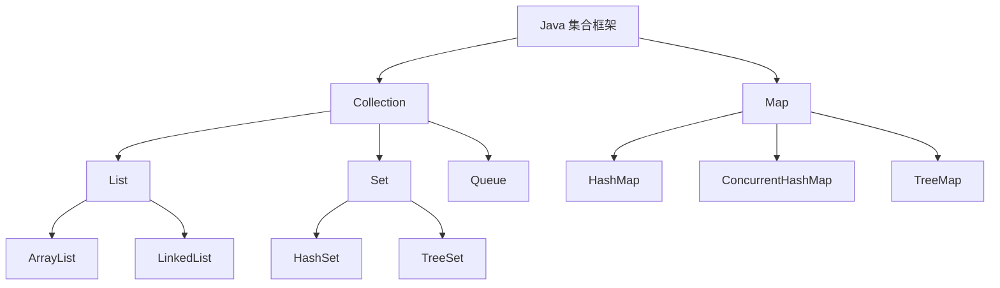

# JAVASE

> **模块**：11_后端八股/01_JAVASE.md  
> **来源**：购买资料 A（10 个源文件）— 集合/反射/深浅拷贝/异常/代理/String/迭代器/泛型/IO模型/JDK新特性  
> **规模**：约 812 行  |  **生成**：2026-11-12  
> **状态**：已合并（多源合一）

## 本篇包含

01. 集合
02. 反射
03. 深拷贝浅拷贝
04. 异常机制
05. 代理
06. String相关
07. 迭代器
08. 泛型
09. IO模型
10. JDK新特性

## 01 集合

对于集合的考察，面试官比较喜欢上来先问你自己在项目中会用什么集合，怎么用的

这种类型的问题其实很常见，因为可以考察你的知识广度和深度，回答的时候要从两方面回答

1. **先大而广地罗列一下，讲一下主要区别**

> 📝 面试官你好， Java 集合框架主要分为两条主线，**Collection**接口和**Map** 接口 ，**Collection** 下主要有三个子接口：**List**（有序、可重复）、**Set**（无序、唯一）和 **Queue**（队列），**Map** 接口则是存储键值对（Key-Value）的结构。
> 在具体实现上，常用的有 `ArrayList`、`LinkedList`、`HashSet`、`TreeSet`，以及最核心的 `HashMap`、`ConcurrentHashMap` 和 `TreeMap`

1. **然后有侧重地介绍自己比较熟悉的**

> 📝 比如我项目里面规则树的实现，为了在决策过程中实现 O(1) 级别的节点跳转，我用Hashmap来存储节点 ID 与其对应逻辑实体的映射关系。

1. **在这之后面试官就会顺着你讲的展开了，这样子面试的节奏就是你的了**

集合的话我比较推荐看hashmap，因为hashmap的八股是集合里比较有深度的，可以展示你的水平

类似的问题也有会出现在redis八股的考察，会问你redis有哪些数据结构，你在项目中会用什么，怎么用。

### ArrayList与LinkedList的区别

- **底层结构**：

  - **ArrayList** 基于**动态数组**。它在内存中是**连续存储**的。
  - **LinkedList** 基于**双向链表**（JDK1.7 之后）。它的节点在内存中是**分散存储**的，通过指针连接。
- **性能差异**：

  - **查询**：ArrayList 支持**随机访问**，通过下标能直接算出地址，复杂度是 **O(1)**。LinkedList 需要从头遍历，复杂度是 **O(n)**。
  - **增删**：
  
    - LinkedList 在**已知节点**的情况下，增删只需改动指针，是 **O(1)**。
    - ArrayList 如果在中间增删，需要挪动后续所有元素，是 **O(n)**。

> 🔎 **追问1：你在项目中怎么选这两种数据结构**

- 绝大多数场景（90%）我都会选 **ArrayList**。

  - **原因**：除了支持快速查询，ArrayList 的**连续内存**对 CPU 缓存（Cache Line）非常友好，遍历速度极快。而 LinkedList 内存分散，容易造成缓存未命中。
  - 只有在‘需要频繁在头部或中间插入删除，且几乎不随机访问’的极少数特殊场景下，我才会考虑 LinkedList。”

> 🔎 追问2： 你说 LinkedList 插入更快，那我在 List 中间插入 1000 万条数据，谁更快？

这要看情况。 如果是用 `for` 循环根据下标 `i` 去插入，**ArrayList 反而更快**。 因为 LinkedList 每次都要 `get(i)` 遍历找到位置，这一步就是 O(n)，总复杂度变成 O(n^2)。 只有用 **Iterator** 遍历并插入，LinkedList 才能发挥 O(1) 插入的优势。

> 🔎 追问3：  ArrayList 是线程安全的吗？如果不安全怎么办 ？

不安全。多线程下建议使用 `CopyOnWriteArrayList`（适合读多写少）或者用 `Collections.synchronizedList` 包装一下

### ArrayList的扩容机制

ArrayList 的扩容主要发生在 `add` 操作时。

1. **初始化**：在 JDK 1.8 中，如果使用无参构造器，它初始化的是一个**空数组**（懒加载）。只有当第一次 `add` 添加元素时，才会初始化为默认容量 **10**。
2. **触发条件**：当当前元素个数等于数组容量时，就会触发扩容。
3. **增长策略**：新容量通常是旧容量的 **1.5 倍**。

   - *源码细节*：`int newCapacity = oldCapacity + (oldCapacity >> 1);` （右移一位相当于除以 2）。
4. **数据迁移**：计算好新容量后，底层会调用 `Arrays.copyOf`（本质是 `System.arraycopy`），在堆中创建一个新数组，把老数据复制过去，然后丢弃老数组。

> 🔎 追问1：  既然扩容需要复制数组，效率很低，怎么优化

最直接的优化就是**预估容量**。 如果我能预知列表大概要存 1000 个对象，我就直接 `new ArrayList<>(1000)`。 这样就避免了中间多次的扩容（10 -> 15 -> 22...），既省了时间也减少了数组碎片的产生。

### HashMap的底层原理（重要）

HashMap 的底层结构在JDK 1.7 和 1.8 中是有区别的，我分开来讲，JDK 1.7采用的是**数组+链表**的结构，而 JDK 1.8 做了优化，采用了**数组+链表+红黑树**的结构。

**具体的插入流程（put）是这样的**

1. 首先，根据 Key 计算 Hash 值，经过扰动函数处理后，通过(数组长度-1) & 键的哈希值 公式确定它在数组中的下标。
2. 如果该位置为空，直接插入。
3. 如果该位置已经有数据了（发生Hash冲突），会遍历链表检查Key是否存在：

   - 如果Key相同，就覆盖Value。
   - 如果Key不同，JDK 1.8 会判断当前节点是链表还是红黑树。如果是链表，采用**尾插法**追加到末尾；如果是红黑树，则调用树的插入方法。
4. **重点是**，在 JDK 1.8 中，当链表长度超过 8 且数组长度大于等于 64 时，链表会转换为红黑树，这样能将查找复杂度从 O(n) 降低到 O(log n)，解决链表过长导致的性能下降问题。

> 🔎 追问1： 为什么 JDK 1.8 要用尾插法？1.7 的头插法有什么问题

JDK 1.7 用头插法是因为作者认为最新插入的数据被访问的概率更大。 但在**多线程并发扩容**时，头插法会改变链表的顺序，容易导致**环形链表**，从而引发死循环（CPU 100%）。 1.8 改用尾插法，扩容后链表顺序保持不变，就解决了这个问题。

> 🔎 **追问2： HashMap的扩容机制是怎么样的（重要）**

HashMap 默认初始容量是 **16**，加载因子是 **0.75**。 当元素数量超过 `容量 * 0.75` 时，就会触发扩容，容量变为原来的**2倍**。 扩容时需要重新计算每个元素在数组中的位置。不过 JDK 1.8 做了优化，不需要重新 Hash，只需要看 hash 值新增的那一位比特是 0 还是 1。如果是 0，位置不变；如果是 1，位置变为 `原索引 + 原容量`。这样效率更高。

**帮助理解的例子**


> 🔎 追问3：为什么 HashMap 的容量必须是 2 的幂

为了支持两个优化：

1. **极速寻址**：只有当容量是 2 的幂时，`hash % 容量` 才能等价于位运算 `hash & (容量 - 1)`，位运算比取模快得多。
2. **扩容优化**：就是刚才讲的，利用高位比特判断位置，避免重新 Hash。

> 🔎 追问4： HashMap 是线程安全的吗

HashMap **不是**线程安全的。在多线程环境下使用它，主要会产生两个严重问题：

1. **数据丢失（覆盖）**：这是最常见的问题。

   - 在 JDK 1.7 和 1.8 中都存在。当两个线程同时进行 `put` 操作，并且 Key 的 Hash 值冲突时，它们可能会同时判断“当前位置为空”。
   - 于是，线程 A 刚准备插入，线程 B 抢先插入了。等线程 A 恢复执行时，它不知道该位置已经被占了，就会直接写入，把线程 B 的数据**覆盖**掉。
2. **死循环（CPU 100%）**：这是 JDK 1.7 的经典 Bug。

   - JDK 1.7 在扩容时采用的是**头插法**。
   - 在并发扩容时，如果链表结构被破坏，可能会导致链表成环（A指向B，B又指向A）。
   - 当下次 `get` 操作遍历这个链表时，程序就会进入死循环，导致服务器 CPU 飙升。
   - *补充*：虽然 JDK 1.8 改用了**尾插法**解决了死循环问题，但数据覆盖的问题依然存在，所以它依然是不安全的。

补充，生产环境要使用线程安全的map有三种方案

1. **Hashtable**：虽然安全，但它给所有方法都加了 `synchronized`，锁粒度太粗，全表只有一把锁，效率极低，现在基本没人用了。
2. **Collections.synchronizedMap**：它是对 HashMap 做了一层包装，本质上也是用 synchronized 锁住整个 Map，并发性能依然不高。
3. **ConcurrentHashMap**：这是**最佳选择**。它通过降低锁粒度（分段锁或节点锁）实现了高效的并发。

### ConcurrentHashMap的实现原理

ConcurrentHashMap 的核心思想是**分而治之**，尽量缩小锁的范围。JDK 1.7 和 1.8 的实现差异很大：

**1. JDK 1.7：分段锁**

- **结构**：它由一个 `Segment` 数组组成。每个 `Segment` 本质上继承了 `ReentrantLock`。
- **原理**：它把一个大的 HashMap 切分成了 16 个小段（Segment）。
- **并发度**：理论上支持 16 个线程并发写入，只要它们访问的是不同的段，就不会互斥。
- *缺点*：并发度受限于 Segment 的个数，且 Segment 对象本身占用不少内存。

**2. JDK 1.8：CAS + Synchronized**

- **结构**：摒弃了 Segment，结构和 HashMap 1.8 一样（数组+链表+红黑树）。
- **原理**：

  - 它**直接锁链表/红黑树的头节点**。
  - **如果是第一次插入**（桶为空）：利用 **CAS** (Compare And Swap) 指令进行无锁插入，速度极快。
  - **如果发生冲突**（桶不为空）：使用 **synchronized** 锁住当前桶的头节点。
- **优势**：锁粒度细化到了每一个 Node（桶）。只要 Hash 不冲突，几千个线程都能并发写，性能比 1.7 提升巨大。”

> 🔎 追问1： 为什么 JDK 1.8 要把 ReentrantLock 换成 synchronized？synchronized 不是性能很差吗

这其实是一个误区。

1. **JDK 优化**：从 JDK 1.6 开始，JVM 对 synchronized 做了大量优化（偏向锁、轻量级锁、锁消除等），在低竞争下，它的性能已经不输 ReentrantLock 了。
2. **节省内存**：ReentrantLock 需要创建额外的 Segment 对象，而 synchronized 直接锁住 Node 对象头，不需要额外内存。
3. **自动释放**：synchronized 自动释放锁，而 Lock 必须手动 unlock，代码更简洁安全。

> 🔎 追问2：ConcurrentHashMap 的 Key 和 Value 能为 null 吗？为什么？

**坚决不能**（HashMap 可以）。

**原因**：主要是为了避免**二义性**（Ambiguity）。 假设我 `map.get(key)` 返回了 null。

- 在单线程（HashMap）中，我可以再调用 `map.containsKey(key)` 来确认是‘没这个键’还是‘值为 null’。
- 但在多线程（ConcurrentHashMap）中，这两次调用之间，可能有另一个线程把数据改了。所以我没法判断最初那个 null 到底是什么意思。 为了系统健壮性，并发集合直接禁止了 null。

#### 图解补充：集合体系与选型



| 结构 | 底层 | 查询 | 中间插入/删除 | 线程安全 | 典型场景 |
|-|-|-|-|-|-|
| `ArrayList` | 动态数组 | 快，`O(1)` | 慢，可能搬迁元素 | 否 | 绝大多数业务列表 |
| `LinkedList` | 双向链表 | 慢，`O(n)` | 已知节点时快 | 否 | 极少数频繁头尾插入 |
| `HashMap` | 数组+链表/红黑树 | 平均快，`O(1)` | 插入快 | 否 | 普通 KV 映射 |
| `ConcurrentHashMap` | 数组+链表/红黑树 | 平均快，`O(1)` | 并发写更稳 | 是 | 并发缓存、共享状态 |
| `TreeMap` | 红黑树 | `O(log n)` | `O(log n)` | 否 | 需要有序键 |

#### 图解补充：HashMap put 与扩容


#### 高频追问补充

> 🔎 **追问补充1：为什么实际开发里 LinkedList 用得很少？**

主要是因为它理论上的插入优势，往往会被遍历定位成本抵消。再加上链表节点分散，CPU 缓存命中率差，真实业务里通常 `ArrayList` 更快也更省内存。

> 🔎 **追问补充2：HashMap 为什么链表转红黑树的阈值是 8？**

这个值本质上是时间复杂度和空间开销之间的折中。链表太短时直接转树不划算，链表太长又会拉低查询性能，所以 JDK 选择在冲突较严重时再树化，同时要求数组长度至少 64，优先先扩容而不是立刻树化。

> 🔎 **追问补充3：面试里怎么回答集合选型更像工程实践？**

可以按这个顺序回答：

1. 先讲业务形态，是列表、去重、队列还是 KV 映射。
2. 再讲读多写多、是否需要排序、是否并发访问。
3. 最后给出具体实现和原因，比如 `ArrayList + HashMap`、`ConcurrentHashMap`、`TreeMap`。

#### 速记版

> 📝 集合面试可以按这条线背：
> - 先分 `Collection` 和 `Map`
> - `List` 常问 `ArrayList vs LinkedList`
> - `Map` 常问 `HashMap`、扩容、线程安全
> - 并发场景收口到 `ConcurrentHashMap`
> 一句话记忆：
> `ArrayList` 看查询和遍历，`LinkedList` 看节点插删，`HashMap` 看寻址和扩容，`ConcurrentHashMap` 看并发控制。

## 02 反射

反射是 Java 能够成为动态语言的关键，也是**所有主流框架（Spring、MyBatis）的基石**

**所以如果考察反射，很多时候会跟spring/mybatis一起考察**

### 什么是反射？它有什么用？

> 💡 Q：什么是 Java 反射机制？你在哪里用过？

> ✅ **A：**
> **反射**的本质是：**在运行状态中，对于任意一个类，都能够知道这个类的所有属性和方法；对于任意一个对象，都能够调用它的任意方法和属性。** 简单来说，就是把 Java 类中的各种成分（成员变量、方法、构造器等）映射成一个个 Java 对象（Field、Method、Constructor）。
> **至于用途**，虽然我在写业务代码时很少直接写反射，但我用的**所有框架**底层都在用反射。 比如 **Spring 的 IOC（控制反转）**，它读取 XML 或注解配置，通过反射实例化 Bean 并注入依赖； 还有 **MyBatis**，它也是通过反射将数据库结果集映射成 Java 对象的。

反射的原理：

其实比较好理解，java中有一个核心类， java.lang.Class

当 JVM 加载一个 `.class` 文件时，会在堆内存中产生一个代表这个类的 `Class` 对象。这个对象包含了该类的完整结构信息（类名、包名、父类、接口、方法、属性等）。程序员可以通过操作这个 `Class` 对象，动态地获取信息或执行操作。

> 🔎 追问1： 反射机制有什么优缺点

**优点**是**灵活性极高**。它允许程序在运行时动态加载类，这使得我们可以编写通用的框架代码，不需要在编译期就将被调用的类写死。

**缺点**主要有两个：

1. **性能开销**：反射涉及动态解析，JVM 无法对这些代码进行极致的 JIT 优化，所以比直接调用要慢（虽然现在 JDK 优化得已经很快了，但在高频调用场景下仍需注意）。
2. **安全隐患**：反射可以绕过泛型检查，甚至通过 `setAccessible(true)` 访问私有成员，可能会破坏类的封装性。

### 获取 Class 对象的几种方式

> 💡 Q： 获取 Class 对象有哪几种方式？它们有什么区别？

> ✅ **A：**
> 主要有三种方式：
> 1. `Class.forName("全类名")`：这是最常用的方式，通常用于读取配置文件加载类（比如 JDBC 加载驱动）。它需要捕获异常。
> 2. `类名.class`：这种方式最简单，但需要编译期就导入该类，一般用于参数传递（比如 `new ArrayList<>(String.class)`）。
> 3. `对象.getClass()`：必须要有实例化后的对象才能用。
> **区别在于**：`Class.forName()` 是动态加载，最灵活；`类名.class` 是静态加载；`getClass()` 依赖实例。在编写框架或通用工具时，第一种用得最多。

## 03 深拷贝浅拷贝

### 反射

反射是 Java 能够成为动态语言的关键，也是**所有主流框架（Spring、MyBatis）的基石**

**所以如果考察反射，很多时候会跟spring/mybatis一起考察**

### 什么是反射？它有什么用？

> 💡 Q：什么是 Java 反射机制？你在哪里用过？

> ✅ **A：**
> **反射**的本质是：**在运行状态中，对于任意一个类，都能够知道这个类的所有属性和方法；对于任意一个对象，都能够调用它的任意方法和属性。** 简单来说，就是把 Java 类中的各种成分（成员变量、方法、构造器等）映射成一个个 Java 对象（Field、Method、Constructor）。
> **至于用途**，虽然我在写业务代码时很少直接写反射，但我用的**所有框架**底层都在用反射。 比如 **Spring 的 IOC（控制反转）**，它读取 XML 或注解配置，通过反射实例化 Bean 并注入依赖； 还有 **MyBatis**，它也是通过反射将数据库结果集映射成 Java 对象的。

反射的原理：

其实比较好理解，java中有一个核心类， java.lang.Class

当 JVM 加载一个 `.class` 文件时，会在堆内存中产生一个代表这个类的 `Class` 对象。这个对象包含了该类的完整结构信息（类名、包名、父类、接口、方法、属性等）。程序员可以通过操作这个 `Class` 对象，动态地获取信息或执行操作。

> 🔎 追问1： 反射机制有什么优缺点

**优点**是**灵活性极高**。它允许程序在运行时动态加载类，这使得我们可以编写通用的框架代码，不需要在编译期就将被调用的类写死。

**缺点**主要有两个：

1. **性能开销**：反射涉及动态解析，JVM 无法对这些代码进行极致的 JIT 优化，所以比直接调用要慢（虽然现在 JDK 优化得已经很快了，但在高频调用场景下仍需注意）。
2. **安全隐患**：反射可以绕过泛型检查，甚至通过 `setAccessible(true)` 访问私有成员，可能会破坏类的封装性。

### 获取 Class 对象的几种方式

> 💡 Q： 获取 Class 对象有哪几种方式？它们有什么区别？

> ✅ **A：**
> 主要有三种方式：
> 1. `Class.forName("全类名")`：这是最常用的方式，通常用于读取配置文件加载类（比如 JDBC 加载驱动）。它需要捕获异常。
> 2. `类名.class`：这种方式最简单，但需要编译期就导入该类，一般用于参数传递（比如 `new ArrayList<>(String.class)`）。
> 3. `对象.getClass()`：必须要有实例化后的对象才能用。
> **区别在于**：`Class.forName()` 是动态加载，最灵活；`类名.class` 是静态加载；`getClass()` 依赖实例。在编写框架或通用工具时，第一种用得最多。

### 深拷贝浅拷贝

这部分内容其实是考察**Java 内存模型（堆/栈）** 的理解。

面试官想听到的关键词是：**引用地址**vs**实际对象**。

### 深拷贝和浅拷贝的核心区别

> 💡 Q：  什么是深拷贝和浅拷贝？它们的区别是什么？

> ✅ **A：**
> 面试官你好。 这两者的核心区别在于**对‘引用类型’成员变量的处理方式不同**。
> 1. **浅拷贝**：
> 
>    - 它只复制对象本身，对于对象内部的引用类型变量（比如对象里有个 `List`），它**只复制了引用的地址**，没有复制引用的对象。
>    - **后果**：原对象和新对象指向堆内存中的**同一个实体**。修改新对象的 List，原对象的 List 也会跟着变。
>    - Java 中默认的 `Object.clone()` 方法就是浅拷贝。
> 2. **深拷贝**：
> 
>    - 它不仅复制对象本身，还会**递归地复制**对象内部所有引用指向的对象。
>    - **后果**：原对象和新对象在内存中是**完全独立**的。修改其中一个，互不影响。

### 如何实现深拷贝

> 💡 Q：在项目中，如果让你实现一个对象的深拷贝，你会怎么做？

> ✅ **A：**
> 虽然理论上可以通过重写 `clone()` 方法，在里面手动对每个引用对象再次调用 clone 来实现，但这在实际开发中**非常不推荐**。因为代码太繁琐，容易漏写，且维护成本高。
> 在工程实践中，我通常使用**序列化**来实现深拷贝。具体有两种方式：
> 1. **JSON 序列化（推荐）**：
> 
>    - 这是最常用的方法。利用 Jackson 或 FastJson 把对象转成 JSON 字符串，再转回 Java 对象。
>    - 比如：`User copy = JSON.parseObject(JSON.toJSONString(original), User.class);`
>    - 优点是代码简单，通用性强。
> 2. **Java 原生序列化**：
> 
>    - 让对象实现 `Serializable` 接口，然后通过**字节流**写出去再读回来。
>    - 这种方式比较重，但在处理一些不支持 JSON 转换的复杂对象时（比如对象里有循环引用）会用到。

### String与浅拷贝

> 💡 Q：String 也是引用类型，那为什么我在浅拷贝一个对象后，修改 String 字段，原对象没变呢？

> ✅ **A：**
> String 是引用类型，浅拷贝时复制的也是地址。 但是，**String 是不可变类**。 当我修改副本的 String 属性时（比如 `user.name = "NewName"`），**并非**修改了堆内存中原来的那个字符串对象，而是**指向了一个新的字符串对象**。 原对象的引用依然指向老的字符串，所以看起来互不影响。

## 04 异常机制

异常机制这块很适合面试官连续追问，通常会从 `Exception 和 Error 区别` 开始，一路问到受检异常、运行时异常、`throw/throws`、`finally`。

### Error 和 Exception 的区别

> 💡 **Q：Error 和 Exception 有什么区别？**

> 📝 它们都继承自 `Throwable`，但语义完全不同。
> **Error** 通常表示系统级、JVM 级的问题，比如：
> - `OutOfMemoryError`
> - `StackOverflowError`
> 这类问题一般不是业务代码能优雅恢复的，所以通常不建议捕获后继续运行。
> **Exception** 则更多表示程序运行过程中的异常情况，往往是可以通过代码处理的，比如：
> - 文件不存在
> - 参数非法
> - 空指针
> - 数组越界
> 所以一句话总结就是：  
> **Error 更偏“系统已经出大问题了”，Exception 更偏“程序要显式处理异常场景”。**

### 受检异常和运行时异常

> 💡 **Q：受检异常和运行时异常的区别是什么？**

> 📝 Java 的异常大致可以分为两类：
> **第一类是受检异常（Checked Exception）**。  
> 这类异常在编译期就会被检查，方法如果可能抛出它，要么 `try-catch`，要么在方法签名里 `throws`。
> 常见的比如：
> - `IOException`
> - `SQLException`
> - `ClassNotFoundException`
> **第二类是运行时异常（RuntimeException）**。  
> 这类异常不强制在编译期处理，通常代表代码逻辑本身有问题。
> 常见的比如：
> - `NullPointerException`
> - `ArrayIndexOutOfBoundsException`
> - `ClassCastException`
> 所以可以把它理解为：  
> **受检异常强调“外部环境可能出错”，运行时异常更强调“代码本身写得有问题”。**

### throw 和 throws 的区别

> 💡 **Q：throw 和 throws 有什么区别？**

> 📝 `throw` 和 `throws` 都和异常相关，但位置和作用完全不同。
> **throw** 用在方法体内部，表示主动抛出一个具体异常对象。
> ```java
> throw new IllegalArgumentException("参数非法");
> ```
> **throws** 用在方法签名上，表示这个方法可能抛出哪些异常。
> ```java
> public void read() throws IOException {
> }
> ```
> 所以一句话记忆：
> - `throw` 是“真的抛”
> - `throws` 是“先声明可能会抛”

### finally 一定会执行吗

> 💡 **Q：finally 中的代码一定会执行吗？**

> 📝 大多数正常场景下，`finally` 都会执行，所以它很适合写资源释放逻辑。
> 但它**不是绝对一定执行**，典型例外包括：
> - 在 `try` 中调用了 `System.exit()`
> - JVM 直接崩溃
> - 程序死机、断电
> - 线程陷入死循环，根本没有机会走到 `finally`
> 所以更准确的说法是：  
> **在 JVM 还能正常继续执行控制流的前提下，finally 基本都会执行。**

> 🔎 **追问1：finally 里写 return 有什么问题？**

不推荐。  
因为它会覆盖 `try` 或 `catch` 里的返回值，代码可读性很差，也容易埋坑。  
面试里最好直接表态：**finally 应该只做清理动作，不要写 return。**

### 异常处理的最佳实践

> 💡 **Q：项目里你是怎么设计异常体系的？**

> 📝 如果是在项目里，我一般会这样设计：
> - 业务异常和系统异常分开
> - 自定义业务异常，承载错误码和错误信息
> - Controller 层统一做全局异常处理
> - 日志里保留上下文信息，但不给前端暴露内部堆栈
> 也就是说，异常处理要做到两件事：
> - 对用户或调用方来说，返回的信息清晰、稳定
> - 对开发排障来说，日志信息充分、可追踪

## 05 代理

### JDK 动态代理& CGLIB

> 💡 Q：了解动态代理吗？JDK 动态代理和 CGLIB 有什么区别？

> ✅ A：
> 面试官你好，动态代理主要用于在**不修改源码**的情况下，对方法进行功能增强（比如加日志、事务控制），它是 Spring AOP 的底层基石。 在 Java 中主要有两种实现方式：
> 1. **JDK 动态代理**：这是 Java 原生提供的。
> 
>    - 它的核心是 `Proxy` 类和 `InvocationHandler` 接口。
>    - **特点是**：它要求被代理的类**必须实现接口**。因为它生成的代理对象默认继承了 `Proxy` 类，利用反射机制调用目标方法。
> 2. **CGLIB 动态代理**：这是一个第三方高性能代码生成包。
> 
>    - 它在内存中动态生成一个被代理类的**子类**。
>    - **特点是**：它**不要求实现接口**，是通过**继承**的方式来重写父类方法实现增强的。

### 为什么 JDK 代理必须基于接口

> 💡 Q： 为什么 JDK 动态代理强制要求目标类必须实现接口？不能像 CGLIB 那样直接代理类吗？

> ✅ A：
> 这主要受限于 **Java 的单继承机制**。 因为 JDK 动态代理生成的那个Proxy代理类，它在底层代码中已经**显式继承了** `java.lang.reflect.Proxy`**这个父类。 Java 语法规定，一个类只能有一个父类。既然它已经继承了**`Proxy` **类，就无法再继承业务目标类了。 所以，它只能通过实现接口**的方式来与目标类建立联系，这就是为什么 JDK 代理必须基于接口的原因。

> 🔎 追问1：那 CGLIB 基于继承机制，有什么缺点或者限制吗

的。 因为 CGLIB 是通过生成**子类**并**重写方法**来实现代理的。 在 Java 中，`final` 修饰的方法和类是无法被继承或重写的。 所以，如果目标类被标记为 `final`，或者目标方法被标记为 `final`，CGLIB 就无法对它进行代理（增强会失效），这是使用继承机制天然的局限性。

### 静态代理 vs 动态代理

> 💡 Q：静态代理和动态代理有什么区别？

> ✅ A：
> **静态代理**是指在编译期就已经写好了代理类的 `.java` 文件。 比如我写一个 `UserProxy` 类，手动实现 `UserService` 接口，在内部调用 `Target` 的方法前后打印日志。 它的缺点很明显：**代码冗余**。如果我有 100 个 Service 需要加日志，我就得写 100 个代理类，维护成本极高。
> **动态代理**则是把这个过程推迟到了**运行期**。 我们不需要手动写代理类，而是让 JVM（JDK）或者字节码框架（CGLIB）在内存中自动生成代理类的字节码。 这样我们只需要写一套通用的增强逻辑，就能应用到成千上万个不同的类上，实现了代码的**解耦**和**复用**。

## 06 String相关

String 是 Java 面试里非常高频的基础题，常见考法一般是：底层结构、为什么不可变、字符串常量池、以及和 `StringBuffer`、`StringBuilder` 的区别。

### String 的底层实现

> 💡 **Q：String 底层是怎么实现的？JDK1.8 和 JDK1.9 之后有什么区别？**

> 📝 在 **JDK1.8 之前**，String 底层主要是 `char[]`。  
> 在 **JDK1.9 之后**，底层改成了 `byte[] + coder` 的方式，也就是所谓的紧凑字符串（Compact Strings）。
> 这样做的原因是：很多字符串其实只需要 Latin-1 编码，一个字节就够了。  
> 如果继续统一使用 `char[]`，每个字符两个字节，会造成额外的内存浪费。
> 所以 JDK1.9 之后，String 更关注 **节省内存占用**。

### String 为什么不可变

> 💡 **Q：为什么 String 被设计成不可变的？**

> 📝 String 设计成不可变，核心原因主要有三个：
> **第一是安全性。**  
> 字符串常用于类加载、数据库连接、网络地址、用户名密码等敏感场景。  
> 如果 String 可变，那么一个方法拿到字符串引用后，可能在外部被偷偷改掉，这会带来很大的安全风险。
> **第二是线程安全。**  
> String 不可变后，多线程之间共享同一个字符串对象时，不需要额外同步。
> **第三是便于缓存和复用。**  
> 比如字符串常量池、字符串哈希值缓存，都依赖于“内容一旦创建就不变”这个前提。

> 🔎 **追问1：String 不可变是怎么做到的？**

主要靠两点：

- 底层存储数组是私有的，外部拿不到可直接修改的入口
- String 类本身是 `final`，不能被继承后破坏语义

所以可以理解为：**既不让你改内部状态，也不让子类改规则。**

### 字符串常量池

> 💡 **Q：什么是字符串常量池？有什么好处？**

> 📝 字符串常量池是堆中的一块特殊区域，用于复用内容相同的字符串常量。
> 比如：
> ```java
> String s1 = "hello";
> String s2 = "hello";
> ```
> 这里 `s1` 和 `s2` 指向的是常量池中的同一个对象。
> 这样做的好处主要是：
> - 节省内存
> - 避免重复创建对象
> - 提升字符串比较和使用效率
> 本质上，它是 JVM 基于“String 不可变”做的一种缓存优化。

> 🔎 **追问1：`new String("hello")` 会创建几个对象？**

这取决于常量池里原来有没有 `"hello"`。

- 如果常量池没有，那么会先在常量池中创建一个，再在堆中创建一个 `new String` 对象，一共两个。
- 如果常量池已经有了，那么只会在堆里再创建一个对象，一共一个新对象。

### intern 方法

> 💡 **Q：`intern()` 方法是做什么的？**

> 📝 `intern()` 的作用是尝试把字符串对象和常量池中的字符串关联起来。
> 如果常量池中已经有相同内容的字符串，就返回池中的引用；  
> 如果没有，就把该字符串放入常量池（或让池中记录这个引用）并返回池中的引用。
> 因此它常用于：
> - 大量重复字符串的去重
> - 需要统一引用语义的场景
> 但也不能滥用，因为如果字符串非常多且重复率不高，反而会增加常量池压力。

### String、StringBuffer、StringBuilder 的区别

> 💡 **Q：String、StringBuffer、StringBuilder 有什么区别？**

> 📝 三者最核心的区别在于 **可变性**和**线程安全**。
> **String**：
> - 不可变
> - 因为不可变，所以天然线程安全
> - 适合字符串内容基本不变的场景
> **StringBuffer**：
> - 可变
> - 方法大多带同步，线程安全
> - 适合多线程下频繁修改字符串，但性能相对一般
> **StringBuilder**：
> - 可变
> - 不保证线程安全
> - 单线程下拼接性能最好，也是开发中最常用的可变字符串类
> 如果面试官问项目中怎么选，我的回答会很直接：  
> **单线程拼接优先用 StringBuilder；多线程且共享时再考虑 StringBuffer；普通常量或少量拼接直接用 String。**

### String 的长度限制

> 💡 **Q：String 有长度限制吗？**

> 📝 有，但编译期和运行期要分开看。
> **编译期**，字符串字面量会进入 class 文件常量池，对应 `CONSTANT_Utf8_info` 结构，这一层有长度限制。
> **运行期**，String 的底层长度本质上受数组长度和 JVM 可用内存限制，不是说能无限大。
> 面试里这里不用展开得太底层，知道“存在限制，而且编译期和运行期的限制来源不同”就够了。

## 07 迭代器

### 为什么要有 Iterator？for-each 循环的本质

> 💡 Q： Java 既然已经有 for 循环了，为什么还要设计 Iterator？平时用的增强 for 循环（for-each）和它有什么关系？

> ✅ A：
> **Iterator 的主要作用是‘统一’和‘解耦’**。 不同的集合底层结构不同，比如 ArrayList 是数组，LinkedList 是链表，HashSet 是哈希表。如果没有 Iterator，我就需要了解每种集合的内部结构才能遍历它（比如数组用下标，链表用指针）。 Iterator 提供了一套**统一的 API**（hasNext、next），让我不需要关心容器的底层实现就能遍历所有集合。
> 至于**增强 for 循环（for-each）**，它其实就是 Java 提供的一个**语法糖**。 在编译成字节码后，它本质上还是被转成了 **Iterator** 的调用。所以用 for-each 遍历 List，本质上就是在用 Iterator。

原理：

- **设计模式**：这是典型的**迭代器模式**。提供一种方法顺序访问一个聚合对象中的各个元素，而又不暴露其内部的表示。
- **语法糖验证**：可以查看 `.class` 反编译后的代码，会发现 `for(String s : list)` 变成了 `while(iterator.hasNext()) { ... }`。

> 🔎 追问1：那既然 for-each 底层就是 Iterator，为什么我在 for-each 里面删除元素会报错

虽然 for-each 底层是 Iterator，但它**隐藏了迭代器对象**。 当我们调用 `list.remove()` 删除元素时，集合的结构改变了，但背后的那个隐形迭代器并不知道，它的预期状态和实际状态不一致了，所以下一次循环时就会触发 **Fail-Fast** 机制，抛出异常。 如果要在遍历中删除，必须显式获取 Iterator 对象，并调用 `iterator.remove()`。

### Fail-Fast机制

> 💡 Q：什么是 Fail-Fast 机制？它是怎么检测到并发修改的？

> ✅ **Fail-Fast（快速失败）** 是 Java 集合的一种错误检测机制。它的初衷是：**一旦发现数据可能不一致，立马抛异常，宁可停止程序也不给出错误结果**。
> 实现原理是基于一个变量 `modCount`：
> 1. 集合类（如 ArrayList）内部有一个 `modCount` 变量，用来记录集合**被修改的次数**（add/remove 都会让它 +1）。
> 2. 当我们创建迭代器时，迭代器内部会复制一份 `modCount`，记为 `expectedModCount`。
> 3. 此后每次调用 `iterator.next()`，迭代器都会检查：`modCount` 是否等于 `expectedModCount`？
> 4. 如果不相等，说明在迭代期间，集合被其他代码（或者多线程）修改了，于是直接抛出 `ConcurrentModificationException`。

> 🔎 追问1： Fail-Fast 是线程安全的吗？有没有不抛异常的集合

Fail-Fast **不是**线程安全的，它只是尽力检测错误，不能作为并发控制的手段。 如果需要**Fail-Safe（安全失败）的集合，可以使用 `java.util.concurrent` 包下的类，比如 CopyOnWriteArrayList。 它的原理是写时复制**，遍历的是原数组的快照，修改的是新数组，所以永远不会抛出并发修改异常，但可能读不到最新的数据（弱一致性）。

## 08 泛型

### 什么是泛型？什么是类型擦除？

> 💡 Q： 谈谈你对 Java 泛型的理解？什么是类型擦除？

> ✅ A：
> 泛型的主要目的是为了**增强代码的类型安全**和**重用性**。 在没有泛型之前，我们从集合中取对象必须强制转换，容易抛出 `ClassCastException`。有了泛型，编译器就能帮我们做类型检查。
> Java 的泛型其实是**伪泛型**，这是通过**类型擦除）实现的。 简单来说，Java 的泛型只存在于编译阶段**。 当编译器把 `.java` 翻译成 `.class` 文件时，它会把所有的泛型参数（如 `<T>`, `<String>`）都擦除掉

### 【拓展】 通配符与 PECS 原则

> 💡 **Q：**`List`**、**`List` 和 `List` 有什么区别？平时怎么用？

> ✅ A：这三个都是泛型的通配符，区别主要在于**读写权限**不同，使用时遵循 **PECS 原则**（Producer Extends, Consumer Super）：
> 1. `? extends T`**（上界通配符）**：
> 
>    - 表示集合里装的是 T 的**子类**。
>    - **特点**：只能**读**（取出来一定是 T），不能**写**（因为不知道具体是哪个子类，怕类型不匹配）。
>    - **适用**：它适合作为**生产者（Producer）**，也就是只读数据的场景。
> 2. `? super T`**（下界通配符）**：
> 
>    - 表示集合里装的是 T 的**父类**。
>    - **特点**：可以**写**（可以安全地放入 T 及其子类），但**读**出来只能是 Object（类型丢失）。
>    - **适用**：它适合作为**消费者（Consumer）**，也就是写入数据的场景。
> 3. `?`**（无界通配符）**：
> 
>    - 等价于 `? extends Object`，通常只用于只读且不关心具体类型的场景。

## 09 IO模型

IO 模型这块在 Java 八股里，最常见的就是 `BIO / NIO / AIO`，以及“同步异步、阻塞非阻塞”的区别。

### BIO、NIO、AIO 的区别

> 💡 **Q：BIO、NIO、AIO 分别是什么？有什么区别？**

> 📝 如果只抓面试最核心的区别，我会这样总结：
> **BIO** 是同步阻塞 IO。  
> 线程发起读写后，会一直阻塞等待结果返回。模型简单，但高并发下一个连接往往就要占一个线程，线程资源很容易成为瓶颈。
> **NIO** 是同步非阻塞 IO。  
> 它引入了 `Channel`、`Buffer`、`Selector` 等概念，可以基于 IO 多路复用，让一个线程同时管理多个连接。
> **AIO** 是异步非阻塞 IO。  
> 应用发起 IO 请求后，不需要主动轮询，等底层完成后通过回调通知应用继续处理。
> 所以三者的主线可以理解为：
> - BIO：简单，但扩展性差
> - NIO：工程里更常见，适合高并发网络编程
> - AIO：理论上更先进，但在 Java 生态里使用没有 NIO 普遍

### 同步和异步

> 💡 **Q：同步和异步怎么理解？**

> 📝 同步和异步，强调的是 **任务结果的获取方式**。
> **同步** 是我发起一个调用后，要等这个调用完成，才能继续往下走。  
> **异步** 是我发起调用后，不必原地等待，后续通过通知、回调、Future 等方式拿结果。
> 所以同步异步的核心不是“线程会不会卡住”，而是：  
> **调用方是不是必须自己等结果。**

### 阻塞和非阻塞

> 💡 **Q：阻塞和非阻塞怎么理解？**

> 📝 阻塞和非阻塞，强调的是 **线程在等待结果时的状态**。
> **阻塞**：线程会挂起等待，期间不能干别的事。  
> **非阻塞**：线程发起请求后，如果条件不满足，会立刻返回，线程可以继续做别的事。
> 所以阻塞非阻塞的核心是：  
> **等待期间线程是不是被卡住。**

> 🔎 **追问1：同步一定阻塞吗？异步一定非阻塞吗？**

不一定。  
这是面试里特别爱考的点。

- 同步不一定阻塞，比如同步轮询也可以是非阻塞的
- 异步也不一定完全非阻塞，某些框架内部仍然可能用阻塞线程池来承接任务

所以这两组概念不是同一维度。

### Java 工程里怎么回答这类题

> 💡 **Q：项目里如果面试官问你 NIO 的实际价值，你会怎么答？**

> 📝 我会从“为什么需要它”来回答。
> 在高并发网络场景下，如果继续沿用 BIO，就会出现“一连接一线程”的问题。  
> 当连接数很大、请求里还夹杂大量阻塞等待时，线程数量会迅速膨胀，带来上下文切换和内存开销。
> NIO 通过 Selector 把多个连接复用到少量线程上处理，因此更适合：
> - Netty 这类网络框架
> - 网关、IM、RPC 通信
> - 高并发长连接场景
> 所以 NIO 的实际价值，本质上是：  
> **用更少的线程支撑更多连接。**

## 10 JDK新特性

JDK 新特性的考察，一般不是让你背版本号，而是看你能不能说出“这个特性解决了什么问题、适合什么场景、项目里是否真用过”。

### JDK5 到 JDK8 的核心变化

> 💡 **Q：JDK5、JDK8 分别有哪些你觉得最重要的新特性？**

> 📝 面试官你好，如果只抓面试里最常见、最有代表性的特性，我会这样回答：
> **JDK5**重点是引入了**泛型、枚举、注解、自动装箱拆箱**。  
> 其中泛型和注解影响最大，前者提升了类型安全，后者为 Spring 这种框架式开发打下了基础。
> **JDK8**重点是**Lambda 表达式、Stream 流、Optional、接口默认方法、时间 API**。  
> 这一版最核心的变化，是 Java 开始明显吸收函数式编程思想，让集合处理、空值处理和时间处理更现代化。
> 如果从“项目里最常用”的角度看，JDK8 的几个特性几乎是现在 Java 开发的标配。

### Lambda 表达式

> 💡 **Q：什么是 Lambda 表达式？它解决了什么问题？**

> 📝 Lambda 表达式本质上是 **对匿名内部类的简化**，它的核心价值是：**把函数当成参数传递**。
> 以前如果我想给集合排序、给线程池提交任务、给 Stream 做过滤，往往需要写很多模板化代码；  
> 有了 Lambda 之后，可以把关注点放在“做什么”，而不是“怎么写一个匿名类”。
> 比如：
> ```java
> list.sort((a, b) -> a.getAge() - b.getAge());
> ```
> 相比传统匿名内部类，代码更短，可读性也更强。

> 🔎 **追问1：Lambda 的底层是匿名内部类吗？**

不是简单地等价于匿名内部类。  
JVM 层面主要借助 `invokedynamic` 指令和 `LambdaMetafactory` 来实现，因此它不是每次都真的生成一个新的匿名类文件。

你可以把它理解为：**语法层面像匿名类，运行时实现更轻量、更灵活**。

### Stream 流

> 💡 **Q：Stream 流的核心价值是什么？**

> 📝 Stream 流的核心价值，是把集合处理从“命令式写法”变成“声明式写法”。
> 传统写法里，我们往往要自己写 `for` 循环、判断条件、临时变量；  
> 而 Stream 更强调“我要过滤什么、映射什么、聚合什么”。
> 常见操作包括：
> - `filter`：过滤
> - `map`：转换
> - `sorted`：排序
> - `collect`：收集
> - `count`：统计
> 例如：
> ```java
> List<String> names = users.stream()
>         .filter(user -> user.getAge() > 18)
>         .map(User::getName)
>         .sorted()
>         .collect(Collectors.toList());
> ```
> 它的优势是代码表达力强，尤其适合做列表筛选、转换、统计类场景。

> 🔎 **追问1：Stream 一定比 for 循环快吗？**

不一定。  
如果只是简单遍历，`for` 循环往往更直接，性能未必差。  
Stream 的核心优势主要是 **可读性、链式表达、便于组合操作**。

如果是非常高频、极度关注性能的热点路径，还是要以压测结果为准，不能机械地说 Stream 一定更好。

### Optional

> 💡 **Q：Optional 是干什么的？为什么它能减少空指针问题？**

> 📝 Optional 是一个“可能有值，也可能没值”的容器类。  
> 它的意义不是彻底消灭 `null`，而是 **强迫开发者显式处理空值**。
> 例如以前我们可能这样写：
> ```java
> if (user != null && user.getAddress() != null) {
>     ...
> }
> ```
> 而使用 Optional 后，可以写成更清晰的链式处理。
> 它比较适合：
> - 返回值可能为空的方法
> - 多层对象取值时的空值兜底
> - 需要默认值、异常抛出、条件分支时

> 🔎 **追问1：Optional 适合当实体类字段吗？**

一般不推荐。  
Optional 更适合作为**方法返回值**，而不是实体类字段或 RPC 传输字段。  
因为这样会增加序列化、框架兼容、代码理解上的复杂度。

### JDK21 的虚拟线程

> 💡 **Q：你了解 JDK21 的虚拟线程吗？**

> 📝 虚拟线程可以理解成由 JVM 管理的轻量级线程。  
> 传统平台线程是 **一个 Java 线程对应一个操作系统线程**，创建和切换成本都比较高；  
> 而虚拟线程是 **大量用户态线程复用少量平台线程**，因此更适合高并发、阻塞等待多的场景。
> 它特别适合：
> - 大量 IO 阻塞任务
> - 一请求一线程模型
> - 需要提升并发量，但不想手动把代码改造成异步回调风格
> 它的优势主要是：
> - 创建成本低
> - 切换成本低
> - 编程模型仍然接近同步代码，心智负担比手写异步低

> 🔎 **追问1：虚拟线程会完全替代线程池吗？**

不会这么绝对。  
虚拟线程更适合“高并发 IO 阻塞”场景，但 CPU 密集型任务的瓶颈仍然是 CPU 本身。  
如果是计算型任务，线程数量仍然不能无限增加。

所以更准确的说法是：**虚拟线程降低了阻塞型并发编程的成本，但没有消灭线程模型和资源调度的基本约束。**

---

## 来源档案（原始文件，仅供溯源）

- `04_后端八股整理/00_JAVASE/00_集合.md`
- `04_后端八股整理/00_JAVASE/01_反射.md`
- `04_后端八股整理/00_JAVASE/02_深拷贝浅拷贝.md`
- `04_后端八股整理/00_JAVASE/03_异常机制.md`
- `04_后端八股整理/00_JAVASE/04_代理.md`
- `04_后端八股整理/00_JAVASE/05_String相关.md`
- `04_后端八股整理/00_JAVASE/06_迭代器.md`
- `04_后端八股整理/00_JAVASE/07_泛型.md`
- `04_后端八股整理/00_JAVASE/08_IO模型.md`
- `04_后端八股整理/00_JAVASE/09_JDK新特性.md`
