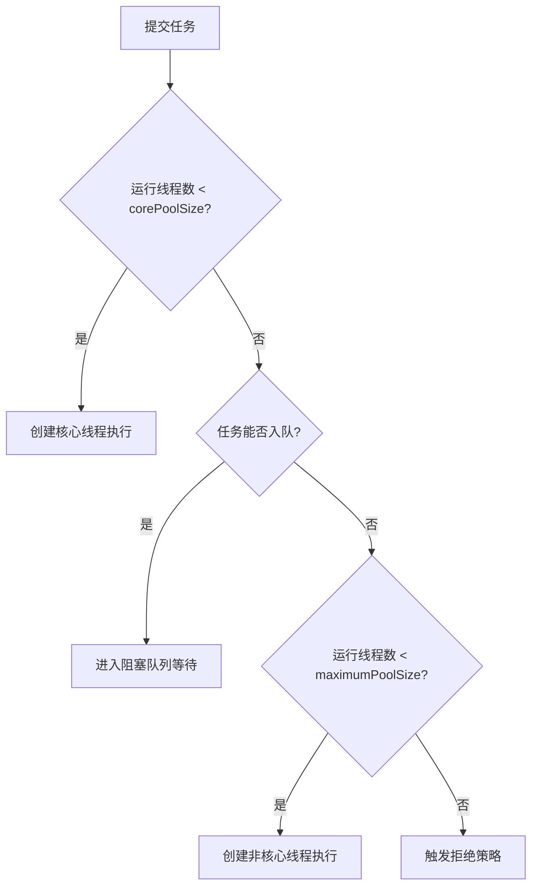

# JUC

> **模块**：11_后端八股/02_JUC.md  
> **来源**：购买资料 A（9 个源文件）— 线程基础/volatile/ThreadLocal/线程池/AQS/CAS/synchronized/并发题/JMM  
> **规模**：约 980 行  |  **生成**：2026-11-12  
> **状态**：已合并（多源合一）

## 本篇包含

01. 线程基础
02. volatile关键字
03. ThreadLocal
04. 线程池
05. AQS原理
06. CAS与原子类
07. synchronized与Lock
08. 并发经典题
09. 线程安全与JMM

## 01 线程基础

线程基础题通常是 JUC 面试的开场题，面试官会先确认你对线程状态、创建方式、常见方法这些最基础的概念是否清楚。

### 线程的创建方式

> 💡 **Q：Java 创建线程有哪些方式？**

> 📝 常见的创建线程方式主要有四种：
> **第一种，继承 Thread 类。**  
> 直接重写 `run()` 方法，简单直观，但耦合度高，不够灵活。
> **第二种，实现 Runnable 接口。**  
> 这是更常见的方式，因为它把“任务”和“线程”解耦了。
> **第三种，实现 Callable 接口配合 FutureTask。**  
> 它适合有返回值、还能抛异常的异步任务。
> **第四种，通过线程池创建线程。**  
> 这是生产环境最推荐的方式，因为线程池可以复用线程、统一管理资源。
> 如果面试官问项目里怎么用，我会直接回答：**生产环境优先线程池，不会手动频繁 new Thread。**

### 线程的状态流转

> 💡 **Q：Java 线程有哪些状态？**

> 📝 Java 在线程状态上，`Thread.State` 枚举里定义了六种：
> - `NEW`
> - `RUNNABLE`
> - `BLOCKED`
> - `WAITING`
> - `TIMED_WAITING`
> - `TERMINATED`
> 比较容易混淆的是：
> **RUNNABLE** 不等于“此刻一定正在 CPU 上运行”，它表示线程已经具备运行资格，可能在运行，也可能在等待 CPU 调度。
> **BLOCKED** 一般是抢锁失败。  
> **WAITING** 一般是调用了 `wait()`、`join()` 等无限等待方法。  
> **TIMED_WAITING** 一般是 `sleep()`、带超时的 `wait()`、带超时的 `join()`。

### start 和 run 的区别

> 💡 **Q：`start()` 和 `run()` 有什么区别？**

> 📝 `run()` 只是普通方法调用，不会启动新线程。  
> `start()` 才会真正创建新的执行路径，让 JVM 去调度这个线程，然后由新线程去执行 `run()` 方法。
> 所以如果直接调用 `run()`，本质上还是主线程自己在执行。

### sleep 和 wait 的区别

> 💡 **Q：sleep 和 wait 有什么区别？**

> 📝 这是一个特别经典的对比题。
> **sleep** 是 `Thread` 类的方法。  
> 它表示让当前线程休眠一段时间，但 **不会释放锁**。
> **wait** 是 `Object` 类的方法。  
> 它必须在同步代码块里调用，调用后线程会进入等待状态，并且 **会释放当前持有的对象锁**。
> 所以一句话记：
> - `sleep`：线程休眠，不释放锁
> - `wait`：线程等待，释放锁

## 02 volatile关键字

volatile 是并发编程中的高频考点，面试官通常会从"volatile 有什么作用"切入，然后深挖可见性、重排序等底层原理。

### volatile的作用

> 💡 **Q：volatile 关键字有什么作用？**

> 📝 面试官你好，volatile 主要有两个作用：
> 第一个是**保证可见性**。当一个线程修改了 volatile 变量的值，这个新值会立即刷新到主内存，其他线程读取这个变量时，会从主内存中读取最新值，而不是使用自己工作内存中的旧值。
> 第二个是**禁止指令重排序**。编译器和处理器为了优化性能，可能会对指令进行重排序，但 volatile 通过内存屏障，禁止特定类型的重排序，保证代码按照我们预期的顺序执行。
> 需要注意的是，volatile **不能保证原子性**，这是它和 synchronized 的一个重要区别。

> 🔎 **追问1：什么是可见性问题？为什么会出现？**

可见性问题是指一个线程修改了共享变量的值，其他线程无法立即看到这个修改。

出现这个问题的原因是，现代计算机为了提高性能，每个 CPU 核心都有自己的缓存。线程在读取变量时，会先从自己的工作内存（缓存）中读取，而不是直接从主内存读取。当一个线程修改了变量，可能只是修改了自己缓存中的值，还没有刷新到主内存，其他线程的缓存中还是旧值，就会出现可见性问题。

举个例子，比如我有一个 `boolean flag = false`，线程 A 把它改成 true，但线程 B 可能一直读到 false，导致程序出现意外的行为。给 flag 加上 volatile 关键字就能解决这个问题。

### volatile的底层原理

> 💡 **Q：volatile 是如何保证可见性和禁止重排序的？**

> 📝 面试官你好，volatile 的底层实现依赖于**内存屏障**（Memory Barrier）。
> 对于可见性，当写一个 volatile 变量时，JMM（Java 内存模型）会在写操作后插入一个 Store 屏障，强制将缓存中的数据刷新到主内存。当读一个 volatile 变量时，JMM 会在读操作前插入一个 Load 屏障，强制从主内存中读取最新值，使工作内存中的缓存失效。
> 对于禁止重排序，volatile 通过内存屏障，禁止了几种重排序：写 volatile 变量之前的操作不能重排序到写操作之后，读 volatile 变量之后的操作不能重排序到读操作之前。这样就保证了代码的执行顺序符合我们的预期。

> 🔎 **追问1：什么是指令重排序？为什么要重排序？**

指令重排序是指编译器和处理器为了优化性能，可能会改变指令的执行顺序，但会保证单线程下的执行结果不变。

重排序的目的是提高 CPU 的执行效率，减少流水线停顿。但在多线程环境下，重排序可能导致程序出现意外的结果，所以在某些关键位置，我们需要用 volatile 来禁止重排序。

### volatile不能保证原子性

> 💡 **Q：volatile 能保证原子性吗？为什么？**

> 📝 面试官你好，volatile **不能保证原子性**。
> 我举个例子，比如 `count++` 这个操作，看起来是一条语句，但实际上包含三个步骤：读取 count 的值、将 count 的值加 1、将新值写回 count。
> 在多线程环境下，可能出现这样的情况：线程 A 和线程 B 同时读取 count = 0，然后都计算出 1，最后都写回 1。这样执行了两次 count++，但最终 count 只等于 1，而不是期望的 2。
> 如果要保证原子性，我们需要使用 synchronized 或者 Lock，或者使用 AtomicInteger 这样的原子类。

> 🔎 **追问1：什么情况下 volatile 可以保证线程安全？**

当满足以下两个条件时，volatile 可以保证线程安全：

第一，对变量的写操作不依赖当前值，比如直接赋值 `flag = true`，而不是 `count++` 这种依赖当前值的操作。

第二，该变量不需要与其他变量共同参与不变约束。

典型的场景就是用 volatile 修饰一个布尔变量作为状态标志，或者在双重检查锁定（DCL）单例模式中使用。

### volatile与synchronized的区别

> 💡 **Q：volatile 和 synchronized 有什么区别？**

> 📝 面试官你好，volatile 和 synchronized 的区别主要有以下几点：
> 首先，**作用范围不同**。volatile 只能修饰变量，而 synchronized 可以修饰方法和代码块。
> 其次，**原子性不同**。volatile 不能保证原子性，synchronized 可以保证原子性。但它们都能保证可见性和有序性。
> 第三，**性能不同**。volatile 是轻量级的同步机制，性能更好，不会阻塞线程。synchronized 是重量级的同步机制，可能会阻塞线程，但 JDK 1.6 之后做了很多优化，性能也提升了不少。
> 最后，**使用场景不同**。volatile 适用于一写多读的场景，比如状态标志。synchronized 适用于需要原子性的场景，比如 count++ 这种操作。
> 总结一下，能用 synchronized 就用 synchronized，除非只需要保证可见性，不需要原子性，那用 volatile 就够了。

> 🔎 **追问1：既然 synchronized 功能更强大，为什么还要用 volatile？**

因为 volatile 的性能更好，开销更小。如果我只需要保证可见性，不需要原子性，用 volatile 就够了，没必要用 synchronized 增加额外的开销。

### volatile的典型应用场景

> 💡 **Q：volatile 有哪些典型的应用场景？**

> 📝 面试官你好，volatile 的典型应用场景主要有两个：
> 第一个是**状态标志**。最常见的就是用 volatile 修饰一个布尔变量，作为线程的停止标志。比如我有一个 `volatile boolean stop = false`，在线程的 run 方法里用 `while (!stop)` 循环执行任务，当其他线程调用 `stop = true` 时，执行任务的线程能立即看到这个修改，退出循环。
> 第二个是**双重检查锁定（DCL）单例模式**。在单例模式中，我们会用 `volatile` 修饰 instance 变量。这是因为 `instance = new Singleton()` 这行代码实际上包含三个步骤：分配内存空间、初始化对象、将 instance 指向分配的内存地址。由于指令重排序，可能变成先分配内存、再指向内存、最后初始化对象。如果线程 A 执行到指向内存这一步时，线程 B 进入第一次检查，发现 instance 不为 null，直接返回，但此时对象还没有初始化完成，就会出现空指针异常。volatile 的作用就是禁止这种重排序，保证对象初始化完成后，才将引用赋值给 instance。

> 🔎 **追问1：DCL 单例模式中，为什么要双重检查？**

第一次检查是在 synchronized 外面，目的是避免每次调用 getInstance() 都进入同步块，提高性能。如果 instance 已经初始化了，直接返回，不需要加锁。

第二次检查是在 synchronized 里面，目的是防止多个线程同时通过第一次检查，进入同步块后，重复创建实例。

比如线程 A 和 B 同时调用 getInstance()，都通过了第一次检查，然后线程 A 先获取锁，创建了实例。线程 B 获取锁后，如果不进行第二次检查，就会再创建一个实例，这就违背了单例模式的初衷。

## 03 ThreadLocal

ThreadLocal 是 JUC 中的高频考点，面试官通常会问"ThreadLocal 是什么"，然后深挖内存泄漏问题。

### ThreadLocal是什么

> **Q：ThreadLocal 是什么？有什么作用？**

> 📝 面试官你好，ThreadLocal 是 Java 提供的一个**线程局部变量**工具类。它的作用是让每个线程都拥有自己独立的变量副本，线程之间互不干扰。
> 简单来说，就是我在 ThreadLocal 里存一个值，线程 A 存的是 A 的值，线程 B 存的是 B 的值，它们互相看不到对方的值，这样就避免了线程安全问题。
> 典型的使用场景有这么几个：第一个是**数据库连接管理**，每个线程持有自己的数据库连接。第二个是**用户信息传递**，在 Web 应用中，把用户信息存在 ThreadLocal 里，整个请求链路都能访问。第三个是**SimpleDateFormat**，因为 SimpleDateFormat 不是线程安全的，可以用 ThreadLocal 让每个线程持有自己的实例。

> 🔎 **追问1：为什么不直接用局部变量，要用 ThreadLocal？**

局部变量确实是线程安全的，但它的作用域只在方法内部。如果我想在整个线程的多个方法之间共享数据，又不想通过参数传递，就可以用 ThreadLocal。

比如在 Web 应用中，我在 Filter 里把用户信息存到 ThreadLocal，然后在 Service、Dao 等各层都能直接获取，不需要层层传递参数。

### ThreadLocal的底层原理

> 💡 **Q：ThreadLocal 的底层实现原理是什么？**

> 📝 面试官你好，ThreadLocal 的底层实现其实挺巧妙的。
> 每个 **Thread 对象**内部都有一个 **ThreadLocalMap** 属性，这个 Map 的 Key 是 ThreadLocal 对象，Value 是我们存储的值。
> 当我们调用 `threadLocal.set(value)` 时，实际上是：
> 1. 获取当前线程的 ThreadLocalMap
> 2. 把 ThreadLocal 对象作为 Key，value 作为 Value，存到这个 Map 里
> 当我们调用 `threadLocal.get()` 时，实际上是：
> 1. 获取当前线程的 ThreadLocalMap
> 2. 用 ThreadLocal 对象作为 Key，从 Map 里取出 Value
> 所以，数据实际上是存在**线程对象**里的，而不是 ThreadLocal 对象里。这样每个线程都有自己的 Map，自然就隔离了。

> 🔎 **追问1：ThreadLocalMap 和 HashMap 有什么区别？**

ThreadLocalMap 和 HashMap 虽然都是 Map，但实现上有很大区别：

第一个是**解决冲突的方式不同**。HashMap 用的是链表法（或红黑树），而 ThreadLocalMap 用的是**开放地址法**（线性探测）。当发生 Hash 冲突时，ThreadLocalMap 会往后找下一个空位置。

第二个是**Key 的类型不同**。ThreadLocalMap 的 Key 是 **WeakReference**，也就是弱引用，这是为了防止内存泄漏。

第三个是**扩容机制不同**。HashMap 的扩容阈值是 0.75，而 ThreadLocalMap 的扩容阈值是 2/3。

### ThreadLocal的内存泄漏问题

> 💡 **Q：ThreadLocal 会导致内存泄漏吗？为什么？**

> 📝 面试官你好，ThreadLocal **可能会导致内存泄漏**，这是一个很经典的问题。
> 我先说一下原因：ThreadLocalMap 的 Key 是 **WeakReference**（弱引用），Value 是**强引用**。
> 当 ThreadLocal 对象没有外部强引用时，在 GC 时，Key 会被回收，变成 null。但是 Value 还是强引用，不会被回收。这样就会出现 Key 为 null，但 Value 还在的情况，这个 Value 就永远访问不到了，但又占着内存，这就是内存泄漏。
> 而且，如果使用的是线程池，线程会被复用，线程对象不会被回收，ThreadLocalMap 也不会被回收，这些泄漏的 Value 就会一直存在，越积越多。

> 🔎 **追问1：为什么 Key 要设计成弱引用？**

这是为了**降低内存泄漏的风险**。

如果 Key 是强引用，那么即使外部没有对 ThreadLocal 的引用了，ThreadLocalMap 里还持有强引用，ThreadLocal 对象就永远不会被回收。这样不仅 ThreadLocal 对象泄漏了，Value 也泄漏了。

用弱引用的话，至少 ThreadLocal 对象可以被回收，只是 Value 可能泄漏。而且 ThreadLocalMap 在 set、get、remove 时，会主动清理 Key 为 null 的 Entry，这样可以一定程度上缓解内存泄漏。

> 🔎 **追问2：如何避免 ThreadLocal 的内存泄漏？**

最佳实践是：**用完之后一定要调用 remove() 方法**。

```java
ThreadLocal<User> userThreadLocal = new ThreadLocal<>();

try {
    userThreadLocal.set(user);
    // 业务逻辑
} finally {
    userThreadLocal.remove();  // 必须调用 remove
}
```

在 Web 应用中，通常在 Filter 或拦截器的 finally 块中调用 remove()，确保请求结束后清理 ThreadLocal。

另外，如果可以的话，尽量把 ThreadLocal 定义成 **static final** 的，这样 ThreadLocal 对象本身不会被回收，就不会出现 Key 为 null 的情况。

### ThreadLocal的使用场景

> 💡 **Q：ThreadLocal 有哪些典型的使用场景？**

> 📝 面试官你好，ThreadLocal 的典型使用场景主要有这么几个：
> **第一个是数据库连接管理**。在传统的 JDBC 编程中，每个线程需要持有自己的数据库连接，可以用 ThreadLocal 来存储。这样在事务管理时，同一个线程的多个 DAO 操作可以共享同一个连接。
> **第二个是用户信息传递**。在 Web 应用中，我们可以在 Filter 或拦截器里把用户信息（如用户 ID、用户名）存到 ThreadLocal，然后在 Controller、Service、Dao 等各层都能直接获取，不需要层层传递参数。Spring Security 就是这么做的。
> **第三个是 SimpleDateFormat**。SimpleDateFormat 不是线程安全的，如果多个线程共享一个实例，会出现问题。可以用 ThreadLocal 让每个线程持有自己的 SimpleDateFormat 实例。
> **第四个是分布式追踪的 TraceId**。在微服务架构中，我们会给每个请求分配一个 TraceId，用于追踪整个调用链路。这个 TraceId 可以存在 ThreadLocal 里，方便在日志中打印。

> 🔎 **追问1：你在项目中是怎么用 ThreadLocal 的？**

在我的项目中，主要用 ThreadLocal 来传递用户信息。

我们在网关层会解析 JWT Token，获取用户 ID 和用户名，然后通过 HTTP Header 传递给下游服务。下游服务在拦截器里把用户信息存到 ThreadLocal，这样在整个请求处理过程中，任何地方都能通过 `UserContext.getUserId()` 获取当前用户信息，不需要在每个方法里传递 userId 参数。

在拦截器的 finally 块中，我们会调用 `UserContext.clear()` 来清理 ThreadLocal，避免内存泄漏。

### ThreadLocal的注意事项

> 💡 **Q：使用 ThreadLocal 有哪些注意事项？**

> 📝 面试官你好，使用 ThreadLocal 主要有这么几个注意事项：
> **第一个是一定要记得 remove**。这是最重要的，尤其是在使用线程池的场景下，线程会被复用，如果不 remove，上一个请求的数据可能会影响下一个请求。
> **第二个是不要存储大对象**。因为 ThreadLocal 的数据是存在线程对象里的，如果存储的对象很大，会占用大量内存。而且在线程池场景下，线程不会被回收，这些大对象会一直占着内存。
> **第三个是注意父子线程的数据传递**。ThreadLocal 的数据是线程隔离的，子线程无法访问父线程的 ThreadLocal 数据。如果需要传递，可以使用 **InheritableThreadLocal**。
> **第四个是避免在异步场景下使用**。比如在一个线程里设置了 ThreadLocal，然后提交了一个异步任务到线程池，异步任务是在另一个线程执行的，就拿不到 ThreadLocal 的值了。如果需要传递，可以使用阿里的 **TransmittableThreadLocal**。

> 🔎 **追问1：InheritableThreadLocal 是什么？**

InheritableThreadLocal 是 ThreadLocal 的子类，它可以让**子线程继承父线程的 ThreadLocal 数据**。

实现原理是：在创建子线程时，会把父线程的 InheritableThreadLocal 数据复制一份给子线程。

但是要注意，InheritableThreadLocal 只在**创建子线程时**复制数据。如果使用线程池，线程是复用的，不会重新创建，就无法传递数据了。这种情况需要用阿里的 TransmittableThreadLocal。

## 04 线程池

线程池是 JUC 中**面试出现频率最高**的知识点，几乎是必问题。

面试官通常会从"你项目中怎么用线程池"切入，然后深挖底层原理、参数配置、拒绝策略等。

### 为什么要使用线程池

> 💡 **Q：为什么要使用线程池？有什么好处？**

> 📝 面试官你好，使用线程池主要有三大好处：
> 第一个是**降低资源消耗**。因为线程的创建和销毁是有开销的，需要调用操作系统内核。线程池通过复用已创建的线程，避免了频繁创建销毁的开销。
> 第二个是**提高响应速度**。任务到达时，不需要等待线程创建，可以立即执行。
> 第三个是**提高线程的可管理性**。线程是稀缺资源，如果无限制创建，会消耗系统资源，甚至导致系统崩溃。线程池可以统一分配、调优和监控线程。

### ThreadPoolExecutor的七大参数

> 💡 **Q：ThreadPoolExecutor 有哪些核心参数？分别是什么作用？**

> 📝 面试官你好，ThreadPoolExecutor 有**七个核心参数**：
> 我详细说一下这七个参数：
> 第一个是 **corePoolSize（核心线程数）**，它表示线程池中常驻的线程数量。即使这些线程处于空闲状态，也不会被回收，除非设置了 `allowCoreThreadTimeOut`。
> 第二个是 **maximumPoolSize（最大线程数）**，它表示线程池允许创建的最大线程数量。当任务队列满了，且当前线程数小于最大线程数时，会创建新线程处理任务。
> 第三个是 **keepAliveTime（空闲线程存活时间）**，当线程数超过核心线程数时，多余的空闲线程在被回收前的最大等待时间。
> 第四个是 **unit（时间单位）**，就是 keepAliveTime 的时间单位，比如 `TimeUnit.SECONDS`。
> 第五个是 **workQueue（任务队列）**，用于存放等待执行的任务。常见的有 `ArrayBlockingQueue`（有界队列）、`LinkedBlockingQueue`（无界队列，默认容量是 Integer.MAX_VALUE）、还有 `SynchronousQueue`（不存储元素的队列，每个插入操作必须等待一个移除操作）。
> 第六个是 **threadFactory（线程工厂）**，用于创建新线程。我们可以自定义线程名称、优先级等。
> 第七个是 **handler（拒绝策略）**，当任务队列满了，且线程数达到最大值时，如何处理新提交的任务。

### 线程池的工作流程

> 💡 **Q：线程池的执行流程是怎样的？**

> 📝 面试官你好，线程池的执行流程可以总结为以下几步：
> 首先，我们调用 `execute()` 或 `submit()` 提交任务。
> 然后，线程池会判断当前运行的线程数是不是小于核心线程数。如果小于，就直接创建新线程执行任务，即使有空闲线程也会创建新的。
> 如果当前运行的线程数大于等于核心线程数，任务会被放入任务队列等待。
> 如果任务队列已满，且当前线程数小于最大线程数，就会创建新的非核心线程执行任务。
> 最后，如果任务队列满了，且线程数已达到最大值，就会执行拒绝策略。
> 我画个流程图可能更清楚：

> 🔎 **追问1：为什么线程数小于核心线程数时，即使有空闲线程也要创建新线程？**

这是线程池的设计策略。核心线程是"常驻"的，线程池会尽快达到核心线程数，以保证有足够的线程处理任务。这样可以避免任务在队列中等待，提高响应速度。

### 四种拒绝策略

> 💡 **Q：线程池有哪些拒绝策略？分别适用什么场景？**

> 📝 面试官你好，JDK 提供了**四种**内置的拒绝策略：
> 第一个是 **AbortPolicy（默认）**，它会直接抛出异常 `RejectedExecutionException`。这个适用于需要感知任务被拒绝的情况，及时发现问题。
> 第二个是 **CallerRunsPolicy**，它会由调用线程（提交任务的线程）自己执行任务。这个适用于任务不能丢失，且可以接受降低提交速度的场景。这种策略会降低任务提交的速度，起到一定的限流作用。
> 第三个是 **DiscardPolicy**，它会直接丢弃任务，不抛异常。这个适用于允许任务丢失的场景，比如日志记录。
> 第四个是 **DiscardOldestPolicy**，它会丢弃队列中最老的任务，然后尝试重新提交当前任务。这个适用于优先处理新任务的场景。

> 🔎 **追问1：生产环境中你会选择哪种拒绝策略？**

这要看具体业务场景：

如果是**核心业务**，比如订单、支付这种，我会使用 **AbortPolicy**，抛异常后可以记录日志、告警，不能让任务悄悄丢失。

如果是**非核心业务**，比如日志、埋点这种，可以用 **DiscardPolicy**，允许部分数据丢失。

如果是**需要限流**的场景，我会用 **CallerRunsPolicy**，让调用线程自己执行，降低提交速度。

### 常见的线程池类型

> 💡 **Q：Executors 提供了哪些常见的线程池？有什么问题？**

> 📝 面试官你好，Executors 工具类提供了几种快速创建线程池的方法：
> 第一个是 **newFixedThreadPool(int n)**，它是固定大小的线程池，核心线程数等于最大线程数等于 n。它使用 `LinkedBlockingQueue`（无界队列）。问题是队列无界，可能导致内存溢出（OOM）。
> 第二个是 **newSingleThreadExecutor()**，它只有一个线程的线程池，也使用 `LinkedBlockingQueue`。同样存在 OOM 风险。
> 第三个是 **newCachedThreadPool()**，它的核心线程数为 0，最大线程数为 `Integer.MAX_VALUE`，使用 `SynchronousQueue`（不存储任务）。问题是可能创建大量线程，导致系统资源耗尽。
> 第四个是 **newScheduledThreadPool(int n)**，它支持定时和周期性任务执行。同样使用无界队列，存在 OOM 风险。

> 🔎 **追问1：为什么阿里巴巴开发手册不推荐使用 Executors 创建线程池？**

主要有两个原因：

第一个是 **FixedThreadPool 和 SingleThreadExecutor** 使用的是 `LinkedBlockingQueue`，默认容量是 `Integer.MAX_VALUE`（约 21 亿）。如果任务提交速度大于处理速度，队列会无限增长，导致内存溢出。

第二个是 **CachedThreadPool** 的最大线程数是 `Integer.MAX_VALUE`，可能创建大量线程，导致 CPU 和内存资源耗尽。

所以推荐的做法是使用 `ThreadPoolExecutor` 手动创建线程池，明确指定核心参数，避免资源失控。比如这样：

```java
ThreadPoolExecutor executor = new ThreadPoolExecutor(
    10,                          // 核心线程数
    20,                          // 最大线程数
    60L,                         // 空闲线程存活时间
    TimeUnit.SECONDS,
    new ArrayBlockingQueue<>(100),  // 有界队列
    new ThreadPoolExecutor.CallerRunsPolicy()  // 拒绝策略
);
```

### 如何合理配置线程池参数

> 💡 **Q：如何合理设置线程池的核心线程数和最大线程数？**

> 📝 面试官你好，线程池参数的配置需要根据**任务类型**来决定：
> **第一种是 CPU 密集型任务**，任务主要消耗 CPU 资源，比如计算、加密这种。推荐配置是核心线程数等于 CPU 核心数加 1。原因是 CPU 密集型任务，线程数过多会导致频繁的上下文切换，反而降低性能。加 1 是为了在某个线程因为偶尔的内存页失效或其他原因暂停时，额外的线程可以顶上。
> **第二种是 IO 密集型任务**，任务主要等待 IO 操作，比如网络请求、数据库查询、文件读写这种。推荐配置是核心线程数等于 CPU 核心数乘以 2，或者 CPU 核心数除以（1 减去阻塞系数）。阻塞系数通常在 0.8 到 0.9 之间，也就是线程有 80% 到 90% 的时间在等待 IO。原因是 IO 密集型任务，线程大部分时间在等待，可以创建更多线程来提高 CPU 利用率。
> **第三种是混合型任务**，建议拆分成 CPU 密集型和 IO 密集型任务，分别用不同的线程池处理。

> 🔎 **追问1：你在项目中是怎么配置线程池的？**

在我的项目中，我会根据实际业务场景来配置：

比如**异步任务处理**，像发送短信、邮件这种，这是典型的 IO 密集型任务。我会设置核心线程数为 20，最大线程数为 50，使用有界队列（比如 `ArrayBlockingQueue(200)`），拒绝策略用 `CallerRunsPolicy`。

如果是**数据计算任务**，这是 CPU 密集型任务。我会设置核心线程数等于 CPU 核心数加 1，最大线程数与核心线程数相同，使用较小的队列。

重点是，生产环境中，我会通过压测和监控（比如线程池的活跃线程数、队列大小、拒绝次数）来动态调整参数，找到最优配置。

### 线程池的关闭

> 💡 **Q：如何正确关闭线程池？shutdown 和 shutdownNow 有什么区别？**

> 📝 面试官你好，线程池提供了两种关闭方法：
> 第一个是 **shutdown()**，这是温柔关闭。它不再接受新任务，但会执行完队列中的所有任务。已提交的任务会继续执行，线程池状态变为 `SHUTDOWN`。
> 第二个是 **shutdownNow()**，这是强制关闭。它不再接受新任务，尝试停止正在执行的任务，并返回队列中未执行的任务列表。它通过调用线程的 `interrupt()` 方法来中断线程，线程池状态变为 `STOP`。
> 推荐的做法是这样：

> 🔎 **追问1：为什么不能直接用 shutdownNow？**

因为 `shutdownNow()` 只是尝试中断线程，但如果任务没有正确处理中断信号（比如没有检查 `Thread.interrupted()`），任务可能无法停止。而且，正在执行的任务可能处理到一半，导致数据不一致。所以生产环境中，优先使用 `shutdown()` 优雅关闭。

#### 图解补充：线程池任务流转



#### 图解补充：参数和队列怎么记

| 维度 | 核心结论 | 面试表达 |
|-|-|-|
| `corePoolSize` | 常驻线程数 | 先保响应，再谈扩容 |
| `maximumPoolSize` | 极限兜底线程数 | 队列扛不住时再扩线程 |
| `workQueue` | 决定是“排队”还是“扩线程” | 队列类型直接影响系统行为 |
| `handler` | 最后的降级策略 | 核心业务不能悄悄丢任务 |
| `keepAliveTime` | 非核心线程回收时间 | 高峰过后及时缩容 |

| 队列 | 特点 | 常见风险 | 适用场景 |
|-|-|-|-|
| `ArrayBlockingQueue` | 有界、数组实现 | 容量太小易拒绝 | 明确限流的业务 |
| `LinkedBlockingQueue` | 默认近似无界 | 任务堆积可能 OOM | 不建议直接无脑用 |
| `SynchronousQueue` | 不存元素，直接交接 | 容易快速拉高线程数 | 短任务、高吞吐 |

#### 高频追问补充

> 🔎 **追问补充1：**`execute()`**和**`submit()` **有什么区别？**

`execute()` 只提交任务，没有返回值；`submit()` 会返回 `Future`，可以拿结果，也会把异常包装到 `Future` 里。面试里一般会补一句：如果要感知异步任务异常，不能只调 `submit()` 不看 `Future`。

> 🔎 **追问补充2：生产里线程池参数怎么定，不要只背公式，怎么回答更靠谱？**

更好的答法是：

1. 先按 CPU 密集型、IO 密集型做初始估算。
2. 队列一定设成有界，先把系统上限卡住。
3. 再结合压测看活跃线程数、队列长度、拒绝次数、任务平均耗时。
4. 最终根据业务 SLA 调整，而不是死背“CPU 核数乘 2”。

> 🔎 **追问补充3：核心业务为什么常选** `AbortPolicy`**或**`CallerRunsPolicy`**？**

因为核心业务最怕“悄悄丢任务”。`AbortPolicy` 适合快速失败并告警，`CallerRunsPolicy` 适合反压，把压力回传给调用方。真正线上系统一般不会选静默丢弃。

#### 速记版

> 📝 线程池可以背成一句话：
> `先开核心线程 -> 再进队列 -> 队列满了再扩线程 -> 还扛不住就拒绝`
> 面试里最容易被追问的四个点：
> - 七大参数
> - 执行流程
> - 拒绝策略
> - 为什么不用 Executors

## 05 AQS原理

AQS 是 JUC 中最核心的底层框架，面试官通常用它来考察候选人对并发编程的理解深度。

### AQS是什么

> 💡 **Q：什么是 AQS？它的作用是什么？**

> 📝 面试官你好，AQS 全称是 **AbstractQueuedSynchronizer**（抽象队列同步器），它是 JUC 包中**最核心的基础框架**。
> AQS 的作用是为实现锁和同步器提供一个**通用的框架**。像 ReentrantLock、Semaphore、CountDownLatch、ReentrantReadWriteLock 这些同步工具，底层都是基于 AQS 实现的。
> AQS 的核心思想是：如果请求的共享资源空闲，就把当前请求资源的线程设置为有效的工作线程，并将共享资源设置为锁定状态。如果请求的共享资源被占用，就需要一套**线程阻塞等待以及被唤醒时锁分配的机制**。AQS 用的是 **CLH 队列锁**（一个虚拟的双向队列）来实现这个机制，将暂时获取不到锁的线程加入到队列中。

> 🔎 **追问1：为什么要有 AQS？直接用 synchronized 不行吗？**

synchronized 是 JVM 层面的，功能比较固定，不够灵活。而 AQS 提供了一个可扩展的框架，让我们可以根据不同的需求实现各种同步器。

比如 ReentrantLock 可以实现公平锁和非公平锁，Semaphore 可以控制并发数量，CountDownLatch 可以实现等待多个线程完成。这些功能用 synchronized 都很难实现，但基于 AQS 就很容易。

### AQS的核心原理

> 💡 **Q：AQS 的核心原理是什么？**

> 📝 面试官你好，AQS 的核心原理主要包括三个部分：
> **第一个是 state 状态**。AQS 内部维护了一个 **volatile int state** 变量，用来表示同步状态。比如在 ReentrantLock 中，state = 0 表示锁空闲，state > 0 表示锁被占用，state 的值表示重入次数。
> **第二个是 CLH 队列**。AQS 内部维护了一个 **FIFO 的双向队列**，用来存放等待获取锁的线程。当线程获取锁失败时，会被封装成一个 Node 节点，加入到队列尾部。当持有锁的线程释放锁时，会唤醒队列中的第一个线程。
> **第三个是独占模式和共享模式**。AQS 支持两种模式：
> - **独占模式（Exclusive）**：同一时刻只有一个线程能获取资源，比如 ReentrantLock。
> - **共享模式（Shared）**：多个线程可以同时获取资源，比如 Semaphore、CountDownLatch。

> 🔎 **追问1：CLH 队列是什么？**

CLH 队列是一种**基于链表的 FIFO 队列**，全称是 Craig, Landin, and Hagersten 队列（三个人名的缩写）。

在 AQS 中，CLH 队列的每个节点（Node）包含：

- **thread**：等待的线程
- **waitStatus**：节点状态（如 CANCELLED、SIGNAL 等）
- **prev**：前驱节点
- **next**：后继节点

当线程获取锁失败时，会被封装成 Node 加入队列尾部。当锁被释放时，会唤醒队列头部的下一个节点。

### AQS的工作流程

> 💡 **Q：AQS 的加锁和释放锁的流程是怎样的？**

> 📝 面试官你好，我以独占模式（比如 ReentrantLock）为例，说一下 AQS 的工作流程：
> **加锁流程（acquire）**：
> 1. 首先，线程调用 `tryAcquire()` 尝试获取锁（这个方法由子类实现）。
> 2. 如果获取成功（state 从 0 变成 1），直接返回，线程获得锁。
> 3. 如果获取失败（state 已经是 1），说明锁被占用，线程会被封装成 Node 节点，加入到 CLH 队列的尾部。
> 4. 加入队列后，线程会进入自旋，再次尝试获取锁。如果前驱节点是头节点，就尝试获取锁。
> 5. 如果还是获取失败，线程会被 `LockSupport.park()` 阻塞，进入等待状态。
> **释放锁流程（release）**：
> 1. 线程调用 `tryRelease()` 释放锁（这个方法由子类实现）。
> 2. 如果释放成功（state 从 1 变成 0），会唤醒 CLH 队列中的第一个等待线程。
> 3. 被唤醒的线程会再次尝试获取锁，如果成功，就从队列中移除，成为新的持有锁的线程。
> 流程图可能更清楚：
> 线程 A 获取锁成功（state: 0 -> 1）
> ↓
> 线程 B 尝试获取锁失败
> ↓
> 线程 B 加入 CLH 队列尾部
> ↓
> 线程 B 被 park 阻塞
> ↓
> 线程 A 释放锁（state: 1 -> 0）
> ↓
> 唤醒队列头部的线程 B
> ↓
> 线程 B 获取锁成功（state: 0 -> 1）

> 🔎 **追问1：为什么加入队列后还要自旋？**

这是一种优化策略。因为如果前驱节点就是头节点，说明当前线程是队列中的第一个等待线程，很可能马上就能获取到锁。这时候自旋一下，可能就获取到了，避免了线程阻塞和唤醒的开销。

如果自旋几次还是获取不到，说明锁的持有时间比较长，这时候再阻塞，避免浪费 CPU 资源。

### ReentrantLock如何基于AQS实现

> 💡 **Q：ReentrantLock 是如何基于 AQS 实现的？**

> 📝 面试官你好，ReentrantLock 内部有一个 **Sync 类**，它继承了 AQS。Sync 又有两个子类：**FairSync（公平锁）和NonfairSync（非公平锁）**。
> **非公平锁的实现**：
> 当调用 `lock()` 时：
> 1. 首先用 CAS 尝试将 state 从 0 改成 1，如果成功，直接获取锁。
> 2. 如果失败，调用 AQS 的 `acquire()` 方法，进入队列等待。
> 在 `tryAcquire()` 方法中：
> 1. 如果 state = 0，再次用 CAS 尝试获取锁（插队）。
> 2. 如果当前线程已经持有锁（state > 0），state 加 1（可重入）。
> 3. 否则返回 false，线程进入队列。
> **公平锁的实现**：
> 公平锁和非公平锁的区别在于：公平锁在 `tryAcquire()` 时，会先检查队列中是否有等待的线程。如果有，当前线程必须排队，不能插队。
> 这就是为什么公平锁性能比非公平锁差，因为多了一次队列检查。

> 🔎 **追问1：state 是如何保证线程安全的？**

state 是用 **volatile** 修饰的，保证了可见性。

修改 state 时，AQS 使用 **CAS（Compare And Swap）** 操作，保证了原子性。CAS 是一种无锁的原子操作，通过硬件指令实现，性能很高。

比如在获取锁时，会用 `compareAndSetState(0, 1)` 来尝试将 state 从 0 改成 1。如果成功，说明获取锁成功；如果失败，说明有其他线程抢先了。

### AQS的共享模式

> 💡 **Q：AQS 的共享模式是怎么实现的？**

> 📝 面试官你好，AQS 的共享模式和独占模式的主要区别在于：**共享模式下，多个线程可以同时获取资源**。
> 典型的例子是 **Semaphore（信号量）**。Semaphore 可以控制同时访问某个资源的线程数量。
> **实现原理**：
> 在共享模式下，state 表示**可用的资源数量**。比如 `new Semaphore(3)` 表示最多允许 3 个线程同时访问。
> 当线程调用 `acquire()` 时：
> 1. 调用 `tryAcquireShared()`，尝试将 state 减 1。
> 2. 如果 state >= 0，获取成功，线程继续执行。
> 3. 如果 state < 0，获取失败，线程加入队列等待。
> 当线程调用 `release()` 时：
> 1. 调用 `tryReleaseShared()`，将 state 加 1。
> 2. 如果队列中有等待的线程，唤醒它们。
> **共享模式的特点**是：当一个线程释放资源后，可能会唤醒**多个**等待的线程，而不是只唤醒一个。

> 🔎 **追问1：CountDownLatch 是如何基于 AQS 实现的？**

CountDownLatch 也是基于 AQS 的共享模式实现的。

在 CountDownLatch 中，state 表示**计数器的值**。比如 `new CountDownLatch(3)` 表示需要等待 3 个线程完成。

当线程调用 `await()` 时：

- 如果 state > 0，线程加入队列等待。
- 如果 state = 0，线程直接返回。

当线程调用 `countDown()` 时：

- 将 state 减 1。
- 如果 state 变成 0，唤醒所有等待的线程。

这样就实现了"等待多个线程完成"的功能。

### AQS的优势

> 💡 **Q：AQS 相比 synchronized 有什么优势？**

> 📝 面试官你好，AQS 相比 synchronized 的优势主要有这么几点：
> **第一个是灵活性更高**。AQS 提供了一个可扩展的框架，我们可以根据不同的需求实现各种同步器。比如公平锁、非公平锁、读写锁、信号量等，这些用 synchronized 都很难实现。
> **第二个是功能更强大**。AQS 支持可中断的锁获取（lockInterruptibly）、超时获取（tryLock(timeout)）、非阻塞获取（tryLock），而 synchronized 只能阻塞等待。
> **第三个是性能更好**。在高并发场景下，AQS 的性能通常比 synchronized 好。虽然 JDK 1.6 后 synchronized 做了很多优化，但 AQS 的灵活性让它在某些场景下性能更优。
> **第四个是支持条件变量**。AQS 支持 Condition，可以实现更复杂的线程协作，比如生产者-消费者模式。synchronized 只有一个等待队列，而 AQS 可以有多个 Condition 队列。

> 🔎 **追问1：什么时候用 AQS，什么时候用 synchronized？**

这要看具体场景：

如果是简单的同步需求，比如保护一个临界区，用 **synchronized** 就够了，代码简单，性能也不差。

如果需要更高级的功能，比如可中断、超时、公平锁、读写锁，就用 **AQS 相关的类**（如 ReentrantLock、ReadWriteLock）。

如果需要实现自定义的同步器，就可以继承 AQS，实现自己的 tryAcquire 和 tryRelease 方法。

> 更新: 2026-01-30 20:59:34  
> 原文: [https://www.yuque.com/u63312805/wnyutc/erxkffw0ggr6bq6c](https://www.yuque.com/u63312805/wnyutc/erxkffw0ggr6bq6c)

## 06 CAS与原子类

CAS、原子类、乐观锁悲观锁通常是一套组合题，面试官很喜欢顺着这一条线往下挖。

### CAS 是什么

> 💡 **Q：什么是 CAS？**

> 📝 CAS 的全称是 **Compare And Swap**，也叫比较并交换。
> 它包含三个值：
> - 内存中的旧值 V
> - 预期值 A
> - 要修改的新值 B
> 执行时会先比较：如果 V == A，就把值更新成 B；如果不相等，说明这段时间被其他线程改过了，本次更新失败。
> 所以它本质上是一种 **无锁的乐观并发控制思想**。

### CAS 的优缺点

> 💡 **Q：CAS 有什么优缺点？**

> 📝 **优点**：
> - 不需要阻塞线程
> - 在低竞争场景下性能很好
> - 避免了传统锁的上下文切换开销
> **缺点**：
> - 高竞争下可能一直自旋，浪费 CPU
> - 只能保证单个共享变量更新的原子性
> - 会有 ABA 问题
> 所以 CAS 并不是万能替代锁，而是更适合“短时间、冲突不高”的更新场景。

### ABA 问题

> 💡 **Q：什么是 ABA 问题？怎么解决？**

> 📝 ABA 问题的意思是：
> 一个线程看到某个值从 A 变成 B，又变回 A。  
> 它会误以为这个值从来没被改过，于是 CAS 成功，但实际上共享变量已经经历过一次变化了。
> 解决方案通常是给值加一个 **版本号**或**时间戳**，也就是“值 + 版本”一起比较。  
> JUC 里常见的实现是 `AtomicStampedReference`。

### 原子类

> 💡 **Q：Java 里有哪些常见原子类？**

> 📝 JUC 里常见的原子类可以分成几类：
> **基础类型原子类**：
> - `AtomicInteger`
> - `AtomicLong`
> - `AtomicBoolean`
> **数组原子类**：
> - `AtomicIntegerArray`
> - `AtomicLongArray`
> **引用原子类**：
> - `AtomicReference`
> - `AtomicStampedReference`
> - `AtomicMarkableReference`
> **字段更新器**：
> - `AtomicIntegerFieldUpdater`
> - `AtomicLongFieldUpdater`
> - `AtomicReferenceFieldUpdater`
> 它们底层大量依赖的就是 CAS。

### 乐观锁和悲观锁

> 💡 **Q：乐观锁和悲观锁怎么理解？**

> 📝 **悲观锁** 的思想是：先假设冲突一定会发生，所以先加锁再操作。  
> 典型代表就是 `synchronized`、`ReentrantLock`、数据库行锁。
> **乐观锁** 的思想是：先假设冲突不太会发生，不先加锁，提交更新时再检查有没有被别人改过。  
> 典型代表就是 CAS、数据库版本号机制。
> 如果冲突频繁，悲观锁往往更稳；  
> 如果冲突不高、操作很短，乐观锁往往效率更高。

## 07 synchronized与Lock

synchronized 和 Lock 是 Java 并发编程中最常用的两种锁机制，面试中经常会被拿来对比。

面试官通常会问"synchronized 和 Lock 有什么区别"，然后深挖锁升级、公平锁、死锁等问题。

### synchronized与Lock的区别

> 💡 **Q：synchronized 和 Lock 有什么区别？**

> 📝 面试官你好，synchronized 和 Lock 的主要区别可以从以下几个维度来看：
> 我详细说一下：
> 第一个是**使用方式**，synchronized 是关键字，使用简单，自动加锁解锁。而 Lock 是接口，需要手动 lock 和 unlock，通常在 finally 块中释放锁。
> 第二个是**锁的获取**，synchronized 只能阻塞等待，无法中断。而 Lock 提供了 `tryLock()`（尝试获取锁）、`tryLock(timeout)`（超时获取）、`lockInterruptibly()`（可中断获取）等方法。
> 第三个是**公平性**，synchronized 是非公平锁，线程获取锁的顺序不确定。而 ReentrantLock 可以在构造时指定是否为公平锁（`new ReentrantLock(true)`）。

> 🔎 **追问1：什么时候用 synchronized，什么时候用 Lock？**

这要看具体场景：

**推荐使用 synchronized 的场景**有这么几种：第一个是锁竞争不激烈的场景。第二个是代码简单，不需要高级功能（如超时、中断、公平锁）。第三个是 JDK 1.6 后，synchronized 性能已经很好，且代码更简洁。

**推荐使用 Lock 的场景**也有几种：第一个是需要**尝试获取锁**（tryLock），避免死锁。第二个是需要**可中断**的锁获取（lockInterruptibly）。第三个是需要**公平锁**，保证线程按顺序获取锁。第四个是需要**读写锁**（ReadWriteLock），读多写少的场景。

总结一下就是：能用 synchronized 就用 synchronized，除非需要 Lock 的高级特性。

### synchronized的底层原理

> 💡 **Q：synchronized 的底层实现原理是什么？**

> 📝 面试官你好，synchronized 的底层实现依赖于 **JVM 的 Monitor（监视器锁）**。
> 我分两种情况来说：
> **第一种是同步代码块**，编译后会在代码块前后插入 `monitorenter` 和 `monitorexit` 指令。`monitorenter` 会尝试获取对象的 Monitor，如果获取成功，锁计数器 +1；如果失败，线程阻塞等待。`monitorexit` 会释放 Monitor，锁计数器 -1，当计数器为 0 时，锁被释放。
> **第二种是同步方法**，方法上加 synchronized 关键字，编译后会在方法的访问标志中添加 `ACC_SYNCHRONIZED` 标记。JVM 在调用方法时，会检查这个标记，自动获取和释放 Monitor。
> **Monitor 的本质**是这样的：每个 Java 对象都有一个 Monitor 对象（对象头中的 Mark Word 指向 Monitor）。Monitor 内部有一个计数器、一个等待队列和一个同步队列。

> 🔎 **追问1：synchronized 锁的是什么？**

synchronized 锁的是**对象**，具体来说有三种情况：

第一种是**修饰实例方法**，锁的是**当前实例对象（this）**。

第二种是**修饰静态方法**，锁的是**当前类的 Class 对象**。

第三种是**修饰代码块**，锁的是**括号里指定的对象**。

```java
// 锁的是 this
public synchronized void method1() { }

// 锁的是 MyClass.class
public static synchronized void method2() { }

// 锁的是 obj
synchronized (obj) { }
```

### synchronized的锁升级机制

> 💡 **Q：synchronized 的锁升级过程是怎样的？**

> 📝 面试官你好，JDK 1.6 对 synchronized 做了大量优化，引入了**锁升级机制**，从低到高依次是：
> **无锁 → 偏向锁 → 轻量级锁 → 重量级锁**
> 这个过程是**单向的**，只能升级，不能降级（为了提高效率）。
> 我详细说一下这几种锁：
> **第一个是偏向锁（Biased Locking）**，它适用于锁总是被同一个线程获取，没有竞争的场景。原理是在对象头的 Mark Word 中记录获取锁的线程 ID。当这个线程再次请求锁时，无需做任何同步操作，直接获取锁。优势是几乎没有性能开销。但是当有其他线程尝试获取锁时，偏向锁会被撤销，升级为轻量级锁。
> **第二个是轻量级锁（Lightweight Locking）**，它适用于多个线程交替获取锁，但没有实际竞争（不同时获取）的场景。原理是通过 **CAS（Compare And Swap）** 操作尝试将对象头的 Mark Word 替换为指向锁记录的指针。优势是避免了重量级锁的线程阻塞和唤醒，性能较好。但是如果 CAS 失败（说明有竞争），轻量级锁会膨胀为重量级锁。
> **第三个是重量级锁（Heavyweight Locking）**，它适用于多个线程同时竞争锁的场景。原理是依赖操作系统的 **Mutex Lock（互斥锁）**，线程会被阻塞，进入等待队列。劣势是涉及用户态和内核态的切换，性能开销大。
> 我画个流程图可能更清楚：

> 🔎 **追问1：为什么锁只能升级，不能降级？**

这是 JVM 的设计选择。锁降级需要额外的开销来判断是否可以降级，而且降级后如果又发生竞争，还要再次升级，反而增加了复杂度。JVM 认为，一旦发生过竞争，后续大概率还会竞争，所以干脆不降级，保持在高级别的锁状态。

> 🔎 **追问2：什么是自旋锁？为什么要自旋？**

**自旋锁**是指线程在获取锁失败时，不立即阻塞，而是**循环尝试获取锁**（自旋）。

**为什么要自旋**呢？主要有两个原因：

第一个是线程的阻塞和唤醒需要从用户态切换到内核态，开销很大。

第二个是如果锁的持有时间很短，自旋等待一下，可能很快就能获取到锁，避免了线程切换的开销。

**自旋的问题**是：如果锁的持有时间很长，自旋会浪费 CPU 资源。所以 JVM 引入了**自适应自旋**：根据上次自旋的结果动态调整自旋次数。如果上次自旋成功了，这次可以多自旋几次；如果上次失败了，这次就少自旋或直接阻塞。

### ReentrantLock的使用

> 💡 **Q：ReentrantLock 怎么使用？有什么注意事项？**

> 📝 面试官你好，ReentrantLock 的基本使用是这样的：先调用 lock() 获取锁，然后在 try中执行业务逻辑，最后一定要在 finally 中调用 unlock() 释放锁。
> **注意事项**有这么几点：
> 第一个是**必须手动释放锁**，一定要在 `finally` 块中调用 `unlock()`，否则如果发生异常，锁永远不会被释放，导致死锁。
> 第二个是**lock 和 unlock 要成对出现**，每次 `lock()` 必须对应一次 `unlock()`。
> 第三个是**避免在 lock 之前写业务代码**，如果在 `lock()` 之前的代码抛异常，会导致 `finally` 中的 `unlock()` 被执行，但锁根本没获取到，会抛 `IllegalMonitorStateException`。
> **高级用法**还有这些：
> `tryLock()` 可以尝试获取锁，拿不到就立即返回；带超时时间的 `tryLock()` 可以在指定时间内等待锁，超时后放弃；`lockInterruptibly()` 可以在等待锁的过程中响应中断；构造方法可以设置公平锁和非公平锁；还可以配合 `Condition` 实现更精细的等待和唤醒。
> 所以整体来说，`synchronized` 更简单，适合普通同步场景；`ReentrantLock` 更灵活，适合需要超时等待、可中断等待、公平性控制、多条件队列这些更复杂的并发场景。

### 公平锁与非公平锁

> 💡 **Q：什么是公平锁和非公平锁？有什么区别？**

> 📝 面试官你好，我先解释一下这两个概念：
> **公平锁**是指多个线程按照**申请锁的顺序**来获取锁（先到先得），内部维护了一个 FIFO 队列。
> **非公平锁**是指线程获取锁的顺序**不确定**，可能后来的线程先获取到锁。新来的线程会先尝试直接获取锁（插队），如果失败再进入队列。
> **区别**主要体现在这几个方面：
> 第一，**获取锁的顺序不同**。公平锁强调先来后到，尽量按照线程排队顺序获取锁；非公平锁允许线程插队，后来的线程可能比先等待的线程更早获取锁。
> 第二，**性能不同**。公平锁为了保证顺序，每次获取锁时都要判断队列中是否已经有等待线程，如果有，就不能直接抢锁，而是进入队列等待。非公平锁则会先尝试直接 CAS 获取锁，如果成功，就省去了线程挂起、唤醒、入队、出队等开销，所以吞吐量通常更高。
> 第三，**饥饿风险不同**。公平锁可以减少线程长期等待的问题，因为线程基本按照顺序获取锁；非公平锁由于允许插队，极端情况下可能导致某些线程一直抢不到锁，出现线程饥饿。
> 第四，**适用场景不同**。如果业务非常关注线程获取资源的顺序，或者希望尽量避免线程饥饿，可以考虑公平锁；如果业务更关注整体吞吐量，通常会选择非公平锁。
> **为什么非公平锁性能更好**呢？因为公平锁在获取锁时，必须先检查队列中是否有等待的线程，如果有，当前线程必须排队。而非公平锁可以直接尝试获取锁，如果成功，就省去了入队和出队的开销。
> **ReentrantLock 的公平性**可以这样设置：
> // 默认是非公平锁  
> ReentrantLock lock1 = new ReentrantLock();
> // 显式指定非公平锁  
> ReentrantLock lock2 = new ReentrantLock(false);
> // 显式指定公平锁  
> ReentrantLock lock3 = new ReentrantLock(true);
> 公平锁和非公平锁在 `ReentrantLock` 里的核心区别，主要体现在获取锁的入口逻辑上。
> 非公平锁在调用 `lock()` 方法时，会先尝试通过 CAS 把 AQS 中的 `state` 从 `0` 修改为 `1`。如果修改成功，就说明当前线程直接获取到了锁，不需要管同步队列里是否已经有其他线程在等待。
> 公平锁在尝试 CAS 获取锁之前，会先判断同步队列中当前线程前面是否已经有等待线程。如果前面有人排队，那么当前线程不会直接抢锁，而是进入 AQS 队列等待。

> 🔎 **追问1：synchronized 是公平锁还是非公平锁？**

synchronized 是**非公平锁**，且无法改变。这也是为什么在需要公平性的场景下，要使用 ReentrantLock。

### 可重入锁

> 💡 **Q：什么是可重入锁？synchronized 和 ReentrantLock 是可重入的吗？**

> 📝 面试官你好，**可重入锁**（Reentrant Lock）是指**同一个线程可以多次获取同一把锁**，而不会被自己阻塞。
> **为什么需要可重入**呢？因为在递归调用或方法嵌套调用时，如果锁不可重入，线程会被自己持有的锁阻塞，导致死锁。
> **synchronized 和 ReentrantLock 都是可重入锁**。
> 我举个例子：
> 在这个例子中，`method1` 获取了锁，然后调用 `method2`，`method2` 也需要获取同一把锁。因为 synchronized 是可重入的，所以不会死锁。
> **实现原理**是这样的：锁内部维护了一个**计数器**和**持有锁的线程 ID**。当线程第一次获取锁时，计数器等于 1。当同一个线程再次获取锁时，计数器加 1。每次释放锁时，计数器减 1，当计数器为 0 时，锁被完全释放。

> 🔎 **追问1：如果锁不可重入会怎样？**

如果锁不可重入，上面的例子中，线程在 `method1` 中获取了锁，然后调用 `method2` 时，发现锁已经被占用（被自己占用），就会一直等待，导致**死锁**。

## 08 并发经典题

并发经典题本身不难，但特别能区分“只会背概念”和“真能写出并发代码”的人。面试官经常会问交替打印、顺序控制这类问题。

### 多线程交替打印 0-100

> 💡 **Q：两个线程交替打印 0 到 100，你会怎么做？**

> 📝 这类题的关键不是语法，而是 **线程之间怎么协调顺序**。
> 常见做法有三种：
> - `synchronized + wait/notify`
> - `ReentrantLock + Condition`
> - `CAS + 自旋`
> 如果是面试，我一般优先答 `synchronized + wait/notify`，因为它最能体现基础。
> 核心思路是：
> - 共享一个计数器
> - 打印完之后唤醒对方
> - 自己不满足条件时进入等待
> 如果追求代码表达更清晰，也可以用 `ReentrantLock + Condition`。

### 三线程交替打印 ABC

> 💡 **Q：三个线程交替打印 ABC，你会怎么设计？**

> 📝 这个题和交替打印数字的本质一样，关键是引入一个 **状态变量**。
> 比如可以定义：
> - 0 表示轮到 A
> - 1 表示轮到 B
> - 2 表示轮到 C
> 每个线程只在轮到自己时打印；打印后修改状态并唤醒其他线程。
> 实现手段同样可以是：
> - `synchronized + wait/notifyAll`
> - `ReentrantLock + 3 个 Condition`
> 如果线程数更多、规则更复杂，我更倾向于 `Lock + Condition`，可读性会更好。

### 如何回答这类题

> 💡 **Q：面试里遇到并发手撕题，怎么答更稳？**

> 📝 我一般会按这个顺序答：
> **第一步，先确认需求。**  
> 比如是两个线程还是三个线程，要不要严格交替，打印到多少结束。
> **第二步，说思路。**  
> 先说“需要共享状态 + 线程协作 + 顺序控制”。
> **第三步，选工具。**  
> 简单场景优先 `synchronized + wait/notify`，复杂一点再上 `Lock + Condition`。
> **第四步，说边界。**  
> 比如要注意唤醒后重新判断条件，所以通常写 `while` 而不是 `if`。
> 这样回答，面试官会觉得你不是在背模板，而是在真的设计并发逻辑。

## 09 线程安全与JMM

线程安全和 JMM 是并发面试里非常高频的一组题。很多人会把它们拆开背，但更好的理解方式是：**JMM 解释了为什么会出现线程安全问题，以及 Java 是怎么约束可见性、有序性和原子性的。**

### 什么是线程安全

> 💡 **Q：你怎么理解线程安全？**

> 📝 如果一个类或一段逻辑在多线程并发访问下，仍然能够保持结果正确、状态一致，而且调用方不需要额外做同步控制，那我就认为它是线程安全的。
> 线程不安全的典型表现包括：
> - 数据覆盖
> - 脏读
> - 结果不符合预期
> - 对象状态被多个线程改乱
> 比如 `i++` 看起来只是一行代码，但实际上包含读取、计算、写回三个步骤，多线程并发执行就可能丢失更新。

### JMM 是什么

> 💡 **Q：什么是 JMM？**

> 📝 JMM 指的是 **Java 内存模型**。  
> 它不是说 JVM 真实内存怎么实现，而是一套并发访问内存时的规范。
> 它主要解决的是多线程环境下三个核心问题：
> - **原子性**
> - **可见性**
> - **有序性**
> JMM 规定了线程和主内存之间的交互方式，也规定了什么场景下一个线程对共享变量的修改，必须让其他线程可见。

### 原子性、可见性、有序性

> 💡 **Q：原子性、可见性、有序性分别是什么意思？**

> 📝 **原子性**：一个操作要么全部执行完，要么完全不执行，中间不能被打断。  
> 比如单次基本类型赋值通常具有原子性，但 `i++` 不是原子操作。
> **可见性**：一个线程修改了共享变量，其他线程能够及时看到最新值。  
> 如果没有可见性保证，一个线程可能一直读到旧值。
> **有序性**：程序执行顺序不一定严格按照代码顺序，因为编译器和 CPU 可能会做指令重排序。  
> JMM 允许一定范围内的重排序，但不能破坏单线程语义和多线程同步语义。

### happens-before

> 💡 **Q：你怎么理解 happens-before？**

> 📝 happens-before 可以理解成 JMM 里判断“一个操作的结果，对另一个操作是否一定可见”的规则。
> 只要满足 happens-before 关系，就意味着前一个操作的执行结果，对后一个操作是可见的，而且前一个操作的执行顺序也排在后一个之前。
> 常见规则包括：
> - 程序次序规则
> - 锁规则：解锁 happens-before 后续加锁
> - `volatile` 变量规则：对一个 volatile 变量的写 happens-before 后续对它的读
> - 线程启动规则：`start()` 先于线程内动作
> - 线程终止规则：线程内动作先于其他线程感知它结束
> 面试里不用把规则全背全，只要知道它是 **JMM 的可见性和有序性判断依据** 就够了。

### JMM 和 volatile 的关系

> 💡 **Q：volatile 为什么能保证可见性？**

> 📝 volatile 变量的写，会强制把工作内存中的值刷新到主内存；  
> volatile 变量的读，会强制从主内存重新读取最新值。
> 同时，volatile 在读写前后会插入内存屏障，禁止特定类型的指令重排序。
> 所以它能保证：
> - 可见性
> - 一定程度的有序性
> 但它**不能保证复合操作的原子性**，比如 `i++` 这种场景，还是需要加锁或 CAS。

### 图解补充：JMM 的主内存与工作内存


### 对比补充：happens-before 规则怎么记

| 规则 | 可以怎么理解 | 面试里的简短说法 |
|-|-|-|
| 程序次序规则 | 单线程里前面的操作先于后面的操作 | 单线程看代码顺序 |
| 锁规则 | 解锁先于后续加锁 | 同一把锁天然建立可见性 |
| `volatile` 规则 | 写先于后续读 | 写完别人能看到 |
| 线程启动规则 | `start()` 先于线程内动作 | 主线程先发车，子线程后执行 |
| 线程终止规则 | 线程内动作先于 `join()` 后的感知 | 等线程结束后看到它结果 |

### 高频追问补充

> 🔎 **追问补充1：为什么 `i++` 不是线程安全的？**

因为它不是一个原子动作，而是“读 -> 加一 -> 写回”三个步骤。即使变量是 `volatile`，也只能保证别的线程能看到最新值，不能阻止两个线程同时读到旧值后再覆盖写回。

> 🔎 **追问补充2：`synchronized` 和 `volatile` 分别解决什么问题？**

`volatile` 主要解决可见性和部分有序性；`synchronized` 同时能解决可见性、原子性和有序性。面试里如果只问“轻量同步”，可以先答 `volatile`；如果涉及复合操作，一般就要收口到锁或 CAS。

> 🔎 **追问补充3：面试里怎么把 JMM 和线程安全串起来？**

可以这么讲：线程安全问题的本质通常就落在三个维度上，原子性、可见性、有序性。JMM 定义了这三个问题的约束边界，`volatile`、`synchronized`、CAS 这些手段，都是在这个模型上解决不同类型的并发风险。

### 速记版

> 📝 JMM 建议按这条线记：
> - 线程安全先看三个问题：原子性、可见性、有序性
> - JMM 是规则，不是物理实现
> - happens-before 是判断“可见且有序”的依据
> - `volatile` 能见、不能包办原子性
> 一句话回答模板：
> JMM 的核心作用是定义多线程下共享变量什么时候可见、什么时候允许重排序，以及通过什么同步手段建立可靠的可见性和有序性。

---

## 来源档案（原始文件，仅供溯源）

- `04_后端八股整理/01_JUC/00_线程基础.md`
- `04_后端八股整理/01_JUC/01_volatile关键字.md`
- `04_后端八股整理/01_JUC/02_ThreadLocal.md`
- `04_后端八股整理/01_JUC/03_线程池.md`
- `04_后端八股整理/01_JUC/04_AQS原理.md`
- `04_后端八股整理/01_JUC/05_CAS与原子类.md`
- `04_后端八股整理/01_JUC/06_synchronized与Lock.md`
- `04_后端八股整理/01_JUC/07_并发经典题.md`
- `04_后端八股整理/01_JUC/08_线程安全与JMM.md`
