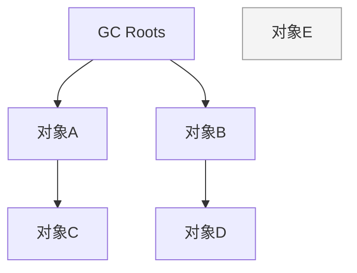

# JVM

> **模块**：11_后端八股/03_JVM.md  
> **来源**：购买资料 A（6 个源文件）— 对象创建/内存区域/垃圾回收/类加载/调优/JIT  
> **规模**：约 626 行  |  **生成**：2026-11-12  
> **状态**：已合并（多源合一）

## 本篇包含

01. 对象创建与内存布局
02. JVM内存区域
03. 垃圾回收
04. 类加载机制
05. JVM调优实战
06. ★★ 【了解】执行引擎与JIT

## 01 对象创建与内存布局

### 对象创建流程

> 💡 Q： 在 Java 代码中 new 一个对象，JVM 底层具体执行了哪些步骤？

> ✅ **A：**
> 当虚拟机遇到一条 `new` 指令时，主要会经历以下 **5 个步骤**：
> 1. **类加载检查**：
> 
>    - 首先检查这个指令的参数（即类名）能不能在常量池中定位到一个类的符号引用。
>    - 并且检查这个类是不是已经被加载、解析和初始化过。如果没有，必须先执行类加载过程。
> 2. **分配内存**：
> 
>    - 类加载通过后，JVM 就在堆中划分一块内存给新对象。对象所需的内存大小在类加载完成后便可完全确定。
>    - 分配策略：如果内存规整，用**指针碰撞**；如果内存不规整，用**空闲列表**。
> 3. **初始化零值**：
> 
>    - 内存分配完后，JVM 需要将分配到的内存空间都初始化为零值（比如 `int` 设为 0，`boolean` 设为 false，引用设为 null）。
>    - 这就是为什么我们在 Java 代码中定义成员变量不需要赋初值就能直接用的原因。
> 4. **设置对象头**：
> 
>    - 初始化零值后，JVM 要对对象头进行设置。比如：这个对象是哪个类的实例？它的哈希码是多少？它的 GC 分代年龄是多少？
> 5. **执行  方法**：
> 
>    - 上面 4 步完成后，从 JVM 视角看对象已经产生了，但从 Java 程序视角看，对象创建才刚开始。
>    - 此时会执行构造函数（`<init>` 方法），按照程序员的意愿对对象进行真正的初始化赋值。

> 🔎 **追问1： 两个线程同时new对象，分配内存怎么保证线程安全**

JVM 主要有两种方案来解决并发冲突：

1. **CAS + 失败重试**：这是最通用的方法。JVM 采用 CAS 机制配合失败重试的方式，保证更新操作的原子性。
2. **TLAB 【重点】**：

   - 这是 JVM 的默认优化方案。
   - **原理**：每个线程在 Java 堆中预先分配一小块私有内存，也就是 **本地线程分配缓冲（TLAB）**。
   - 当线程需要 `new` 对象时，优先在自己的 TLAB 上分配。只有当 TLAB 用完了，才需要通过 CAS 去锁住堆内存来分配。这样大大减少了并发冲突。

### 内存布局

> 💡 Q：一个 Java 对象在内存中由哪几部分组成？对象头里都有什么？

> ✅ **A：**
> 在 HotSpot 虚拟机中，对象在内存中的布局可以分为三块区域：
> 1. **对象头【核心】**：它包含两部分信息。
> 
>    - **Mark Word（标记字段）**：存储对象自身的运行时数据，如 **HashCode**、**GC 分代年龄**、**锁状态标志**（偏向锁/轻量级锁/重量级锁）、线程持有的锁等。
>    - **Klass Pointer（类型指针）**：对象指向它的类元数据的指针，虚拟机通过这个指针来确定这个对象是哪个类的实例。
>    - (如果是数组，还有一块用于记录数组长度)
> 2. **实例数据**：这是对象真正存储的有效信息，也就是我们在代码里定义的各种成员变量（字段）的内容。
> 3. **对齐填充**：这不是必须的，仅仅起占位符的作用。因为 HotSpot 规定对象的起始地址必须是 **8 字节的整数倍**。如果实例数据不够 8 字节，就需要填充对齐。

> 🔎 追问1：为什么对象的 GC 年龄最大是 15

这个限制是写死在对象头里的。 在 **Mark Word**中，用于存储 GC 分代年龄（GC Age）的区域只有**4 个比特位（4 bit）**。 二进制的 `1111` 换算成十进制就是 **15**。 所以，一旦对象熬过了 15 次 GC，它的年龄就会溢出这 4 位，JVM 规定它必须晋升到老年代。 (注：CMS 默认为 6，但最大物理上限就是 15)

### 对象创建的完整过程

> 💡 Q：new 一个对象时，JVM 里到底发生了什么？

> ✅ **A：**
> 可以概括为下面几步：
> 1. **类加载检查**  
> 当执行 `new` 指令时，JVM 会先检查这个类是否已经被加载、链接和初始化。  
> 如果还没有，就要先执行类加载。
> 2. **分配内存**  
> 类加载完成后，对象所需要的内存大小就确定了，JVM 会在堆中为对象分配一块连续的内存空间。
> 3. **处理并发安全问题**  
> 因为对象创建在高并发场景下可能有多个线程同时进行，所以 JVM 需要保证分配内存时线程安全。  
> 常见做法是 **CAS + 失败重试**，或者通过 **TLAB** 让线程优先在自己的私有分配区中分配。
> 4. **初始化零值**  
> 内存分配完成后，JVM 会先把对象的实例字段都初始化为零值。  
> 比如 `int` 为 `0`，引用类型为 `null`，这是为什么对象即使我们没手动赋值，也有默认值。
> 5. **设置对象头**  
> JVM 会把对象头信息写进去，比如哈希码、GC分代年龄、锁状态、类型指针等。
> 6. **执行构造方法**  
> 最后再执行对象的构造方法，也就是 `init` 对应的逻辑，按程序员写的代码完成真正的初始化。
> 总结一下就是：**先检查类，再分配内存，再设默认值和对象头，最后执行构造方法。**

> 🔎 追问1：对象在堆里是怎么分配内存的？

**答：**

主要有两种方式：

1. **指针碰撞**  
如果堆内存是规整的，已用内存和空闲内存之间有明确边界，那么只需要把指针往空闲方向移动一段对象大小的距离即可。
2. **空闲列表**  
如果堆内存不是规整的，JVM 就需要维护一张空闲列表，记录哪些内存块可用，再从中找到合适空间分配给对象。

**用哪种方式，取决于垃圾回收器是否会整理内存。**

### 对象内存布局

> 💡 Q：Java 对象在内存中的布局是怎样的？

> ✅ **A：**
> 在 HotSpot 虚拟机里，一个普通对象在内存中一般分为三部分：
> 1. **对象头（Header）**  
> 存储对象的运行时元数据，比如哈希码、GC分代年龄、锁状态、类型指针等。
> 2. **实例数据（Instance Data）**  
> 也就是真正存储成员变量值的地方，包括当前类和父类继承下来的实例字段。
> 3. **对齐填充（Padding）**  
> HotSpot 要求对象大小通常按 **8 字节对齐**，所以如果前两部分加起来不是 8 的倍数，就需要补齐。
> 需要注意两点：
> 1. **静态变量不在对象实例里**  
> 静态变量属于类，不属于对象，它存放在方法区 / 元空间对应的类元数据中。
> 2. **成员变量的存储顺序不一定完全等于代码声明顺序**  
> JVM 可能会为了对齐和节省空间，对字段顺序做一定调整。

> 🔎 追问1：对象头里都有什么？为什么 synchronized 会和对象头扯上关系？

**答：**

对象头里最核心的两部分是：

1. **Mark Word**  
用来存对象运行时信息，比如哈希码、GC分代年龄、锁状态标志等。
2. **Klass Pointer（类型指针）**  
指向这个对象所属类的元数据，JVM 通过它知道这个对象到底是哪个类的实例。

如果是**数组对象**，对象头里通常还会多一个**数组长度**字段。

之所以 `synchronized` 会和对象头扯上关系，是因为**锁状态信息就记录在对象头的 Mark Word 里**，所以我们常说 Java 里“锁是加在对象上的”，本质上和对象头是直接相关的。

> 🔎 追问2：一个空对象占多少字节？

**答：**

一般来说，在 **64 位 HotSpot JVM 并开启压缩指针**的常见场景下，一个空的 `Object` 通常占**16 字节**。

原因是：

1. 对象头通常占 **12 字节**
2. HotSpot 要求按 **8 字节对齐**
3. 所以最终会补齐到 **16 字节**

注意这是**常见情况**，不是绝对值，具体大小和 JVM 参数、是否开启指针压缩都有关系。

### 对象访问定位

> 💡 Q：栈里的引用变量，是怎么定位到堆中的对象的？

> ✅ **A：**
> 主要有两种方式：
> 1. **句柄访问**  
> 栈中的引用先指向句柄，句柄里再保存对象实例地址和类型数据地址。
> 2. **直接指针访问**  
> 栈中的引用直接保存对象地址，对象头里再通过类型指针找到类元数据。
> HotSpot 虚拟机一般采用的是**直接指针访问**，因为这样少了一次间接寻址，访问速度更快。

### 对象分配的常见规则

> 💡 Q：对象一般是怎么进入新生代、老年代的？

> ✅ **A：**
> 一般有下面几种常见规则：
> 1. **大多数新对象优先分配在 Eden 区**  
> 这是最常见的情况。
> 2. **如果本线程的 TLAB 没满，会优先在 TLAB 中分配**  
> 这样可以减少多线程分配内存时的锁竞争。
> 3. **大对象有可能直接进入老年代**  
> 因为大对象如果频繁在新生代复制，成本会比较高。
> 4. **长期存活的对象会晋升到老年代**  
> 对象每熬过一次 Young GC，年龄会增加，到达阈值后就会晋升。
> 5. **如果 Survivor 放不下，也可能提前晋升到老年代**  
> 这本质上是空间分配担保的结果。
> 总结来说就是：**新对象一般先进新生代，但大对象、长寿命对象或者 Survivor 放不下的对象，可能会更早进入老年代。**

## 02 JVM内存区域

### JVM运行时数据区

> 💡 Q： 介绍一下 JVM 的运行时数据区（内存结构）？哪些是线程共享的，哪些是私有的？

> ✅ **A：**
> JVM 在运行 Java 程序时，会把内存划分为 5 个区域。
> 为了逻辑清晰，我习惯把它们按照生命周期和是否线程共享**分为两类：**
> **第一类是**线程私有的，随线程生灭，**不需要垃圾回收**（GC）； 第二类是**线程共享的**，也是 GC 重点关注的区域。
> 下面我具体展开说一下。
> 首先是**线程私有**的区域，包含三个部分：
> 1. **程序计数器**： 它的作用是记录当前线程执行到哪一行字节码了。
> 
>    - *为什么需要它？* 因为 CPU 会在不同线程间切换，当切回来的时候，线程得知道自己刚才执行到哪儿了。
>    - *特点*：这是 JVM 中唯一一个不会发生内存溢出（OOM）的区域。
> 2. **虚拟机栈**： 这是我们平时最常说的栈，它是 Java 方法执行的内存模型。
> 
>    - 每个方法在执行时都会创建一个**栈帧**，里面存了局部变量表、操作数栈等信息。方法调用入栈，执行完出栈。
>    - *异常*：如果递归太深，会爆出 `StackOverflowError`；如果申请不到内存，会爆出 `OOM`。
> 3. **本地方法栈（Native Method Stack）**： 这个和虚拟机栈逻辑一样，只不过它是服务于 `Native` 方法（比如 C++ 写的底层方法）的。
> 
>    - *注*：在 HotSpot 虚拟机中，其实直接把这两个栈合二为一了。”
> 接下来是**线程共享**的区域，这也是出现问题最多的地方
> 1. **堆**： 这是 JVM 内存中**最大**的一块。**几乎所有的对象实例和数组**都在这里分配内存。
> 
>    - *关注点*：它是垃圾回收器（GC）的主要工作场所。我们常说的‘新生代’、‘老年代’划分，就是指的这里。
>    - *异常*：如果对象太多塞满了，就会报 `OutOfMemoryError: Java heap space`。
> 2. **方法区**： 它存储了已被虚拟机加载的**类信息、常量、静态变量**等数据。
> 
>    - *版本差异（亮点）*： 在 **JDK 1.7 及以前**，它在实现上叫‘永久代’（PermGen），且位于堆内存中，容易导致 OOM。 而在 **JDK 1.8 及以后**，JVM 移除了永久代，改用在本地内存（Native Memory）中实现的 **元空间（Metaspace）**。这样做的好处是方法区不再受堆内存大小的限制，减少了 OOM 的风险。”
> 总结一下：**栈管运行，堆管存储。** 栈是线程私有的，堆和方法区是线程共享的。

> 🔎 追问1：  这些区域里，哪些会发生 OOM（内存溢出）

除了**程序计数器**以外，其他 4 个区域都有可能发生 OOM。

1. **堆**：最常见。对象太多且无法回收时，报 `OutOfMemoryError: Java heap space`。
2. **方法区**：加载的类太多（比如 Spring 动态代理生成太多类），报 `OutOfMemoryError: Metaspace`。
3. **栈**：虽然平时更多报的是 `StackOverflowError`（递归太深），但如果线程请求的栈深度大于允许深度，或者创建太多线程导致内存耗尽，也会报 OOM。

### 栈与堆的区别

> 💡 **Q： 简单说一下JVM里栈和堆的区别是什么？**

> ✅ **A：**
> 可以从三个维度来区分：
> 1. **存储内容**：
> 
>    - **栈**主要存储**局部变量**（基本数据类型、对象的引用）和方法调用的上下文。
>    - **堆**存储的是**实际的对象实例**（`new` 出来的东西）。
> 2. **内存管理**：
> 
>    - **栈**是自动管理的，方法结束了自动出栈释放，**不需要 GC**。
>    - **堆**是手动管理（C++）或 GC 管理（Java）的，是垃圾回收的主要场所。
> 3. **物理地址**：
> 
>    - **栈**通常是连续的内存空间（速度快）。
>    - **堆**是不连续的内存空间，通过链表等方式维护（灵活但稍慢）。

> 🔎 追问1：  什么是栈溢出（StackOverflow）？什么情况下会发生

**StackOverflowError** 是指线程请求的栈深度超过了虚拟机允许的深度。 最典型的场景就是**死递归**（递归方法没有出口），或者递归层级过深。 每一次方法调用都会压入一个栈帧，如果一直压栈不弹栈，内存很快就爆了。

### JDK1.8的变化

> 💡 **Q： JDK 1.8 在内存区域上有什么重大变化？为什么要用元空间替代永久代**

> ✅ **A：**
> 最大的变化是：**移除了永久代，引入了元空间。** 在 JDK 1.7 及之前，方法区是堆内存的一部分（永久代）。 而在 JDK 1.8 中，元空间使用的是**本地内存**，不再占用 JVM 的堆内存。
> **为什么要替换？主要有两个原因**：
> 1. **避免 OOM**：永久代的大小是启动时固定的，很难调整。现在的应用（尤其是 Spring 这种大量使用动态代理的框架）会动态生成很多类，很容易把永久代撑爆。而元空间直接使用服务器的物理内存，上限大得多。
> 2. **合并 HotSpot 和 JRockit**：当年 Oracle 收购了 JRockit，JRockit 里面就没有永久代，为了代码统一，就把 HotSpot 的永久代也去掉了。

> 🔎 追问1：  元空间既然用的是本地内存，是不是就永远不会 OOM 了

**不是的**，依然会 OOM。 虽然本地内存很大，但不是无限的。 如果在生产环境中，我们没有限制元空间大小（默认是无限），且程序有 Bug 导致动态疯狂生成类，可能会把服务器所有的物理内存吃光，导致整个服务器宕机（被系统 Kill 掉）。 所以线上环境我们通常还是会配置 `-XX:MaxMetaspaceSize` 来兜底。

#### 图解补充：运行时数据区总览

#### 对比补充：哪些区域会 OOM

| 区域 | 是否线程共享 | 主要存什么 | 是否 GC 重点区域 | 典型异常 |
|-|-|-|-|-|
| 程序计数器 | 否 | 当前线程字节码位置 | 否 | 基本不会 OOM |
| 虚拟机栈 | 否 | 栈帧、局部变量、操作数栈 | 否 | `StackOverflowError` / OOM |
| 本地方法栈 | 否 | Native 方法调用信息 | 否 | OOM |
| 堆 | 是 | 对象实例、数组 | 是 | `Java heap space` |
| 方法区/元空间 | 是 | 类元数据、常量、静态变量 | 重点但不如堆常见 | `Metaspace` |

#### 高频追问补充

> 🔎 **追问补充1：为什么说“栈管运行，堆管存储”？**

因为方法执行过程中的上下文信息主要在栈里，比如局部变量、操作数栈、方法调用链；而真正 `new` 出来的对象通常在堆里。这样回答能快速把栈和堆的职责区分开。

> 🔎 **追问补充2：元空间移到本地内存之后，线上就不用管了吗？**

不是。元空间虽然不再占用堆，但依然吃机器内存。如果动态生成类很多，比如代理类暴涨、类加载器泄漏，照样会把机器内存打满，所以线上一般还是会限制 `MaxMetaspaceSize`。

#### 速记版

> 📝 内存区域建议按这条线记：
> - 三私有：程序计数器、虚拟机栈、本地方法栈
> - 两共享：堆、方法区/元空间
> - 堆是 GC 主战场
> - JDK8 之后永久代换成元空间
> 一句话面试版：
> JVM 运行时内存区域可以先按线程私有和线程共享来分，私有区偏执行上下文，共享区偏对象和类元数据存储。

## 03 垃圾回收

垃圾回收是 JVM 面试里非常核心的一条线，常见考法一般会从“对象什么时候会被回收”开始，再追问到垃圾回收算法、垃圾回收器、三色标记和根可达性。

### 如何判断对象是否可回收

> 💡 **Q：JVM 如何判断一个对象是否可以被回收？**

> 📝 现在主流 JVM 采用的是 **可达性分析算法**，而不是单纯的引用计数。
> 它的思路是：从一组称为 **GC Roots** 的根对象出发，沿着引用关系向下搜索。  
> 如果一个对象从 GC Roots 出发不可达，那么这个对象就可以被判定为垃圾对象。
> 常见的 GC Roots 包括：
> - 虚拟机栈中引用的对象
> - 方法区中类静态属性引用的对象
> - 方法区中常量引用的对象
> - 本地方法栈 JNI 引用的对象
> 之所以不用引用计数，核心原因是 **它无法解决循环引用问题**。

### 常见的垃圾回收算法

> 💡 **Q：常见的垃圾回收算法有哪些？**

> 📝 常见垃圾回收算法主要有四种：
> **第一种，标记-清除。**  
> 先标记存活对象，再清理未标记对象。优点是实现简单；缺点是会产生内存碎片。
> **第二种，复制算法。**  
> 把内存分成两块，每次只使用一块；回收时把存活对象复制到另一块。优点是没有内存碎片；缺点是浪费一半空间。
> **第三种，标记-整理。**  
> 先标记存活对象，再把存活对象向一端移动，最后直接清理边界外内存。优点是没有碎片；缺点是整理对象成本较高。
> **第四种，分代收集。**  
> 这不是一种具体算法，而是一种组合思想：年轻代和老年代的对象特点不同，所以采用不同算法更合适。

### 分代回收思想

> 💡 **Q：为什么 JVM 要做分代回收？**

> 📝 因为不同区域的对象生命周期分布非常不一样。
> 年轻代的对象特点是：**创建多、死亡快、存活率低**。  
> 所以年轻代更适合复制算法，回收效率高。
> 老年代的对象特点是：**存活率高、对象体积更大**。  
> 如果还用复制算法，成本就太高了，所以老年代通常更适合标记-清除或标记-整理。
> 所以分代回收的本质是：  
> **针对不同对象生命周期，采用更匹配的回收策略。**

### 三色标记法

> 💡 **Q：什么是三色标记法？**

> 📝 三色标记法是并发标记过程中常用的一种抽象模型，用来描述对象的扫描状态。
> - **白色**：还没被标记，理论上可能是垃圾
> - **灰色**：已经被标记，但它引用的对象还没扫描完
> - **黑色**：已经被标记，而且它引用的对象也都扫描完成
> 并发标记时，GC 线程和用户线程可能同时修改对象引用关系。  
> 如果处理不好，就可能出现“本来应该存活的对象被漏标”的问题。
> 因此现代垃圾回收器通常会配合：
> - **增量更新**
> - **SATB（原始快照）**
> 来修正并发标记带来的问题。

### 常见垃圾回收器

> 💡 **Q：常见的垃圾回收器有哪些？怎么选？**

> 📝 常见垃圾回收器可以按代际来看：
> **年轻代** 常见有：
> - Serial
> - ParNew
> - Parallel Scavenge
> **老年代** 常见有：
> - Serial Old
> - CMS
> - Parallel Old
> **整堆/区域化回收器** 常见有：
> - G1
> - ZGC
> - Shenandoah
> 如果是 JDK8 时代的常见答案，面试最常问的是 **CMS 和 G1**；  
> 如果是更新一点的版本，也可能会问 **ZGC**。

> 🔎 **追问1：G1 的特点是什么？**

G1 的核心特点是把整个堆划分成很多 Region，不再机械区分连续的年轻代和老年代空间。  
它会优先回收“垃圾最多、收益最高”的 Region，因此叫 Garbage First。

它的优势是：

- 更适合大堆
- 可预测停顿时间
- 整体吞吐和停顿之间比较均衡

### CMS 和 G1 的区别

> 💡 **Q：CMS 和 G1 有什么区别？**

> 📝 **CMS** 更强调低停顿，它的老年代回收流程里大量使用并发标记和并发清理。  
> 缺点是会产生内存碎片，而且对 CPU 资源比较敏感。
> **G1** 是区域化回收器，兼顾吞吐和停顿，更适合大堆和需要可控停顿的场景。  
> 它可以通过目标停顿时间来做一定程度的回收调度。
> 所以工程里如果让我给面试官一个简短判断：
> - JDK8 以前很多系统会选 CMS
> - 现在更常见的默认方案是 G1

### 图解补充：GC Roots 与可达性分析

### 对比补充：回收算法怎么区分

| 算法 | 核心动作 | 优点 | 缺点 | 适合场景 |
|-|-|-|-|-|
| 标记-清除 | 标记后直接清理 | 实现简单 | 有碎片 | 老年代早期方案 |
| 复制 | 存活对象复制到新区域 | 无碎片、效率高 | 浪费空间 | 年轻代 |
| 标记-整理 | 标记后压缩存活对象 | 无碎片 | 移动对象成本高 | 老年代 |
| 分代收集 | 不同代组合不同算法 | 更贴合对象生命周期 | 实现更复杂 | 现代 JVM |

### 对比补充：常见回收器怎么答

| 回收器 | 关键词 | 优势 | 典型短板 |
|-|-|-|-|
| CMS | 低停顿 | 老年代并发回收 | 碎片、多核依赖强 |
| G1 | Region、可预测停顿 | 大堆更友好 | 调优理解成本更高 |
| ZGC | 超低停顿、染色指针 | 超大堆场景优秀 | 版本要求更高 |

### 高频追问补充

> 🔎 **追问补充1：为什么引用计数不适合作为主流回收方案？**

因为它很难处理循环引用。两个对象互相引用时，即使业务上已经没人能访问它们了，引用计数也不为 0，无法回收。

> 🔎 **追问补充2：三色标记为什么会漏标？**

因为并发标记期间，用户线程可能同时改引用关系。如果一个黑对象新增了对白对象的引用，而灰对象到白对象的旧引用又被删掉，就可能让白对象被漏标。所以才需要 SATB 或增量更新这类补偿机制。

> 🔎 **追问补充3：面试里 CMS 和 G1 怎么快速选型？**

如果是老系统背景，可以说 CMS 曾经因为低停顿用得很多；如果是新系统或新版本，通常优先考虑 G1，因为它已经是更主流、更稳妥的默认方案。答题重点不是“背历史”，而是讲清楚停顿、碎片和大堆场景的权衡。

### 速记版

> 📝 垃圾回收建议按这条线记：
> - 先讲怎么判断垃圾：可达性分析
> - 再讲算法：标记清除、复制、整理、分代
> - 再讲并发标记：三色标记、SATB、增量更新
> - 最后讲回收器：CMS、G1、ZGC
> 一句话面试版：
> JVM 垃圾回收的本质，是先判断对象是否还可达，再根据对象生命周期和停顿目标选择合适的回收算法和回收器。

## 04 类加载机制

### 类加载的生命周期

> 💡 Q： Java 类是从哪里来的？讲一下类加载的整个流程？

> ✅ **A：**
> Java 的类加载机制是指把 `.class` 文件加载到内存，并进行校验、解析和初始化，最终形成可以被虚拟机直接使用的 Java 类型。 整个过程分为 5 个阶段：
> 1. 加载 ：通过类的全限定名（包名+类名）找到 `.class` 二进制流，把它读进内存，并在堆中生成一个 `java.lang.Class` 对象作为访问入口。
> 2. 验证 ：检查这个字节码是不是合法的（比如文件头是不是 `0xCAFEBABE`），防止恶意代码破坏 JVM。
> 3. **准备 【重点】**：为类的**静态变量（static）分配内存，并设置默认初始值**。
> 
>    - *注意*：这里是设置默认值（比如 `int` 为 0，`Object` 为 null），而不是代码里写的那个值。
> 4. **解析** ：把常量池里的**符号引用（比如仅仅是个字符串 "ArrayList"）替换为直接引用（内存中的实际地址指针）。**
> 5. **初始化 【重点】**：这是类加载的最后一步。
> 
>    - 这时候才真正执行类中定义的 Java 代码（也就是 `static` 代码块和 `static` 变量的赋值操作）。

> 🔎 追问1：  什么时候会触发类的初始化？

JVM 规定了只有 **主动引用** 时才会初始化，常见的场景有：

1. `new` 一个对象时。
2. 读取或设置一个类的静态字段（static）时。
3. 调用类的静态方法时。
4. 对类进行反射调用（`Class.forName`）时。
5. 初始化一个子类时，如果父类还没初始化，会先触发父类的初始化。

### 双亲委派模型（核中核，必须背熟）

> 💡 Q： 什么是类加载器？什么是双亲委派模型？为什么要这么设计？

> ✅ **A：**
> 首先，类加载器的作用就是把编译好的 `.class` 字节码文件加载到 JVM 内存中。 在 JDK 8 及之前的版本中，主要有三个核心的类加载器，它们呈层级关系：
> 1. **启动类加载器**： 它是最顶层的。负责加载 JDK 的**核心类库**（即 `JAVA_HOME/lib` 目录下的类，比如 `String`、`System` 等）。
> 
>    - *注意点*：它是由 C++ 实现的，所以我们在 Java 代码里拿不到它的引用（会返回 null）。
> 2. **扩展类加载器** ： 它负责加载 JDK 的**扩展库（`JAVA_HOME/lib/ext` 目录）。**
> 3. **应用类加载器**： 这是我们平时接触最多的。它负责加载 `Classpath` 下的类，也就是**我们自己写的代码**和引入的第三方 jar 包。”
> 所谓双亲委派模型，其实不是指有两个父母，而是指‘父辈委托’机制。 它的核心逻辑可以概括为八个字：‘**向上委托，向下加载**’。
> 具体流程是这样的： 当一个加载器（比如应用类加载器）收到类加载请求时，它**不会自己先去加载**，而是把这个请求**原封不动地委托给父加载器**去尝试。 每一层都是如此，直到请求传送到最顶层的 **Bootstrap ClassLoader**。
> - 如果父加载器在自己的搜索范围内找到了这个类，就成功返回；
> - 只有当父加载器反馈‘我加载不了’（找不到）时，子加载器才会尝试自己去加载。
> 这么设计主要有两个目的：**安全**和**避免重复加载**。最核心的是**安全**。
> 举个最经典的例子： 假设有人恶意写了一个 `java.lang.String` 类，里面植入了破坏系统的代码。
> - **如果没有双亲委派**：应用类加载器可能直接就加载了这个恶意的 String 类，那整个系统的 String 就被替换了，JVM 也就崩溃了。
> - **有了双亲委派**：当加载请求向上委托到 Bootstrap ClassLoader 时，它发现自己负责的 `rt.jar` 里已经有了 `java.lang.String`，它就会直接加载 JDK 自带的那个安全的 String 类。
> 这样，恶意的类就永远没有机会被加载进来。这就保证了 **Java 核心类库的安全性（沙箱安全机制）**

> 🔎 追问1：父加载器是子加载器的父类吗？

**不是继承关系**，而是**组合关系**。 它们在代码层面并没有 `extends` 关系，而是通过一个 `parent` 成员变量持有父加载器的引用。这是一种包含关系，不是类继承

### 怎么打破双亲委派

> 💡 **Q：有什么场景需要打破双亲委派，怎么打破**

> ✅ **A：**
> 双亲委派不是强制约束，而是一种建议
> **场景一：Tomcat**
> - Tomcat 上可能部署了两个 Web 应用。应用 A 依赖 Spring 4，应用 B 依赖 Spring 5。
> - 如果遵循双亲委派，类加载器只会加载一份 Spring（假设是 4）。那应用 B 也是用的 Spring 4，启动就报错了。
> - **解决**：Tomcat 自定义了 `WebAppClassLoader`，它**重写了** `loadClass` **方法**。优先自己加载 `WEB-INF/classes` 下的类，加载不到再给父类。这样就实现了应用间的隔离。
> **场景二：JDBC**
> - JDBC 的接口（`java.sql.Driver`）是 Java 核心包，由 Bootstrap 加载。
> - 但具体的驱动实现（如 MySQL Driver）是厂商提供的第三方 Jar 包，在 Classpath 下，由 Application 加载器加载。
> - **矛盾**：Bootstrap 加载的代码（DriverManager）需要去调用 Application 加载的代码（MySQL Driver），这违反了双亲委派（父调子）。
> - **解决**：利用 **线程上下文类加载器 (Thread Context ClassLoader)**。核心类通过 `Thread.currentThread().getContextClassLoader()` 拿到应用类加载器，去加载第三方的实现类。

## 05 JVM调优实战

JVM 调优这块，面试官更看重你是不是有“问题驱动”的思维，而不是背参数大全。回答时最好按“现象 -> 排查 -> 结论 -> 调整方案”来讲。

### JVM 调优的基本思路

> 💡 **Q：你做过 JVM 调优吗？一般怎么做？**

> 📝 如果让我概括 JVM 调优的基本思路，我会分成四步：
> **第一步，先看现象。**
> - 接口 RT 抖动
> - Full GC 频繁
> - Young GC 特别频繁
> - CPU 飙高
> - 内存持续上涨
> **第二步，看监控。**
> - 堆使用率
> - GC 次数和停顿时间
> - 老年代增长趋势
> - 晋升速率
> - 对象分配速率
> **第三步，定位原因。**
> 比如是年轻代太小、对象创建过快、存在内存泄漏、还是垃圾回收器不适配业务场景。
> **第四步，再做参数调整。**
> 调优应该基于现象和监控，不是先拍脑袋改参数。

### 常见调优场景

> 💡 **Q：Young GC 很频繁，你会怎么排查？**

> 📝 Young GC 频繁通常说明年轻代压力过大，常见原因有：
> - 年轻代空间偏小
> - 短生命周期对象创建太多
> - 批量操作导致瞬时分配过高
> 排查时我会重点看：
> - Eden 区是否很快被打满
> - 对象分配速率是否异常
> - 接口是否存在大对象创建、重复对象创建
> 优化方向通常包括：
> - 适当调大年轻代
> - 减少无意义对象创建
> - 优化批量逻辑，降低瞬时分配峰值

> 💡 **Q：Full GC 频繁怎么办？**

> 📝 Full GC 频繁比 Young GC 更危险，因为它往往意味着停顿更长，对线上 RT 影响更明显。
> 常见原因包括：
> - 老年代空间不足
> - 对象晋升过快
> - 大对象直接进入老年代
> - 存在内存泄漏
> 排查思路一般是：
> - 看老年代占用是否持续上涨
> - 看 Full GC 后内存是否能明显回落
> - 如果回落不明显，就要怀疑内存泄漏
> - 结合 dump 文件分析大对象和引用链

### 调优时常见的参数关注点

> 💡 **Q：JVM 调优时你会关注哪些参数？**

> 📝 我会优先关注这些参数：
> - `-Xms`、`-Xmx`：初始堆和最大堆
> - `-Xmn`：年轻代大小
> - `-XX:SurvivorRatio`
> - `-XX:MaxTenuringThreshold`
> - `-XX:+UseG1GC` 等垃圾回收器选择参数
> - `-XX:MaxGCPauseMillis`：目标停顿时间
> 但面试里我不会把重点放在背参数上，而是强调：  
> **参数只是工具，关键是它要和实际业务现象对应起来。**

### 如何选择垃圾回收器

> 💡 **Q：垃圾回收器怎么选？**

> 📝 一般我会结合三点来选：
> - 机器资源情况
> - 业务更关注吞吐还是停顿
> - 堆大小和对象生命周期分布
> 如果是比较新的业务系统，而且希望停顿更可控，我会优先考虑 **G1**。  
> 如果是对极低停顿要求非常高、JDK 版本也匹配，才会进一步考虑 **ZGC** 这类更先进的回收器。

## 06 ★★ 【了解】执行引擎与JIT

### 执行引擎与JIT

执行引擎和 JIT 一般不是最前面的基础题，但很适合拿来体现你对 JVM“不是只会背堆和栈”的理解深度。

#### Java 是编译型还是解释型

> 💡 **Q：Java 是编译型语言还是解释型语言？**

> 📝 更准确的说，Java 同时包含了 **编译**和**解释** 两个阶段。
> 源码先通过 `javac` 编译成字节码，这是编译阶段；  
> 运行时，JVM 先解释执行字节码，在热点代码达到一定阈值后，再通过 JIT 编译成本地机器码执行。
> 所以如果面试官这样问，我不会简单回答“Java 是编译型”或者“Java 是解释型”，而是会说：  
> **Java 是先编译成字节码，再由 JVM 解释执行并结合 JIT 动态优化。**

#### JIT 是什么

> 💡 **Q：什么是 JIT？**

> 📝 JIT 指的是 **Just In Time Compiler**，也就是即时编译器。
> 它的作用是把热点字节码编译成本地机器码，提高运行效率。  
> 如果一直纯解释执行，灵活是灵活，但性能不够高；  
> JIT 的意义就在于：**把最值得优化的那部分代码进一步编译优化。**

#### 为什么热点代码更适合 JIT

> 💡 **Q：为什么 JVM 不一开始就把所有代码都编译成机器码？**

> 📝 因为 JIT 编译本身也是有成本的。
> 如果一开始就把所有代码全部编译：
> - 启动会变慢
> - 很多根本不会高频执行的代码也会被白白编译
> - 内存占用也会更高
> 所以 JVM 的策略更聪明：  
> **先解释执行，等某段代码真的成为热点，再去编译优化。**
> 这是一种典型的“按需优化”思路。

---

## 来源档案（原始文件，仅供溯源）

- `04_后端八股整理/02_JVM/00_对象创建与内存布局.md`
- `04_后端八股整理/02_JVM/01_JVM内存区域.md`
- `04_后端八股整理/02_JVM/02_垃圾回收.md`
- `04_后端八股整理/02_JVM/03_类加载机制.md`
- `04_后端八股整理/02_JVM/04_JVM调优实战.md`
- `04_后端八股整理/02_JVM/05_【了解】执行引擎与JIT.md`
