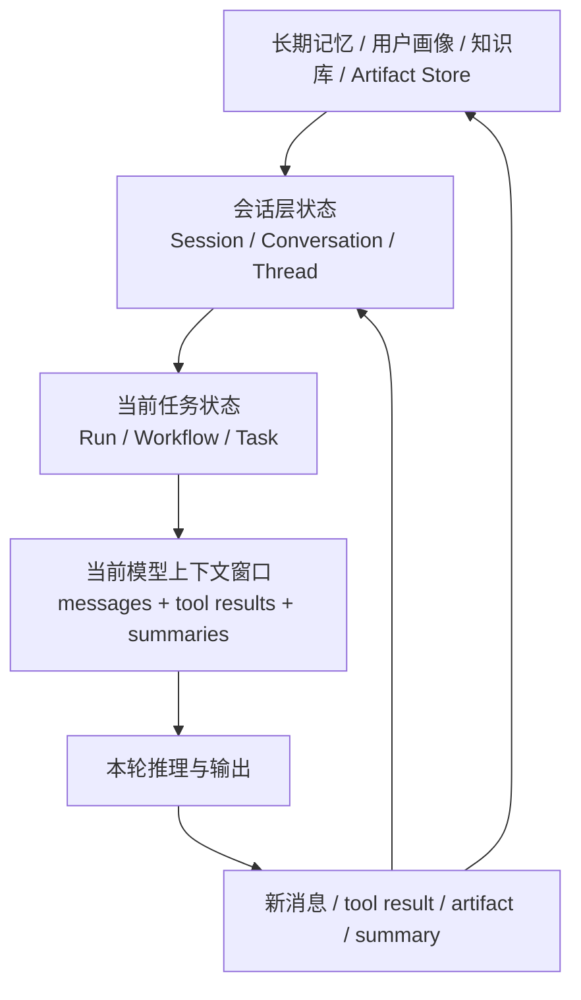

# 记忆与会话状态

> **模块**：06_记忆与会话状态/06_记忆与会话状态.md  
> **构成**：2 个知识点合为一篇，按顺序编号  
> **规模**：约 1,414 行  |  **生成**：2026-11-12

## 目录

1. 记忆体系
2. 会话状态与上下文生命周期

---

## 1. 记忆体系

### 01 Memory体系

#### 一、为什么 Memory 是 Agent 面试里的高频误区题

Memory 几乎是所有 Agent 面试都会问到的话题，但它也是最容易被答错、答混和答空的部分。最常见的误区有三个：  
**第一，把 memory 直接等同于保存聊天记录；**  
**第二，把 memory 和 RAG 混为一谈；**  
**第三，把所有持久化信息都笼统叫长期记忆，却说不清它们的读写时机和使用边界。**  
所以面试官问Agent 的 memory 怎么设计memory 和 RAG 有什么区别长期记忆有什么风险，本质上是在看你是否理解 agent 的状态持续能力，而不是只会堆术语。

从系统角度看，memory 解决的是：**系统如何在跨步骤、跨回合、跨任务甚至跨天的执行中，保留对后续决策真正有帮助的信息。**  
如果没有 memory，agent 每次都像刚被创建出来的新个体，只能依赖当前上下文；  
如果 memory 设计得不好，agent 又会变得迟钝、污染、过时，甚至在错误经验上越走越偏。  
因此，memory 的难点从来不是存起来，而是存什么、何时写、何时读、如何失效、怎样避免污染。

#### 二、先把概念分清：Memory、Context、State、RAG 不是一回事

这是面试里必讲的边界。

##### 1. Context

Context 是当前模型调用时实际送进 prompt 的那部分信息。  
它是当下可见窗口，可能来自系统提示词、用户输入、工具结果、摘要、memory 检索结果等。  
所以 context 是模型眼前看到的东西，不等于 memory 本身。

##### 2. State

State 更偏运行时状态。  
它包括当前任务 ID、阶段进度、已完成步骤、预算消耗、临时变量、中间产物、审批状态等。  
State 不一定长期保存，也不一定适合被称为 memory。

##### 3. Memory

Memory 更强调对未来决策有价值的可延续信息。  
它可以来自历史对话、历史任务、用户偏好、成功经验、失败经验、总结笔记、长期知识片段等。  
换句话说，memory 是可被未来再次利用的过去。

##### 4. RAG

RAG 主要解决外部知识召回问题。  
它关心的是：面对当前问题，从知识库或文档库里取回最相关的信息。  
RAG 的对象通常是相对客观、共享的外部知识；  
memory 的对象更偏个体化、任务化、经验化的信息。

一个非常稳妥的面试表达是：  
**RAG 面向外部知识找回来，memory 面向系统经历过的有用信息留得住。**

#### 三、为什么 Agent 需要 Memory

##### 1. 长任务不可能全靠上下文硬扛

如果一个任务要持续几十步甚至几天，不可能把全部过程都一直塞进 prompt。  
需要把阶段性结论和关键事实沉淀成 memory 或持久化状态。

##### 2. 用户个体化体验需要持续

例如用户偏好什么格式、常用什么术语、是否偏好简洁回答、所在行业、常用数据源，这些都不应该每次重新问。

##### 3. 经验会改变未来决策

如果 agent 之前试过某个工具在某类任务上经常失败，或者某种搜索策略更有效，这些经验理应被保留下来，服务未来决策。

##### 4. 人类协同需要上下文延续

人类接管、审批、编辑之后，系统需要记住人类修正过什么，否则下次还会犯同样错误。

#### 四、Memory 的经典分类：一定要会的层次化回答

面试中最推荐的回答方式是分层，而不是一股脑说短期记忆、长期记忆。

##### 1. Working Memory（工作记忆）

也叫运行时记忆。  
它服务于当前任务的短时推理与执行，例如：

- 当前已知事实；
- 最近几步工具结果；
- 当前计划和子任务状态；
- 暂时变量；
- 中间摘要。  
它通常生命周期较短，和 session state 有很强重合。

##### 2. Episodic Memory（情节记忆）

记录系统曾经经历过的具体事件。  
例如：

- 某次任务的步骤与结果；
- 某次失败的原因；
- 某次人工审批的修改意见；
- 某个用户在某种任务上偏好的交付形式。  
情节记忆的特点是有时间、有场景、有具体经过。

##### 3. Semantic Memory（语义记忆）

更像从多次经验中抽象出来的稳定知识。  
例如：

- 用户偏好 Markdown 表格；
- 某业务系统字段 `status=3` 表示已结案；
- 某类任务常用三个数据源更可靠。  
它比情节记忆更抽象，也更适合作为长期可复用规则。

##### 4. Procedural Memory（程序性记忆）

指怎么做的经验。  
例如：

- 处理退款工单时优先检查订单状态再核对支付方式；
- 调研类任务先搜英文资讯再补中文分析；
- 修复代码 bug 时先跑最小复现。  
它接近策略模板或技能，通常非常有价值。

##### 5. User Memory（用户记忆）

围绕某个用户的稳定偏好和背景。  
如岗位、团队、常用语言、输出格式偏好、时间区域、业务范围。  
这是企业产品中最常见的一类 memory，但也最容易涉及隐私与过时问题。

#### 五、一个非常重要的工程点：不是所有记住都应该叫 memory

很多线上系统会把以下东西都混在一起，这是危险的：

- 历史聊天记录；
- 中间推理链；
- 工具原始返回值；
- 用户画像；
- 长期知识笔记；
- 运行状态；
- 审批记录。

更稳妥的做法是把它们分成不同存储层和不同消费路径：

1. 会话状态层：服务当前任务运行；
2. 经验记忆层：保存可复用经验；
3. 用户画像层：保存用户长期偏好；
4. 知识检索层：服务外部知识 RAG；
5. 审计日志层：保留完整可追溯记录，但不直接喂给模型。

这类回答很加分，因为它体现你有信息分层治理的意识。

#### 六、Memory 的读写策略：真正难的不是有，而是何时用

##### 一）什么时候写入

###### 1. 任务完成后写总结

这是最安全的方式。  
任务结束后，把关键结论、有效策略、失败原因、人类修正点提炼成结构化记忆。

###### 2. 在关键节点写 checkpoint

长任务中可以在阶段结束时写入阶段性记忆，例如已验证来源、已完成子任务、关键证据。

###### 3. 遇到高价值事件写 episodic memory

例如某个工具反复失败、某次人类明确修正偏好、某次关键审批被拒绝并附理由。

###### 4. 不建议无脑全量写

把每轮对话和每个工具返回都直接塞进长期记忆，会迅速导致污染和检索噪声。

##### 二）什么时候读取

###### 1. 任务初始化时读用户相关记忆

例如用户偏好、所在项目、常用格式。

###### 2. 规划前读任务经验

如果这是一个以前做过很多次的任务，可以在 planning 前先取回以往成功经验。

###### 3. 执行受阻时读失败案例

当某工具失败，可以查历史上类似失败是如何处理的。

###### 4. 最终输出前读交付偏好

确保回答格式与用户历史偏好一致。

一个成熟的表达是：**memory 应当按任务阶段分层读取，而不是每次调用都把所有记忆一股脑塞进 prompt。**

#### 七、Memory 与 RAG 的区别：高频必答题

一个合格回答至少要包含下面这几条：

##### 1. 数据对象不同

- RAG：客观文档、知识库、公共资料、业务资料；
- Memory：个体历史、任务经验、用户偏好、系统经历。

##### 2. 更新机制不同

- RAG：通常由知识库构建、同步或文档更新驱动；
- Memory：更多由交互事件和任务执行过程驱动。

##### 3. 使用目的不同

- RAG：补足模型不知道或不可靠的外部知识；
- Memory：让系统具备持续性和个体化。

##### 4. 生命周期不同

- RAG 文档可能是长期共享的；
- Memory 可能是用户级、任务级、会话级，有明确作用范围。

##### 5. 风险不同

- RAG 的风险更多是召回不准、版本过时、权限过滤错误；
- Memory 的风险更多是污染、过时偏好、错误经验固化、隐私问题。

一句话总结：**RAG 更像查资料，Memory 更像有过经历。**

#### 八、Memory 的实现思路：不要只会说向量库

##### 1. 不是所有 memory 都适合向量检索

用户偏好、角色信息、配额、当前审批状态，这些更适合结构化存储。  
情节记忆和经验摘要则更适合文本检索或向量检索。  
因此，memory 常常是混合存储，而不是单一向量库。感兴趣的可以看下nanobot

##### 2. 记忆条目最好结构化

推荐包括：

- memory_id
- 类型（user/episodic/semantic/procedural）
- 作用域（session/user/project/org）
- 内容摘要
- 证据来源
- 置信度
- 更新时间
- 失效时间
- 可见权限
- 写入原因

##### 3. 需要记忆压缩与摘要

长历史不能全量保留为原文。  
应定期把冗长历史总结成高价值摘要，必要时保留指向原始日志的链接。

##### 4. 需要评分与遗忘机制

并非越多越好。  
可以按最近使用、成功贡献、人工确认程度、置信度进行排序或衰减。

#### 九、Memory 的典型失败模式

##### 失败模式一：记忆污染

系统把错误结论或幻觉写进长期记忆，下次反而更自信地重复错误。  
解决：记忆写入前做验证；高价值记忆要求工具证据或人工确认。

##### 失败模式二：记忆过时

用户偏好变了，业务规则更新了，但旧 memory 还在影响当前决策。  
解决：时间戳、TTL、版本号、最后验证时间。

##### 失败模式三：记忆检索噪声大

写了太多无关历史，检索时高价值内容淹没在噪声里。  
解决：精写少写，分类型索引，按阶段选择性读取。

##### 失败模式四：记忆泄露权限

把不该跨用户共享的 memory 当成公共知识召回。  
解决：严格作用域、租户隔离、可见性策略。

##### 失败模式五：把日志当 memory

日志适合审计，不适合直接进入模型上下文。  
需要先提炼成可消费的记忆。

#### 十、Memory 与 Human-in-the-Loop 的关系

当人类审批、编辑、驳回或接管时，系统其实获得了非常高质量的反馈信号。  
这些反馈如果能沉淀为 memory，就能让 agent 逐渐知道这个组织怎样工作。

例如：

- 某类邮件正式程度要更高；
- 某位领导特别在意数据来源；
- 某类工单必须先核验身份再处理；  
这些都不一定来自公开文档，却是极高价值的程序性或语义记忆。

当然，也要注意隐私、过时和组织边界，不是什么都该写。

#### 十一、Memory 分层与读写路径

#### 十二、高频面试题与参考回答

##### 题 1：Agent 的 memory 是什么？

参考回答：  
是对未来决策有价值、可跨步骤或跨任务持续利用的信息体系，而不只是历史聊天记录。

##### 题 2：memory 和 context 有什么区别？

参考回答：  
Context 是当前调用时送进模型窗口的信息；memory 是系统可供未来检索和利用的持久化信息源。memory 只有被取回后才进入 context。

##### 题 3：memory 和 RAG 有什么区别？

参考回答：  
RAG 面向外部知识召回，memory 面向个体化经历和系统经验延续。一个解决找知识，一个解决留经验。

##### 题 4：为什么不能把所有历史都直接存成长期记忆？

参考回答：  
因为会产生污染、噪声和过时问题。memory 需要提炼、验证、分层和遗忘机制。

##### 题 5：长期记忆最重要的工程点是什么？

参考回答：  
作用域、写入策略、读取策略、有效期、验证机制和权限隔离。

##### 题 6：什么是 episodic memory 和 semantic memory？

参考回答：  
episodic 是具体事件经历，semantic 是从多次经历中抽象出的稳定知识或偏好。

##### 题 7：什么是 procedural memory？

参考回答：  
是怎么做的经验或技能模板，例如某类任务的优先步骤和稳定策略。

##### 题 8：人类反馈为什么适合写入 memory？

参考回答：  
因为这是高质量监督信号，能帮助 agent 学到组织偏好和有效操作模式，但要注意作用域和过时性。

##### 题 9：如果 memory 用错了会有什么后果？

参考回答：  
会导致错误经验固化、用户偏好过时、权限泄露、上下文噪声大和系统行为越来越偏。

##### 题 10：一句话总结 memory 设计原则？

参考回答：  
不是记得越多越好，而是要记真正有用、可验证、可控作用域、能在合适时机被正确取回的信息。

#### 十三、面试速记版

- Memory 不是聊天记录，也不是所有持久化状态。
- 区分 context、state、memory、RAG。
- 常见类型：working、episodic、semantic、procedural、user memory。
- 写入要克制，读取要按阶段。
- 不是所有 memory 都该放向量库，很多应结构化存。
- 需要验证、TTL、作用域、遗忘和权限隔离。
- RAG 查知识，memory 留经历。

#### 参考资料与延伸阅读

1. Anthropic，《Building effective agents》，2024。适合用来界定 agent 与 workflow 的边界，强调能用简单工作流解决时不要过度 agent 化。
2. Anthropic，《Effective context engineering for AI agents》，2025。非常适合补充agent 不只是 prompt engineering，而是 context engineering的近年观点。
3. Anthropic，《How we built our multi-agent research system》，2025。适合放在多 agent、任务拆解、subagent 协作章节中。
4. OpenAI，《A practical guide to building agents》，2025。适合用作工具类型、agent 运行循环、单 agent 优先、多 agent 何时有意义的工程基线。
5. LangChain / LangGraph 官方文档，《Workflows and agents》《Multi-agent》《Human-in-the-loop》《Interrupts》《Durable execution》。
6. Yao et al., *ReAct: Synergizing Reasoning and Acting in Language Models*, 2023。
7. Wang et al., *Executable Code Actions Elicit Better LLM Agents (CodeAct)*, 2024。
8. Yao et al., *Tree of Thoughts*, 2023。
9. Kim et al., *An LLM Compiler for Parallel Function Calling*, 2024。
10. Erdogan et al., *Plan-and-Act: Improving Planning of Agents for Long-Horizon Tasks*, 2025。
11. Schick et al., *Toolformer*, 2023。
12. Packer et al., *MemGPT*, 2024。
13. Park et al., *Generative Agents*, 2023。
14. Shinn et al., *Reflexion*, 2023。
15. Wu et al., *AutoGen*, 2023。
16. Cemri et al., *Why Do Multi-Agent LLM Systems Fail?*, 2025。适合补充多 agent 失败模式。
17. Mialon et al., *GAIA: A Benchmark for General AI Assistants*, 2023。适合在为什么 agent 需要工具、规划、执行时做 benchmark 背景延伸。

### 02 ★★★ RAG-vs-Memory

#### 一、这篇在考察什么

主要考察你是否能把知识系统中的不同信息载体区分清楚：**什么是知识库，什么是会话上下文，什么是长期记忆，什么是用户画像，什么又只是缓存或者状态**。很多候选人会把所有额外给模型的信息都统称为 context，这在工程上是不够精确的。

更高质量的回答必须说明：RAG 的核心对象通常是外部知识证据，偏向从库里查资料；Memory 的核心对象通常是与用户、任务、经历、偏好、状态相关、需要跨轮或跨会话延续的信息，偏向系统对人和任务的持续认知。二者在读写时机、存储形态、更新方式、权限边界、评测方式上都不同。面试官真正想看的是你能不能设计一个既有知识检索、又有用户记忆、还有 session state 的 Agent 系统，而不是把它们混成一锅。

面试官在这一题里，通常不是只想听一个名词解释，而是想顺着这个主题判断你是否具备下面这些能力：

- 是否能准确区分知识库检索、用户长期记忆、会话工作记忆、缓存、状态存储这几类概念。
- 是否知道 RAG 更偏外部证据访问，Memory 更偏个体化持续信息管理，两者服务对象不同。
- 是否理解 memory 不是把聊天记录全塞进上下文，而是要经过抽取、压缩、写入、检索和淘汰。
- 是否能说明 RAG 与 memory 在 read/write pattern、schema 设计、权限与删除要求上的差异。
- 是否了解 LangGraph、Letta 等框架在记忆体系上的官方设计思路，以及近年的 agent memory 研究方向。

可以通过引入一个项目来把这件事在面试中讲的更加清楚：

> 💡 我们把系统分成四层：当前流程状态放 session state，当前会话的压缩摘要和中间结论放 working memory，用户偏好和可跨会话复用的信息放 long-term memory，企业制度和文档走 RAG。这样做是为了避免把所有信息都塞进一个库里。比如用户明确说以后回答简洁一些，我们会写入用户作用域的 semantic memory；如果只是当前任务里确认了某个参数，就只写 session state。真正需要引用出处的制度和产品知识不放 memory，而是走知识检索。这样系统既能个性化，又不会把用户偏好和客观知识混掉。

#### 二、一些总的结论

- RAG 查的是‘世界和业务知识’，Memory 记的是‘这个用户、这个任务、这段经历’。
- RAG 通常读多写少，memory 通常既要读也要写，而且写入要有策略，不是每轮都存。
- 会话上下文不等于长期记忆，缓存也不等于记忆，状态机字段更不等于知识库。
- 一个成熟 Agent 往往同时有：session state、working memory、long-term memory、external knowledge 四层。
- 面试里只要你能把对象、写入时机、检索方式和治理要求讲清，基本就能把这道题讲透。

#### 三、系统化八股知识

##### 先把几个概念分开：知识、记忆、上下文、状态、缓存

面试里最容易失分的地方，就是把这些概念全部混成给模型的上下文。其实它们不是一回事。

**知识库 / RAG 数据源**：偏向相对客观、可共享、可追溯的外部知识，比如公司制度、产品文档、数据库记录、工单系统、网页搜索结果。这类信息通常和某个用户无关，重点在可检索、可更新、可引用。  
**Memory**：偏向某个用户、某个会话群体、某个 Agent 或某段任务执行过程中沉淀下来的持续信息，比如用户偏好、常用表达、过去做过的决定、已完成的子任务、显式提供的背景资料。  
**Session State**：偏向当前流程运行所需的结构化状态，比如当前 step、已调用过的工具、上一步结果、待确认参数、审批单号。  
**Context Window**：是模型这一轮真正能看到的输入载荷，不等于你的全部知识系统。  
**Cache**：通常是为了节省成本和延迟而复用先前结果，例如 prompt cache、embedding cache、工具结果缓存，不代表系统理解并记住了什么。

只要你先把这几个层次讲清楚，RAG vs Memory 这道题基本就有了框架。

##### RAG 与 Memory 的核心区别：服务对象不同

RAG 的第一职责是回答世界中有什么信息。例如公司报销制度、某个 API 文档、某个工单状态、某篇文章内容。它强调证据来源、覆盖范围、可更新性和可追溯性。Memory 的第一职责则是回答系统应该持续记住关于这个用户、这个任务、这个 Agent 的什么信息。例如用户喜欢简洁回答、用户正在找后端岗位、这个任务上一次已经完成了需求澄清、该客户偏好邮件沟通、这个 Agent 曾经尝试过 A 方案失败。

所以两者的根本区别不是一个放向量库，一个放数据库，而是**服务对象与更新规律不同**。知识库通常是共享资源，很多用户共用；memory 通常是个体化资源，要考虑作用域和隐私。知识库常常由外部文档变更驱动，memory 常常由交互与经历驱动。

##### 读写模式不同：RAG 多读少写，Memory 读写并重

这是工程上非常关键的区别。RAG 系统当然也会写，比如导入新文档、增量更新索引，但对单次用户交互来说，它更像一个以读取为主的知识访问层。Memory 则不同，它除了读，还要决定**什么时候写、写什么、写到哪里、是否覆盖旧记忆、是否需要用户确认**。

如果把每轮对话都原样写进 memory，会产生两类问题：一是噪声爆炸，二是错误沉淀。更合理的做法是把 memory 写入当作一个提炼过程，只在满足显著性条件时写入。例如用户明确表达长期偏好、披露稳定背景、做出持续性决定、要求记住某事，或者某段任务经验对未来有复用价值时，才写入长期记忆。LangGraph 官方文档就把长期记忆区分为 semantic、episodic、procedural 等类型，并强调可以在热路径或后台异步更新；这反映的正是memory 是主动管理，不是日志备份。

##### Memory 的典型分类：working / episodic / semantic / procedural

如果面试官继续追问那 memory 有哪些类型，你可以给出一个四分法，这也是近年很多 Agent memory 讨论里较常见的结构。

**Working memory**：当前任务或当前会话中临时有用的信息，类似短时工作记忆，比如这轮已经确认的参数、上一步工具结果、临时中间结论。它生命周期短，通常跟 session 绑定。  
**Episodic memory**：关于过去经历和事件的记忆，例如上次给这个用户推荐过 X 方案但他不满意上周这个任务调用过某工具失败。  
**Semantic memory**：关于用户或世界的稳定事实，例如用户偏好、常用单位、所在行业、岗位意向、团队术语释义。  
**Procedural memory**：关于做事方式或规则的记忆，例如某类任务的固定 SOP、代码生成规范、审批路径、回复风格模板。

LangGraph 的记忆文档直接采用了 semantic、episodic、procedural 这种划分；这在面试里是一个很好的既学术又工程的回答方式。

##### Letta 和 LangGraph 的设计思路能说明什么

你可以借助官方框架的设计来讲出memory 不是玄学。LangGraph 官方把长期记忆设计成命名空间中的 JSON 文档，由 store 持久化，强调长期记忆是跨线程/跨会话存在的，并可根据语义、情节、程序三类进行管理。Letta 则把记忆分成 memory blocks 和 archival memory：前者是始终位于 agent 上下文中的结构化记忆块，更像高优先级、常驻、显式可编辑的记忆；后者则是按需检索的长期档案记忆，更像一个语义可搜索的长期存储层。

这两个设计恰好能帮你讲清一个关键点：并不是所有 memory 都应该放进当前上下文窗口。有些记忆是**常驻显式信息**，比如用户名字、回答偏好、任务约束；有些记忆更适合**按需检索**，比如用户几个月前某次复杂讨论的详细过程。前者要短小、稳定、结构清晰；后者要可搜索、可压缩、可版本化。

##### RAG 与 Memory 在检索逻辑上的不同

虽然两者都可能使用相似度检索，但查询逻辑不一样。RAG 的查询通常围绕当前问题的知识意图展开，例如报销流程某个 API 的鉴权方式合同违约条款。Memory 的查询往往围绕个体化相关性展开，例如这个用户偏好什么这个任务之前做到哪一步了我们之前为什么放弃过方案 A。

这意味着 memory 检索要更关注作用域和时间性。比如同一句预算是多少，对知识库来说可能去检索制度或报表；对 memory 来说可能要先看看当前任务是否已经讨论过预算。一个成熟 Agent 的上下文组装通常不会只做一次统一检索，而是按槽位拉取：先取 session state，再取 working memory，再视情况查询 long-term memory，最后再去外部知识库找证据。

##### 什么时候该用 RAG，什么时候该用 Memory

可以记一个简单判断：如果信息本质上属于共享知识、客观资料、可外部验证证据，优先走 RAG；如果信息本质上属于用户偏好、个体背景、长期任务状态、历史经历，优先归入 memory。

例如Java 里 HashMap 的扩容机制是什么显然是外部知识；这个用户更喜欢代码示例还是概念解释是 memory；当前工单已经审批到哪一步更像 session state 或工具状态；上次我们为什么选择 A 框架而不是 B如果未来可能复用，可沉淀为 episodic memory。用这个区分法，面试官通常会觉得你理解了系统边界。

##### 为什么很多人误把会话摘要当长期记忆

因为会话摘要很直观：把长对话压缩一下，下轮继续喂给模型，看起来就像记住了。但会话摘要更多是上下文管理手段，不等于真正的长期记忆。摘要的目标是让模型在 token 预算内继续理解当前对话，而长期记忆的目标是跨会话、跨时间地保存未来仍有价值的信息。两者的写入标准、生命周期和治理要求都不同。

摘要更偏为了当下推理方便，长期记忆更偏为了未来复用与个性化。如果你把摘要当长期记忆，容易把大量临时噪声、错误猜测和不再适用的信息永久留下。

##### 删除、纠错与权限：Memory 比 RAG 更敏感

因为 memory 往往与具体用户绑定，所以删除、修改、撤回和可见性控制比知识库更敏感。用户可能要求不要再记住这个偏好把我之前的个人信息删掉这段对话不要用于后续个性化。这些要求在知识库层也存在，但在 memory 层尤为突出。换句话说，memory 设计天然要面对隐私和治理，而不能只从效果出发。

你在面试里可以补充：memory 需要明确 schema、来源、更新时间、置信度、作用域、是否用户确认过、删除接口和审计记录。只有这样，系统才能既个性化又可控。

##### 一个好用的系统分层方式

如果你被问那你会怎么设计，推荐给出一个四层模型：

第一层是 **session state**，保存当前流程状态、工具参数、中间产物；  
第二层是 **working memory**，保存当前会话压缩摘要和临时任务信息；  
第三层是 **long-term memory**，保存用户偏好、稳定背景、任务经历和高价值经验；  
第四层是 **external knowledge / RAG**，访问企业知识库、搜索、数据库和 API。

模型每轮并不是盲目读全量，而是按需拉取这些层的数据拼装上下文。这样回答通常既清晰又工程化。

#### 四、值得在面试里分享的演进点

最近两年的一个明显变化，是大家不再把记忆简单理解为聊天历史，而是更系统地讨论 Agent memory 的分类、写入策略和生命周期。LangGraph 官方文档明确区分长期记忆与短期线程状态，并把长期记忆分为 semantic、episodic、procedural。Letta 官方则把常驻 memory blocks 与可按需检索的 archival memory 分开。学术上，《Memory in the Age of AI Agents》等工作也开始从 token-level、parametric、latent 等视角讨论更广义的记忆形态。这说明业内正在把记忆从一个产品体验词，逐渐沉淀为一个可建模、可治理、可评测的系统层。

#### 五、常考面试题与参考答法

1. **RAG 和 Memory 最本质的区别是什么？**

   - 参考回答：RAG 主要解决外部知识访问与证据提供，Memory 主要解决个体化持续信息管理。前者面向世界和业务知识，后者面向用户、任务和经历。
2. **为什么会话历史不等于长期记忆？**

   - 参考回答：会话历史是原始交互日志，会话摘要是为了继续推理做的压缩，长期记忆则是经过筛选后留下、可跨会话复用的高价值信息。三者生命周期和用途不同。
3. **缓存是不是一种记忆？**

   - 参考回答：通常不是。缓存的目标是复用结果、降低成本或延迟，不代表系统理解了信息的重要性，也不一定有长期语义价值。
4. **session state 和 memory 有什么区别？**

   - 参考回答：session state 更偏当前流程运行状态和结构化字段，如当前 step、工具结果、参数；memory 更偏可复用认知，如偏好、经历、稳定事实。
5. **为什么说 memory 需要写入策略？**

   - 参考回答：因为不是所有交互都值得存。没有写入策略会造成噪声堆积、错误沉淀和隐私风险。
6. **semantic、episodic、procedural memory 分别是什么？**

   - 参考回答：semantic 是稳定事实，episodic 是过去经历事件，procedural 是做事方式或规则。
7. **什么时候优先走 RAG，什么时候优先查 memory？**

   - 参考回答：共享知识、可验证资料优先走 RAG；与某个用户或任务绑定的长期信息优先查 memory。
8. **为什么 Memory 比 RAG 更强调删除和权限？**

   - 参考回答：因为 memory 往往包含用户偏好和个人信息，作用域更敏感，必须支持纠错、删除、确认和审计。
9. **Letta 的 memory blocks 和 archival memory 有什么区别？**

   - 参考回答：memory blocks 是常驻上下文中的显式结构化记忆，archival memory 是按需检索的长期档案记忆。
10. **LangGraph 里的长期记忆是什么形态？**

- 参考回答：官方设计中长期记忆通常以命名空间下的 JSON 文档形式持久化，通过 store 跨线程/跨会话访问。

1. **如果项目里用户说‘记住我以后都用简短回答’，你会怎么处理？**

- 参考回答：这是典型的长期偏好，应该写入用户作用域的 semantic memory，并在后续上下文组装时以高优先级常驻或显式注入。

1. **如果用户说‘上一轮那个预算先不用了’，你会更新哪层？**

- 参考回答：优先更新当前任务相关的 working memory / session state；如果这是长期决策且未来会复用，再视情况同步到长期记忆。

#### 六、容易踩坑的表达

- 把一切额外输入都称为 context，不区分知识、记忆、状态、缓存。
- 把聊天记录原样长期保存，误以为这就是 memory。
- 讨论 memory 时只谈存储，不谈写入标准、删除机制和权限边界。
- 把 RAG 和 memory 的检索逻辑混为一谈，不说明它们服务对象不同。
- 忽略 session state 在 Agent runtime 中的重要性。

#### 七、参考资料

- LangGraph Memory Overview —— 官方记忆体系说明
- LangGraph Long-term Memory —— 跨线程长期记忆示例
- Letta Memory Blocks —— 官方常驻记忆块文档
- Letta Archival Memory —— 官方长期档案记忆文档
- Memory in the Age of AI Agents —— 关于 agent memory 的较新综述
- Anthropic / OpenAI / LangGraph agent memory related docs —— 工程实践背景

### 03 ★★★ 长期记忆与用户记忆

#### 一、这篇在考察什么

这一篇是在上一题RAG vs Memory基础上的深挖题。面试官不再满足于你会区分概念，而是要看你能不能把长期记忆和用户记忆真的设计出来。也就是说，不只是知道记住用户偏好这句话，而是要说明：记什么、何时写、怎么更新、怎么删、如何召回、如何评测、怎样避免记错和过度个性化。

校招生经常会把用户记忆理解成保存用户资料卡，这只覆盖了最浅的一层。真正可用的长期记忆系统，至少要覆盖稳定偏好、显式用户事实、跨会话任务进度、历史经历、失败经验、常用格式、共享记忆、忘却与纠错机制。近两年 Agent memory 的研究和框架实践也都在朝这个方向发展：把记忆做成独立层，而不是聊天记录附件。

面试官在这一题里，通常不是只想听一个名词解释，而是想顺着这个主题判断你是否具备下面这些能力：

- 是否知道用户记忆不是简单 profile，而是包含偏好、事实、经历、计划、共享上下文等多个层次。
- 是否理解长期记忆必须有写入策略、更新策略、遗忘策略和用户可控策略。
- 是否能设计 memory schema，包括来源、置信度、时间戳、作用域、冲突处理与可删除性。
- 是否了解 Letta memory blocks / archival memory、LangGraph long-term memory、MemoryOS、A-MEM / Agentic Memory 等近年代表方向。
- 是否能从产品、工程、隐私和评测四个维度讲长期记忆，而不只是谈个性化体验。

项目里可以这么讲：

> 💡 我们把用户长期记忆拆成两层：一层是结构化 profile，记录回答偏好、岗位方向、长期项目目标等稳定字段；另一层是 episodic memory，保存重要经历和历史决策。写入上不是每轮都存，而是先抽取候选记忆，再按显著性、稳定性和来源可信度筛选。高频稳定的信息做成常驻记忆，长事件按需检索。记忆记录里会带来源、时间戳、置信度和作用域，冲突时优先显式用户输入，并保留版本。这样做比单纯保存聊天历史更稳，也方便用户查看、修改和删除。

#### 二、核心结论

- 用户记忆的核心不是‘多存’，而是‘有选择地存、可验证地用、可纠错地改、可删除地管’。
- 长期记忆应区分稳定偏好、显式事实、经历事件、任务计划、共享记忆，不应混成一个自由文本字段。
- 高质量 memory 写入依赖 salience 判断、结构化抽取、去重合并与冲突更新。
- 常驻记忆和可检索记忆要分层：重要短事实常驻，长经历按需取。
- 没有治理的长期记忆会迅速变成噪声和风险源，尤其是在隐私与错误沉淀方面。

#### 三、系统化八股知识

##### 长期记忆到底要记什么

这是设计长期记忆的第一问。如果你的答案只有记住用户偏好，面试官大概率会继续追问，因为这太窄了。一个更完整的分类可以分成五类。

第一类是**稳定偏好**，例如回答风格、格式偏好、常用语言、是否喜欢表格、是否希望先给结论后给细节。  
第二类是**显式用户事实**，例如岗位意向、所在行业、是否是应届生、使用的技术栈、所在时区、长期项目背景。  
第三类是**经历与事件**，例如某次任务失败原因、之前尝试过的方案、用户明确否决过的选项。  
第四类是**计划与承诺**，例如下周继续完善知识库第 04 章这轮面试准备重点攻克 Agent Runtime。  
第五类是**共享记忆**，例如同一团队多个 Agent 共享的项目背景、当前目标、标准约束。

这五类信息的共同点是：它们在未来还有复用价值，而且与某个用户或任务作用域相关。反过来说，一次性的寒暄、暂时性的猜测、模型自己的臆测，都不应该轻易写入长期记忆。

##### 为什么‘原样保存聊天历史’不是长期记忆系统

原样保存聊天历史最多只是有了日志。日志当然重要，但它不是长期记忆本身。长期记忆系统的难点在于**抽取、压缩、结构化和持续演化**。因为未来真正需要被召回的，往往不是几十轮聊天原文，而是从里面提炼出来的稳定信息。比如用户连续三次都要求回答尽量简短，你需要沉淀的是偏好：简洁回答，而不是三段原始对话全文。

此外，原始聊天历史天然带噪声：用户会临时改变想法，会说错，会反悔，模型也可能误解。如果不做结构化处理直接写长期记忆，系统很快就会被噪声和错误污染。近年的 agent memory 研究，包括 A-MEM、Agentic Memory、MemoryOS 等，都在强调记忆管理不是简单存储，而是组织、更新和检索的问题。

##### 写入策略：什么时候值得写入

长期记忆最核心的不是怎么查，而是什么时候写。因为写错一次，后面可能每轮都被错误强化。一个实用的写入标准可以从四个角度判断。

第一是**显著性**：这条信息未来复用概率高不高？第二是**稳定性**：它是长期偏好还是临时想法？第三是**可验证性**：这是用户明确说的，还是模型猜的？第四是**作用域价值**：它影响的是当前会话、这个用户的未来对话，还是团队/多个 agent 的共享任务？

工程上常见的策略有三类。  
其一，**显式触发**：用户说请记住……以后都这样……，可信度最高。  
其二，**规则触发**：如偏好、个人资料、计划节点、长期项目背景等，满足模式就候选写入。  
其三，**模型提炼 + 审核**：模型提取候选记忆，再通过规则、置信度阈值、用户确认或后台审查决定是否落库。

你在面试里要明确表达：长期记忆不是每轮写，而是候选生成后经过筛选才写。

##### 更新、冲突与遗忘：记忆不是只增不减

这是高分点。很多人会谈写入，却不谈更新和删除。事实上长期记忆如果只有追加、没有演化，很快就会变脏。比如用户一开始说我偏好详细解释，后来又明确说以后尽量简短，这不是再加一条新记忆就完了，而是要识别出冲突、更新旧值，甚至保留版本和更新时间。

一个可靠的 memory schema 至少应包含：字段类型、值、来源、时间戳、置信度、作用域、是否用户确认过、是否允许自动覆盖、历史版本链接。对于显式用户事实和偏好，通常更适合用结构化 key-value 或 JSON 文档，而不是一长段自由文本。对于经历型记忆，则可以是事件记录或 note 形式。

遗忘机制也很重要。不是所有记忆都值得永久存在。你可以引入 TTL、最近使用衰减、显著性重估、用户显式删除等策略。MemoryOS 等工作就把短期、中期、长期做成分层存储，本质上也是在承认：不同记忆应该有不同生命周期。

##### 常驻记忆 vs 可检索记忆：为什么要分层

让模型记住一切最直接的方法，是把所有重要信息都塞进 prompt。但这会很快撞到上下文预算，而且噪声会越来越大。所以长期记忆系统几乎都需要分层。

一种实用分法是：**常驻记忆**只保留极少量、对几乎所有未来交互都高价值的信息，如用户名字、回答风格偏好、岗位意向、禁忌话题、系统高优先级约束；**可检索记忆**则保存详细的经历、项目历史、复杂事件、共享背景，需要时再检索注入。Letta 的 memory blocks 与 archival memory 之分，本质上就是这种分层：前者常驻，后者按需检索。

这背后的原则很简单：高频、短小、稳定的信息常驻；低频、长文本、事件型的信息检索。你这样说，面试官通常会认为你理解了 context budget 与记忆层之间的关系。

##### 用户记忆的 schema 应该怎么设计

这一题如果能落到 schema，面试官会很容易判断你是不是做过。一个较实用的用户记忆 schema 可以包含这些字段：

- memory_id：唯一标识
- user_id / tenant_id：作用域
- memory_type：preference / fact / episode / plan / shared_context
- key：结构化字段名，如 response_style、job_target
- value：值
- evidence：来源片段或对话引用
- source_type：user_explicit / system_extracted / imported_profile
- confidence：置信度
- created_at / updated_at
- expires_at：可选过期时间
- status：active / superseded / deleted
- version_of：若是更新版本则关联旧记录
- privacy_level：private / team_shared / org_shared

有了这些字段，后续才谈得上冲突合并、删除审计和精细化召回。

##### 如何检索用户记忆：不是只靠向量相似度

长期记忆当然可以用向量检索，但不能只靠向量。因为很多用户记忆其实是结构化事实，直接按 key 读取更稳。例如用户偏好简短回答这种信息，最好的方式往往是直接查 profile，而不是做语义召回。向量检索更适合回忆经历和长文本事件，比如我们之前为什么否决过方案 B。

因此，一个成熟的用户记忆读取流程通常是分层的：先读取高置信结构化 profile，再根据当前任务是否需要去 episodic memory 里召回相关经历，必要时按时间、项目、主题做过滤。这也是为什么 memory 系统常常是 KV + document store + vector search 的组合，而不是单一向量库。

##### 共享记忆与多 Agent 场景

一旦进入多 Agent 场景，记忆不再只有用户专属这一种。多个 Agent 可能需要共享项目背景、约束、进度和标准操作。Letta 官方就支持 shared memory blocks，让多个 agent 读写同一块共享记忆，并立即看到更新。这类共享记忆更像团队知识与任务状态的结合体，作用域介于 session state 和公共知识库之间。

你在面试里可以指出：共享记忆要特别注意来源可信度、写入权限和冲突解决。因为多个 agent 同时写，错误传播速度会更快。如果没有 versioning 和审计，问题会非常难排查。

##### 长期记忆的评测：比 RAG 更难

RAG 的评测还能围绕证据召回与答案正确性展开，长期记忆的评测更偏用户体验和长期一致性。你至少要看这些维度：记忆写入 precision（有没有记错、乱记）、召回相关性（该想起的时候能不能想起）、个性化收益（是否真的让回答更贴合用户）、冲突更新正确率、删除生效率、用户满意度。

近年的 MemoryCD 等基准就试图从跨领域用户历史中评估记忆方法是否能更好筛选和压缩长期信息，但总体上这个方向仍然远未成熟。你在面试里承认评测比 RAG 更难，但可以分层评通常是加分项。

##### 隐私、治理与可解释性：长期记忆最大的产品风险

长期记忆能显著提升个性化体验，但也天然带来风险。用户可能不知道系统记住了什么，也不知道为什么后续回答会越来越懂他。如果系统没有提供查看、修改、删除、暂停记忆、限制作用域的能力，体验很容易从‘贴心’滑向‘越界’。

因此，产品和工程都需要为长期记忆提供治理能力：可查看、可纠错、可删除、可导出、可暂停、可设置敏感级别。对企业场景还要加入租户隔离和审计。这一点在校招面试里很容易被忽视，但一旦你主动提到，通常会显得你不是只会做 demo。

#### 四、值得和面试官分享的演进细节

这部分近两年的变化很明显。第一，主流 Agent 框架开始把长期记忆做成独立能力：LangGraph 提供跨线程持久化与命名空间 memory；Letta 明确区分 memory blocks 与 archival memory。第二，学术上对 Agent memory 的研究从让模型记住更多历史转向如何组织、更新、遗忘与评测，例如 A-MEM 强调动态记忆组织，MemoryOS 强调短中长期分层，Agentic Memory/ AgeMem 试图统一长期与短期记忆管理，MemoryCD 则开始关注跨域用户历史下的记忆评测。第三，业内越来越承认：长期记忆首先是治理问题，其次才是召回问题。

#### 五、常考面试题与参考答法

1. **长期记忆和用户画像有什么区别？**

   - 参考回答：用户画像通常只是长期记忆里最稳定、最结构化的一部分，比如偏好和背景；长期记忆还包括经历、计划、失败经验、共享上下文等更丰富的信息。
2. **为什么长期记忆不能每轮都写？**

   - 参考回答：因为会产生大量噪声和错误沉淀。长期记忆应该只保存未来复用价值高、稳定性较强、来源可信的信息。
3. **你会把哪些信息写成常驻记忆？**

   - 参考回答：高频、短小、稳定、跨多数对话都有效的信息，比如回答风格偏好、名字、岗位意向、长期项目目标。
4. **哪些信息更适合做可检索记忆？**

   - 参考回答：复杂经历、历史讨论过程、失败案例、较长的项目背景和事件记录。
5. **显式触发和自动提炼写入怎么取舍？**

   - 参考回答：显式触发精度高但覆盖低；自动提炼覆盖高但风险大。工程上通常是两者结合：显式优先，自动提炼作为候选并经过规则或确认。
6. **如果用户偏好发生变化，你怎么处理？**

   - 参考回答：识别冲突字段，更新旧值而不是简单追加，并保留时间戳、来源和版本历史，以便回溯。
7. **为什么用户记忆不能只靠向量检索？**

   - 参考回答：因为很多高价值记忆是结构化事实，直接按 key 读取更稳；向量检索更适合召回经历型长文本。
8. **共享记忆和个人记忆的区别是什么？**

   - 参考回答：区别在作用域和权限。共享记忆供多个 agent 或团队成员使用，个人记忆只对特定用户或 agent 生效。
9. **长期记忆怎么做遗忘？**

   - 参考回答：可以结合 TTL、使用频率、显著性衰减、用户显式删除和冲突覆盖等策略。
10. **怎么评估长期记忆系统好不好？**

- 参考回答：看写入精度、召回相关性、个性化收益、冲突更新正确率、删除生效率和用户满意度。

1. **Letta 的 memory blocks 为什么值得提？**

- 参考回答：因为它把高价值短记忆显式放在上下文常驻位置，非常适合解释‘常驻记忆 vs 按需检索记忆’这个分层思路。

1. **如果用户说‘别再记住我的私人信息’，系统要做什么？**

- 参考回答：立即停止相关类型记忆写入，删除或失活既有敏感记忆，并提供可审计的反馈与确认。

#### 六、容易踩坑的表达

- 把长期记忆理解成 profile 表，不谈经历、计划、共享记忆和更新机制。
- 只谈怎么检索，不谈什么时候写、什么时候删。
- 把原始聊天历史直接当长期记忆使用。
- 忽略隐私治理、用户可控和删除能力。
- 只用向量库做全部用户记忆，不区分结构化 profile 与经历型记忆。

#### 七、参考资料

- LangGraph Memory Overview —— 官方长期/短期记忆说明
- Letta Memory Blocks —— 官方常驻记忆块
- Letta Memory / Archival Memory —— 官方长期档案记忆
- MemoryOS: A Hierarchical Memory Management System for LLM Agents —— 分层记忆系统
- A-MEM: Agentic Memory for LLM Agents —— 动态记忆组织
- Agentic Memory / AgeMem —— 长期与短期记忆统一管理
- MemoryCD —— 用户中心长期记忆基准

### 补充 · Agent 记忆的框架实现（B 套）

> 来源：购买资料 B（原文第 1819–1927 行）

#### 7 Agent的记忆功能

（属于**必考内容**，熟练掌握

[《Agentic design pattern》第八章](https://github.com/xindoo/agentic-design-patterns/blob/main/chapters/Chapter%208_%20Memory%20Management.md)有对这一问题专门讲解。我把这个经典面试问题，结合了理论知识和现在最火的Openclaw结合，我相信这个回答会更让面试官眼前一亮。然后你这么回答其实把话题引到了Openclaw，所以Openclaw的知识要好好看，接着面试主动权就在我们手里了！）

Agent 的记忆功能通常分为**短期记忆**和**长期记忆。**

**短期记忆**通常存在于上下文窗口，包含最近的对话消息，智能体回复，工具调用结果，以及当前交互的反思内容。但是上下文窗口的容量有限，所以当多轮对话时，我们可以通过总结旧对话片段、强调关键细节等技术来维护这个上下文窗口。以 OpenClaw 为例，它的 Compaction 机制就是一个典型实现：当上下文 token 接近模型窗口上限时，系统会把最近约 20,000 tokens 的消息原样保留，更早的旧消息则用 LLM 分块生成结构化摘要来替代，摘要中会强制保留任务状态、决策理由、TODO 和关键标识符等信息，压缩后上下文变为"摘要加上最近原文"的结构，这样既释放了空间又尽量减少了信息损失。

当会话结束，短期记忆会丢失，**所以我们通常也会让 Agent 支持长期记忆。**我们通常使用一个知识库，存储智能体在各种交互场景、任务执行过程中需要长时间保存的信息。数据通常存在智能体运行环境之外，比如数据库，知识图谱，或者向量数据库中。当智能体需要使用长期记忆时，会查询外部存储，检索相关信息和数据并整合到上下文窗口中然后进行使用。**还是以 OpenClaw 为例**，它的长期记忆就是工作空间里的 Markdown 文件——`MEMORY.md` 存策展过的持久知识和偏好，`memory/YYYY-MM-DD.md` 按日期存追加式日志。在检索侧，系统会对这些文件建立混合搜索索引，同时使用向量语义搜索和 BM25 关键词搜索，按 7:3 权重做混合排序。Agent 需要回忆历史时，通过 `memory_search` 工具按需检索相关片段再拉进上下文，而不是把全部记忆都塞进去，这就是典型的 RAG 式长期记忆方案。

此外还有一个值得一提的设计，**就是短期记忆向长期记忆的自动沉淀机制**。OpenClaw 在压缩前会静默触发一轮 agent 回合，提醒模型把当前对话中重要的信息写入记忆文件，这样短期记忆中真正有价值的内容能在被压缩丢弃之前沉淀为长期记忆，保证了记忆的连续性。

##### 7.1 介绍Langchain中的记忆功能的实现。

(短期记忆）Langchain中通过**ConversationBufferMemory**的接口，可以实现只保存几轮对话，或者使用LLM总结历史对话的短期记忆功能。

（长期记忆）通过**VectorStoreRetrieverMemory**可以将信息变成嵌入向量，存入Chroma, weaviate , FAISS的数据库中，并且支持语义搜索。

##### 7.2 介绍Langgraph中的记忆功能的实现。

(参考https://mp.weixin.qq.com/s/XhFbLTLcSjDj0r3KGT9EOg， 这个文章对Langgraph的各方面写得很详细，想深入学可以仔细阅读，想简单学习可以当字典查。比如这个Langgraph的记忆功能，这里面就有现成答案，我直接照抄，不理解的可以看原文，里面也有讲解，原文里还有代码。）

 记忆是智能体运行中记住先前交互信息的组件，是能够连贯对话的核心能力，LangGraph中提供了**短期记忆和长期记忆。**

**1、短期记忆：**存储当前对话上下文的信息，作用于单次会话或线程，通过thread_id（会话id）区分，通过**图状态**（State）和**检查点**（Checkpoint）实现。

**2、长期记忆：**长期记忆用于存储那些需要在不同会话间保留的信息。它通过 **存储库（Store）** 接口实现，类似于一个键值数据库，并支持基于向量嵌入的语义检索。与线程范围的短期记忆不同，长期记忆保存在自定义的“命名空间”中。

##### 7.3 长期记忆的常见应用场景

（依旧是从我推荐的书籍《Agentic design pattern》中给大家总结， 在面试聊到长期记忆的时候，我们可以给面试官举一些常见应用场景下具体的长期记忆的例子，这个问题倒是不会直接被问。不过记忆部分是重点，很多场合其实会聊到。聊到了能清晰有条理的列举一些长期记忆典型例子就很好。）

https://github.com/fzy2012/rhzl-Agentic-Design-Patterns-cn/blob/feature/interactive-website/14-Chapter-08-Memory-Management.md

常见的长期记忆的例子是：

1. 聊天机器人 / 对话式 AI：

**存储内容：**用户偏好、过往对话摘要、关键话题记录。

**作用**：提供个性化且连贯的交互体验，避免用户重复自我介绍，让对话更自然流畅。

2.个性化服务AI：

**存储内容：**用户偏好、历史行为模式、个人画像信息

**作用**：动态调整响应策略和推荐内容，提供更精准的个性化服务。

3.智能客服 / 售后 AI

**存储内容：**历史工单、问题解决记录、用户满意度反馈

**作用**：快速定位老用户的历史问题，避免重复排查，提升服务效率。

##### 7.4 面试真题

###### 7.4.1 请介绍一下Agent 记忆的常见类型与作用。

💡 **思路：** 这个就是最典型的八股问题了。大的分类上来说，Agent记忆分**长期记忆**和**短期记忆**，我参考了一些书籍，再把**长期记忆**分成：**语义记忆**，**情景记忆**，**程序性记忆**三类，方便大家理解。 答题的时候从这个角度出发，分类型讲解。同时我在**长期记忆**这里加入了举例，以最近比较火的DSH框架为例，写了例如 DSX xx，让答案更具体，侧面表明了自己看过DSH 框架，也可以把话题引导到DSH上。当然这里可以替换成用你自己的项目举例，或者其他的开源项目举例。 另外，这个回答也是另一个典型的八股：**长期记忆**主要存哪些东西 的参考答案。

📝 **答案：**

Agent 的记忆从生命周期上主要分为**短期记忆和长期记忆**。其中，**长期记忆**还可以根据信息内容进一步分为**语义记忆、情景记忆和程序性记忆**。

**短期记忆**也叫**工作记忆**，主要保存当前**对话历史、任务目标**、最近的**工具调用**结果以及执行过程中的中间状态。它的作用是**保持当前任务的上下文连续性**，支持 Agent 进行多轮对话和多步推理。例如在 DSH 中，用户消息、模型回复、**工具调用**和工具执行结果都会记录在当前 Session 中，并用于构造模型下一轮看到的上下文。当对话过长时，DSH 会通过 **Compaction** 将较早的历史压缩成摘要，从而控制上下文长度。

**长期记忆**用于**跨任务、跨会话地保存信息**，可以进一步分为三类：

第一类是**语义记忆**，**保存相对稳定的事实、概念和用户偏好，主要用于事实召回和个性化**。例如，DSH 可以通过 **Memory MCP** 接入外部记忆系统，保存“用户习惯使用 TypeScript”“用户希望使用中文回答”等信息，并在新的会话中重新检索和使用。

第二类是**情景记忆**，保存过去**发生的事件**、**对话和任务经历**，**主要用于回顾历史经验和避免重复犯错。**例如，DSH 可以通过 **JSONL** 或 **SQLite** 持久化过去的 Session，其中包括对话内容、修改过的文件、调用过的工具以及执行结果。后续可以通过会话查询能力，查找“上一次修复登录问题时采用了什么方案、测试是否通过”。

第三类是**程序性记忆**，保存完成任务的方法、操作步骤和执行策略，主要用于**复用已经形成的技能和工作流程**，提高执行效率与稳定性。例如，DSH 通过 **Skill**、**AGENTS.md** 和 **Workflow** 保存“修改代码前先读取仓库规范”“修改完成后运行对应测试”“遇到特定任务时加载相应 **Skill**”等执行规则。从功能上看，这些规则承担了**程序性记忆**的作用。

总结来说，**短期记忆**保存 Agent 当前正在做什么；**语义记忆**保存它知道什么；**情景记忆**保存它经历过什么；**程序性记忆**保存它应该怎么做。

需要注意的是，DSH 的跨会话**语义记忆**需要额外启用 **Memory MCP**，并不是默认内置开启的。

面试问题选自[202607 宇树科技Agent开发一面](https://my.feishu.cn/docx/NCsodvrcJoVDfVxjNDEcqfeEnSb#doxcnUhU89TSHxVQNJq6xxNnGde)。

###### 7.4.2 多轮对话状态管理要考虑哪些关键要素

💡 **思路：** 多轮对话管理，其实就是说**短期记忆**。问题翻译过来就是**短期记忆**要考虑什么因素。这倒是一个很好的问题，我们设计Agent的时候，也不妨从这些角度想想，弄清楚这个问题，有助于我们把Agent产品想得比较彻底，把技术角度考虑全面。

📝 **答案：**

多轮对话状态管理主要是管理当前 Session 中的**短期记忆**，我认为需要考虑五个方面。

第一是**保存什么**。除了必要的对话历史，还要保存当前任务目标、用户已经确认的关键信息和约束、任务执行进度，以及最近的**工具调用**和执行结果。这样 Agent 才能理解上下文，并知道当前任务进行到了哪一步。

第二是**如何更新**。**用户可能在后续对话中补充或修改需求**，例如把预算从 5000 元改成 3000 元。外部框架需要提取这些变化，更新结构化的会话状态。对于明确修改，可以使用新值覆盖旧值；如果信息存在歧义，则让 Agent 向用户确认。因此，状态管理不能只是不断追加历史消息**，还需要外部框架进行提取、更新和校验。**

第三是**如何控制上下文长度**。对话轮数增加后，不能把所有历史无限加入模型上下文。通常可以保留最近的消息，把较早的对话**压缩成摘要，**同时单独保留任务目标、关键约束和未完成事项，从而兼顾信息完整性、Token 成本和响应速度。

第四是如何**隔离和恢复**。系统需要通过**用户 ID**、**Session ID** 或**任务 ID** 隔离不同会话，避免不同用户或不同任务之间发生状态串扰。同时，会话状态最好能够持久化，以便服务中断或**工具调用**失败后继续恢复任务。

第五是**何时清理**。会话结束或超时后，短期状态应该被清理或归档。只有稳定、以后仍有复用价值，并且允许长期保存的信息，才需要提炼后写入**长期记忆**。

总结来说，多轮对话状态管理需要回答五个问题：保存什么、如何更新、如何压缩、如何隔离和恢复，以及何时清理或沉淀为**长期记忆**。它不是简单地追加上下文，而是由外部框架维护一份**准确、精简并且可恢复的当前会话状态**。

面试问题选自[202607 宇树科技Agent开发一面](https://my.feishu.cn/docx/NCsodvrcJoVDfVxjNDEcqfeEnSb#doxcnUhU89TSHxVQNJq6xxNnGde)。

---

---

### 来源档案（原始文件，仅供溯源）

- `07_Agent八股整理/01_Agent核心范式/05_06 Memory体系.md`
- `07_Agent八股整理/02_知识-记忆-检索/04_04 RAG-vs-Memory（重要）.md`
- `07_Agent八股整理/02_知识-记忆-检索/05_05 长期记忆与用户记忆（重要）.md`

## 2. 会话状态与上下文生命周期

### 这篇主要考察什么

如果说 Function Calling 考的是模型如何表达动作，那么 Session-State 与 Context 生命周期考的就是系统如何记住过去，并决定下一步带什么进去。  
这道题之所以高频，是因为几乎所有 Agent 产品一旦进入真实使用，都会遇到下面的问题：

1. 用户说继续刚才那个任务，系统怎么知道刚才是什么？
2. 一个任务跑了 5 分钟，页面关掉之后，状态是丢了，还是还能继续？
3. 工具调用结果、用户消息、系统摘要、记忆、artifact、审批记录，哪些应该进上下文，哪些应该只放状态库？
4. 如果对话很长，怎么压缩？是自己做摘要，还是依赖平台的 compaction？
5. Session、Conversation、Thread、Memory、Context Window 到底分别指什么？
6. 当前轮该带哪些历史，带多少，谁来决定？

所以这篇文章的本质，是帮你把状态和上下文从一个模糊概念，拆成可设计、可治理的几个层次。

面试一句话版本：

> 💡 Session-State 解决的是系统在多轮、多任务、多步骤里要记住什么；Context 生命周期解决的是这些信息何时进入模型上下文、何时被裁剪、何时被摘要、何时只留在外部状态存储中。一个成熟的 Agent 系统一定会把持久状态和当前窗口里的上下文分开设计，因为它们不是一回事。

### 一图看懂状态与上下文的层次

这张图非常关键。它说明：

- **不是所有被记住的信息都会进入模型上下文窗口**；
- **不是所有进入窗口的信息都应该永久持久化**；
- 你必须同时设计外部状态存储和当前轮上下文组装。

### 先把最容易混的几个词拆开

#### 1. Context Window

Context Window 是模型当前一次调用能看到的输入窗口。  
它只和**本次模型调用**有关，不等于你的全部会话历史，更不等于长期记忆。

一句话记忆：  
**Context Window 是当前看见什么。**

#### 2. Session

Session 通常表示某个连续交互会话的状态容器。  
它强调的是：多次 run / turn 之间如何自动保留历史，常见于 SDK 层或应用层会话记忆。

一句话记忆：  
**Session 是这一串交互怎么串起来。**

#### 3. Conversation

Conversation 更偏平台或服务端管理的一段对话对象。  
它通常是一个有 durable identifier 的会话实体，能把消息、工具调用和其他上下文项都组织起来。

一句话记忆：  
**Conversation 是平台侧保存的一段对话实体。**

#### 4. Thread

Thread 常见于工作流或图执行框架中，表示某条执行脉络的持久状态线。  
例如在图工作流里，同一个 thread 会不断积累状态 checkpoint。

一句话记忆：  
**Thread 是某条执行脉络的持久轨迹。**

#### 5. Memory

Memory 是比 session 更泛的概念。  
它可以包括：

- 短期记忆：本会话里刚发生的事；
- 长期记忆：跨会话的用户偏好、画像、稳定事实；
- 工作记忆：当前任务的中间结论；
- 总结记忆：把长历史压缩后的摘要。

一句话记忆：  
**Memory 是系统决定留下来的可复用信息。**

#### 6. State

State 是更工程化的词。  
它不只包括聊天历史，还可能包括：

- 当前任务阶段；
- 审批状态；
- tool call 历史；
- artifact 指针；
- retry 计数；
- 幂等键；
- 上次中断位置；
- 权限上下文。

一句话记忆：  
**State 是让系统能继续往下执行所需的一切结构化事实。**

### 为什么把聊天记录存数据库远远不够

这是很多校招生会掉进去的坑。  
你说我们把消息存 MySQL 就行，这当然是状态管理的一部分，但远远不够，因为真正的问题不是有没有存，而是：

1. **谁来组织它？** 是按用户、按会话、按任务还是按 thread？
2. **哪些要进模型？** 历史消息全部塞进去肯定不行。
3. **哪些要摘要？** 太长会爆窗口。
4. **哪些不能进模型？** 比如部分日志、密钥、内部错误堆栈。
5. **哪些要跨会话记住？** 比如用户偏好。
6. **系统重启后如何恢复？** 只存 message 不一定足够。
7. **工具结果怎么处理？** 全量原文往往又长又脏。
8. **多租户怎么隔离？** 不同用户和不同团队的状态不能混。

所以，状态管理一定要回答两个问题：

- **持久层存什么；**
- **模型调用时取什么。**

### 当前主流的几种状态管理思路

#### 思路一：客户端 / 应用侧自己维护历史

最传统的做法是：应用自己存消息历史，每一轮调用时把需要的历史重新拼进去。  
优点：

- 可控；
- 容易和业务库整合；
- 平台无绑定。

缺点：

- 自己要处理裁剪、摘要、去重、重放、恢复；
- 很容易把历史组装逻辑写乱；
- 长对话和长任务管理成本高。

这种方式在小系统里很常见，但随着功能变复杂，会越来越难维护。

#### 思路二：服务端 / 平台管理 conversation state

一些平台支持通过 conversation 对象或 `previous_response_id` 之类的 continuation 机制，让服务端负责把前序上下文串起来。  
优点：

- 调用简单；
- 平台能帮你保留上下文链；
- 和平台的 compaction、background、tool execution 等能力结合更自然。

缺点：

- 平台绑定更强；
- 如果你还自己重复维护一套历史，容易造成双份状态；
- 迁移到其他平台时要重新设计。

这类方案的优势很明显：**开发体验好**。但面试里要体现成熟度，最好补一句：  
便利性与可迁移性要权衡，不能一边让平台管 conversation，一边又在应用层盲目重复拼接完整历史。

#### 思路三：SDK Session 抽象

还有一些 SDK 提供 session 抽象，自动帮你在多轮 run 之间维护历史。  
这一层通常更偏**客户端记忆容器**，可以接 SQLite、Redis、SQLAlchemy、Dapr 等后端。  
它的好处是：

- 比自己手工 `.to_input_list()` 更稳；
- 可替换不同存储；
- 对应用开发者更友好。

但也要注意：如果 SDK 的 session 和记在服务端的 conversation continuation 机制同时启用，往往会冲突或语义重复。  
所以一个很重要的面试点是：  
**不要把 client-side session 和记在 server-side conversation 的 continuation 机制叠在一起，除非你非常清楚各自责任边界。**

### OpenAI 这一侧，最新值得知道的状态管理能力

面试里不需要背 API 参数，但最好知道几个关键词和边界。

#### 1. `previous_response_id`：以响应链串联上下文

这种方式本质上是告诉平台：  
当前这次调用接在上一条响应之后。  
好处是：

- 简化多轮状态续接；
- 不用每轮都手动发完整历史；
- 和平台的上下文管理机制耦合更紧。

你可以这样解释给面试官：  
**这更像告诉平台从哪条链继续，而不是我自己手工回放全部历史。**

#### 2. Conversation 对象：把会话变成可持久化的一等对象

更进一步的平台做法，是直接把 conversation 作为 durable entity 管起来。  
这样 conversation 不只是上一条响应的指针，而是一个完整对话容器，里面可保存：

- 消息；
- 工具调用；
- 工具结果；
- 其他上下文项。

这对于长对话、异步任务和多次恢复非常重要。

#### 3. Sessions：SDK 侧自动维护历史

在 SDK 层，session 的价值是减少手工拼接历史。  
它通常会做两件事：

- 在本轮执行前取回该 session 的历史；
- 在本轮执行后把新产生的 items 存进去。

但这里要记住一个高频点：  
**SDK session 和 server-managed continuation 通常不是叠加使用的。**  
因为两者都在试图回答历史由谁来带，如果同时开，容易语义重叠甚至重复注入历史。

#### 4. Compaction：不是简单摘要，而是对长上下文的结构化压缩

Compaction 很值得讲，因为它体现你对长对话管理的理解不是停留在做个总结。  
真正成熟的 compaction 不是随便生成一段摘要，而是把：

- 已经不必逐 token 保留的历史；
- 仍需对后续推理保持影响的上下文；
- 某些隐含推理或中间信息；

压缩成更小但仍可续接的表示。  
如果平台已经支持 server-side compaction，就不要自己同时盲目手工删历史，否则可能破坏 continuation 语义。

#### 5. Prompt Caching：状态管理之外的另一条降本路径

Prompt caching 不是会话状态，但和上下文生命周期紧密相关。  
原因是：如果你每轮都改动前缀、改动工具定义、改动大段系统提示，缓存命中率会下降。  
因此一个成熟系统会同时考虑：

- 状态怎么存；
- 上下文怎么裁；
- 前缀怎么稳定，以便缓存复用。

这也是为什么大量工具 schema 不要每轮乱变会影响成本和时延。

### Gemini / Interactions 这一侧可以怎么理解

不同平台叫法不同，但核心问题相似。  
例如一些平台会提供：

- `previous_interaction_id` 之类的方式表示接着上一轮；
- 原生状态管理；
- 后台执行；
- 将思考过程和最终响应分层管理。

你在面试里不需要背所有字段，但可以体现一个成熟认知：

> 不同平台的 API 形式不一样，但状态管理本质都在回答同一件事：系统是否把多轮交互当成一等对象，还是要求调用方每次自己重放全部历史。

有这个认知就够了。

### LangGraph / 工作流框架里的 Thread、Checkpoint 和 Memory

当系统不只是聊天，而是要执行一个有节点、有状态转移的流程时，状态语义会更像图执行引擎。

#### 1. Thread：一次执行脉络

在图工作流里，thread 类似某个会话 / 某个任务的状态线。  
同一个 thread 上，会不断追加 checkpoint。

#### 2. Checkpoint：每一步执行后的持久快照

Checkpoint 的意义在于：

- 失败后能恢复；
- 支持 human-in-the-loop 中断再继续；
- 支持 time travel / replay 调试；
- 支持多次 run 在同一 thread 上推进。

#### 3. Short-term Memory 与 Long-term Memory

图框架里常常会把短期记忆放在线程状态里，而把长期记忆放到外部 store。  
这和我们前面画的那张层次图是完全一致的：

- 线程状态里放当前执行必须知道的东西；
- 外部 store 放跨会话或跨线程可复用的东西。

这个区分很重要，否则你会把 thread 搞得越来越重，恢复和迁移都会变麻烦。

### 上下文生命周期：一条信息会经历什么阶段

这是整篇最核心的设计题。  
你可以把任何一条信息的生命过程概括成下面几个阶段：

#### 阶段 1：产生（Generate）

信息可能来自：

- 用户输入；
- 模型输出；
- 工具结果；
- 审批动作；
- 子任务产物；
- 记忆召回；
- 系统生成摘要。

#### 阶段 2：分类（Classify）

系统要判断它属于哪一类：

- 需要进当前上下文；
- 只需持久化；
- 需要脱敏后持久化；
- 只用于审计，不给模型看；
- 需要总结后再进入上下文；
- 需要进入长期记忆。

#### 阶段 3：注入（Inject）

真正进入模型上下文的内容，应该按角色和优先级组织，例如：

- system / developer instructions；
- 当前用户消息；
- 必要历史摘要；
- 必要 tool result；
- 必要 artifact 摘要；
- 检索结果；
- 安全 / 权限提示。

#### 阶段 4：压缩（Compact / Summarize）

随着会话变长，不可能保留所有原文。  
这时系统要判断：

- 哪些历史可只保留摘要；
- 哪些必须保留原文；
- 哪些只需保存在外部状态库，不再带入窗口。

#### 阶段 5：归档（Archive）

一些信息不再需要参与推理，但需要留作：

- 审计；
- 回放；
- 用户下载；
- 结果复盘；
- 训练样本；
- 故障分析。

这一步常被忽视，但在企业系统里非常重要。

### 一个成熟的上下文组装策略应该包含什么

#### 1. 固定前缀层

包括：

- 系统指令；
- 产品策略；
- 安全规则；
- 稳定工具 / namespace 信息。

这一层应尽量稳定，有利于缓存。

#### 2. 当前任务层

包括：

- 当前用户请求；
- 当前 workflow 状态；
- 当前待解决目标；
- 当前审批结论；
- 当前 task 的关键变量。

这一层是本轮最重要的。

#### 3. 历史摘要层

不是完整历史，而是能够帮助模型继续任务的摘要，例如：

- 已经确认过哪些事实；
- 已完成哪些步骤；
- 用户偏好；
- 当前未决问题。

#### 4. 外部召回层

包括：

- RAG 检索结果；
- 长期记忆召回；
- Artifact 摘要；
- 外部上下文资源。

#### 5. 工具反馈层

最近一次或最近几次对本轮决策有价值的 tool result。  
注意不是所有工具结果都要塞回去，尤其是长日志和大文本。

### 常见错误：把工具结果当聊天记录原封不动塞回去

这真的是工程上很常见的问题。  
例如一次搜索工具返回 20 页长文本；一次 SQL 查询返回 500 行表格；一次网页抓取返回整页 HTML。  
如果你把这些原样放进会话历史，会带来：

- 上下文爆炸；
- 模型注意力被噪声占据；
- 后续每轮成本上升；
- 隐私与安全风险扩大；
- 真正关键事实反而被淹没。

更好的做法是：

- 持久化完整原始结果到 artifact / object store；
- 为模型生成结构化摘要或关键字段；
- 在需要时再按需加载原文。

一句话记忆：  
**模型上下文里应放决策所需信息，不是所有你曾经拿到的信息。**

### 人机中断、恢复与长任务状态

一旦涉及审批或长任务，状态设计会更复杂。  
例如：

- 模型请求用户补充日期范围；
- 系统要求用户确认是否真的发给全部成员；
- 长任务跑到一半，用户离开页面；
- 任务在后台继续，完成后再通知用户。

这时你至少要保存：

- task / run ID；
- 当前阶段；
- 等待的输入类型；
- 已生成 artifact；
- 已执行过的副作用步骤；
- 可恢复位置；
- 相关审计信息。

如果只保存聊天文本，你根本无法可靠恢复执行。

### 多租户与隔离

面试里只要提到状态，就值得顺带提一句多租户。  
因为状态系统一旦设计差，很容易出现最危险的问题：串上下文、串记忆、串工具权限。

必须隔离的对象至少包括：

- session / conversation ID 命名空间；
- state store；
- memory store；
- artifact store；
- tool visibility；
- cache key；
- trace 与日志检索范围。

一个很成熟的回答是：  
**状态隔离不只是数据库表里加 tenant_id，而是整个上下文装配链都要 tenant-aware。**

### 常见误区

#### 误区 1：Session 就等于 Memory

不对。  
Session 更偏当前会话级历史管理；Memory 还可能包含跨会话长期记忆。

#### 误区 2：Conversation 越长越好，说明记住更多

错误。  
长历史不等于高质量上下文。真正好的系统会做裁剪、摘要和分层状态管理。

#### 误区 3：摘要就是 Compaction

不完全对。  
摘要只是压缩的一种方式；平台级 compaction 还可能保留更多结构化续接语义，不是随手总结几句就能替代。

#### 误区 4：工具结果都应该回填进上下文

错误。  
应该只回填对下一步决策有价值、且结构化过的结果。

#### 误区 5：状态管理只是后端数据库问题

错误。  
它同时是：

- 模型输入问题；
- 成本与时延问题；
- 安全与隐私问题；
- 可靠性与恢复问题；
- 平台耦合问题。

### 高频面试题与回答模板

#### 1. Session、Conversation、Thread 有什么区别？

标准回答：Session 更偏应用或 SDK 层的会话记忆容器；Conversation 更偏平台侧持久化的对话实体；Thread 更偏工作流或图执行中的一条持久执行脉络。三者都和连续性有关，但语义层次不同。

#### 2. 为什么要把持久状态和模型上下文分开？

标准回答：因为很多信息需要被系统记住，却不需要每轮都给模型看。把两者混在一起会导致上下文膨胀、成本上升、噪声变多和安全风险变大。

#### 3. 什么情况下适合用平台的 server-managed conversation state？

标准回答：当你希望快速获得多轮续接、长任务和上下文管理能力，且能接受一定平台绑定时，这种方式很高效。但要避免同时再手工重复组装完整历史，防止双重状态。

#### 4. 为什么 Compaction 很重要？

标准回答：因为真实对话和任务会变得很长，不能无限制保留原始历史。Compaction 的价值是保留后续推理需要的关键信息，同时减少 token 成本和噪声。

#### 5. 为什么不能把所有 tool result 都放进下一轮？

标准回答：因为原始 tool result 常常冗长且噪声大，会拖垮上下文质量。更好的方式是把完整结果外置存储，只把结构化摘要或关键字段注入模型。

#### 6. 长任务中断后恢复，最关键要保存什么？

标准回答：不仅是消息历史，还包括 task / run 标识、当前阶段、已完成步骤、已产生副作用、待补充输入、artifact 指针和可恢复位点。

#### 7. 状态管理最大的工程风险是什么？

标准回答：串状态和错状态。包括多租户串上下文、重复注入历史、过度压缩导致遗忘关键事实、平台和应用层同时维护状态导致语义冲突。

### 项目表达模板

我们把状态管理拆成三层：第一层是外部持久状态，存 session、task、artifact、审批记录和完整工具结果；第二层是会话摘要和当前任务关键变量，用于跨轮续接；第三层才是本轮真正进入模型上下文的内容。这样做的原因是，不是所有被系统记住的信息都应该进上下文。对长会话我们会做摘要或 compaction，对大体积工具结果只存外部对象并给模型一份结构化摘要。对于 SDK session 和平台 conversation continuation，我们只选一种主导机制，避免双重管理历史。整个上下文装配过程都带 tenant 和 permission 约束，防止串租户和越权召回。

### 小结

把这篇压缩成四句话：

1. Session-State 解决的是系统要记住什么，Context 生命周期解决的是这些信息何时进窗口、何时被压缩、何时只存外部；
2. Session、Conversation、Thread、Memory、State、Context Window 不是一个概念，必须分层；
3. 长会话的关键不是全保留，而是分层保存、按需注入、持续压缩；
4. 真正可靠的 Agent 系统，恢复执行依赖的从来不只是聊天记录，而是结构化状态。

如果你把这四句话讲顺，再辅以一个你自己的上下文装配策略，这一题已经会很有说服力。

### 延伸阅读与更新依据（官方为主）

- [OpenAI Conversation State](https://developers.openai.com/api/docs/guides/conversation-state)
- [OpenAI Compaction](https://developers.openai.com/api/docs/guides/compaction)
- [OpenAI Background Mode](https://developers.openai.com/api/docs/guides/background)
- [OpenAI Agents SDK](https://developers.openai.com/api/docs/guides/agents-sdk)
- [OpenAI Sessions](https://openai.github.io/openai-agents-python/sessions/)
- [LangGraph Persistence](https://docs.langchain.com/oss/python/langgraph/persistence)
- [Google Blog: Interactions API](https://developers.googleblog.com/building-agents-with-the-adk-and-the-new-interactions-api/)
- [Claude Prompt Caching](https://platform.claude.com/docs/en/build-with-claude/prompt-caching)
