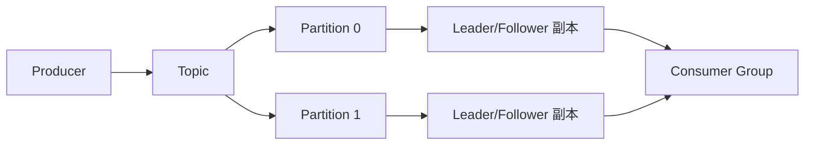

# 中间件

> **模块**：11_后端八股/10_中间件.md  
> **来源**：购买资料 A（8 个源文件）— Kafka/xxl-job/RocketMQ/RabbitMQ/Netty/ES/Dubbo/选型  
> **规模**：约 1477 行  |  **生成**：2026-11-12  
> **状态**：已合并（多源合一）

## 本篇包含

01. kafka核心原理
02. xxl-job
03. RocketMQ
04. RabbitMQ
05. Netty
06. Elasticsearch
07. Dubbo
08. 消息队列选型

## 01 kafka核心原理

Kafka 是大厂最常用的消息队列，面试中经常会问"Kafka 为什么这么快"和"如何保证消息不丢失"。

### Kafka的基本概念

> 💡 **Q：什么是 Kafka？有什么特点？**

> 📝 Kafka 是一个分布式的流式处理平台，最初由 LinkedIn 开发，现在是 Apache 的顶级项目。
> **Kafka 的特点**：
> 第一个是**高吞吐量**。Kafka 可以处理每秒数百万条消息，吞吐量非常高。
> 第二个是**低延迟**。Kafka 的消息延迟通常在毫秒级别。
> 第三个是**可扩展性**。Kafka 可以水平扩展，通过增加 Broker 节点来提高性能。
> 第四个是**持久化**。Kafka 的消息会持久化到磁盘，即使系统崩溃，消息也不会丢失。
> 第五个是**高可用**。Kafka 支持副本机制，即使某个节点宕机，消息也不会丢失。
> **Kafka 的核心概念**：
> - **Producer（生产者）**：发送消息到 Kafka。
> - **Consumer（消费者）**：从 Kafka 读取消息。
> - **Broker**：Kafka 的服务器节点，负责存储和转发消息。
> - **Topic（主题）**：消息的分类，类似于数据库的表。
> - **Partition（分区）**：Topic 的物理分组，每个 Partition 是一个有序的消息队列。
> - **Consumer Group（消费者组）**：多个 Consumer 组成一个组，共同消费一个 Topic。

### Kafka的架构

> 💡 **Q：Kafka 的架构是怎样的？**

> 📝 Kafka 的架构主要包括以下几个组件：
> **第一个是 Producer（生产者）**，负责发送消息到 Kafka。Producer 可以选择将消息发送到哪个 Partition，通常通过 Key 的 Hash 值来决定。
> **第二个是 Broker**，Kafka 的服务器节点，负责存储和转发消息。一个 Kafka 集群通常有多个 Broker，每个 Broker 可以存储多个 Partition。
> **第三个是 Topic**，消息的分类。一个 Topic 可以有多个 Partition，每个 Partition 是一个有序的消息队列。
> **第四个是 Partition**，Topic 的物理分组。每个 Partition 是一个有序的消息队列，消息在 Partition 内是有序的，但不同 Partition 之间的消息是无序的。每个 Partition 可以有多个副本（Replica），分布在不同的 Broker 上，提高可用性。
> **第五个是 Consumer（消费者）**，负责从 Kafka 读取消息。Consumer 可以订阅一个或多个 Topic，从 Partition 中读取消息。
> **第六个是 Consumer Group（消费者组）**，多个 Consumer 组成一个组，共同消费一个 Topic。同一个 Consumer Group 中的 Consumer 不会重复消费同一条消息，每个 Partition 只会被一个 Consumer 消费。
> **第七个是 ZooKeeper**（Kafka 2.8 之前）或 **KRaft**（Kafka 2.8 之后），负责管理 Kafka 集群的元数据，比如 Broker 的注册、Topic 的配置、Partition 的分配等。
> **架构图**：

> 🔎 **追问1：Kafka 为什么要用 Partition？**

Partition 的主要作用有三个：

第一个是**提高并发性能**。一个 Topic 可以有多个 Partition，多个 Producer 可以并发地向不同的 Partition 写入消息，多个 Consumer 可以并发地从不同的 Partition 读取消息，提高了并发性能。

第二个是**实现负载均衡**。Partition 可以分布在不同的 Broker 上，实现负载均衡。

第三个是**实现水平扩展**。通过增加 Partition 的数量，可以提高 Kafka 的吞吐量。

### Kafka的高吞吐原理

> 💡 **Q：Kafka 为什么这么快？高吞吐量是如何实现的？**

> 📝 Kafka 的高吞吐量主要依赖以下几个技术：
> **第一个是顺序写入磁盘**。Kafka 的消息是顺序写入磁盘的，顺序写入的速度比随机写入快很多（可以达到几百 MB/s）。而且 Kafka 利用了操作系统的 Page Cache，写入时先写到内存，由操作系统异步刷新到磁盘，提高了写入速度。
> **第二个是零拷贝（Zero Copy）**。Kafka 使用了零拷贝技术，减少了数据在内存和磁盘之间的拷贝次数。传统的数据传输需要经过 4 次拷贝（磁盘 → 内核缓冲区 → 用户缓冲区 → Socket 缓冲区 → 网卡），而零拷贝只需要 2 次拷贝（磁盘 → 内核缓冲区 → 网卡），大大提高了传输速度。
> **第三个是批量发送和压缩**。Producer 可以批量发送消息，减少网络请求的次数。而且 Kafka 支持消息压缩（如 Gzip、Snappy、LZ4），减少了网络传输的数据量。
> **第四个是分区并行**。一个 Topic 可以有多个 Partition，多个 Producer 可以并发地向不同的 Partition 写入消息，多个 Consumer 可以并发地从不同的 Partition 读取消息，提高了并发性能。
> **第五个是高效的数据结构**。Kafka 使用了高效的数据结构，比如稀疏索引，可以快速定位消息的位置。

> 🔎 **追问1：什么是零拷贝？**

零拷贝是一种减少数据拷贝次数的技术。

**传统的数据传输**：

1. 数据从磁盘读取到内核缓冲区（DMA 拷贝）。
2. 数据从内核缓冲区拷贝到用户缓冲区（CPU 拷贝）。
3. 数据从用户缓冲区拷贝到 Socket 缓冲区（CPU 拷贝）。
4. 数据从 Socket 缓冲区发送到网卡（DMA 拷贝）。

总共 4 次拷贝，其中 2 次是 CPU 拷贝，占用 CPU 资源。

**零拷贝**：

使用 `sendfile()` 系统调用，数据直接从内核缓冲区发送到网卡，不需要经过用户缓冲区。

1. 数据从磁盘读取到内核缓冲区（DMA 拷贝）。
2. 数据从内核缓冲区发送到网卡（DMA 拷贝）。

总共 2 次拷贝，都是 DMA 拷贝，不占用 CPU 资源。

Kafka 使用了 Java 的 `FileChannel.transferTo()` 方法，底层就是 `sendfile()` 系统调用，实现了零拷贝。

### 消费者组

> 💡 **Q：什么是消费者组？有什么作用？**

> 📝 消费者组（Consumer Group）是 Kafka 的一个重要概念，它是多个 Consumer 的集合。
> **消费者组的特点**：
> 第一个是**同一个 Consumer Group 中的 Consumer 不会重复消费同一条消息**。每个 Partition 只会被一个 Consumer 消费，实现了负载均衡。
> 第二个是**不同的 Consumer Group 可以重复消费同一条消息**。每个 Consumer Group 都有自己的消费进度（Offset），互不影响。
> **消费者组的作用**：
> 第一个是**实现负载均衡**。一个 Topic 有多个 Partition，多个 Consumer 可以并发地消费不同的 Partition，提高消费速度。
> 第二个是**实现广播和点对点**。如果多个 Consumer 属于同一个 Consumer Group，就是点对点模式（每条消息只被消费一次）。如果多个 Consumer 属于不同的 Consumer Group，就是广播模式（每条消息被多次消费）。
> **消费者组的分配策略**：
> Kafka 有三种分配策略，决定哪个 Consumer 消费哪个 Partition：
> - **Range（范围分配）**：按 Partition 的范围分配给 Consumer。
> - **RoundRobin（轮询分配）**：按轮询的方式分配给 Consumer。
> - **Sticky（粘性分配）**：尽量保持原有的分配关系，减少 Rebalance 的开销。

> 🔎 **追问1：什么是 Rebalance？有什么问题？**

**Rebalance（重平衡）**是指 Consumer Group 中的 Consumer 数量发生变化时，重新分配 Partition 的过程。

**触发 Rebalance 的情况**：

1. Consumer 加入或退出 Consumer Group。
2. Consumer 崩溃或超时。
3. Partition 数量发生变化。

**Rebalance 的问题**：

第一个是**停止消费**。Rebalance 期间，所有 Consumer 都会停止消费，等待 Rebalance 完成，影响消费速度。

第二个是**重复消费**。Rebalance 后，Consumer 可能会重新消费已经消费过的消息（如果 Offset 没有及时提交）。

**如何减少 Rebalance**：

第一个是**增加 Consumer 的超时时间**，避免因为网络抖动导致 Consumer 被踢出 Consumer Group。

第二个是**减少 Consumer 的处理时间**，避免因为处理时间过长导致 Consumer 超时。

第三个是**使用 Sticky 分配策略**，减少 Rebalance 的开销。

### 消息的可靠性

> **Q：Kafka 如何保证消息不丢失？**

> 📝 Kafka 保证消息不丢失主要依赖以下几个机制：
> **第一个是副本机制（Replication）**。每个 Partition 可以有多个副本（Replica），分布在不同的 Broker 上。其中一个副本是 Leader，负责处理读写请求，其他副本是 Follower，负责同步 Leader 的数据。如果 Leader 宕机，会从 Follower 中选举一个新的 Leader，保证消息不丢失。
> **第二个是 ACK 机制**。Producer 发送消息后，可以设置 ACK 级别，决定什么时候认为消息发送成功：
> - **acks = 0**：Producer 不等待 Broker 的确认，直接认为发送成功。性能最高，但可能丢失消息。
> - **acks = 1**：Producer 等待 Leader 确认，Leader 写入成功后返回确认。如果 Leader 宕机，Follower 还没同步，消息可能丢失。
> - **acks = -1（all）**：Producer 等待 Leader 和所有 ISR（In-Sync Replicas，同步副本）确认，所有副本都写入成功后返回确认。可靠性最高，但性能最低。
> **第三个是 ISR 机制**。ISR 是指与 Leader 保持同步的 Follower 列表。只有 ISR 中的 Follower 才能被选举为 Leader。如果 Follower 落后太多，会被踢出 ISR。
> **第四个是 HW 和 LEO**。HW（High Watermark，高水位）是指所有 ISR 都已经同步的最新消息的 Offset。LEO（Log End Offset，日志末端偏移量）是指 Partition 的最新消息的 Offset。Consumer 只能消费 HW 之前的消息，保证消息的一致性。
> **第五个是 Consumer 的 Offset 管理**。Consumer 消费消息后，需要提交 Offset，记录消费进度。如果 Consumer 崩溃，重启后可以从上次提交的 Offset 继续消费，避免消息丢失。
> **如何保证消息不丢失**：
> - **Producer 端**：设置 `acks = -1`，等待所有 ISR 确认。设置 `retries > 0`，失败后自动重试。
> - **Broker 端**：设置 `min.insync.replicas > 1`，保证至少有 2 个副本同步成功。设置 `unclean.leader.election.enable = false`，禁止非 ISR 的 Follower 被选举为 Leader。
> - **Consumer 端**：手动提交 Offset，消费成功后再提交，避免消息丢失。

> 🔎 **追问1：Kafka 如何保证消息不重复？**

Kafka 本身无法完全保证消息不重复，需要在业务层面实现幂等性。

**消息重复的原因**：

第一个是 **Producer 重试**。如果 Producer 发送消息后，Broker 已经写入成功，但网络抖动导致 Producer 没有收到确认，Producer 会重试，导致消息重复。

第二个是 **Consumer 重复消费**。如果 Consumer 消费消息后，还没来得及提交 Offset 就崩溃了，重启后会重新消费，导致消息重复。

**如何保证消息不重复**：

**Producer 端**：

- 开启幂等性（`enable.idempotence = true`）。Kafka 会为每条消息分配一个唯一的 ID，Broker 会去重，避免重复写入。
- 开启事务（`transactional.id`）。Kafka 支持事务，可以保证一批消息要么全部成功，要么全部失败。

**Consumer 端**：

- 在业务层面实现幂等性。比如在数据库中记录消息的唯一 ID，消费前先检查是否已经消费过。
- 使用唯一键约束，避免重复插入。

### Kafka的消息顺序

> 💡 **Q：Kafka 如何保证消息的顺序？**

> 📝 Kafka 的消息顺序保证分为两个层面：
> **第一个是 Partition 内有序**。同一个 Partition 内的消息是有序的，按照发送的顺序存储和消费。
> **第二个是 Topic 内无序**。不同 Partition 之间的消息是无序的，因为多个 Partition 是并行处理的。
> **如何保证消息的顺序**：
> 第一个是**将需要保证顺序的消息发送到同一个 Partition**。可以通过指定 Key，Kafka 会根据 Key 的 Hash 值决定发送到哪个 Partition。相同 Key 的消息会发送到同一个 Partition，保证顺序。
> 第二个是**设置 Partition 数量为 1**。如果 Topic 只有一个 Partition，所有消息都是有序的。但这样会降低并发性能，不推荐。
> 第三个是**Consumer 端单线程消费**。如果 Consumer 使用多线程消费，可能会导致消息乱序。应该使用单线程消费，或者在业务层面保证顺序。

> 🔎 **追问1：如果要保证全局有序，怎么办？**

如果要保证全局有序，有两种方案：

**第一种是设置 Topic 只有一个 Partition**。这样所有消息都在一个 Partition 中，自然是有序的。但这样会降低并发性能，吞吐量很低。

**第二种是在业务层面保证顺序**。比如给每条消息加一个序号，Consumer 消费时按序号排序，保证顺序。但这样会增加业务复杂度。

**实际场景**：

大多数场景下，不需要保证全局有序，只需要保证局部有序（比如同一个用户的消息有序）。这时候可以用 Key 来保证，相同 Key 的消息发送到同一个 Partition，保证顺序。

### Kafka的存储机制

> 💡 **Q：Kafka 的消息是如何存储的？**

> 📝 Kafka 的消息存储机制主要有以下几个特点：
> **第一个是分段存储（Segment）**。每个 Partition 的消息不是存储在一个大文件中，而是分成多个 Segment（段）。每个 Segment 包含一个数据文件（.log）和两个索引文件（.index 和 .timeindex）。
> **第二个是稀疏索引**。Kafka 使用稀疏索引，不是每条消息都有索引，而是每隔一定数量的消息才有一个索引。这样可以减少索引的大小，提高查询速度。
> **第三个是顺序写入**。Kafka 的消息是顺序写入磁盘的，顺序写入的速度比随机写入快很多。
> **第四个是定期清理**。Kafka 会定期清理过期的消息，有两种清理策略：
> - **按时间清理**：删除超过一定时间的消息（如 7 天）。
> - **按大小清理**：删除超过一定大小的消息（如 1GB）。
> **Segment 的结构**：
> 每个 Segment 的文件名是该 Segment 的起始 Offset。
> **查询消息的流程**：
> 1. 根据 Offset 找到对应的 Segment。
> 2. 在 Segment 的索引文件中查找 Offset 的位置。
> 3. 在数据文件中读取消息。

> 🔎 **追问1：Kafka 为什么不用数据库存储消息？**

Kafka 不用数据库存储消息主要有两个原因：

第一个是**性能**。数据库的随机写入速度很慢，而 Kafka 使用顺序写入磁盘，速度快很多。而且数据库需要维护索引、事务等，开销很大。

第二个是**扩展性**。数据库的扩展性有限，而 Kafka 可以通过增加 Broker 和 Partition 来水平扩展，吞吐量可以达到每秒数百万条消息。

Kafka 的设计理念是"消息队列"，不是"数据库"，它的目标是高吞吐、低延迟，而不是复杂的查询和事务。

### Rebalance 机制

> 💡 **Q：什么是 Rebalance？它有什么影响？**

> 📝 Rebalance 指的是消费者组内分区分配关系的重新调整。
> 常见触发条件包括：
> - 消费者数量变化
> - Topic 分区数变化
> - Consumer 宕机或重启
> 它的好处是可以动态平衡消费负载，但坏处是：**Rebalance 期间消费会短暂停顿**。  
> 如果 Rebalance 太频繁，就会导致吞吐抖动，甚至进一步引发消息堆积。

### Offset 提交

> 💡 **Q：自动提交 Offset 和手动提交 Offset 有什么区别？**

> 📝 自动提交的优点是简单，但风险是业务还没真正处理成功，Offset 就已经提交了。
> 手动提交更安全，一般会在业务处理成功后再提交 Offset。  
> 所以如果业务对可靠性要求高，我更倾向于使用 **手动提交 Offset**。

### ISR 机制

> 💡 **Q：什么是 ISR？**

> 📝 ISR 指的是 **In-Sync Replicas**，也就是和 Leader 保持同步的副本集合。
> 当 Producer 配置 `acks=-1` 时，本质上就是要求消息至少被 ISR 中的副本确认后才返回成功。  
> 这样可以提升可靠性，但写入延迟会稍微高一些。

### 消息堆积

> 💡 **Q：Kafka 发生消息堆积时，你怎么排查？**

> 📝 消息堆积通常说明：生产速度大于消费速度。
> 我会优先看：
> - Consumer 是否异常或频繁 Rebalance
> - 单条消息处理是否太慢
> - 下游依赖是否卡住
> - Partition 数量是否不够，导致并行度受限
> 常见优化方向包括：
> - 增加 Consumer 并发
> - 增加 Partition 数量
> - 优化业务处理逻辑
> - 临时扩容做削峰

#### 图解补充：Kafka 核心拓扑

#### 对比补充：可靠性怎么记

| 机制 | 作用 | 面试里的关键词 |
|-|-|-|
| 副本机制 | Broker 宕机后仍可恢复 | Leader、Follower |
| ACK | 控制发送成功的确认时机 | `acks=0/1/all` |
| ISR | 保证只有同步足够的副本参与选主 | 同步副本集合 |
| HW/LEO | 控制消费者可见范围 | 高水位 |
| Offset 提交 | 记录消费进度 | 至少一次/重复消费 |

#### 高频追问补充

> 🔎 **追问补充1：为什么 Kafka 的顺序性只能保证分区内有序？**

因为每个 Partition 本质上就是一个有序日志文件，顺序是建立在单个分区内部的。多个分区并行写入和并行消费时，天然就没有全局顺序。

> 🔎 **追问补充2：Rebalance 为什么会影响消费体验？**

因为 Rebalance 期间消费者组要重新分配分区，消费者会短暂停止拉取消息。如果业务处理时间长、心跳不稳或频繁扩缩容，就容易反复触发 Rebalance，造成抖动。

> 🔎 **追问补充3：Kafka 怎么回答“如何保证消息不丢”更完整？**

最好按三端回答：Producer 端设 `acks=all` 和重试，Broker 端设副本和 `min.insync.replicas`，Consumer 端消费成功后再提交 Offset。这样更像完整链路，不是只背一端配置。

#### 速记版

> 📝 Kafka 建议按这条线记：
> - Topic 用 Partition 拆并发
> - Broker 用副本保高可用
> - Producer 端靠 ACK 和重试保发送
> - Consumer 端靠 Offset 管理进度
> - Rebalance 是消费者组的常见风险点
> 一句话面试版：
> Kafka 的核心设计就是 `分区做并行，副本做可靠性，顺序写和零拷贝做高吞吐`。

## 02 xxl-job

常问问题：

**为什么不用 Spring 定时任务、调度中心和执行器怎么配合、失败重试和分片广播怎么做。**

### XXL-JOB 是什么

> 💡 **Q：什么是 XXL-JOB？它主要解决什么问题？**

> 📝 XXL-JOB 是一个分布式任务调度平台。
> 它要解决的核心问题是：
> - 定时任务怎么统一管理
> - 多台机器上任务怎么调度
> - 任务失败了怎么重试
> - 任务执行日志怎么查看
> - 同一任务怎么避免多实例重复执行
> 如果一句话概括：
> **XXL-JOB 解决的是“任务怎么稳定地、可视化地、分布式地执行”。**

### 为什么不用 Spring 自带定时任务

> 💡 **Q：为什么很多项目不用 `@Scheduled`，而是上 XXL-JOB？**

> 📝 Spring 自带定时任务适合简单场景，但一旦到了分布式环境，问题就来了：
> - 多实例部署后可能重复执行
> - 没有统一调度中心
> - 任务日志、执行历史、告警能力较弱
> - 动态修改任务配置不方便
> 而 XXL-JOB 提供了：
> - 调度中心
> - 执行器管理
> - 任务路由
> - 日志查看
> - 失败重试
> - 分片广播
> 所以它更适合中后台任务平台化管理。

### XXL-JOB 的核心架构

> 💡 **Q：XXL-JOB 的核心架构是怎样的？**

> 📝 XXL-JOB 的典型架构里有两个核心角色：
> - **Admin 调度中心**：负责任务配置、调度、监控、日志管理
> - **Executor 执行器**：真正执行任务的应用节点
> 大致流程是：
> 1. 执行器启动后向调度中心注册
> 2. 调度中心根据 cron 或其他触发规则生成调度
> 3. 调度中心按路由策略选择一个或多个执行器
> 4. 执行器执行任务并回传结果
> 5. 调度中心记录日志、状态、失败重试信息

### 调度中心和执行器怎么配合

> 💡 **Q：XXL-JOB 里调度中心和执行器分别负责什么？**

> 📝 ### 调度中心
> 主要负责：
> - 维护任务配置
> - 计算触发时间
> - 选择目标执行器
> - 记录任务执行日志
> - 失败重试和报警
> ### 执行器
> 主要负责：
> - 注册自己
> - 暴露任务处理器
> - 真正执行任务逻辑
> - 把执行结果回传给调度中心
> 所以面试里可以直接说：
> **调度中心负责“什么时候、让谁执行”，执行器负责“具体怎么执行”。**

### 路由策略怎么理解

> 💡 **Q：XXL-JOB 的路由策略是什么？为什么需要路由策略？**

> 📝 因为一个任务往往会部署在多个执行器实例上，所以调度中心要决定：
> **这次调度，到底交给哪台机器执行。**
> 常见路由策略可以理解成：
> - 轮询
> - 随机
> - 故障转移
> - 忙碌转移
> - 分片广播
> 其中最典型的是：
> ### 故障转移
> 某台执行器不可用时，切换到其他节点。
> ### 分片广播
> 把一个任务拆成多个分片，让多台执行器分别处理不同分片。
> 这对批处理、大数据同步、分片扫描任务很常见。

### 分片广播是什么

> 💡 **Q：XXL-JOB 的分片广播是干什么的？**

> 📝 分片广播适合：
> **同一个任务逻辑，需要多台机器并行处理不同数据片段。**
> 比如：
> - 多库分片数据扫描
> - 大量用户数据批处理
> - 大表分段修复任务
> 调度中心会把总分片数和当前分片号传给执行器，执行器按分片参数只处理自己负责的一段。
> 所以分片广播不是简单“广播执行”，而是：
> **同一任务的并行切片执行。**

### 失败重试怎么做

> 💡 **Q：XXL-JOB 任务执行失败后，一般怎么处理？**

> 📝 XXL-JOB 常见失败处理思路有：
> - 记录失败日志
> - 配置失败重试次数
> - 报警通知
> - 人工补偿或手工重跑
> 但面试里要注意：
> **任务平台只能帮你做调度和重试，业务任务本身最好具备幂等性。**
> 比如发券任务、同步任务、补偿任务，如果不幂等，重试可能反而放大问题。

### XXL-JOB 和 Quartz 怎么比

> 💡 **Q：XXL-JOB 和 Quartz 有什么区别？**

> 📝 一个常见答法是：
> - **Quartz** 更像一个任务调度组件库
> - **XXL-JOB** 更像一个完整的分布式任务调度平台
> XXL-JOB 提供了：
> - Web 管理界面
> - 执行器注册
> - 路由策略
> - 日志与告警
> - 分片广播
> 所以很多团队不是因为 Quartz 不行，而是因为：
> **当任务数量、节点数量、运维复杂度上来后，更需要平台化的调度能力。**

### 项目里怎么说

> 💡 **Q：如果项目里用了 XXL-JOB，面试时怎么讲？**

> 📝 可以这样组织：
> 1. **场景**  
> 比如定时同步、对账、补偿、批处理、数据修复。
> 2. **为什么选 XXL-JOB**  
> 比如多实例环境下需要统一调度和可视化管理。
> 3. **怎么保证稳定**  
> 比如执行器分组、失败重试、报警、幂等、分片广播。
> 4. **踩过什么坑**  
> 比如任务执行时间过长、重试导致重复处理、分片设计不均匀。

### 高频追问补充

> 🔎 **追问1：XXL-JOB 能保证任务绝对只执行一次吗？**

平台会尽量做调度控制，但在重试、网络抖动、执行器异常等情况下，业务仍然需要靠幂等兜底。

> 🔎 **追问2：XXL-JOB 和 MQ 有什么区别？**

XXL-JOB 主要做定时和调度；  
MQ 主要做异步解耦和消息传递。

> 🔎 **追问3：为什么任务平台也要监控和告警？**

因为任务很多时候承担的是对账、补偿、数据同步这类关键后台链路，一旦失败，影响未必比主链路小

## 03 RocketMQ

RocketMQ 在 Java 面试里经常被放在“业务消息队列”语境下讨论。  
面试官通常会追问的不是“RocketMQ 是什么”，而是：**为什么很多交易系统会选它、顺序消息怎么做、事务消息怎么回事、消费失败怎么处理。**

### RocketMQ 是什么，适合什么场景

> 💡 **Q：什么是 RocketMQ？它更适合什么场景？**

> 📝 RocketMQ 是 Apache 顶级项目之一，本质上也是一个分布式消息中间件。
> 它在 Java 业务场景里比较常见，原因通常有三点：
> - 对**顺序消息**支持比较友好
> - 对**延迟消息、事务消息**这类业务型能力支持较完整
> - 很多业务系统更关注“交易、订单、库存”这种消息链路，而不是极致日志吞吐
> 所以如果一句话概括：
> **RocketMQ 更适合核心业务消息场景，而 Kafka 更偏数据流和日志流。**

### RocketMQ 的核心概念

> 💡 **Q：RocketMQ 里最重要的几个概念是什么？**

> 📝 RocketMQ 里常见的核心概念有：
> - **Producer**：生产者
> - **Consumer**：消费者
> - **NameServer**：路由中心，负责记录 Topic 和 Broker 的路由信息
> - **Broker**：真正存储消息、提供读写服务的节点
> - **Topic**：消息主题
> - **Message Queue**：一个 Topic 下的逻辑队列
> - **Consumer Group**：消费组
> - **Tag**：更细粒度的消息分类
> 你可以把它理解成：
> - NameServer 解决“我该把消息发到哪”
> - Broker 解决“消息真正存在哪、怎么投递”
> - Queue 解决“并行度和局部有序”

### RocketMQ 的架构和工作流程

> 💡 **Q：RocketMQ 的架构是怎样的？**

> 📝 RocketMQ 架构里最典型的链路是：
> 1. Producer 启动时先从 NameServer 拉取 Topic 路由信息
> 2. Producer 根据路由把消息发给某个 Broker
> 3. Broker 把消息写入 CommitLog
> 4. Consumer 从 Broker 拉消息并消费
> 5. 消费成功后返回确认，失败则重试
> RocketMQ 的一个特点是 **NameServer 本身不做强一致协调**，它更像轻量级路由发现组件。  
> 真正的消息存储和转发，还是在 Broker 上完成。

### 为什么很多业务系统会选 RocketMQ

> 💡 **Q：RocketMQ 相比 Kafka、RabbitMQ，优势通常体现在哪里？**

> 📝 RocketMQ 在业务系统里的优势通常会从下面几个点来讲：
> **第一，业务特性比较完整。**  
> 顺序消息、延迟消息、事务消息、重试、死信，这些业务里很常见。
> **第二，Java 生态结合比较顺手。**  
> 很多 Java 团队更熟悉它的使用方式、监控方式和工程表达。
> **第三，适合订单、支付、库存这类链路。**  
> 这些场景更看重消息可靠性、顺序控制、事务协同，而不只是极致吞吐。
> 所以如果面试问“为什么没选 Kafka”，一个合理回答是：
> **因为当前系统的重点不是日志流吞吐，而是核心业务消息的可靠投递、顺序控制和事务协同。**

### RocketMQ 的消息存储模型

> 💡 **Q：RocketMQ 的消息是怎么存储的？**

> 📝 RocketMQ 最核心的存储文件是 **CommitLog**。
> 它的大致思路是：
> - 所有消息先顺序写入 CommitLog
> - 再通过 ConsumeQueue 建立逻辑队列索引
> - 通过索引帮助消费者快速定位消息
> 这样设计的好处是：
> - 写入路径比较统一
> - 顺序写磁盘性能较好
> - 逻辑队列和物理存储分离，便于消费
> 这个思路和 Kafka 有点像，都是在利用**顺序写磁盘**来换高吞吐。  
> 但 RocketMQ 在业务能力层面做了更多增强。

### RocketMQ 有哪些常见消息类型

> 💡 **Q：RocketMQ 常见的消息类型有哪些？**

> 📝 面试里最常见的通常有这几类：
> ### 普通消息
> 最基础的异步解耦消息。
> ### 顺序消息
> 要求同一类业务消息按顺序消费。  
> 常见于订单状态流转、步骤编排。
> ### 延迟消息
> 消息先发出去，但不是立刻消费，而是在指定延迟后投递。  
> 常见于超时关单、超时取消、补偿检查。
> ### 事务消息
> 用于把“本地事务”和“消息最终可见”关联起来。  
> 常见于下单成功后异步通知库存、积分、营销系统。
> ### 重试消息 / 死信消息
> 消费失败会重试，多次失败后进入死信队列，方便后续排查和补偿。

### RocketMQ 怎么保证消息不丢

> 💡 **Q：RocketMQ 如何保证消息不丢失？**

> 📝 RocketMQ 的可靠性也要从三端来看：
> ### Producer 端
> - 发送失败重试
> - 关键消息做好发送结果确认
> - 必要时使用同步发送
> ### Broker 端
> - 主从复制
> - 刷盘策略合理配置
> - 持久化成功后再返回
> ### Consumer 端
> - 消费成功后再确认
> - 失败时按重试策略处理
> - 业务层面做幂等
> 所以不要只回答“RocketMQ 有主从”。  
> 更完整的表达是：
> **生产端保证送达，Broker 保证持久化和复制，消费端保证正确确认和幂等处理。**

### 顺序消息怎么实现

> 💡 **Q：RocketMQ 的顺序消息是怎么做的？**

> 📝 顺序消息的核心思路是：
> **让同一业务主键的消息落到同一个 Queue，再由消费端顺序处理。**
> 比如一个订单从“创建 -> 支付 -> 发货 -> 完成”，如果要保证状态顺序：
> - 可以按 `orderId` 选择同一个 Queue
> - 消费端对这个 Queue 顺序消费
> 要注意：
> - 顺序通常是**局部顺序**，不是全局顺序
> - 一旦消费端并发打散，顺序也可能被破坏
> 所以顺序消息不只是 Broker 的事，**生产端路由和消费端模型也要一起配合。**

### 事务消息是什么

> 💡 **Q：RocketMQ 的事务消息解决什么问题？**

> 📝 RocketMQ 的事务消息主要解决的是：
> **本地事务和消息发送之间的一致性问题。**
> 经典场景是：
> 1. 先发送半消息
> 2. 执行业务本地事务
> 3. 本地事务成功，则提交消息
> 4. 本地事务失败，则回滚消息
> 5. 如果状态不明确，Broker 会回查生产者
> 这个机制适合：
> - 下单成功后通知库存
> - 支付成功后通知营销系统
> - 核心写库成功后再异步通知下游
> 但也要说明边界：
> **事务消息不是万能分布式事务，它更像一种“消息最终一致”的工程方案。**

### RocketMQ 消费失败怎么处理

> 💡 **Q：RocketMQ 消费失败后会怎样？**

> 📝 RocketMQ 对消费失败一般会做这几层处理：
> 1. **先重试**  
> 业务抖动、网络抖动类问题先靠重试兜住。
> 2. **达到重试上限后进死信队列**  
> 便于人工排查和补偿。
> 3. **业务幂等保护**  
> 防止因为重试把下游写坏。
> 所以一个成熟答案不能只说“RocketMQ 会重试”，还要补：
> **重试只是第一层，真正稳定的系统还要有死信、补偿、监控、人工介入通道。**

### 广播消费和集群消费怎么理解

> 💡 **Q：RocketMQ 的广播消费和集群消费有什么区别？**

> 📝 ### 集群消费
> 同一个消费组里的多个消费者共同分摊消息。  
> 一条消息只会被组内一个实例处理。
> ### 广播消费
> 消息会被组内所有消费者各消费一次。  
> 适合配置下发、缓存刷新、广播通知这类场景。
> 所以面试里可以直接说：
> **集群消费强调分摊吞吐，广播消费强调每个节点都收到。**

### 项目里怎么说

> 💡 **Q：如果项目里用了 RocketMQ，面试时应该怎么讲？**

> 📝 推荐答法可以这样组织：
> 1. **场景**  
> 比如下单后异步发券、发通知、同步库存。
> 2. **为什么选 RocketMQ**  
> 比如看重顺序消息、延迟消息、事务消息等能力。
> 3. **可靠性设计**  
> 比如主从复制、重试、死信、消费幂等。
> 4. **遇到的问题**  
> 比如消息积压、消费重试过多、死信处理、顺序消费吞吐受限。
> 这样回答会比只背概念更像真实做过。

### 高频追问补充

> 🔎 **追问1：RocketMQ 和 Kafka 最核心的区别怎么说？**

一句话回答：

**Kafka 更偏高吞吐数据流平台，RocketMQ 更偏业务型消息平台。**

> 🔎 **追问2：RocketMQ 的顺序消息是全局顺序吗？**

通常不是。  
大多数业务里做的是“同一业务主键的局部顺序”。

> 🔎 **追问3：用了事务消息，是不是就不需要幂等了？**

不是。  
事务消息解决的是消息可见性和本地事务之间的一致性，消费端仍然可能重试，业务还是要做幂等。

> 更新: 2026-04-01

## 04 RabbitMQ

一般都考察**Exchange 有哪些类型、消息怎么保证可靠、为什么会积压、死信和 TTL 怎么用。**

### RabbitMQ 是什么，适合什么场景

> 💡 **Q：什么是 RabbitMQ？它更适合哪些场景？**

> 📝 RabbitMQ 是一个实现了 AMQP 协议的消息中间件。
> 它最突出的特点不是极致吞吐，而是：
> - 模型成熟
> - 路由灵活
> - 工程使用门槛相对低
> - 很适合通知分发、解耦、工作队列、规则路由
> 所以 RabbitMQ 往往更适合：
> - 中后台业务系统
> - 规则路由较复杂的场景
> - 通知、审批、异步任务分发
> - 吞吐不是第一目标，但稳定性和路由灵活性很重要的系统

### RabbitMQ 的核心概念

> 💡 **Q：RabbitMQ 的核心概念有哪些？**

> 📝 RabbitMQ 里最重要的概念是：
> - **Producer**：生产者
> - **Consumer**：消费者
> - **Exchange**：交换机，负责路由消息
> - **Queue**：队列，真正存消息
> - **Binding**：绑定关系，决定 Exchange 怎么把消息投到 Queue
> - **Routing Key**：路由键
> - **Channel**：信道，AMQP 的轻量级通信通道
> - **Virtual Host**：虚拟主机，用于隔离资源
> RabbitMQ 最大的特点就是：
> **生产者通常不是把消息直接发到队列，而是先发给 Exchange，再由 Exchange 路由到 Queue。**

### Exchange 有哪些类型

> 💡 **Q：RabbitMQ 的 Exchange 有哪些类型？**

> 📝 最常见的有四种：
> ### Direct Exchange
> 按精确的 `routing key` 路由。  
> 适合一对一、定向投递。
> ### Fanout Exchange
> 忽略 `routing key`，直接广播到所有绑定队列。  
> 适合广播通知。
> ### Topic Exchange
> 支持通配符匹配。  
> 适合按主题、规则进行灵活路由。
> ### Headers Exchange
> 按消息头匹配。  
> 实际项目里没有前三种常见。
> 面试里最常用的答法是：
> **RabbitMQ 的强项就在于 Exchange 模型，它让消息路由比很多 MQ 更灵活。**

### RabbitMQ 的工作流程

> 💡 **Q：Producer 发消息到 RabbitMQ，大致流程是什么？**

> 📝 RabbitMQ 的典型流程是：
> 1. Producer 建立连接和 Channel
> 2. Producer 把消息发到某个 Exchange
> 3. Exchange 根据 Binding 和 Routing Key 路由到一个或多个 Queue
> 4. Queue 持久化消息
> 5. Consumer 订阅 Queue 并消费
> 6. Consumer 消费成功后返回 ack
> 这个流程和 Kafka、RocketMQ 最大不同点在于：
> **RabbitMQ 先强调“路由”，再强调“存储和消费”。**

### RabbitMQ 如何保证消息不丢

> 💡 **Q：RabbitMQ 如何保证消息不丢失？**

> 📝 RabbitMQ 的可靠性一般要分三段看：
> ### 1. 生产者到 Broker
> - 开启 **Publisher Confirm**
> - 必要时配合 **Return 机制** 处理无法路由的消息
> ### 2. Broker 内部存储
> - Exchange、Queue、Message 设置为持久化
> - 必要时使用高可用队列
> ### 3. Broker 到消费者
> - 使用手动 `ack`
> - 消费成功后再确认
> - 失败时重试或进入死信
> 所以 RabbitMQ 可靠性的标准答法通常是：
> **生产端 Confirm，Broker 端持久化，消费端手动 ack。**

### ack、nack、reject 是什么

> 💡 **Q：RabbitMQ 里的 ack、nack、reject 是什么？**

> 📝 这些都是消费者对消息处理结果的反馈：
> - **ack**：消费成功，Broker 可以删消息
> - **nack**：消费失败，可以选择重回队列
> - **reject**：拒绝这条消息，也可以决定是否重回队列
> 面试里要说明：
> **如果不开手动 ack，或者业务还没成功就 ack，就可能导致消息丢失。**

### prefetch 有什么作用

> 💡 **Q：RabbitMQ 的 prefetch 是干什么的？**

> 📝 `prefetch` 可以理解成：
> **消费者一次最多预取多少条尚未确认的消息。**
> 它的作用主要有两个：
> - 防止某个消费者一次拿太多消息，处理不过来
> - 帮助做消费端流控和公平分发
> 如果 `prefetch` 设得太大，可能导致某个慢消费者手里压很多消息；  
> 如果设得太小，吞吐又可能起不来。
> 所以它本质上是 RabbitMQ 消费端的重要流控参数。

### TTL、死信队列、延迟消息怎么理解

> 💡 **Q：RabbitMQ 的 TTL、死信队列、延迟消息分别是什么？**

> 📝 ### TTL
> 给消息或队列设置生存时间，过期后不再正常消费。
> ### 死信队列
> 消息因为以下原因无法正常消费时，会进入死信：
> - 被拒绝且不重新入队
> - 超过 TTL
> - 队列达到长度限制
> ### 延迟消息
> RabbitMQ 原生更多依赖 **TTL + 死信交换机** 组合，或者使用延迟消息插件来实现。
> 这几个能力在业务里很常见：
> - 超时取消订单
> - 重试后仍失败的消息转人工处理
> - 定时提醒、延时通知

### RabbitMQ 为什么容易积压

> 💡 **Q：RabbitMQ 出现消息积压，一般从哪些方向排查？**

> 📝 消息积压通常从三个方向看：
> ### 1. 生产太快
> 上游突发流量，把队列瞬间打满。
> ### 2. 消费太慢
> - 消费逻辑太重
> - 下游数据库或 RPC 慢
> - 消费者实例数不够
> ### 3. 配置不合理
> - `prefetch` 设置不合理
> - ack 太慢
> - 单队列成瓶颈
> RabbitMQ 更适合灵活路由，但如果拿它扛超大吞吐，又没有足够并行和治理，就容易积压。

### RabbitMQ 的高可用怎么讲

> 💡 **Q：RabbitMQ 的高可用一般怎么实现？**

> 📝 RabbitMQ 的高可用通常会提到：
> - 集群部署
> - 队列镜像或更现代的 **Quorum Queue**
> - 持久化
> - 节点故障转移
> 面试里别只停留在“做集群”，还可以补一句：
> **RabbitMQ 的普通集群不等于消息天然高可用，关键还要看队列副本机制怎么配。**

### 项目里怎么说

> 💡 **Q：如果项目里用了 RabbitMQ，面试时怎么讲更像真实做过？**

> 📝 推荐讲法：
> 1. **场景**  
> 比如消息通知、审批流、订单状态广播、异步任务解耦。
> 2. **为什么选 RabbitMQ**  
> 比如更看重路由灵活、协议成熟、团队使用成本低。
> 3. **可靠性怎么做**  
> 比如 confirm、持久化、手动 ack、死信队列、幂等。
> 4. **遇到的问题**  
> 比如消息积压、消费不均衡、延迟消息实现、死信补偿。

### 高频追问补充

> 🔎 **追问1：RabbitMQ 和 Kafka 最大区别怎么说？**

一句话回答：

**RabbitMQ 更强调灵活路由和业务队列模型，Kafka 更强调高吞吐和流式处理。**

> 🔎 **追问2：RabbitMQ 的消息是直接发到队列吗？**

通常不是。  
Producer 是先发到 Exchange，再由 Exchange 路由到 Queue。

> 🔎 **追问3：有了手动 ack，为什么还要幂等？**

因为消费失败重试、网络抖动、消费者重启都可能带来重复投递，业务层幂等仍然需要做。

## 05 Netty

Netty 在面试里经常被放在“高性能网络框架”语境下问。  
它常常和 NIO、Reactor、Dubbo、网关、IM、长连接一起出现。

### Netty 是什么

> 💡 **Q：什么是 Netty？为什么很多框架都喜欢基于 Netty？**

> 📝 Netty 是一个基于 Java NIO 的高性能网络通信框架。
> 它解决的核心问题是：
> - 原生 NIO 编程太复杂
> - 连接管理、事件分发、粘包拆包、心跳检测这些基础能力很麻烦
> - 业务框架不想每次都从 Socket / Selector 重新造轮子
> 所以很多 RPC 框架、网关、IM 系统、消息中间件客户端都会基于 Netty。
> 一句话概括：
> **Netty 把高性能网络编程里那些复杂但重复的基础设施抽象好了。**

### Netty 和原生 NIO 的区别

> 💡 **Q：Netty 相比原生 NIO，主要提升在哪里？**

> 📝 原生 NIO 的核心问题不是能力不够，而是编码复杂度高。
> Netty 主要帮你封装了这些东西：
> - 连接和线程模型
> - 事件分发
> - 编解码器
> - 粘包拆包处理
> - 心跳和空闲检测
> - 内存管理和缓冲区封装
> 所以如果面试官问“为什么不用原生 NIO”，你可以答：
> **原生 NIO 能做，但工程复杂度高；Netty 更适合构建可维护的高性能网络服务。**

### Reactor 模型是什么

> 💡 **Q：Netty 为什么总会和 Reactor 模型一起说？**

> 📝 因为 Netty 的事件驱动模型，本质上就是 Reactor 思想的工程实现。
> Reactor 的核心是：
> **把连接建立、事件监听、事件分发、业务处理拆开，由事件循环统一调度。**
> Netty 里最常见的是主从 Reactor：
> - 一个 Boss 线程组负责接收连接
> - 一个 Worker 线程组负责处理读写事件
> 这比“一个连接一个线程”的 BIO 模式更适合高并发连接场景。

### EventLoop 是什么

> 💡 **Q：Netty 里的 EventLoop 是什么？**

> 📝 EventLoop 可以理解成：
> **一个不断执行事件循环的线程执行单元。**
> 它通常负责：
> - 监听 IO 事件
> - 执行 Channel 上的任务
> - 调度定时任务
> 一个 Channel 通常会绑定到一个固定的 EventLoop。  
> 这样做好处是：
> - 避免并发竞争
> - 简化线程安全问题
> - 保持同一连接上的事件顺序

### Channel 和 Pipeline 是什么

> 💡 **Q：Netty 里的 Channel 和 Pipeline 分别是什么？**

> 📝 ### Channel
> 表示一个网络连接或 IO 通道。  
> 它可以理解成对底层 Socket 的高级抽象。
> ### ChannelPipeline
> 表示这条连接上的处理链。  
> 消息进来后会沿着 Pipeline 经过多个 Handler。
> 所以 Netty 很像一个责任链模式：
> - 入站事件一层层往下走
> - 出站事件按另一方向处理
> 这让编解码、鉴权、日志、心跳、业务处理都可以拆分成独立 Handler。

### ByteBuf 为什么重要

> 💡 **Q：Netty 为什么不用原生 ByteBuffer，而是自己搞了 ByteBuf？**

> 📝 因为原生 `ByteBuffer` 在使用上有不少不便，比如：
> - 读写模式切换麻烦
> - 扩容不友好
> - API 体验一般
> Netty 的 `ByteBuf` 做了更好的抽象：
> - 读写指针分离
> - 更灵活的内存操作
> - 支持池化和零拷贝相关优化
> 所以 `ByteBuf` 是 Netty 提升易用性和性能的核心组件之一。

### 粘包拆包问题怎么理解

> 💡 **Q：为什么基于 TCP 的 Netty 通信会有粘包拆包问题？**

> 📝 因为 TCP 是**字节流协议**，它不关心应用层消息边界。
> 所以应用层看到的数据可能出现：
> - 多条消息粘在一起
> - 一条消息被拆成多段
> Netty 常见解决方式有：
> - 固定长度协议
> - 分隔符协议
> - 长度字段协议
> 面试里要说明：
> **粘包拆包不是 Netty 的问题，而是 TCP 字节流模型天然带来的问题，Netty 只是帮你更方便地解决。**

### 心跳和空闲检测怎么做

> 💡 **Q：Netty 里为什么经常会做心跳检测？**

> 📝 长连接场景里，如果一条连接长时间没有数据，不代表它一定有效。  
> 所以很多系统会做：
> - 心跳包
> - 空闲检测
> - 超时关闭
> Netty 常通过空闲检测 Handler 来感知读空闲、写空闲、全空闲，然后触发心跳或断连处理。
> 这在 IM、网关、RPC 长连接场景里都非常常见。

### 为什么说 Netty 性能高

> 💡 **Q：Netty 性能高主要体现在哪些地方？**

> 📝 Netty 的高性能通常来自这些点：
> - 基于 NIO 的事件驱动模型
> - Reactor 线程模型
> - 减少锁竞争
> - 高效的内存管理和对象复用
> - 丰富的编解码和连接管理能力
> 但面试里不要说成“用了 Netty 就一定快”。  
> 如果业务 Handler 里写了阻塞操作，再好的 EventLoop 也会被拖慢。

### Netty 使用时常见坑

> 💡 **Q：使用 Netty 时，常见的坑有哪些？**

> 📝 常见坑通常有：
> - 在 IO 线程里做耗时阻塞逻辑
> - 忽略粘包拆包
> - 连接数太多但心跳和空闲处理不合理
> - 直接内存泄漏
> - Handler 线程安全问题
> 其中最经典的一句是：
> **不要在 EventLoop 线程里做重业务逻辑，IO 线程应该专注处理网络事件。**

### 项目里怎么说

> 💡 **Q：如果项目里用过 Netty，面试时怎么讲？**

> 📝 可以这样组织：
> 1. **用在什么场景**  
> 比如 RPC 通信、长连接网关、IM、内部二进制协议通信。
> 2. **为什么用 Netty**  
> 比如原生 NIO 开发复杂，Netty 提供更成熟的网络编程模型。
> 3. **你关注的点**  
> 比如线程模型、编解码、粘包拆包、心跳、连接管理。
> 4. **踩过的坑**  
> 比如阻塞 IO 线程、内存泄漏、拆包协议设计不合理。

### 高频追问补充

> 🔎 **追问1：Netty 和 Tomcat 是一类东西吗？**

不完全一样。  
Netty 是底层网络通信框架，Tomcat 是 Servlet 容器和 Web 服务器。

> 🔎 **追问2：Netty 和 Dubbo 有什么关系？**

Dubbo 这类 RPC 框架经常会基于 Netty 做底层通信，但 Dubbo 还会再往上封装服务发现、序列化、容错治理等能力。

> 🔎 **追问3：Netty 和 IO模型 怎么关联？**

Netty 可以看成是对 NIO 多路复用模型的一层工程化封装，底层思想和 `Selector + Channel + 非阻塞` 是一脉相承的。

## 06 Elasticsearch

Elasticsearch 是面试里很典型的“搜索中间件”题。  
它通常不会只考“ES 是什么”，而是会连着问：**为什么搜得快、倒排索引怎么回事、为什么叫近实时、分片副本怎么设计、为什么不直接用 MySQL。**

### Elasticsearch 是什么

> 💡 **Q：什么是 Elasticsearch？它擅长解决什么问题？**

> 📝 Elasticsearch 本质上是一个**分布式全文检索和分析引擎**。
> 它最擅长做的是：
> - 全文搜索
> - 复杂条件检索
> - 聚合分析
> - 海量文档检索
> 它的典型场景包括：
> - 商品搜索
> - 日志检索
> - 文章检索
> - 运营分析和报表
> 如果一句话概括：
> **ES 的核心价值，是把“模糊搜索 + 海量数据 + 复杂查询”这件事做得比关系型数据库更合适。**

### 为什么不直接用 MySQL 做搜索

> 💡 **Q：为什么很多搜索场景不用 MySQL，而要上 Elasticsearch？**

> 📝 MySQL 当然能做简单查询，但它在全文搜索场景下通常不是最佳选择。
> 主要原因有：
> - 模糊查询性能差
> - 多字段全文检索不擅长
> - 排序、相关性评分能力弱
> - 海量搜索扩展性有限
> 而 Elasticsearch 之所以更适合，是因为它底层依赖：
> - 倒排索引
> - 分词器
> - 分片并行搜索
> 所以不是 MySQL 不能搜，而是：
> **搜索系统的核心诉求和关系型数据库的设计目标不一样。**

### 什么是倒排索引

> 💡 **Q：什么是倒排索引？为什么 Elasticsearch 查得快？**

> 📝 倒排索引可以简单理解成：
> **不是“文档里有哪些词”，而是“每个词出现在哪些文档里”。**
> 比如：
> - “Java” -> 文档 1、文档 3、文档 8
> - “中间件” -> 文档 2、文档 3
> 这样查关键词时，不需要全表扫描，而是直接通过词项找到命中的文档集合。
> 所以 ES 搜索快的核心不是“存在内存里”，而是：
> **它预先把检索结构组织好了。**

### 分词器是什么

> 💡 **Q：为什么 Elasticsearch 需要分词器？**

> 📝 因为全文搜索不是简单拿整段文本做等值匹配，而是要把文本拆成适合检索的词项。
> 分词器大致会做三件事：
> 1. 字符过滤
> 2. 分词
> 3. 词项归一化
> 比如中英文、大小写、停用词、同义词，都会影响搜索效果。
> 面试里常见的表达是：
> **倒排索引决定“怎么存”，分词器决定“拆成什么词去存”。**

### Elasticsearch 的核心概念

> 💡 **Q：ES 里有哪些核心概念？**

> 📝 面试里最常见的概念有：
> - **Cluster**：集群
> - **Node**：节点
> - **Index**：索引，类似数据库里的逻辑集合
> - **Document**：文档，一条 JSON 数据
> - **Shard**：分片
> - **Replica**：副本
> - **Segment**：Lucene 底层的索引段
> 可以粗暴理解成：
> - Index 类似库表级逻辑对象
> - Document 类似一条记录
> - Shard 决定怎么水平拆分
> - Replica 决定怎么高可用和读扩展

### 分片和副本怎么理解

> 💡 **Q：ES 的分片和副本分别解决什么问题？**

> 📝 ### 分片
> 主要解决：
> - 单机放不下
> - 单机查不过来
> - 数据和查询的水平扩展
> ### 副本
> 主要解决：
> - 高可用
> - 读请求分担
> 所以面试里可以这样答：
> **分片解决扩展性，副本解决可用性和读能力。**

### Elasticsearch 为什么叫近实时

> 💡 **Q：为什么 Elasticsearch 叫“近实时”，而不是强实时？**

> 📝 因为一条数据写入 ES 后，并不是立刻就对搜索可见。
> 典型流程是：
> 1. 文档先写入内存缓冲和 translog
> 2. 定期执行 `refresh`
> 3. 刷新后生成新的可搜索 segment
> 所以新写入的数据往往会在一个很短的时间窗口后才可被搜索到。  
> 这个“不是立即可见，但很快可见”的特性，就叫近实时。

### Elasticsearch 的写入流程

> 💡 **Q：一条文档写入 Elasticsearch，大致经历什么流程？**

> 📝 可以简单理解为：
> 1. 请求先到某个协调节点
> 2. 路由到目标主分片
> 3. 主分片先写本地
> 4. 再同步到副本分片
> 5. 写入 translog，等待 refresh 后对搜索可见
> 所以 ES 写入的关键点通常是：
> - 主分片负责接收写请求
> - 副本分片负责同步
> - refresh 决定搜索可见性

### Elasticsearch 的查询流程

> 💡 **Q：ES 查询时是怎么工作的？**

> 📝 查询大致分两步：
> ### Query Phase
> 协调节点把查询分发到各个分片，各分片先返回本地 TopN 结果。
> ### Fetch Phase
> 协调节点汇总排序后，再去对应分片拿完整文档。
> 这样做的好处是：
> - 各分片并行搜索
> - 协调节点统一汇总结果
> 所以 ES 查询快，很大一部分也来自**分片并行**。

### Mapping 为什么重要

> 💡 **Q：为什么 ES 的 Mapping 设计很重要？**

> 📝 因为 Mapping 决定了：
> - 字段是什么类型
> - 是精确匹配还是全文检索
> - 是否参与索引
> - 是否参与聚合和排序
> 最典型的高频点是：
> - `text`：适合全文检索
> - `keyword`：适合精确匹配、聚合、排序
> 如果 Mapping 设计错了，后面搜索效果、聚合能力、性能表现都会受影响。

### ES 常见问题怎么说

> 💡 **Q：面试里关于 Elasticsearch 常见会追问哪些问题？**

> 📝 常见追问通常有这些：
> - 为什么不用 MySQL 做全文检索
> - 倒排索引和 B+ 树索引有什么差别
> - 为什么叫近实时
> - 分片数怎么设计
> - 深分页为什么慢
> - refresh、flush、merge 分别是什么
> 其中深分页常见答法是：
> **页数越深，协调节点和分片要跳过的数据越多，排序和汇总成本也越高。**

### 项目里怎么说

> 💡 **Q：如果项目里用了 Elasticsearch，面试时怎么讲？**

> 📝 可以按这四步来讲：
> 1. **场景**  
> 比如商品搜索、日志检索、文章检索。
> 2. **为什么选 ES**  
> 比如需要全文搜索、分词、复杂条件过滤和聚合分析。
> 3. **怎么设计索引**  
> 比如分片、副本、Mapping、分词器。
> 4. **踩过什么坑**  
> 比如深分页慢、Mapping 配错、写入延迟、数据同步一致性问题。

### 高频追问补充

> 🔎 **追问1：ES 查询快的核心原因是什么？**

核心是：

- 倒排索引
- 分词器
- 分片并行搜索

> 🔎 **追问2：ES 能完全替代 MySQL 吗？**

不能。  
ES 更擅长搜索和分析，不适合直接承担强事务型主存储。

> 🔎 **追问3：为什么新写入的数据搜不到？**

因为 ES 是近实时，数据要经过 refresh 后才会对搜索可见。

> 更新: 2026-04-01

## 07 Dubbo

### Dubbo核心原理

Dubbo 是 Java 面试里非常典型的 RPC 框架题。  
它经常会和 ZooKeeper、注册中心、负载均衡、超时重试、服务治理一起问。

#### Dubbo 是什么

> 💡 **Q：什么是 Dubbo？它解决的核心问题是什么？**

> 📝 Dubbo 本质上是一个 **RPC 服务框架**。
> 它主要解决的是：
> - 服务怎么暴露
> - 服务怎么发现
> - 远程调用怎么像本地调用一样方便
> - 调用失败时怎么做超时、重试、容错、负载均衡
> 所以如果一句话概括：
> **Dubbo 解决的是分布式服务调用问题。**

#### 什么是 RPC

> 💡 **Q：什么是 RPC？为什么不直接用 HTTP 接口互调？**

> 📝 RPC 的全称是 Remote Procedure Call，远程过程调用。
> 它的目标是：
> **让你像调用本地方法一样去调用远程服务。**
> 相比直接写 HTTP 接口，RPC 框架通常会帮你处理这些事：
> - 服务发现
> - 序列化 / 反序列化
> - 连接管理
> - 超时控制
> - 负载均衡
> - 失败重试和容错
> 所以 Dubbo 的价值不只是“发一个请求”，而是把整个服务调用链路的工程细节封装起来。

#### Dubbo 的核心架构

> 💡 **Q：Dubbo 的核心架构是怎样的？**

> 📝 Dubbo 经典架构里通常有几个角色：
> - **Provider**：服务提供者
> - **Consumer**：服务消费者
> - **Registry**：注册中心
> - **Monitor**：监控中心
> - **Config Center**：配置中心
> 典型流程是：
> 1. Provider 启动时把服务地址注册到注册中心
> 2. Consumer 启动时从注册中心订阅服务列表
> 3. Consumer 本地生成代理对象
> 4. 业务调用代理对象时，底层发起远程调用
> 5. 返回结果后像本地方法一样继续执行

#### Dubbo 调用链路是怎样的

> 💡 **Q：一个 Dubbo 调用从发起到返回，大致经历哪些步骤？**

> 📝 可以按这条链路来答：
> 1. 业务代码调用本地代理对象
> 2. 代理对象把方法名、参数、接口信息封装成请求
> 3. 请求经过序列化后通过网络发送出去
> 4. Provider 端反序列化请求并定位到目标服务实现
> 5. 服务执行后把结果再序列化回传
> 6. Consumer 反序列化结果并返回给业务线程
> 这里最核心的几个关键词是：
> - 动态代理
> - 序列化
> - 网络传输
> - 服务发现
> - 容错治理

#### Dubbo 为什么常和 ZooKeeper 一起出现

> 💡 **Q：为什么早期 Dubbo 常常配合 ZooKeeper 使用？**

> 📝 因为 Dubbo 需要一个注册中心来解决：
> - Provider 地址存在哪
> - Consumer 怎么动态感知服务上下线
> ZooKeeper 的临时节点和 Watch 正好很适合这个场景：
> - Provider 注册临时节点
> - Provider 宕机时节点自动删除
> - Consumer 监听节点变化，更新本地服务列表
> 所以早期经典组合就是：
> **Dubbo 做 RPC，ZooKeeper 做注册中心。**

#### Dubbo 的负载均衡怎么讲

> 💡 **Q：Dubbo 有哪些常见负载均衡策略？**

> 📝 面试里常见的通常有：
> - **随机**：默认比较常见，简单均匀
> - **轮询**：按顺序分发
> - **最少活跃数**：优先给当前处理压力小的节点
> - **一致性 Hash**：同一类请求尽量打到同一节点
> 不同策略适合不同场景：
> - 普通业务接口常用随机
> - 有局部缓存、会话粘性诉求时可能会用一致性 Hash
> - 节点性能差异明显时，最少活跃数更有意义

#### Dubbo 的超时、重试、容错

> 💡 **Q：Dubbo 调用失败时通常怎么处理？**

> 📝 Dubbo 常见治理能力包括：
> ### 超时
> 防止一个慢服务无限拖住上游线程。
> ### 重试
> 对幂等读请求或者部分可重试请求，失败后自动再试。
> ### 容错策略
> 比如：
> - Failover：失败自动切换其他节点重试
> - Failfast：失败立即报错
> - Failsafe：失败时忽略异常
> - Forking：并发调用多个节点，谁先返回用谁
> 面试里要补一句：
> **重试不是默认越多越好，如果接口非幂等，重试反而会把问题放大。**

#### Dubbo 的序列化和协议

> 💡 **Q：Dubbo 调用为什么需要序列化？协议有什么作用？**

> 📝 远程调用本质上要把方法参数和返回值在网络上传输，所以必须：
> - 先把对象变成字节流，也就是序列化
> - 再按照协议格式发到对端
> 协议解决的是：
> - 怎么组织请求头和请求体
> - 怎么标识接口、方法、参数
> - 怎么区分请求和响应
> 序列化则影响：
> - 性能
> - 网络开销
> - 兼容性
> - 安全性
> 所以 RPC 框架性能不只是“网络快不快”，还和序列化效率强相关。

#### Dubbo 和 Spring Cloud / OpenFeign 怎么比较

> 💡 **Q：Dubbo 和 Spring Cloud / OpenFeign 怎么比较？**

> 📝 一个常见答法是：
> - **Dubbo** 更偏 RPC 框架，调用链路更轻、更贴近高性能服务调用
> - **Spring Cloud / OpenFeign** 更偏微服务生态组合，治理、配置、网关、熔断等体系更完整
> 如果你的重点是：
> - Java 内部服务高性能 RPC 调用
> - 接口调用量大
> - 追求更细的 RPC 治理能力
> 那很多团队会偏向 Dubbo。
> 如果更重视完整微服务体系、HTTP 协议兼容性和云原生集成，Spring Cloud 生态会更常见。

#### 项目里怎么说

> 💡 **Q：如果项目里用了 Dubbo，面试时怎么讲？**

> 📝 可以这样组织：
> 1. **场景**  
> 比如订单服务要调用库存服务、账户服务、营销服务。
> 2. **为什么选 Dubbo**  
> 比如内部调用量大、对性能和 RPC 治理有要求。
> 3. **怎么治理**  
> 比如注册发现、超时、重试、负载均衡、限流、熔断。
> 4. **踩过什么坑**  
> 比如超时设置不合理、重试把下游放大、注册中心抖动导致调用异常。

#### 高频追问补充

> 🔎 **追问1：Dubbo 只负责网络通信吗？**

不是。  
它还负责服务发现、动态代理、序列化、负载均衡、容错治理等一整套 RPC 能力。

> 🔎 **追问2：Dubbo 重试为什么可能有风险？**

因为非幂等接口一旦重试，可能导致重复扣款、重复下单这类问题。

> 🔎 **追问3：Dubbo 和 MQ 的区别是什么？**

Dubbo 是同步调用框架，强调请求-响应；  
MQ 更偏异步解耦，强调削峰和事件通知。

## 08 消息队列选型

消息队列选型题本质上不是让你背产品参数，而是看你能不能根据业务场景做取舍。

### 为什么要用消息队列

> 💡 **Q：项目里为什么要引入消息队列？**

> 📝 消息队列最核心的价值一般有三类：
> **第一，解耦。**  
> 上游系统只负责发消息，下游系统独立消费，不需要直接强依赖。
> **第二，削峰填谷。**  
> 高峰流量先进入 MQ，下游系统按自己的处理能力慢慢消费，避免被瞬时流量打垮。
> **第三，异步化。**  
> 一些不需要主链路同步完成的动作，可以异步执行，从而降低接口 RT。

### Kafka、RabbitMQ、RocketMQ 怎么选

> 💡 **Q：常见消息队列怎么选？**

> 📝 如果从面试回答角度，我一般会这样概括：
> **Kafka**：  
> 更适合高吞吐日志流、埋点流、大数据链路。
> **RabbitMQ**：  
> 协议成熟、路由灵活，适合传统业务消息场景。
> **RocketMQ**：  
> 兼顾业务消息和高吞吐，顺序消息、事务消息等能力比较强。
> 所以如果只讲一句话：
> - 大吞吐日志链路优先 Kafka
> - 传统业务消息和复杂路由可考虑 RabbitMQ
> - 电商类核心业务消息很多团队会选 RocketMQ

### 选型时看哪些维度

> 💡 **Q：做 MQ 选型时你会关注哪些维度？**

> 📝 我通常会看这些维度：
> - 吞吐量要求
> - 可靠性要求
> - 是否需要顺序消息、延迟消息、事务消息
> - 团队熟悉度
> - 运维复杂度和生态成熟度
> 所以真正的选型不是“谁功能最多”，而是：  
> **哪个最适合当前业务和团队。**

---

## 来源档案（原始文件，仅供溯源）

- `04_后端八股整理/09_中间件/00_kafka核心原理.md`
- `04_后端八股整理/09_中间件/01_xxl-job.md`
- `04_后端八股整理/09_中间件/02_RocketMQ.md`
- `04_后端八股整理/09_中间件/03_RabbitMQ.md`
- `04_后端八股整理/09_中间件/04_Netty.md`
- `04_后端八股整理/09_中间件/05_Elasticsearch.md`
- `04_后端八股整理/09_中间件/06_Dubbo.md`
- `04_后端八股整理/09_中间件/07_消息队列选型.md`
