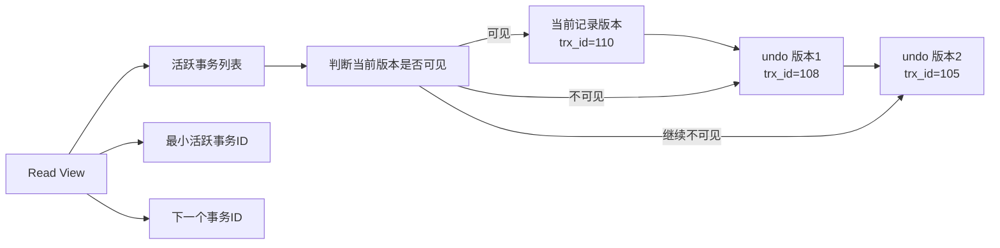
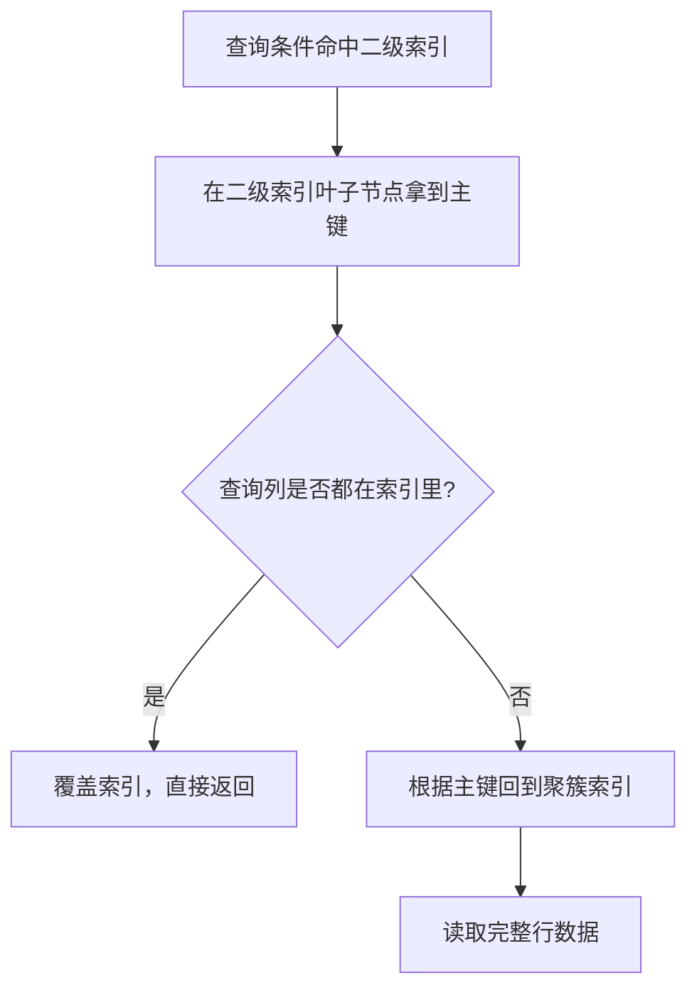

# MySQL

> **模块**：11_后端八股/05_MySQL.md  
> **来源**：购买资料 A（5 个源文件）— 事务与MVCC/日志/索引/锁/主从复制  
> **规模**：约 572 行  |  **生成**：2026-11-12  
> **状态**：已合并（多源合一）

## 本篇包含

01. 事务与MVCC
02. 日志与执行流程
03. 索引原理
04. 锁机制
05. 主从复制与隔离级别

## 01 事务与MVCC

事务和并发控制是数据库的核心能力。理解事务不仅要理解 ACID，更要理解**隔离级别背后的实现机制**，以及 MySQL 如何通过 MVCC 在并发性能和一致性之间做权衡。

### 事务隔离的实现机制

> 💡 **面试官：MySQL 的四种隔离级别分别解决了什么问题？**

> 📝 四种隔离级别，本质是**在并发性能和数据一致性之间做取舍**。
> **读未提交（Read Uncommitted）**：
> 事务可以读到其他事务未提交的数据。实现简单，直接读最新版本，不加锁。但会产生**脏读**——读到其他事务可能回滚的数据，造成逻辑错误。
> 实际生产环境几乎不用，因为数据可靠性太低。
> **读已提交（Read Committed）**：
> 事务只能读到其他事务已提交的数据。解决了脏读，但会产生**不可重复读**——在同一个事务内，两次读取同一行数据，结果可能不同（中间被其他事务修改并提交）。
> Oracle、SQL Server 的默认隔离级别。
> **可重复读（Repeatable Read）**：
> MySQL 的默认隔离级别。在同一个事务内，多次读取同一行数据，结果始终相同。解决了不可重复读，但理论上会产生**幻读**——两次范围查询，结果集的行数不同（中间被其他事务插入或删除）。
> InnoDB 通过 **MVCC + 间隙锁** 解决了幻读问题。
> **串行化（Serializable）**：
> 完全串行执行，没有并发。解决了所有并发问题，但性能最差，吞吐量极低。

> 🔎 **追问：InnoDB 如何解决幻读？**

> 📝 幻读的定义是：同一个事务内，两次**范围查询**，结果集的行数不同。
> **快照读（Snapshot Read）解决部分幻读**：
> 普通的 `SELECT`（不加锁）是快照读，读取的是事务开始时的数据快照（通过 MVCC 实现）。其他事务插入的新数据，快照读看不到，避免了幻读。
> **当前读（Current Read）的幻读问题**：
> `SELECT ... FOR UPDATE`、`SELECT ... LOCK IN SHARE MODE`、`UPDATE`、`DELETE` 是当前读，读取的是最新数据，且要加锁。
> 如果只用行锁，只能锁住已存在的记录，其他事务可以插入新记录，导致当前读两次查询结果不同，出现幻读。
> **间隙锁（Gap Lock）解决当前读的幻读**：
> InnoDB 在事务中执行当前读时，不仅锁住符合条件的记录，还锁住这些记录之间的**间隙**（Gap），防止其他事务插入新记录。
> 例如：`SELECT * FROM user WHERE age > 20 FOR UPDATE`，InnoDB 会锁住 age > 20 的所有记录，以及这些记录之间的所有间隙。其他事务无法在 age > 20 的范围内插入新记录，直到当前事务提交。
> **注意**：间隙锁只在 RR（可重复读）隔离级别生效，且只在当前读时加。如果是 RC（读已提交），InnoDB 不加间隙锁，只加行锁，会出现幻读，但并发性能更好。

### MVCC 的多版本控制

> 💡 **面试官：MVCC 是怎么实现的？**

> 📝 MVCC（Multi-Version Concurrency Control）的核心思想是**读写不加锁，通过版本链实现并发控制**。
> **隐藏字段**：
> InnoDB 的每行记录有两个隐藏字段：
> - **DB_TRX_ID**：最后修改这行的事务 ID。
> - **DB_ROLL_PTR**：回滚指针，指向这行数据的上一个版本（存储在 undo log 中）。
> **版本链**：
> 每次更新数据，都会生成一个新的版本，旧版本通过回滚指针链接，形成版本链。
> **Read View（读视图）**：
> 事务执行快照读时，会生成一个 Read View，记录当前活跃的事务 ID 列表。通过对比行记录的 trx_id 和 Read View，判断该行对当前事务是否可见：
> - 如果 trx_id < 最小活跃事务 ID：说明这行数据在当前事务开始前已提交，可见。
> - 如果 trx_id > 最大事务 ID：说明这行数据是当前事务开始后才创建的，不可见。
> - 如果 trx_id 在活跃事务列表中：说明这行数据由未提交事务创建，不可见。
> - 如果 trx_id 不在活跃事务列表中：说明这行数据由已提交事务创建，可见。
> **RC 和 RR 的区别**：
> - **Read Committed**：每次快照读都生成新的 Read View，能看到其他事务新提交的数据，所以会有不可重复读。
> - **Repeatable Read**：事务第一次快照读时生成 Read View，后续快照读都复用这个 View，保证看到的数据始终一致，实现可重复读。

### 事务持久化的实现

> 💡 **面试官：redo log 和 binlog 有什么区别？**

> 📝 redo log 和 binlog 都是持久化机制，但设计目标完全不同。
> **redo log**：
> - **物理日志**，记录的是"某个数据页做了什么修改"。
> - **循环写**，固定大小（如 4GB），写满后覆盖旧日志。
> - **用于崩溃恢复**。数据库崩溃后，通过 redo log 恢复未写入磁盘的数据。
> - **InnoDB 引擎特有**。
> **binlog**：
> - **逻辑日志**，记录的是 SQL 语句或行数据变更（ROW 格式）。
> - **追加写**，文件大小不固定，可以配置保留天数。
> - **用于主从复制和数据恢复**。主库的 binlog 同步到从库，从库重放 binlog 实现数据同步。
> - **MySQL Server 层**，所有存储引擎共享。
> **为什么需要两个日志？**
> **redo log 是 InnoDB 自己用的**，其他存储引擎（如 MyISAM）没有 redo log，它们依赖 binlog 做恢复。
> **binlog 是 MySQL 层面统一的日志**，用于跨引擎的复制和恢复。
> **两阶段提交**：
> 为了保证 redo log 和 binlog 的一致性，InnoDB 使用两阶段提交：
> 1. **Prepare 阶段**：事务提交前，先写 redo log，状态为 prepare。
> 2. **Commit 阶段**：写 binlog，然后 redo log 状态改为 commit。
> 如果写 binlog 前崩溃，redo log 是 prepare 状态，没有 binlog，事务回滚。  
> 如果写 binlog 后崩溃，redo log 可以通过 binlog 恢复，保证一致性。

### 事务的性能优化

> 💡 **面试官：大事务有什么问题？如何优化？**

> 📝 大事务是生产环境的常见问题，会带来多种风险。
> **第一，锁持有时间过长**：
> 事务中如果修改了大量数据，会持有大量行锁甚至间隙锁，阻塞其他事务，导致并发性能下降。
> **第二，undo log 膨胀**：
> 大事务修改的数据多，生成的 undo log 也多，占用大量磁盘空间，且长时间不释放。
> **第三，主从延迟**：
> 主库执行大事务，binlog 量大，同步到从库需要时间，导致主从延迟。如果这时候主库故障，从库数据不完整。
> **第四，回滚代价高**：
> 大事务如果失败回滚，需要撤销大量修改，耗时极长，期间数据库性能急剧下降。
> **优化策略**：
> **分批处理**：把大事务拆分成多个小事务，每批提交一次。
> **避免在事务中做耗时操作**：
> 事务中不要调用外部接口、发送消息、复杂计算，这些操作会拉长事务时间，增加锁持有时间。
> **优化 SQL**：
> 减少事务中的 SQL 数量，尽量用批量操作代替单条操作。

#### 图解补充：隔离级别和并发问题

| 隔离级别 | 脏读 | 不可重复读 | 幻读 | 实现思路 |
|-|-|-|-|-|
| RU | 可能 | 可能 | 可能 | 直接读最新版本 |
| RC | 不会 | 可能 | 可能 | 每次快照读生成新 Read View |
| RR | 不会 | 不会 | 理论上可能，InnoDB 基本规避 | 复用 Read View + 当前读加间隙锁 |
| Serializable | 不会 | 不会 | 不会 | 强串行化，性能最低 |

#### 图解补充：版本链与 Read View

#### 高频追问补充

> 🔎 **追问补充1：快照读和当前读怎么区分？**

普通 `SELECT` 是快照读，读的是历史可见版本，核心目标是提高并发；`SELECT ... FOR UPDATE`、`UPDATE`、`DELETE` 属于当前读，读的是最新版本，同时要加锁，核心目标是保证修改安全。

> 🔎 **追问补充2：RC 和 RR 最核心的差别是什么？**

最核心差别不只是“会不会不可重复读”，而是 **Read View 的生成时机不同**。RC 每次快照读都重新生成，所以更容易看到别的事务最新提交的数据；RR 通常在事务第一次快照读时生成并复用，所以同一事务里读到的数据更稳定。

> 🔎 **追问补充3：为什么大事务会拖垮系统？**

可以按这条线回答：锁持有时间变长、undo log 膨胀、主从复制变慢、失败回滚成本很高。这样就不是只背一个“影响性能”，而是能展开到存储、并发和高可用三个层面。

#### 速记版

> 📝 事务和 MVCC 建议按这条线记：
> - ACID 是入口
> - 隔离级别是并发问题的表象
> - MVCC 是快照读的核心
> - 间隙锁是当前读防幻读的关键
> - redo/binlog 是提交和恢复的关键
> 一句话面试版：
> InnoDB 通过 `MVCC 解决读多写少场景下的并发读问题`，通过 `锁机制解决当前读和写冲突问题`，两者配合实现了性能和一致性的平衡。

> 更新: 2026-01-31 01:20:52  
> 原文: [https://www.yuque.com/u63312805/wnyutc/beq0z2dkbt1vsa0c](https://www.yuque.com/u63312805/wnyutc/beq0z2dkbt1vsa0c)

## 02 日志与执行流程

这块内容通常会和事务、索引、SQL 优化一起问，常见题目包括 redo log、undo log、binlog、SQL 执行过程、执行计划怎么分析。

### redo log、undo log、binlog 的区别

> 💡 **Q：redo log、undo log、binlog 有什么区别？**

> 📝 这三个日志的职责完全不同：
> **redo log**：  
> 是 InnoDB 的物理日志，记录数据页的修改，用于崩溃恢复，保证事务的持久性。
> **undo log**：  
> 记录数据修改前的旧版本，一方面用于事务回滚，另一方面为 MVCC 提供版本链支持。
> **binlog**：  
> 是 MySQL Server 层的逻辑日志，记录的是逻辑变更，主要用于主从复制和数据恢复。
> 如果让我一句话总结：
> - redo log：向前恢复
> - undo log：向后回滚
> - binlog：复制和审计

### 两阶段提交

> 💡 **Q：为什么需要两阶段提交？**

> 📝 因为 MySQL 事务提交时，既涉及 InnoDB 的 redo log，又涉及 Server 层的 binlog。  
> 如果这两个日志不一致，就会带来严重问题。
> 典型场景是：
> - redo log 写成功了，但 binlog 没写成功
> - 或者 binlog 写成功了，但 redo log 状态不一致
> 所以 MySQL 用两阶段提交来保证一致性：
> **第一阶段**：redo log 先写成 prepare 状态  
> **第二阶段**：写 binlog，成功后再把 redo log 标记成 commit
> 这样崩溃恢复时，就可以根据日志状态判断事务是否真正提交成功。

### SQL 查询语句的执行过程

> 💡 **Q：一条 SQL 查询语句的执行过程是什么？**

> 📝 如果是一条普通查询，大致流程可以概括为：
> 1. 客户端和 MySQL 建立连接
> 2. 经过连接器做权限认证
> 3. 由解析器做词法、语法分析
> 4. 由优化器选择执行计划
> 5. 执行器调用存储引擎接口取数据
> 6. 最后把结果返回给客户端
> 如果是更新语句，还会额外涉及：
> - undo log
> - redo log
> - binlog
> 所以答这类题时，一般要先区分“查询语句”和“更新语句”。

### 执行计划怎么看

> 💡 **Q：你怎么分析 MySQL 执行计划？**

> 📝 最常见是用 `EXPLAIN` 看执行计划。
> 我会重点关注这些字段：
> - `type`：访问类型，是否走了高效路径
> - `key`：实际用到哪个索引
> - `rows`：预估扫描行数
> - `Extra`：是否出现 `Using filesort`、`Using temporary` 之类的额外开销
> 如果 `type` 很差，或者 `rows` 特别大，通常就说明 SQL 或索引设计存在优化空间。

### SQL 优化的常见思路

> 💡 **Q：SQL 优化你一般怎么做？**

> 📝 我一般按这个顺序看：
> - 先看是不是走了索引
> - 再看索引是否合理，比如联合索引顺序是否匹配查询条件
> - 再看是否存在回表、排序、临时表等额外开销
> - 最后再看是不是需要改 SQL 写法或者分页方式
> 常见优化方向包括：
> - 避免全表扫描
> - 避免索引失效
> - 减少回表次数
> - 减少排序和临时表
> - 控制返回字段，避免 `select *`

## 03 索引原理

MySQL 索引的设计本质上是**如何通过空间换时间，在海量数据中快速定位目标记录**。理解索引的关键不在于背诵 B+ 树的结构，而在于理解**为什么 MySQL 选择 B+ 树，以及在不同场景下索引如何工作、如何失效**。

### 索引的数据结构选择

> 💡 **面试官：为什么 MySQL 用 B+ 树做索引，不用 Hash 或者红黑树？**

> 📝 索引的核心诉求有两个：**等值查询快**和**范围查询快**。不同的数据结构在这两点上有不同的 trade-off。
> **Hash 表**：
> 等值查询是 O(1)，但 Hash 表不支持范围查询。如果要做 `WHERE id > 100 AND id < 200`，Hash 表无能为力，只能全表扫描。所以 Hash 只适合精准匹配的场合，比如内存缓存（Memcached、Redis 的核心结构）。Memory 存储引擎支持 Hash 索引，但 InnoDB 不支持（除了自适应 Hash 索引，那是内部优化）。
> **红黑树**：
> 是平衡二叉搜索树，等值和范围查询都是 O(log n)。但问题是，**树的高度太高**。数据量大的时候，树高可能达到 20-30 层，意味着一次查询要 20-30 次磁盘 IO。磁盘 IO 是毫秒级的，20 次 IO 就是几十毫秒，性能无法接受。
> **B+ 树**：
> 多路平衡搜索树，每个节点可以存多个键值。InnoDB 默认一页 16KB，假设一个整型键 8 字节，指针 6 字节，一个节点可以存约 1000 个键。树高只有 3-4 层，查询只需 3-4 次磁盘 IO，性能提升一个数量级。
> 更重要的是，B+ 树的叶子节点是**有序链表**，范围查询时，找到起始位置后顺序遍历即可，效率极高。这是红黑树做不到的（红黑树只能中序遍历，无法顺序扫描）。

> 🔎 **追问：B+ 树和 B 树有什么区别？**

> 📝 B 树（B-Tree）的每个节点都存储数据，非叶子节点也存数据。这导致：
> **第一，节点能存的键值变少**。因为数据占用了空间，一页 16KB 可能只能存 100 个键，树高增加，IO 次数变多。
> **第二，范围查询效率低**。B 树的叶子节点没有链表连接，范围查询需要中序遍历，涉及大量随机 IO。
> B+ 树的改进：
> **非叶子节点只存键值，不存数据**。数据都在叶子节点。这样非叶子节点能存更多键，树高更低。
> **叶子节点形成有序链表**。范围查询时，找到起始叶子节点，顺序遍历链表即可，全是顺序 IO，性能极高。
> **查询性能稳定**。B 树可能在非叶子节点就找到数据，返回很快；也可能要查到叶子节点，很慢。B+ 树无论查什么数据，都要到叶子节点，性能稳定可预期。

### 聚簇索引与二级索引

> 💡 **面试官：聚簇索引和非聚簇索引有什么区别？**

> 📝 这是 InnoDB 存储引擎的核心设计。
> **聚簇索引（Clustered Index）**：
> InnoDB 的表数据本身就是按 B+ 树组织的，**聚簇索引的叶子节点存储的是完整的行数据**。一张表只能有一个聚簇索引，通常是主键索引。
> 如果没有主键，InnoDB 会选择第一个唯一索引作为聚簇索引；如果没有唯一索引，会隐式创建一个 6 字节的 row_id 作为聚簇索引。
> **二级索引（Secondary Index）**：
> 也叫辅助索引，叶子节点存储的是**主键值**，而不是行数据。查询时，先通过二级索引找到主键，再通过主键去聚簇索引查完整数据，这个过程叫**回表**。
> **为什么二级索引不存完整数据？**
> **第一，节省空间**。如果每个索引都存完整数据，数据量会爆炸式增长。
> **第二，保持数据一致性**。如果一张表有多个索引，数据更新时要同步更新所有索引。如果二级索引存的是主键，只需要更新聚簇索引的数据；如果存完整数据，所有索引都要更新，代价极高。
> **回表的代价**：
> 回表意味着两次索引查询。如果通过二级索引找到 100 条记录，就要回表 100 次，100 次随机 IO，性能很差。这时候**覆盖索引**就很重要。

> 🔎 **追问：什么是覆盖索引？**

> 📝 覆盖索引是指**查询的所有字段都在索引中**，不需要回表。
> 比如：
> `name` 和 `age` 都在联合索引中，查询直接走索引，拿到结果就返回，不需要回表查主键索引。
> **覆盖索引的优势**：
> **减少 IO 次数**。不需要回表，一次索引查询就搞定。
> **减少数据传输**。索引通常比完整行数据小得多，网络传输量小。
> **利用索引的有序性**。如果查询需要排序，而索引已经是有序的，可以直接用索引顺序，避免 filesort。
> **设计索引时的考虑**：
> 高频查询的字段，可以考虑建成联合索引，让查询能覆盖。但要注意索引的维护成本和空间占用，不能为了覆盖索引把所有字段都加进索引，那是本末倒置。

### 联合索引的最左前缀

> 💡 **面试官：联合索引 (a, b, c) 什么情况下会生效？**

> 📝 联合索引的列顺序至关重要，InnoDB 按照**最左前缀原则**使用索引。
> **生效的情况**：
> **失效的情况**：
> **原理**：
> 联合索引是先按 a 排序，a 相同再按 b 排序，b 相同再按 c 排序。如果没有 a，就不知道从哪里开始查。
> **范围查询的影响**：
> a 和 b 走索引，c 不走。因为 b 是范围查询，b 相同的记录有很多，c 在这些记录中是无序的，无法直接定位。
> **索引下推（Index Condition Pushdown）**：
> MySQL 5.6 引入的优化。上面的例子中，虽然 c 不能直接用索引定位，但存储引擎可以先在索引中过滤 `c = 3` 的记录，减少回表次数。这叫 ICP，是 MySQL 内部的优化，不需要手动干预。

### 索引失效的场景

> 💡 **面试官：什么情况下索引会失效？**

> 📝 索引失效通常是因为**查询条件无法利用索引的有序性**。
> **第一，对索引列做函数运算**：
> 对 `create_time` 做 YEAR() 函数运算后，MySQL 不知道运算结果和索引中的值是什么关系，只能全表扫描。
> **第二，隐式类型转换**：
> MySQL 会尝试把字符串转成数字，转换后值变了，无法匹配索引。
> **第三，LIKE 前导通配符**：
> `%` 在前，表示前面有任意字符，MySQL 不知道从哪里开始查。
> **第四，OR 条件**：
> 如果 a 和 b 都有索引，MySQL 可能会用索引合并（Index Merge）；如果其中一个没索引，通常会导致全表扫描。
> **第五，!= 和 <>**：
> 虽然技术上可以用索引，但通常 MySQL 会选择全表扫描，因为 != 匹配的记录太多，回表成本太高。
> **第六，NULL 判断**：
> `IS NOT NULL` 匹配的记录通常很多，优化器认为全表扫描更快。

### 索引设计的权衡

> 💡 **面试官：设计索引时要考虑哪些因素？**

> 📝 索引不是越多越好，需要在**查询性能**和**维护成本**之间做权衡。
> **第一，区分度**：
> 索引列的区分度要高。如果一列只有几个取值（如性别），索引意义不大。MySQL 优化器会发现走索引和全表扫描差不多，还不如直接全表扫描。
> 区分度可以用 `COUNT(DISTINCT col) / COUNT(*)` 计算，越高越好。
> **第二，最左前缀**：
> 联合索引要把区分度高的列放左边，让索引在更多场景下生效。
> **第三，避免冗余索引**：
> 这三个索引是冗余的，(a, b, c) 可以覆盖 (a, b) 和 (a)。冗余索引占用空间，增加维护成本。
> **第四，长字符串索引**：
> 长字符串（如 URL、邮箱）建索引，可以用前缀索引：
> 只索引前 10 个字符，节省空间。但要注意前缀长度，太短区分度不够，太长索引太大。
> **第五，覆盖索引**：
> 高频查询的字段，尽量让查询能覆盖索引，避免回表。
> **第六，写放大**：
> 每次 INSERT/UPDATE/DELETE，都要维护所有索引。索引越多，写操作越慢。读多写少的表可以多建索引，写多读少的表要控制索引数量。

#### 图解补充：为什么 MySQL 更偏爱 B+ 树

| 结构 | 等值查询 | 范围查询 | 磁盘 IO 层数 | 为什么不是它 |
|-|-|-|-|-|
| Hash | 快 | 差 | 低 | 不支持范围查询 |
| 红黑树 | 可以 | 可以 | 高 | 树太高，磁盘 IO 太多 |
| B+ 树 | 快 | 快 | 低 | 叶子链表天然适合范围扫描 |

#### 图解补充：聚簇索引、二级索引与回表

#### 对比补充：联合索引 `(a, b, c)` 怎么记

| 查询条件 | 能否高效使用索引 | 原因 |
|-|-|-|
| `a = 1` | 能 | 命中最左列 |
| `a = 1 and b = 2` | 能 | 命中连续前缀 |
| `a = 1 and b = 2 and c = 3` | 能 | 命中完整联合索引 |
| `b = 2` | 不能 | 丢失最左列 |
| `a = 1 and c = 3` | 部分 | 用到 `a`，但 `c` 无法直接连续定位 |
| `a = 1 and b > 2 and c = 3` | 部分 | 范围列后面的列通常不能继续做有序定位 |

#### 高频追问补充

> 🔎 **追问补充1：为什么回表会慢？**

因为二级索引叶子节点只存主键，查到目标后还要再去聚簇索引找整行数据，本质上多了一次索引树访问。命中的记录越多，随机 IO 越多，成本就越高。

> 🔎 **追问补充2：覆盖索引为什么重要？**

因为它能直接在索引里拿到结果，避免回表。面试里可以主动补一句：覆盖索引不只是“更快”，还常常能减少磁盘 IO 和网络传输，尤其适合高频查询。

> 🔎 **追问补充3：设计联合索引时第一列一定放区分度最高的吗？**

不绝对。更准确的说法是：要综合查询条件的出现频率、等值匹配优先级、排序需求和区分度来排。面试里如果只答“区分度最高放最左边”，会显得过于机械。

#### 速记版

> 📝 索引建议按这条线记：
> - 先讲 B+ 树为什么赢
> - 再讲聚簇索引、二级索引和回表
> - 再讲最左前缀和索引失效
> - 最后讲覆盖索引和设计权衡
> 一句话面试版：
> MySQL 索引的核心不是背结构，而是理解 `B+ 树如何降低 IO、联合索引如何利用有序性、回表为什么昂贵`。

## 04 锁机制

锁机制是 MySQL 面试里非常容易和事务、隔离级别串起来的一块内容。答题时最好从“为什么要加锁”出发，再讲锁分类和具体场景。

### MySQL 为什么需要锁

> 💡 **Q：MySQL 为什么需要锁？**

> 📝 数据库的锁，本质上是为了在并发环境下保证数据一致性。
> 如果多个事务同时修改同一份数据，而没有任何并发控制，就会出现：
> - 丢失更新
> - 脏读
> - 不可重复读
> - 幻读
> 所以锁的本质作用就是：  
> **协调并发事务对共享数据的访问顺序。**

### 表锁、行锁、间隙锁

> 💡 **Q：MySQL 常见锁有哪些？**

> 📝 如果从粒度上看，常见有：
> **表锁**：锁住整张表，粒度大，并发能力弱，但实现简单。  
> **行锁**：锁住具体行，粒度小，并发能力更强。  
> **间隙锁**：锁住一个范围内的“间隙”，防止其他事务插入新记录。
> InnoDB 最核心的是行锁体系，但它底层是通过 **锁索引记录** 来实现的，所以如果 SQL 没走索引，行锁就可能退化成更大范围的锁。

### 共享锁和排他锁

> 💡 **Q：共享锁和排他锁有什么区别？**

> 📝 **共享锁（S 锁）** 允许多个事务同时读，但不允许写。  
> **排他锁（X 锁）** 不允许其他事务再读写同一资源。
> 通常可以这样记：
> - S 锁：读读可以并发，读写冲突
> - X 锁：读写都冲突

### InnoDB 的行锁

> 💡 **Q：InnoDB 的行锁是怎么实现的？**

> 📝 InnoDB 的行锁并不是直接锁“物理行”，而是 **锁索引记录**。
> 这意味着：
> - 如果 SQL 命中了索引，锁的范围更精准
> - 如果 SQL 没走索引，InnoDB 可能会扫描更多记录，锁范围也会变大
> 所以很多时候“锁冲突严重”并不只是事务问题，也可能是索引设计问题。

### Next-Key Lock

> 💡 **Q：什么是 Next-Key Lock？**

> 📝 Next-Key Lock 可以理解成：**记录锁 + 间隙锁**。
> 它的作用是：  
> 不仅锁住当前命中的记录，还锁住相邻区间，防止其他事务在这个范围内插入新数据，从而避免幻读。
> 这也是为什么在 RR 隔离级别下，InnoDB 能比较好地解决当前读的幻读问题。

### 死锁

> 💡 **Q：MySQL 为什么会发生死锁？怎么处理？**

> 📝 死锁的本质是多个事务互相等待对方释放资源，形成循环依赖。
> 典型场景是：
> - 事务 A 先锁记录 1，再等记录 2
> - 事务 B 先锁记录 2，再等记录 1
> InnoDB 能检测死锁，一旦发现会主动回滚其中一个事务。
> 实际工程里避免死锁的常见做法有：
> - 尽量按固定顺序访问资源
> - 减少事务范围和持锁时间
> - 保证 SQL 能走索引，减少锁范围

### 对比补充：锁类型怎么记

| 锁 | 粒度/语义 | 能解决什么 | 典型代价 |
|-|-|-|-|
| 表锁 | 整张表 | 实现简单 | 并发度低 |
| 行锁 | 单条或少量记录 | 精准控制冲突 | 依赖索引效果 |
| 间隙锁 | 记录间的空隙范围 | 防止插入幻读 | 容易扩大阻塞范围 |
| S 锁 | 共享读锁 | 保证并发读 | 阻塞写 |
| X 锁 | 排他写锁 | 保证写安全 | 读写都可能被拦 |

### 图解补充：Next-Key Lock 的作用

### 高频追问补充

> 🔎 **追问补充1：为什么说 InnoDB 的行锁本质上是“锁索引”？**

因为 InnoDB 是通过索引项来定位和加锁的，不是直接给物理行贴一个锁标记。也正因为如此，SQL 如果没走索引，锁的范围往往会变大，性能和并发都会受影响。

> 🔎 **追问补充2：为什么锁问题经常和索引问题绑在一起？**

因为索引决定了扫描范围，也就决定了加锁范围。索引设计差，可能不是查询慢一点那么简单，而是直接把锁冲突、阻塞和死锁概率一并拉高。

> 🔎 **追问补充3：怎么从工程上降低死锁概率？**

最实用的回答是三点：固定资源访问顺序、缩小事务和持锁时间、确保 SQL 走索引。这样回答比只说“注意并发”更像真实项目经验。

### 速记版

> 📝 锁机制建议按这条线记：
> - 先讲为什么要锁：解决并发一致性
> - 再讲粒度：表锁、行锁、间隙锁
> - 再讲语义：S 锁和 X 锁
> - 最后讲 Next-Key Lock 和死锁
> 一句话面试版：
> MySQL 锁的核心不是“有几种锁”，而是不同事务在不同隔离级别下，数据库如何用锁来约束读写顺序并控制锁范围。

## 05 主从复制与隔离级别

这块内容经常被一起问，因为很多面试官会从“为什么线上会选择 RC”一路追问到主从延迟和读写分离。

### InnoDB 和 MyISAM 的区别

> 💡 **Q：InnoDB 和 MyISAM 有什么区别？**

> 📝 如果只讲面试最核心的差异，我会抓这几个点：
> - InnoDB 支持事务，MyISAM 不支持
> - InnoDB 支持行锁，MyISAM 主要是表锁
> - InnoDB 支持外键，MyISAM 不支持
> - InnoDB 有 redo log、undo log，崩溃恢复能力更强
> 所以现在绝大多数线上核心业务表，基本都会优先选 InnoDB。

### RR 和 RC 的区别

> 💡 **Q：RR 和 RC 的区别是什么？**

> 📝 **RC（读已提交）**：每次快照读都生成新的 Read View，所以能读到其他事务新提交的数据。  
> 它解决了脏读，但会有不可重复读。
> **RR（可重复读）**：事务第一次快照读生成 Read View，后续复用同一个 View，所以同一事务内多次读取结果更稳定。  
> 它解决了不可重复读，而且 InnoDB 在当前读场景下还会通过间隙锁减少幻读问题。

### 为什么很多互联网公司喜欢 RC

> 💡 **Q：MySQL 默认是 RR，为什么很多互联网公司反而更常用 RC？**

> 📝 因为线上很多业务更关注 **并发性能和锁冲突控制**。
> 在 RR 下，InnoDB 会更积极地使用间隙锁和 Next-Key Lock，这虽然能增强一致性，但也更容易扩大锁范围，带来阻塞和死锁风险。
> 而 RC 的锁范围通常更小，并发能力更好。  
> 对于很多互联网系统来说，只要业务层能接受，选择 RC 往往是更平衡的方案。
> 所以这里不是说 RR 不好，而是：  
> **默认值不一定等于线上最佳选择。**

### 主从复制原理

> 💡 **Q：MySQL 主从复制的原理是什么？**

> 📝 主从复制的核心，是主库把 binlog 变更传给从库，从库再重放这些日志。
> 经典流程可以概括为：
> 1. 主库写入 binlog
> 2. 从库的 IO 线程拉取主库 binlog，写入 relay log
> 3. 从库的 SQL 线程读取 relay log 并执行
> 所以主从复制本质上是 **基于 binlog 的异步复制机制**。

### 主从延迟怎么理解

> 💡 **Q：为什么会出现主从延迟？**

> 📝 主从延迟一般有几类常见原因：
> - 主库写入压力大，binlog 产生太快
> - 从库执行能力不足
> - 大事务导致日志量太大
> - 从库上还有额外查询压力
> 主从延迟会直接影响：
> - 读写分离的一致性体验
> - 故障切换时的数据完整性
> 所以线上除了做主从复制本身，还要关注：
> - 尽量避免大事务
> - 合理做读写分离
> - 对关键业务做主读或延迟感知

---

## 来源档案（原始文件，仅供溯源）

- `04_后端八股整理/04_mysql/00_事务与MVCC.md`
- `04_后端八股整理/04_mysql/01_日志与执行流程.md`
- `04_后端八股整理/04_mysql/02_索引原理.md`
- `04_后端八股整理/04_mysql/03_锁机制.md`
- `04_后端八股整理/04_mysql/04_主从复制与隔离级别.md`
