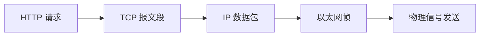
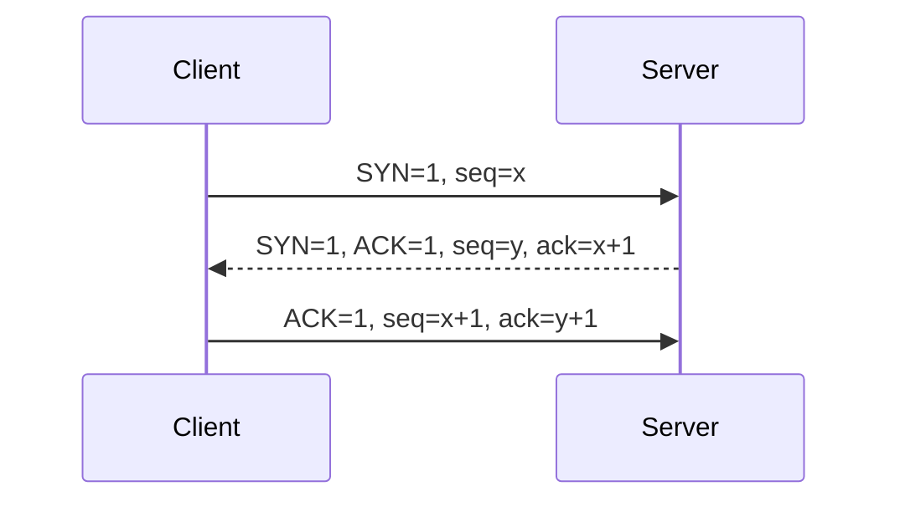
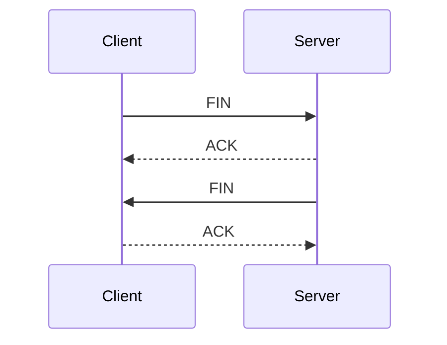
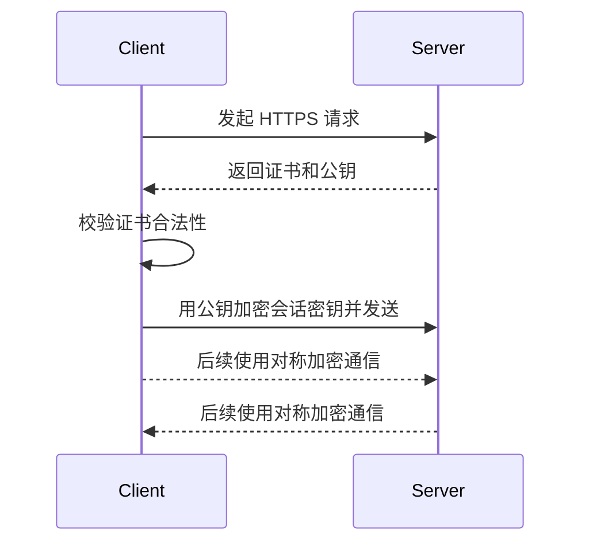

# 计算机网络

> **模块**：11_后端八股/07_计算机网络.md  
> **来源**：购买资料 A（6 个源文件）— 分层/URL到页面/TCP/HTTP/DNS与CDN/排查场景  
> **规模**：约 1030 行  |  **生成**：2026-11-12  
> **状态**：已合并（多源合一）

## 本篇包含

01. 网络分层与基础
02. 从输入URL到页面展示
03. TCP
04. HTTP与HTTPS
05. DNS与CDN
06. 网络排查与高频场景

## 01 网络分层与基础

基础内容。后面的 `TCP`、`HTTP`、`DNS`、`URL 到页面展示`，都建立在这里。

### 为什么网络要分层

> 💡 **Q：为什么计算机网络要分层？**

> 📝 分层的核心目的，是把复杂问题拆开，让每一层只关心自己的职责。
> 如果不分层，应用开发者既要关心数据格式、连接管理、路由寻址，还要关心网卡怎么发电信号，系统会非常难维护。
> 分层之后：
> - 应用层只关心“我要发什么数据”
> - 传输层只关心“怎么可靠或高效地送到对端进程”
> - 网络层只关心“怎么跨网络找到目标机器”
> - 链路层只关心“怎么在当前链路上把帧发出去”
> 所以面试里可以一句话总结：
> **网络分层的本质，是通过职责隔离来降低复杂度，提高协议的可复用性和可演进性。**

### OSI 七层和 TCP/IP 四层

> 💡 **Q：OSI 七层模型和 TCP/IP 四层模型有什么区别？**

> 📝 OSI 七层更偏理论，用来帮助理解网络分工；TCP/IP 四层更偏实际，是今天互联网真正落地的协议栈。
> 常见对应关系可以这样记：
> - OSI 的应用层、表示层、会话层，大体映射到 TCP/IP 的应用层
> - OSI 的传输层，对应 TCP/IP 的传输层
> - OSI 的网络层，对应 TCP/IP 的网络层
> - OSI 的数据链路层、物理层，大体对应 TCP/IP 的网络接口层
> 面试里不要死背七层定义，重点要能说出每层的代表协议和职责。

### 各层分别做什么

| 层次 | 主要职责 | 典型协议/设备 | 面试表达 |
|-|-|-|-|
| 应用层 | 面向应用提供网络能力 | HTTP、HTTPS、DNS、SMTP | 规定数据语义，决定“发什么” |
| 传输层 | 端到端传输 | TCP、UDP | 决定“怎么在进程之间传” |
| 网络层 | 跨网络寻址和路由 | IP、ICMP | 决定“机器怎么找到机器” |
| 网络接口层 | 在当前链路上传输数据 | 以太网、ARP、交换机 | 决定“这一跳怎么发出去” |

### 数据封装和解封装

> 💡 **Q：应用数据在网络中是怎么一层层发出去的？**

> 📝 发送时是“层层封装”，接收时是“层层解封装”。
> 例如浏览器发一个 HTTP 请求时：
> 1. 应用层先组织 HTTP 报文
> 2. 传输层给它加上 TCP 首部，形成报文段
> 3. 网络层再加 IP 首部，形成数据包
> 4. 链路层再加 MAC 首部和尾部，形成帧
> 5. 最后由网卡把比特流发出去
> 接收方则反过来一层层拆开，最终把 HTTP 数据交给应用程序。
> 所以面试里常见的一句话是：
> **应用层看到的是消息，传输层看到的是段，网络层看到的是包，链路层看到的是帧。**

### MAC、IP、端口、Socket 的区别

> 💡 **Q：MAC 地址、IP 地址、端口号、Socket 分别是什么？**

> 📝 这几个概念经常被混着问，建议按“定位层级”来回答。
> - `MAC 地址`：链路层地址，用来标识局域网里网卡的身份，解决“这一跳发给谁”
> - `IP 地址`：网络层地址，用来标识网络中的主机，解决“跨网络最终发给哪台机器”
> - `端口号`：传输层概念，用来区分一台机器上的不同进程
> - `Socket`：通常可以理解为 `IP + 端口 + 协议` 的通信端点，是应用编程时真正接触的抽象
> 一句话串起来就是：
> **IP 找主机，端口找进程，MAC 负责当前链路这一跳，Socket 是程序视角下的通信入口。**

> 🔎 **追问1：既然已经有 IP 地址了，为什么还需要 MAC 地址？**

因为 IP 解决的是跨网络寻址，MAC 解决的是局域网内逐跳转发。  
数据包到了某一跳时，网卡并不会看全局路径，它只关心这个帧是不是发给自己，所以链路层还需要 MAC。

> 🔎 **追问2：一个 TCP 连接能唯一确定吗？**

通常用四元组唯一确定：

- 源 IP
- 源端口
- 目的 IP
- 目的端口

如果把协议也算上，可以扩展理解成五元组。

### TCP 和 UDP 的区别

> 💡 **Q：TCP 和 UDP 有什么区别？怎么选？**

> 📝 面试里最稳的答法，不是背概念，而是按“连接、可靠性、顺序、开销、场景”来比较。
> `TCP`：
> - 面向连接
> - 可靠传输
> - 保证有序
> - 有流量控制和拥塞控制
> - 头部更大，开销更高
> `UDP`：
> - 无连接
> - 不保证可靠和有序
> - 没有重传、流控、拥塞控制这一整套复杂机制
> - 头部更小，时延更低
> 所以选择标准通常是：
> - 对正确性要求高，用 TCP
> - 对实时性要求高、能容忍少量丢失，用 UDP

| 维度 | TCP | UDP |
|-|-|-|
| 是否连接导向 | 是 | 否 |
| 是否可靠 | 是 | 否 |
| 是否保证顺序 | 是 | 否 |
| 传输粒度 | 字节流 | 数据报 |
| 典型场景 | HTTP、MySQL、RPC | DNS、音视频、实时游戏 |

> 🔎 **追问1：DNS 为什么经常用 UDP？**

因为大多数 DNS 查询报文很小，而且希望尽快返回结果，UDP 没有建连开销，效率更高。  
但当响应太大、需要可靠传输，或者做区域传输时，也会使用 TCP。

### 交换机和路由器

> 💡 **Q：交换机和路由器有什么区别？**

> 📝 最核心的区别是它们工作的层次不同、转发依据不同。
> - 交换机主要工作在链路层，按照 `MAC 地址` 转发帧
> - 路由器主要工作在网络层，按照 `IP 地址` 和路由表转发数据包
> 面试里一句话总结：
> **交换机更偏“同一局域网内怎么转”，路由器更偏“不同网络之间怎么走”。**

| 设备 | 主要工作层次 | 转发依据 | 典型作用 |
|-|-|-|-|
| 交换机 | 数据链路层 | MAC 地址 | 组建局域网 |
| 路由器 | 网络层 | IP 地址 | 连接不同网络 |

### 速记版

> 📝 这一篇建议按下面这条线记：
> - 先讲为什么要分层
> - 再讲 OSI 和 TCP/IP 的映射
> - 再讲封装与解封装
> - 再讲 `MAC / IP / 端口 / Socket`
> - 最后讲 `TCP / UDP` 和 `交换机 / 路由器`
> 一句话面试版：
> 网络分层本质上是把“应用语义、端到端传输、跨网络路由、链路转发”拆成不同职责，每层做自己的事，最终协作完成通信。

## 02 从输入URL到页面展示

这道题本质上是网络、浏览器、系统、服务端、前端渲染的综合串讲题。回答得好不好，往往能直接看出知识链条是否完整。

### 面试里先给一个总流程

> 💡 **Q：从输入 URL 到页面展示，中间发生了什么？**

> 📝 如果面试官先问总流程，建议先给一版 10 步主线，不要一上来就把细节说炸。
> 可以这样答：
> 1. 浏览器解析 URL
> 2. 判断协议、域名、端口、路径等信息
> 3. 查询浏览器缓存、系统缓存、`hosts` 和 DNS 缓存
> 4. 如果没命中，就发起 DNS 解析拿到 IP
> 5. 与目标服务器建立 TCP 连接
> 6. 如果是 HTTPS，再进行 TLS 握手
> 7. 浏览器发送 HTTP 请求
> 8. 服务端处理请求并返回 HTTP 响应
> 9. 浏览器解析 HTML、CSS、JS，构建页面
> 10. 完成布局和绘制，把页面显示出来
> 这一版说清楚后，再看面试官往哪一层追问。

### 第一步：解析 URL

> 💡 **Q：浏览器拿到 URL 后，第一步做什么？**

> 📝 浏览器会先解析 URL，拆出这些信息：
> - 协议：`http` 还是 `https`
> - 域名
> - 端口
> - 路径
> - 查询参数
> - 锚点
> 这一步的意义是明确：
> - 后面该走哪个协议
> - 去连接谁
> - 请求哪一个资源

### 第二步：缓存和 DNS

> 💡 **Q：DNS 解析前会先查哪些地方？**

> 📝 通常会先看：
> 1. 浏览器缓存
> 2. 操作系统缓存
> 3. `hosts`
> 4. 本地 DNS 解析器缓存
> 如果都没有，才真正去做 DNS 查询。
> 这也是为什么有时候你刚改了 DNS，但浏览器里访问结果还没变，因为旧缓存可能还在。

### 第三步：DNS 解析

> 💡 **Q：DNS 解析拿 IP 的过程怎么讲？**

> 📝 一条比较完整的链路是：
> 1. 客户端把查询交给本地 DNS
> 2. 本地 DNS 没有缓存，就去问根域名服务器
> 3. 根域名服务器告诉它去问顶级域名服务器
> 4. 顶级域名服务器告诉它去问权威域名服务器
> 5. 权威域名服务器返回最终 IP
> 6. 本地 DNS 把结果缓存后返回给客户端
> 如果业务前面接了 CDN，DNS 返回的往往不一定是源站 IP，而可能是一个更合适的 CDN 节点地址。

### 第四步：建立 TCP 连接

> 💡 **Q：拿到 IP 之后下一步是什么？**

> 📝 浏览器会根据目标 IP 和端口去建立 TCP 连接。
> 这一步本质上是为后续应用层通信先准备一条可靠的传输通道。  
> 如果是 HTTP，通常就是对 `80` 端口建连；如果是 HTTPS，通常就是对 `443` 端口建连。
> TCP 建连本身会走三次握手。

### 第五步：如果是 HTTPS，还要做 TLS 握手

> 💡 **Q：为什么 HTTPS 比 HTTP 多一步？**

> 📝 因为 HTTPS 不会在一开始就直接发业务数据，而是要先协商安全参数，验证证书，建立加密通信所需的会话密钥。
> 所以链路上其实是：
> - 先 TCP 建连
> - 再 TLS 握手
> - 然后才真正发 HTTP 请求
> 这也是为什么 HTTPS 的理解不能只停留在“端口变成 443”。

### 第六步：发送 HTTP 请求

> 💡 **Q：连接建立好后，浏览器会做什么？**

> 📝 浏览器会组织 HTTP 请求报文并发送出去。
> 其中通常会包含：
> - 请求行
> - 请求头
> - 请求体
> 请求头里常见会有：
> - `Host`
> - `Cookie`
> - `User-Agent`
> - `Accept`
> - 缓存相关头
> 如果本地有缓存副本，浏览器还可能带上协商缓存头，问服务端“这个资源我还能继续用吗”。

### 第七步：服务端处理请求

> 💡 **Q：请求到服务端以后一般怎么走？**

> 📝 比较常见的线上链路是：
> 1. 先到负载均衡或网关
> 2. 再到 Nginx 或应用网关
> 3. 转发到后端应用
> 4. 应用可能访问 Redis、MySQL、下游服务
> 5. 最终生成响应结果返回
> 所以从浏览器视角看是一次请求，但从服务端视角看，后面可能是一整条调用链。

### 第八步：浏览器接收响应

> 💡 **Q：浏览器收到响应后会立刻显示页面吗？**

> 📝 不一定。
> 浏览器先要看响应内容是什么：
> - 如果是 HTML，进入页面解析流程
> - 如果是图片、CSS、JS、字体等资源，就按资源类型分别处理
> - 如果状态码是重定向，还可能继续发下一次请求
> 所以“收到响应”和“页面展示出来”之间，中间还隔着渲染流程。

### 第九步：解析 HTML、CSS、JS

> 💡 **Q：页面渲染的大体过程怎么说？**

> 📝 浏览器收到 HTML 后，通常会：
> 1. 解析 HTML，构建 DOM
> 2. 解析 CSS，构建 CSSOM
> 3. 把 DOM 和 CSSOM 合成渲染树
> 4. 进行布局，计算每个节点的位置和大小
> 5. 进行绘制，把页面画出来
> 如果 HTML 里还有外链 CSS、JS、图片、字体，浏览器还会继续发请求加载这些资源。

### 第十步：JS 执行和后续资源加载

> 💡 **Q：为什么有时候 HTML 回来了，页面还是没完全出来？**

> 📝 因为首个 HTML 文档往往只是开始。
> 后续还可能涉及：
> - 外链 CSS 下载
> - JS 下载和执行
> - 图片和字体加载
> - 异步接口请求
> - 前端框架挂载和二次渲染
> 所以用户看到“白屏”或者“骨架屏”的时间，不一定只取决于网络建连快不快，还和资源体积、JS 执行、接口慢不慢有关。

### 一道题里怎么把网络和浏览器串起来

> 💡 **Q：这道题怎么回答才不显得零散？**

> 📝 建议你按下面这条链讲：
> `URL 解析 -> 缓存/DNS -> TCP/TLS -> HTTP 请求 -> 服务端处理 -> HTTP 响应 -> 浏览器解析渲染`
> 这样结构清楚，面试官也更容易沿着某个点继续追问，比如：
> - DNS 细节
> - TCP 三次握手
> - HTTPS 握手
> - HTTP 缓存
> - 页面渲染阻塞

### 高频追问补充

> 🔎 **追问1：输入 URL 后，为什么不一定每次都要走完整 DNS？**

因为浏览器、操作系统、本地 DNS 都可能已经缓存了解析结果，命中缓存时可以直接复用。

> 🔎 **追问2：如果是 CDN 域名，浏览器最终访问的是谁？**

通常先通过 DNS 被调度到某个 CDN 节点，如果节点有缓存就直接返回，没有再回源。

> 🔎 **追问3：为什么有时候接口明明已经返回了，页面还是慢？**

因为网络只是其中一环。  
后面还可能有资源加载、JS 执行、前端渲染、主线程阻塞等问题。

### 项目里怎么把这道题说得更像真实经验

> 💡 **Q：如果面试官让你结合项目说，你会怎么组织？**

> 📝 可以用“一个页面首屏加载”的场景来讲。
> 比如：
> - 用户访问首页，域名先走 DNS 和 CDN
> - 建立 HTTPS 连接后，请求 HTML
> - HTML 回来后继续请求 CSS、JS、图片
> - 后端接口再查缓存和数据库
> - 浏览器解析和渲染完成后，用户看到首屏
> 再顺带补一句优化思路：
> - CDN 缓存静态资源
> - 浏览器缓存减少重复请求
> - 压缩和合并资源
> - 接口做缓存和降耗
> 这样回答会更像做过线上性能优化。

### 速记版

> 📝 这道题建议按下面这条线记：
> - 解析 URL
> - 查缓存和 DNS
> - 建立 TCP
> - HTTPS 再做 TLS
> - 发 HTTP 请求
> - 服务端处理并返回
> - 浏览器解析 HTML/CSS/JS
> - 布局绘制，页面展示
> 一句话面试版：
> 从输入 URL 到页面展示，本质上就是“先找到对端，再建立连接，再完成请求响应，最后由浏览器把响应内容解析渲染出来”。

## 03 TCP

TCP 是计算机网络面试里的绝对高频题，通常会从“三次握手”切入，然后一路追到 `TIME_WAIT`、可靠性、滑动窗口、拥塞控制、粘包拆包。

### TCP 的核心特点

> 💡 **Q：TCP 有哪些核心特点？**

> 📝 TCP 最关键的标签有五个：
> - 面向连接
> - 可靠传输
> - 面向字节流
> - 保证有序
> - 有流量控制和拥塞控制
> 所以 TCP 不是简单的“能发数据”，而是它会尽量保证：
> - 数据不丢
> - 顺序不错
> - 对端能按顺序还原
> - 不把接收方和网络整体打爆

### 三次握手

> 💡 **Q：TCP 为什么要三次握手？**

> 📝 三次握手的目的是让通信双方都确认两件事：
> 1. 对方能收也能发
> 2. 双方已经同步好初始序列号，可以开始可靠传输
> 典型过程是：
> 1. 客户端发 `SYN`，表示要建立连接
> 2. 服务端回 `SYN + ACK`，表示收到，也同意建立连接
> 3. 客户端再回 `ACK`，表示我确认你这边也准备好了
> 所以第三次握手本质上是：
> **客户端对服务端发起连接能力的一次最终确认。**

> 🔎 **追问1：为什么不能只用两次握手？**

如果只有两次，服务端在发完 `SYN+ACK` 后就认为连接建立了，但它并不能确认客户端是否真的收到了这个响应。  
第三次握手就是为了解决“服务端如何确认客户端接收能力正常”这个问题。

> 🔎 **追问2：为什么不是四次握手？**

因为服务端收到客户端的 `SYN` 后，完全可以把“确认客户端请求”和“自己也发起连接”合并成一个 `SYN+ACK`，没必要拆成两次。

### 四次挥手

> 💡 **Q：TCP 为什么要四次挥手？**

> 📝 TCP 是全双工通信，双方都可以独立发送数据，所以关闭连接时，要分别关闭两个方向。
> 典型过程是：
> 1. 一方发送 `FIN`，表示我这边不再发数据了
> 2. 对方回 `ACK`，表示知道了
> 3. 对方把自己剩余的数据发完后，再发送 `FIN`
> 4. 最后一方回 `ACK`
> 所以关闭连接往往需要四次，而不是三次。

> 🔎 **追问1：为什么挥手时 ACK 和 FIN 往往不能合并？**

因为收到 `FIN` 的一方，可能还有数据没发完。  
它可以先确认“我知道你不发了”，但自己未必能立刻关闭发送通道，所以通常要等业务数据处理完成后再发 `FIN`。

### TIME_WAIT 和 CLOSE_WAIT

> 💡 **Q：**`TIME_WAIT`**和**`CLOSE_WAIT` **分别是什么？**

> 📝 这是 TCP 状态题里的重点。
> `TIME_WAIT`：
> - 通常出现在主动关闭连接的一方
> - 收到对方 `FIN` 后，回完最后一个 `ACK` 进入
> - 会等待一段时间后再真正关闭
> `CLOSE_WAIT`：
> - 通常出现在被动关闭连接的一方
> - 表示对方已经要求关闭连接了
> - 但本端应用还没有真正执行关闭动作
> 一句话记忆：
> `TIME_WAIT` **是“我已经收尾了，但还要再等等”；**`CLOSE_WAIT` **是“对方都结束了，但我还没收尾”。**

> 🔎 **追问1：为什么要有** `TIME_WAIT`**？**

主要有两个原因：

1. 确保最后一个 `ACK` 能让对方收到，如果对方没收到还会重发 `FIN`
2. 让旧连接中的残留报文在网络里自然消失，避免影响后续同四元组的新连接

> 🔎 **追问2：线上** `CLOSE_WAIT` **很多通常意味着什么？**

这通常不是网络抖动，而是应用没有及时 `close` 连接，比如代码分支没释放 Socket、连接池回收有问题、异常处理不完整。

### TCP 如何保证可靠传输

> 💡 **Q：TCP 是怎么保证可靠传输的？**

> 📝 TCP 的可靠性不是“绝对不出错”，而是通过一整套机制尽量保证数据正确到达。
> 常见机制包括：
> - 序列号：保证数据可排序、可重组
> - 确认应答：告诉发送方哪些数据已经收到
> - 超时重传：超时没收到确认就重发
> - 校验和：检查数据是否损坏
> - 去重和乱序重排：避免重复、恢复顺序
> - 滑动窗口：控制未确认数据量
> 所以面试里最稳的结论是：
> **TCP 的可靠，靠的是“编号、确认、重传、排序、控速”这一整套机制。**

### 序列号和确认应答

> 💡 **Q：序列号和 ACK 在 TCP 里起什么作用？**

> 📝 TCP 是面向字节流的，每个字节都可以认为有自己的编号。
> 发送方发数据时，会带上起始序列号；接收方收到后，会通过 ACK 告诉发送方“下一个我期望收到哪个序号的数据”。
> 这样带来的好处是：
> - 能发现丢包
> - 能发现重复包
> - 能恢复乱序

### 超时重传和快速重传

> 💡 **Q：TCP 丢包了以后怎么处理？**

> 📝 常见有两种思路：
> 1. `超时重传`：发出去一段时间还没收到 ACK，就认为可能丢了，重发
> 2. `快速重传`：如果发送方连续收到多个重复 ACK，就能更早判断某个报文段丢了，不必硬等超时
> 这也是为什么 TCP 既能保证可靠性，又尽量不把恢复动作做得太慢。

### 滑动窗口和流量控制

> 💡 **Q：什么是滑动窗口？什么是流量控制？**

> 📝 滑动窗口可以理解成：
> **发送方在还没收到 ACK 之前，最多可以连续发送多少数据。**
> 接收方会把自己的可用缓冲区大小告诉发送方，发送方再根据这个值决定发多快，这就是流量控制。
> 所以流量控制关注的是：
> **不要把接收方撑爆。**

> 🔎 **追问1：如果接收方窗口变成 0 会怎么样？**

发送方会暂停继续发送大量数据，但不会永远不管，一般还会做零窗口探测，确认接收方是不是已经恢复可接收状态。

### 拥塞控制

> 💡 **Q：什么是拥塞控制？和流量控制有什么区别？**

> 📝 流量控制关注的是接收方顶不顶得住，拥塞控制关注的是整个网络顶不顶得住。
> 简单说：
> - 流量控制：别把对端接收缓冲区撑爆
> - 拥塞控制：别把网络链路打满，导致整体拥塞
> TCP 常见拥塞控制关键字要能说出来：
> - 慢启动
> - 拥塞避免
> - 快速重传
> - 快速恢复

> 🔎 **追问1：慢启动为什么叫“慢”，但看起来增长很快？**

“慢”不是指增长速度慢，而是指它一开始很保守，从比较小的拥塞窗口开始探测网络容量。  
虽然前期常表现为指数增长，但它的出发点是“先小心试探”。

### TCP 是面向字节流的

> 💡 **Q：为什么说 TCP 是面向字节流，而不是消息？**

> 📝 因为 TCP 只保证一串字节按顺序传到对端，但不会替你保留“你这次发的是一条消息还是两条消息”的边界。
> 发送端写两次数据，接收端未必就是两次读出来，可能被合并，也可能被拆开。
> 这就是后面“粘包和拆包”的根源。

### 粘包和拆包

> 💡 **Q：TCP 为什么会出现粘包和拆包？怎么解决？**

> 📝 因为 TCP 是字节流协议，没有天然消息边界。
> 所以：
> - 发送方连续写入两段数据，接收方可能一次都读到了，这叫粘包
> - 一段完整消息太长，接收方一次没读全，这叫拆包
> 常见解决方案有三种：
> - 固定长度协议
> - 分隔符协议
> - 长度字段 + 消息体
> 工程里最常见的是第三种，也就是先读消息头，再按长度读消息体。

### KeepAlive 和心跳

> 💡 **Q：TCP KeepAlive 和业务心跳有什么区别？**

> 📝 二者都和“连接活性检测”有关，但层次不同。
> - `TCP KeepAlive`：操作系统 TCP 层提供的保活机制，周期通常较长
> - `业务心跳`：应用层自己定义的探活包，控制更灵活，也更贴近业务
> 面试里建议不要把两者混成一回事。  
> 很多长连接系统真正依赖的，往往是应用层心跳，而不是仅靠 TCP KeepAlive。

### SYN 洪泛

> 💡 **Q：什么是 SYN Flood？**

> 📝 SYN Flood 是一种典型的半连接攻击。  
> 攻击者大量发送 `SYN`，但不完成后续握手，让服务端长期停留在半连接状态，消耗连接资源。
> 常见防护思路有：
> - SYN Cookie
> - 增大 backlog
> - 限流和防火墙策略
> - 网关层清洗

### 项目里怎么回答更像真实经验

> 💡 **Q：如果面试官问你 TCP 在项目中的价值，你会怎么答？**

> 📝 可以结合接口调用、RPC、数据库连接来讲。
> 比如：
> - HTTP、RPC、MySQL 通信一般都跑在 TCP 上
> - 看重的是可靠、有序和成熟的拥塞控制
> - 长连接还能减少频繁握手和挥手的成本
> - 出现大量 `TIME_WAIT`、`CLOSE_WAIT` 时，可以从连接复用和连接释放角度排查
> 这样回答会比只背概念更像做过系统的人。

### 速记版

> 📝 TCP 建议按这条线记：
> - 先讲“面向连接、可靠、有序、字节流”
> - 再讲三次握手、四次挥手
> - 再讲 `TIME_WAIT / CLOSE_WAIT`
> - 再讲可靠性：序列号、ACK、重传、滑动窗口
> - 再讲流量控制和拥塞控制
> - 最后讲粘包拆包、KeepAlive、SYN 洪泛
> 一句话面试版：
> TCP 的本质，是在不可靠的网络之上，通过连接管理、确认重传、窗口和拥塞控制，尽量提供可靠有序的字节流传输。

## 04 HTTP与HTTPS

HTTP 和 HTTPS 是面试中非常高频的网络基础题，通常会从“区别”切入，再追问状态码、GET/POST、TLS 握手。

### HTTP 和 HTTPS 的区别

> 💡 **Q：HTTP 和 HTTPS 有什么区别？**

> 📝 最核心的区别是：**HTTPS = HTTP + TLS/SSL 加密层**。
> HTTP 明文传输，安全性差；  
> HTTPS 在传输层之上增加了加密、身份认证、完整性校验，因此更安全。
> 除此之外常见差异还有：
> - 默认端口不同：HTTP 80，HTTPS 443
> - HTTPS 需要证书
> - HTTPS 握手阶段会有一定额外开销

### HTTPS 握手的大致过程

> 💡 **Q：HTTPS 是怎么建立安全连接的？**

> 📝 简化理解可以分成几步：
> 1. 客户端发起 HTTPS 请求
> 2. 服务端返回证书和公钥信息
> 3. 客户端校验证书是否合法
> 4. 客户端生成会话密钥，并用服务端公钥加密发送过去
> 5. 双方后续使用对称加密通信
> 所以 HTTPS 的关键思想是：  
> **非对称加密负责安全交换密钥，对称加密负责后续高效通信。**

### GET 和 POST 的区别

> 💡 **Q：GET 和 POST 有什么区别？**

> 📝 如果从面试角度回答，我会抓这几个点：
> - GET 更偏获取资源，POST 更偏提交资源
> - GET 参数通常放在 URL，POST 更多在请求体
> - GET 更容易被缓存和收藏
> - 从规范语义上讲，GET 应该是幂等的，POST 通常不是
> 但要注意：  
> **GET 并不是绝对不能带请求体，POST 也不是绝对更安全。**  
> 安全性更多取决于是不是 HTTPS。

### 常见状态码

> 💡 **Q：常见 HTTP 状态码有哪些？**

> 📝 高频要记住这些：
> - `200`：请求成功
> - `301` / `302`：重定向
> - `400`：请求参数错误
> - `401`：未认证
> - `403`：无权限
> - `404`：资源不存在
> - `500`：服务端内部错误
> - `502`：网关错误
> - `503`：服务不可用
> 面试里一般不是让你背全，而是看你是否能结合场景说出含义。

### 图解补充：HTTPS 握手怎么记

### 对比补充：HTTP 高频点速查

| 主题 | 核心结论 | 面试表达 |
|-|-|-|
| HTTP vs HTTPS | HTTPS 多了 TLS 安全层 | 安全性来自加密、认证、完整性校验 |
| GET vs POST | 语义不同，不是“谁更安全” | 安全看是否走 HTTPS |
| `301` vs `302` | 都是重定向 | 一个更偏永久，一个更偏临时 |
| `401` vs `403` | 一个未认证，一个无权限 | 先登录再谈授权 |

### 高频追问补充

> 🔎 **追问补充1：HTTPS 为什么既要非对称加密又要对称加密？**

因为非对称加密适合安全交换密钥，但性能较差；对称加密性能高，适合后续大量数据传输。两者组合，兼顾安全和效率。

> 🔎 **追问补充2：POST 比 GET 安全吗？**

不绝对。POST 只是参数位置通常在请求体，不代表天然安全。只要是明文 HTTP，GET 和 POST 都可能被窃听；真正决定安全性的还是 HTTPS。

> 🔎 **追问补充3：状态码怎么回答更像项目经验？**

不要只背数字，可以带场景说，比如 `401` 常见于登录态失效，`403` 常见于权限校验失败，`502/503` 常见于网关或下游服务异常，这样更像实际排障经验。

### 速记版

> 📝 HTTP/HTTPS 建议按这条线记：
> - 先讲 HTTPS 比 HTTP 多了 TLS
> - 再讲证书、公钥、会话密钥
> - 再讲 GET/POST 的语义区别
> - 最后讲高频状态码
> 一句话面试版：
> HTTPS 的本质是在 HTTP 通信前先建立一条可信且加密的传输通道，后续再承载普通 HTTP 请求和响应。

## 05 DNS与CDN

DNS 和 CDN 是网络面试里经常和 `URL 到页面展示`、`HTTP 性能优化` 连着问的两块。

### DNS 是做什么的

> 💡 **Q：DNS 是什么？为什么需要它？**

> 📝 DNS 的作用，是把人类更容易记忆的域名解析成机器真正通信需要的 IP 地址。
> 如果没有 DNS，用户访问网站时就只能记 IP，这既不方便，也不利于服务迁移、负载均衡和容灾。
> 所以 DNS 可以理解成互联网的“电话簿”，但它不只是做简单映射，还承担了：
> - 域名解析
> - 结果缓存
> - 负载分流
> - 容灾切换

### DNS 查询流程

> 💡 **Q：DNS 查询一般是怎么走的？**

> 📝 比较完整的链路通常是：
> 1. 浏览器先查自己的 DNS 缓存
> 2. 再查操作系统缓存和 `hosts`
> 3. 还没命中，就把请求发给本地 DNS 解析器
> 4. 本地解析器如果也没有缓存，就去问根域名服务器
> 5. 根域名服务器返回对应顶级域名服务器地址，比如 `.com`
> 6. 再去问顶级域名服务器
> 7. 顶级域名服务器返回权威域名服务器地址
> 8. 再去问权威域名服务器
> 9. 权威服务器返回最终 IP
> 10. 本地 DNS 缓存结果，再返回给客户端
> 面试时建议把“缓存 -> 递归解析器 -> 根 -> TLD -> 权威”这条主线讲清楚。

### 递归查询和迭代查询

> 💡 **Q：什么是 DNS 的递归查询和迭代查询？**

> 📝 这也是高频题，关键是区分“谁替你继续问”。
> - `递归查询`：你问了一个 DNS 服务器之后，希望它帮你把最终答案查到底，再直接返回给你
> - `迭代查询`：你问一个服务器，它如果不知道最终答案，就告诉你“下一步该去问谁”
> 通常：
> - 客户端到本地 DNS，常常表现为递归查询
> - 本地 DNS 再去问根、TLD、权威 DNS，通常是迭代查询

### 常见 DNS 记录类型

> 💡 **Q：常见 DNS 记录类型有哪些？**

> 📝 面试里最常见的这几个要能说出来：
> - `A`：域名映射到 IPv4 地址
> - `AAAA`：域名映射到 IPv6 地址
> - `CNAME`：别名记录，一个域名指向另一个域名
> - `NS`：指定某个域的权威 DNS 服务器
> - `MX`：邮件服务器记录
> - `TXT`：存文本信息，常用于校验、SPF、DKIM 等
> 如果面试官问 CDN、对象存储、自定义域名绑定，`CNAME` 通常特别高频。

### TTL 和 DNS 缓存

> 💡 **Q：DNS 为什么会有缓存？TTL 是什么？**

> 📝 DNS 查询如果每次都从根域名服务器一路问到底，延迟和系统压力都会很大，所以一定要缓存。
> `TTL` 是一条解析记录的生存时间。缓存没过期时，可以直接复用；过期后需要重新查询。
> TTL 配得太长：
> - 切换 IP、故障迁移会变慢
> TTL 配得太短：
> - 解析请求会变多，缓存命中率下降
> 所以它本质上是性能和灵活性之间的权衡。

### CDN 是做什么的

> 💡 **Q：CDN 的核心作用是什么？**

> 📝 CDN 的核心目标有三个：
> - 就近访问，降低时延
> - 缓存静态资源，减少回源压力
> - 提升可用性和抗突发流量能力
> 用户访问资源时，请求通常会先被调度到离自己更近的边缘节点。如果边缘节点已经缓存了资源，就直接返回；如果没有，就回源到源站拉取，再缓存一份。
> 所以面试里可以一句话总结：
> **CDN 本质上是把内容提前分发到离用户更近的地方，用空间换时间、用边缘节点抗流量。**

### CDN 的工作流程

> 💡 **Q：CDN 请求一般怎么走？**

> 📝 大致流程可以这样理解：
> 1. 用户访问业务域名
> 2. DNS 解析把请求引导到 CDN 节点
> 3. 边缘节点检查本地缓存
> 4. 如果命中，直接返回
> 5. 如果未命中，回源到源站拉取资源
> 6. 回源结果返回给用户，同时缓存在边缘节点
> 这也是为什么很多站点首次访问慢一点，后续访问会更快。

### CDN 适合哪些内容

> 💡 **Q：CDN 只能加速图片、JS、CSS 吗？**

> 📝 最适合 CDN 的，确实是图片、静态资源、下载文件、视频切片这类“可缓存内容”。
> 但现在 CDN 不只做静态缓存，还会做：
> - 动静分离
> - 智能调度
> - 边缘计算
> - 动态加速
> - WAF 和基础安全防护
> 只是从面试角度看，先把“边缘缓存 + 回源”讲清楚最重要。

### DNS 和 CDN 的关系

> 💡 **Q：DNS 和 CDN 有什么关系？**

> 📝 CDN 经常借助 DNS 做流量调度。
> 也就是用户访问某个域名时，DNS 不一定直接返回源站 IP，而是根据地理位置、运营商、负载情况等因素，返回某个更合适的 CDN 节点地址。
> 所以可以理解为：
> - DNS 负责“把用户引到合适的节点”
> - CDN 节点负责“尽量在边缘直接把内容返回”

### 高频追问补充

> 🔎 **追问1：为什么有时候改了 DNS 记录，结果不会立刻生效？**

因为缓存还没过期。浏览器、本地系统、本地 DNS、运营商 DNS 都可能缓存旧结果，所以 TTL 没过之前，旧记录可能还在被使用。

> 🔎 **追问2：CDN 缓存和浏览器缓存有什么区别？**

浏览器缓存发生在客户端本地；CDN 缓存发生在网络边缘节点。  
前者减少客户端重复请求，后者减少用户到源站的距离和源站压力。

> 🔎 **追问3：CDN 回源会带来什么问题？**

如果缓存命中率低、回源链路慢、源站抗压差，CDN 反而可能成为“放大器”，把大量未命中请求集中打到源站，所以命中率、缓存策略、回源带宽都很关键。

### 项目里怎么回答更像真实经验

> 💡 **Q：如果面试官问你 DNS/CDN 在项目里有什么价值，你会怎么答？**

> 📝 可以结合首页静态资源、图片资源、下载资源来讲。
> 比如：
> - 域名通过 DNS 解析到 CDN
> - 首页静态资源、商品图片先走 CDN
> - 热资源命中边缘缓存，用户就近访问
> - 对源站来说，静态流量被卸载掉，核心应用只处理真正需要回源的动态请求
> 这样回答比单纯说“CDN 提高速度”更像工程视角。

### 速记版

> 📝 这一篇建议按下面这条线记：
> - DNS 把域名解析成 IP
> - 查询链路是：缓存 -> 本地 DNS -> 根 -> TLD -> 权威
> - 客户端常见递归，本地 DNS 往外通常是迭代
> - CDN 通过边缘缓存和智能调度加速访问
> - DNS 常常负责把用户引流到合适的 CDN 节点
> 一句话面试版：
> DNS 负责找到地址，CDN 负责把内容放到更近的地方，两者配合解决“去哪找”和“怎么更快拿到”这两个问题。

## 06 网络排查与高频场景

把常见网络问题按排查链路串起来。很多面试官会通过这类问题判断你是不是只会背八股。

### 排查网络问题的基本顺序

> 💡 **Q：接口访问失败时，你一般怎么排查？**

> 📝 比较稳的思路是按链路自上而下或者自下而上查，不要一上来就猜。
> 常见顺序可以是：
> 1. 先确认域名是否能解析
> 2. 再确认目标 IP 是否可达
> 3. 再确认目标端口是否可连
> 4. 再看 TLS 握手是否成功
> 5. 再看 HTTP 请求和响应
> 6. 最后再看应用日志、网关、下游依赖
> 也可以简化成一句话：
> **先分清楚是 DNS 问题、连通性问题、端口问题、协议问题，还是应用本身的问题。**

### ping 能看什么

> 💡 **Q：**`ping` **是干什么的？**

> 📝 `ping` 本质上是用 ICMP 回显报文测试目标主机是否可达，以及粗略观察网络时延和丢包情况。
> 它适合回答这些问题：
> - 目标 IP 是否能通
> - 延迟大概多少
> - 是否有明显丢包
> 但要注意：
> - `ping` 通，不代表应用端口一定通
> - `ping` 不通，也不一定代表机器挂了，可能只是禁了 ICMP

### traceroute 能看什么

> 💡 **Q：**`traceroute`**/**`tracert` **有什么用？**

> 📝 它的作用是看请求经过了哪些路由节点，以及大致在哪一跳开始出现延迟或丢包。
> 如果用户说“某地访问很慢”，`traceroute` 很适合用来判断问题更像：
> - 本地网络问题
> - 中间路由问题
> - 机房出口问题
> - 目标区域网络问题

### nslookup / dig 能看什么

> 💡 **Q：**`nslookup`**或**`dig` **一般什么时候用？**

> 📝 当你怀疑问题出在 DNS 时，这两个工具非常常用。
> 可以用来确认：
> - 域名当前解析到了哪个 IP
> - TTL 是多少
> - 权威 DNS 是谁
> - `A`、`AAAA`、`CNAME` 等记录是否正常
> 如果线上刚切流量、刚改域名，`dig` 查出来的结果和预期不一致，通常就要先看 DNS 缓存和 TTL。

### curl 最适合看什么

> 💡 **Q：**`curl` **在网络排查里为什么很常用？**

> 📝 因为它很适合直接验证 HTTP/HTTPS 层到底有没有问题。
> 常见用途有：
> - 测试接口是否能访问
> - 看返回状态码、响应头、响应体
> - 看是否跳转
> - 看 TLS 握手和证书
> - 带上 `Host` 头绕过部分域名问题，直接打 IP 验证
> 所以如果 `ping` 没问题但页面打不开，通常下一步就该用 `curl` 看协议层是不是已经异常了。

### ss / netstat 能看什么

> 💡 **Q：**`ss`**或**`netstat` **在排查中有什么价值？**

> 📝 它们非常适合看机器当前的连接状态。
> 常见用途：
> - 看某个端口是不是在监听
> - 看连接数是不是异常高
> - 看 `TIME_WAIT`、`CLOSE_WAIT`、`ESTABLISHED` 是否异常堆积
> - 看服务到底监听在 `127.0.0.1` 还是 `0.0.0.0`
> 如果服务明明启动了，但外部还是连不上，先看监听地址和端口状态，常常就能定位一半问题。

### 502、503、504 的区别

> 💡 **Q：**`502`**、**`503`**、**`504` **经常怎么区分？**

> 📝 这也是很常见的排障题。
> - `502 Bad Gateway`：网关拿到了一个无效响应，常见于上游服务异常、协议不匹配、连接被重置
> - `503 Service Unavailable`：服务当前不可用，常见于过载、限流、维护、熔断
> - `504 Gateway Timeout`：网关等待上游超时了，本质上是“请求发过去了，但上游太久没回”
> 面试里最好带一句：
> **502 更像上游回得不对，504 更像上游回得太慢，503 更像服务当前不接单。**

### TIME_WAIT 过多怎么办

> 💡 **Q：如果机器上** `TIME_WAIT` **很多，说明什么？**

> 📝 `TIME_WAIT` 多，通常说明这台机器主动关闭了大量 TCP 连接。
> 常见原因：
> - 短连接太多
> - 压测期间请求量大
> - 服务端频繁主动断开连接
> - 长连接没有复用好
> 这不一定是 bug，但如果数量非常夸张，就可能带来端口占用和资源压力。
> 排查时重点看：
> - 是否可以复用连接
> - 是否误用了短连接
> - 是否有异常重试导致大量瞬时连接

### CLOSE_WAIT 过多怎么办

> 💡 **Q：**`CLOSE_WAIT` **很多又意味着什么？**

> 📝 这通常说明对端已经把连接关了，但本端应用没有及时调用 `close` 把连接真正释放掉。
> 所以 `CLOSE_WAIT` 堆积更值得警惕，因为它往往不是网络抖动，而是应用侧连接释放有问题，比如：
> - 代码忘记关闭 Socket
> - 连接池回收不及时
> - 异常分支没有执行清理逻辑
> 面试里一句话就够：
> `TIME_WAIT` **更像关闭策略问题，**`CLOSE_WAIT` **更像应用没有好好收尾。**

### 连接超时和连接重置

> 💡 **Q：连接超时和** `Connection reset` **有什么区别？**

> 📝 二者都常见，但含义不一样。
> - `连接超时`：通常是请求没有在预期时间内建立连接或收到响应，更像“迟迟等不到”
> - `Connection reset`：通常是对方或中间设备直接把连接重置了，更像“连接被粗暴打断”
> 前者多关注：
> - 网络不通
> - 防火墙
> - 上游响应慢
> - 超时配置过小
> 后者多关注：
> - 对端进程异常退出
> - 上游服务主动关闭
> - 网关或 LB 中途断开
> - 协议不匹配

### 项目化回答模板

> 💡 **Q：如果线上说“页面很慢”，你会怎么讲排查思路？**

> 📝 可以按这一套说：
> 1. 先确认是所有用户都慢，还是某个地区、某条链路慢
> 2. 看 DNS 是否正常，是否解析到了错误节点
> 3. 看 TCP/TLS 建连时间是否异常
> 4. 用 `curl` 或浏览器开发者工具看是首包慢、下载慢，还是前端渲染慢
> 5. 再看网关日志、应用日志、数据库或缓存是否变慢
> 这样回答会让面试官觉得你有“分层定位”的意识，而不是只会说“先看日志”。

### 速记版

> 📝 排障题建议按这条线记：
> - `nslookup/dig` 看 DNS
> - `ping` 看可达性
> - `traceroute` 看路径
> - `curl` 看 HTTP/HTTPS
> - `ss/netstat` 看连接状态
> - `502/503/504` 分清“回错了 / 不接单 / 回太慢”
> - `TIME_WAIT` 看主动关闭多不多
> - `CLOSE_WAIT` 看应用有没有把连接收干净
> 一句话面试版：
> 网络排查的核心不是背命令，而是顺着 DNS、连通性、端口、协议、应用这一条链路逐层缩小范围。

---

## 来源档案（原始文件，仅供溯源）

- `04_后端八股整理/06_计算机网络/00_网络分层与基础.md`
- `04_后端八股整理/06_计算机网络/01_从输入URL到页面展示.md`
- `04_后端八股整理/06_计算机网络/02_TCP.md`
- `04_后端八股整理/06_计算机网络/03_HTTP与HTTPS.md`
- `04_后端八股整理/06_计算机网络/04_DNS与CDN.md`
- `04_后端八股整理/06_计算机网络/05_网络排查与高频场景.md`
