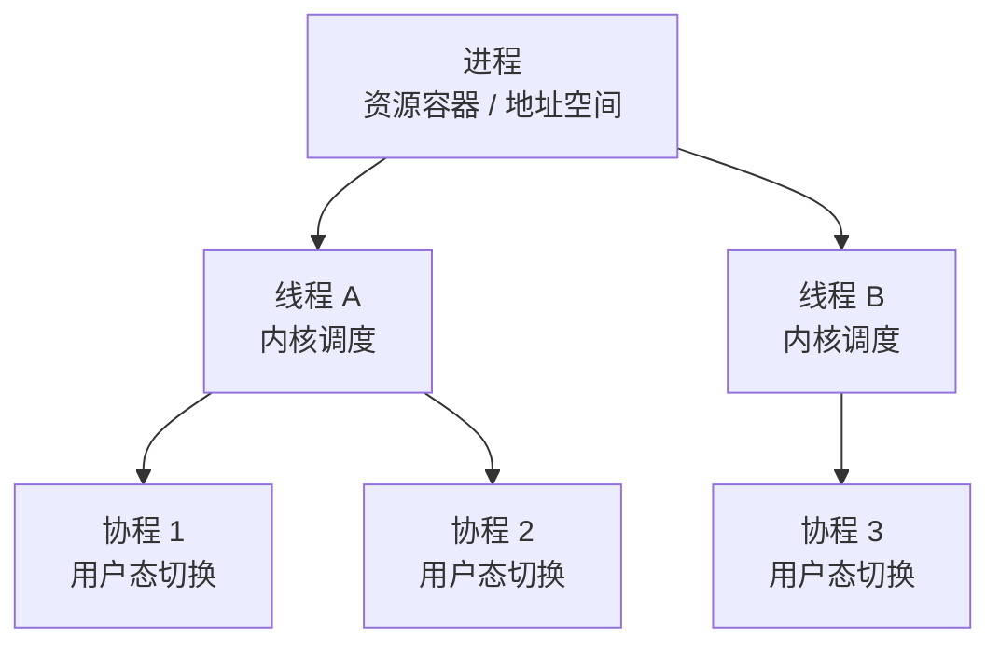
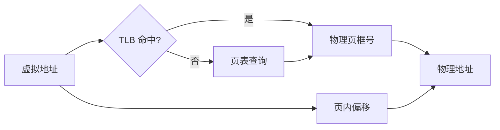
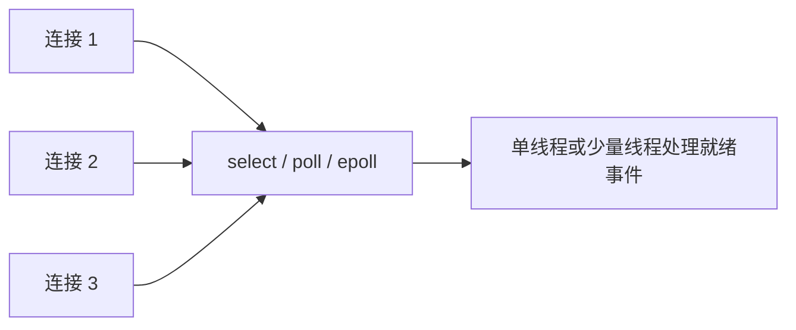
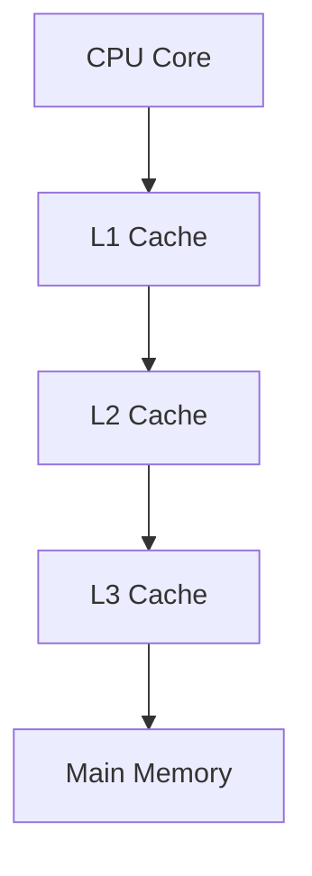

# 操作系统

> **模块**：11_后端八股/06_操作系统.md  
> **来源**：购买资料 A（7 个源文件）— 进程线程协程/内存管理/死锁/IO多路复用/CPU缓存/Linux命令  
> **规模**：约 897 行  |  **生成**：2026-11-12  
> **状态**：已合并（多源合一）

## 本篇包含

01. 进程线程协程
02. 内存管理
03. 死锁
04. IO多路复用
05. CPU缓存与一致性协议
06. Linux常用命令
07. 操作系统补充

## 01 进程线程协程

### 进程、线程、协程的区别

> 💡 **Q：进程、线程、协程有什么区别？**

> 📝 **进程** 是资源分配的基本单位，拥有独立的地址空间。  
> **线程** 是 CPU 调度的基本单位，同一进程内线程共享进程资源。  
> **协程** 则更轻量，通常由用户态调度，不依赖操作系统直接调度。
> 简单理解：
> - 进程更重，隔离性强
> - 线程更轻，共享资源方便
> - 协程更轻量，切换成本低

### 为什么需要协程

> 💡 **Q：为什么有了线程还需要协程？**

> 📝 因为线程虽然已经比进程轻，但它的创建和切换仍然有系统调用成本。  
> 在高并发 IO 场景下，大量线程阻塞等待会浪费很多资源。
> 协程的意义在于：  
> **用更低的上下文切换成本支撑更多并发任务。**

### 进程和线程的核心差异

> 💡 **Q：面试里怎么快速区分进程和线程？**

> 📝 最稳妥的答法是从三个维度说：
> - **资源归属**：进程有独立地址空间，线程共享进程的大部分资源
> - **调度单位**：线程是 CPU 调度的基本单位，进程更偏资源容器
> - **切换成本**：进程切换通常更重，因为涉及地址空间切换；线程切换相对更轻
> 如果只说“进程重、线程轻”太空，最好再补一句：  
> **进程强调隔离，线程强调并发执行。**

### 进程切换和线程切换为什么成本不同

> 💡 **Q：为什么进程切换比线程切换更重？**

> 📝 因为进程切换除了要保存和恢复寄存器、程序计数器、栈指针这些上下文之外，往往还要切换页表、地址空间，TLB 也可能失效。
> 线程切换通常只需要：
> - 保存线程私有寄存器状态
> - 切换线程栈
> - 继续在同一个进程地址空间里执行
> 所以面试里可以概括成一句话：  
> **线程切换主要是执行流切换，进程切换还叠加了资源环境切换。**

### 进程间通信方式有哪些

> 💡 **Q：进程之间怎么通信？**

> 📝 常见的 IPC 方式有：
> - 管道
> - 消息队列
> - 共享内存
> - 信号量
> - Socket
> 其中：
> - **共享内存** 速度最快，但要自己处理同步问题
> - **Socket** 最通用，既能本机通信，也能跨机器通信
> - **管道** 适合父子进程或简单单向通信
> 如果面试官继续追问，通常会问：  
> **为什么共享内存快？** 因为少了一层反复拷贝，多个进程直接映射到同一块物理内存。

### 线程之间怎么通信

> 💡 **Q：线程之间怎么通信？**

> 📝 线程因为共享进程内存，所以“通信”本质上往往就是共享变量、共享对象。
> 但共享带来的问题是竞态条件，所以通常要结合这些同步手段：
> - `synchronized` / `Lock`
> - 条件变量
> - 信号量
> - `wait/notify`
> - 原子类和 CAS
> 所以线程通信可以一句话概括：  
> **线程通信比进程容易，但同步比进程更重要。**

### 并发和并行有什么区别

> 💡 **Q：并发和并行的区别是什么？**

> 📝 **并发** 是一段时间内看起来多个任务都在推进。  
> **并行** 是同一时刻多个任务真的同时执行。
> 比如：
> - 单核 CPU 上多个线程交替执行，属于并发
> - 多核 CPU 上多个线程各占一个核心同时跑，属于并行
> 所以一句话记忆就是：  
> **并发强调“交替推进”，并行强调“同时执行”。**

### 用户级线程和内核级线程怎么理解

> 💡 **Q：什么是用户级线程和内核级线程？**

> 📝 可以把线程实现分成三种常见模型：
> - **用户级线程**：线程调度由用户态运行时完成，内核感知不到每个线程
> - **内核级线程**：线程由操作系统直接管理和调度
> - **混合模型**：用户态和内核态共同参与映射和调度
> 面试里最重要的理解是：
> - 用户级线程切换快，但一个线程阻塞可能拖住整个进程
> - 内核级线程能更好利用多核，但创建和切换成本更高
> Java 传统线程模型更接近 **1:1 的内核线程模型**，而虚拟线程更接近“用户态轻量调度”的思路。

### 图解补充：进程、线程、协程关系

### 高频追问

> 💡 **Q：协程一定比线程好吗？**

> 📝 不一定。协程主要适合 **IO 密集型、高并发、等待时间长** 的场景。
> 如果是 CPU 密集型任务，瓶颈在计算，不在切换，协程并不会天然更快。  
> 这时候更关键的是：
> - 核心数够不够
> - 任务能不能并行拆分
> - 调度和缓存命中是否合理

> 💡 **Q：为什么多线程程序容易出问题？**

> 📝 因为线程共享进程内存，带来三个经典问题：
> - 竞态条件
> - 可见性问题
> - 有序性问题
> 所以线程的难点从来不只是“开几个线程”，而是：  
> **共享资源时如何保证正确性。**

### 面试回答模板

> 📝 如果面试官问“进程、线程、协程有什么区别”，可以按这个顺序答：
> 第一，进程是资源分配的基本单位，线程是 CPU 调度的基本单位，协程是更轻量的用户态执行单元。  
> 第二，进程之间地址空间隔离，线程共享同一进程资源，所以线程切换比进程切换轻，但同步问题更多。  
> 第三，协程的优势在于用户态切换成本低，特别适合高并发 IO 场景，但 CPU 密集型任务不一定占优。

### 速记版

> 📝 - 进程：资源隔离强，成本高
> - 线程：共享资源，调度方便，同步复杂
> - 协程：用户态切换，适合 IO 密集
> - 并发：交替推进；并行：同时执行
> - IPC 高频考点：管道、消息队列、共享内存、信号量、Socket

## 02 内存管理

### 操作系统为什么需要内存管理

> 💡 **Q：操作系统为什么需要内存管理？**

> 📝 内存管理的目标主要有三个：
> - 让多个进程安全共享内存资源
> - 提高内存利用率
> - 给程序提供统一、连续的地址空间抽象
> 如果没有内存管理，程序直接操作物理内存，安全性和可维护性都会非常差。

### 虚拟内存

> 💡 **Q：什么是虚拟内存？**

> 📝 虚拟内存可以理解成：  
> **程序看到的是虚拟地址，操作系统再把虚拟地址映射到物理地址。**
> 这样做的好处是：
> - 进程之间互相隔离
> - 程序不必关心真实物理内存布局
> - 可以通过分页把部分不常用数据放到磁盘，缓解内存压力

### 分页和分段

> 💡 **Q：分页和分段有什么区别？**

> 📝 **分页** 是把内存划分成固定大小的页。  
> **分段** 是按逻辑模块划分，比如代码段、数据段、栈段。
> 分页更利于内存管理和物理映射，分段更符合程序逻辑语义。  
> 现代操作系统里，分页通常更核心。

### 地址翻译过程是怎样的

> 💡 **Q：CPU 是怎么把虚拟地址翻译成物理地址的？**

> 📝 核心流程可以概括成四步：
> - CPU 先拿到虚拟地址
> - 根据页号去查页表
> - 找到对应的物理页框
> - 再拼上页内偏移，得到最终物理地址
> 这里的关键点在于：  
> **高位通常用来定位页，低位偏移表示页内位置。**
> 如果面试官追问性能问题，就继续说 TLB。

### 什么是页表和 TLB

> 💡 **Q：页表和 TLB 分别是什么？**

> 📝 **页表** 是操作系统维护的映射表，用来记录“虚拟页 -> 物理页框”的对应关系。  
> **TLB** 可以理解成页表的高速缓存，它缓存在 CPU 里，保存最近访问过的地址映射。
> 如果每次访存都先去内存里查页表，成本太高，所以需要 TLB 来加速。  
> 因此最标准的回答是：
> - 页表解决的是“怎么映射”
> - TLB 解决的是“映射查得太慢”

### 缺页中断是什么

> 💡 **Q：什么是缺页中断？**

> 📝 当进程访问的虚拟页当前不在物理内存中时，就会触发 **缺页中断**。
> 操作系统会做这些事：
> - 暂停当前进程
> - 去磁盘把目标页调入内存
> - 必要时淘汰一个旧页
> - 更新页表
> - 恢复进程继续执行
> 所以缺页中断本质上说明：  
> **程序访问的逻辑地址有效，但对应数据当前不在内存里。**

### 页面置换算法有哪些

> 💡 **Q：常见页面置换算法有哪些？**

> 📝 高频算法主要有这几个：
> - **FIFO**：先进先出，实现简单，但可能出现 Belady 异常
> - **LRU**：淘汰最近最少使用页，更符合局部性原理
> - **Clock**：对 LRU 的工程化近似实现
> 面试里一般这样答更稳：
> - 理论上 LRU 更理想
> - 实际系统里常常用 Clock 这类近似算法，因为真正精确维护 LRU 成本高

### 进程地址空间一般怎么分布

> 💡 **Q：一个进程的虚拟地址空间一般怎么划分？**

> 📝 典型划分可以这样理解：
> - 代码段
> - 数据段
> - 堆
> - 栈
> - 共享库映射区
> 其中最容易考的是：
> - **堆**：向上增长，主要用于动态分配
> - **栈**：向下增长，主要保存函数调用现场和局部变量

### 图解补充：虚拟地址到物理地址

### 图解补充：进程地址空间

### 高频追问

> 💡 **Q：为什么有了物理内存还要搞虚拟内存？**

> 📝 因为虚拟内存同时解决了三件事：
> - 进程隔离
> - 地址抽象
> - 内存扩展
> 如果程序直接操作物理内存，会带来安全问题，而且程序装载、重定位、内存复用都会变复杂很多。

> 💡 **Q：分页为什么比纯分段更主流？**

> 📝 因为分页是固定大小，映射和管理更标准，能更好地配合页表、TLB、缺页中断这一整套机制。  
> 纯分段更贴近逻辑语义，但容易产生外部碎片，工程上不如分页稳定。

### 面试回答模板

> 📝 如果面试官问“什么是虚拟内存”，可以这样答：
> 虚拟内存本质上是操作系统给每个进程提供的一层地址抽象，程序访问的是虚拟地址，再通过页表映射到物理内存。  
> 它的价值主要有三点：第一做进程隔离，第二简化程序对内存的使用，第三可以把不活跃页放到磁盘，提升整体内存利用率。  
> 为了避免每次查页表太慢，CPU 还会用 TLB 缓存热点映射。

### 速记版

> 📝 - 虚拟内存：隔离 + 抽象 + 扩展
> - 页表：负责映射；TLB：负责加速
> - 缺页中断：页合法，但当前不在内存
> - 置换算法：FIFO、LRU、Clock
> - 堆向上，栈向下

## 03 死锁

### 什么是死锁

> 💡 **Q：什么是死锁？**

> 📝 死锁指的是多个进程或线程互相等待对方释放资源，最终谁都无法继续执行。
> 它的本质是：  
> **形成了循环等待。**

### 死锁的四个必要条件

> 💡 **Q：死锁的四个必要条件是什么？**

> 📝 四个必要条件是：
> - 互斥
> - 请求并保持
> - 不可剥夺
> - 循环等待
> 只要破坏其中任意一个条件，就可以避免死锁。

### 如何避免死锁

> 💡 **Q：怎么避免死锁？**

> 📝 常见做法包括：
> - 固定资源获取顺序
> - 一次性申请所需资源
> - 缩短持锁时间
> - 尽量减少资源嵌套依赖
> 在 Java 业务开发里，最常见也最实用的是：  
> **按统一顺序加锁。**

## 04 IO多路复用

### IO 多路复用是什么

> 💡 **Q：什么是 IO 多路复用？**

> 📝 IO 多路复用的核心思想是：  
> **一个线程可以同时监听多个文件描述符的 IO 事件。**
> 这样就不用像传统阻塞模型那样，一个连接配一个线程，从而显著提高并发能力。

### select、poll、epoll 的区别

> 💡 **Q：select、poll、epoll 有什么区别？**

> 📝 **select**：
> - 有监听数量上限
> - 每次调用都要把所有 fd 从用户态拷贝到内核态
> - 遍历成本较高
> **poll**：
> - 解决了 select 的数量上限问题
> - 但本质上仍然需要轮询遍历
> **epoll**：
> - 基于事件驱动
> - 不需要每次完整遍历所有 fd
> - 在大量连接场景下性能更好
> 所以高并发网络编程里，最常见的是 epoll。

### 阻塞、非阻塞、同步、异步怎么区分

> 💡 **Q：阻塞/非阻塞、同步/异步有什么区别？**

> 📝 这四个概念最容易混。建议分成两个维度来答：
> - **阻塞 / 非阻塞**：调用线程会不会被挂起等待
> - **同步 / 异步**：结果是不是还要调用方主动参与处理
> 常见组合理解：
> - BIO：同步阻塞
> - NIO 多路复用：同步非阻塞
> - AIO：异步非阻塞
> 所以 IO 多路复用并不等于异步，它更准确地说是：  
> **同步非阻塞的事件驱动模型。**

### epoll 为什么更高效

> 💡 **Q：为什么 epoll 比 select、poll 更高效？**

> 📝 关键是两个点：
> - **监听集合管理更高效**
> - **返回的是就绪事件，不是所有 fd**
> 也就是说，select/poll 的问题不只是“API 老”，而是：
> - 每次都要把关注列表从用户态拷到内核态
> - 每次都要遍历全量 fd
> 而 epoll 更接近“先注册、后通知”的模式，所以在连接数大、活跃连接比例低的场景下更有优势。

### epoll 的 LT 和 ET 模式

> 💡 **Q：什么是 LT 和 ET？**

> 📝 `epoll` 常见有两种触发模式：
> - **LT（Level Trigger，水平触发）**  
> 只要缓冲区里还有数据没处理完，就会持续通知
> - **ET（Edge Trigger，边缘触发）**  
> 只有状态变化时通知一次，不会反复提醒
> 面试里最常问的是区别：
> - LT 更稳，更不容易漏处理
> - ET 性能潜力更高，但要求一次把数据尽量读完，否则容易漏事件
> 如果你答 Netty，也可以补一句：  
> **ET 模式通常要配合非阻塞 IO 一起用。**

### Reactor 模型怎么理解

> 💡 **Q：IO 多路复用和 Reactor 有什么关系？**

> 📝 IO 多路复用提供的是“事件监听能力”，Reactor 提供的是“事件分发模型”。
> 可以这样理解：
> - epoll 负责告诉你“哪个连接就绪了”
> - Reactor 负责把这个就绪事件分发给对应处理器
> 所以像 Java NIO、Netty，本质上都是：
> - 底层用 IO 多路复用监听事件
> - 上层用 Reactor 组织事件处理流程

### 零拷贝是什么，和 IO 多路复用有什么关系

> 💡 **Q：零拷贝是什么？**

> 📝 零拷贝关注的是 **数据搬运路径优化**，IO 多路复用关注的是 **连接事件处理效率**。
> 两者解决的问题不一样：
> - IO 多路复用：减少线程数量，提升连接管理效率
> - 零拷贝：减少用户态和内核态之间的数据复制、减少 CPU 参与
> 典型零拷贝手段有：
> - `mmap`
> - `sendfile`
> 面试时不要把它们混成一个概念，但可以说明它们经常一起出现在高性能网络框架里。

### 图解补充：IO 多路复用工作流

### 图解补充：select、poll、epoll 对比

| 机制 | 数据结构/特征 | 性能瓶颈 | 适用结论 |
|-|-|-|-|
| select | 位图，数量有限制 | 全量拷贝 + 全量遍历 | 老方案，小规模可用 |
| poll | 链表/数组描述集合 | 无上限但仍然全量遍历 | 比 select 更灵活 |
| epoll | 事件驱动 | 实现复杂度更高 | 高并发场景首选 |

### 高频追问

> 💡 **Q：为什么 Redis、Nginx、Netty 都爱讲 IO 多路复用？**

> 📝 因为它们都要面对“大量连接 + 较少活跃事件”的场景。
> 如果每个连接一个线程，线程数会爆炸；  
> 如果用 IO 多路复用，一个线程就能管很多连接，把真正活跃的事件挑出来处理。

> 💡 **Q：IO 多路复用是不是完全没有遍历成本？**

> 📝 不是。真正准确的说法是：
> - 它避免了对所有连接做无意义的阻塞等待
> - 尤其是 `epoll`，把“全量轮询”优化成了“基于就绪事件处理”
> 但事件分发、业务处理本身依然有成本。

### 面试回答模板

> 📝 如果面试官问“什么是 IO 多路复用”，可以这样答：
> IO 多路复用就是一个线程同时监听多个文件描述符，当某个连接可读可写时再去处理它。  
> 它解决的是高并发场景下线程数量过多的问题，所以比传统 BIO 的“一连接一线程”模型更适合高并发。  
> 常见实现有 select、poll、epoll，其中 epoll 的优势在于事件驱动和返回就绪 fd，所以在 Linux 下最常用。

### 速记版

> 📝 - 一个线程监听多个 fd，就是 IO 多路复用
> - BIO：同步阻塞；NIO：同步非阻塞；AIO：异步非阻塞
> - epoll 关键优势：事件驱动、只处理就绪 fd
> - LT 稳，ET 快但更容易写错
> - IO 多路复用解决连接管理；零拷贝解决数据搬运

## 05 CPU缓存与一致性协议

### 为什么要有 CPU 缓存

> 💡 **Q：为什么主存前面还要加多级缓存？**

> 📝 因为 CPU 的计算速度远快于主存访问速度，如果每次取数据都直接访问内存，CPU 会经常空等。
> 所以现代计算机一般会设计成：
> - L1 缓存
> - L2 缓存
> - L3 缓存
> - 主存
> 这本质上是在解决 **CPU 和内存速度不匹配** 的问题。

### 什么是缓存局部性

> 💡 **Q：为什么有些代码缓存命中率高，有些很差？**

> 📝 这背后是局部性原理：
> - **时间局部性**：刚访问过的数据，后面很可能还会访问
> - **空间局部性**：访问了一个地址，它附近的数据也很可能很快被访问
> 所以连续遍历数组通常比跳跃访问更友好，因为更容易命中缓存。

### 什么是缓存行

> 💡 **Q：什么是 Cache Line？**

> 📝 CPU 和缓存之间不是按一个字节一个字节搬数据的，而是按 **缓存行** 为单位搬。
> 你可以理解成：
> - 主存里相邻的一小块数据会一起被加载到缓存
> - 常见缓存行大小是 64 字节
> 这也是为什么“相邻变量”有时候会互相影响，尤其是在多线程环境里。

### 什么是伪共享

> 💡 **Q：什么是伪共享？**

> 📝 伪共享指的是：
> - 两个线程修改的是不同变量
> - 但这两个变量恰好落在同一个缓存行里
> - 导致缓存行频繁失效和同步，性能明显下降
> 所以伪共享不是数据语义冲突，而是：
> **硬件层面上共享了同一个缓存行。**

### 什么是缓存一致性协议

> 💡 **Q：为什么多核 CPU 需要缓存一致性协议？**

> 📝 因为每个 CPU 核心可能都有自己的私有缓存。
> 如果核心 A 改了某个变量，而核心 B 还在用旧缓存，就会出现数据不一致问题。  
> 缓存一致性协议的目标就是：  
> **保证多个核心看到的数据最终一致。**

### MESI 协议怎么理解

> 💡 **Q：什么是 MESI？**

> 📝 MESI 是经典缓存一致性协议，缓存行通常有四种状态：
> - **M（Modified）**：已修改，只在当前缓存里，和主存不一致
> - **E（Exclusive）**：独占，只在当前缓存里，和主存一致
> - **S（Shared）**：共享，可能在多个缓存里，和主存一致
> - **I（Invalid）**：失效，当前缓存副本不可用
> 面试里不用背每一条状态转移规则，但一定要理解：
> - 一个核心写数据后，其他核心对应缓存行可能失效
> - 这样才能避免不同核心长期看到不同值

### 缓存一致性和内存可见性是什么关系

> 💡 **Q：CPU 缓存一致性和 Java 可见性有什么关系？**

> 📝 它们不是同一个层次，但有强相关。
> 可以这样理解：
> - CPU 缓存一致性是 **硬件层面**
> - `volatile`、内存屏障、JMM 是 **语言/运行时层面**
> 语言层的可见性保证，最终还是要落到硬件执行上。  
> 所以很多并发问题，底层都和缓存、重排序、写回时机有关。

### 图解补充：多级缓存结构

### 图解补充：MESI 核心含义

| 状态 | 含义 | 和主存是否一致 | 是否可能被其他核心共享 |
|-|-|-|-|
| M | 已修改 | 否 | 否 |
| E | 独占 | 是 | 否 |
| S | 共享 | 是 | 是 |
| I | 失效 | 无意义 | 无意义 |

### 高频追问

> 💡 **Q：为什么连续遍历数组通常更快？**

> 📝 因为它更符合空间局部性，CPU 一次把一整条缓存行加载进来后，后续访问很可能直接命中缓存，不用频繁去主存取数据。

> 💡 **Q：伪共享为什么会拖慢程序？**

> 📝 因为不同线程虽然在修改不同变量，但变量处于同一缓存行中，导致缓存行在多个核心之间频繁同步、失效和回写。
> 所以伪共享的重点不是锁，而是：  
> **缓存行为单位的冲突。**

### 面试回答模板

> 📝 如果面试官问“为什么需要缓存一致性协议”，可以这样答：
> 现代多核 CPU 每个核心都有自己的缓存，如果一个核心修改了共享变量，而另一个核心还在读旧缓存，就会出现数据不一致。  
> 所以硬件层需要缓存一致性协议来协调多个核心对同一份数据的读取和写入，MESI 就是最经典的协议之一。  
> 它通过缓存行状态流转来保证多个核心最终看到一致的数据。

### 速记版

> 📝 - CPU 快，内存慢，所以要有多级缓存
> - 局部性分时间局部性和空间局部性
> - 数据以缓存行为单位搬运
> - 伪共享：变量不同，但缓存行相同
> - MESI：M、E、S、I 四种状态

## 06 Linux常用命令

### 查看进程和资源

> 💡 **Q：排查线上问题时，你常用哪些 Linux 命令？**

> 📝 我最常用的有：
> - `top` / `htop`：看 CPU、内存、进程资源占用
> - `ps -ef`：看进程信息
> - `free -m`：看内存
> - `df -h`：看磁盘空间
> - `du -sh`：看目录大小

### 查看日志和网络

> 💡 **Q：常见日志和网络排查命令有哪些？**

> 📝 常见会用到：
> - `tail -f`：实时看日志
> - `grep`：过滤关键字
> - `less`：分页查看文件
> - `netstat` / `ss`：看端口和连接
> - `lsof -i`：看端口占用
> 如果是 Java 服务排障，还经常会配合 `jps`、`jstack`、`jmap` 一起用。

### CPU 过高时看什么

> 💡 **Q：线上 CPU 飙高时，你一般怎么查？**

> 📝 我的排查顺序通常是：
> - `top` 看整体 CPU 占用
> - `top -Hp <pid>` 看哪个线程最耗 CPU
> - `ps -mp <pid> -o THREAD,tid,time` 辅助看线程
> - 把线程 ID 转成 16 进制，再配合 `jstack` 找具体代码栈
> 如果是面试，建议把“命令 + 思路”一起说出来，不要只背命令名。

### 内存问题怎么查

> 💡 **Q：怀疑内存有问题时，你会用哪些命令？**

> 📝 常见组合是：
> - `free -m`：看整体内存和 swap
> - `top`：看哪个进程吃内存
> - `vmstat`：看内存、换页、上下文切换
> - `pmap -x <pid>`：看具体进程内存映射
> 如果是 Java，还会继续配合：
> - `jmap -histo`
> - `jcmd GC.heap_info`

### 磁盘和 IO 问题怎么查

> 💡 **Q：磁盘满了或者 IO 异常时怎么查？**

> 📝 我一般这么查：
> - `df -h`：先看分区整体使用率
> - `du -sh *`：看哪个目录占空间大
> - `du -sh /path/* | sort -h`：逐层缩小范围
> - `iostat -x`：看磁盘读写压力和 util
> 磁盘类问题最常见的坑是：
> - 日志膨胀
> - 临时文件没清理
> - 大目录或大文件积压

### 网络问题怎么查

> 💡 **Q：端口占用、连接异常、超时问题怎么查？**

> 📝 常用命令有：
> - `ss -lntp`：看监听端口和对应进程
> - `lsof -i :端口号`：看某个端口被谁占了
> - `netstat -anp`：看连接状态
> - `ping`：测连通性
> - `curl`：测接口可达性和返回
> 如果连接很多，还要关注：
> - `ESTABLISHED`
> - `TIME_WAIT`
> - `CLOSE_WAIT`
> 这些 TCP 状态常常是面试追问点。

### 日志排查怎么组织命令

> 💡 **Q：查日志时你常怎么组合命令？**

> 📝 最常用的几种组合：
> - `tail -f app.log`
> - `grep "ERROR" app.log`
> - `grep "用户ID" app.log | grep "关键字"`
> - `cat app.log | grep "Exception" | tail -n 50`
> 如果日志很大，一般优先：
> - `less`
> - `tail`
> - `grep`
> 不要一上来 `cat` 整个大文件。

### 图解补充：线上排障常见顺序

### 高频追问

> 💡 **Q：为什么现在更推荐 `ss`，而不是老用 `netstat`？**

> 📝 因为 `ss` 更快、更现代，查询 socket 状态的性能通常更好。
> 不过面试时不用踩 `netstat`，你可以说：
> - 老环境里 `netstat` 也很常见
> - 新环境里更推荐 `ss`

> 💡 **Q：排查问题时你是先看日志还是先看资源？**

> 📝 一般先看资源概况，再看日志细节。
> 因为如果是 CPU 打满、内存泄漏、磁盘写满、端口异常，先从资源视角能更快缩小范围。  
> 日志更适合在定位到某个进程、某个接口、某个时间段之后精确分析。

### 面试回答模板

> 📝 如果面试官问“线上问题常用哪些 Linux 命令”，可以这样答：
> 我通常按资源维度来排查。先用 `top`、`free -m`、`df -h` 看 CPU、内存、磁盘，再用 `ps`、`ss`、`lsof` 定位进程和端口，最后用 `tail`、`grep`、`less` 查日志。  
> 如果是 Java 服务，我还会继续用 `jstack`、`jmap` 结合线程和堆信息定位问题。

### 速记版

> 📝 - CPU：`top`、`top -Hp`、`ps`
> - 内存：`free -m`、`vmstat`、`pmap`
> - 磁盘：`df -h`、`du -sh`、`iostat`
> - 网络：`ss`、`netstat`、`lsof -i`
> - 日志：`tail`、`grep`、`less`

## 07 操作系统补充

### 用户态和内核态

> 💡 **Q：什么是用户态和内核态？**

> 📝 用户态是应用程序运行的受限环境，权限较低；  
> 内核态是操作系统内核运行的高权限环境，能直接操作硬件资源。
> 像网络 IO、磁盘 IO、进程调度等很多能力，都需要从用户态切到内核态完成。

### 中断

> 💡 **Q：什么是中断？**

> 📝 中断可以理解成硬件或软件向 CPU 发出的“请先处理我”的信号。  
> 操作系统借助中断机制来处理外设输入、时钟调度等事件。

### 孤儿进程和僵尸进程

> 💡 **Q：什么是孤儿进程和僵尸进程？**

> 📝 **孤儿进程** 是父进程先退出，子进程还在运行。此时子进程会被系统托管。  
> **僵尸进程** 是子进程已经结束，但父进程还没回收它的退出状态。
> 僵尸进程如果大量堆积，会浪费系统资源。

### 进程调度算法

> 💡 **Q：常见进程调度算法有哪些？**

> 📝 常见的有：
> - 先来先服务
> - 短作业优先
> - 时间片轮转
> - 多级反馈队列
> 面试里最常被提到、也最有代表性的是 **时间片轮转**和**多级反馈队列**。

### 系统调用是什么

> 💡 **Q：什么是系统调用？**

> 📝 系统调用就是应用程序向操作系统请求服务的方式。
> 比如这些操作，本质上都离不开系统调用：
> - 读写文件
> - 创建进程
> - 建立网络连接
> - 申请内存
> 最常见的面试表达是：  
> **用户程序自己没有直接操作硬件的权限，所以要通过系统调用进入内核态，由内核代为完成。**

### 用户态切换到内核态有哪些场景

> 💡 **Q：什么时候会发生用户态到内核态切换？**

> 📝 常见有三类：
> - **系统调用**：应用主动请求内核服务
> - **中断**：外设或时钟中断打断当前执行流
> - **异常**：比如缺页、除零、非法访问
> 所以面试里可以总结为：  
> **主动切换常见是系统调用，被动切换常见是中断和异常。**

### 上下文切换是什么

> 💡 **Q：什么是上下文切换？为什么它贵？**

> 📝 上下文切换就是 CPU 从当前执行单元切到另一个执行单元前，先保存当前状态，再恢复目标状态。
> 它贵的原因主要有：
> - 要保存和恢复寄存器、程序计数器、栈指针
> - 线程切换也可能导致缓存局部性变差
> - 进程切换还可能引入地址空间切换和 TLB 失效
> 所以很多高性能问题，本质上不是“线程太少”，而是：  
> **切换太频繁。**

### 中断、异常、系统调用怎么区分

> 💡 **Q：中断、异常、系统调用有什么区别？**

> 📝 这三个概念常被放在一起考：
> - **系统调用**：应用程序主动发起，请求内核服务
> - **异常**：程序运行出错或特殊事件触发，比如缺页
> - **中断**：来自外设或时钟的外部事件
> 所以区分它们最简单的角度是：  
> **谁发起、为什么切换。**

### 图解补充：用户态到内核态

### 高频追问

> 💡 **Q：孤儿进程和僵尸进程哪个更危险？**

> 📝 通常是 **僵尸进程** 更值得警惕。
> 因为孤儿进程会被系统接管，不一定是坏事；  
> 但僵尸进程说明退出状态没有被回收，堆积多了会占用 PID 等系统资源。

> 💡 **Q：上下文切换一定发生在进程之间吗？**

> 📝 不是。线程之间也会发生上下文切换。
> 只是：
> - 线程切换通常更轻
> - 进程切换通常更重
> 不要把“上下文切换”只理解成进程切换。

### 面试回答模板

> 📝 如果面试官问“用户态和内核态有什么区别”，可以这样答：
> 用户态是应用程序运行的受限环境，不能直接操作硬件；内核态拥有更高权限，可以管理 CPU、内存、磁盘、网络等系统资源。  
> 当程序需要文件 IO、网络 IO、进程管理这类能力时，就要通过系统调用进入内核态。  
> 此外，中断和异常也会触发从用户态切换到内核态。

### 速记版

> 📝 - 用户态权限低，内核态权限高
> - 切换来源：系统调用、中断、异常
> - 系统调用是主动，中断和异常更偏被动
> - 孤儿进程会被接管，僵尸进程要及时回收
> - 上下文切换的成本主要来自状态保存和缓存失效

---

## 来源档案（原始文件，仅供溯源）

- `04_后端八股整理/05_操作系统/00_进程线程协程.md`
- `04_后端八股整理/05_操作系统/01_内存管理.md`
- `04_后端八股整理/05_操作系统/02_死锁.md`
- `04_后端八股整理/05_操作系统/03_IO多路复用.md`
- `04_后端八股整理/05_操作系统/04_CPU缓存与一致性协议.md`
- `04_后端八股整理/05_操作系统/05_Linux常用命令.md`
- `04_后端八股整理/05_操作系统/06_操作系统补充.md`
