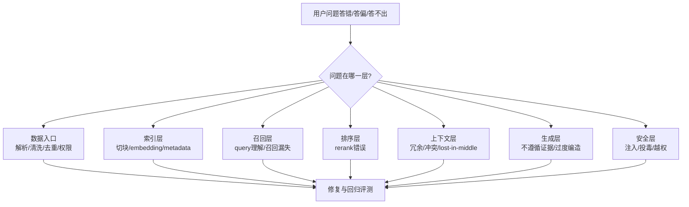

# RAG与知识检索

> **模块**：05_RAG与知识检索/05_RAG与知识检索.md  
> **构成**：7 个知识点合为一篇，按顺序编号  
> **规模**：约 2,772 行  |  **生成**：2026-11-12

## 目录

1. RAG基础
2. Chunking-Embedding-Rerank
3. Hybrid检索与QueryRewrite
4. AgenticRAG与GraphRAG
5. RAG常见失败模式
6. RAG工程实现全流程
7. RAG场景题与趋势

---

## 1. RAG基础

### 一、RAG的考察内容

RAG 基础题表面上在问什么是 RAG，**本质上在考你是否理解大模型应用为什么需要把模型参数里的知识和外部知识源拆开管理**。校招生最容易把 RAG 讲成把文档切块后丢进向量库，再把检索结果拼到 Prompt 里，这只能拿到及格分。更高分的表达必须说明：**RAG 解决的是知识时效性、领域覆盖、可追溯性、成本与可维护性之间的工程平衡**；它不是单一算法，而是一整条以检索为核心、以生成为出口、以评测和治理为约束的数据通路。

因此，这篇题真正考的是你能不能把为什么要检索、检索什么、什么时候检索、检索到之后如何约束生成、RAG 与长上下文/微调/记忆分别是什么关系说清楚。只要你把这些关系讲明白，面试官通常会认为你具备了进入 RAG 细化题、Agent 检索题、评测题和系统设计题的基础。

面试官在这一题里，通常不是只想听一个名词解释，而是想顺着这个主题判断你是否具备下面这些能力：

- 是否能准确区分参数知识、外部知识、会话上下文、用户记忆这四类信息载体。
- 是否理解 RAG 的核心链路：数据接入、解析、切分、索引、召回、重排、上下文组装、答案生成、引用与回传。
- 是否知道 RAG 的收益和边界：能降低幻觉、提升时效与可解释性，但不能自动保证正确，更不能替代权限控制与评测。
- 是否能说出 RAG 与微调、长上下文、缓存、知识图谱、Agent 的关系，而不是把这些概念混成一团。
- 是否具备工程 trade-off 意识，能从质量、成本、延迟、维护、权限、安全这几个维度比较方案。

### 二、一些重要结论

- RAG 的本质是检索驱动的受控生成，不是向量库 + Prompt 拼接的机械套路。
- RAG 价值最大的场景是：知识频繁变化、知识属于私域、需要来源追溯、上下文很长但真正有用的信息只占一小部分。
- RAG 的效果由两段决定：一段是能不能把对的证据召回来，另一段是模型会不会老老实实依据证据作答。
- 做不好 RAG 的根源往往不在模型，而在解析、切块、召回、重排、权限、上下文打包与评测闭环。
- 长上下文模型变强以后，生产上越来越常见的做法不是永远用 RAG，而是按查询类型在 RAG 与长上下文之间做路由。

### 三、先有一张总图


### 四、系统化八股知识

#### RAG 到底是什么：一句定义，三层含义

RAG 是 Retrieval-Augmented Generation，也就是检索增强生成。最朴素的理解是：先从外部知识源中找到与问题最相关的证据，再把证据和问题一起交给模型作答。这个说法没有错，但还不够完整。面试里最好把它展开成三层。

第一层，**RAG 是信息访问机制**。模型自身参数里的知识是静态的、训练期固化的，而外部知识可以是实时更新的数据库、文档库、企业知识库、搜索引擎结果、图数据库甚至业务系统 API。RAG 的作用就是在推理时把这些外部知识安全、经济地接进来。Lewis 等人在 2020 年提出的经典 RAG 工作，把它表述为把参数化记忆和非参数化记忆结合起来的生成范式，这也是今天绝大多数面试官默认的理论起点。

第二层，**RAG 是证据约束机制**。它不是让模型凭感觉回答，而是尽量让模型依据检索到的证据回答。这就是为什么生产系统往往要求返回引用片段、文档标题、页码、URL 或 chunk id。只要没有证据，你就应该尽量让系统拒答、澄清或继续检索，而不是胡编。

第三层，**RAG 是工程系统而不是单点算法**。从数据接入、解析、切块、索引，到检索、重排、上下文压缩、答案生成、引用回传、权限过滤、评测观测，任何一个环节出问题，最后用户都会感知为RAG 不准。所以真正做过的人，讲 RAG 时一定会强调全链路，而不只盯着 embedding 模型。

#### 为什么今天还需要 RAG：不是模型不够强，而是系统边界不同

很多同学会说因为大模型会幻觉，所以需要 RAG。这个说法对，但太浅。更完整的回答应该至少包含四个动机。

第一，**知识时效性**。模型预训练截止之后发生的事情，它不知道；企业内部昨天刚更新的制度、今天刚上的商品、刚变更的价格、刚修复的 bug，它也不知道。RAG 可以在不重新训练模型的前提下接入最新知识。

第二，**知识所有权与私域性**。公司内部 wiki、CRM、工单、合同、代码仓库、会议纪要，本来就不可能全部纳入底座模型预训练。RAG 是把私域知识接给模型最自然的方式。

第三，**可追溯与可治理**。在企业环境里，答案像不像真的远远不够，通常还要能追溯答案是根据哪份文档、哪条记录、哪一次更新给出的。没有来源，你很难审计、纠错、追责，也很难让用户信任系统。

第四，**成本与效率**。即使长上下文模型已经很强，直接把整库内容塞进上下文仍然很贵。Google DeepMind 在 2024 年的对比研究里发现，资源充足时长上下文模型常常能优于 RAG，但 RAG 仍有显著的成本优势，因此更合理的工程思路是路由，而不是二选一。换句话说，RAG 并不是旧时代妥协方案，而是在成本、权限、更新频率、可解释性约束下依然有竞争力的系统设计。

面试官爱追问的点通常是：既然长上下文越来越强，RAG 会不会过时？你的回答应该是：**不会过时，但会从默认方案变成按任务选择的方案**。当知识库小于一个上下文窗口且权限简单时，直接 long-context 很可能更省事；当知识源很大、更新频繁、权限复杂、证据追溯重要时，RAG 依旧是主流。Anthropic 在 Contextual Retrieval 文里甚至明确提到，如果你的知识库小于约 20 万 token，直接把整库放进提示里可能比上 RAG 更简单；这反而说明成熟团队已经开始按规模和任务做分层选择。

#### RAG 的标准链路：从离线索引到在线回答

面试里最好把 RAG 拆成离线索引链路和在线查询链路，这样会显得你对系统边界很清楚。

**离线索引链路**通常包含：

1. 数据接入：接文件、网页、数据库、消息流、代码仓库、SaaS API。
2. 解析与标准化：抽取正文、标题、层级、表格、图片说明、作者、更新时间、权限标签。
3. 切块：按段落、章节、语义、表格、代码函数等切成适合检索的最小单元。
4. 索引构建：建立向量索引、BM25 倒排索引、知识图谱或混合索引。
5. 元数据与权限绑定：记录 doc_id、chunk_id、tenant_id、acl、版本号、时间戳、语言、业务域等。

**在线查询链路**通常包含：

1. 查询理解：识别问题意图、语言、是否需要检索、是否需要改写。
2. 召回：用 dense、sparse、hybrid、graph 或 agentic retrieval 拿回候选证据。
3. 重排：用 cross-encoder、late interaction 或更强的 reranker 对候选重新排序。
4. 上下文组装：去重、按信息密度和 token budget 选择片段，必要时做压缩或摘要。
5. 生成答案：提示模型基于证据作答、不要越界推断、无证据就说不知道。
6. 返回结果：答案、引用、置信线索、后续动作建议。
7. 观测与回放：记录 query、retrieved docs、rerank scores、latency、cost、用户反馈。

为什么要这么拆？因为**离线链路决定知识能否被正确表征，在线链路决定证据能否被正确使用**。很多面试题其实就是在问你哪一段出了问题。例如召回率低怎么办是在线问题，表格总是答错往往是解析和切块问题，跨租户泄漏是权限绑定问题。你一旦会这样拆，后续所有 RAG 细题都容易讲。

#### RAG 与微调、长上下文、缓存、搜索的关系

这部分是面试里非常高频的概念边界题。回答时建议用解决什么问题来区分，而不是按技术实现来背诵。

**RAG vs 微调**：RAG 主要解决让模型在推理时访问外部知识的问题，适合知识更新快、证据需要追溯的场景；微调主要解决让模型学会特定输出风格、领域表达、工具调用习惯、分类边界的问题。知识更新如果天天变，更适合 RAG；回答格式总是不稳，更适合微调。很多生产系统同时使用二者：底座经过指令/格式微调，知识通过 RAG 接入。

**RAG vs 长上下文**：长上下文是给模型更多上下文容量，RAG 是从大量候选信息里挑出应该放进去的那一小部分。前者解决容量，后者解决选择。容量大不等于选择好。现实里常见的是两者结合：先检索，再把选中的证据交给长上下文模型做综合推理。

**RAG vs 缓存**：缓存是复用过去已经算过的结果，比如相同问题的答案缓存、embedding 缓存、query rewrite 缓存。它主要优化成本和延迟；RAG 主要优化知识获取和回答正确性。缓存不能替代检索，只能加速检索后的部分流程。

**RAG vs 搜索**：传统搜索通常输出文档列表，而 RAG 目标是把搜索结果转化成可消费的模型上下文并完成答案生成。所以你可以把 RAG 理解为搜索 + 证据编排 + 生成。如果只会搜不会用证据，还是做不好 RAG。

#### 什么是好 RAG：不要只说准确率，要看一整组指标

很多校招生答 RAG 题时只会说看回答准不准。面试官如果听到这里，通常会继续追问：那怎么知道是检索错了，还是生成错了？这时你必须能把指标拆开。

第一类是**检索指标**，比如 Recall@k、MRR、nDCG、Hit Rate。它衡量正确证据是否进入候选集。如果 gold evidence 根本没被召回，再好的生成模型都救不回来。

第二类是**重排与上下文打包指标**。候选里有对的文档，不代表最终拼进 Prompt 的就是对的文档。你需要关注 rerank 之后 top-N 的质量、去重率、token 利用率、不同来源覆盖率，以及是否把关键证据淹没在一堆边缘片段里。

第三类是**生成指标**，比如答案正确率、faithfulness、citation accuracy、refusal accuracy、hallucination rate。也就是说，不仅看答案像不像，还看它是否忠于给定证据、引用是否对得上、该拒答时能不能拒答。

第四类是**系统指标**，包括 P95 延迟、吞吐、单问成本、索引更新时间、失败重试率、权限过滤命中率。这些指标决定了你能不能把 RAG 放进生产环境，而不是只停留在 demo。

真正成熟的回答应该是：**一个高质量 RAG 系统，至少要同时优化召回、重排、证据打包、生成忠实度和系统成本**。你甚至可以补一句：RAG 系统的问题定位通常要通过 tracing 把 query rewrite、retrieval、rerank、prompt assembly、generation 这些环节全部打点，否则改了半天也不知道改对了没有。

#### Naive RAG、Advanced RAG、Modular RAG：面试里怎么讲层次

面试里经常会问你理解的 RAG 演进阶段是什么。比较稳妥的讲法是三层。

**Naive RAG**：文档切块、做 embedding、向量检索、把 top-k 拼给模型回答。这种方式容易上手，但对关键词问题、长文结构问题、多跳问题、权限问题都比较脆弱。

**Advanced RAG**：开始引入混合检索、query rewrite、rerank、metadata filter、chunk contextualization、query routing、citation、拒答机制。也就是说，不再把向量检索当成唯一武器，而是把 retrieval 做成多阶段系统。Anthropic 的 Contextual Retrieval、Pinecone/Weaviate/Qdrant 的 hybrid + rerank 官方实践，都是这个阶段的典型代表。

**Modular / Production RAG**：进一步把检索、重排、压缩、权限、评测、观测做成可插拔模块，并与缓存、异步索引、灰度发布、回归测试、成本治理整合。到这一步，RAG 已经不是一个小 demo，而是平台能力了。

如果面试官继续追问Agentic RAG 算哪一层，你可以回答：它通常建立在 Advanced/Modular RAG 之上，把检不检、检几次、用什么工具检、何时停止检索交给 Agent 动态决策。它不只是 RAG 的一个小优化，而是检索控制权的升级。

#### 校招生最该避免的两个误区：把问题讲小，把边界讲乱

第一个误区是把 RAG 讲成解决幻觉的银弹。实际上，RAG 只能**降低无依据胡说的概率**，但不能保证答案一定正确。因为它可能检错、排错、拼错，也可能模型拿到证据后仍然过度总结、错误归纳、断章取义。

第二个误区是把 RAG、记忆、搜索、长上下文、微调混成一锅。面试官非常介意这一点。你必须清楚：企业文档属于外部知识检索，用户偏好属于记忆，系统提示属于程序性约束，长上下文属于容量，微调属于行为塑形。边界讲不清，通常说明你没有真正做过系统设计。

一个很实用的答题口诀是：**先讲为什么需要外部知识，再讲RAG 链路，再讲与其他方案的边界，最后讲质量与成本 trade-off**。只要沿着这条线说，基本不会乱。

### 五、目前RAG的演进趋势

1. **长上下文与 RAG 的关系正在从替代关系变成路由关系。** Google DeepMind 的研究表明，在资源足够时，长上下文模型平均表现往往优于经典 RAG，但 RAG 依旧有显著成本优势，所以生产系统更像是在做 query routing，而不是宣布 RAG 失效。
2. **向量检索 alone越来越不够。** Anthropic 的 Contextual Retrieval 提醒大家，真正的生产级 RAG 常常是更好的 chunk 表征 + 稀疏检索 + rerank + 合理 top-k，而不是单靠一个 embedding 模型。
3. **RAG 的关注点从能不能搭出来转向能不能治理。** 权限、来源追踪、评测回归、灰度发布、延迟成本控制，正在成为面试里更常见的加分点。
4. **RAG 与 Agent 的边界也在前移。** 原来的两段式 RAG 更像固定 workflow；今天越来越多系统会让 Agent 决定是否继续检索、是否切换知识源、是否二次提问，这就是 Agentic RAG 的入口。

### 六、常考面试题与参考答法

1. **什么是 RAG？为什么它比直接让模型回答更适合企业知识问答？**

   - 参考回答：先给定义：推理时从外部知识源检索证据，再基于证据生成答案。然后补三点：知识可更新、私域知识可接入、答案可追溯。最后说边界：RAG 不能天然保证正确，还需要评测、权限和拒答机制。
2. **RAG 和微调有什么区别？什么时候用哪个？**

   - 参考回答：微调主要改模型行为和输出风格，RAG 主要补外部知识。知识频繁变化选 RAG，输出格式/行业表达不稳可用微调，生产里常常二者结合。
3. **RAG 和长上下文模型谁更好？**

   - 参考回答：不能绝对比较。长上下文在资源足够时可能有更强整体理解，但 RAG 在大知识库、复杂权限、成本敏感场景更有优势。更成熟的做法是路由：小库直接 long-context，大库走 RAG。
4. **一个 RAG 系统为什么会答错？**

   - 参考回答：至少四类原因：解析切块错、召回错、重排/上下文组装错、生成越界。面试里要体现你会分层定位，不要笼统说模型幻觉。
5. **为什么说 RAG 不是向量库项目？**

   - 参考回答：因为向量索引只是召回的一种实现。真实系统还包含解析、元数据、权限、混合检索、重排、引用、拒答、评测、观测等模块。
6. **什么时候不应该上 RAG？**

   - 参考回答：当知识库很小、权限简单、整库放进上下文更省事时；或者任务本质不是查知识而是改行为时。Anthropic 甚至建议小于约 20 万 token 的知识库可以直接塞进上下文。
7. **RAG 的核心指标有哪些？**

   - 参考回答：至少分三段：检索指标 Recall@k / MRR / nDCG，生成指标正确率/faithfulness/citation accuracy，系统指标延迟/成本/更新时延/权限错误率。
8. **你会怎么向面试官解释 parametric memory 和 non-parametric memory？**

   - 参考回答：参数记忆是模型训练进参数里的知识，更新成本高、不可追溯；非参数记忆是外部知识索引，可热更新、可审计。RAG 的核心就是把二者结合。
9. **为什么很多 RAG demo 看起来能跑，线上却不好用？**

   - 参考回答：因为 demo 只验证单轮 happy path，线上会遇到脏文档、表格、权限、长尾词、更新延迟、查询分布漂移、性能约束和评测闭环缺失。
10. **如何一句话概括成熟团队的 RAG 观？**

- 参考回答：RAG 不是一个检索技巧，而是知识访问、证据约束、成本治理和系统可追溯性的组合方案。

### 七、容易踩坑的表达

- 只背检索增强生成六个字，不解释为什么增强、增强的是什么、增强在哪个阶段发生。
- 把向量检索当成 RAG 的全部，不提 BM25、hybrid、rerank、metadata filter、权限过滤。
- 把 RAG、记忆、微调、长上下文混用，导致概念边界模糊。
- 说 RAG 能彻底消灭幻觉，这会显得没有做过线上系统。
- 只讲技术栈，不讲用户价值、业务约束和评测方法。：

### 九、参考资料

- Retrieval-Augmented Generation for Knowledge-Intensive NLP Tasks —— 经典 RAG 起点，定义参数记忆与非参数记忆结合
- Retrieval Augmented Generation or Long-Context LLMs? A Comprehensive Study and Hybrid Approach —— RAG 与长上下文的系统对比
- Contextual Retrieval in AI Systems —— 官方工程文章，讨论何时直接 long-context、何时改进 RAG
- Retrieval-Augmented Generation: A Comprehensive Survey of Architectures, Enhancements, and Robustness Frontiers —— 2025 年较新的 RAG 总体综述

### 补充 · RAG 全局总览/评价指标/向量库（B 套）

> 来源：购买资料 B（原文第 4766–4859 行）

#### 16.1 RAG全局总览

RAG 全称 Retrieval-Augmented Generation（检索增强生成）。一句话概括：让 AI 在回答前，先去一个"专属知识库"里查资料，再根据查到的内容来回答，而不是单纯靠它脑子里记住的东西瞎编。

可以类比成开卷考试：大模型是考生，知识库是允许带进考场的参考书。遇到问题先翻书找到相关章节，再组织答案——这样答得更准、更不容易胡说。

这一小节带大家用这张图来理解整个RAG系统的流程。


 这张图把整个流程分成了两条链路。

**一、离线知识库构建链路（绿色，"提前准备参考书"）**

这部分是事先做好的，目的是把你的文档变成 AI 能快速查阅的知识库，一共 7 步：

- 1 原始文档：你的资料，比如 PDF、Word、网页等。
- 2 文档解析：把各种格式读出来，变成纯文字。
- 3 文档清洗：去掉乱码、页眉页脚、广告等垃圾内容。
- 4 文档分块：把长文章切成一小段一小段，方便后面精准检索。
- 5 元数据生成：给每段贴"标签"，比如标题、来源、时间、关键词等。
- 6 向量化：把文字转成一串数字（向量），让计算机能计算"语义相似度"。
- 7 向量数据库：把这些向量存进专门的数据库，等着被查询。

> 核心思想：把书"消化"成 AI 容易检索的形式，存起来备用。

**二、在线用户问答链路（蓝/橙/紫色，"用户提问时实时处理"）**

用户真正提问时走这条线，一共 9 步。

理解问题阶段（蓝 + 橙）

- 1 用户问题：用户输入问题。
- 2 上下文补全：结合前面的对话，补全省略的信息（比如"它"指的是谁）。
- 3 意图理解：搞清楚用户到底想问什么。
- 4 歧义判断：判断问题清不清楚。如果不清楚，就走 澄清追问（反问用户一句，再回到第 2 步重新理解）；如果清楚，就继续往下。

检索与生成阶段（蓝 + 紫）

- 5 查询处理：把问题"优化"得更适合检索，常见手段有改写、扩展、拆解等。你只需知道这一步是"把问题打磨得更好查"即可。
- 6 检索与筛选：去知识库里找出最相关的几段资料（相似度计算、按权限和元数据过滤等）。这是 RAG 里的 "R（检索）" 核心。
- 7 重排序 / 压缩：把找到的资料排个序、去重、精简，只留最有用的部分。
- 8 生成回答：把"问题 + 检索到的资料"一起交给大模型，让它基于资料生成答案，并附上引用出处、做事实核查，答不了就拒答，避免乱编。这是 RAG 里的 "G（生成）" 核心。
- 9 返回用户：把最终答案返回给用户。

#### 16.2 RAG vs 微调


#### 16.3 RAG评价指标

（Reference: 大模型RAG实战 ：4.5小节）

Rag场景下，比较著名的评估模型方法的框架是：**RAGAS**。RAGAS方法在评估过程中主要使用**忠诚度**，**答案相关性**，和**上下文相关性**来评判整个RAG系统中llm生成答案的质量。 RAGAS方法的一个优点是不需要参考答案。

具体来讲，**忠诚度**是指用户判断LLM的输出是否是根据召回文本的内容生成的。

**答案相关性**是衡量生成的答案是否和用户的问题相关的。

**上下文相关性**是用于判断召回文本是否和用户问题相关的。

（下面的可以挑一个具体的指标来展开给面试官讲，都展开讲太长了，而且内容有点抽象，如果讲完面试官不懂，可以给他举具体的例子讲解）

具体来讲：

**忠实度**的计算方式通常包括两个步骤。1：使用LLM生成的问题和答案，让大模型生成多个陈述。 2. 让LLM判断是否可以通过召回的文本，推断出这些陈述。 最后采用能够推断出来的陈述/总陈述量作为忠诚度的评分。

**答案相关性：**根据LLM的回答生成若干个假问题，然后计算假问题和真实问题的相似度，将相似度平均值作为答案相关性的评分。

**上下文相关性**：让LLM挑选出召回文本片段中能够回答用户问题的文本子集，用文本子集占召回文本的比例作为上下文的相关性数值。

 

#### 16.4 常见的向量数据库

常见的向量数据库有Milvus, Weaviate, Chroma, Qdrant。具体来讲：

**Milvus** 建立在Faiss, Annoy等开源向量搜索库的基础上，能够支持**数十亿级别**甚至万亿级别的向量搜索库，并且**检索速度快**，万亿向量数据集上检索速度的延迟可以控制在毫秒级。

除此之外，Milvus还支持**数据分片**，**数据持久化，流式数据摄取**，**混合搜索**等很多高级功能。具有**高可用性**，**高性能**和**易扩展**的特点，用户还可以将其部署在Kubernetes上。并且可靠性强，具有**数据复制**和**故障恢复**的功能。

 

**Weaviate** 具有**鲁棒性**，**云原生性**和**可扩展性**的特点。它结合了向量搜索和结构化过滤的能力，同时拥有云原生数据库的容错性和可伸缩性。在百万级的向量数据上，可以实现毫秒级的检索。它可以方便调用OpenAI, Cohere以及Hugging Face平台提供的先进的数据向量化接口和模型。缺点是：目前只支持HNSW这一种检索算法。

 

**Chroma** 是一款AI原生的开源向量数据库，主要功能和特点围绕AI应用开发而设计。主要针对大模型RAG场景，目前只实现了单机方案。相比Weaviate和Milvus，Chroma更轻量化。 检索上实现了FAISS索引，不支持GPU加速。

 


## 2. Chunking-Embedding-Rerank

### 一、当我们在谈论这三者时，我们在聊什么

表面在考RAG 细节优化，本质上在考你**是否理解检索系统里最常见的质量瓶颈根本不在大模型本身，而在索引前后的表征与筛选**。校招生最容易犯的错是把 chunking、embedding、rerank 当成三个互不相关的小点背诵：切块大小 512/1024，embedding 选某个模型，rerank 用 cross-encoder。这样的回答太碎，也无法支撑深入追问。

更成熟的表达应该是：切块决定可被召回的最小语义单元，embedding 决定召回阶段如何测相似，rerank 决定候选集合如何被重新排序。这三者共同影响召回率、精确率、上下文冗余、延迟和成本。面试官真正想听的是你能否把这条链路串成一个工程优化闭环：先定义查询类型，再确定切块策略，再选 embedding 表征，再选首阶段召回与二阶段重排，最后通过离线评测和线上观测做调整。

面试官在这一题里是想顺着这个主题判断你是否具备下面这些能力：

- **是否理解 chunk 不是越小越好，也不是越大越好，而是在语义完整性、召回粒度、上下文预算之间做平衡。**
- **是否能区分首阶段召回与二阶段重排各自负责什么，以及为什么很多系统先粗召回、再精排序。**
- **是否了解 embedding 模型选择不仅看排行榜，还要看领域适配、语言覆盖、维度、延迟、价格和向量库存储成本。**
- **是否知道元数据、标题、段落结构、表格边界、页码等信息会直接影响检索质量，而不是只有正文文本重要。**
- **是否能讲清 late chunking、contextual retrieval、ColBERT/late interaction 这类 2024-2026 被频繁提到的新趋势。**

如果你在项目里确实做过这一块，可以按下面这个顺序回答：

> 💡 **我们的知识库里既有 FAQ，也有制度文档和长流程说明，所以没有采用全库统一切块。先做结构解析，保留标题层级、页码、更新时间、权限标签等 metadata；FAQ 采用较细粒度 chunk，制度文档按章节和段落边界切，表格单独抽取。首阶段不是只用向量，而是 hybrid retrieval，先保证别漏；二阶段加 rerank，解决 top-k 里相关但不够直接的问题。我们把 recall@20、top-5 引用命中率、首屏正确率作为关键指标，发现相比只调 embedding，先把切块和 rerank 做好，体感提升更明显。后面针对上下文依赖强的长文档，还尝试了 contextual retrieval 思路，用自动补充的上下文说明改善 chunk 脱离原文后的信息贫血问题。** 

### 二、先把这几个结论记住

- 切块决定候选池上限，embedding 决定召回空间，rerank 决定最终排序，三者必须联调。
- 生产环境里最常见的组合不是只靠向量，而是结构化切块 + dense/sparse 召回 + rerank。
- 如果 chunk 本身破坏了语义边界，后面的 embedding 和 rerank 往往只能补救一部分，不能完全挽回。
- rerank 很少提升 recall，但能显著提升 top-k 质量，因此常常是用户体感提升最大的步骤之一。
- 近年的趋势不是单一固定切块，而是按文档类型和查询类型采用层级切块、语义切块、late chunking 或 contextual retrieval。

### 三、先有一张总图


### 四、系统化八股知识

#### 为什么这一题经常被追问

很多候选人能够流畅地讲出 RAG 流程，但一旦面试官追问你们为什么把 chunk size 设成 512 而不是 1024为什么要加 rerankembedding 模型为什么换代，就会露出没有做过系统优化的问题。因为真正影响效果的，不是会不会背 RAG 定义，而是你有没有把召回质量当成一个可拆解、可测量、可迭代的工程问题。

在多数企业场景中，RAG 出现答非所问引用看起来相关但并不关键明明知识库里有答案却检不出来的根因，常常不是 LLM 太弱，而是 chunk 破坏了信息边界，或者 embedding 无法表达领域概念，又或者首阶段召回把高质量候选压在了很后面。这就是为什么 chunking、embedding、rerank 会成为面试的高频追问点。

#### Chunking：切块到底在切什么

切块的本质不是把长文本裁成固定长度，而是为检索系统定义一个**可被索引、可被召回、可被引用、可被拼装**的最小语义单元。一个好的 chunk 至少要满足四件事：第一，包含相对完整的语义；第二，不要引入太多无关内容；第三，能挂载足够多的元数据；第四，长度要适合后续 embedding、召回和上下文预算。

常见切块策略可以分成四类。第一类是**固定窗口切块**，例如按 token 或字符数切成 256/512/800/1024 大小并加入 overlap。这种方式简单、吞吐高、可控性强，因此是许多生产系统的起点。OpenAI 官方 file search 在默认策略下就采用固定大小 chunk 和重叠窗口，默认 chunk size 为 800 tokens、overlap 为 400 tokens，这说明即便是成熟平台，也认为稳定、可控的基础切块仍然是默认选项之一。第二类是**基于结构的切块**，例如按标题、章节、段落、表格、代码块、问答对、页面块来切，这通常比纯固定窗口更能保留语义边界。第三类是**语义切块**，通过 embedding 相似度、语义边界检测或句间断点识别来决定分块边界。第四类是**层级切块**，同时保留 coarse chunk 和 fine chunk，用于先粗定位，再细取证。

面试时你最好强调：切块不是越细越好。chunk 太小会导致上下文不完整，尤其是在制度文档、表格说明、长代码函数、合同条款这类依赖前后文的场景；chunk 太大又会把噪声带进来，导致向量平均化、召回不准、top-k 上下文挤占。一个常见经验是：问答型知识更适合细粒度，流程型/制度型文档更适合保留结构边界，代码和表格往往需要特殊解析而不能直接混同普通段落。

#### Overlap、标题增强与元数据为什么重要

很多人只谈 chunk size，却忽略 overlap 和元数据。Overlap 的作用是防止重要信息恰好被切在边界上。典型例子是某个条款的定义在上一段、限制条件在下一段，如果不做重叠，两个 chunk 都是不完整的。Overlap 不是越大越好，因为过大意味着索引膨胀、重复召回、重排浪费和上下文冗余。你需要把 overlap 看作一种针对边界损失的保险机制，而不是默认拉满的参数。

更重要的是**标题增强与元数据保留**。很多业务文档的正文语义高度依赖标题层级、产品名、业务线、版本号、日期、作者、权限标签、表格列名、页码等信息。如果切块时丢掉这些上下文，召回质量会明显下降。现实里常见的优化是：把章节标题、子标题、文档标题、所属目录、最近更新时间拼到 chunk 前缀里，或者作为 metadata 参与过滤和排序。这样做的效果往往不亚于更换 embedding 模型。

这也是为什么你在面试里最好少说切块就是按 500 字切，而应该说切块时要保留结构信息、来源信息和权限信息。因为对企业知识库来说，能被正确引用、能做权限过滤、能回溯原始文档的位置，和能否召回同样重要。

#### Embedding：召回阶段到底在表示什么

Embedding 模型的任务，是把文本映射到一个向量空间，使得语义相近的内容在空间里距离更近。很多候选人会把 embedding 讲成把文字转成向量，这句话太浅。面试更看重你是否理解：embedding 其实在决定首阶段召回时什么被视为相似。

为什么同一个知识库换 embedding 模型，效果会差很多？因为不同模型对语言、领域术语、长文本、数字表达、代码片段、表格描述、跨语种术语映射的能力不同。举例来说，面向通用搜索训练的 embedding 对 FAQ、百科、网页摘要表现通常不错，但对金融术语、法律条款、企业内部缩写、代码 API 名称不一定敏感。再比如，一些模型擅长多语言，但对中文企业文档里的中英混排、产品代号、内部简称并不稳。

模型选择不能只看榜单。你至少要从这些维度比较：一，领域适配；二，语言覆盖；三，是否区分 query/document instruction；四，维度大小和存储成本；五，推理吞吐和延迟；六，是否支持批量离线重建索引；七，向量库和检索框架是否原生支持。生产上常见做法是先用成熟通用 embedding 起步，再用自己的评测集比较候选模型，而不是一开始就追求最强榜单模型。

#### Instruction-aware Embedding、Query/Document 区分与领域适配

近几年 embedding 的一个明显趋势是对 query 和 document 进行不同格式的编码，或者在输入里加 instruction。原因很简单：用户问题往往是意图表达，而文档 chunk 往往是知识陈述，两者分布并不一致。如果模型训练时显式区分 query 和 document，它在检索时往往更稳。

你在面试里可以补一句：embedding 并不是文档和查询各自转向量然后算距离这么简单。好的 embedding 设计会关注**查询分布**。如果你的业务里用户问题普遍比较短、带很多别名、夹杂拼音缩写和产品代号，那么 query encoding 的适配性会直接决定召回效果。另外，领域适配并不一定要重训 embedding，有时只需要在 chunk 前补充结构化标签、在 query 侧做 rewrite 或 expansion，效果就能显著改善。

#### Rerank：为什么大多数成熟系统都有二阶段排序

首阶段召回通常追求的是别漏掉好候选，因此它会偏 recall；二阶段 rerank 追求的是把最相关的候选放到前面，因此它偏 precision。向量检索和 BM25 这类首阶段方法本质上都属于高吞吐、近似筛选，很难在 top-10 或 top-20 上做到特别精细的相关性判断，于是 rerank 成了把候选集合精修一遍的关键步骤。

常见的 rerank 方式包括 cross-encoder 和 late interaction 两大类。Cross-encoder 让查询和候选文档在同一模型里联合编码，通常相关性判断更准，但成本较高；ColBERT 这类 late interaction 方案把文档 token 表征保留下来，在匹配时做更细粒度的 token-level 交互，在效果和效率之间提供了一个有代表性的折中。对于企业知识库问答而言，rerank 往往能显著减少看上去相关但其实不是直接答案的 chunk 排到前面的情况。

面试里可以这样讲：rerank 本身不创造新信息，它做的是把第一阶段粗召回得到的候选按照更像答案证据的标准重新排序。它未必提升召回率，但常常能显著提升 top-k 质量，进而改善最终答案。

#### Late Chunking、Late Interaction 与 Contextual Retrieval：为什么它们常被放在一起讨论

这几个概念经常一起出现，但不是一回事。**Late chunking** 的核心思想是先在更大范围内编码长文上下文，再在后处理中得到 chunk 级表示，目的是减少先切再编码造成的上下文割裂。**Late interaction** 典型代表是 ColBERT，它不是简单把整段文档压成一个向量，而是保留 token 级表征，在匹配时做更细粒度相似性计算。**Contextual Retrieval** 则更偏工程方案，Anthropic 给出的思路是先为 chunk 补充上下文说明，再配合 contextual embeddings 和 contextual BM25 做召回，还建议在此基础上加 rerank；其公开材料中提到，相比传统检索，其 failed retrievals 可显著下降，加入 rerank 后还会进一步降低。

三者共同回应的是同一个问题：传统固定切块 + 单向量表征会丢失上下文。只是它们的切入点不同。Late chunking 关注编码阶段如何保留长程上下文；late interaction 关注匹配阶段如何保留细粒度信号；Contextual Retrieval 则关注如何显式把 chunk 所在上下文补写进 chunk。本质上，它们都是在对抗chunk 独立化导致的语义贫血。

#### 怎么选：一个工程上好用的决策框架

如果你在面试里被问那到底怎么选 chunking、embedding 和 rerank，不要给出一个固定参数，而应该给出决策顺序。

第一步，看文档类型。FAQ、操作手册、制度规范、会议纪要、合同、代码仓库、表格报表，它们最适合的切块策略不同。第二步，看问题类型。是事实型查找、流程型解释、跨段归纳、多跳推理还是精确定位？第三步，看目标指标。你更在乎 recall、precision、citation accuracy、延迟还是成本？第四步，再决定方案组合。一个常见起点是：结构化切块 + dense/sparse hybrid + rerank；如果文档长且上下文依赖强，再考虑层级切块、late chunking、contextual retrieval；如果预算紧张，就尽量把复杂度留在离线索引而不是在线推理。

还要补一句：所有选择都应该由评测集驱动。因为没有离线 benchmark，只靠主观提问，很容易把偶然答对当成真实提升。

#### 评测怎么做：不要只看最终答案

这一篇最容易被忽略的一点是评测。你不能只看模型最后答对没，而要把链路拆开。对 chunking 来说，要看 gold evidence 是否被切到同一个或相邻 chunk、是否保留关键字段、chunk 覆盖率如何。对 embedding/召回来说，要看 recall@k、MRR、nDCG 等。对 rerank 来说，要看 top-1 / top-3 是否更靠前，是否把真正证据提到了模型能读到的位置。对最终问答来说，再看 groundedness、citation precision、答案完整性和拒答质量。

只有把链路拆开，你才知道问题出在哪。否则会出现一种很常见的误判：实际上是解析把表格读坏了，但团队却在不停换 embedding 模型；或者其实是 rerank 没加，但大家一直在调 chunk size。

#### 项目里怎么讲出做过的感觉

讲项目时不要说我们把文档切块后存到向量库。更好的是说：我们先按文档结构解析，保留标题层级、页码、权限标签等 metadata；基础策略采用中等长度 chunk 和适度 overlap，针对表格与代码走单独解析链；首阶段使用 hybrid retrieval 保证召回，二阶段使用 rerank 提升 top-k 质量；所有变更用一套标注好的问答集和引用评测集做对比，最终观察到 recall@20、citation precision、首屏正确率等指标提升。

### 五、值得跟面试官分享的新动态

这一题近两年有几个更新点值得记住。第一，固定切块仍然是很多系统的起点，但越来越多团队会按文档类型做结构化切块，而不是全库一个参数。第二，late chunking 被越来越多地当成减少上下文割裂的思路来讨论，尤其适合长段文本和多句子依赖强的资料。第三，Anthropic 推出的 Contextual Retrieval 让给 chunk 自动补上下文说明成为热门实践，其公开案例提到 failed retrievals 降低 49%，加入 rerank 后可降低 67%，这使得chunk 本身的信息贫血被更系统地讨论。第四，rerank 已经从可选优化逐渐变成很多高质量 RAG 系统的默认组件，尤其是在企业知识问答、客服、合规与代码检索场景里。第五，ColBERT 这类 late interaction 思路虽然不是新概念，但在效果与成本折中的讨论里依然经常被拿来作为代表方案。

### 六、常考面试题与参考答法

1. **为什么说 chunking 决定了检索系统的上限？**

   - 参考回答：因为首阶段召回只能在已有 chunk 上做选择。如果关键语义在切块时被拆散、表格被读坏、标题丢失或限制条件和结论被分到不相关的块里，后续 embedding 和 rerank 再强也只能在坏候选里挑相对没那么坏的，无法凭空恢复被破坏的结构。
2. **chunk size 应该怎么定？**

   - 参考回答：不要给固定答案。应该根据文档类型、查询类型、上下文预算和评测结果决定。FAQ 或短问答适合较小粒度；制度规范、长流程说明、代码函数说明需要更完整的上下文；表格和代码常常要走特殊解析。起步可以用中等长度配合 overlap，再结合 recall@k、citation precision 和人工评审调参。
3. **overlap 有什么作用，为什么不能太大？**

   - 参考回答：作用是减少边界截断带来的信息损失，防止定义和限制条件被切开。不能太大是因为会导致索引膨胀、重复召回、rerank 浪费和上下文冗余。它本质上是一种边界保险，而不是默认越大越好。
4. **embedding 模型怎么选？**

   - 参考回答：要看领域、语言、查询分布、维度、延迟、成本和向量库支持。不要只看榜单。一般先用成熟通用模型起步，再用自己的评测集比较候选模型，重点看 recall、top-k 质量和线上稳定性。
5. **为什么很多系统要加 rerank？**

   - 参考回答：因为首阶段召回追求高吞吐和高 recall，相关性判断不够精细，容易把有点相关但不是答案证据的 chunk 排得很前。rerank 用更细粒度的相关性模型重新排序，可以显著提升 top-k 质量，从而提高最终回答质量。
6. **cross-encoder rerank 和向量召回的关系是什么？**

   - 参考回答：向量召回适合在大规模候选中快速找一批可能相关的文档；cross-encoder 更适合对少量候选做精排序。前者负责不漏，后者负责更准。
7. **late chunking 解决什么问题？**

   - 参考回答：它试图缓解先切后编码造成的上下文割裂。先在更长范围内建模，再得到 chunk 级表征，可以让每个 chunk 的表示包含更多全局语境。
8. **Contextual Retrieval 的核心思想是什么？**

   - 参考回答：核心是给 chunk 自动补充它所在文档与段落的上下文说明，再结合 contextual embeddings 和 contextual BM25 进行检索，并建议用 rerank 进一步精排。它针对的是chunk 脱离原文后信息贫血的问题。
9. **元数据为什么对检索效果重要？**

   - 参考回答：因为很多业务问题依赖来源、时间、版本、产品线、文档层级、权限等信息。没有这些 metadata，就很难过滤、排序、引用和做权限控制。
10. **如果预算有限，你优先优化哪一项？**

- 参考回答：通常先优化解析和切块，其次引入 hybrid retrieval，再视情况加 rerank。因为数据入口质量和候选质量往往比单纯换更贵的模型更影响系统上限。

1. **如何证明 rerank 值得加？**

- 参考回答：用同一套评测集对比无 rerank 与有 rerank 的 top-k 质量、引用正确率、首屏正确率和人工偏好，同时观察延迟和成本增量。如果 precision 提升明显且延迟可接受，就值得加。

1. **为什么很多项目中换 embedding 没有预期效果？**

- 参考回答：常见原因是问题不在 embedding，而在文档解析坏了、chunk 边界不对、query 表达不稳定、权限过滤放错位置，或者最终生成阶段没有严格基于证据作答。

### 七、容易踩坑的表达

- 把 chunking 当成固定参数背诵，不说明它与文档类型、查询类型和评测指标的关系。
- 把 embedding 模型选择讲成排行榜比较，而不谈领域适配、向量维度、成本和线上吞吐。
- 把 rerank 说成提高 recall，这是不准确的。它主要提高候选排序质量。
- 忽视 metadata、标题层级、页码、表格边界、权限标签这些对企业检索系统极其关键的信息。
- 把 late chunking、late interaction、contextual retrieval 混为一谈。

### 九、参考资料

- Pinecone Rerank Results —— 官方 rerank 指南
- Pinecone Hybrid Search —— 官方 hybrid retrieval 指南
- Weaviate Hybrid Search —— 官方 hybrid search 文档
- Qdrant Hybrid Queries —— 官方 RRF 与 hybrid 检索文档
- ColBERT —— late interaction 代表工作
- Late Chunking for Long-Context Embedding Models —— late chunking 代表论文
- Anthropic: Introducing Contextual Retrieval —— 官方工程文章

### 补充 · 嵌入向量（B 套）

> 来源：购买资料 B（原文第 5990–6098 行）

#### 16.6 嵌入向量

> 面试偶尔喜欢问的：有什么Embedding的方式，对比。Embedding选择策略。没啥特别要强调的，不过还是值得记住（背住的）。本质上来说，是RAG项目做得并没特别深入和专业，所以我就是选择了通用Embedding模型，没办法这些部分只能背着，最少做理论上的巨人。

##### 16.6.1 常见的Embedding方法

常见的 embedding 相关模型大概可以分成几类：

**通用语言理解模型：BERT、RoBERTa**

这类模型本质上是通用文本理解底座，语言理解能力强，适合分类、抽取式问答、序列标注、精排等任务。

但它们**不是专门为向量检索训练的**。如果直接拿 BERT 的句向量去做相似度搜索，效果通常不稳定：有时两个句子看起来很像，向量距离却不近；有时语义不相关，分数又拉不开。

所以在 RAG 里，BERT 更常作为底座或精排模型使用，不是最推荐直接拿来做第一阶段召回。

**句向量模型：SBERT、Sentence Transformers**

这类模型是在 BERT 基础上改出来的，目标就是让句子向量更适合做相似度计算。它会把问题和文档分别编码成向量，然后用向量距离判断相关性。

**它的优点**是：**开源、好部署、生态成熟、适合语义搜索和 RAG 召回**。相比原生 BERT，它更适合做“用户问题和知识片段是否相关”的判断。

**缺点是**：不同模型差异很大。英文效果好的模型，不一定适合中文；通用语料上效果好的模型，不一定适合公司内部术语、产品名、业务黑话。小模型速度快但表达能力弱，大模型效果好但资源和延迟更高。

**检索专用开源模型：E5、BGE、GTE**

这类模型一开始就是按“问题找文档”的目标训练的，更贴近 RAG 的使用方式。它们通常会用大量问答对、搜索点击数据、正负样本对来训练，所以对“这个问题应该召回哪段资料”更敏感。

**它的优点**是：**召回能力强、适合知识库问答、可以私有化部署、中文模型选择也比较多**。如果项目不能把数据发到外部 API，这类模型通常是比较现实的选择。

**缺点是**：部署、显存、推理速度、批量建库都要自己维护；有些模型还有固定输入格式，比如问题和文档要分别加不同前缀，不按格式用可能会掉效果。

**商业 Embedding API：OpenAI、Cohere、Voyage 等**

这类模型的特点是开箱即用。你不用自己部署模型，只要调用接口就能生成向量。

**它的优点**是：**效果稳定、多语言能力强、接入简单、维护成本低**。很多项目早期验证 RAG 效果时，会先用这类模型快速跑通。

**缺点是**：要考虑调用成本、网络延迟、限流、数据合规和私有化问题。尤其是企业内部知识库，如果文档不能出内网，就不能简单依赖外部接口。大规模重建索引时，费用也可能比较明显。

**领域专用模型：代码、法律、金融、医疗等**

这类模型不是追求“什么都能搜”，而是针对某个领域优化。比如代码检索要理解函数名、接口、报错信息；法律检索要理解法条、案由、裁判逻辑；医疗检索要理解疾病、药品、检查指标。

**它的优点**是：**在特定领域更准，能处理通用模型不熟悉的术语和表达**。

**缺点是**：换领域后不一定好用，而且训练和评估成本更高。是否值得用领域模型，要看业务 query 里领域术语占比高不高，以及通用模型是否已经明显召回不准。

**领域专用 embedding 模型**：比如代码、法律、金融、医疗、论文检索、图文多模态检索等模型。它们的优点是在特定领域术语、结构和查询方式上更准，比如代码检索要理解函数名、API、错误信息，法律检索要理解法条和案由。缺点是泛化能力可能弱，换领域后不一定比通用模型好，而且评估和训练数据成本更高。

##### 16.6.2 Embedding选择策略

1. **先看要解决什么检索问题**：如果只是普通知识库问答，优先选面向“问题找文档”训练过的检索模型；如果是代码、法律、金融、医疗，就要考虑领域模型；如果要中文问英文资料，或者中英混合检索，就要看跨语言能力。不要用一个“通用句子相似度模型”硬套所有场景。

2. **再看数据本身的特点**：知识库是中文多，还是英文多？是长文档、PDF、网页，还是短 FAQ？里面有没有大量产品名、缩写、错误码、接口名、内部黑话？这些都会影响模型效果。比如纯语义模型对“意思相近”的内容比较敏感，但对订单号、版本号、接口名这种精确匹配，不一定比关键词检索好。

3. **一定要用业务样本试**：不要只看榜单。应该拿几十到几百个真实问题，标出它应该命中的文档片段，然后比较不同模型能不能把正确片段排到前面。重点看两个现象：该召回的有没有召回；不该召回的相似干扰项有没有混进来。

4. **看能不能满足工程约束**：模型效果好还不够，还要看向量维度、索引大小、查询延迟、建库速度、调用成本、是否能私有化部署。比如商业 API 接入快，但有费用和数据合规问题；开源模型可控，但要自己维护推理服务和机器资源。

5. **和切分、关键词检索、重排一起调**：Embedding 不是孤立选择的。chunk 切太大，语义会被稀释；切太小，上下文又不够。对于专有名词、编号、时间、版本号这类信息，通常还要结合关键词检索；对召回结果质量要求高的场景，再加重排模型做二次筛选。

##### 16.6.3 选错Embedding带来的问题

\- **召回不准**：用户问 A，返回一堆“语义上有点像但答不上问题”的 chunk，LLM 就会基于噪声回答。

\- **召回漏掉关键证据**：答案明明在库里，但 topK 里没有，表现为 RAG 频繁说不知道，或者只能答泛泛内容。

\- **近义词、缩写、业务术语匹配差**：比如内部黑话、产品名、英文缩写、中文同义表达搜不出来。

\- **跨语言效果差**：中文问题搜英文资料、英文问题搜中文资料时命中率明显下降。

\- **长 chunk 被语义稀释**：一个 chunk 里混了多个主题，向量变成“平均语义”，具体问题反而匹配不到。

\- **精确信息检索失败**：订单号、接口名、错误码、版本号这类 token，纯 embedding 可能不如关键词检索稳定。

\- **分数分布异常**：相关和不相关 chunk 的相似度分数拉不开，阈值很难定，topK 结果经常抖动。

\- **线上成本过高**：维度太大或模型太慢，导致索引膨胀、检索延迟高、增量入库成本高。

##### 16.6.4 面试问题

###### 16.6.4.1 Embedding模型在项目中应该怎么选，选错会出现什么现象？

请参考 202604 [腾讯AIAgent开发暑期实习面经](https://my.feishu.cn/docx/NCsodvrcJoVDfVxjNDEcqfeEnSb#doxcnQlnC1HE33DYfyVskW4y44c) 问题6，答案写在了那里。

###### 16.6.4.2 向量数据库与关系型数据库的核心区别

[选自202607 宇树科技一面](https://my.feishu.cn/docx/NCsodvrcJoVDfVxjNDEcqfeEnSb#doxcnIwY5WCWlnIHyeurwkpIK5b)

💡 **思路：** 八股问题。对于这些八股，我们如果背到了是最好的，用一个比较标准的，全面的，精心组织的回答去回答。但是如果你没有背到这个八股，也不应该答不上来，学过了RAG，你应该知道向量数据库是啥，包括关系数据库，基本也算是计算机的常识问题了。

📝 **答案：**

向量数据库与关系型数据库最核心的区别，是**数据表示方式和查询范式不同**。

**关系型数据库把数据组织成表、行和列**，通过明确的 Schema、SQL 条件以及 JOIN 进行**精确查询**。例如，查询“张三的注册日期”或“过去一年订单总额”。它擅长**处理结构化事实**的**精确查询**、事务处理和**强一致性**。

**向量数据库**则会把文本、图片等非结构化内容通过 **Embedding 模型**转换成**高维向量**。查询时，也会把用户的问题转换成向量，再通过**余弦相似度**、内积等方法，返回语义最相近的 **Top-K** 结果。它擅长处理非结构化内容的**语义检索**、相似内容匹配和大规模候选召回。

两者的**索引机制也不同**。关系型数据库常用 **B+ 树**、**哈希索引**；向量数据库常用 **HNSW**、**IVF**、**PQ** 等**近似最近邻索引**，需要在检索速度、召回率和内存占用之间进行权衡。因此，SQL 查询通常返回满足明确条件的确定记录，而**向量检索**返回的是带有相似度分数的候选结果，并不保证结果一定正确。

在实际的 RAG 系统中，两者通常**不是替代关系，而是互补关系**。例如，可以先用关系型字段或元数据过滤租户、权限、时间和文档类型，再通过**向量检索**寻找语义相关的知识片段。PostgreSQL 加 pgvector 就是将两种能力结合起来的例子。

最后总结来说：关系型数据库擅长对**结构化事实进行精确、确定性的查询**；向量数据库擅长对**非结构化内容进行近似的语义相似性检索**，两者在实际 RAG 系统中通常结合使用。

---

## 3. Hybrid检索与QueryRewrite

### 一、这篇在考察什么

这一篇不是单纯考两个技术点，而是在考你**是否理解用户原始问题往往并不是检索系统最适合处理的查询表达**。现实中的问题经常带有简称、歧义、隐含约束、多轮上下文、省略指代，或者同时需要词面匹配和语义匹配。只靠单一路径的 dense retrieval 往往会漏掉关键词极强的文档，只靠 BM25 又容易漏掉语义相近但词面不一致的证据。因此，Hybrid Retrieval 和 Query Rewrite 经常一起出现，因为它们分别在召回通道与查询表达两个层面补洞。

面试官真正想考的是：你是否知道为什么要把 sparse 与 dense 结合；你是否理解 query rewrite、decomposition、expansion、HyDE、step-back 这些方法各自想解决什么；你是否能说明什么时候 rewrite 会帮忙，什么时候会害人；以及你是否具备把检索链路做成多策略召回 + 查询理解 + 二阶段排序的系统意识。

面试官在这一题里，通常不是只想听一个名词解释，而是想顺着这个主题判断你是否具备下面这些能力：

- 是否理解 sparse retrieval 与 dense retrieval 分别擅长什么，以及两者为什么经常组合而不是互相替代。
- 是否知道 hybrid search 的常见融合方式，如加权融合、分数归一化、RRF，以及它们的优缺点。
- 是否能解释 query rewrite 的必要性，包括消歧、补全上下文、显式约束、拆解多跳问题、生成假设文档等。
- 是否理解 rewrite 不是越激进越好，因为改写漂移会把正确意图带偏。
- 是否知道多轮对话检索、企业搜索和 Agent 检索里，query understanding 往往比单次相似度计算更关键。

如果你有做过类似项目，可以借鉴下面的项目表达组织：

> 💡 我们知识库里有大量产品代号、版本号和内部缩写，所以只用 dense 检索会漏掉一些必须词面命中的文档。后来我们把首阶段改成 sparse+dense 并行召回，再通过 RRF 合并候选，最后让 reranker 做精排。与此同时，我们发现多轮对话里很多 query 本身不完整，于是加了一层 query understanding：先补齐会话指代，再对原问题做轻量 rewrite，但保留原 query 同时检索，防止 rewrite 漂移。离线评测里，我们把问题按精确术语型、语义改写型、多轮指代型分桶，发现 hybrid 对前两类都有帮助，而 rewrite 主要改善多轮和口语化问题。

### 二、先来些总的结论

- Hybrid Retrieval 的本质是用不同信号源覆盖不同类型的相关性，常见是 sparse 保词面、dense 保语义。
- Dense 很强，但对精确术语、错误拼写、版本号、产品代号、长尾别名不一定稳定，因此 sparse 往往仍然必要。
- Query Rewrite 的目的不是让问题更像自然语言，而是让问题更适合被检索系统命中。
- Rewrite、decompose、expand、HyDE、step-back 是不同策略，不要混成一个概念。
- 最稳的工程路径通常是：先做 query understanding，再做 hybrid retrieval，再用 rerank 精排，并通过评测约束 rewrite 漂移。


### 三、系统化八股知识

#### 为什么 Hybrid Retrieval 成了主流工程解法

只要你的知识库不是完全干净、同质、标准化的百科数据，单一路径检索就很难稳定。企业知识库里充满了缩写、产品代号、版本号、工单号、法条编号、SQL 字段名、函数名、团队黑话和中英混排。这类信息往往是**词面强信号**，BM25 或 sparse retrieval 很擅长；但用户也会问怎么开通新员工报销权限这种和文档词面不完全一致的问题，这时 dense retrieval 更容易抓住语义相近关系。

所以 Hybrid Retrieval 的核心不是为了炫技把两种检索拼起来，而是承认不同相关性信号各有盲区。Sparse 检索擅长精确关键词、长尾标识符和词面约束，dense 检索擅长语义近义、改写表达和上下文相似。把两者结合，可以显著减少精确词没命中和语义像但没有关键词这两类漏召。

#### Sparse、Dense 各自擅长什么

Sparse retrieval 典型代表是 BM25 或学习式稀疏检索。它依赖倒排索引，对关键词匹配、实体名、版本号、编号、拼写接近的词面线索特别有效，延迟低、可解释性强，也更容易做布尔过滤和权限预筛。Dense retrieval 则把查询和文档映射到向量空间，更适合近义表达、 paraphrase、长文本语义匹配、多语言表达等场景。

但两者都有天然弱点。Sparse 容易错过语义相近但词面差异大的表达，尤其是中文口语化问题对制度性书面文档的检索；dense 则可能在编号、专有名词、产品代号、细粒度术语上不稳，还可能被高频泛化语义吸走，出现看上去相关但不够精准的问题。因此混合召回几乎成了生产系统的常见配置。

#### Hybrid Retrieval 怎么融合

Hybrid 不是简单把两个 top-k 拼在一起。你需要考虑不同检索器打分空间不一致的问题。常见融合方式有三类。

第一类是**线性加权**。对 sparse 分数和 dense 分数做归一化后加权，适合你能稳定估计两边权重、分数分布也比较平稳的场景。第二类是**排序级融合**，代表是 RRF（Reciprocal Rank Fusion）。Qdrant 等官方文档都明确给出了这种公式：最终得分与文档在各路结果中的 rank 倒数相关，而不是依赖原始分数的绝对值。RRF 的好处是稳健，不需要强依赖不同模型的分数校准。第三类是**两阶段并联 + rerank**。先分别召回，再把候选合并后让 reranker 判断最终排序。很多工程团队更喜欢这种方式，因为它对底层检索器的异构性更包容。

Weaviate 官方文档就强调 hybrid search 会并行执行向量搜索和 BM25，再对结果做融合；Pinecone 文档也反复强调 hybrid 往往要配合 rerank 使用。这些官方实践本身就说明：Hybrid 的关键不是用两种索引，而是**怎么把多路信号整合成最终候选排序**。

#### 什么时候一定要加 sparse

如果你的问题里经常出现下面这些东西，就几乎一定要把 sparse 纳入方案：产品代号、政策编号、合同条款号、报错码、函数名、类名、SQL 字段、工单号、药品名、证券代码、SKU、型号、精确版本号、团队内部黑话。这些词一旦没被精确匹配到，dense 往往没有足够信心把对应文档排到前面。

另外，多租户系统里经常有大量模板化文档，内容语义相似但只差一些关键字段。如果只靠 dense，容易把邻近模板混起来；加 sparse 之后，很多必须命中的词面约束才有稳定保障。

#### Query Rewrite：为什么原始问题经常不适合直接检索

用户说的话通常是面向人的，不是面向检索器的。比如我想知道新同学入职以后办公设备怎么领，真正适合检索的形式可能是新员工 入职 办公设备 领取 流程或者IT 资产申请 新员工 办公设备 配置。再比如多轮对话里，用户第二轮问那审批人是谁，如果你不把上一轮里的出差申请补进查询，检索器拿到的 query 基本不可用。

所以 Query Rewrite 的目标不是润色语言，而是**重建检索意图**。它通常包含四种动作：补全被省略的上下文、显式化隐含约束、消歧、把复杂问题变成更容易召回的子问题。你要把 rewrite 看作 retrieval engineering，而不是 prompt polish。

#### Rewrite、Expansion、Decomposition、HyDE、Step-back 分别是什么

这几个概念面试里很容易混。

**Rewrite** 通常指把用户原问题改写成更适合检索的查询，例如补齐主语、消除代词、省略和口语。  
**Expansion** 通常指扩展关键词、同义词、实体别名、相关术语，让 query 覆盖更多可能的表达。  
**Decomposition** 指把一个复杂问题拆成多个子问题，适合多跳、组合约束或先查 A 再查 B的检索。  
**HyDE**（Hypothetical Document Embeddings）指先让模型根据问题生成一段假想答案文档，再用这段文档做向量检索，适合原始问题过短、语义稀疏时补足语义锚点。  
**Step-back prompting** 则更偏抽象化，把问题提升到更一般的层级，以便检索更基础的原理或背景知识，再回到具体问题。

你可以把它们看作对 query 的不同改造方式：rewrite 是让问题更清楚，expansion 是让问题覆盖更广，decomposition 是把问题拆细，HyDE 是让问题更像答案片段，step-back 是让问题站高一点看。

#### Rewrite 什么时候会害人

这很多候选人把 rewrite 说成纯正向优化，但实际上它非常容易引入**查询漂移**。比如用户想问离职员工的账号多久自动停用，模型 rewrite 成账号权限回收流程，听起来相关，但如果企业内部把离职停用和权限回收分属不同流程，就可能把真正证据带偏。又比如多轮对话中，模型错误继承上一轮语境，会把当前问题强行绑定到错误主题上。

因此 rewrite 要有边界。第一，尽量保留原 query 的关键信号，不随意替换实体词。第二，对高风险实体可以采用原 query + rewrite query 并行检索，而不是只信改写后的版本。第三，评测时要单独统计 rewrite 之后 recall 变化和错误类型，不要只看最终答案。第四，必要时让模型输出 rewrite rationale 或结构化字段，便于观测。

#### 对话检索与 Agent 检索里的 query understanding

一旦进入多轮对话和 Agent 系统，query understanding 的重要性会明显上升。因为用户的表达经常是不完整的，甚至是任务级指令而不是信息级问题。例如帮我看看上周那个会议里谁负责跟进预算把刚刚那个接口报错的排查方式找一下，这种问题如果不做会话状态补齐，检索器根本不知道上周那个会议和刚刚那个接口具体指什么。

在 Agent 系统里，查询甚至可能不是用户直接说的，而是 planner 生成的 tool query。这时 query rewrite 不再只是一个小优化，而是 agent reasoning 与 retrieval 之间的接口层。你要让面试官感觉到你知道：检索质量不只是底层索引能力，还是上游 query formulation 能力。

#### 如何做评测：把每种查询拆开看

Hybrid 与 rewrite 的评测不能只看混合后的最终问答。更好的做法是把问题分成若干类型：精确术语型、语义近义型、长尾别名型、多轮指代型、多跳型、组合约束型，然后分别看 sparse、dense、hybrid、rewrite+hybrid 的表现。这样你才能知道某个优化到底是在哪一类问题上真正有效。

对于 rewrite，还应单独记录：原始 query 的 recall@k，rewrite 后的 recall@k，原始+rewrite 双路并发后的 recall@k，以及 rewrite 失败案例的比例。只有这样，面试里你才能有理有据地说我们不是盲目加 rewrite，而是知道它在什么问题上提升最大、在什么问题上风险最大。

#### 工程上的推荐默认配置

如果你需要给出一个务实的默认配置，可以这么说：对通用企业知识问答，默认先做结构化 query understanding，保留原 query；并行做 sparse + dense 召回；融合时优先用更稳的 RRF 或 merge 后 rerank；对多轮场景加入会话补齐；对复杂问题视情况启用 decomposition 或 agentic retrieval。这样一套组合，通常比只靠一个 embedding 模型检索 top-k更稳。

面试官一般不要求你给出唯一正确方案，但会很看重你是否知道每一步是在对抗什么错误类型。

### 四、一些值得跟面试官分享的变化

近两年的明显变化有三点。第一，Hybrid Retrieval 已经从可选增强越来越接近生产默认，因为 dense 与 sparse 的互补性在企业场景里非常明显，多个主流向量数据库和检索框架都把 hybrid search 做成了一等能力。第二，RRF 这类排序级融合因为稳健、无需分数严格对齐，在工程上越来越常见。第三，query rewrite 不再只是简单同义词扩展，而是逐渐演化出针对多轮对话、复杂推理、Agent 工具调用的 query understanding 管线，包含 rewrite、decomposition、HyDE、step-back、clarification 等多种策略。学术上也出现了像 RQ-RAG、GuideCQR 等更系统地研究查询重写与检索质量关系的工作。

### 五、常考面试题与参考答法

1. **为什么 dense retrieval 这么强了，生产里还要 sparse？**

   - 参考回答：因为 dense 擅长语义相似，但对编号、缩写、型号、产品代号、函数名、版本号等词面强约束不一定稳定。企业知识库恰好充满这类长尾标识符，所以 sparse 仍然非常重要。
2. **Hybrid Retrieval 的本质是什么？**

   - 参考回答：本质是用多路不同的相关性信号覆盖不同错误类型，让 sparse 负责词面、dense 负责语义，再通过融合和 rerank 得到更稳的候选集合。
3. **RRF 为什么常被用来做融合？**

   - 参考回答：因为不同检索器的原始分数往往不可直接比较，RRF 只依赖排序位置，稳健、实现简单，对异构检索器友好。
4. **什么时候线性加权比分数级融合更合适？**

   - 参考回答：当你对不同通道的分数分布和贡献比较清楚，并且能通过验证集稳定调出权重时，线性加权能更细致地利用分数信息。否则排序级融合通常更稳。
5. **Query Rewrite 的目的是什么？**

   - 参考回答：不是润色自然语言，而是把原始问题改造成更适合被检索系统命中的表达，包括补全上下文、消歧、显式化约束和改善词项覆盖。
6. **rewrite 和 expansion 有什么区别？**

   - 参考回答：rewrite 更强调保留原意并重述；expansion 更强调增加同义词、别名、相关词，扩大召回覆盖面。
7. **HyDE 适合什么场景？**

   - 参考回答：适合原始问题很短、语义稀疏或者问法过于抽象时。先生成一段假想答案文档再做向量检索，可以给 retrieval 一个更丰富的语义锚点。
8. **step-back prompting 为什么可能帮助检索？**

   - 参考回答：因为用户问题有时过于具体而词面不稳定，先上抽象层找到通用原理或上位概念，再回到具体问题，可以让检索更容易命中基础背景材料。
9. **query rewrite 有什么风险？**

   - 参考回答：最大的风险是查询漂移，把问题改偏，尤其是在多轮对话、实体词替换和隐式约束补全时。高风险场景最好保留原 query 并行检索。
10. **你会怎么设计多轮对话检索的 query understanding？**

- 参考回答：先从会话状态里补齐指代和省略，再抽取显式实体、时间和约束，必要时保留原 query 与 rewrite query 双路检索，对复杂问题做 decomposition，最后统一 rerank。

1. **Hybrid Retrieval 和 rerank 的关系是什么？**

- 参考回答：Hybrid 扩大并稳定候选池，rerank 在候选池上做精排序。前者解决别漏，后者解决谁排前。

1. **项目里怎么证明 hybrid 比单路检索好？**

- 参考回答：按问题类型分桶对比 sparse、dense、hybrid 的 recall@k、nDCG、top-5 引用命中率和人工偏好，尤其看长尾实体和语义改写类问题上的增益。

### 六、容易踩坑的表达

- 把 hybrid 讲成向量库支持稀疏和稠密所以我们就开了而不说明它解决什么错误类型。
- 把 query rewrite 说成纯正向能力，不提查询漂移和双路保底。
- 分不清 rewrite、expansion、decomposition、HyDE、step-back。
- 只看最终答案不看分桶评测，导致无法判断 hybrid 或 rewrite 具体在哪类问题上有效。
- 忽略多轮对话场景中的会话补齐和指代消解。

### 七、参考资料

- Pinecone Hybrid Search —— 官方 hybrid 检索文档
- Weaviate Hybrid Search —— 官方 hybrid 搜索文档
- Qdrant Hybrid Queries —— 官方 RRF / hybrid 查询文档
- Hypothetical Document Embeddings —— HyDE 论文
- Take a Step Back: Evoking Reasoning via Abstraction —— step-back prompting 论文
- RQ-RAG: Learning to Refine Queries for Retrieval Augmented Generation —— query rewrite for RAG
- GuideCQR —— 对话检索中的查询重写研究
- LangChain / LangGraph retrieval & query analysis docs —— 工程化检索与 query analysis 实践

## 4. AgenticRAG与GraphRAG

### 一、这篇在考察什么

本质上在考你**是否理解检索不再只是一次 top-k 查询，而是可以成为一个有计划、有工具调用、有多步推理、甚至有图结构支持的动态过程**。很多候选人会把 Agentic RAG 讲成让 Agent 调用一下检索工具，把 GraphRAG 讲成在 RAG 前面加个知识图谱，这样的回答都太浅。

更成熟的回答应该说明：Agentic RAG 强调让检索成为推理与行动循环中的一部分，能够根据中间结果继续搜索、改写 query、分解子问题、路由数据源；GraphRAG 强调把非结构化文本转化为图结构与社区报告，支持多跳、全局主题、关系推理和不同粒度的信息导航。**但它们都不是银弹**：Agentic RAG 更复杂、成本更高；GraphRAG 在很多真实任务上并不一定优于 vanilla RAG，图构建质量和成本也是大问题。面试官想看的是你能不能讲清楚适用场景与代价，而不是只会追热点名词。

面试官在这一题里，通常不是只想听一个名词解释，而是想顺着这个主题判断你是否具备下面这些能力：

- 是否理解 Agentic RAG 的核心是‘迭代式、有决策的检索’，而不是简单多查几次。
- 是否知道 GraphRAG 的主要流程：实体/关系抽取、图构建、社区层次、社区报告、local/global/DRIFT search。
- 是否能区分 vanilla RAG、Agentic RAG、GraphRAG 分别适合哪类问题。
- 是否理解多跳推理、跨文档关系、全局主题总结是 GraphRAG 常见强项，但图构建与维护成本也很高。
- 是否知道近期研究对 GraphRAG 的态度并不是一边倒看好，而是更强调在什么条件下它值得使用。

项目里可以这样讲：

> 💡 我们把复杂问答分成三档：单跳事实问题走普通 RAG；需要多步取证和跨系统查询的问题走 Agentic RAG，由 planner 拆分子问题并路由不同检索工具；涉及实体关系梳理和全局主题总结的问题，尝试走 GraphRAG 路径。GraphRAG 部分不是所有问题都用，而是只在确实需要关系网络和跨文档主题聚合时启用。我们离线对比过 vanilla RAG 和图增强方案，发现图方案在多跳和全局分析类问题上更好，但在简单定位题上反而更慢且收益有限，所以最后做成了路由而不是一刀切。

### 二、一些关键结论

- Agentic RAG 的关键不在 ‘Agent’ 三个字，而在检索是否进入了计划—行动—反思闭环。
- GraphRAG 的关键不只是‘有图’，而是是否真的需要实体关系和社区层级来支持问题求解。
- vanilla RAG 适合大多数单跳证据问答；Agentic RAG 适合复杂、多步、跨工具检索；GraphRAG 适合关系密集、多跳和全局主题问题。
- GraphRAG 并非总比普通 RAG 强，图构建质量、图噪声、更新成本和查询类型匹配度都非常关键。


### 三、系统化八股知识

#### 从 Vanilla RAG 到 Agentic RAG：升级的根因是什么

普通 RAG 默认假设：给定一个问题，只要构造一个 query，从一个知识源召回 top-k 证据，再交给模型生成即可。这在单跳事实问答、FAQ、制度查询、局部流程说明等场景里通常足够。但一旦问题变成先查 A，再根据 A 查 B，再综合两个来源做判断，单次检索就容易不够。

Agentic RAG 的出现，本质上是为了处理这些**需要检索决策和中间推理**的问题。比如用户问这个客户上季度投诉最多的问题和当前产品 roadmap 中正在修复的问题有没有重合，你可能要先查投诉数据，再查 roadmap，再做字段映射和总结。这时检索不再是一条固定流水线，而是一个被 planner 或 agent 驱动的循环过程。

#### 什么叫 Agentic RAG

Agentic RAG 可以理解为：让检索成为 Agent reasoning loop 的一部分，而不是一次性预处理。它通常具备下面几个能力：第一，**query routing**，知道去哪个知识源查；第二，**query rewriting/decomposition**，知道怎么拆问题、改 query；第三，**iterative retrieval**，知道看完第一批结果后是否继续查；第四，**tool composition**，知道何时从文档检索切换到数据库、搜索引擎或代码库；第五，**reflection / verification**，知道当前证据是否足够支撑回答。

如果只是用户问题来了，调用一次 retriever 工具，再返回 top-k，这还只是把 RAG 包装成 tool use，不算强意义上的 Agentic RAG。高分回答一定要体现检索策略会根据中间观察动态变化。

#### Agentic RAG 常见工作流

一个典型的 Agentic RAG 流程通常是：先判断问题复杂度与数据源类型；如果是单跳问题，直接普通检索；如果是复杂问题，先做 decomposition，把问题拆成若干子问题；然后为每个子问题选择合适的数据源和检索工具；拿到结果后做中间总结或结构化抽取；如果发现证据不足，再次检索或改写 query；最后综合多轮证据作答，并在必要时附上引用链路。

这类流程最适合多源、多步、跨文档和需要工具联动的任务，也是许多 agent 平台把 retrieval 做成 tool + planner 的原因。

#### GraphRAG 到底是什么

GraphRAG 不等于把知识图谱接到 RAG 前面。更准确地说，微软提出的 GraphRAG 是一套把原始文本加工为**实体—关系图 + 社区层次 + 社区报告**，再围绕这些结构执行查询的 RAG 方法。它的流程一般包括：从文本中抽取实体、关系和 claims；构建图；对图做 community detection；为社区生成摘要报告；在查询时根据需要选择 local search、global search 或 DRIFT search。

这套设计的核心价值在于：普通 chunk 检索擅长找局部相似文本，但对跨文档关系网络全局主题总结某群体内的共性模式并不天然友好。GraphRAG 通过图和社区报告，给模型一个更适合多跳和整体视角的问题表达。

#### Local Search、Global Search、DRIFT Search 分别在干什么

这是 GraphRAG 面试里最容易被问到的细节之一。

**Local Search** 更适合围绕特定实体或局部主题做关系推理。微软官方文档描述中，会把实体、关系、文本单元和社区报告一起作为候选，让模型围绕某个实体邻域做更细致的分析。  
**Global Search** 更适合整个语料的大主题总结这类问题。官方做法通常是对社区报告进行 map-reduce 式处理，先对各社区回答，再做全局汇总。  
**DRIFT Search** 是后来加入的思路，结合 global 和 local 的特点：先从社区层信息出发扩大搜索起点，再通过后续跟进收缩到局部，更适合那种既需要全局背景、又要最终落到细节的问题。

你如果能把这三个模式说清楚，面试官通常会认为你不是只听过 GraphRAG 这个词。

#### GraphRAG 适合什么，不适合什么

GraphRAG 更适合下面这些任务：多跳关系推理、跨文档实体网络分析、全局主题概览、人物/组织/事件之间的关联梳理、复杂报告生成、知识探索型问答。比如这家公司在过去三年里与哪些合作伙伴形成了最关键的战略联盟，并分别影响了哪些业务线，这类问题就比纯相似度检索更适合图结构和社区报告。

但 GraphRAG 不一定适合简单事实查找、精确条款定位、局部流程问答、纯关键词约束问题。因为这些问题 vanilla RAG 往往更直接、更便宜，图构建反而可能引入噪声和额外延迟。

#### 近期研究对 GraphRAG 的真实态度：值得用，但不是银弹

这是这一题里最值得主动补充的部分。微软及相关研究展示了 GraphRAG 在多跳和某些复杂推理任务上的优势；例如在部分 MultiHop-RAG 设置下，图增强方法相较无图基线取得了更高分数。但同时，较新的研究也指出 GraphRAG 在很多真实任务上会落后于 vanilla RAG，尤其当任务本身并不需要关系推理、图构建质量一般、图社区摘要不够准时，GraphRAG 反而可能放大噪声并增加成本。

所以面试里的高分说法应该是：GraphRAG 更像针对特定问题分布的结构化增强方案，而不是默认替代普通 RAG。是否值得引入，取决于关系密度、多跳需求、图构建质量与预算。

#### Agentic RAG 与 GraphRAG 的关系

这两个概念不是对立关系。GraphRAG 可以被 Agent 调用，因此完全可以出现在 Agentic RAG 体系里。换句话说，Agentic RAG 关注的是检索过程是否有计划和决策，GraphRAG 关注的是底层知识组织是否用图和社区层次。前者更像 runtime / workflow 层增强，后者更像 knowledge representation 层增强。

所以一个系统完全可能同时是 Agentic 的，也是 Graph-based 的。比如 planner 先判断问题需要实体关系推理，于是路由到 GraphRAG local search；如果需要更广视角，再调 global search；拿到结果后继续普通文档检索验证原文。这种组合比单独背两个词更像真实系统。

#### 什么时候不该上 Agentic RAG 或 GraphRAG

如果问题绝大多数都是单跳事实问答、知识更新频繁、预算敏感、延迟敏感，而且团队还没有稳定的评测集，那就不应该一上来就做复杂的 Agentic RAG 或 GraphRAG。先把解析、切块、混合召回、rerank、权限和评测做好，往往收益更大。

面试官其实很喜欢听到这种知道什么时候不用的回答。因为这说明你不是见新词就上，而是会做成本收益判断。

#### 一个实用的决策框架

你可以记住这样一个判断顺序：

如果是单文档或单证据可回答的问题，先用 vanilla RAG。  
如果需要多步查询、跨系统取证、动态拆解、验证与反思，引入 Agentic RAG。  
如果问题依赖实体关系网络、跨文档多跳和全局主题汇总，再考虑 GraphRAG。  
如果三者都可能，优先做 query routing，由 planner 选择路径，而不是所有问题都走最重方案。

这个回答方式非常适合系统设计追问。

### 四、一些重要趋势

这一题最近的两个重要趋势必须记住。第一，Agentic RAG 正在从会调 retriever 工具升级为基于 planner 的迭代检索与工具路由，很多框架与官方示例都开始强调自适应检索而不是固定 top-k。第二，GraphRAG 热度很高，但最新研究并没有给出‘GraphRAG 全面优于 RAG’的结论。微软官方文档持续强化 local/global/DRIFT 三种搜索模式，而一些新论文则指出 GraphRAG 在不少现实任务中会落后于 vanilla RAG，只有在关系密集、多跳和全局主题任务上才更有优势。这种‘更强，但有条件’正是面试里应该讲出的判断。

### 五、常考面试题与参考答法

1. **什么是 Agentic RAG？**

   - 参考回答：让检索进入 agent 的计划—行动—观察—反思闭环，能够根据中间结果继续改写 query、拆分问题、路由数据源和验证证据。
2. **什么情况下普通 RAG 不够用？**

   - 参考回答：当问题需要多步取证、跨工具或跨数据源、先查 A 再查 B、或者必须边查边调整策略时，单次 top-k 检索往往不够。
3. **GraphRAG 和知识图谱问答是一回事吗？**

   - 参考回答：不完全是。GraphRAG 更强调从原始文本自动构建实体关系图、社区层次和社区报告，再把这些结构用于检索与总结。
4. **GraphRAG 的 local search 适合什么问题？**

   - 参考回答：适合围绕特定实体或局部主题做关系推理和细粒度分析。
5. **global search 适合什么问题？**

   - 参考回答：适合整个语料的大主题概览、宏观总结和跨社区综合。
6. **DRIFT search 想解决什么？**

   - 参考回答：它试图结合 global 和 local 的优势，先从更全局的社区信息出发，再通过后续跟进定位到局部细节。
7. **GraphRAG 一定比 vanilla RAG 强吗？**

   - 参考回答：不一定。只有在任务确实需要关系网络、多跳推理或全局主题总结，且图构建质量较高时，GraphRAG 才更可能带来收益。
8. **GraphRAG 的主要成本在哪？**

   - 参考回答：实体关系抽取、图构建、社区检测、社区报告生成、增量更新和查询复杂度都带来额外成本。
9. **Agentic RAG 和 GraphRAG 是替代关系吗？**

   - 参考回答：不是。前者是检索过程层增强，后者是知识表示层增强，可以组合使用。
10. **什么时候不建议做 Agentic RAG？**

- 参考回答：当问题大多是简单单跳问答、延迟和成本敏感、评测体系还不成熟时，不建议一开始就上复杂方案。

1. **如何向面试官解释你项目中的 Agentic RAG 不是‘套个 Agent 壳’？**

- 参考回答：要说明检索会根据中间结果动态调整，例如分解子问题、路由不同数据源、验证证据是否足够，而不是固定一次检索。

1. **GraphRAG 项目里最容易踩的坑是什么？**

- 参考回答：图构建质量不稳、实体归一化差、社区报告噪声大、更新成本高，以及把不需要图的问题也硬塞给图检索。

### 六、容易踩坑的表达

- 把 Agentic RAG 讲成‘调用了一次 retriever 工具’。
- 把 GraphRAG 讲成‘用知识图谱检索’而不提社区层次和多种搜索模式。
- 把 GraphRAG 神化为对所有任务更强，不提任务分布和构图成本。
- 分不清 runtime 增强（Agentic）与表示增强（Graph）两个层次。
- 忽略增量更新与图维护成本。

### 七、参考资料

- Microsoft GraphRAG —— 官方文档
- GraphRAG Query: Local Search —— 官方 local search
- GraphRAG Query: Global Search —— 官方 global search
- GraphRAG Query: DRIFT Search —— 官方 DRIFT search
- From Local to Global: A Graph RAG Approach to Query-Focused Summarization —— GraphRAG 代表论文
- Rethinking GraphRAG: Conditions When GraphRAG Outperforms Vanilla RAG —— GraphRAG 条件性优势研究
- MultiHop-RAG benchmark related GraphRAG results —— 图增强在多跳任务上的表现
- LangGraph Custom RAG Agent —— Agentic RAG 工程实践

### 补充 · RAG 进阶（B 套）

> 来源：购买资料 B（原文第 6098–6262 行）

#### 16.7 RAG进阶

此部分为RAG进阶部分，如前所述，一般岗位可能不会考察这么深，除非你自己简历写了Graph Rag, Agentic RAG或者本身就是专门做RAG的组，可能会考到这里。 我的原则是，该部分概念要会，问RAG有啥新方向，相关概念答得出来，但没有深入研究。

##### 13.7.1 RAG新方向

（这俩新方向，虽然可能没深入研究，但是得知道，概念要能讲出来）

目前典型的RAG的新方向是 Agentic RAG和Graph RAG, 具体来讲：

**Agentic RAG**的核心是把RAG从一个固定流水线变成一个有决策能力的Agent。传统RAG就是检索一轮、生成答案、结束了。但很多复杂问题一轮检索根本不够，Agentic RAG让模型自己判断——检索结果够不够？不够就再检索一轮，或者换个检索策略。像Self-RAG、Corrective RAG都是这个思路，本质就是让**检索过程变得更智能、可以自我纠错**。

**Graph RAG**解决的是另一个问题——**传统向量检索擅长找语义相似的内容**，但很难处理跨文档的关联推理。比如问人物之间的关系，信息散落在十几个段落里，靠embedding相似度很难串起来。Graph RAG的做法是先从文档里抽取实体和关系建成知识图谱，检索时在图上做关系遍历，特别适合需要全局理解的问题。"

我觉得这两个方向是互补的——一个解决检索策略的智能化，一个解决知识关联和推理，未来可能会结合起来用。

##### 16.7.2 RAG与知识图谱

（知识图谱也能和RAG结合使用。但是其实对于可能80%的问题，靠高质量的切片和双路召回就能够解决，只有20%的问题，需要跨文件全局关联的硬核需求，值得花200%的精力去建立图谱。总结来说，知识图谱较为复杂，不是每个企业都会用，成本高。也属于进阶路线。 所以如果你没有学好传统的双路召回RAG，先不用来学这个结合图谱的RAG，这里的建议依旧是作为概念，先理解什么是知识图谱，为什么和RAG能结合？优势和劣势是啥？我就只学到这里。如果哪天他变得很火了，考的多了，可以继续学）

###### 13.7.2.1 什么是知识图谱？

知识图谱是一种结构化的知识表示形式，通过图模型来描述现实中的实体及其之间的关系：核心包括：

**节点：**表示实体或者概念，如'北京'，'小刘'

**边：**表示实体间的关系，比如'小刘-就职于-阿里'

**属性：**描述节点的额外信息，如'北京-人口-2154万'等。

知识图谱通过三元组的形式组织数据，从而构建出一个庞大的网络。


###### 13.7.2.2 知识图谱在RAG的应用？

传统的RAG是基于分块，向量召回的思路来对输入数据增强的。但是对于强调跨文档/多文档综合，需要多跳推理/链路关系的时候，可以将知识图谱和RAG结合，即KG-RAG。 它的做法是先用普通语义检索拿到一批chunk，然后把这些chunk映射到知识图谱的实体上，沿着图的边做扩展检索，把原本关联的文本片段补齐成一条/多条与问题相关的关系链，最终把组织起来的片段按图结构交给LLM（简单说，向量召回的结果作为起点，KG扩展把点连成线，再将整合结果送入LLM）

###### 13.7.2.3 知识图谱vs普通RAG？

普通RAG **落地快，成本低，适合'答案就在某几段文档里'的定位性问题**，但是它的弱点是需要**跨多段/多条文档做综合，需要多跳推理和关系链路时**，他只能拿到碎片，此种场景适合使用KG-RAG, 但是它的缺点是：**需要抽取/维护实体关系、做图扩展与组织，构建与维护成本更高**。

##### 16.7.3 Self-RAG

Self-RAG, 我认为是一个还挺有价值的技术。学好这个，对面试的帮助也很明显，当面试官问你：[**如何保证RAG系统生成的答案是准确的？** ](https://my.feishu.cn/docx/NCsodvrcJoVDfVxjNDEcqfeEnSb#doxcnxRBZTJAxGkP5WXOG3mcXlE)以及 [你的RAG系统中有什么高级技术？可以介绍一下吗（英伟达面试真题）？](https://my.feishu.cn/docx/NCsodvrcJoVDfVxjNDEcqfeEnSb#doxcng4MAbOoeOguHeK140Q7oYf) 我们都可以从Self-RAG的角度出发。这两个问题也是真实的面试问题，我也附上了跳转链接。 

同时这也确实是一个有价值的事：我们学了RAG的评估方法，比如RAGAS，这个是已经吐出了回答后的检测，有没有办法能够在运行的时候，就能动态检测生成质量，实时调整呢？那么就得靠我们的Self-RAG技术了。

###### 16.7.3.1 Self-RAG是什么？

Self-RAG（Self-Reflective Retrieval-Augmented Generation，**自省式检索增强生成**）是在传统 RAG 基础上加入“自我判断和自我评估”能力的一种 RAG 范式。

传统 RAG 通常采用固定流程：

```Plain Text
用户问题 → 检索知识 → 生成答案
```

它存在两个问题：一是无论问题是否需要外部知识都进行检索；二是即使检索到了知识，也不能保证知识与问题相关，更不能保证生成答案严格受到知识支持。

Self-RAG 将流程改为：

```Plain Text
判断是否需要检索
→ 检查检索内容是否相关
→ 生成候选答案
→ 检查答案是否得到证据支持、是否有用
→ 评分并选择最终答案
```

因此，Self-RAG 的重点不是简单地增加一次检索，而是让质量评估直接参与检索和生成决策。

从下图中可以清晰地理解Self-RAG和传统RAG的区别：图片上方是经典的RAG，而Self-RAG就是在上方经典RAG下面引入了自我检查：**从要不要检索，到输出分数是否达标各个方面检测，及时做出调整或者拒答。**


---

###### 16.7.3.2 Self-RAG 检测什么？

经典 Self-RAG 使用四类自省信号：

1. `Retrieve`：在检索前判断当前问题是否需要检索外部知识。
2. `IsREL`：在检索后、生成前判断检索到的文档或 Chunk 是否与问题相关。
3. `IsSUP`：在生成后判断答案是否得到检索证据支持。
4. `IsUSE`：在生成后判断答案是否有用、是否真正解决了用户的问题。

其中，`IsSUP` 可以进一步分为完全支持、部分支持和无支持或冲突；`IsUSE` 通常可以采用分级评分。

---

###### 16.7.3.3 经典 Self-RAG 如何实现？

经典 Self-RAG 会把上述判断表示为特殊的“自省 Token”，例如：

```Plain Text
[Retrieve]
[Relevant]
[Fully Supported]
[Utility:5]
```

训练阶段先使用 **Critic 模型为训练样本生成这些评价标签**，再使用带标签的数据微调 **Generator**。完成训练后，Generator 不仅能够生成答案，还能够在适当位置生成自省 Token。

推理时，程序读取这些 Token 及其生成概率，以决定是否检索、是否保留某个 Chunk，以及应该选择哪个候选答案。自省 Token 不需要展示给用户，它们相当于模型提供给程序的标准化控制信号。

简化后的运行过程如下：

```Plain Text
用户问题
  ↓
Retrieve：需要检索吗？
  ↓
检索多个 Chunk
  ↓
IsREL：逐个判断 Chunk 是否相关
  ↓
使用相关证据生成候选答案
  ↓
IsSUP + IsUSE：评价候选答案
  ↓
选择得分最高的答案并输出
```

如果要形成更严格的生产级闭环，还可以增加质量阈值：**答案未达到阈值时，不直接输出，而是重新检索、重新生成或拒答。**

---

###### 16.7.3.4 用RAGAS 替换传统Self-RAG

这一节纯粹是我自己加的。因为我们看到上面的Self-RAG的 自评估方法是要使用专门的模型进行训练的。如果我们要包装，我害怕面试官问你的模型训练的细节，加上我们项目中做了RAGAS的评估，RAGAS的评估和Self-RAG的三个指标是一样的，干脆我们讲的时候就用RAGAS集成到Self-RAG好了，这样问到我们如何实现的细节，我们更加胸有成竹。我在相关面试真题:[如何保证RAG系统生成的回答是准确的](https://my.feishu.cn/docx/NCsodvrcJoVDfVxjNDEcqfeEnSb#doxcnxRBZTJAxGkP5WXOG3mcXlE)？，也是用这个思路来组织最终参考答案的。

我们可以保留 Self-RAG 的"检索—生成—评估—修正"流程，用 RAGAS 作为外部评估器替代模型内部的自省 Token。

两者可以近似映射为：

1. `Retrieve`：RAGAS 没有直接对应指标，可以使用 LLM 分类器或业务规则判断是否需要检索。
2. `IsREL`：可以使用 Context Relevance 或 Context Precision 判断检索内容是否相关。
3. `IsSUP`：可以使用 Faithfulness 判断答案是否得到检索上下文支持。
4. `IsUSE`：可以使用 Answer Relevancy 判断答案是否解决了问题；有参考答案时，还可以增加 Answer Correctness。

替换后的流程为：

```Plain Text
用户问题
  ↓
规则或 LLM 判断是否需要检索
  ↓
检索并生成答案
  ↓
RAGAS 评估上下文相关性、答案忠实度和答案相关性
  ↓
达到阈值 → 输出
未达到阈值 → 过滤噪声、重新检索、重新生成或拒答
```

这种实现并不是原始论文中依靠自省 Token 的经典 Self-RAG，更准确的称呼是“借鉴 Self-RAG 思想、以 RAGAS 为外部评估器的自反思 RAG 工作流”。它不需要重新训练 Self-RAG 模型，更容易接入现有工程，但会增加额外的模型调用、延迟和成本。

###### 16.7.3.5 讲解视频

https://www.bilibili.com/video/BV1gF8Z6WEGW/?spm_id_from=333.1387.homepage.video_card.click&vd_source=144bec9c3f54e465073138bed788be1b

---

## 5. RAG常见失败模式

### 一、失败模式其实就是在考察你的system design

面试官问RAG 常见失败模式并不是让你列几个名词，而是在看你能否像工程师一样定位问题：到底是解析坏了、切块错了、召回漏了、重排歪了、上下文拼坏了、模型没按证据答、权限过滤裁掉了、还是知识本身过期了。很多候选人会把所有错误都归为‘幻觉’，这会显得你没有排障方法论。

更成熟的回答应该呈现一条分层故障树：**从数据入口、索引构建、检索召回、排序、上下文组装、生成、引用、权限、安全、评测和线上观测逐层排查**。近两年的研究也开始把 RAG 失败系统化拆解，例如 Document-Level Retrieval Mismatch、CRUD-RAG、对抗性证据、检索投毒等，都说明失败模式并不只是模型编造，而是整条链路都可能出问题。

面试官在这一题里，通常不是只想听一个名词解释，而是想顺着这个主题判断你是否具备下面这些能力：

- **是否能从系统链路而不是从单个模型角度分析 RAG 失败原因。**
- **是否知道常见失败模式的分类：解析问题、切块问题、召回问题、排序问题、上下文问题、生成问题、权限与安全问题。**
- **是否能举出具体排查指标和定位手段，而不是只会说‘调 prompt’。**
- **是否了解近年的 RAG failure/robustness 研究，例如 CRUD-RAG、document-level mismatch、adversarial evidence、poisoning。**
- **是否具备从错误类型反推架构优化的能力。**

---

**怎么在项目里描述？**

> 💡 我们把 RAG 错误拆成数据、召回、排序、组装、生成和权限六层来排。先看正确证据有没有被解析和入库，再看 recall@k；如果 top-50 有但 top-5 没有，就优先查 rerank 和上下文打包；如果证据已经进入上下文但答案仍然错，就看 groundedness、引用和拒答策略。线上每次回答都记录检索 trace、过滤条件、候选 chunk、最终注入上下文和引用结果，方便回放。对高风险知识源还会做 prompt injection 清洗和来源可信度分层。这套方法比单纯说‘模型幻觉’更能真正定位问题。

### 二、先把这几个结论记住

- RAG 失败不等于幻觉，很多失败发生在模型回答之前。
- 最有效的排障方式是把链路拆开看：数据、索引、召回、重排、上下文、生成、输出、权限、安全、评测。
- 上线后没有 trace、引用、重放和错误分桶，RAG 基本无法稳定迭代。
- 同一个‘答错了’背后可能是完全不同的问题，必须用指标和样例定位。
- 安全失败、权限失败和投毒失败在生产上往往比普通准确率下降更严重。

### 三、先有一张总图



### 四、系统化八股知识

### 先建立一个正确心智：RAG 失败是链路失败，不只是模型失败

很多候选人一看到 RAG 出错就说‘模型 hallucination 了’，这太粗糙。因为模型最后编错当然是现象，但根因可能在更早阶段。知识库里其实有正确答案，但 PDF 解析把表格读坏了；或者切块把定义和限制条件切散了；或者 query rewrite 把实体改偏了；或者权限预过滤太严把正确证据挡掉了；或者 rerank 把真正答案压在 top-10 之外；或者上下文打包时重复 chunk 太多，关键证据被挤到中间位置。

所以这道题最好的回答方式不是背诵召回失败、生成失败，而是给出一条完整故障树：数据入口、索引、召回、排序、上下文、生成、引用、安全与治理。

### 失败模式一：数据入口与解析失败

这是最常被低估的一层。很多业务文档不是干净纯文本，而是 PDF、扫描件、表格、代码仓库、网页、PPT、数据库导出、图片混排。只要解析阶段把表格列错位、标题层级丢失、代码缩进破坏、页眉页脚混进正文，后续检索就会建立在错误文本上。最终用户只会觉得系统答错了，但本质上是知识入口已经坏了。

排查方法包括：抽样回看原文与解析文本对齐度；重点检查表格、代码块、列表、标题层级、页码和附件；建立解析质量监控；对高价值文档保留 source-to-chunk 可追溯链路。现实里很多所谓的 RAG 优化，收益最大的是换解析器而不是换模型。

### 失败模式二：切块失败与语义边界损坏

切块失败常见于三类情况。第一类是**chunk 太小**，导致上下文不完整，例如定义在上一段、例外条件在下一段；第二类是**chunk 太大**，噪声太多，相关信息被稀释；第三类是**边界不对**，比如按固定长度把表格行、代码函数、条例条款硬切开。

这一类问题的表征通常是：系统检到了一堆‘有点相关’的 chunk，但真正能直接回答问题的证据不在其中，或者明明同一段信息就在原文里，检索结果却总是缺半句。解决方向往往是结构化切块、保留标题层级、针对表格/代码做特殊处理、引入 overlap 或层级切块。

### 失败模式三：召回漏失

召回漏失是最直观的一类问题：正确答案明明在库里，但 top-k 里没有。原因可能有很多：embedding 选型不匹配、dense 对精确术语不敏感、sparse 没有启用、query rewrite 改偏、多轮对话没有补齐上下文、过滤条件过严、向量索引参数不合适、top-k 太小、文档更新后索引没刷新。

排查时要先问三个问题：一，正确证据是否真的入库并可检索；二，原始 query、rewrite query、hybrid query 各自能否召回；三，问题集中在哪类 query 上。只有先确认是召不回来，才能决定是调 embedding、加 sparse、做 rewrite 还是放宽过滤。

### 失败模式四：排序错误与看似相关的伪证据

很多时候召回其实成功了，真正证据已经在 top-50 里，但因为排序不好，前面挤满了看似相关的噪声 chunk，模型根本读不到真正答案。这类问题在 dense only 系统里很常见，尤其是很多模板文档彼此非常像时。二阶段 rerank 正是为了解决这个问题。

一个典型信号是：增大 top-k 后偶尔能答对，但延迟和成本明显上升；加入 rerank 后首屏正确率提升明显。这通常说明问题不在 recall，而在 ranking quality。

### 失败模式五：上下文组装失败

就算候选排序没问题，上下文组装仍然可能失败。最常见的形式有：重复 chunk 太多，浪费上下文；多个来源互相冲突，没做冲突标记；关键 chunk 被塞在上下文中部，触发 lost-in-the-middle；引用信息和正文分离，模型难以判断来源；太多无关上下文把真正答案稀释掉。

这一层的修复常常包括：去重、压缩、摘要化、基于来源多样性选 chunk、把最强证据前置、按问题类型动态控制 top-k 和上下文预算。很多团队只优化召回，不优化组装，最终让前面的工作白费。

### 失败模式六：生成阶段没有被证据约束

即便证据已经进了上下文，模型也可能没有老老实实根据证据回答。表现形式包括：把证据中的概率性表达说成确定事实；把多个 chunk 的信息拼接成文档中并不存在的新结论；忽略证据中的限制条件；当证据不足时仍然硬答。用户视角看还是‘幻觉’，但更准确地说是 grounded generation 失败。

这时需要从 prompt 约束、答案结构、引用机制、拒答策略和模型选择上修复。例如要求答案按结论-证据-引用输出，证据不足时明确说明；或者把答案生成和引用抽取拆成两个步骤。重要的是，你要在面试里强调：RAG 只能提供证据，不自动保证模型会守规矩。

### 失败模式七：知识过期、版本冲突与源文档不一致

RAG 的核心价值之一是时效性，但前提是知识库真的及时更新。如果旧文档没下线、新旧版本同时可见、索引增量没完成、缓存没失效，就会出现版本冲突。系统可能召回到过期规则，却给出看似很自信的答案。企业内部制度、产品文档、接口说明、活动规则都很容易出现这种问题。

修复思路包括：版本字段入索引、更新时间入 metadata、默认偏向最新文档、旧版本显式失活、回答时展示生效日期、对关键知识源建立增量更新监控。

### 失败模式八：权限过滤与多租户误配置

用户会把‘我明明有权限却查不到’和‘系统答不上来’归为一类，但工程上这往往是权限问题。ACL 过严会导致正确答案永远召不回来；ACL 错配更严重，可能让模型拿到不该看的文档。由于权限通常和检索、缓存、引用、审计纠缠在一起，这类问题如果没有 trace 很难定位。

所以生产上一定要把 tenant、ACL、scope 信息写进检索 trace，能够回放这个用户的这次查询为什么看到这些 chunk，为什么没看到另外那些。否则排障会非常痛苦。

### 失败模式九：Prompt Injection、检索投毒与对抗性证据

近年的研究越来越强调：RAG 不只是质量系统，也是攻击面。攻击者可以在知识源里植入带有恶意指令或误导性内容的文档，让系统在检索到这些内容后被劫持；也可能通过检索投毒，把伪造证据排到前面。对抗性证据研究表明，RAG 模型面对有害或误导性支持文档时可能明显退化，尤其在高风险领域更值得注意。

防护上至少要做三件事：来源信任分层、内容清洗与安全过滤、生成阶段显式忽略文档中的操作性指令（除非来源可信且在允许范围内）。同时，对高风险领域要做更严格的 groundedness 检查和人工审批。

### 失败模式十：评测盲区与基准偏差

如果评测集不覆盖真实问题分布，系统就会出现‘离线挺好，线上很差’。比如 benchmark 多是短事实问答，但线上问题很多是多轮、省略、跨文档、权限受限、版本敏感问题；或者离线评测只看答案正确率，不看引用是否对、检索是否越权、拒答是否合理。这样即便分数高，也不意味着能上线。

CRUD-RAG 等基准开始尝试系统地覆盖 RAG 各组成部分的能力，但生产评测依然需要自己分桶。你在面试里主动提到‘按错误类型建回归集’会很加分。

### 如何建立一套排障方法论

一个可操作的方法是四步法。

第一步，**看证据是否存在**：正确答案是否真的在库里，是否解析正确。  
第二步，**看证据是否召回**：gold chunk 是否进入 top-k。  
第三步，**看证据是否被模型读到**：排序、去重、组装是否把证据放在有效位置。  
第四步，**看模型是否依据证据作答**：是否有引用、是否存在无依据补全。

配套指标至少包括：解析质量抽检、入库覆盖率、recall@k、nDCG、top-k 引用命中率、citation precision、groundedness、拒答率、越权率、线上 trace 重放。只要你能把这套框架讲顺，这道题就很稳。

### 五、2025-2026 值得补进脑子的更新点

这一题近两年的新意主要来自RAG robustness研究的系统化。除了传统的召回与生成错误，研究开始专门讨论 Document-Level Retrieval Mismatch（找到了相关段落却来自错误文档）、CRUD-RAG 这类覆盖检索链路不同环节的基准、以及对抗性证据和检索投毒对系统鲁棒性的影响。这些工作说明，RAG 失败不再只被看成‘模型幻觉’，而是一个包含数据质量、安全攻击、检索偏差和评测盲区的综合系统问题。

### 六、常考面试题与参考答法

1. **RAG 最常见的失败模式有哪些？**

   - 参考回答：可以从链路看：解析失败、切块失败、召回漏失、排序错误、上下文组装失败、生成不受证据约束、知识过期、权限误配置、安全攻击和评测盲区。
2. **为什么说很多 RAG 问题不是模型问题？**

   - 参考回答：因为正确证据可能根本没被解析、没入索引、没被召回、没排到前面或没被正确组装，模型只是最后一个暴露问题的环节。
3. **如何区分召回失败和排序失败？**

   - 参考回答：看 gold evidence 是否出现在更大的候选集合里。如果 top-50 有但 top-5 没有，通常是排序问题；如果 top-50 都没有，通常是召回问题。
4. **什么是 lost-in-the-middle？**

   - 参考回答：关键信息被放在长上下文中间位置，模型注意力不足，导致虽然信息在上下文里但没被有效利用。
5. **为什么加入更多 chunk 不一定更好？**

   - 参考回答：因为会引入噪声、重复和上下文稀释，可能让关键信息更难被模型抓住。
6. **知识过期问题怎么处理？**

   - 参考回答：要做版本字段、更新时间、旧版本失活、增量索引监控和缓存失效策略，回答时必要时展示生效日期。
7. **Prompt Injection 在 RAG 里为什么危险？**

   - 参考回答：因为恶意文档可能被检索进上下文，借此操纵模型的后续行为或污染答案。
8. **Document-Level Retrieval Mismatch 是什么？**

   - 参考回答：段落表面相关，但来自错误来源文档，导致模型引用了不该引用的证据或在文档级别出现事实错配。
9. **如果用户有权限但系统总查不到正确文档，你会怎么排查？**

   - 参考回答：先查 ACL 和过滤条件是否正确下推，再查索引是否包含文档、query 是否匹配、召回与 rerank 是否把结果压掉。
10. **为什么需要 trace 和回放？**

- 参考回答：因为没有中间过程可见性，就无法知道错误发生在哪一层，也无法稳定回归修复。

1. **CRUD-RAG 这类基准说明了什么？**

- 参考回答：说明 RAG 需要分组件评估，不能只看最终答案，还要评估检索链路不同能力。

1. **项目里如何建立 RAG 回归测试？**

- 参考回答：按错误类型分桶建设数据集，覆盖解析、召回、排序、权限、安全、引用和最终答案，并对每次改动做回放与指标对比。

### 七、容易踩坑的表达

- 把所有错误都叫幻觉，不做链路拆分。
- 只调 prompt，不查解析、切块、召回和上下文组装。
- 离线只看答案正确率，不看引用、越权和拒答质量。
- 没有 trace 与重放机制，导致问题复现困难。
- 忽视安全型失败，如 prompt injection 和检索投毒。

### 九、参考资料

- CRUD-RAG —— 覆盖 RAG 组件能力的基准
- Document-Level Retrieval Mismatch —— 文档级错配问题
- Adversarial Evidence in Retrieval-Augmented LLMs —— 对抗性证据研究
- A Comprehensive Study of RAG Robustness —— RAG 架构、增强与鲁棒性综述
- PoisonedRAG / retrieval poisoning related works —— 检索投毒与安全
- RAG Failure Modes analyses —— 失败模式综述类参考

## 6. RAG工程实现全流程

### 16.5.1 意图识别

意图识别位于 [RAG全局总览](https://my.feishu.cn/docx/NCsodvrcJoVDfVxjNDEcqfeEnSb#doxcn0CTwjagvEuBDixvUIzUsUb)的第3，4（图中橙色的部分）

**是什么？**

意图识别位于 RAG 的检索前处理阶段，核心作用是先理解用户到底想问什么，再决定后面应该如何检索。它不是简单给用户问题打一个分类标签，而是要把用户的自然语言问题转成后续 RAG 可以执行的检索计划。

在实际场景中，用户的问题经常是不完整、口语化、依赖上下文的。比如用户问“这个怎么申请？”“它和那个有什么区别？”如果直接把原句送进向量数据库，很容易召回错误内容。因此在正式检索前，系统需要先判断用户的真实意图、问题中的关键对象、时间地点等限制条件，以及这个问题是否需要先澄清。

**怎么做？**

意图识别通常会做三件事。

第一，**判断用户的问题类型**。比如用户是在问定义、查事实、问流程、做比较、要总结、查政策，还是排查问题。不同类型的问题适合不同的处理方式：事实类问题通常适合精确检索，比较类问题适合拆成多个子问题，总结类问题需要召回更大范围的上下文，政策类问题则通常需要结合地区、时间、政策类型等元数据过滤。

第二，**抽取实体和槽位**。实体是用户问题中真正关心的对象，槽位是检索时需要用到的限制条件。例如“2024 年上海人才补贴怎么申请？”中，主题是“人才补贴”，地区是“上海”，时间是“2024 年”，问题类型是“申请流程”。这些信息可以直接用于过滤文档集合，避免在整个知识库里盲目检索。

第三，**决定检索策略**。如果用户问题已经明确，可以直接检索；如果问题表达口语化或依赖上下文，可以先做查询改写；如果用户用词和文档用词可能不一致，可以做查询扩展；如果问题比较短、抽象，可以用 HyDE 生成假设性文档辅助召回；如果问题包含多个子目标，可以进行查询分解；如果缺少关键信息，就应该先向用户澄清，而不是强行检索。

比如用户问“这个怎么申请？”，如果上一轮正在讨论“上海人才租房补贴”，系统就可以把它改写成“上海人才租房补贴怎么申请？”再检索。如果没有上下文，系统就应该追问“你想申请的是哪类事项？比如人才补贴、项目申报、发票报销，还是其他业务？”这就是意图识别在多轮 RAG 中的价值：能补全的自动补全，不能确定的先澄清。


在工程实现上，可以用规则、小模型分类器，也可以直接用大模型做结构化理解。现在**更常见的方式是让大模型输出一个结构化结果**，例如：

```JSON
{
  "intent": "policy_query",
  "entities": ["人才补贴"],
  "filters": {
    "region": "上海",
    "year": "2024"
  },
  "needs_clarification": false,
  "route": "policy_knowledge_base",
  "retrieval_strategy": "metadata_filter",
  "rewrite_query": "2024年上海人才补贴政策的申请条件、补贴标准和办理流程是什么？"
}
```

这个结果比单纯输出一个 `policy_query` 更有用，因为它可以直接驱动后续流程：`intent` 决定问题类型，`filters` 用于元数据过滤，`route` 决定去哪个知识库，`retrieval_strategy` 决定是直接检索、改写、扩展、HyDE、分解还是澄清。

**如何判断意图识别做得好不好？**

我们需要从意图分类，槽位抽取，是否需要澄清，路由是否正确这几个维度来综合评估。

**意图分类**可以看 整体准确率、精确率、召回率、F1；

**实体和槽位抽取**可以看 Slot 精确率、Slot 召回率、Slot F1；

**是否需要澄清**可以单独看澄清判断的准确率和召回率；

**路由是否正确**可以看 Route Accuracy；

最终还要看加入意图识别后，正确文档**是否更容易进入 Top-K，答案准确率是否提升。**

> **指标释义**：**❗如果还不明白就问AI，都是标准指标，也确实有点难绕。**
> 
> **整体准确率 (Accuracy)**：所有判断里预测对（包括对和错两类判定都对）的样本占总体的比例。
> 
> **精确率 (Precision)**：模型预测为“是”的结果里，真正正确的比例（主要防误报、防乱判）。
> 
> **召回率 (Recall)**：在实际为“是”的所有样本中，模型成功找出来多少的比例（主要防漏报、防漏判）。
> 
> **F1 值 (F1-Score)**：精确率和召回率的调和平均值，两者双高才能拿到高分，反映综合好坏。
> 
> **槽位 (Slot)**：从用户提问里抽出来的结构化属性约束条件，如时间、地区、主题。
> 
> **前 K 个检索结果 (Top-K)**：指搜索引擎按相关性排序最终返回给用户的前 K 个文档片段。
> 
> **平均倒数排名 (MRR)**：评判第一个正确结果排在第几名，排名越靠前（第一名倒数为1，第二名倒数为0.5）分值越高。
> 
> **前 K 个命中率 (Hit@K)**：测试样本集中，检索前 K 个文档包含有正确答案的样本比例。
> 
> **归一化折损累计增益 (nDCG)**：不仅衡量找回的文档是否相关，还非常看重最相关的文档是不是排在最前排

---

### *16.5.2 输入文件处理*

在进行文档分割前，我们先要对输入的各种类型的文件进行处理，转换成文本内容，进行切块。这个地方倒是算不上是RAG里面的重要内容，属于传统方法的内容。不过我们的项目是以PDF作为输入，转换成Markdown的文本，进行后续切块的，根据粉丝朋友们反馈，**这里面面试被问得很多**，所以我干脆把这里沉淀成专题笔记：PDF到MarkDown的处理，相关的面试真题可以参考这里：[PDF处理问题](https://my.feishu.cn/docx/NCsodvrcJoVDfVxjNDEcqfeEnSb#doxcn7j7J2xBHbvnWOALP0ROOWu)。 

我觉得这个知识点**纯粹是为了应付你使用我们笔记RAG项目，面试官可能会问到的相关的问题。**如果你没有用我们项目，我觉得你可以放一放这个问题，这个问题不算是RAG里面很重要的知识点。

#### **16.5.2.1 整体处理逻辑**

整体处理逻辑很清晰，我们把工业化的处理分成5个连续的阶段：

**文件体检**：检查 PDF 是否重复、加密、损坏或方向异常，确认文件可以正常处理。

**逐页判断**：判断每页属于原生文本、扫描、混合、复杂布局还是异常页面。

**按页面类型解析**：为不同类型的页面选择对应的解析方法。

**统一结果**：将不同解析结果按页码和阅读顺序整理成统一格式。

**结果检查**：检查漏页、乱码、重复、错序及表格错误，确保最终内容完整、准确、可用。


很好理解对吗？接下来我们逐一讲解。

---

#### 16.5.2.2 步骤一：文件基础体检

基础体检只负责文件级别的准入和预处理，不负责提取正文。

- **文件哈希已经存在**：视为重复文件，跳过处理或复用已有结果。
- **文件哈希发生变化**：视为文件新版本，重新处理。
- **PDF 有密码**：先获取密码或解密；无法解密则停止处理并记录原因。
- **PDF 损坏或无法打开**：尝试修复；修复失败则要求重新提供文件。
- **页面方向错误**：在文字提取或 OCR 前进行方向校正。
- **总页数可以读取**：记录总页数，处理完成后用于检查是否漏页。

文件通过基础体检后，进入逐页分类。

#### 16.5.2.3 步骤二：逐页判断类型

页面类型通常通过程序规则判断。可以使用 PyMuPDF 读取每页的文字、图片和位置信息，再综合判断：

- 页面中有多少可正常读取的文字；
- 页面是否主要被一张或多张图片覆盖；
- 提取出来的文字是否存在大量异常字符；
- 少量文字是否只是跨页重复的水印、页眉或页脚；
- 页面是否存在多栏、表格、表单等复杂布局。

根据这些信息，将页面分为以下类型。

**原生文本页**

页面存在完整、可正常读取的文字层。文字通常可以在 PDF 阅读器中选中、复制和搜索

**扫描页**

页面主体是一张扫描图片，没有可靠的正文文字层。人可以看到图片中的文字，但普通 PDF 文字提取工具无法直接读取。

有些扫描页可能带有页码或水印文字层，因此不能仅根据“是否提取到文字”判断，还需要结合有效正文数量和图片覆盖情况。

**混合页**

页面既包含可以直接提取的正文，又包含图片中的重要文字或信息。

例如正文是原生文字，但页面中插入了带文字的软件截图。普通装饰图片或 Logo 不会使页面自动成为混合页，关键是图片中是否存在需要提取的信息。

 **复杂布局页**

页面包含多栏、表单、复杂表格、重要图表、公式或大量图文混排内容。虽然可能存在文字层，但普通提取方式容易打乱阅读顺序，或者丢失表格、图片和公式所表达的信息。

**异常页**

页面出现文字乱码、解析报错、内容为空，或者无法可靠判断属于上述哪种类型。

页面分类不一定百分之百准确。规则能够明确判断的页面自动处理，判断不清的页面交给更强的解析工具、多模态模型或人工复核。

#### 16.5.2.4 步骤三：按页面类型解析

第二步得到页面类型后，第三步与其逐项对应。

**处理原生文本页**

使用 **PyMuPDF** 提取页面文字及基本位置信息。如果还需要识别标题、正文、列表等文档结构，可以使用 **Unstructured、LlamaParse** 等工具。

**PyMuPDF 更擅长快速获取 PDF 中已有的文字、图片和坐标**；**Unstructured、LlamaParse** 更擅长将内容整理成标题、正文、列表和表格等结构化元素。

**处理扫描页**

先将 PDF 页面渲染成图片，再使用 OCR 识别图片中的文字。中文文档应选择支持中文的 OCR 模型。

如果扫描质量较差，可以先进行旋转校正、去噪、倾斜校正或对比度增强，再执行 OCR。OCR 结果应保留页码，低质量页面需要重新识别或人工检查。

**处理混合页**

混合页需要同时使用两种方式：

1. 直接提取页面中已有的原生文字。
2. 提取或截取包含重要信息的图片区域。
3. 对这些图片区域执行 OCR，或者使用多模态模型理解图表内容。
4. 合并原生文字和图片识别结果，并删除重复内容。

PyMuPDF 可以发现和提取图片，但通常不能理解图片内容；OCR 负责识别图片中的文字，多模态模型可用于理解图表、流程图等更复杂的视觉信息。

**处理复杂布局页**

复杂布局页可以先交给 Unstructured、LlamaParse 等工具进行版面解析。这些工具会识别标题、正文、栏位、表格和图片区域，并返回元素类型、页面位置和大致阅读顺序。程序再按照这些结果组合内容，不应让大模型随意改写原文。

具体处理方法如下：

- **分栏页面**：使用 Unstructured、LlamaParse 或布局模型识别左右栏及各文本块的位置，按照“先读完一栏，再读取下一栏”的顺序重新排列文本。工具给出的顺序不正确时，可以根据文本块坐标补充排序规则。
- **表格**：原生 PDF 中边界较清楚的表格可以使用 Camelot 提取；扫描表格先通过 OCR 或表格识别模型识别单元格；图文混排文档也可以直接使用 Unstructured 或 LlamaParse 提取表格。提取结果转换成 Markdown、HTML 或 CSV，并抽查表头、合并单元格、跨页表格和关键数字。如果自动提取破坏了行列关系，则保留表格截图并进入人工复核。
- **含文字的图片**：先用 PyMuPDF 或版面解析工具确定并提取图片区域，再使用 OCR 识别其中的文字，最后按照图片在页面中的位置插回正文。
- **流程图、架构图和统计图**：普通 OCR 只能读取图中的文字，无法完整理解节点、箭头和数据关系，因此可以将图片及附近正文交给多模态模型生成说明，并保留原图和页码以便核对。
- **公式**：使用支持公式识别的 OCR 或文档解析工具转换为 LaTeX；识别不可靠时保留公式图片，并将它与前后正文关联。

自动工具仍然无法正确恢复阅读顺序或内容结构时，将该页标记为需要人工复核。

 **处理异常页**

- **文字乱码**：先更换一种 PDF 解析器重新提取；仍然乱码时，将页面渲染成图片并使用 OCR。
- **空白页面**：保留页码和页面记录，不输出正文。
- **解析报错或类型无法确定**：使用多模态模型辅助判断；仍无法可靠处理时进入人工复核。

无论页面采用哪种解析方式，得到文字和位置信息后，还要处理页眉、页脚、页码和水印。具体方法是比较连续页面中处于相同顶部或底部位置的文本；如果同一内容反复出现，就将其识别为页眉、页脚或水印并从正文中移除。页码可以通过固定位置和连续数字识别。处理完成后再进入统一结果阶段。

#### 16.5.2.5 步骤四：统一结果

走过不同解析路线的页面，可能分别产生普通文字、OCR 文字或结构化元素。最后一步不再重新判断和处理页面问题，只负责把这些结果整理成统一形式：

1. 将不同工具的输出转换成相同的文本结构。
2. 按 PDF 原始页码排列所有页面。
3. 将同一页内已经确认顺序的标题、正文、列表和特殊元素组合起来。
4. 输出为 Markdown 或带页码的结构化文本。

最终结果建议至少保留：

- 原始文件名；
- PDF 页码；
- 标题和正文；
- 列表结构；
- 可以可靠恢复的表格；
- 图片或公式的说明及对应位置；
- 需要人工复核的页面标记。

无论输出成哪种格式，都应能从文本追溯到原始 PDF 页面。

#### 16.5.2.6 步骤五：结果检查

PDF 转文本完成后，应进行一次简单验收：

- 输出页数是否与原 PDF 对应，是否漏页；
- 是否仍存在大量乱码；
- 页眉、页脚和水印是否大量残留；
- 多栏页面的阅读顺序是否正确；
- OCR 是否遗漏整页或大段内容；
- 表格的表头、行列和关键数字是否正确；
- 原生文字与 OCR 文字是否重复；
- 标记为异常的页面是否已经复核。

检查通过后，才得到可供后续系统使用的最终文本。

#### 16.5.2.7 讲解视频

https://www.bilibili.com/video/BV1gF8Z6WEGW/?spm_id_from=333.1387.homepage.video_card.click&vd_source=144bec9c3f54e465073138bed788be1b

---

### *16.5.3 切割*

分块策略，在RAG这个面试模块里，**算是比较高频的考点了**，在25年的12月份，我去面试的时候，很多公司就问过，到今年的2026年7月，宇树科技Agent开发一面面试，依旧在问RAG切块的策略。 本篇笔记重构于2026年8月份，我查阅了一些数据，彻底将这一部分重构了。同时加入了若干面试真题，放在该小节最后，同时也录制了讲解视频，我希望达到的目标是：

1. 即使你没有RAG切块方面的前置知识基础，你看了本篇笔记对应的讲解视频，能够理解这些切块的基本思路，不同方法是干什么，选型策略。
2. 结合对应的笔记，能够进一步巩固和背诵相关知识点。
3. 结合章节后面的面试真题，彻底让你在面试中，对于RAG切块问题能够胸有成竹。 今本上本小节所有的内容，都是面试考察过的内容，对应着一些面试问题的回答思路，该小节的内容还是值得大家背诵一下的。

---

#### 16.5.3.1 基本概念

**什么是文档分块**

**文档分块（Chunking）**是指把一篇长文档拆分成多个较小且相对完整的文本块（Chunk），再分别进行向量化、索引和检索。在 RAG 系统中，分块连接了文档解析、向量检索和大模型生成，是影响召回质量的关键环节。

一个理想的 Chunk 应同时满足以下要求：

- 长度不超过嵌入模型和大语言模型的输入限制；
- 块内尽量只表达一个完整、集中的主题；
- 脱离原文后仍具有足够的上下文，可以被独立理解；
- 保留标题路径、页码、来源和父文档 ID 等元数据，便于追溯原文。

**为什么需要分块**

第一，**满足大语言模型的上下文窗口限制**。直接输入整篇长文档可能超过模型的最大上下文长度。分块后只把与问题相关的内容送入模型，可以控制上下文规模。

第二，**提高生成上下文的质量**。召回内容过多、过长会增加 Token 成本，并产生“Lost in the Middle”问题，使真正有用的信息被大量无关内容掩盖。

第三，**满足嵌入模型的输入限制**。嵌入模型通常存在最大 Token 数，超出后可能被截断。例如部分 BGE 或 Sentence-Transformers 模型的上限为 512 Tokens，过长文本会造成后半部分语义丢失。

第四，**提高检索精度**。一个文本块如果同时包含多个主题，其向量表示会被不同语义平均和稀释，用户查询某个细节时不容易准确召回。较小且主题集中的文本块通常更容易与查询匹配。


---

#### 16.5.3.2 常见分块策略

##### 16.5.3.2.1 固定长度分块

**固定长度分块**按照固定字符数或 Token 数切分文档，并可设置 Overlap，使相邻块保留一部分重复内容。

LlamaIndex 中可以使用 `TokenTextSplitter`：

```Python
from llama_index.core.node_parser import TokenTextSplitter

splitter = TokenTextSplitter(
    chunk_size=500,
    chunk_overlap=50,
)
nodes = splitter.get_nodes_from_documents(documents)
```

例如，将一篇 1500 Tokens 的文档按照 500 Tokens 切分：

```Plain Text
输入文档：
[1 ...................................................... 1500 Tokens]

输出：
Chunk 1：[1-----------500]
Chunk 2：                [501--------1000]
Chunk 3：                                  [1001--------1500]
```

为了避免关键信息恰好落在两个块的边界，可以让相邻块保留部分重复内容：

```Plain Text
Chunk 1：[--------------------]
Chunk 2：                [--------------------]
                         ↑ Overlap
```

**优点**：实现简单、速度快、块大小稳定，便于控制索引规模和成本，适合作为快速验证 RAG 流程的基线。

**缺点**：可能从句子或段落中间切断，不理解文档结构和语义；Overlap 过大还会导致索引冗余和重复召回。

**适用场景**：文本结构不明显、需要快速建立基线、对切分边界要求不高的场景。

##### 16.5.3.2.2 递归分块

**递归分块**按照一组从粗到细的分隔符逐级切分。它通常先尝试段落，再尝试句子、标点、空格，最后使用字符或 Token 强制切分作为兜底。

```Plain Text
段落 → 换行 → 句子 → 标点 → 空格 → 字符或 Token
```

LlamaIndex 中可以使用 `SentenceSplitter`：

```Python
from llama_index.core.node_parser import SentenceSplitter

splitter = SentenceSplitter(
    chunk_size=500,
    chunk_overlap=50,
)
nodes = splitter.get_nodes_from_documents(documents)
```

LangChain 中的对应工具是 `RecursiveCharacterTextSplitter`。两者名称不同，但都具有从自然边界到细粒度边界逐级切分的思想。

**递归分块**的完整过程如下：

1. 先按照段落切分；
2. 检查每个片段是否超过 `chunk_size`；
3. 如果某个段落仍然太长，再按照句子切分；
4. 如果句子仍然太长，再按照标点、空格等更细的边界切分；
5. 最后使用字符或 Token 强制切分作为兜底；
6. 将较小片段重新合并成接近目标长度的 Chunk，并保留适量 Overlap。

```Plain Text
输入：一篇长文档
        ↓ 按段落切
  [段落 A] [超长段落 B] [段落 C]
                  ↓ 按句子继续切
           [句 1] [句 2] [超长句 3]
                              ↓ 按标点或字符切
                         [片段 3.1] [片段 3.2]
```

递归分块器本身通常不真正识别标题。标题层级需要由前面的文档解析器提取，再作为结构边界或元数据传给分块器。如果输入没有段落换行和正常标点，递归分块仍能运行，但会逐步退化为字符或 Token 级强制切分，只能保证长度不超限，不能保证**语义边界**正确。

**优点**：尽量保留段落和句子的完整性；速度快，不需要调用模型；是普通 RAG 项目中最常用的分块方式。

**缺点**：依赖文本解析和清洗质量；OCR 错误换行可能造成误切；它并不真正理解标题和主题变化，输入没有正常换行或标点时会退化为固定长度切分。

**适用场景**：普通文章、说明书、制度和技术文档，以及已经完成基本清洗的非结构化文本。


##### 16.5.3.2.3 结构化分块

**结构化分块**利用文件本身的组织结构确定边界，而不是只根据长度切分。

- **Markdown**：按照标题、段落和代码块切分；
- **HTML**：按照 `h1`～`h6`、`p`、`li`、`table` 等标签切分；
- **DOCX**：按照 Heading 样式、段落、列表和表格切分；
- **代码**：按照文件、类、函数和方法切分；
- **PDF/PPT**：按照标题、正文、列表、表格、图片和页面区域切分。

LlamaIndex 提供了 `MarkdownNodeParser`、`HTMLNodeParser`、`JSONNodeParser`、`CodeSplitter` 等解析器。例如：

```Python
from llama_index.core.node_parser import MarkdownNodeParser

parser = MarkdownNodeParser()
nodes = parser.get_nodes_from_documents(documents)
```

**结构化分块**的典型处理流程如下：

```Plain Text
原始文件
→ 文档解析或版面分析
→ 识别标题、正文、表格、列表和代码等结构单元
→ 在超长结构单元内部继续递归切分
→ 生成 Chunks，并保存标题路径、页码和来源等元数据
```

Reader 负责读取和提取文件内容，NodeParser 负责形成最终用于索引的节点。对于复杂 PDF，仅提取纯文本通常无法保留正确阅读顺序，需要结合字号、坐标、页面区域和版面模型识别标题、分栏、表格与图片；扫描 PDF 还需要先进行 OCR。

如果一个章节仍然过长，可以先按标题进行结构化分块，再在章节内部使用**递归分块**。因此，结构化分块和**递归分块**经常组合使用。

**优点**：能够保留标题与正文、表头与数据、函数与代码之间的关系，结果更容易引用和追溯。

**缺点**：不同文件需要不同解析器；复杂 PDF 需要根据字号、坐标和版面推断结构；解析错误会直接影响后续分块质量。

**适用场景**：Markdown、HTML、Word、代码，以及包含标题、列表和表格的 PDF/PPT。

##### 16.5.3.2.4 语义分块

**语义分块**根据主题或语义变化确定边界。常见实现会先切句，再使用嵌入模型计算相邻句子或**句子窗口**的语义距离，在语义突变的位置设置断点，并将连续且语义相近的句子合并成一个 Chunk。

LlamaIndex 中可以使用 `SemanticSplitterNodeParser`：

```Python
from llama_index.core.node_parser import SemanticSplitterNodeParser

splitter = SemanticSplitterNodeParser(
    embed_model=embed_model,
    breakpoint_percentile_threshold=85,
)
nodes = splitter.get_nodes_from_documents(documents)
```

阈值需要根据真实语料调整，数值越低通常越容易产生更多分块。**语义分块**仍需设置最大 Token 上限，避免产生过长的 Chunk。

基于 Embedding 的语义分块通常包含以下步骤：

1. 先把文档切成句子；
2. 为单个句子或**句子窗口**生成向量；
3. 计算相邻句子的语义相似度或距离；
4. 在语义差异明显的位置设置断点；
5. 将语义相近的连续句子合并为一个 Chunk；
6. 使用最大 Token 数限制 Chunk 上限。

```Plain Text
句 1 ──相似── 句 2 ──相似── 句 3 ║语义突变║ 句 4 ──相似── 句 5

输出：
Chunk 1：句 1 + 句 2 + 句 3
Chunk 2：句 4 + 句 5
```

语义分块比**递归分块**慢，是因为**递归分块**主要执行字符串操作，而语义分块需要对大量句子运行嵌入模型、计算相似度，有些算法还需要进行多轮合并。

**优点**：块内主题更一致，不完全依赖换行和格式，能够缓解语义在错误位置被切断的问题。

**缺点**：需要对大量句子计算 Embedding 和相似度，建库速度较慢；阈值需要实验调整；块大小不固定。

**适用场景**：会议纪要、访谈、长篇报告、OCR 后段落结构不可靠的文本，以及一个自然段中经常包含多个主题的内容。

##### 16.5.3.2.5 命题分块

**命题分块**使用大语言模型把原文转换成多条能够独立理解的事实或观点。它可能拆开复合句、补全省略主语、消解代词指代，并进行少量改写，因此不仅是文本切割，也属于内容转换和索引增强。

LlamaIndex 没有像 `SentenceSplitter` 一样通用的内置**命题分块**器。因此，命题提取逻辑需要开发者自己实现，LlamaIndex 主要负责承载节点和建立索引。通常需要自行组合以下流程：

```Plain Text
使用 SentenceSplitter 粗切原文
→ 调用 LLM 提取命题列表
→ 每条命题创建一个 TextNode
→ 在 metadata 中保存 parent_id、页码和来源
→ 使用 VectorStoreIndex 建立索引
```

下面是命题分块的流程伪代码。它用于说明职责划分，并不是可以直接运行的 LlamaIndex 内置 API：

```Python
parent_chunks = sentence_splitter.get_nodes_from_documents(documents)

proposition_nodes = []

for parent_chunk in parent_chunks:
    # 核心步骤需要自己实现：调用 LLM，把原始段落拆成命题列表
    propositions = extract_propositions_with_llm(parent_chunk.text)

    for proposition in propositions:
        proposition_node = create_llamaindex_node(
            text=proposition,
            parent_node=parent_chunk,
        )
        proposition_nodes.append(proposition_node)

index = VectorStoreIndex(proposition_nodes)
```

这里的 `extract_propositions_with_llm()` 和 `create_llamaindex_node()` 都是为了说明流程而写的自定义函数名，不是 LlamaIndex 自带方法。前者负责通过 Prompt 和 LLM 提取命题，后者负责把命题包装为 LlamaIndex 节点。

其中，“把已经提取出的命题包装成节点”可以使用 LlamaIndex 自带的 `TextNode`：

```Python
from llama_index.core.schema import TextNode

nodes = [
    TextNode(
        text=proposition,
        metadata={
            "parent_id": parent_id,
            "source": source,
            "page": page,
        },
    )
    for proposition in propositions
]
```

这段 `TextNode` 代码本身不负责切分，也不会自动生成命题。它成立的前提是业务代码已经完成以下工作：

1. 调用 LLM 分析原始段落；
2. 得到 `propositions` 命题列表；
3. 记录每组命题对应的原始段落 ID；
4. 再把每条命题保存为 `TextNode`。

`text` 和 `metadata` 是 `TextNode` 提供的字段；`parent_id`、`source` 和 `page` 是项目自定义的 metadata 键，并不是 LlamaIndex 自动生成的属性。如果需要使用 LlamaIndex 原生的父子节点关系，也可以通过节点的 `relationships` 字段保存父节点关系。

例如，原文为：

```Plain Text
张三于 2024 年加入公司，并担任技术负责人。
他此前在 A 公司工作了五年。
```

经过命题转换后可以得到：

```Plain Text
1. 张三于 2024 年加入当前公司。
2. 张三担任当前公司的技术负责人。
3. 张三此前在 A 公司工作了五年。
```

这里不仅拆开了复合句，还把“他”还原成了“张三”，使每条事实脱离原段落后仍能独立参与检索。

命题文本适合生成向量和参与检索，但不应直接替代原文作为最终事实依据。系统应同时保存命题与原文的映射，回答和引用时通过 `parent_id` 回到原始段落。

推荐同时保存以下信息：

- **命题文本**：用于生成向量和检索；
- **原始段落**：用于回答、引用和事实核对；
- **`parent_id`**：连接命题与原始段落；
- **页码和来源**：用于定位和追溯原文。

检索到命题后，再根据 `parent_id` 找到对应原始段落，并把原文而不是孤立命题交给大模型生成答案。

**优点**：每个检索单元只表达一个事实，粒度精细；能够补全指代，适合事实型问答。

**缺点**：需要调用 LLM，速度慢、成本高；模型可能遗漏、误解或错误改写事实。

**适用场景**：事实密集的企业知识库，以及人物、产品属性、事件和关系检索。

---

#### 16.5.3.3 分块选型技巧和原则

##### 16.5.3.3.1 核心原则：先选主策略，再调分块粒度

分块选型不是从多种方法中随意挑选，也不是把所有方法同时使用，而是按照一条明确的决策链进行：

```Plain Text
判断文档是否具有可靠结构
→ 选择主分块策略
→ 根据检索目标调整 Chunk 粒度
→ 使用 Overlap 或上下文扩充解决边界问题
→ 根据召回结果继续调优
→ 通过评测确定最终方案
```

其中，文档结构决定“在哪里切”，检索目标决定“切多大”，Overlap、**句子窗口**和父子块决定“切完后如何补充上下文”，评测负责验证整个方案是否有效。几类因素承担的作用不同，不应混为同一级别的选型条件。


##### 16.5.3.3.2 第一步：根据文档结构选择主分块策略

首先判断文档是否存在可靠的自然边界。

如果文档结构清晰，应优先尊重原始结构：

- **Markdown、HTML、Word**：先按照标题、章节、段落等结构切分；
- **代码**：按照文件、类、函数和方法切分；
- **PDF/PPT**：先完成版面解析，再按照标题、正文、列表和表格等结构切分；
- **FAQ、商品资料、人物信息等强结构化数据**：一条完整记录本身就是一个语义实体，可以直接作为一个 Chunk，不必强行拆分。

如果结构单元仍然过长，再在结构单元内部使用**递归分块**。

如果文档缺少可靠结构，则根据文本质量选择：

- **普通文章、说明书、制度**：使用**递归分块**；
- **OCR 错乱、换行不可靠但句子语义仍可识别**：先清洗文本，再考虑递归分块或**语义分块**；
- **会议纪要、访谈、长篇报告等主题频繁变化的文本**：考虑**语义分块**；
- 事实高度密集，并且需要检索独立人物、属性或关系：考虑**命题分块**，同时保留命题与原文的映射。

因此，**结构化分块**、递归分块、语义分块和**命题分块**不是简单的优劣关系，而是分别解决不同的数据形态问题。

##### 16.5.3.3.3 第二步：根据检索目标确定 Chunk 粒度

确定主分块策略后，再根据用户问题所需的证据粒度决定 Chunk 大小。

- **只需要定位相关文档或章节**：Chunk 可以相对大，以保留完整上下文；
- **需要定位具体条款、步骤、句子或事实**：Chunk 应相对小，以提高**检索精度**；
- **用户问题通常对应一个完整段落**：让 Chunk 尽量覆盖一个自然段落或语义单元；
- **一个 Chunk 中经常包含多个主题**：说明粒度过大，应减小 Chunk，或者使用语义分块寻找主题边界；
- **检索结果很准确，但回答缺少前后文**：说明检索粒度合适、生成上下文不足，不应直接增大所有 Chunk，而应使用**句子窗口**、父子块或**层级索引**扩充上下文。

理想状态不是 Chunk 越小或越大越好，而是一个 Chunk 尽量对应用户问题所需要的最小完整证据单元。

##### 16.5.3.3.4 第三步：使用默认方案建立实验基线

当项目处于早期阶段，尚未积累足够的真实问题和评测数据时，可以先采用一个低成本、容易解释的基线方案：

```Plain Text
结构化解析
→ 在超长结构单元内部递归分块
→ 设置有限 Overlap
→ 保存标题、页码和来源等元数据
```

初始实验可以从约 400～600 Tokens 的 `chunk_size` 和 10%～20% 的 Overlap 开始。

默认方案不是最终选型原则，也不与“根据文档类型选择”冲突。它只是在信息不足时提供一个可运行的起点。获得真实召回结果后，仍然要根据文档特点和问题类型进行调整。

##### 16.5.3.3.5 第四步：根据召回问题定向调整

运行基线方案后，应根据实际问题判断需要修改哪一层，而不是盲目调大或调小 Chunk。

- **正确内容经常召回不到**：Chunk 可能过大或结构边界不合理，应减小 Chunk、改善结构解析，或调整检索方式；
- **已召回正确内容，但上下文不完整**：适当增加 Overlap，或使用句子窗口、父子块扩充上下文；
- **一个 Chunk 中经常存在多个主题**：减小 Chunk，或改用语义分块；
- **Top-K 结果高度重复**：减少 Overlap，并对召回结果去重；
- **标题与正文经常分离**：改善结构解析，并把标题路径写入 Chunk 元数据；
- **表格问题效果差**：将表头与数据行绑定，按照完整记录或逻辑区域分块；
- **OCR 文档切分混乱**：先清理页眉页脚、水印和错误换行，再调整分块策略。

这一步的关键是先定位问题属于“解析错误、边界错误、粒度错误还是上下文不足”，再采取对应措施。

##### 16.5.3.3.6 第五步：通过评测确定最终方案

不存在适用于所有项目的统一 Chunk Size。最终方案应由真实问题的评测结果决定。

可以准备一批真实查询，并标注每个问题对应的正确证据，分别测试不同的主策略、Chunk Size 和 Overlap。重点观察：

- 正确证据是否出现在 Top-K 中；
- 正确证据的排序是否靠前；
- 回答是否得到召回证据支持；
- 页码、章节和来源引用是否正确；
- 检索结果的重复率；
- 平均上下文 Token 数；
- 索引规模、建库时间和查询延迟。

最终选择的方案，应是在真实语料和真实问题上，**检索精度**、**上下文完整性**、成本与延迟之间取得最好平衡的方案。

---

#### 16.5.3.4 常见面试问题

##### 16.5.3.4.1 常见的分块策略有哪些？各自有什么优缺点？

💡 **答题思路**

这个问题并**不是出自真实面试题**，而是我为了帮助大家掌握基础知识主动添加的。现实面试中通常不会直接这样问，因为这种问法比较固定，也比较偏向概念背诵。

但我仍然把它放在这里，是希望大家能够有意识地记住常见分块策略，以及每种策略的基本原理、优缺点和适用场景。后面可以看到，真实面试中的问题通常会比这道题更深入，例如追问项目为什么选择某种策略、内容跨块怎么办、Chunk Size 如何确定，以及分块效果如何评测。

这些真实问题虽然问法不同，但回答的思路和出发点仍然来自本题涉及的理论基础。只有先掌握不同分块策略的特点，后面才能根据文档类型和实际问题完成选型与调优。（参考答案有点长，面试可以稍微简化一点）

📝 **参考答案**

RAG 中常见的分块策略主要包括**固定长度分块**、**递归分块**、**结构化分块**、**语义分块**和**命题分块**。

第一种是**固定长度分块**，也就是按照固定的字符数或 Token 数切分文档。它的优点是实现简单、速度快、块大小稳定，便于控制索引规模和成本；缺点是不理解文档结构和语义，可能把一个完整句子、段落或步骤从中间切断。因此，它适合快速建立基线，或者处理结构不明显且对**语义边界**要求不高的文本。

第二种是**递归分块**。它会按照从粗到细的分隔符逐级尝试切分，例如先按段落，再按换行、句子、标点、空格切分，最后才使用字符或 Token 强制切分。它的优点是速度快、不需要调用模型，并且能尽量保留自然**语义边界**；缺点是依赖文本解析和清洗质量，遇到 OCR 错误换行、标点缺失或格式混乱时，仍然可能产生不合理的分块。它是普通文章、说明书和技术文档中最常用的基线方案。

第三种是**结构化分块**，也就是利用文档自身的结构进行切分，例如 Markdown 标题、HTML 标签、Word Heading、代码中的类和函数，以及 PDF 中识别出的标题、正文和表格。它的优点是能够保留标题与正文、表头与数据、函数与代码之间的关系，结果也更容易引用和追溯；缺点是依赖文档解析器，不同文件需要不同的处理方式，复杂 PDF 或扫描件还需要版面分析和 OCR。实际项目中通常先进行结构化分块，如果某个结构单元仍然过长，再在内部使用递归分块。

第四种是**语义分块**。它通常先把文档切成句子，再使用 Embedding 计算相邻句子的语义相似度，在主题发生明显变化的位置建立边界。它的优点是块内主题更加集中，不完全依赖换行和格式；缺点是需要额外进行向量计算，建库速度较慢，分块阈值也需要通过实验调整。它适合会议纪要、访谈和主题变化频繁的长文本。

第五种是**命题分块**。它使用大语言模型把原文转换成多条能够独立理解的事实或观点，例如拆开复合句、补全省略的主语并消解代词指代。它的优点是检索粒度非常精细，适合人物、属性和事实关系检索；缺点是需要调用 LLM，成本和延迟较高，而且模型可能遗漏或错误改写事实。因此，命题不能直接替代原文，通常需要通过 `parent_id` 保留命题与原始段落的映射。

此外，Overlap、**句子窗口**和父子块不完全属于与上述方法并列的主分块策略，而是用于缓解边界信息丢失和上下文不足的辅助机制。Overlap 让相邻 Chunk 保留部分重复内容；**句子窗口**和父子块则通过“**小块检索、大块生成**”同时兼顾**检索精度**和**上下文完整性**。

总的来说，固定长度分块适合快速建立基线，递归分块适合普通非结构化文本，结构化分块适合结构清晰的文档，语义分块适合主题边界不稳定的文本，命题分块适合高精度事实检索。实际项目中通常不是只使用一种方法，而是先尊重文档结构，再在超长结构单元内部递归切分，并结合有限的 Overlap 或上下文扩充策略。

---

##### 16.5.3.4.2 你的项目中是如何确定分块策略的？

💡 **答题思路**

**这道题的理论基础就是 `5.3.3 分块选型技巧和原则`。** 但 `5.3.3` 讲的是通用方法论，真正回答这道题时，需要把方法论落到自己的项目中，答得具体一些，让面试官能够看出你确实理解项目中的数据、问题和技术取舍，而不是只会背诵几种分块方法。

**我知道，大部分人在个人项目中不一定会把每一个技术选型都做得如此规范。** 即使在真实企业项目中，也不是所有选型都会进行非常完整的实验。因此不需要因为自己的项目没有覆盖全部流程而怀疑自己，但需要理解每一步为什么这样设计，并提前结合自己的项目组织答案。

**这里需要灵活运用理论和项目表达技巧。** 所谓“包装”，不是捏造不存在的数据或结果，而是把自己已经做过的方案、遇到的问题、能够解释的取舍，以及后续可以采用的验证方式组织成一条完整逻辑。没有实际执行过的实验，可以表述为后续验证方案，不要把计划说成已经取得的结果。

**面试前最好针对自己的文档类型、分块方式、Chunk Size、Overlap、异常情况和评测方法准备一版项目化答案。** 但也不可能预先准备所有追问。面对新的问题时，需要以扎实的理论基础为底层依据，再结合项目场景灵活分析和随机应变。

**下面以“企业内部技术文档知识库”为例组织答案。** 回答时可以按照一条标准流程展开：先介绍文档特点，再说明如何选择主分块策略，然后解释参数如何建立基线、遇到了什么问题、如何定向调整，最后说明怎样通过评测确定最终方案。 （参考答案有点长，面试可以稍微简化一点）

📝 **参考答案**

**我们做的是一个企业内部技术文档知识库，主要处理 Markdown、Word 和 PDF 格式的 API 文档、架构设计文档、部署手册和故障复盘。** 我们没有直接对所有文档使用固定长度切分，而是先分析文档结构和实际查询目标，再选择分块方案。

**第一步是根据文档结构选择主策略。** 这类技术文档通常具有比较明确的标题、章节、段落、代码块和接口说明，因此我们先进行结构化解析。Markdown 和 Word 按照标题层级解析；PDF 先转换成能够保留标题和段落关系的结构化文本，同时清理页眉、页脚和错误换行。这样可以避免把不同章节或不同接口的内容混在同一个 Chunk 中。

**但是，只按标题切分还不够，因为有些章节可能非常长。** 所以在每个结构单元内部，我们继续使用 **递归分块**，优先按照段落、换行、句子和标点寻找边界，只有内容仍然超过长度限制时，才使用 Token 长度进行兜底切分。最终采用的是“ **结构化解析加递归分块**，而不是单纯固定长度切分。

**第二步是根据检索目标确定粒度。** 我们的用户通常会查询某个接口的参数、配置项、部署步骤或故障处理方法，需要定位到比较具体的证据，因此 Chunk 不能太大；但技术说明又经常包含前置条件、操作步骤和注意事项，Chunk 太小会导致上下文不完整。因此我们的目标是让一个 Chunk 尽量覆盖一个完整的接口说明、操作步骤或自然段落。

**第三步是建立参数基线。** 项目早期我们先以大约 500 Tokens 的 `chunk_size` 和 10%～20% 的 `chunk_overlap` 作为起点，并保留文档 ID、标题路径、页码、Chunk 序号等元数据。500 Tokens 不是最终答案，只是一个兼顾检索粒度、Embedding 输入和上下文成本的初始值。

**第四步是根据实际问题进行调整。** 测试过程中主要发现了两类问题。第一类是接口名称、参数解释和限制条件偶尔落在相邻 Chunk 中，检索命中参数说明后，模型拿不到接口名称或前置条件。对于这种边界问题，我们保留适量 Overlap，并通过 `chunk_index` 扩充前后相邻块。

**第二类问题是部分架构文档的单个章节很长，即使递归切分后，一个小块虽然容易检索，但不足以支持完整回答。** 对于这种情况，我们没有盲目增大所有 Chunk，而是保留父子关系：小的子块负责生成向量和参与检索，命中后再根据 `parent_id` 返回对应的较大父段落，让系统实现“**小块检索、大块生成 ”。这样既保留了 检索精度**，也补充了生成所需的上下文。

我们也评估过 **语义分块** 和 **命题分块**。\*\* 语义分块 **需要为大量句子额外计算 Embedding，并且阈值需要针对语料调试；** 命题分块 **还需要调用 LLM 对原文进行转换，存在成本和事实改写风险。考虑到我们的技术文档结构比较稳定，** 结构化解析加递归分块\*\*已经能够解决大部分问题，因此没有把语义分块或命题分块作为默认主链路，只把它们作为特殊文档的候选方案。

**最后，分块参数需要通过真实问题验证。** 我们会准备一批覆盖接口查询、部署步骤、故障原因和配置说明的测试问题，分别比较不同 Chunk Size 和 Overlap 下的 Hit Rate、正确证据排序、**上下文完整性**、召回重复率、Token 成本和查询延迟。如果小块方案召回更准确但上下文不足，就优先使用父子块或相邻块扩充；如果大块中经常混入多个主题，就减小 Chunk。最终选择的是评测结果最均衡的方案，而不是直接套用某个固定参数。

**所以，我们的整体选型逻辑可以概括为：先根据技术文档的结构选择“结构化解析加递归分块”，再根据查询目标设置初始粒度，通过 Overlap 和父子块解决边界与上下文问题，最后使用真实问题评测确定最终参数。** 这个过程中的每一步都有对应的数据特点和问题依据。

---

##### 16.5.3.4.3 RAG 的 Chunking 策略如何设计？遇到过哪些问题？如何调整？

*选自* [*宇树科技 Agent 开发二面面试真题*](https://my.feishu.cn/docx/NCsodvrcJoVDfVxjNDEcqfeEnSb#doxcnMChqBKGQApMpwFf1fzoNId)*。*

💡 **答题思路**

**这道题比“项目中使用了什么分块策略”更进一步。** 面试官不仅要听最终方案，还希望看到完整的问题解决过程。建议按照“初始设计—暴露问题—定位原因—定向调整—评测验证”回答。

**回答时不要只罗列技术名词。** 每一个调整都要对应一个实际问题，例如语义被切断、一个 Chunk 混入多个主题、召回准确但上下文不足、结果高度重复、标题与正文分离等。这样才能体现自己具备真实的调试和迭代经验。

📝 **参考答案**

**我们的知识库主要处理企业内部技术文档。** 初始方案是先保留标题和章节结构，再在超长章节内部使用 **递归分块**，以 500 Tokens 左右的 Chunk 和约 15% 的 Overlap 建立基线，同时保存标题路径、页码、`source_id` 和 `chunk_index`。

**第一轮测试发现，部分接口名称、参数说明和限制条件被分到相邻 Chunk 中。** 检索虽然命中了参数说明，但模型不知道它属于哪个接口。我们先改善结构解析，把标题路径补充到每个 Chunk；然后保留适量 Overlap，降低边界信息丢失的概率。

**第二个问题是小块检索比较准确，但回答复杂部署流程时上下文不够。** 这个问题不适合简单增大所有 Chunk，因为大块会混入多个主题，降低向量匹配精度。我们给 Chunk 保存父子关系和顺序信息，使用子块检索，命中后根据 `parent_id` 返回父段落，或者根据 `chunk_index` 补充前后相邻块，实现“**小块检索、大块生成**”。

**第三个问题是增加 Overlap 后，Top-K 中经常出现内容高度相似的相邻块。** 我们把 Overlap 控制在 10%～20%，并在召回后根据来源和文本相似度去重，避免重复内容占满上下文。

**调整过程中，我们不会只看最终答案，而是分别观察正确证据能否进入 Top-K、正确证据的排序、召回重复率、输入 Token 数和查询延迟。** 通过对比不同 Chunk Size、Overlap 和上下文扩充方案，选择综合效果最好的配置。

整体来说，我们先用 **结构化解析加递归分块** 建立基线，再根据边界丢失、上下文不足和重复召回等具体问题，分别使用标题元数据、Overlap、父子块和结果去重进行调整，最后通过真实问题集验证效果。

---

##### 16.5.3.4.4 手写算法：按照句子边界进行文本分块，避免截断句子

[*选自 宇树科技 Agent 开发二面面试真题*](https://my.feishu.cn/docx/NCsodvrcJoVDfVxjNDEcqfeEnSb#doxcnMChqBKGQApMpwFf1fzoNId)*。*

💡 **答题思路**

**就是手撕代码题目，如果以力扣的标准来判断这个题目，这个题算不上一个难题，最多是个中等的题目。** 不过就是没法像力扣一样，可以期待能碰到原题。

📝 **参考答案**

**我会先使用中英文句末标点切句，然后按顺序合并句子。** 只要加入下一句后不超过最大长度，就继续累加；如果超过，就先保存当前 Chunk，再从下一句开始构建新 Chunk。这样正常情况下不会从句子中间截断。

```Python
import re

def split_by_sentence(text: str, max_length: int = 500) -> list[str]:
    sentences = re.split(r"(?<=[。！？.!?])\s*", text.strip())
    chunks = []
    current = ""for sentence in sentences:
        if not sentence:
            continue# 单个句子已经超过上限，只能使用长度切分兜底if len(sentence) > max_length:
            if current:
                chunks.append(current)
                current = ""for start in range(0, len(sentence), max_length):
                chunks.append(sentence[start:start + max_length])
            continueif len(current) + len(sentence) <= max_length:
            current += sentence
        else:
            if current:
                chunks.append(current)
            current = sentence

    if current:
        chunks.append(current)

    return chunks
```

**这段实现保证普通句子不会被截断，并对超长单句进行了兜底。** 真实项目中还可以把 `len()` 替换为 Tokenizer 的计数函数，并进一步处理小数点、英文缩写、代码和列表等特殊情况。

---

##### 16.5.3.4.5 技术文档的相关内容跨越多个 Chunk，应该如何优化？什么时候需要扩充上下文？

*选自* [*2025.11 网龙科技一面面试真题。*](https://my.feishu.cn/docx/NCsodvrcJoVDfVxjNDEcqfeEnSb#doxcnT1bZC3U4YFj40li90591Bh)

💡 **答题思路**

**这是一组连续追问。** 第一问考察如何解决跨块问题，第二问考察是否知道上下文扩充的使用条件。回答时先区分“检索不到正确位置”和“已经检索正确但上下文不足”：前者需要调整分块或检索，后者才适合扩充上下文。

📝 **参考答案**

**技术文档中的接口名称、参数、前置条件和限制说明可能跨越多个 Chunk。** 我们会先通过结构化解析和 **递归分块** 尽量保留自然边界，并设置有限的 Overlap，降低内容在边界处完全断开的风险。

**如果仍然存在跨块问题，我们会给每个 Chunk 保存 `source_id`、`chunk_index` 和 `parent_id`。** 检索命中某个子块后，可以根据 `chunk_index` 补充同一文档中的前后相邻块，或者根据 `parent_id` 返回包含它的完整父段落。

**上下文扩充主要适用于“短文本容易检索，但不足以支持完整回答”的情况。** 例如，已经准确命中了某个配置参数，但回答还需要它的适用条件和异常说明；或者命中了流程中的一个步骤，但问题要求解释完整流程。这时适合采用小块检索、相邻块或父块扩充。

如果正确内容根本没有进入 Top-K，直接扩充上下文没有意义，应先检查 Chunk 是否过大、**语义边界** 是否错误、查询表达是否需要改写，以及检索策略是否合适。扩充时还要限制同源范围、扩充数量和总 Token 预算，并进行去重，防止引入过多无关内容。

---

##### 16.5.3.4.6 你的文档分块会使用滑动窗口吗？滑窗长度一般是多少？

*选自*[ *2025.11 网龙科技一面面试真题。*](https://my.feishu.cn/docx/NCsodvrcJoVDfVxjNDEcqfeEnSb#doxcnT1bZC3U4YFj40li90591Bh)

💡 **答题思路**

**面试语境中的“滑窗长度”通常是在追问相邻 Chunk 的重叠长度，也就是 `chunk_overlap`。** 回答时最好同时说明窗口大小、滑动步长和 Overlap 的关系，并区分严格的固定滑窗与 **递归分块** 中的重叠机制。

📝 **参考答案**

我们使用 **递归分块**，并为相邻 Chunk 设置了重叠区域。严格来说，它不是完全按照固定步长进行机械滑窗，而是优先在段落、句子和标点等自然边界切分，然后保留适量 `chunk_overlap`。

**在严格的固定滑窗中，窗口大小就是 `chunk_size`，相邻窗口重复的长度是 `chunk_overlap`，滑动步长等于 `chunk_size - chunk_overlap`。** 例如窗口大小为 500 Tokens、Overlap 为 100 Tokens，那么每次向后移动约 400 Tokens。

**项目中通常可以先把 Overlap 设置为 Chunk Size 的 10%～20%。** 设置重叠是为了避免接口名、条件或半句话恰好落在边界处而丢失；但 Overlap 过大会增加索引规模，并导致 Top-K 结果高度重复。因此最终比例需要结合边界信息丢失率、召回重复率和 Token 成本进行调整。

---

##### 16.5.3.4.7 你的系统中有没有使用更高级的召回或分块方案？

*选自* [*2025.11 网龙科技一面面试真题。*](https://my.feishu.cn/docx/NCsodvrcJoVDfVxjNDEcqfeEnSb#doxcnT1bZC3U4YFj40li90591Bh)

💡 **答题思路**

**虽然面试官问有没有更高级的技巧，但是建议也不要特别盲目地说或者编造。** 实在不行就讲我们的策略是基于这个科学的方法论驱动的，把这个5.3.3 的方法论再讲一遍。如果想要将一些高级的技巧，比如说根据子块检索，召回父块这些策略，一定要找到明确的需求出发点，说明选择这个技术是合理的。能现场包装当然是更好的，但是如果包装露馅无法自圆其说，还不如不包装。这块是我自己面试的素材，我当时估计回答的就是没有，最后也通过了，面试官对我评价还挺高的，有可能这个也是压力测试，不要因为面试官这么追问就盲目现场包装，然后露馅，反而得不偿失。

📝 **参考答案**

我们的默认主链路仍然是 **结构化解析加递归分块**，因为企业技术文档结构比较稳定，这套方案成本低、速度快，也容易解释和调试。在此基础上，我们针对不同问题设计了几种增强方式。

对于“小块召回准确但上下文不足”的问题，我们使用 **父子块检索**：子块负责 Embedding 和匹配，命中后通过 `parent_id` 返回完整父段落。对于只需要补充局部上下文的场景，则使用 \*\* 句子窗口\*\*或 `chunk_index` 扩充前后相邻内容。

对于主题切换频繁、自然段落不可靠的会议纪要，可以评估 **语义分块**，根据相邻句子的向量距离确定主题断点。对于事实密集且需要精确检索人物、属性和关系的数据，可以评估 \*\* 命题分块\*\*，但需要保留命题与原文映射，避免把 LLM 改写结果直接作为事实依据。

此外，还可以建立 **层级索引**：先定位文档或章节，再在命中的范围内进行细粒度检索。这样可以减少跨文档噪声。是否启用这些方案，要根据错误案例和评测结果决定，而不是把所有策略同时堆到系统中。

---

##### 16.5.3.4.8 Embedding 切 Chunk 应该怎么做？为什么固定长度切分经常不够？

*选自* [*202604 腾讯 AI Agent 开发暑期实习面试真题*](https://my.feishu.cn/docx/NCsodvrcJoVDfVxjNDEcqfeEnSb#doxcnQlnC1HE33DYfyVskW4y44c)*。*

💡 **答题思路**

**这是一道由两个基础问题组合而成的复合题，可以先把它拆开，再分别使用前文的知识回答。**

**第一问“Embedding 切 Chunk 应该怎么做”，本质上是在问“应该如何确定分块策略”，对应 `5.3.3 分块选型技巧和原则`。** 回答时按照完整的选型流程展开：先分析文档结构，选择主分块策略；再根据检索目标确定 Chunk 粒度；然后设置必要的 Overlap 或上下文扩充机制；最后根据召回问题调整，并通过真实问题评测确定最终方案。

第二问“为什么固定长度切分经常不够”，本质上是在问“**固定长度分块 \*\* 有什么缺点”，对应 `5.3.2.1 固定长度分块`。固定长度切分只保证长度可控，不理解标题、段落、句子和**语义边界\*\*，因此可能切断完整信息，也可能把多个主题混在同一个 Chunk 中，最终影响 Embedding 表达和召回效果。

**所以这道题不需要单独背一套新答案。** 先用分块选型方法论回答“应该怎么做”，再用 **固定长度分块** 的缺点回答“为什么不够”，最后把两部分串联成“结构或语义优先、长度约束兜底、实验评测定型”的完整结论。

📝 **参考答案**

**Embedding 切 Chunk 时，我不会只使用固定长度切分，而是先按照分块选型流程确定方案。**

**首先看文档是否具有可靠结构。** 如果是 FAQ、商品信息或人物资料等强结构化数据，一条完整记录本身就是一个语义实体，可以直接作为一个 Chunk；如果是 Markdown、Word、HTML 或技术文档，则先按照标题、章节和段落进行 **结构化分块**，再在过长的结构单元内部使用 \*\* 递归分块\*\*；如果文本结构不可靠、主题切换又比较频繁，可以进一步评估 \*\* 语义分块\*\*。

**确定主策略后，还要根据检索目标决定 Chunk 粒度。** 需要定位具体条款、参数或事实时，Chunk 应相对小；需要回答完整流程或复杂原因时，则需要更多上下文。对于“小块检索准确但上下文不足”的情况，我不会直接增大所有 Chunk，而是通过 Overlap、**句子窗口 、相邻块扩充或父子块实现“ 小块检索、大块生成**”。

**Chunk Size 可以先设置一个实验基线，例如 400～600 Tokens，并设置约 10%～20% 的 Overlap。** 但这只是起点，最终还要比较不同参数下的 Hit Rate、正确证据排序、召回重复率、上下文 Token 数和查询延迟。

固定长度切分之所以经常不够，是因为它只考虑长度，不理解文档结构和 **语义边界**。一个定义、操作步骤、接口说明或实体资料可能被从中间切断，使单个 Chunk 只包含残缺语义；也可能把多个不相关主题放进同一个 Chunk，使生成的向量变成多个主题的“平均语义”，降低具体问题的匹配精度。

**因此，长度应该作为 Chunk 的上限约束和最终兜底，而不应该是唯一的切分依据。** 更合理的方案是优先保留文档结构和自然语义边界，在必要时设置 Overlap 或扩充上下文，最后通过真实问题评测确定最终分块策略。

---

##### 16.5.3.4.9 硬切分在实际场景中有哪些弊端？

*选自* [*202604 腾讯 AI Agent 开发暑期实习面试真题*](https://my.feishu.cn/docx/NCsodvrcJoVDfVxjNDEcqfeEnSb#doxcnQlnC1HE33DYfyVskW4y44c)*。*

💡 **答题思路**

这道题翻译过来，其实就是在问“**固定长度分块** 有什么缺点”，对应前文 `5.3.2.1 固定长度分块` 中讲过的内容。

面试中遇到这种题目，可以先把它转换成自己已经掌握的基础知识：硬切分只根据字符数、Token 数、页码或行数确定边界，本质上就是没有考虑文档结构和 **语义边界** 的固定切分。回答时直接从 **固定长度分块** 的缺点展开即可。

**为了让回答更完整，可以沿着 RAG 链路组织：** 首先说明它可能破坏标题、段落、句子和完整事实；然后说明残缺语义或多个主题混合会影响 Embedding 表达；接着说明这会降低召回的准确性和稳定性；最后说明系统可能需要使用 Overlap、上下文补全和 Rerank 等后处理进行补救，从而增加成本和复杂度。

📝 **参考答案**

硬切分最大的问题是破坏 **语义边界**。它只按照固定字符数、Token 数、页码或行数切分，不关心标题、段落、句子和逻辑结构，因此可能把一个完整概念、操作步骤、接口说明或实体资料切断。

第二，**边界信息容易丢失**。如果接口名称、错误码、配置项和适用条件落在两个 Chunk 的交界处，两个 Chunk 都可能只包含一部分证据，最终都无法与查询形成足够高的相似度。

第三，**它会影响 Embedding 的语义表示**。包含半个技术点的 Chunk 表达的是残缺语义；混入多个主题的 Chunk 表达的是被平均后的语义。这会使相关结果和不相关结果之间的相似度差距变小，导致召回不稳定。

第四，**硬切分会把问题推给后续链路**。系统不得不增加 Overlap、相邻块补全、Rerank 或 LLM 重组来修复切分阶段造成的问题，从而增加存储、Token 成本、延迟和调试复杂度。

**因此，固定长度可以作为最终兜底和长度上限，但不应成为唯一边界。** 更常见的做法是优先按照结构、段落和句子切分，无法满足长度约束时才进行强制切分。

---

##### 16.5.3.4.10 为什么内部文档需要设置 `chunk_size=1000`？1000 是不是太大了？

*选自* [*RAG 项目面试真题 3.9：某大厂一面*](https://my.feishu.cn/docx/NCsodvrcJoVDfVxjNDEcqfeEnSb#doxcn2BPHJ2iXosO3sDOqX8YZNg)

💡 **答题思路**

**这个问题通常不是面试官凭空提出的。** 更可能是候选人在介绍项目、简历或配置参数时，主动说到自己的 **`chunk_size=1000`**，于是面试官继续追问：**“为什么是 1000？这个值是不是太大了？”**

**这道题仍然可以转换成前文已经讲过的内容。** 第一部分“为什么设置 1000”，本质上是在考察 \*\*如何确定 Chunk Size **，应借鉴 `5.3.3 分块选型技巧和原则`，按照 “建立参数基线—运行真实问题—观察召回问题—调整参数—通过评测定型” 的 \*\* 实验驱动**方法回答。

第二部分“1000 是不是太大”，是在考察候选人的 \*\*现场分析和灵活变通能力 **。不能看到 1000 就直接回答大或不大，而要先确认它的 \*\* 计量单位、文档语言、自然语义粒度、Embedding 模型输入范围，以及 Top-K 上下文预算**。

面试官临时挑战简历中的参数时，需要懂得 **现场发挥 ，根据项目场景迅速找到能够支撑该参数的合理依据。例如，可以从计量单位、文档语言、 自然语义粒度 、Embedding 模型输入范围、Top-K 上下文预算和实验调优等角度组织理由。 如果 1000 指英文字符，它可能只有约 200～250 Tokens，并不算大；如果是 1000 个中文字符，就需要结合文档段落长度重新解释或调整。**

这里需要适度使用 **项目包装技巧 。即使个人项目中没有完整执行每一轮选型实验，也要把前文的方法论理解透彻，能够结合自己的项目组织出一套合理的参数选择过程。回答的重点是让面试官看到： 这个参数不是随手填写的，而是经过文档分析、基线设置、问题观察和实验调整得到的。**

📝 **参考答案**

我们项目中的 **`chunk_size=1000` 不是适用于所有文档的固定经验值**，而是结合当前文档场景建立基线，并通过实际查询逐步调整得到的候选参数。

首先需要明确，**项目中的 1000 指字符，不是 Tokens 。我们使用的长度函数按照字符计数，知识库主要存储英文 API 文档、架构决策记录、Runbook 和故障复盘。 1000 个英文字符通常约为 200～250 Tokens**，大致对应一个完整的技术段落，所以在这个场景下并不算大。

在分块策略上，我们也不是每到 1000 个字符就强制截断，而是先保留标题和章节结构，再使用 **递归分块**，优先在段落、换行和句子边界切分。\*\* 1000 只是单个 Chunk 的长度上限\*\*，实际生成的 Chunk 通常不会全部达到 1000 个字符。

参数确定采用的是 \*\*实验驱动思路 **。项目早期先使用 1000 字符建立基线，然后选择多组候选值，例如 \*\* 600、1000、1500 字符**，使用同一批接口查询、配置查询、部署步骤和故障排查问题运行完整检索流程。

对比时主要观察 \*\*正确证据是否进入 Top-K、正确证据的排序、语义完整性、召回重复率、Token 成本和查询延迟 **。如果 Chunk 太小，接口名称、参数说明和限制条件容易分散到不同块中；如果 Chunk 太大，一个块中又可能混入多个主题，使向量语义被稀释。我们选择的是 \*\* 在检索精度和上下文完整性之间表现更均衡的参数**。

**从下游窗口预算看，假设一个 Chunk 约 250 Tokens，召回 10 个 Chunk 大约占用 2500 Tokens，不会明显挤压模型的推理和生成空间。** 相邻块还会设置有限的 Overlap，并通过标题路径、页码和来源元数据保留上下文。

但 **1000 是否合理高度依赖场景 。如果项目换成中文文档，1000 个中文字符对应的 Token 数会明显增加，也可能跨越多个自然段落，这时我会重新降低 Chunk Size，并使用同一套评测流程重新选型。因此， 1000 不是天然合理，而是在当前英文技术文档、字符计量和评测条件下合理**。

#### **16.5.3.5 视频讲解**

https://www.bilibili.com/video/BV1extE6jEHu/?spm_id_from=333.1387.homepage.video_card.click&vd_source=144bec9c3f54e465073138bed788be1b

---

### *16.5.4 召回*

#### 16.5.4.1 召回的常用策略

RAG系统可以使用**粗排** + **重排**两个阶段来完成召回。 粗排通常使用**稠密向量检索模型**来做**语义匹配，召回语义相关文档。**当然也可以再结合**稀疏向量检索模型**来补充使用，因为**稀疏向量检索模型**更擅长**捕捉关键信息**来提高召回效果。

粗排后，可以使用**交叉编码器**，比如BERT来对候选文档进行**深入语义排序**，提高召回质量。

 

#### 16.5.4.2 稠密向量和稀疏向量

参考书籍《大模型RAG实战》 第三章文本召回模型

RAG系统中的文本向量检索模型大致分成两类：一类是基于**BERT， GPT等深度学习模型**的**稠密向量检索模型**，另一类是以**TF-IDF, BM 25 为代表的稀疏向量检索模型。 稠密向量检索模型更擅长提取文本中语义信息**，**稀疏向量检索模型更擅长提取关键信息**。

 

#### 16.5.4.3 对称检索和非对称检索

参考书籍《大模型RAG实战》 第三章文本召回模型

**对称检索是找到相似的句子**，与向量检索基于计算向量相似度的原理天然匹配，只需要模型具有较强的内容抽象的能力即可。

**非对称搜索是根据问题召回答案**，要求模型能够将问题和答案映射到同一空间，而问题和答案通常具有不同的文本结构。并非所有的向量化模型都支持非对称检索，只有经过大量问答数据的模型才能提供支持。

---

### 16.5.5 召回优化策略

#### 16.5.5.1 短文本全局信息增强

    因为切块的过程难免会造成全局文本信息的丢失，因此我们为切块后的短文补充其所属的长文本信息。

    比如以论文《DAPR: A Benchmark on Document-Aware Passage Retrieval》中提到，我们可以将**长文本的前三句话， 长文本的标题，长文本的关键词** 作为全局信息，和切块后的文本一起保存。

#### 16.5.5.2 召回内容上下文扩充

    在RAG切块的时候，对长文本切块后，可能会有较大的信息损失，因为我们从数据库中召回的通常是短文本。这时我们可以采用召回内容上下文补充的方法：**召回的是短文本，但是输入LLM处理的是短文本的父文本（长文本）**。 好处是既**精准**（基于短文本匹配），**又完整**（基于长文本输入）

    在Langchain中，我们可以使用**ParentDocumentRetriever** 来完成这一功能，它使用了两个分割器，**Parent_splitter**和**child_splitter**。 前者用于确定在RAG场景下输入到大模型的父文本块的大小，后者确定从向量数据库中召回的子文本块的大小。同时还会存储父子文本块的映射关系。 当使用get_relevant_documents召回时，返回的实际上是父文本的内容。

#### 16.5.5.3 文本多向量表示

     在构建向量数据库的时候，可以使用多种向量来表示同一段文本。比如有一段文本A，我们不仅可以使用完整的A来生成向量，还可以使用它的**子集**，**总结句**来生成补充向量。当召回任意的补充向量对应的文本后，并不是将其输入大模型中，而是将其对应的文本A输入。

常见的生成补充向量的方法有：

      **文本切块:** 将原始文本切块后保存到数据库中，可以在召回时增强对更细粒度的表示。

      **文章摘要：**利用LLM生成摘要。

      **假设性回答：**可以利用大模型的能力，根据文本提出问题，把问题作为补充信息。这种方法的思想是用问题召回问题会比用问题召回答案更容易。

#### 16.5.5.4 内容查询优化

     很多情况下，用户提出的内容有口语化，语义模糊，无关内容多的问题。 因此直接将问题变成向量可能和用户的真实意图不相关，从而影响RAG场景下的召回效果。因此，我们可以对用户的原始问题进行改写和扩充，再进行召回。

常见的对原始问题优化的方法有：

1.使用LLM 改写和扩充，比如LangChain提供的MultiQueryRetriever就集成了这个功能。

2.对历史问题进行总结，然后再进行召回，这个特别适用于多轮对话中。比如 

    用户：中国的首都在哪里？

    LLM：北京

    用户：那里有哪些好玩的景点？

    这时直接用原来的问题召回显然太模糊，如果用LLM总结后，问题就变成了北京有哪些好玩的景点。

#### 16.5.5.5 召回文本重排序

        在RAG场景下，默认使用的是向量召回，检索效率高。但是由于文本向量化的过程中存在着信息损失，并且在召回过程无法考虑查询用户和候选文本上下文关系，因此召回精度不高。 所以在召回向量后，通常还会进行召回文本的重排序的精筛。

最常用的重排序的模型是基于**Transformer编码器架构的交叉编码器**。将用户查询和一段候选文本同时输入到模型之中，预测它们之间的相关性分布。使用这种方法可以考虑到用户查询和候选文本的上下文关系，因此有更高的精度。

#### 16.5.5.6 结合元数据召回

在实际场景中，很多情况我们不需要在整个向量数据库中进行召回。如果在存储文本向量的时候同时记录了每个向量相关的标签，就可以在召回时先根据标签信息过滤出所需的向量子集，有利于提高检索速率，避免检索无用的信息。

现在的大模型应用框架，Langchain就基于多种向量数据库，集成了元数据写入和召回过滤的能力。我们可以使用**Langchain的Create_metadata_tagger**的接口，借助大模型的能力，自动生成元数据。

 

---

### 16.5.6 精排

> 第四小节的各个部分其实就是RAG最基本的模块和环节。是弄懂RAG的基础，不管是我推荐的书籍还是项目（实战都有），大家结合笔记，书籍，自己搜的资料，把这几个环节理解一下。可以多搜索视频啊，书籍来理解这些基础知识点。我这里写得不是很详细，知识概括，方便大家背诵。如果说学习的话，其实可以找我推荐的书籍啊，视频啊，自己也能找。这些都是最基础的东西，网上很多讲解。

精排是 RAG 检索链路里位于召回之后的一层排序环节。粗排或者向量召回的目标是从大规模语料里快速找出一批候选文档，而精排的目标是对这批候选文档做更细粒度的相关性判断，把真正能回答问题、信息质量更高、业务上更适合进入上下文的内容排到前面。常见的精排方法主要有 Cross Encoder 精排、LLM 精排、规则精排，以及混合精排。它们都不是用来替代召回的，而是在候选集已经比较小的情况下，对候选内容进行二次排序、过滤和质量控制。

具体来说，Cross Encoder 会把 query 和每个候选文档拼在一起输入模型，让模型直接判断二者相关性。它的优点是语义匹配能力强，相关性分数比较稳定，适合做通用的语义相关性排序。缺点是每个候选都要单独过模型，延迟和算力成本较高，而且它主要判断语义相关，不一定能很好处理业务规则、字段完整性、时效性、来源可信度这些约束。

LLM 精排可以让大模型结合问题、候选文档和业务要求做综合判断。它的优点是解释性强，也能处理复杂意图和多维标准，比如不仅判断相关，还可以判断这段内容能不能支撑最终回答。缺点是成本更高、延迟更高，输出稳定性和可控性也需要额外约束。

规则精排是根据项目里的明确业务目标来打分或过滤，比如优先保留字段完整、标题匹配、时间更新、来源可靠、包含关键实体的内容。它的优点是可解释、成本低、延迟低、容易调试，也更适合把业务经验沉淀到系统里。缺点是语义泛化能力弱，规则覆盖不到的情况容易漏掉。

混合精排则是把模型相关性和规则约束结合起来。它的优点是效果更均衡，既能利用模型判断语义相关性，也能用规则保证业务可用性。缺点是工程复杂度更高，需要调权重，也需要用评估集持续验证不同策略的收益。


---

### 16.5.7 面试问题精选

#### 16.5.7.1 Embedding 切 Chunk 应该怎么做，为什么固定长度切分经常不够？

**Embedding 切 chunk 不能只按固定长度一刀切，而是要尽量让一个 chunk 对应一个完整的语义单元。**实际做的时候，我会**先看文档类型**：如果是 FAQ这类强结构化数据，本身就是完整实体，就可以一条作为一个 Document，不强行切；如果是技术文档、用户协议、SOP 这类长文本，就用递归切分，优先按标题、段落、句子切，最后才按长度兜底。

**chunk 大小也不是拍脑袋，要结合 embedding 模型的输入限制和最佳区间**，比如很多 BGE / Sentence-Transformers 模型虽然有 512 token 上限，但最佳效果通常在 100-400 token 或几百 token 区间。太短信息不够，太长语义会被稀释。还要设置 10%-20% 的 overlap，避免关键信息刚好落在边界被切断。

**固定长度切分的问题是，它只保证长度，不保证语义完整**。比如一个定义、一个步骤、一个实体画像可能被切成两半，向量表示就会变成残缺语义；或者一个 chunk 里混了多个主题，embedding 变成“平均语义”，用户问具体问题时反而召回不到。所以更好的做法是“语义优先 + 长度约束 + overlap + 评估验证”，最后用真实 query 的 hit_rate、MRR 来调 chunk size。

选自202604[ 腾讯AI Agent开发暑期实习面试](https://my.feishu.cn/docx/NCsodvrcJoVDfVxjNDEcqfeEnSb#doxcnQlnC1HE33DYfyVskW4y44c)

---

#### 16.5.7.2 硬切分在实际场景中有哪些弊端？

**硬切分最大的问题是破坏语义边界**。它通常按固定字符数、固定 token 数、页码或行数切分，不管文本本身的标题、段落、句子和逻辑结构，所以很容易把一个完整概念、一个操作步骤、一个接口说明切断。比如接口文档里本来应该把接口名、参数、错误码、限制条件放在一起，如果硬切分刚好切开，后面检索到的 chunk 就可能只有条件说明，却没有对应的接口上下文。

**第二是边界信息容易丢失**。版本号、接口名、错误码、配置项、前置条件这类信息，如果刚好落在两个 chunk 的交界处，单个 chunk 里就没有完整证据。检索时可能两个 chunk 都和用户问题“不够像”，最后都排不上来，导致模型拿不到关键上下文。

**第三是会影响 embedding 的语义表达**。这里不是说硬切分一定导致 chunk 长短不合适，而是说它只保证长度可控，不保证语义完整。一个长度合适的 chunk，如果只包含半个技术点，embedding 表达的就是残缺语义；如果一个 chunk 里混进多个主题，embedding 又会变成“平均语义”。这会导致相关和不相关结果的相似度分数拉不开，召回结果不稳定。

**第四是增加后处理成本。**切分阶段如果把段落、步骤、表格说明切碎了，后面可能还要靠 overlap、rerank、LLM 重组、上下文补全去补救。这样不仅增加计算成本和延迟，也会让整个 RAG 链路更难调试。

选自202604[ 腾讯AI Agent开发暑期实习面试](https://my.feishu.cn/docx/NCsodvrcJoVDfVxjNDEcqfeEnSb#doxcnQlnC1HE33DYfyVskW4y44c)

#### 16.5.7.3 微调（模型训练）vs RAG，如何选择？

我会先区分这个项目的问题到底出在哪里。不是所有效果不好都应该重训练模型，很多时候只是知识没接上、检索没做好、规则没兜住。

**如果问题主要是知识更新、企业内部资料、产品文档、政策制度、FAQ、接口说明这类外部知识缺失，我更倾向于用 RAG**。因为这些内容变化快、可追溯性要求高，放进知识库可以随时更新，也方便引用来源。如果为了这些动态知识去微调模型，成本高、更新慢，而且模型还可能记混或者幻觉。

**如果问题主要是确定性的业务规则，比如权限判断、价格计算、流程状态流转、字段校验、风控规则、格式约束，我不会优先训练模型，而是用规则、代码、工作流或者工具调用来增强。**因为这些东西要求稳定、可解释、可审计，不能靠模型“猜”。更适合继续做模型重训练的项目，一般是模型的能力模式本身不符合业务需求。比如模型长期不会按某种专业风格回答，不能稳定遵守某种输出格式，对领域术语理解差，分类/抽取/意图识别这类任务在大量样本上都表现不好，或者有大量高质量标注数据可以让模型学到稳定模式。这时候微调才有价值，因为它改变的是模型的行为分布，而不是临时塞几段知识。

选自202604[ 腾讯AI Agent开发暑期实习面试](https://my.feishu.cn/docx/NCsodvrcJoVDfVxjNDEcqfeEnSb#doxcnQlnC1HE33DYfyVskW4y44c)

#### 16.5.7.4 RAG 检索相关性差的原因与优化思路？

💡 **思路：** 这个题也不难回答，我们的RAG项目中，做了很多操作：**RRF**,双路检索，**Rerank**, 基于Metadata 过滤答案后筛选，这些做法都是在提高检索内容的相关性。同时我们在RAG知识部分，也讲解了RAG的一些高级策略，也是回答优化方向的点。

同时我们之前专门讲了[**Self-RAG**](https://my.feishu.cn/docx/NCsodvrcJoVDfVxjNDEcqfeEnSb#doxcngPB7D0ZMumSI0CHRPGa0Wb)技术（因为面试官问如何保证系统生成回答的准确性），这几个技术都是来回答优化思路的出发点。因此即使我们没有专门准备过这个问题，但是我觉得不应该答不出来。如果从这个题目本身来说，我下面给的参考答案，其实有点多了，不过我还是没有删减，因为我觉得这些内容挺有价值的，从相关性差的原因，到如何解决，顺着整个链路把RAG系统串了起来。回答的时候，挑着说，简化着说就好了，我都列出来，是想给大家复习。

📝 **答案：**

RAG 检索相关性差，通常不是单一环节的问题，我会沿着“**知识入库、用户查询、候选召回、结果排序**”这条链路逐层排查。

**首先是知识入库的问题**。比如原始文档质量不高、包含大量噪声或重复内容，或者 **Chunk** 切得不合理。**Chunk** 太大容易混入无关信息，太小又会破坏完整语义；如果标题、章节、时间、文档类型等 **Metadata** 没有保留下来，检索时也很难利用这些结构化信息进行过滤。另外，**Embedding 模型**如果不适合中文或业务领域，也会导致向量表达不准确。

其次是用户 **Query** 本身的问题。用户的问题可能很短、存在歧义，或者使用了知识库中没有出现过的表达。对于复杂问题，如果直接把原始 **Query** 做一次**向量检索**，也可能因为包含多个意图而召回不准。这种情况可以通过 **Query Rewrite** 补全上下文，把口语化问题改写成更适合检索的表达；也可以通过 **Query Decomposition**，把复杂问题拆成多个子问题分别检索。

**在召回阶段**，我不会只依赖单路**向量检索**。**向量检索**擅长语义匹配，但对产品编号、专有名词和精确关键词不一定敏感；**BM25** 关键词检索正好可以弥补这一点。因此可以采用**双路混合检索**，同时执行**向量检索**和 **BM25**，再使用 **RRF** 根据两路结果的排名进行融合。这样既能利用语义相似性，也能保留关键词精确匹配能力，提高候选集的召回率。

**如果业务数据带有明确的结构化条件**，我还会在检索前或检索后使用 **Metadata 过滤**。例如，用户查询某个产品最新版本的使用说明，可以先按照产品型号、文档类型、版本和时间进行过滤，再进行**向量检索**，避免把其他产品或旧版本的内容送入候选集。这里还需要根据评测结果调整 **Top-K**、相似度阈值和索引参数，防止 **Top-K** 太小导致漏召回，或者太大引入过多噪声。

召回之后还需要做 **Rerank**。向量数据库返回的相似度主要适合快速筛选候选，并不代表排序结果一定最符合用户问题。我会先通过混合检索召回较多候选，再使用 **Cross-Encoder** 或专门的 **Reranker**，让模型同时理解 **Query** 和每个候选 **Chunk**，重新计算相关性，最后只把排名靠前的内容交给大模型。整体上就是“**粗召回保证不漏，精排序减少噪声**”。

对于复杂场景，还可以引入 **Self-RAG** 的反馈机制。模型先判断当前问题是否需要检索，再检查检索内容是否相关、是否足以支持回答；如果证据不足，就改写 **Query** 或继续检索，而不是拿着低质量上下文强行生成。生成以后还可以检查回答是否忠实于检索证据，从而减少检索质量问题进一步演变成回答幻觉。

最后，这些优化不能只靠主观观察，还要通过评测集验证。检索阶段可以看 **Context Precision**、**Context Recall**、**MRR**、**NDCG** 等指标；生成阶段可以看 **Faithfulness** 和答案正确性。同时记录每个失败案例，判断问题究竟出在 **Chunk**、Embedding、**Query**、召回还是 **Rerank**，再针对性调整。

总结来说，我的优化思路是：先提升知识和 **Chunk** 质量，再通过 **Query Rewrite** 或问题拆解改善查询，使用 **BM25** 与**向量检索**双路召回、**RRF** 融合，通过 **Metadata** 缩小范围，再利用 **Rerank** 精排；复杂场景下加入 **Self-RAG** 的**检索与反思闭环**，最后用离线评测指标验证优化效果。

[选自202607 宇树科技一面](https://my.feishu.cn/docx/NCsodvrcJoVDfVxjNDEcqfeEnSb#doxcnHN8eGF5yuiE0Cx8b637leh)

---

## 7. RAG场景题与趋势

### 16.9 RAG的趋势探讨

在2026年，我相信大家听过很多论调和讨论：**RAG已死**。**我们现在Agent都不用RAG了**。包括还有各种面试题：**为什么ClaudeCode不用RAG了？你设计Agent架构的时候，到底要不要用RAG（**202606滴滴面试真题）。包括还有一些你和面试官聊天的时候的讨论：**你如何看待RAG的趋势，你觉得现在还需要不需要RAG？**

今天这个小节，我想全面，客观的来帮助大家分析一下这个问题。大家不要背答案，而是真的去理解，去思考，去看看我说的是不是这么一回事？有了自己的思考，对于上面的各种问题的回答其实也是自然而然就知道如何回答了。

本文参考的资料为：

1. **长上下文视角**——《[Is RAG still needed? Choosing the best approach for LLMs](https://www.youtube.com/watch?v=UabBYexBD4k&t=35s)》（YT视频）
2. **结构化数据视角**——《[Why the best AI coding tools abandoned RAG (and what they use instead) / Is RAG Dead?](https://www.youtube.com/watch?v=60G93MXT4DI&t=124s)》（YT视频）
3. **系统作者视角**——Boris Cherny(Claude Code 核心作者)在 Latent Space 播客的访谈
4. **Harness 工程视角**——飞书「大模型笔记」[2.4.1 Retrieval 章节](https://my.feishu.cn/docx/NCsodvrcJoVDfVxjNDEcqfeEnSb#doxcnXQaliPJPMyukgxCalvvFKh)(检索工具谱系 + Agentic RAG 实验)

注意，其实我并不是说大家一定要去看对应的视频，为了严谨性我列出来源。笔记已经总结了上面的资料的各个方面的要点，已经是比较全面的了。看懂了笔记和我的视频，可以不用再去专门看上面的视频了。

---

#### 16.9.1 背景 - 先把RAG这个词说清楚

**RAG 是什么?**

RAG = **R**etrieval **A**ugmented **G**eneration(检索增强生成)。

它要解决的是 LLM 的一个根本缺陷:**模型被冻结在训练时刻**——它不知道 5 分钟前发生的事,更不知道你的私有数据、内部 wiki、专有代码库。要让模型「知道」这些,就必须解决**上下文注入(context injection)**:在正确的时间,把正确的数据放进模型的上下文窗口。

经典(传统)RAG 的管线是:

```Plain Text
文档 → 切块(chunking) → embedding 模型编码成向量 → 存入向量数据库
用户提问 → query 向量化 → 语义搜索(semantic search)召回最相关的若干 chunk → 注入上下文窗口 → 生成答案
```

**关键澄清:大家吵的RAG 已死,死的是哪个 RAG?**

这是全篇最重要的区分,不厘清就会全程鸡同鸭讲:

- **传统 RAG / 语义搜索**:指切块 + embedding + 向量库 + 语义召回这套**具体管线**。现状是在**部分场景**(尤其编程)被替代。
- **广义 RAG**:指**任何**把外部信息拉进上下文的检索行为(grep、BM25、向量搜索、web 搜索都算)。现状是不可能死,是所有 Agent 的地基。
- **RAG 的本意** 就是抓取任何外部信息,拉进 LLM 上下文,增强它的回答。所以广义上,agent 用 grep 翻代码、用工具查数据库,**本质都是 RAG**,只是没有向量库那一套。
- 网上RAG is dead的暴论,几乎都在偷换概念:用**传统 RAG 在编程场景被淘汰**这个局部事实,去论证**RAG 整体过时**这个错误结论。
- 更进一步:**Agentic RAG(智能体检索)本身仍然是 RAG**,只是把一次性检索换成了模型自己迭代地、多轮地检索。

> **一句话定调**:讨论RAG 是否过时,只有把范围收缩到**传统的、切块 + 向量库的语义搜索管线**才有意义。广义 RAG(检索)永远不会过时。


---

#### 16.9.2 四个思维点

咱们可以先不讨论结论，先从4个方面去思考，我想思考清楚了这四个思维点，那么结论也呼之欲出。

##### 16.9.2.1 大家说的RAG已死，死的是什么？

- RAG 已死是一个被 LinkedIn / X 放大的**伪命题**。视频作者直言:这个叙事大部分不成立,只是**在编程这个特定场景**有一点点为真。
- Klein 原创者 Nick Pash 甚至把盲目上 RAG 的风气称为**mind virus(思维病毒)**:2023–2024 年,只要 agent 需要搜索,大家就无脑套语义相似 + 向量库,严重过度工程化。
- 但反过来,把传统 RAG 在编程被淘汰推广成RAG 全面过时,是同一枚硬币的另一面错误。
- Harness 视角给出了最精准的定性:**Agentic RAG 本身就是 RAG**,只是把一次检索换成迭代检索。所以从范式上讲,RAG 根本没被取代,而是**换了形态继续存在**。

> **小结**:与其问RAG 死没死,不如问**在我的场景里,那套沉重的切块 + 向量库管线还有必要吗?**——这才是能回答的问题。

---

##### 16.9.2.2 数据的结构化程度

传统 RAG 唯一真正值钱的超能力,是处理**自然语言的模糊性**——找到意思相近但字面不同的内容。判断要不要它,就看你的数据需不需要这个超能力。而数据需不需要,取决于它的**结构化程度**。所以先要把结构化和非结构化这两个词说清楚。

**什么是非结构化数据?**

指**没有固定组织形式、以自然语言为主**的数据——散落在 Google Drive、SharePoint、Confluence、wiki、SQL 里的海量文本。它的三个核心特征:

1. **语言是模糊的**:同一个意思有无数种表达,同义词、近义词、指代、隐喻满天飞。
2. **靠概念含义而非字面组织**:你想找的东西,常常和文档里的字面写法对不上——需要按意思相近来找,而不是按字一样来找。
3. **没有天然的导航结构**:一份文档可能埋在成千上万份文档里,没有文件路径、语法这类现成地图帮你定位。

这类数据里,你想要的信息可能**藏在几千甚至几百万份文档中**,而且**字面上根本没出现你搜的词**。要跨同义词、跨概念把它们捞出来,就必须靠 embedding 捕捉语义相似。**这正是传统 RAG 不可替代的场景。**

**什么是结构化数据?**

指**有精确语法、精确标识符、且自带组织结构**的数据,代码是最典型的例子。它的三个核心特征:

1. **拼写/标识符是精确的**:能正常运行的代码,函数名、变量名一定拼写精确——`getUserProfile` 全项目就叫这个,不存在另一种说法。
2. **不依赖语义近似**:你要找的东西字面就是确定的,不需要靠同义词或概念含义去猜,关键词/正则(grep、ripgrep)就能精确命中。
3. **自带导航结构**:文件夹、路径、架构本身就是现成地图,agent 用文件导航工具逐层 hone in 即可,不需要语义帮它理解大概在讲什么。

这类数据用精确匹配又快又准,再套一层语义搜索反而更不准、还多一堆维护负担。**所以结构化数据不用 RAG。**

两类数据的选型对比如下:

- **非结构化数据**:特征是自然语言、模糊有歧义,同义词/指代多,靠概念含义组织,无天然导航结构,信息埋在海量文档里。**该用传统 RAG(语义搜索)**——因为靠 embedding 捕捉概念相似,才能跨同义词、跨字面把埋藏的内容召回。
- **结构化数据**:特征是精确标识符、语法确定,字面即确定、无需猜意思,自带文件/路径/架构结构。**不用 RAG,用 grep / 文件导航**——因为字面就是确定的,精确匹配又快又准,再上语义反而更差且要维护索引。

**经典例子——川菜**:在知识库里搜川菜有哪些,库里那几段可能只写了麻婆豆腐,花椒配辣椒,麻辣鲜香,**完全没有出现川菜两个字**。关键词搜索按字面逐字匹配,搜川菜根本匹配不到这些段落,一条都召回不了;只有靠 embedding 的语义相似,才能认出麻婆豆腐，水煮鱼在意思上就是川菜,把这些段落召回。这就是非结构化数据离不开 RAG 的原因。


**为什么代码(结构化)不用 RAG**,三条:

1. **精确,不需要猜意思**:能跑的代码拼写一定精确,`getUserProfile` 全项目就叫这个 → grep 直接 100% 命中,再上语义搜索反而更不准。
2. **自带组织结构**:文件夹、路径、架构就是现成地图,agent 逐层导航即可,不需要语义帮它理解大概在讲什么。
3. **索引维护是负担**:代码改动极频繁,向量索引很快漂移失同步;而普通文档几个月不变,索引好维护。

> **检索工具是一条谱系,不是二选一**(Harness 视角补充): `grep(词法/精确)` → `BM25(词法/倒排)` → `embedding(语义)` → `结构化 DB(带 metadata)` 从左到右,能力更强但成本更高。**能用轻的就不上重的。**

---

##### 16.9.2.3 规模 vs 上下文窗口

传统 RAG 的第二个对手不是 grep,而是**百万 token 的长上下文**(直接把文档全塞进去,不做检索)。二者各有胜场:

**长上下文赢在简单——三个理由:**

1. **砍掉基础设施(no-stack stack)**:不需要切块策略、embedding 模型、向量库、reranker、同步逻辑——少了一堆会坏的环节。
2. **没有检索彩票**:语义搜索是概率性的,可能**静默失败(silent failure)**——答案在库里,但没被召回,模型压根没看到。长上下文让模型看到全部,不存在这个失败点。
3. **整本书问题**:RAG 只能检索**存在的内容**,无法回答**缺了什么**。比如对比需求文档和发布说明,哪些安全需求被遗漏了——RAG 只能召回零散片段,看不到两份文档之间的空缺;长上下文把两份文档整体喂进去才能做这种全局对比。

**但 RAG 依然不可替代——三个理由:**

1. **重复读取成本**:长上下文每次查询都要重新处理整份文档(500 页 ≈ 250k token,每次都付这个税);RAG 只在建索引时处理一次。(prompt caching 能部分抵消静态数据,但动态数据仍要全额付费。)
2. **大海捞针(needle in haystack)**:上下文越长(50 万+ token),模型注意力越**被稀释**,埋在中间的单段信息经常漏掉或幻觉;RAG 只给 top-k 相关块,**降噪聚焦**,反而更准。
3. **无限数据集**:企业数据是 TB / PB 级,百万 token 只是杯水车薪。要在无限数据里定位,**必须有检索层**先过滤到能塞进窗口的量。

> **该视角的结论**:
> 
> - **有界数据 + 需要全局推理**(分析单份合同、总结一本书)→ 用**长上下文**。
> - **无限的企业级知识** → **向量数据库(RAG)仍是唯一可行的仓库**。


---

##### 16.9.2.4 工程成本与按需外挂

**Boris Cherny(Claude Code 核心作者)的第一手复盘**:早期 Claude Code **真的用过 RAG**——用 Voyage embedding 给代码库建索引,但后来整个放弃,转向 agentic search(glob + grep 的常规代码搜索)。原因三条:

1. **性能**:agentic search**outperformed everything. By a lot.**(全面碾压,大幅度)。他很坦诚地补充,这个判断主要是**just vibes**(内部凭感觉),也有一些内部 benchmark。
2. **索引复杂 + 代码漂移**:RAG 需要建索引步骤,而**the code drifts out of sync**(代码不断变化,索引很快对不上)。
3. **安全 / 责任**(视频里普遍忽略的一条):索引必须**存在某个地方**,**what if that provider gets hacked?**(存索引的服务商被黑怎么办)——对公司是**a lot of liability**(巨大的责任风险)。Anthropic 不愿把敏感代码上传第三方。

他对这个权衡的总结:

> **at the cost of latency and tokens, you now have really awesome search without security downsides.** (代价是牺牲一点延迟和 token,但换来极棒的搜索,且没有任何安全隐患。)

**Harness 工程视角把这条思路一般化**:

- **不要把通用 AI 工具当万能工具**。Claude Code 内置 grep,但 CC 是通用的,而你的业务是定制的——代码库可能 100GB、文档跨多仓库、查询带 metadata 过滤。这时通用工具会慢甚至搜不到。
- 关键的实证:视频里 Raj 的实验中,**Agentic + 纯 BM25**反超了**One-shot + embedding 切块**。这说明随着模型变强,语义近似这层**不一定非要靠 embedding**,模型自己重写 query 就能补上。但这是**embedding 从必选变可选**,不是BM25 取代 embedding。
- 所以最精准的定性是:**RAG 没被取代,而是从默认必选降级成按需启用的一档。**

---

#### 16.9.3 总结&结论

**先把 RAG 的账算清楚——它的优点和缺点各是什么。**

传统 RAG(切块 + embedding + 向量库)的**核心优点**有三:

1. **能做语义搜索**:靠 embedding 捕捉概念相似,能跨同义词、跨字面把埋在海量文档里、字面根本没出现搜索词的内容召回——这是 grep 这类字面匹配做不到的。
2. **又快又省成本(核心优势)**:预先切块 + 建索引,查询时只拉几个小 chunk,而不是把整个知识库/整份文档塞进上下文。这一个机制同时带来两个好处——

   - **省成本**:喂给模型的输入 token 大幅减少,大知识库下比让模型读整份文档或多轮 agentic 扫描便宜约 **100 倍**。
   - **快 / 低延迟**:检索直接走索引(向量 HNSW `O(log N)` / BM25 倒排 `O(K)`)秒级命中,加上塞进上下文的内容少、模型推理也快;相比让 agent 用 grep/cat 在海量非结构化文档里逐个遍历(视频原话:慢到爆、贵到爆),定向拉 chunk 快得多。
   - 一句话:**只取最相关的一点点,而不是处理全部——省的是钱,快的是这同一件事的另一面。**
3. **降噪聚焦**:只返回 top-k 相关块,把大海捞针里的草堆先扔掉,给模型的是信号而非噪声,反而比长上下文全塞进去更准。

它的**核心缺点**也有三:

1. **要维护一套重基础设施**:切块策略、embedding 模型、向量库、reranker、同步逻辑——环节多、都可能坏;索引还会随源数据变化而漂移失同步,代码这种高频变动的数据尤其吃亏。
2. **检索是概率性的,会静默失败**:语义召回不保证命中,答案可能就在库里却没被检索到,模型压根没看到——而它不会告诉你我没找到。
3. **只能召回存在的片段,做不了全局推理**:它给的是零散 chunk,回答不了两份文档之间缺了什么这类需要看全局的问题。

**再下结论——它在哪被取代、在哪没被取代。**

**传统 RAG 已在两类场景被更优方案取代:**

1. **结构化数据(尤其代码)**:字面精确、自带文件结构,`grep / 文件导航`又快又准还免维护,不需要语义那一层——Claude Code 弃用 RAG 正是这个原因(性能更好 + 无索引漂移 + 无安全负担)。
2. **有界 + 需全局推理的数据**(单份合同、整本书对比):`长上下文`直接全塞进去,省掉整套检索栈,还避开了静默失败,反而更适合。

此外,即便需要语义,提供语义的活也**不再由 embedding 独家承包**:模型够强时,`Agentic + BM25`(模型自己重写 query,把语义翻译成关键词)也能达到甚至反超传统切块 RAG——所以 embedding **从必选降为可选**。

**但传统 RAG 在这些场景仍不可替代**

1. **海量非结构化知识库**(客服、法律、合规、企业 Wiki,乃至 TB/PB 级数据湖):长上下文只是杯水车薪,必须靠检索层先把数据过滤到能塞进窗口的量,向量库是目前唯一可行的仓库。
2. **延迟 / 成本有硬约束的生产环境**:面向大量用户的语义问答系统、有明确延迟与成本 SLA(如高并发客服问答),既不能对每个 query 跑多轮 agentic 检索(太慢、2–5x token),也不能每次把知识库塞进长上下文(装不下、更贵)。预建索引的 RAG 一次检索、毫秒级命中、每查询成本固定且低——这时它是唯一能同时扛住并发与预算的方案。

**RAG 仍具显著优势(虽未到不可替代)的场景:**

**强依赖语义搜索、但同时在意成本与速度**:这类任务 `Agentic + BM25` 确实能取得相同甚至更好的效果——所以谈不上不可替代。但 agentic 方案**强依赖顶级模型能力**(query 重写要够聪明才补得出语义),还要付出多轮迭代的 **2–5x token 和更高延迟**。相比之下,传统 RAG 把语义**预先烧进索引**,一次检索即得,**更快、更省、且不挑模型**(不需要 Opus/GPT-5 级也能跑)。所以当语义需求强,但你不愿为 agentic 买单时,RAG 虽非不可替代,仍是**性价比更优的一档**。

**一句话:**传统 RAG 从默认必选降级为**按需启用的一档**——**在小型/结构化/有界场景被 grep、长上下文、agentic 搜索取代**;**在海量非结构化、以及对延迟成本有硬约束的生产场景仍不可替代**;即便在 agentic 可替代的语义场景,它也常因更快、更省、不挑模型而保有优势。而广义 RAG(检索)作为一切 Agent 的地基,永远不会过时。

---

#### 16.9.4 场景题小测试

我们上面讲了，狭义的RAG变成了按需取用，它只是Agent检索能力的一种实现方式。那么对于不同的场景，我们应该如何选择方案呢？这里给一些场景和选型策略供大家参考。

思路统一为三步——**看数据结构化程度 → 看规模 → 看查询形态**,能用轻的就不上重的。


**最佳实践清单**

1. **默认 grep 起手**:90% 的代码搜索靠 grep 就够,别一上来就上向量库。
2. **量级到了再加 BM25**:代码库 >5GB 或 >10w 文件,包一个 Skill 封装 `ripgrep --index` 或 BM25 库。
3. **跨同义词才用 embedding**:日常代码定位别用,跨语言 / 跨概念查找才上语义搜索。
4. **模型够强就上 Agentic RAG**:让模型自己重写 query、按文件级迭代,比预切 chunk 更准(代价 2–5x token)。
5. **文件级 > chunk 级**:能不切块就不切块,整文件交给模型,避免上下文撕裂。
6. **需要 metadata join 才迁数据库**:纯文本搜索别上 DB。

**Q:我在做一个 coding agent,要在中小代码库里定位函数/改代码,用什么?**

A:用 `grep / ripgrep`,不建任何索引。代码是结构化数据,字面精确,grep 现扫就 100% 命中且免维护;本地项目规模不大,线性扫盘足够快。这正是 Claude Code 的选择。

**Q:代码库超大(比如 100GB、上千万文件),grep 扫盘太慢了怎么办?**

A:加一层 `BM25 倒排索引`(包成 Skill 挂给 agent)。它查询 O(K)、与库大小无关,解决 grep 线性扫盘的慢;仍是词法匹配,不碰 embedding。这是规模把你从零索引推到轻索引,不是因为需要语义。

**Q:要查用户鉴权相关的代码,但关键词散在 auth / login / session / jwt 里,grep 搜不全?**

A:这是跨同义词/跨概念的查找,字面匹配天然漏召回,有两条路都能走,按模型强度 vs 成本/延迟权衡:

- **`embedding 语义搜索`**:预建向量库,靠向量捕捉概念相似,一次召回稳定拿到结果,查询快、单次成本低——适合成本/延迟敏感或高频查询。
- **`Agentic + grep/BM25`**:让模型自己把用户鉴权重写成 `auth|login|session|jwt` 一组关键词、多轮迭代搜。省掉建索引,但要求模型能力够强,且多轮迭代 token 和延迟更高。

注意:日常精确定位(已知函数名)别用这两种,grep 直接命中就好。

**Q:要分析一份合同、或对比两份文档找出遗漏了什么,用 RAG 吗?**

A:不唯一,看数据量和关联复杂度选:

- **数据塞得下 → `长上下文`直接全塞进去**:需要全局推理,让模型看到全貌才能发现文档之间的空缺,还省掉检索栈、避开静默失败。这是有界数据的首选。
- **数据太大塞不下 → 仍要 `RAG` 先过滤**:普通向量 RAG 只给零散 chunk 容易看不到全局,可退而用它把范围缩到能塞进窗口的量再做对比。
- **实体/条款间有复杂关联 → `GraphRAG`**:先把文档抽成实体-关系图,用图结构显式建立这条需求 ↔ 那条发布说明的关联,比纯向量召回更能支撑缺了什么这类跨文档推理。

**Q:要给公司几十万份客服/法律/Wiki 文档做问答系统,用什么?**

A:标准 `传统 RAG`(切块 + embedding + 向量库)。典型的海量非结构化数据:字面对不上、靠概念含义组织、塞不进上下文——必须靠语义检索 + top-k 降噪,这是 RAG 的主场。

**Q:企业数据到了 TB / PB 级,长上下文完全装不下,怎么办?**

A:必须有 `RAG 检索层`。百万 token 在这种量级只是杯水车薪,得先用向量检索把数据过滤到能塞进窗口的量;向量库是目前唯一可行的仓库。

**Q:查询需要按作者过滤 + 按提交时间排序 + 按路径匹配这种带条件的检索?**

A:上 `结构化 DB / metadata 索引`(可与 RAG 混合)。这已经不是找相关内容而是按字段筛选 join,grep 和向量都做不了,需要数据库式的字段过滤。纯文本搜索则别上 DB。

**Q:模型够强(Opus / GPT-5 级)、预算也够,想要最好的检索质量?**

A:上 `Agentic RAG`——让模型自己重写 query、按文件级迭代检索,底层用 BM25 / embedding / 混合都行,坚持文件级 > chunk 级避免上下文撕裂。代价是多花 2–5x token 和延迟,换来更高准确率。

---

#### 16.9.5 面试题

希望大家能真的理解上面说的，有自己的思考。那么如果从这些维度想清楚了，下面的面试问题的答案其实就非常明显了。

##### 16.9.5.1 Q1:你认为 RAG 过时了吗?

**A:我的判断是——传统 RAG 在部分场景被降级,但整体没有过时,更准确地说是换了形态。回答这个问题,必须先厘清在讨论哪个 RAG。**

大家喊RAG 已死时,死的是**切块 + embedding + 向量库 + 语义召回这套传统管线**;而 RAG 的本意是把外部信息检索进上下文,这个**广义 RAG 是所有 Agent 的地基,不可能死**。连 Agentic RAG 本身也仍然是 RAG,只是把一次检索变成迭代检索。

传统 RAG 确实在退位,有两股力量:

- **一是长上下文**:百万 token 窗口让有界数据 + 全局推理的场景(如分析单份合同、对比两份文档找缺漏)可以直接把文档全塞进去,省掉整套检索基础设施,还避免了语义搜索的静默失败。
- **二是 Agentic 搜索**:模型变强后,它能自己重写 query、多轮迭代检索,有实验(Raj)显示Agentic + 纯 BM25能反超One-shot + embedding 切块——说明语义近似这层不一定非靠 embedding。

**但传统 RAG 在三类场景仍不可替代**:

- **① 海量数据(企业 TB/PB 级)**:这种量级下长上下文根本装不下,只是杯水车薪;而且如果不上 RAG、改用 agentic 现扫,面对无限数据每次查询都要海量扫描,**速度会慢到不可用**。必须靠检索层先把数据过滤到能塞进窗口的量,向量库是目前唯一可行的仓库。
- **② 非结构化 + 跨同义词**:内容靠概念含义组织、字面对不上,关键词根本搜不到,只有 embedding 捕捉概念相似才能召回。虽然Agentic + 语义检索(让模型自己重写 query)理论上也能达到,**但这要求模型能力足够强,且多轮迭代的 token 成本和延迟都很高**;用预建的 embedding 向量库,一次召回就能稳定拿到结果,更省更快。
- **③ 成本 / 延迟敏感的场景**:当你需要严格控制查询成本和响应速度时,**事先建好索引**的优势就出来了——切块 + 建索引只在离线做一次,查询时只拉 top-k 个小 chunk,近似最近邻 O(log N) 一次命中;相比每次都让模型读整份文档或多轮 agentic 扫描,**延迟更低、单次查询成本可低约两个数量级**。

**所以结论是:RAG 从默认必选降级为按需启用的一档,而不是被淘汰。** 判断要不要用,看三个条件:**文档规模、查询是否需要跨同义词、以及对成本 / 延迟的要求。**

##### 16.9.5.2 Q2:你如何选择用不用 RAG?如何设计项目的检索模块?

**A:核心原则是——不要把通用工具当万能工具,而要按场景在检索谱系上选一档;能用轻的就不上重的。**

我会分三步走:

**第一步,看任务量级和查询形态。** 先问两个问题:数据多大(单项目 / 超大代码库 / 企业级数据湖)?查询是纯文本、跨同义词、还是带字段过滤?

**第二步,在检索谱系上选档。** 检索工具从词法到语义是一条谱系,不是二选一,从轻到重依次是:

- **词法 · 精确(grep / ripgrep)**:适用于结构化数据、中小代码库(默认起手,90% 够用)。
- **词法 · 倒排(BM25)**:适用于超大代码库(>5GB / >10w 文件)。
- **语义(embedding + 向量库)**:适用于非结构化、跨语言 / 跨同义词。
- **结构化(DB + metadata)**:适用于需要 join 的场景(按 author 过滤、按时间排序)。

具体判据:

- **默认 grep 起手**;结构化数据 + 精确匹配,根本不用 RAG。
- **规模上去了加 BM25**;跨同义词才上 embedding。
- **有界数据 + 全局推理** → 优先考虑长上下文,而非 RAG。
- **海量非结构化** → 传统 RAG 是唯一可行仓库。
- **需要 metadata join** → 结构化 DB + RAG 混合。
- **模型够强 + 预算够** → 上 Agentic RAG(底层 BM25 / embedding / 混合均可),让模型自己迭代,并坚持**文件级 > chunk 级**,避免上下文撕裂。

**第三步,用 Skill / 工具封装,交给 agent 按需调用。** 更前沿的做法是**给 agent 同时配好精确搜索 + 语义搜索两种工具**,让它根据具体 query 自己决定走哪条路——这就是桥接思路。

一句话:**检索模块的设计,本质是 harness 工程——agent 的能力上限不只取决于模型,更取决于你给它配的工具链。**

##### 16.9.5.3 Q3:Claude Code 为什么不用 RAG?

**A:先纠正一个常见误解——不是不能用,而是核心不内置那套向量库管线。原因来自数据环境和工程权衡两方面,Claude Code 核心作者 Boris Cherny 给过第一手复盘。**

**先说根本原因:决定用不用 RAG 的是数据环境,不是任务类型。** Claude Code 虽然是通用 agent,但它面对的数据环境永远是**本地文件系统 + 终端**——有界(单个项目)、天然结构化(文件夹 / 路径 / 文件名)、可直接 grep。这种环境用 agentic search + 长上下文就够了。而 RAG 的刚需场景是海量 + 非结构化 + 无法直接导航的企业级知识库,Claude Code 的工作目录一条都不占。

**再说 Boris 的三条具体理由**(早期 Claude Code 确实用过 Voyage embedding 建索引,后来放弃):

1. **性能**:agentic search全面碾压,大幅度(他坦承主要凭内部 vibes,也有内部 benchmark)。
2. **代码漂移**:代码改动极频繁,向量索引很快out of sync,维护成本高。
3. **安全 / 责任**:索引要存在某处,服务商被黑就是巨大的责任风险,Anthropic 不愿上传敏感代码。

他的总结:**代价是延迟和 token,但换来极棒的搜索,且没有安全隐患。**

**补充两点让回答更完整**:

- 代码是**结构化**数据,拼写精确、自带文件结构,grep 能精确命中,本就不需要 embedding 的语义近似超能力。
- Claude Code 不内置 RAG,**不代表它做不了 RAG**——它可以通过 MCP / 工具外挂一个语义检索能力。**RAG 对它是按需外挂,不是出厂内置。** 为了少数场景让所有用户默认背上索引复杂 + 漂移 + 安全责任这套包袱,不划算;核心保持精简,谁真需要谁再插上去。

#### 16.9.6 讲解视频

https://www.bilibili.com/video/BV1YdMp6kEEf/?spm_id_from=333.1387.homepage.video_card.click&vd_source=144bec9c3f54e465073138bed788be1b

---
