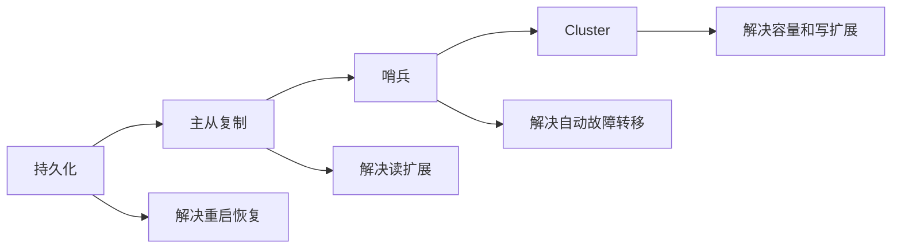
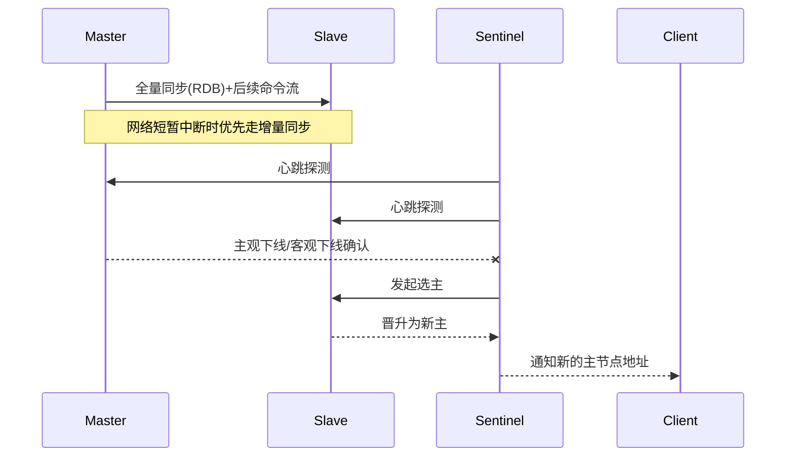

# Redis

> **模块**：11_后端八股/04_Redis.md  
> **来源**：购买资料 A（10 个源文件）— 数据类型/高可用/过期策略/缓存三剑客/双写一致性/看门狗/事务/线程模型/BigKey/setnx  
> **规模**：约 669 行  |  **生成**：2026-11-12  
> **状态**：已合并（多源合一）

## 本篇包含

01. 数据类型
02. 高可用
03. 过期策略
04. 缓存三剑客
05. 缓存与数据库双写一致性
06. 看门狗机制
07. 事务与一致性
08. 线程模型
09. BigKey和HotKey问题
10. setnx

## 01 数据类型

基础中的基础，但又很喜欢考察

重点掌握**String 的 SDS**、**ZSet 的跳表**，以及 **Bitmap/HyperLogLog** 的应用

讲基础的东西要跟自己的项目结合，不要单讲

### 五大基础类型及应用场景

> 💡 Q：  Redis 有哪些常用的数据类型？你在项目中是怎么用的？

> ✅ A：
> redis 最常用的五大基础数据类型是：String、Hash、List、Set 和 ZSet（Sorted Set）。
> 在我的项目中，我是这样用的【挑几个讲就行】：
> 1. **String**：最常用。主要用来做**常规缓存**（存 JSON 对象）、**计数器**（如视频播放量 `incr`）、以及**分布式锁**（`setnx`）。
> 2. **Hash）**：用来存储**对象数据**，比如购物车（用户ID为 Key，商品ID为 field，数量为 value），或者用户信息。比起 String 存 JSON，Hash 可以单独修改某个字段，减少网络传输。
> 3. **List**：主要用作简单的**消息队列**（LPUSH + BRPOP 阻塞读取），或者用来做**最近 N 条记录**（比如微信公众号的文章列表）。
> 4. **Set**：利用它的‘去重’和‘交并差’特性。比如做**抽奖**（去重）、**共同好友**（交集）、**标签推荐**。
> 5. **ZSet（有序集合）**：主要用于做**排行榜**（Top N），或者做**延时队列**（Score 存过期时间戳，轮询取最小的）。

**底层结构概览**：

- **String**: SDS (简单动态字符串)。
- **List**: QuickList (双向链表 + 压缩列表)。
- **Hash**: Listpack (小数据) / Hashtable (大数据)。
- **Set**: IntSet (整数集合) / Hashtable。
- **ZSet**: Listpack (小数据) / **SkipList (跳表)** + Hashtable。

### String的底层实现（SDS）

> 💡 Q：  Redis 的 String 是直接用的 C 语言字符串吗？什么是 SDS？

> ✅ A：
> Redis 没有直接使用 C 语言的字符串（以 `\0` 结尾），而是自己封装了一种叫 **SDS（Simple Dynamic String，简单动态字符串）** 的结构。
> **为什么要这么做呢？主要有三个原因**：
> 1. **性能高**：SDS 内部维护了一个 `len` 字段。获取字符串长度的时间复杂度是 **O(1)**，而 C 语言需要遍历整个字符串是 O(N)。
> 2. **二进制安全**：C 语言字符串遇到 `\0` 就结束了，不能存图片或音频数据。SDS 是根据 `len` 长度来判断结束的，所以可以存任意二进制数据。
> 3. **防止缓冲区溢出**：SDS 在拼接字符串时，会先检查空间够不够，不够会自动扩容，避免了 C 语言中常见的内存溢出问题。

#### SDS的**结构（供理解记忆）**：

```c
struct sdshdr {
    int len;    // 已使用长度
    int free;   // 剩余可用空间
    char buf[]; // 字符数组
};
```

- **预分配策略**：为了减少内存重分配次数，扩容时会多分配空间（空间预分配），缩容时不会立刻回收空间（惰性空间释放）。

> 🔎 追问1： SDS 的最大容量是多少

Redis 规定 String 类型的值最大能存储 512 MB

### ZSet的底层实现（重点！）

> 💡 Q：  ZSet底层是怎么实现的？为什么用跳表而不用红黑树？

> ✅ **A：**
> ZSet 的底层实现比较灵活。 当元素较少且长度较短时，使用 **Listpack（或 Ziplist）压缩列表来节省内存。 当数据量变大时，会转换为SkipList（跳表） + Hashtable**。
> **重点说一下跳表**： 它其实就是一个**多层的链表**。 最底层是一个包含所有元素的普通链表。在这个链表之上，像建索引一样，每隔几个元素提取一个节点到上一层。 查询时，先从顶层开始找，通过索引快速跳过大量元素，一层层往下找。 它的查询复杂度是 **O(log N)**，和二分查找类似。
> **至于为什么不用红黑树（或 B+ 树）**：
> 1. **实现简单**：跳表的代码比红黑树简单得多，容易维护。
> 2. **范围查询更强**：ZSet 经常需要执行 `ZRANGE`（查排名 1-100）。跳表只需要找到起点，然后顺着底层链表遍历就行了；而红黑树通过中序遍历做范围查询稍微麻烦一点。
> 3. **并发调整优势**：在做插入操作时，跳表只需要修改局部的指针，锁的粒度可以更小（虽然 Redis 是单线程的，但这是跳表通用的优势）。

---

### 特殊数据类型 （Bitmap/HyperLogLog ）

> 💡 Q：如果我要统计一个网站 1 亿用户的日活（UV）和签到情况，你会怎么设计？

> ✅ **A：**
> 这涉及到 Redis 的两个特殊数据类型：
> **1. 统计签到**： 我会用 **Bitmap**。 因为签到只有‘签了’和‘没签’两个状态，正好对应二进制的 1 和 0。 我可以把用户 ID 映射为 Bitmap 的偏移量（Offset）。 这样，**一个用户一年的签到记录只需要 365 bit，大概 46 字节**。1 亿用户也就几十兆内存，极其节省空间。
> **2. 统计日活 UV**： 如果要求**精确**去重，可以用 Set，但 1 亿个 ID 太占内存了。 如果允许**极小的误差**（Redis 标准误差 0.81%），我会选用 **HyperLogLog**。 它利用概率统计原理（伯努利试验），**不管存入多少数据，它占用的内存固定只需要 12KB**，非常适合做大规模的 UV 统计。

> 🔎 追问1： HyperLogLog 可以取到具体的 userId 吗

**不可以**。 HyperLogLog 是属于**基数统计**算法，它只记录‘大概有多少个不同的元素’，并不存储元素本身。如果业务需要把当天访问过的用户列表导出来，那就只能用 Set 或者数据库了。

## 02 高可用

关于 Redis 高可用，比较适合按“怎么存、怎么备、怎么切、怎么扩”来记忆，也就是：持久化 -> 主从 -> 哨兵 -> 集群。

### 持久化

> 💡 **Q：Redis 是内存数据库，宕机了数据怎么办？**

> 📝 Redis 主要有两种持久化方式：
> **RDB**：定时把内存快照写到磁盘。  
> 优点是恢复快、文件紧凑；缺点是两次快照之间如果宕机，可能丢失这段时间的数据。
> **AOF**：把写命令按追加日志方式记录下来。  
> 优点是数据更安全；缺点是文件更大，恢复速度通常比 RDB 慢。
> 生产里常见选择是 **混合持久化**，兼顾恢复速度和数据安全。

### 主从复制

> 💡 **Q：Redis 主从复制的意义是什么？**

> 📝 主从复制主要解决两个问题：
> - 提升读能力，做读写分离
> - 提高可用性，为故障切换提供基础
> 一般来说，主节点负责写，从节点负责读。  
> 这样可以让写路径更聚焦，也能把大量读流量分摊到从节点上。

### 主从同步原理与优化

> 💡 **Q：Redis 主从是怎么同步数据的？**

> 📝 Redis 主从同步大致可以分成：
> - **全量同步**
> - **增量同步**
> 第一次建立复制关系时，往往要做全量同步：主节点生成 RDB，发送给从节点，从节点加载后再接收后续命令流。
> 如果连接短暂断开，且复制积压缓冲区里还有断开期间的数据，就可以做增量同步，只补差量。
> 优化思路一般包括：
> - 合理配置复制积压缓冲区
> - 避免大事务和瞬时大量写入
> - 控制从节点数量，避免主节点同步压力过大

### 哨兵机制

> 💡 **Q：哨兵的作用是什么？**

> 📝 哨兵本质上是 Redis 主从体系上的自动故障恢复方案，主要做三件事：
> - 监控主从节点状态
> - 主节点故障时发起选主
> - 把新主节点信息通知客户端
> 所以它解决的是：  
> **主节点挂了之后，不想再依赖人工半夜手动切换。**

### Redis Cluster

> 💡 **Q：什么时候需要 Redis Cluster？**

> 📝 当单机 Redis 已经无法满足需求时，典型有两类情况：
> - 单节点内存不够
> - 单主写压力太大
> 这时就需要 Redis Cluster。  
> 它通过 **16384 个哈希槽** 做数据分片，把不同 key 分散到多个主节点上，从而实现水平扩展。

> 🔎 **追问1：为什么要把数据和槽位绑定，而不是直接和节点绑定？**

因为这样在扩容、缩容、迁移时更灵活。  
本质上是先定位到槽位，再由槽位映射到节点，能够降低节点变化时的数据迁移成本。

### 怎么回答 Redis 高可用

> 💡 **Q：如果面试官让你整体讲一遍 Redis 高可用，你怎么组织？**

> 📝 我会按这个顺序讲：
> 1. 持久化，解决重启后的数据恢复问题
> 2. 主从复制，解决读扩展和基础高可用问题
> 3. 哨兵，解决主节点故障自动切换问题
> 4. 集群，解决更大数据量和更高并发写入问题
> 这样回答比较有层次，也更像工程视角，而不是零散背点。

### 图解补充：Redis 高可用全景



### 图解补充：主从同步与故障切换



### 对比补充：怎么记高可用组件

| 组件 | 解决什么问题 | 代价/风险 | 面试关键词 |
|-|-|-|-|
| RDB | 重启恢复快 | 快照间隔内会丢数据 | 快照、恢复速度 |
| AOF | 数据更安全 | 文件更大、恢复更慢 | 追加写、重放 |
| 主从复制 | 读扩展、基础高可用 | 主从延迟 | 全量/增量同步 |
| 哨兵 | 自动故障转移 | 不解决容量问题 | 监控、选主、通知 |
| Cluster | 分片扩容 | 运维更复杂 | 16384 槽位 |

### 高频追问补充

> 🔎 **追问补充1：为什么 Redis 高可用不能只靠主从复制？**

因为主从复制只能“备份数据”，不能自动切换主节点。主挂了之后，业务还需要人工介入，所以还得靠哨兵做故障发现和自动选主。

> 🔎 **追问补充2：哨兵一定能保证不丢数据吗？**

不能。哨兵解决的是可用性，不是强一致性。主从切换过程中，如果主节点还没来得及把最新写入同步到从节点，就可能丢数据。所以面试里最好主动补一句：Redis 高可用偏 AP，不是 CP。

> 🔎 **追问补充3：Cluster 为什么适合扩容？**

因为数据不是直接绑定机器，而是先绑定槽位，再由槽位映射到节点。扩容时迁移的是槽位，不是全量重分布，成本更可控。

### 速记版

> 📝 Redis 高可用按四层记：
> - 持久化：解决“重启后还有没有数据”
> - 主从：解决“读能不能扩”
> - 哨兵：解决“主挂了能不能自动切”
> - Cluster：解决“单机容量和写瓶颈”
> 一句话回答模板：
> 我通常按 `持久化 -> 主从 -> 哨兵 -> 集群` 来讲 Redis 高可用，因为这条线正好对应 `恢复、备份、切换、扩容` 四个工程问题。

## 03 过期策略

> 💡 Q：Redis 的 Key 过期了是立刻删除吗？如果内存满了 Redis 会怎么做？

> ✅ A：
> 这个问题其实包含两个层面，我们需要把它们区分开来看： 一个是**时间维度**，也就是设置了 TTL（过期时间）的 Key 怎么处理，这叫**过期策略**； 另一个是**空间维度**，也就是内存真的不够用了怎么办，这叫**内存淘汰策略**。
> 我先回答第一个问题：**Key 过期了并不会立刻删除。**
> Redis 为了在‘节省内存’和‘不占用太多 CPU’之间找平衡，采用的是 **‘惰性删除 + 定期删除’** 的混合策略。
> 1. **首先是惰性删除：** 这就好比是‘懒加载’。Redis 不会专门为了删除一个 Key 去中断当前的操作。而是等到客户端**主动查询**这个 Key 的时候，Redis 会先检查一下它有没有过期。如果过期了，就直接删掉并返回空。
> 
>    - \_好处_是：非常节省 CPU，因为不做无用功。
>    - \_坏处_是：如果那些过期的 Key 一直没人查，它们就会一直占着内存，变成‘冷数据’垃圾。
> 2. **为了解决这个问题，Redis 还有定期删除：** Redis 默认每隔 100 毫秒，会**随机抽取**一部分设置了过期时间的 Key 进行检查，如果过期了就删除。 注意这里是‘随机抽取’而不是‘全盘扫描’，因为如果 Key 太多，全盘扫描会直接把 CPU 跑满，导致 Redis 卡顿。
> 所以结论是：**通过惰性删除保证 CPU 性能，通过定期删除兜底清理内存垃圾。**”
> 接下来说第二个问题：**如果内存满了（达到了 maxmemory 上限）会怎么做？**
> redis是提供了多种内存淘汰策略的，在工程实践中，我主要关注这三种：
> 1. `noeviction`**（默认策略）**： 这是默认配置，内存满了直接报错，不淘汰任何数据。这在生产环境通常是不推荐的，因为会导致服务不可用。
> 2. `allkeys-lru`**（最常用/推荐）**： 不管 Key 有没有设置过期时间，从**所有** Key 中，淘汰最近最少使用（LRU）的数据。
> 
>    - *适用场景*：这是最通用的选择。如果我们的应用也是‘热点数据’比较明显（比如新闻、电商），这个策略能保证热数据一直在内存里。
> 3. `volatile-lru`： 它只从**设置了过期时间**的 Key 里面去淘汰最近最少使用的。
> 
>    - *适用场景*：这通常用于那些‘既把 Redis 当缓存（设置了过期），又当持久化存储（没设置过期）’的混用场景。但我个人建议尽量把缓存和存储拆分开。”
> 总结一下：过期 Key 是靠‘惰性+定期’慢慢删的；而内存满了，通常我们会配置 `allkeys-lru` 来强制淘汰冷数据，保证新数据能写进去。

> 🔎 追问1： Redis 采用的是标准的 LRU 算法吗？为了维护 LRU 它是怎么做的

不是标准的。

Redis 采用的是一种**近似 LRU** 算法。 之所以不使用标准的 LRU（基于双向链表），是因为**为了省内存**。

标准的 LRU 需要维护一个双向链表，把所有数据串起来。每当一个 Key 被访问，就得把它移动到链表头。 这就带来两个问题：

1. **内存占用大**：每个 Key 都需要额外的指针（prev, next），这就增加了不必要的内存开销。
2. **性能损耗**：在大并发下，频繁地调整链表指针，会对 Redis 这种高性能组件造成压力。”

Redis 的做法非常聪明，它是一种**随机采样**的策略：

1. Redis 在每个 Key 的对象结构（`redisObject`）里，存了一个 **24 bit 的字段**，用来记录最后一次访问的时间戳（lru 字段）。
2. 当内存满了需要淘汰时，Redis 不会去遍历整个数据库，而是**随机抽取 N 个 Key**（默认是 5 个）。
3. 然后在这 5 个 Key 里面，把 `lru` 字段最旧的那个淘汰掉。

虽然是概率性的，但官方测试数据表明，当采样数（N）设置为 10 的时候，效果已经非常接近标准 LRU 了，但内存利用率却高得多。

> 🔎 追问2：那 LRU 策略有什么缺点吗？听说 Redis 后来引入了 LFU，是为了解决什么问题

LRU 的核心逻辑是‘最近被访问过，未来被访问的概率就大’。

但在一种场景下它会失效，那就是**全表扫描**或**突发流量**

举个例子： 假设我的 Redis 里存满了热点数据。突然，有一个定时任务或者离线分析，对数据库做了一次**全量查询**。 这些冷数据因为刚刚被查了一次，时间戳非常新，会被 LRU 误认为是热数据而留下来；反倒是原本真正的热点数据，因为被挤占了位置而被淘汰了。 这就导致接下来的一段时间，缓存命中率急剧下降。

为了解决这个问题，Redis 4.0 引入了 **LFU（Least Frequently Used，最近最不常用）**。

和 LRU 关注‘时间’不同，LFU 关注的是访问频率。

如果使用 LFU 策略，哪怕刚才那批冷数据被扫描了一次，但因为它们的历史访问次数很低，依然会被优先淘汰。而真正的热点数据，因为长期积累了较高的访问频次，即便最近几秒没被查，也不会轻易被踢走。

所以，**在存在因为‘扫描’导致缓存被冲刷的业务场景下，用 LFU 效果更好。**

## 04 缓存三剑客

缓存三剑客（穿透、击穿、雪崩）是 Redis 面试中**出场率 100%** 的题目。

这三者名字很像，容易背混，记忆的时候着重记忆三者区别以及各自出现时候的解决方案

- **穿透**：直接穿过（Redis和DB都没有）。
- **击穿**：定点爆破（某一个热点 Key 突然挂了）。
- **雪崩**：全面崩盘（大面积 Key 挂了）。

### 缓存穿透

> 💡 Q： 什么是缓存穿透？怎么解决？

> ✅ A：
> **缓存穿透**是指查询一个**根本不存在的数据**。 因为 Redis 中没有，请求会打到数据库；数据库查不到，也不会回写 Redis。 如果这时有大量并发请求（比如恶意攻击者用脚本轮询不存在的 ID），数据库就会瞬间压力过大挂掉
> **解决方案**通常有两种：
> 1. **缓存空对象**：
> 
>    - 如果数据库查不到，我也往 Redis 存一个 `null` 或特定空值，并设置一个较短的过期时间（比如 5 分钟）。
>    - *优点*：实现简单。
>    - *缺点*：消耗内存（存了一堆垃圾 Key），且存在数据不一致窗口。
> 2. **布隆过滤器【推荐】**：
> 
>    - 在请求到达 Redis 之前，先通过布隆过滤器判断一下‘这个 Key 是否可能存在’。如果布隆过滤器说不存在，直接返回，连 Redis 都不用查。
>    - *优点*：内存占用极小，性能极高。”

布隆过滤器原理：

利用一个很长的二进制位数组（BitMap）和多个 Hash 函数。

- 存入数据时：Hash 算出多个位置，把这些位置的 bit 置为 1。
- 查询数据时：Hash 算出位置，只要有一个位置是 0，说明**绝对不存在**。全是 1，说明**可能存在**（存在误判）

例子理解：

> 🔎 追问1：你提到的布隆过滤器有误判率，怎么处理？怎么落地实现？

是的，有布隆过滤器的话，存在如果不一定真存在，但说不存在则一定不存在。 少量的误判（比如 1%）通常是可以接受的，因为这 1% 打到数据库压力已经很小了。

**至于落地实现**： 我们项目中一般不自己手写位运算，而是直接用 **Redisson** 客户端提供的 `RBloomFilter` 接口。它底层基于 Redis 的 BitMap 实现，可以在初始化时配置预估数据量和接受的误判率（比如 0.01），Redisson 会自动计算最优的 Hash 函数个数和数组长度。

### 缓存击穿

> 💡 Q：什么是缓存击穿？和雪崩有什么区别？怎么解决？

> ✅ A：**缓存击穿**是针对**某一个**特定 Key 的。 这个 Key 是**热点数据**（比如微博热搜、秒杀商品），扛着极高的并发。 当这个 Key **过期的一瞬间**，大量的并发请求同时发现 Redis 没数据，于是同时冲向数据库，瞬间把 DB 打垮。
> **解决方案**主要有两套：
> 1. **互斥锁**：
> 
>    - 标准解法。当发现 Redis 没数据时，不是大家一起去查 DB，而是去抢一个锁（比如 `setnx`）。
>    - 抢到锁的线程去查 DB 并回写 Redis，没抢到的线程等待一下再重试。
>    - *特点*：强一致性，但性能稍差（有等待）。
> 2. **逻辑过期**：
> 
>    - 把过期时间设置在 Value 的字段里，Redis Key 实际上**永不过期**。
>    - 查询时检查字段里的时间，如果过期了，异步开启一个线程去更新数据，当前线程直接返回旧数据。
>    - *特点*：高可用，性能最好，但会得到短暂的旧数据（最终一致性）。

**适用场景对比**：

- **互斥锁**：适合对数据准确性要求极高的场景（如余额、库存）。
- **逻辑过期**：适合侧重吞吐量的场景（如文章点赞数、商品详情页）。

> 🔎 追问1：如果不使用逻辑过期，用 setnx 加锁时要注意什么

`setnx` 加锁最重要的是**避免死锁**。 如果我抢到了锁，去查数据库的时候服务器断电了或者报错了，没能释放锁，那其他线程就永远等下去了。 所以必须给锁设置一个**过期时间（TTL）**，最好把‘加锁’和‘设置过期时间’做成**原子操作**（Redis 命令 `SET key value EX 10 NX`），或者使用 Redisson 的看门狗机制自动续期。

### 缓存雪崩

> 💡 Q：  什么是缓存雪崩？怎么预防？

> ✅ A：
> **缓存雪崩**是指在同一时段，**大量的缓存 Key 同时失效**，或者 **Redis 服务宕机**，导致所有请求瞬间全部打到数据库。
> **预防方案**分为事前、事中、事后：
> 1. **针对大量过期**：
> 
>    - **随机 TTL**：在设置过期时间时，不要设成一样的（比如都是 1 小时），而是给它加一个随机值（比如 1-5 分钟的随机数），把过期时间打散。
> 2. **针对 Redis 宕机**：
> 
>    - **高可用架构**：搭建 Redis Sentinel（哨兵）或 Redis Cluster（集群），保证一个节点挂了，备用节点能顶上。
>    - **服务降级/熔断**：如果 Redis 真的全崩了，应用层通过 Hystrix 或 Sentinel 开启熔断，直接返回默认值或友好提示，暂缓访问数据库，保住底层的 DB 不死。

> 🔎 追问1：  缓存预热了解吗？什么时候做

了解。 **缓存预热**就是在系统上线或活动开始前，提前把热点数据加载到 Redis 中，避免用户请求来触发查询。 通常在**秒杀活动**前，我们会写一个定时任务或后台管理功能，把秒杀商品的库存、详情等信息预热进 Redis，并且也是要注意设置**随机过期时间**，防止活动中途集中失效引发雪崩。

## 05 缓存与数据库双写一致性

> 💡 Q：在使用 Redis 做缓存时，如果数据库更新了，是更新缓存还是删除缓存？怎么保证缓存和数据库的数据一致性？

> ✅ A：
> **一般采用‘先更新数据库，然后删除缓存’的策略。**”
> 这里我解释一下为什么这么做，主要基于两点考量：
> **第一就是为什么是删除而不是更新？** 这主要涉及**性能**和**并发**两个维度。
> - **从性能上讲**：这是一种‘懒加载’的思想。试想一下，如果我的业务是‘写多读少’的，我改了 10 次数据库，如果每次都去更新缓存，但期间一次查询都没有，那这 10 次缓存计算就是纯粹的算力浪费。直接删除，等到下次真正有查询请求时，再去数据库读取最新数据回写，效率更高。
> - **从并发安全上讲**：‘双写’很容易出问题。比如线程 A 和线程 B 先后修改数据库，但因为网络原因，B 先更新了缓存，A 后更新了缓存。这就导致数据库里是 B 的新值，但缓存里留下了 A 的旧值，造成数据不一致。直接删除缓存，就能规避这种复杂的并发时序问题。
> **第二点是为什么是先更 DB 后删缓存？** 如果我们反过来，‘先删缓存后更 DB’，在并发读写场景下问题更大： 如果一个读请求进来，发现缓存没了，它去读数据库（此时数据库还是旧值），然后把旧值写回缓存。紧接着写请求才把数据库更新为新值。这样缓存里就会长时间停留脏数据。 所以，**先更 DB 后删缓存**，是目前出问题概率最小的标准做法。
> 当然，先更 DB 后删缓存这个方案不是绝对完美的，它有一个风险点：**如果数据库更新成功了，但在删除缓存的那一步失败了（比如 Redis 挂了或网络抖动），怎么办？** 这会导致缓存里一直是旧数据。
> 为了解决这个问题，保证数据的**最终一致性**，我们在生产环境中通常会有**补偿机制**。目前比较成熟的方案有两种：
> 1. **简单的方案是延时双删**：就是在更新 DB 前删一次，更新后休眠一小会儿再删一次，但这需要精准把控休眠时间，代码侵入性较强。
> 2. **更可靠的工业级方案是利用消息队列（MQ）做异步重试’**： 利用中间件（比如 Canal）去监听数据库的 Binlog。一旦检测到数据变更，就发一条消息到 MQ。 消费者收到消息后，去尝试删除 Redis。如果删除失败，就利用 MQ 的**自动重试机制**（Ack 机制），直到删除成功为止。
> 这样既解耦了业务逻辑，又彻底兜底了数据的一致性问题。

> 🔎 **追问1：对于银行余额这样的强一致性业务场景怎么办？**

如果是对一致性要求极高的场景（如余额、库存），**根本就不应该用缓存**，直接读写数据库。或者使用 Read-Write Lock强行串行化，但那样就牺牲了性能，违背了引入 Redis 的初衷

## 06 看门狗机制

看门狗算是面试里面的进阶考点，通常出现在分布式锁的问题中

### redisson看门狗机制

> 💡 Q： 在使用 Redis 分布式锁时，如果业务逻辑执行时间超长，超过了锁的过期时间，导致锁自动释放了怎么办？怎么解决？

> ✅ A：
> 如果锁过期了业务还没跑完，其他线程就会抢到锁，导致并发事故。
> 解决这个问题最好的办法是使用 **Redisson** 客户端提供的**看门狗（Watchdog）机制**。
> **它的核心原理是**： 当我们调用 `redisson.getLock("key").lock()` 时，如果我们**不指定**锁的过期时间（LeaseTime），Redisson 会默认给锁设置 **30秒** 的过期时间。 同时，它会在后台启动一个**定时任务（守护线程）**，每隔 **10秒**（也就是过期时间的 1/3）就会检查一下：‘嘿，持有锁的那个线程还在跑吗？’
> - 如果还在跑，它就会把锁的过期时间**重新重置**为 30秒。
> - 这就叫**自动续期**。
> 只要业务逻辑还在执行，看门狗就会一直续期，直到业务跑完释放锁，或者客户端宕机。

> 🔎 **追问1：如果拿到锁的客户端宕机了（挂了），看门狗也没了，锁岂不是永远释放不掉了（死锁）**

**不会死锁**。 这也是看门狗机制设计的巧妙之处。 看门狗是运行在**客户端**（业务服务）的后台线程中的，而不是在 Redis 服务端。 如果客户端宕机了，那个负责续期的看门狗线程也就挂了，自然就不会再有人去续期了。 Redis 里的这把锁，在等待完当前的 30秒（或者剩余时间）后，就会因为**自然过期**而被 Redis 自动删除。 所以，其他客户端最多等待 30秒，就能重新抢到锁。

> 🔎 追问1：如果我显式指定了过期时间，比如 lock.lock(10, TimeUnit.SECONDS)，看门狗还会生效吗？

**不会生效**。 如果在 `lock()` 方法中**手动传了过期时间**（LeaseTime），Redisson 就会认为你心里有数，想要严格控制锁的时间，所以它**不会启动看门狗**。 到时候时间一到，锁就自动释放，不管你业务有没有跑完。 所以，如果想用看门狗，**一定不要传过期时间**，直接用无参的 `lock()`

## 07 事务与一致性

Redis 事务相关题不算最难，但很容易暴露理解是否清楚。常见问题一般是：Redis 支持事务吗、能不能回滚、和数据库事务有什么区别。

### Redis 支持事务吗

> 💡 **Q：Redis 支持事务吗？**

> 📝 支持，但 Redis 的事务语义和 MySQL 这种关系型数据库事务差别很大。
> Redis 事务通常通过：
> - `MULTI`
> - `EXEC`
> - `DISCARD`
> 来实现。
> 它能保证的是：  
> **把一组命令打包，按顺序串行执行，中间不会被其他客户端命令插队。**
> 但它不等于关系型数据库那种完整 ACID 事务。

### Redis 事务能回滚吗

> 💡 **Q：Redis 事务支持回滚吗？**

> 📝 严格来说，Redis **不支持像 MySQL 那样的事务回滚**。
> 如果在事务执行前，某条命令就有语法错误，Redis 会在 `EXEC` 时直接拒绝执行整个事务。  
> 但如果事务执行过程中，某条命令因为业务原因失败，比如对错误类型的数据做操作，Redis 不会把前面已经成功执行的命令自动回滚。
> 所以 Redis 事务更接近：
> - 保证顺序执行
> - 不保证完整回滚

### 为什么 Redis 不做完整回滚

> 💡 **Q：为什么 Redis 不像数据库那样支持完整回滚？**

> 📝 核心原因还是设计取舍。
> Redis 追求的是：
> - 简单
> - 高性能
> - 命令执行路径短
> 如果像数据库一样做复杂的 undo/redo 和事务回滚机制，会明显增加系统复杂度和执行成本，这和 Redis 的定位并不一致。
> 所以 Redis 事务的定位不是“强事务”，而是“批量命令的原子提交入口”。

## 08 线程模型

Redis 线程模型这块是非常高频的考点，面试官通常会连续问你：Redis 是单线程吗、为什么这么快、6.0 为什么引入多线程、Redis 是 AP 还是 CP。

### Redis 是单线程吗

> 💡 **Q：Redis 是单线程吗？**

> 📝 更准确的说，**Redis 的命令执行模型主要是单线程**，但它不是整个 Redis 进程所有工作都只有一个线程。
> 比如：
> - 网络读写在某些版本和场景下可以用多线程辅助
> - 持久化会 fork 子进程
> - 集群、后台任务也不完全等同于“只有一个线程”
> 所以标准答案最好不要说死成“Redis 完全单线程”，而是说：  
> **核心命令执行是单线程，这是它设计上的关键点。**

### Redis 为什么这么快

> 💡 **Q：Redis 为什么这么快？**

> 📝 Redis 快的原因一般可以从四个角度来答：
> **第一，纯内存操作。**  
> 绝大多数请求直接在内存里完成，避免了磁盘 IO。
> **第二，数据结构高效。**  
> 比如 SDS、哈希表、跳表、压缩列表/quicklist 等，底层结构都很贴近高性能场景。
> **第三，核心命令执行模型简单。**  
> 单线程避免了大量锁竞争和线程切换成本。
> **第四，IO 多路复用。**  
> Redis 使用 epoll 这类机制高效处理大量连接事件。
> 所以 Redis 快，不是只因为“单线程”，而是多种因素共同决定的。

### 为什么单线程还能高性能

> 💡 **Q：为什么 Redis 用单线程执行命令，性能还这么高？**

> 📝 因为在 Redis 的主要工作负载里，瓶颈往往不是 CPU 计算，而是：
> - 网络 IO
> - 内存访问
> - 锁竞争
> 如果为了并行而引入复杂锁机制，反而可能得不偿失。  
> Redis 的设计思路是：**把核心命令执行路径做到极短、极简单、极少锁。**
> 所以在单核命令执行模型下，结合内存操作和高效数据结构，仍然能有非常高的吞吐。

### Redis 6.0 为什么引入多线程

> 💡 **Q：Redis 6.0 为什么引入多线程？**

> 📝 Redis 6.0 引入多线程，并不是把核心命令执行彻底改成多线程，而是主要用于 **网络读写阶段**。
> 原因是：在更高并发场景下，网络收包、发包也会成为瓶颈。  
> 所以 Redis 选择把网络 IO 的一部分工作并行化，而核心命令执行仍然尽量保持简单的单线程模型。
> 这也说明 Redis 的设计是非常克制的：  
> **只把最值得并行化的地方拆出来，而不是盲目把所有逻辑改成多线程。**

### Redis 是 AP 还是 CP

> 💡 **Q：Redis 是 AP 还是 CP？**

> 📝 如果从经典主从复制和哨兵模式来看，Redis 更偏向 **AP**。
> 原因是：
> - 它更强调服务可用
> - 主从复制是异步的
> - 网络分区或主从切换期间，可能出现短暂不一致
> 但如果引入特定配置或某些强约束场景，也能在局部做得更偏 CP。  
> 所以更准确的表述是：  
> **Redis 默认更偏 AP，而不是天然强一致。**

### 图解补充：Redis 请求处理链路


### 对比补充：Redis 为什么快

| 因素 | 本质 | 面试里的说法 |
|-|-|-|
| 纯内存 | 避开磁盘随机 IO | 绝大多数请求都在内存完成 |
| 数据结构高效 | 操作路径短 | SDS、跳表、哈希表都很贴近高性能场景 |
| 单线程命令执行 | 少锁、少上下文切换 | 核心执行路径很短 |
| IO 多路复用 | 高效处理大量连接 | 一个线程能管很多连接事件 |

### 高频追问补充

> 🔎 **追问补充1：Redis 6.0 的多线程为什么只放在网络 IO 阶段？**

因为 Redis 想把多线程收益最大的部分拆出来，又不想把核心命令执行路径搞复杂。网络收发可以并行，但命令执行如果全面并行，就会引入锁竞争和共享数据结构同步成本，得不偿失。

> 🔎 **追问补充2：为什么说 Redis 快，不能只回答“因为单线程”？**

因为单线程只是其中一个因素。真正完整的答法应该包括：纯内存、高效数据结构、少锁、IO 多路复用。只答单线程会显得理解过浅，甚至会被追问“那单线程不是应该更慢吗”。

> 🔎 **追问补充3：面试里 Redis 的 AP/CP 怎么答更稳？**

最稳的答法是：默认主从复制和哨兵体系下，Redis 更偏 AP，因为优先保证可用性，复制又是异步的；但在某些特定约束和业务设计下，可以局部做得更偏强一致，不能机械地把 Redis 说成绝对 AP。

### 速记版

> 📝 线程模型建议按这条线记：
> - 核心命令执行主要是单线程
> - Redis 快不是单点原因，而是“内存 + 数据结构 + 少锁 + 多路复用”
> - 6.0 多线程主要补网络 IO 短板
> - 一致性层面默认更偏 AP
> 一句话回答模板：
> Redis 的设计重点不是把所有地方都并行化，而是把命令执行路径做得足够短，再在网络 IO 这些最值得并行化的地方引入有限多线程。

## 09 BigKey和HotKey问题

### BigKey 和 HotKey 问题

> 💡 Q： 什么是 Redis的BigKey？它有什么危害？在生产环境怎么发现和处理

> ✅ A：
> BigKey 并不是指 Key 本身的字符串变长了，而是指 **Key 对应的 Value 很大**。
> 在工程标准里，通常会有两个判断维度：
> 1. **String 类型**：如果 Value 超过 **10KB**（通常标准），就可以算 BigKey。
> 2. **集合类型（Hash/Set/List）**：如果里面的元素个数超过 **5000 个**（或 1万个），我们就视为 BigKey。
> 虽然 Redis 支持更大的存储（比如 String 最大 512MB），但不建议这么做。
> BigKey 的危害主要集中在两点，核心原因是 **Redis 的单线程模型**。
> 1. **阻塞主线程（Block）**： Redis 处理命令是排队的。如果我操作一个 BigKey（比如删除它，或者做序列化/反序列化），由于数据量大，耗时会很久。这就导致后面的正常请求全部被堵住，表现为 Redis 响应延迟突增，甚至导致客户端超时。
> 2. **网络阻塞（Network I/O）**： 读取一个 BigKey（比如几 MB 的 String），会瞬间占用大量的网络带宽。这不仅会拖慢 Redis，还可能把物理机的网卡流量打满，影响同机器上的其他服务。”
> 发现 BigKey，有两种手段：
> 1. **在线扫描**： 使用 `redis-cli --bigkeys` 命令。它会扫描整个 Key 空间，统计出每种数据类型里最大的 Key。
> 
>    - *注意*：这个命令在生产环境执行要小心，虽然它用了 SCAN 游标，但还是会有一点点性能开销。
> 2. **离线分析（推荐）**： 利用工具（比如 **RdbTools**或者云厂商提供的分析报告）直接分析 Redis 的**RDB 备份文件**。
> 
>    - *优点*：完全不影响线上服务，而且统计非常详尽。”
> 处理 BigKey，我有两种方案。
> 1. **拆分**： 如果是大集合（比如一个 Hash 存了 100 万个用户），我们应该把它拆分成多个小 Hash。
> 
>    - *做法*：比如 `UserHash_0`, `UserHash_1`... 存取时通过 `id % 100` 来路由到对应的小 Hash 中。
> 2. **删除策略**： 如果发现 BigKey 要删除，不能直接用 `DEL` 命令。因为直接 DEL 一个大 Key 会在主线程里执行内存回收，导致长时间阻塞。
> 
>    - **Redis 4.0 以后**：我们要用 `UNLINK` 命令。它只是把 Key 从元数据中解绑（逻辑删除），真正的内存释放动作会交给后台线程（Lazy Free）异步执行，不会阻塞主线程。
>    - **Redis 4.0 以前**：我们需要写脚本，用 `HSCAN` 或 `SSCAN` 分批次读取元素，然后分批次删除，一点一点把这个大山移走。

## 10 setnx

这一块在面试中通常是作为**分布式锁的入门题**出现的

### setnx的原子性问题

很经典的问题， 分开执行 SETNX 和 EXPIRE 会导致死锁

> 💡 Q：了解 Redis 的 SETNX 吗？如果让你用它实现分布式锁，你会怎么写？

> ✅ A：
> 了解。`SETNX` 全称是 **Set If Not Exists**。 它的规则是：如果 Key 不存在，则设置成功返回 1；如果 Key 已经存在，则设置失败返回 0。利用这个原子特性，我们可以实现简单的锁竞争。
> **但是，在实现分布式锁时，我绝不会直接使用 `SETNX` 命令。** 因为 `SETNX` 本身不带过期时间。 如果我先执行 `SETNX` 抢到了锁，然后还没来得及执行 `EXPIRE` 设置过期时间，服务突然**宕机**了，那么这个锁就会变成**死锁**（永久有效），其他线程再也抢不到了。
> **正确的做法是**： 使用 Redis 2.6.12 之后提供的扩展命令： `SET key value NX EX 10` 这条命令把‘检查是否存在’、‘设置值’、‘设置过期时间’这三步合并成了一个**原子操作**。要么全成功，要么全失败，彻底规避了原子性问题。

> 🔎 追问1：这把分布式锁的 Value 你一般存什么？

**有些人会存1，这是错误的**

**必须存一个唯一标识（比如 UUID + 线程 ID）。**

这是为了防止**误删别人的锁**。 举个例子：

1. 线程 A 抢到锁，但业务执行太慢，超过了 10秒，锁自动过期释放了。
2. 线程 B 顺势抢到了锁。
3. 此时线程 A 醒了，业务执行完，它去执行 `DEL` 删除锁。
4. 如果 Value 只是 "1"，线程 A 就会把**线程 B 正在持有的锁**给删掉了。

所以，Value 必须存线程唯一的 ID。在删除前，先 `GET` 出来判断一下是不是我加的锁，如果是才删，不是就别动。

### 怎么保证setnx的原子性

这个问题其实是考察Lua脚本的应用

接上个问题

> 💡 Q：你刚才说删除前要先判断 Value 是不是自己的。那‘判断’和‘删除’是两步操作，这中间如果不原子怎么办？

如果我 Java 代码写成这样

```java
if (redis.get("lock").equals(myUUID)) {
    redis.del("lock"); // 这一步之前，锁可能刚好过期被别人抢了
}
```

在 `get` 判断通过后，到 `del` 执行前，如果刚好发生 GC 停顿或者网络卡顿，锁过期了，被线程 C 抢走了，那我还是会误删线程 C 的锁。

**解决方案是使用 Lua 脚本。** Redis 保证 Lua 脚本执行的原子性（整个脚本就像一个命令）。 我会把‘比较 UUID’和‘删除 Key’写在一段 Lua 脚本里发给 Redis 执行：

Lua

```lua
if redis.call('get', KEYS[1]) == ARGV[1] then
  return redis.call('del', KEYS[1])
else
  return 0
end
```

这样就能保证 100% 安全了。

### setnx的缺陷

> 💡 Q：做到了 Lua 脚本删除，基于 SETNX 的锁就完美了吗？

> ✅ A：
> 还不够完美，这种手写的分布式锁主要有**两个缺陷**：
> 1. **不可重入**：`SETNX` 是互斥的，同一个线程如果再次去抢（比如递归调用），会失败。需要我们在代码里自己维护计数器来实现可重入。
> 2. **续期问题**：也就是我们之前讨论过的，如果业务没跑完锁过期了怎么办？手写代码去搞守护线程续期太复杂了，容易出 Bug。
> 所以，在生产环境中直接使用 **Redisson** 框架。它把加锁、解锁、看门狗（续期）、可重入机制都封装好了，开箱即用。

---

## 来源档案（原始文件，仅供溯源）

- `04_后端八股整理/03_redis/00_数据类型.md`
- `04_后端八股整理/03_redis/01_高可用.md`
- `04_后端八股整理/03_redis/02_过期策略.md`
- `04_后端八股整理/03_redis/03_缓存三剑客.md`
- `04_后端八股整理/03_redis/04_缓存与数据库双写一致性.md`
- `04_后端八股整理/03_redis/05_看门狗机制.md`
- `04_后端八股整理/03_redis/06_事务与一致性.md`
- `04_后端八股整理/03_redis/07_线程模型.md`
- `04_后端八股整理/03_redis/08_BigKey和HotKey问题.md`
- `04_后端八股整理/03_redis/09_setnx.md`
