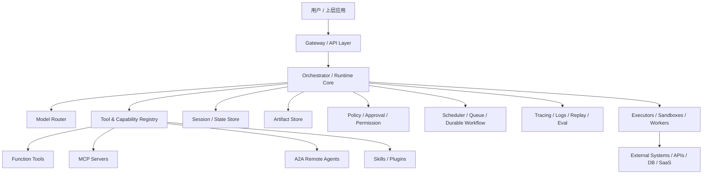
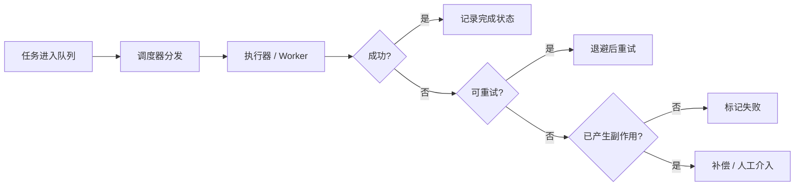
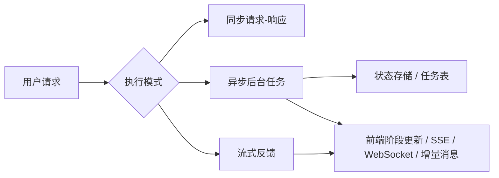
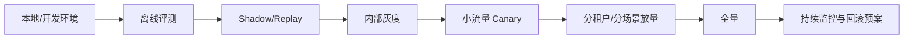

# Runtime与工程化

> **模块**：09_Runtime与工程化/09_Runtime与工程化.md  
> **构成**：8 个知识点合为一篇，按顺序编号  
> **规模**：约 3,797 行  |  **生成**：2026-11-12

## 目录

1. Agent-Runtime设计
2. 任务调度重试幂等回滚
3. 异步长任务与流式执行
4. 成本延迟与稳定性优化
5. 灰度发布与版本回滚
6. 从Prompt到Harness
7. 健壮性与上线问题
8. Harness工程实践

---

## 1. Agent-Runtime设计

### 这篇主要考察什么

很多面试官喜欢问一句非常开放的问题：“如果让你设计一个 Agent Runtime，你会怎么做？”  
这道题之所以难，不在于概念陌生，而在于范围很大。候选人很容易答成两种极端：

- 一种是答得太浅，只说“一个模型 + 一些工具 + 一个数据库”；
- 另一种是堆一堆 buzzword，但没有主干，听不出系统是怎么跑起来的。

真正好的回答，应该能把 Runtime 讲成一套分层清晰的执行底座，它至少要回答：

1. **模型意图如何被解释和执行；**
2. **工具、MCP、A2A、Skills 等外部能力如何注册和调用；**
3. **Session、状态、artifact、memory 如何管理；**
4. **多步任务如何调度、重试、取消、恢复；**
5. **权限、审批、审计和安全怎么插入；**
6. **Trace、日志、回放、评测怎么串起来；**
7. 多租户和资源隔离怎么做（实习可以不用讲）。

所以，这道题的本质是：**你能不能把 Agent 想成一个真正的“运行时系统”，而不是一个 prompt 脚本。**

怎么回答：

> 💡 Agent Runtime 是介于模型与外部世界之间的执行系统。它负责把模型的输出解释成受控动作，把工具、协议、状态和策略组织起来，并提供调度、恢复、安全、观测和治理能力。没有 Runtime，Agent 只是一个会说话的模型；有了 Runtime，Agent 才能成为一个可上线、可运营、可审计的软件系统。

### 一图看懂 Agent Runtime 的核心组成



这张图建议你在脑子里背住。  
因为面试里一旦问 Runtime，你完全可以按图来讲：入口层、编排核心、能力注册层、状态层、执行层、策略层、观测层。

### Agent Runtime 到底负责什么

一句最简单的定义是：  
**Runtime 把“模型能想”变成“系统能做”。**

展开之后，至少有下面八类职责：

#### 1. 输入规范化

把来自用户、API、上游 workflow、Webhook、外部事件的输入统一成 Runtime 可处理的任务对象。  
这一步通常会做：

- 身份识别；
- 会话绑定；
- 租户绑定；
- 参数校验；
- 速率限制；
- 路由准备。

#### 2. 上下文装配

Runtime 负责决定：

- 当前模型调用要看到哪些历史；
- 哪些 memory / RAG 结果要注入；
- 哪些工具 / namespace 可见；
- 是否带上审批结果、系统策略、artifact 摘要。

这一步本质上是“将状态转成模型上下文”的过程。

#### 3. 模型调用与路由

不是所有请求都发给同一个模型。  
Runtime 可能根据任务类型选择：

- 推理更强的模型；
- 成本更低的模型；
- 支持 tool search / MCP 的模型；
- 支持长上下文的模型；
- 支持后台长任务的模型。

这就是 Model Router 的意义。

#### 4. 动作解释与执行

模型可能输出：

- 最终答案；
- function call；
- structured output；
- 需要继续提问；
- handoff 到另一个 agent；
- 调 MCP server；
- 调 A2A remote agent；
- 触发 skill 或脚本。

Runtime 要把这些不同形式的输出解释成可执行动作，并在执行前做治理校验。

#### 5. 状态与 Artifact 管理

Runtime 不只是“对话引擎”，还是状态机执行器。  
它要管理：

- session / conversation；
- 当前任务状态；
- workflow 节点状态；
- tool call 历史；
- artifact 引用与版本；
- 审批状态；
- 取消 / 恢复状态；
- trace 关联 ID。

#### 6. 调度与可靠性

Runtime 需要决定：

- 哪些任务同步执行；
- 哪些任务异步后台执行；
- 失败是否重试；
- 是否允许并行；
- 是否进入 durable workflow；
- 是否需要等待外部事件或人审。

#### 7. 安全与策略控制

Runtime 是所有外部动作的闸门。  
它必须在模型与副作用之间插入：

- 权限校验；
- 审批门；
- 敏感操作拦截；
- 数据脱敏；
- 多租户隔离；
- 速率限制与配额；
- 允许 / 禁止工具集合。

#### 8. 可观测与回放

一旦系统出问题，Runtime 必须能回答：

- 当时模型看到了什么；
- 选了什么工具；
- 传了什么参数；
- 哪一步失败；
- 哪个状态转移出了问题；
- 是否产生副作用；
- 是否有人审批；
- 如何重放这条执行链路。

没有可观测，Runtime 就不可运营。

### 用“控制面 / 数据面”理解 Runtime，很容易说清楚

这是一个非常适合系统设计面试的表达方式。

#### 控制面（Control Plane）

控制面更关注“决定怎么跑”，包括：

- 工具注册；
- Skill 管理；
- 模型路由策略；
- 权限和审批策略；
- 租户配置；
- 流量开关；
- 版本管理；
- 灰度发布；
- 评测与回滚。

#### 数据面（Data Plane）

数据面更关注“实际在跑什么”，包括：

- 当前请求执行；
- 模型调用；
- 工具执行；
- 队列消费；
- 状态写入；
- artifact 生成；
- trace 上报；
- 事件流输出。

这样讲的好处是：  
你可以把 Runtime 解释成一套长期演进的平台，而不仅是某个请求处理函数。

### Runtime Core：编排器是中枢

如果必须只挑一个 Runtime 核心组件，那就是 Orchestrator / Runtime Core。  
它通常承担下面这些职责：

1. 读取当前任务状态；
2. 组装输入上下文；
3. 调模型；
4. 解释模型输出；
5. 发起工具 / MCP / A2A / Skill 调用；
6. 写回结果与新状态；
7. 判断终止、继续、等待还是转人工；
8. 触发流式事件和 trace。

也就是说，它是一个“状态驱动的执行循环”。  
但和最初级的 `while not done` 不同，它需要：

- 显式状态；
- 错误分级；
- 中断点；
- 最大步数；
- 幂等边界；
- 副作用控制；
- 多任务调度能力。

### Capability Registry：工具、协议和能力资产如何统一

Runtime 里一个经常被忽略但很重要的模块，是能力注册中心。  
它不只是存函数列表，而是统一管理多种能力来源：

#### 1. Function Tools

最基础的一层。  
包括名称、schema、权限要求、执行器绑定、幂等类型、风险等级等。

#### 2. MCP Servers

对于远程或标准化能力接入，注册中心要知道：

- server 地址；
- 支持哪些 tools / resources / prompts；
- 认证方式；
- 可见租户和用户；
- 健康状态；
- 命名空间与发现方式。

#### 3. A2A Remote Agents

如果 Runtime 允许委托给远端 Agent，还需要注册：

- Agent Card；
- 可接收任务类型；
- streaming / push notification 能力；
- 信任与认证要求；
- 调用策略与配额。

#### 4. Skills / Plugins

Skill 更像高层能力封装，不一定直接对应一次外部调用。  
Registry 需要知道：

- skill 元数据；
- 适用场景；
- 调用方式；
- 版本；
- 是否可在容器或 shell 中挂载；
- 评测结果。

统一能力注册的价值在于：  
Runtime 才能按统一策略做发现、授权、路由、观测和版本控制。

### Model Router：为什么它不只是“选一个模型”

一个成熟 Runtime 的 Model Router 通常会考虑：

#### 1. 任务类型

- 普通问答；
- 复杂推理；
- 代码任务；
- 长上下文总结；
- 工具密集型任务；
- 多语言任务。

#### 2. 预算与 SLA

- 这类请求预算多少；
- 延迟要求多高；
- 是否允许后台执行；
- 是否走高质量模型或低成本模型。

#### 3. 工具能力兼容性

不是所有模型都支持相同的：

- tool calling；
- strict schema；
- tool search；
- MCP；
- 流式；
- background；
- 长上下文；
- 多模态输入。

#### 4. 风险等级

高风险操作可能要求：

- 更稳定的模型；
- 更严格的 schema 模式；
- 更低的 hallucination 容忍度；
- 更明确的审批前置。

所以 Router 本质上是策略引擎的一部分，而不是简单 switch-case。

### Session / State Store：Runtime 里最容易被低估的模块

前一篇已经讲了状态分层，这里从 Runtime 角度再看一遍。  
State Store 至少应该支持：

- session / conversation 级历史；
- workflow / task 级状态；
- checkpoint；
- tool call 与结果索引；
- artifact 引用；
- 审批和中断状态；
- 恢复标记；
- 租户与用户绑定；
- TTL / 归档 / 删除策略。

一个成熟 Runtime 不会把所有状态都塞进一张 messages 表，而会根据语义分层存储。

### Artifact Store：为什么它要单独拿出来

很多 Agent 系统的结果不是一句文本，而是：

- 报告；
- 表格；
- 代码补丁；
- 网页抓取结果；
- 截图；
- 结构化中间数据；
- 大体积工具原始输出。

这些东西如果都塞进 session 历史，会拖垮上下文和数据库。  
所以 Runtime 通常需要独立的 Artifact Store 来保存：

- 大体积对象；
- 版本化结果；
- 部分结果与最终结果；
- 可供用户下载或继续加工的产物。

然后在上下文里只放它们的摘要、引用或关键字段。

### Policy / Approval / Permission：Runtime 的安全边界

很多同学把安全理解成“在接口层做鉴权”。  
但 Agent Runtime 的安全边界更深，因为真正的风险出现在“模型选了一个结构化动作之后”。

Policy 层至少要管四类东西：

#### 1. 工具可见性

当前用户 / 租户能看到哪些工具、MCP server、A2A agent、skills。

#### 2. 执行权限

看得见不等于能执行。  
某些工具只允许查询，不允许修改；  
某些动作只有审批通过后才能执行。

#### 3. 数据访问范围

即使是查询，也要限制：

- 哪些资源 URI 可读；
- 哪些文件路径可访问；
- 哪些数据库 schema 可查；
- 哪些租户数据可见。

#### 4. 风险动作审批

例如：

- 发消息；
- 删数据；
- 批量操作；
- 写生产环境；
- 调高权限 API；
- 对外发布内容。

这些都应该由 Runtime 在执行前插入 human-in-the-loop，而不是让模型自由直达。

### Executors / Sandboxes：为什么 Runtime 里要有执行隔离层

模型输出 tool call 后，不应该直接触达核心系统。  
更稳妥的架构是：

- Runtime Core 解释动作；
- Executor 负责真正执行；
- 高风险能力在 sandbox / container / isolated worker 中运行；
- 外部系统访问走代理和凭据管理层。

这样设计的原因有三个：

1. **安全**：限制模型影响面；
2. **可靠性**：把执行重试、超时和幂等逻辑集中；
3. **可观测**：所有副作用动作都有统一日志与 trace。

对代码 Agent、Shell、浏览器自动化这类高风险能力，这层尤其重要。

### Scheduler / Queue / Durable Workflow：Runtime 不能只做同步调用

Agent Runtime 一旦支持长任务，就必须纳入调度层。  
否则：

- 所有执行都绑死在请求线程；
- cancel / resume 很难做；
- 多任务并发没有资源隔离；
- worker 崩溃后无法恢复。

因此成熟 Runtime 往往会和：

- 队列系统；
- 背景任务系统；
- durable workflow 引擎；
- cron / event scheduler；

结合在一起。  
也就是说，Runtime Core 负责编排逻辑，Scheduler / Workflow 负责长期执行语义。

### Tracing、Logs、Replay、Eval：为什么观测是 Runtime 的内建能力

如果一个 Agent Runtime 没有内建观测能力，出了问题几乎无从排查。  
至少要有：

#### 1. Trace

串起一次请求从入口到模型、到工具、到子任务、到远端 Agent 的完整链路。

#### 2. Structured Logs

不是简单打印文本日志，而是结构化记录：

- tenant_id；
- session_id；
- task_id；
- tool_name；
- tool_args 摘要；
- 状态转移；
- error_type；
- cost / latency；
- approval actor。

#### 3. Replay

能在开发或调试环境中复现一次执行，帮助判断问题出在：

- 模型输出；
- 上下文装配；
- 工具异常；
- 状态机逻辑；
- 人工审批环节；
- 远端协议调用。

#### 4. Eval Hooks

Runtime 最好天然支持把某些执行链导入：

- benchmark harness；
- 回归测试；
- 线上 sample review；
- trace grading。

这样你才能持续优化而不是靠拍脑袋。

### 多租户与资源隔离：平台化 Runtime 的必答题

只要是平台化 Runtime，就一定要回答多租户。  
至少包括：

#### 1. 命名空间隔离

- 工具；
- session；
- artifact；
- memory；
- traces；
- webhook；
- 配置。

#### 2. 配额和限流

不同租户、不同用户、不同 agent、不同工具应该有独立额度和并发限制。

#### 3. 凭据隔离

一个租户的 API key、OAuth token、MCP 连接信息不能泄漏到另一个租户。

#### 4. 缓存隔离

如果有 prompt cache、tool metadata cache、retrieval cache，也要 tenant-aware。  
否则会出现最隐蔽也最危险的串数据问题。

#### 5. 版本与灰度

Runtime 平台通常要允许：

- 某租户先用新版本模型；
- 某租户切换某组工具；
- 某租户试运行新的 skill；
- 出问题时快速回滚。

### Runtime 状态机：什么时候继续、什么时候停

一个成熟 Runtime 必须有清晰终止条件。  
常见终止原因包括：

- 模型给出最终答案；
- 达到目标状态；
- 完成最终 artifact；
- 进入等待用户输入；
- 进入等待审批；
- 任务取消；
- 达到最大步数；
- 遇到不可恢复错误；
- 达到时间 / 成本预算上限。

这一点特别重要，因为很多初级 Agent 框架的失败根因就是：  
**没有明确终止条件，导致无限 tool loop 或错误自我修复循环。**

### 一个适合校招生面试的 Runtime 分层回答模板

你可以用下面这套五层法来答，很稳：

#### 第一层：入口与身份层

负责 API、用户身份、租户、限流和请求规范化。

#### 第二层：编排与状态层

负责 session、workflow、task、checkpoint、终止条件、取消恢复。

#### 第三层：能力层

负责 tool registry、MCP、A2A、skills、模型路由和 capability discovery。

#### 第四层：执行与隔离层

负责 executor、sandbox、queue、durable workflow、外部系统调用。

#### 第五层：治理与观测层

负责 permission、approval、audit、trace、logs、replay、eval、灰度与回滚。

这五层讲下来，Runtime 的主干就很完整了。

### 常见误区

#### 误区 1：Runtime 就是一个 Agent 类封装

太浅。  
真正 Runtime 要解决的是执行系统问题，而不是面向对象封装问题。

#### 误区 2：把工具执行直接写在模型回调里

风险很大。  
这样会丢失权限边界、审计能力和执行隔离。

#### 误区 3：把状态、日志、artifact 全塞一个库

短期能跑，长期会很乱。  
这些对象生命周期和访问模式不同，应该分层存储。

#### 误区 4：有 Workflow 就等于有 Runtime

不完全对。  
Workflow 是 Runtime 的一部分，但 Runtime 还包括能力注册、模型路由、安全治理和观测系统。

#### 误区 5：Runtime 只关心后端，不关心前端

错误。  
长任务的 phase、流式事件、取消恢复都要求 Runtime 和前端交互契约设计一致。

### 高频面试题与回答模板

#### 1. Agent Runtime 至少包含哪些核心组件？

标准回答：至少包括编排核心、状态存储、工具 / 能力注册、模型路由、执行器 / 隔离层、调度与恢复、权限审批、观测与回放。

#### 2. 为什么 Runtime 需要单独的 Capability Registry？

标准回答：因为能力来源不再只是本地函数，还可能是 MCP server、A2A remote agent、skill 和插件。统一注册后才能做发现、授权、路由、版本控制和观测。

#### 3. 为什么 Runtime 要把执行与模型解耦？

标准回答：模型只负责表达意图，不应该直接触达外部副作用。Runtime 通过执行层和策略层把模型的自由输出变成受控动作，才能保证安全、可靠和可审计。

#### 4. Runtime 和 Workflow 引擎是什么关系？

标准回答：Workflow 引擎常常是 Runtime 的执行底座之一，尤其在长任务、审批和 durable execution 场景下。但 Runtime 的范围更大，还包括能力管理、模型路由、状态装配和安全治理。

#### 5. 多租户 Runtime 最危险的问题是什么？

标准回答：串租户状态和串租户权限。因为一旦 session、memory、artifact 或凭据没有 tenant-aware，后果比普通系统更严重。

#### 6. Runtime 如何支持线上优化？

标准回答：通过内建 trace、结构化日志、回放、评测 hook、灰度发布和版本管理，让每一次执行都可以被观测、复盘和对比优化。

### 项目表达模板

“如果让我设计一个 Agent Runtime，我会把它拆成五层。入口层负责身份、租户、限流和请求规范化；编排层负责 session、任务状态、终止条件和中断恢复；能力层统一管理 function tools、MCP、A2A 和 skills，并做模型路由；执行层通过 sandbox、worker 和 durable workflow 跑真正的工具和长任务；治理层负责 permission、approval、audit、trace、replay 和 eval。这样模型不会直接碰外部系统，所有副作用都会经过受控执行器和策略层。系统既能支持单轮问答，也能支持多步、多协议、可恢复、可观测的生产任务。”

### 小结

把这篇压缩成四句话：

1. Agent Runtime 是模型与外部世界之间的执行系统，不是一个简单 SDK 封装；
2. 它至少要负责编排、状态、能力接入、执行隔离、安全治理和可观测；
3. 它的关键价值在于把模型的自由输出转成受控、可恢复、可审计的系统动作；
4. 一旦系统走向平台化，多租户、版本化、灰度和能力资产化就会成为 Runtime 的一部分。

如果你能围绕这四句话，再辅以一张架构图和五层法回答，这一题在系统设计面里会非常稳。

### 延伸阅读与更新依据（官方为主）

- [OpenAI Agents SDK](https://openai.github.io/openai-agents-python/)
- [OpenAI Sessions](https://openai.github.io/openai-agents-python/sessions/)
- [OpenAI Conversation State](https://developers.openai.com/api/docs/guides/conversation-state)
- [OpenAI Background Mode](https://developers.openai.com/api/docs/guides/background)
- [OpenAI Tool Search](https://developers.openai.com/api/docs/guides/tools-tool-search)
- [LangGraph Workflows and Agents](https://docs.langchain.com/oss/python/langgraph/workflows-agents)
- [LangGraph Persistence](https://docs.langchain.com/oss/python/langgraph/persistence)
- [Temporal Workflow Execution](https://docs.temporal.io/workflow-execution)

### 推荐阅读

[nanobot](https://www.yuque.com/u63312805/df29bk/yx5erdi9q4ghzg3c)

## 2. 任务调度重试幂等回滚

### 这篇主要考察什么

如果说前几篇更多在讲协议、状态和执行框架，那么这一篇就是面试里最能体现“工程味”的部分。  
因为一个 Agent 只要真的去碰外部世界，就一定会遇到：

- 工具调用超时；
- 网络抖动；
- 第三方接口偶发失败；
- 任务重复投递；
- 用户重复点击；
- Worker 崩溃重启；
- 模型重试导致重复副作用；
- 某一步已经成功，后一步失败；
- 外部系统已修改，内部状态还没写回。

很多同学能把 Agent demo 做得很炫，但一问“重复发邮件怎么办”“已经扣款了后来失败怎么办”“消息重放怎么办”，立刻就露底了。  
所以这篇的本质，是让你具备一套可靠性思维：**调度怎么做、失败怎么分级、什么时候重试、怎么防重复、出了事故怎么补偿。**

可以在面试的时候这样说：

> 💡 任务调度解决的是“什么任务在什么时候、以什么优先级、由谁执行”；重试解决的是“临时失败时怎么再试”；幂等解决的是“再试了也不能产生重复副作用”；回滚或补偿解决的是“前面已经产生副作用、后面失败时如何把系统恢复到可接受状态”。这四件事必须配合设计，缺一不可。

### 一图看懂可靠性链路



这张图说明一个非常关键的点：  
**重试之前先问“可不可以重试”，不可重试之前先问“有没有副作用”。**

### 任务调度到底在解决什么问题

很多人把调度理解成“丢进队列就行”，这太窄了。  
调度至少回答下面这些问题：

1. 任务什么时候执行：立刻、延迟、定时、满足条件后；
2. 任务由谁执行：哪个 worker、哪个资源池、哪个地域、哪个租户隔离单元；
3. 任务优先级如何排序；
4. 同一类任务是否有限流、并发上限或配额；
5. 任务是否允许重复排队；
6. 一个任务失败后是立即重试、延迟重试还是进入死信；
7. 同一个业务实体上能否并发跑多个任务；
8. 长任务是否支持取消、恢复和续跑。

在 Agent 系统里，调度对象不只是“业务 job”，还可能包括：

- 模型调用任务；
- 工具调用任务；
- A2A 子任务；
- 后台研究任务；
- 审批等待后的恢复任务；
- 定时回访任务。

因此调度层实际上是 Runtime 的心脏之一。

### 先分清三类失败：不是所有失败都能重试

优秀回答一定先分失败类型，而不是上来就“指数退避”。

#### 第一类：瞬时失败（Transient Failure）

例如：

- 网络抖动；
- 短暂超时；
- 下游服务 5xx；
- 限流窗口暂时关闭；
- 容器冷启动过慢；
- 远程连接暂时中断。

这类失败通常适合重试。

#### 第二类：确定性失败（Deterministic Failure）

例如：

- 参数非法；
- 权限不足；
- 资源不存在；
- schema 校验失败；
- 业务规则不满足；
- 输入缺失。

这类失败重试通常没有意义，因为不改变输入，结果不会变。

#### 第三类：危险失败（Side-effectful Failure）

例如：

- 邮件可能已经发出，但客户端没收到成功响应；
- 第三方支付可能已扣款，但本地事务失败；
- 工单可能已创建，但回执丢失；
- 脚本可能已执行一半，连接却断了。

这类失败最危险，因为你既不能简单当成功，也不能简单重试。  
它们需要幂等标识、状态核对、补偿策略或人工介入。

一句话记忆：  
**先问失败是不是暂时的，再问有没有副作用。**

### 重试设计：不是“失败就多试几次”这么简单

#### 1. 重试单位要明确

你在重试什么？

- 整个 workflow？
- 某个 activity？
- 某个 tool call？
- 某个模型调用？
- 某个数据库写入？

重试单位越大，误伤范围越大；  
重试单位越小，控制越精细，但实现更复杂。

一般来说：

- 外层 workflow 少做整流程重试；
- 内层副作用步骤单独做受控重试；
- 模型调用和纯读操作更适合局部重试。

#### 2. 退避策略要合理

最常见是指数退避加抖动（jitter），原因很简单：

- 避免立即重试把下游压垮；
- 避免大量任务同一时刻齐刷刷重试形成雪崩；
- 给限流和临时故障留恢复时间。

你在面试里不需要背公式，但要能说出：

- 不能无间隔重试；
- 不能所有任务固定一秒后一起重试；
- 不能无限重试不设上限。

#### 3. 重试上限和截止时间

一个成熟系统会同时定义：

- 最大重试次数；
- 最大总耗时 / deadline；
- 单次执行超时；
- 任务整体 TTL。

因为“试到成功为止”在很多系统里是灾难：

- 消耗资源；
- 持续打爆下游；
- 让用户一直不知道结果；
- 把僵尸任务堆满队列。

#### 4. 非重试错误要快速失败

例如 schema 不合法、权限不足、租户配置错误，这类错误应该尽快暴露出来，而不是进入漫长重试。

#### 5. 重试必须和幂等绑定

如果一个动作可能被重试，那么它就必须被当成“可能执行多次”来设计。  
这就是为什么“重试”和“幂等”在工程里必须一起讨论。

### 幂等：为什么它是生产系统的生命线

#### 幂等的核心定义

同一个请求执行一次和执行多次，系统最终外部效果应保持一致，或者至少在可接受的受控范围内一致。

举例：

- 创建工单请求重复提交两次，最终只能有一个工单；
- 发优惠券请求重复执行两次，用户不能收到两张；
- 同一封通知消息重放，最终也只能发送一次；
- 删除一个已删除资源，再删一次不应造成额外伤害。

#### 为什么 Agent 系统特别需要幂等

因为 Agent 天然更容易触发重复执行：

- 模型自己可能重复发同样的 tool call；
- 人工审批后可能再次恢复执行；
- 后台任务重试；
- 网络问题导致调用方不确定是否成功；
- A2A / 工作流引擎重放某个步骤；
- 前端用户重复点击。

如果副作用工具没有幂等保护，系统一定会出事，只是早晚问题。

### 幂等通常怎么做

#### 1. 幂等键（Idempotency Key）

最常见的方法。  
为某个“应视为同一业务动作”的请求生成唯一键，例如：

- user_id + business_object_id + action_type
- workflow_run_id + step_id
- external_request_id
- client_generated_uuid

执行前先查是否已经成功处理过该幂等键：

- 如果处理过，直接返回之前结果；
- 如果没处理过，进入执行并记录处理状态。

#### 2. 去重表 / 幂等表

对于有副作用的操作，常见做法是维护一张去重表，记录：

- 幂等键；
- 当前状态（processing / success / failed）；
- 结果摘要；
- 外部系统回执；
- 重试次数；
- 更新时间。

这张表非常有用，因为它可以帮助你处理“请求发出去了，但结果不确定”的尴尬场景。

#### 3. 资源唯一约束

有些场景可以直接借助数据库唯一约束或业务唯一键，例如：

- 一个订单只能创建一个退款单；
- 一个任务只能生成一份最终报告；
- 一个用户某天只能领取一次福利。

这种方式简单有效，但要注意唯一约束只是底线，通常还需要配合业务状态表和错误处理。

#### 4. 状态机防重入

某些流程可以通过显式状态机来防止重复进入，例如：

- 只有 `PENDING` 才能进入 `APPROVED`；
- 已经 `COMPLETED` 的任务不允许再次执行完成逻辑；
- 已 `CANCELED` 的任务不允许再调起副作用步骤。

#### 5. 外部系统对账 / 查询确认

对于“可能已经成功，但本地不知道”的场景，最稳妥的方式常常不是立刻重试，而是先去外部系统查询：

- 邮件是否已发送；
- 工单是否已存在；
- 交易是否已落单；
- 文件是否已上传。

很多事故都是因为把“不确定”误当成“失败”，然后盲目重试。

### “精确一次”为什么往往是幻觉

这是一个很好的加分点。  
在分布式系统里，真正的 exactly-once 常常代价极高，很多时候我们实现的是：

- 传输层可能 at-least-once；
- 处理层通过幂等和去重实现“外部效果看起来接近 exactly-once”。

也就是说，工程上更现实的目标不是“绝对不重复”，而是：

- 承认可能重复投递；
- 承认可能重试和重放；
- 用幂等和状态机保证最终副作用不重复或可接受。

你如果能在面试里主动说出这一点，会显得非常有工程意识。

### 回滚与补偿：为什么很多时候回不去，只能补

#### 回滚（Rollback）

回滚更接近把系统恢复到之前状态。  
它适合：

- 同一个事务边界内；
- 数据库可回滚；
- 副作用还没真正对外可见；
- 本地一致性较强的场景。

#### 补偿（Compensation）

补偿是承认前面的副作用已经发生，然后执行一个反向或平衡动作。  
例如：

- 已发通知后再发撤销通知；
- 已创建工单后再关闭工单；
- 已发券后再作废券；
- 已预留库存后再释放库存；
- 已创建外部资源后再发起删除。

在多步 Agent 流程里，真正“回滚到什么都没发生”往往做不到，所以更常见的是补偿。

一句话记忆：  
**数据库里回滚，外部世界里常常只能补偿。**

### Saga 思想为什么适合多步 Agent 流程

当一个流程由多个带副作用的步骤组成时，可以把每步拆成：

- 正向动作；
- 对应补偿动作。

例如一个“自动化会议安排”流程：

1. 创建候选日程 → 补偿：删除日程
2. 预定会议室 → 补偿：释放会议室
3. 发送邀请邮件 → 补偿：发送取消通知
4. 同步 CRM → 补偿：写入撤销记录

Agent 系统尤其适合用 Saga 思维，因为：

- 步骤经常跨系统；
- 没有一个全局数据库事务；
- 中间还会掺杂模型推理和人工审批；
- 失败处理不能只靠 try-catch。

### Temporal / Durable Workflow 视角下的重试与幂等

这部分如果讲出来，说明你不是只停留在概念层。

#### 1. Activity 应设计为幂等

因为 Activity 可能被重试。  
如果 Activity 有副作用但不幂等，那么在网络抖动、worker 迁移或超时场景下，很容易重复执行。

#### 2. Workflow Retry 和 Activity Retry 要区分

很多时候更推荐把重试放在具体 activity 或工具步骤上，而不是整个 workflow 级别无脑重试。  
原因是整个 workflow 重试可能导致：

- 前面已经成功的副作用又被执行一次；
- 排查复杂度更高；
- 代价更大。

#### 3. Signals / Updates 与幂等边界

当外部信号或人工操作可以改变流程时，也要注意：

- 重复信号是否会重复触发状态变化；
- 一个审批通过是否会被处理两次；
- 取消操作是否可重入。

也就是说，幂等不仅是“外部 API 调用”的问题，也是“流程状态转移”的问题。

### Agent 场景下的典型可靠性案例

#### 案例一：自动发邮件 Agent

问题：模型决定给用户发送一封总结邮件。  
风险：

- 模型重复触发同一发送动作；
- 网络超时，客户端不知道邮件是否已发；
- 恢复执行时再次发送。

设计：

- 以 `task_id + recipient + template_version` 作为幂等键；
- 发送前检查幂等表；
- 发送成功后记录外部 message_id；
- 结果不确定时先向邮件服务查询状态；
- 如后续流程失败，发送一封补偿通知或撤回说明。

#### 案例二：自动创建工单 Agent

问题：Agent 检测到故障并自动创建工单。  
风险：

- 重试导致多个重复工单；
- 工单创建成功但本地状态未更新；
- 下游系统慢导致超时。

设计：

- 用故障事件唯一 ID 做幂等键；
- 创建前先根据唯一标识查现有工单；
- 本地记录 `CREATING / CREATED / UNKNOWN` 状态；
- UNKNOWN 状态优先对账查询，而非直接重试创建。

#### 案例三：多步销售线索处理

流程：抽取线索 → 写 CRM → 通知销售 → 更新报表。  
风险：

- CRM 写成功后通知失败；
- 报表更新失败但线索已落库；
- 用户重复导入同一批数据。

设计：

- 每一步都有明确状态；
- 对写 CRM 和通知分别设置幂等键；
- 通知失败只重试通知，不重试整条线索创建；
- 报表失败可补偿或异步修复；
- 批量导入使用批次号和明细去重。

### 常见误区

#### 误区 1：只要有 retry 就可靠

错误。  
如果没有幂等，retry 只会把错误放大。

#### 误区 2：幂等就是“数据库里查一下”

太浅。  
真实系统里还要处理处理中状态、未知结果状态、外部系统对账和状态机约束。

#### 误区 3：所有失败都应该自动重试

错误。  
参数错误、权限错误、配置错误通常越重试越浪费。

#### 误区 4：回滚就是删掉数据

不对。  
外部世界里很多动作是不可逆的，往往只能补偿。

#### 误区 5：消息队列天然防重

错误。  
很多队列系统只保证 at-least-once 或至少不保证绝对无重复，因此消费端仍然要做幂等。

### 高频面试题与回答模板

#### 1. 为什么重试一定要和幂等一起设计？

标准回答：因为只要允许重试，就意味着同一动作可能执行多次。没有幂等保护，重复执行就会造成重复副作用，比如重复发邮件、重复扣费、重复创建工单。

#### 2. 什么错误适合重试，什么错误不适合？

标准回答：网络抖动、临时超时、下游 5xx、短期限流更适合重试；参数非法、权限不足、资源不存在、业务规则不满足通常不适合自动重试。

#### 3. 怎么处理“可能成功但我不确定”的请求？

标准回答：不要直接当失败重试。应该先用幂等键和外部系统查询做状态确认，必要时进入 UNKNOWN 状态，再决定是返回已有结果、继续等待还是补偿。

#### 4. 什么是幂等键？怎么设计？

标准回答：幂等键是用来标识“同一个业务动作”的唯一标识，通常由业务实体 ID、动作类型、步骤 ID、调用方请求 ID 等组成。设计关键是让真正重复的动作共享同一个键，而不同动作不会撞键。

#### 5. 为什么很多时候要补偿而不是回滚？

标准回答：因为外部副作用一旦发生，通常无法像数据库事务一样直接回退。更现实的做法是执行一个语义上的反向动作，把系统恢复到可接受状态。

#### 6. Agent 系统里最容易忽略的可靠性问题是什么？

标准回答：模型重复触发副作用。很多人只盯着模型答得对不对，却忽略它可能在异常恢复、工具循环或审批恢复时重复执行同一动作。

### 项目表达模板

“我们的 Agent 会调用外部系统做写操作，所以我们在运行时里专门设计了可靠性层。所有副作用型工具都带幂等键，执行前先查去重表；失败时先分级，只有瞬时错误才进入指数退避重试。对结果不确定的情况，不直接重试，而是先对账查询外部系统状态。多步流程采用状态机和补偿动作设计，确保前面某一步已经成功时，后续失败不会把系统留在不一致状态。这样我们既避免了重复副作用，也让任务失败后可恢复、可审计、可人工接管。”

### 小结

把这篇压缩成四句话：

1. 调度决定任务什么时候、由谁执行；重试决定临时失败时怎么再试；
2. 幂等保证再试不会产生重复副作用，是一切自动重试的前提；
3. 多步外部副作用流程里，很多时候做不到真正回滚，只能做补偿；
4. 可靠性不是“写几个 retry”，而是调度、状态、幂等、补偿的一整套系统设计。

如果你能把这四句话展开成失败分级、幂等键、UNKNOWN 状态、Saga 补偿和 workflow 结合的完整答案，这一题会非常有工程说服力。

### 延伸阅读与更新依据（官方为主）

- [Temporal Activity Definition](https://docs.temporal.io/activity-definition)
- [Temporal Error Handling](https://docs.temporal.io/develop/python/error-handling)
- [Temporal Workflow Execution](https://docs.temporal.io/workflow-execution)
- [OpenAI Background Mode](https://developers.openai.com/api/docs/guides/background)

## 3. 异步长任务与流式执行

### 这篇主要考察什么

大模型应用的一个现实问题是：很多任务根本不适合用用户发请求，服务同步返回结果这一种模式来做。  
例如：

- 深度调研任务可能要跑几分钟；
- 多网页抓取和整理可能涉及几十次工具调用；
- 代码 Agent 可能要不断 build、test、patch；
- 多 Agent 协作可能存在多个远端等待点；
- 文件解析、批处理、报表生成、批量操作更不可能在一个同步请求里优雅完成。

所以，当面试官问长任务怎么做、异步怎么设计、流式输出怎么配合后台执行，本质上是在看你是否理解：**Agent 不只是一个 HTTP handler，而是一个可能跨时间运行的交互系统。**

可以在面试里这么表述：

> 💡 同步适合短、确定、结果马上可用的任务；异步适合长时间、可能中断、需要后台继续的任务；流式执行适合把中间进展持续反馈给用户。三者不是互斥关系：一个任务可以既是异步后台执行的，又对前端提供流式进度，还支持取消和恢复。

### 为什么 Agent 特别需要异步与流式

#### 1. 模型和工具链本身耗时不可忽略

即使单次模型推理不算太慢，一旦叠加：

- 检索；
- 网页抓取；
- 文件读取；
- 多次 tool loop；
- rerank；
- 多 Agent 协作；
- 审批等待；

整体时长很容易超出用户可接受的同步等待时间。

#### 2. 用户对正在做什么很敏感

如果前端只是转圈，用户会非常焦虑：

- 它是不是卡死了？
- 到底在查什么？
- 有没有拿到部分结果？
- 需要我补充信息吗？

流式状态和阶段性反馈可以显著改善体验。

#### 3. 长任务会遇到连接不可靠

网页关闭、网络抖动、移动端切后台都很常见。  
如果任务只能绑在一次前端连接上，可靠性会很差。  
所以必须把任务执行与前端连接分离开。

### 一图看懂三种执行形态



一句话解释：  
**同步是结果交付方式，异步是执行方式，流式是反馈方式。**  
三者可以组合，而不是只能三选一。

### 同步、异步、流式分别适合什么场景

#### 1. 同步

适合：

- 简单问答；
- 少量工具查询；
- 结果可在几秒内稳定返回；
- 不涉及审批和长等待；
- 用户必须立即得到最终答案。

优点：

- 实现简单；
- 产品心智直观；
- 状态管理较轻。

缺点：

- 一旦任务变长，体验和可靠性都迅速变差；
- 不适合断点恢复；
- 难插入复杂等待。

#### 2. 异步后台

适合：

- 长时间任务；
- 需要在用户离开页面后继续；
- 需要和队列、调度器、工作流结合；
- 可能依赖外部慢系统；
- 需要取消、恢复、回调通知。

优点：

- 执行与前端连接解耦；
- 更适合资源调度、超时、重试和恢复；
- 能承载真正的后台 Agent。

缺点：

- 需要任务状态存储；
- 用户如何得知进展要额外设计；
- 一致性和取消语义更复杂。

#### 3. 流式反馈

适合：

- 任务过程本身对用户有价值；
- 需要逐步展示 reasoning phase、阶段进展或部分结果；
- 希望提升体感速度；
- 需要在任务很长时持续建立用户信任。

优点：

- 反馈快；
- 适合展示中间结果；
- 便于提示用户何时需要补充输入。

缺点：

- 前端和协议更复杂；
- 需要定义进度事件与断流恢复；
- 不是所有内容都适合实时暴露。

### OpenAI 背景任务（Background Mode）可以怎么讲

这是当前很新的高频点。  
你不需要背全部 API 细节，但建议知道以下几个要点。

#### 1. Background Mode 解决什么问题

它把需要较长时间完成的模型任务从同步请求中拆出来，让任务在后台继续运行。  
这非常适合：

- 深度调研；
- 长 reasoning；
- 多步工具调用；
- 需要几分钟的复杂任务。

#### 2. 基本交互模型

典型模式是：

1. 发起一个后台响应任务；
2. 立即拿到任务标识或响应对象；
3. 后续通过轮询状态、流式恢复或 webhook 获取完成结果；
4. 必要时发起取消。

这个设计的关键价值是：  
**任务继续跑，但前端连接不需要一直悬挂。**

#### 3. Background 和 Streaming 可以组合

一个很值得你在面试里主动提的点是：后台执行不代表完全没有实时反馈。  
它可以和 streaming 结合：

- 一边后台跑；
- 一边输出阶段性事件；
- 连接断了后还能从 cursor 继续取增量。

这体现了执行方式和反馈方式是两件事。

#### 4. Cancel 要做成幂等操作

长任务一旦支持取消，就要考虑：

- 用户可能点两次取消；
- 前端和后端可能重复发取消；
- 任务已经完成后又收到取消。

因此取消动作本身也要设计成幂等且可安全落空。

#### 5. Webhook 可以让任务完成通知更自然

对真正的后台任务来说，轮询虽然简单，但并不总是最优。  
如果平台支持 webhook，任务完成、失败或需要人工介入时，可以主动通知应用侧。  
这对于集成工作流和企业通知系统很有价值。

### 流式执行到底流什么

很多人一提 streaming，只想到模型 token 一点点吐字。  
但在 Agent 系统里，更有价值的流式内容往往包括：

#### 1. 文本增量

最直观的一种。  
适合：

- 逐字输出答案；
- 展示草稿形成过程；
- 给用户体感上的即时反馈。

#### 2. 阶段事件

例如：

- 已完成需求理解；
- 正在搜索网页；
- 已找到 12 个候选结果；
- 正在调用财务 Agent；
- 等待用户确认；
- 已进入最终生成阶段。

这种事件比纯文本 token 更有产品价值，因为它让用户知道系统当前在哪个阶段。

#### 3. 工具事件

例如：

- 某个 tool call 发起；
- tool result 返回；
- 某个并行子任务完成；
- 某个远端 Agent 返回 artifact。

这类事件对调试和高级用户很有用，也适合作为 trace 的用户可见子集。

#### 4. 部分结果 / Artifact 增量

例如：

- 已生成报告大纲；
- 已完成代码补丁初稿；
- 已汇总前 20 条调研结果；
- 已生成表格第一页。

这在长任务中很重要，因为用户经常不需要全做完才开始利用结果。

### 流式输出不等于暴露全部 Chain-of-Thought

这是一个需要小心说的点。  
工程上，流式阶段更新和进度可见性非常重要，但不代表你要把模型的全部内部思维原样暴露给用户。  
更合理的做法是输出：

- 阶段描述；
- 已执行动作；
- 可理解的中间状态；
- 用户需要知道的下一步。

也就是说，**流式是产品反馈机制，不等于把内部推理全部公开。**

### 长任务的核心设计：执行与呈现分离

这是非常重要的系统设计原则。

#### 执行层负责

- 真正跑模型与工具；
- 维护任务状态；
- 写 checkpoint / trace；
- 处理重试、取消、超时和恢复；
- 记录 artifact。

#### 呈现层负责

- 把当前状态映射成用户可见进度；
- 展示阶段消息、部分结果、最终结果；
- 处理断线重连；
- 订阅 webhook / polling / stream；
- 给用户提供取消、继续、补充输入入口。

如果你把这两层混在一起，例如执行线程直接维护前端长连接并把所有状态都绑死在连接上，系统会很脆弱。

### Polling、Streaming、Webhook 怎么选

#### 1. Polling

适合：

- 实现简单优先；
- 前端或调用方暂时不方便接 webhook；
- 任务频率不高；
- 能接受秒级状态刷新。

优点：

- 简单稳定；
- 容易调试；
- 很适合作为基础兜底机制。

缺点：

- 有额外无效请求；
- 状态更新不够实时；
- 轮询间隔要权衡时延与成本。

#### 2. Streaming

适合：

- 用户在线等待时；
- 中间进度很重要；
- 希望体感更丝滑；
- 前端能稳定处理增量事件。

优点：

- 延迟低；
- 用户体验好；
- 适合多阶段 Agent 可视化。

缺点：

- 连接管理复杂；
- 需要处理断流和恢复；
- 前后端事件协议要设计好。

#### 3. Webhook / Push Notification

适合：

- 任务可能很久；
- 应用侧是服务对服务集成；
- 需要被动接收完成通知；
- 不希望靠频繁轮询。

优点：

- 更节省查询流量；
- 适合后台集成；
- 与工作流和事件总线结合自然。

缺点：

- 需要安全验证；
- 回调失败要重试；
- 复杂度高于简单 polling。

成熟系统通常是：

- **在线场景用 streaming；**
- **离线场景用 webhook；**
- **始终保留 polling 作为保底查询。**

### 取消（Cancel）为什么比想象中更复杂

很多人以为 cancel 就是停掉任务。  
真实系统里，取消至少要回答：

1. 当前任务是还没开始，还是正在执行，还是已经完成？
2. 如果正在执行一个长外部调用，能否真正中断？
3. 如果某一步已经产生副作用，取消后是否需要补偿？
4. 如果任务是多子任务并行，取消是全取消还是局部取消？
5. 取消请求重复到达时怎么处理？

所以一个成熟回答会说：  
**取消本质上是状态转移，不一定保证物理中止所有动作，但必须保证系统进入一致的 canceled / canceling 语义。**

### 恢复（Resume）和断点续跑

异步长任务一旦存在，就必须考虑恢复。  
恢复通常分三种：

#### 1. 前端恢复观察

用户刷新页面后，继续查看任务当前状态和历史进度。

#### 2. 执行恢复

Worker 崩溃或连接断开后，系统从 checkpoint 或持久状态继续执行任务。

#### 3. 人工继续

任务进入 input-required，用户补充资料后，同一 task 再次继续。

你在面试里可以直接说：  
**查看状态和继续执行是两种不同恢复。前者恢复观察通道，后者恢复执行语义。**

### 长任务里最容易被忽略的五个状态字段

这部分很适合拿来做工程化加分：

1. **phase**：当前阶段，如 planning / searching / waiting_input / finalizing；
2. **progress**：阶段进度，可选百分比或可读进度；
3. **last_event_id / cursor**：用于流式恢复；
4. **cancel_requested**：取消意图标记，避免硬杀一切；
5. **resume_token / task_id**：恢复执行所需标识。

这些字段让长任务从只有一个 pending / done变成真正可管理的任务实体。

### A2A、MCP 与异步流式的关系

#### A2A

A2A 天然适合异步和流式，因为远端 Agent 任务本来就可能持续很久，并且有 task state、artifact、push notification、resubscribe 等语义。  
所以如果面试问多 Agent 长任务怎么做，A2A 是很好的切入点。

#### MCP

MCP 更常和能力接入相关，但在远程 HTTP 与事件流场景下，也会涉及长连接、流式事件、工具返回 UI 或任务状态等问题。  
你不必把它讲得和 A2A 一样复杂，但要知道 MCP 也不是只能短平快同步调用。

### 常见误区

#### 误区 1：异步就是把请求丢进线程池

太浅。  
真正的异步任务需要状态存储、取消、恢复、通知和失败处理，而不是只把请求搬到后台线程。

#### 误区 2：流式只是逐字输出

不完整。  
在 Agent 里，流式更有价值的是阶段事件、工具事件和部分结果。

#### 误区 3：长任务可以一直靠前端连接等着

不现实。  
前端连接会断，用户会离开页面，所以必须把执行和连接解耦。

#### 误区 4：支持取消就等于能立即停机

不一定。  
很多外部调用无法瞬时中断，取消更常见的是让系统进入一致的取消状态，并停止后续步骤。

#### 误区 5：有 streaming 就不需要 webhook / polling

不对。  
流式适合在线观察，webhook 适合后台通知，polling 适合保底查询。三者往往是互补的。

### 高频面试题与回答模板

#### 1. 为什么 Agent 特别适合异步执行？

标准回答：因为 Agent 任务经常是多步、多工具、可能很长、可能等待外部系统或人工输入。同步请求-响应模式不适合承载这类长生命周期任务。

#### 2. 流式执行和异步执行是什么关系？

标准回答：异步是执行方式，流式是反馈方式。一个任务可以在后台异步跑，同时把阶段性进度流式推给前端。

#### 3. 为什么长任务不能只靠轮询？

标准回答：可以用轮询兜底，但仅靠轮询会带来时延和无效请求。在线场景通常配合 streaming，后台集成通常配合 webhook。

#### 4. Cancel 最重要的设计点是什么？

标准回答：把取消看成状态转移而不是简单杀进程，并处理重复取消、部分已执行副作用和后续补偿逻辑。

#### 5. Resume 需要保存哪些信息？

标准回答：至少要有 task_id / run_id、当前阶段、最近事件 cursor、已完成步骤、已生成 artifact、等待输入状态和取消标记。

#### 6. Background Mode 的价值是什么？

标准回答：它把长时间模型任务从同步请求中解耦出来，让任务能后台继续执行，并通过 polling、streaming、webhook 等方式获取进度和结果，更适合长 reasoning 和复杂工具链任务。

### 项目表达模板

我们的 Agent 有一些任务会跑很久，比如深度调研和批量自动化处理，所以我们没有把所有执行都绑在一次前端请求里。系统会把长任务提交到后台运行时，生成 task 状态并持续写入 phase、progress、artifact 和 trace。用户在线时，我们通过流式事件返回阶段进展和部分结果；用户离线时，可以靠 webhook 通知或后续轮询恢复查看。取消操作只修改任务状态并停止后续步骤，已执行副作用则通过补偿逻辑处理。这样执行层和呈现层被彻底分开，系统既能长时间运行，也能保持良好交互体验。

### 小结

把这篇压缩成四句话：

1. 同步适合短任务，异步适合长任务，流式适合持续反馈；
2. Agent 的长任务本质上要求执行与连接分离，不能绑在一个前端请求上；
3. Polling、Streaming、Webhook 不是替代关系，而是不同场景下的组合；
4. 取消、恢复、进度、部分结果和任务状态，是长任务设计的核心。

如果你能围绕这四句话讲清后台执行、流式事件、取消恢复和任务状态字段，这一题就已经非常像真正做过系统的人在回答。

### 延伸阅读与更新依据（官方为主）

- [OpenAI Background Mode](https://developers.openai.com/api/docs/guides/background)
- [OpenAI Webhooks](https://developers.openai.com/api/docs/guides/webhooks)
- [OpenAI Conversation State](https://developers.openai.com/api/docs/guides/conversation-state)
- [A2A Protocol](https://a2a-protocol.org/latest/)
- [A2A v1.0](https://a2a-protocol.org/latest/announcing-1.0/)
- [MCP Transports](https://modelcontextprotocol.io/specification/2025-11-25/basic/transports)

## 4. 成本延迟与稳定性优化

### 一、这一章就是你跟别人的agent八股拉开差距的关键

一个 Agent 如果能完成任务，但每次要跑十几步、消耗大量 token、调用多个工具、等待审批十几秒、还经常重试，那么它即使技术上可行，也可能商业上不可行。

所以对企业来说，Agent 的问题从来不是能不能做，而是：

- 成本是否可控？
- 延迟是否可接受？
- 上量后是否稳定？
- 能否在失败时优雅降级？
- 单次任务的资源消耗是否与价值匹配？

这就是为什么面试官很爱问怎么优化成本和延迟怎么保证稳定性。他们想判断你是不是把 Agent 当成一个持续运行的服务，而不是一次性 demo。

一句很好的开场是：

> Agent 优化不能只盯单个 token 单价，而要看每次成功任务的总成本、端到端延迟和失败重试带来的放大效应。

这句话会让你的回答更接近生产视角。

> 💡 我会把 Agent 的成本、延迟和稳定性放在一起看，而不是分别优化。成本上我更关心每成功任务成本，因为总成本不仅包括模型 token，还包括检索、工具调用、浏览器环境、重试和人工接管。延迟上我会先做端到端拆解，看 queue、模型推理、检索、工具 I/O、审批和后处理分别占多少时间，再决定优化抓手。稳定性上我会重点做 step budget、timeout、重试退避、幂等、熔断和 fallback，并把 rate limit 和外部依赖波动考虑进去。具体优化手段包括模型路由、上下文裁剪、prompt caching、结果缓存、并发化可并发步骤、批处理、减少重复工具调用，以及把高成本模型限定在关键节点。最终目标不是单纯更便宜或更快，而是在给定风险边界内提升单位价值产出

### 二、先下定义：什么是成本、延迟、稳定性

#### 1. 成本

对 Agent 来说，成本不只包括模型 token 费用，还包括：

- 输入 / 输出 token；
- 长上下文成本；
- 检索与 embedding 成本；
- 工具调用成本；
- 浏览器 / 沙箱 / 容器资源；
- 队列、存储、trace 成本；
- 审批与人工接管成本；
- 失败重试成本；
- 回滚与事故成本。

所以更有意义的指标通常不是每次调用多少钱，而是：

**每成功任务成本（cost per successful task）。**

#### 2. 延迟

延迟也不只是模型生成时间。端到端延迟通常包括：

- 请求进入系统的排队等待；
- 模型推理时间；
- 检索 / rerank 时间；
- 工具网络请求时间；
- 外部系统等待；
- 审批等待；
- 重试与回退时间；
- 序列化与后处理时间；
- 前端展示与流式输出延迟。

#### 3. 稳定性

稳定性指系统在流量、环境波动、依赖抖动和错误出现时，是否还能持续提供可接受服务。包括：

- rate limit 抗压能力；
- 工具失败恢复能力；
- timeout 处理能力；
- fallback 能力；
- 灰度回滚能力；
- 数据 / 状态一致性；
- 长时间运行下的失败率；
- 多租户隔离下的性能表现。

---

### 三、为什么这三个维度必须放在一起看

很多项目优化失败，是因为单看其中一项。

#### 1. 只压成本，可能牺牲成功率

比如一味换小模型、过度裁剪上下文、减少检索步数，可能导致任务成功率明显下降。

#### 2. 只压延迟，可能放大风险

比如跳过确认、减少验证、并发乱开、弱化安全检查，虽然更快，但可能更不安全或更不稳定。

#### 3. 只追求稳定，可能让成本与体验失衡

比如对所有工具都做非常保守的重试和回退、处处审批，系统虽然稳，但又慢又贵，用户根本不愿意用。

所以更成熟的工程目标通常是：

- 在给定成本预算下最大化成功率；
- 在给定体验 SLA 下最小化成本；
- 在给定风险边界下保证稳定性。

你可以把三者理解成一个三角形，而不是三个独立按钮。

---

### 四、先学会拆账：Agent 的成本到底花在哪

#### 1. 模型调用成本

这是最显眼的一块，但不是全部。重点看：

- 每步调用次数；
- 上下文长度；
- 输出长度；
- 是否使用了高单价模型；
- 是否存在无意义的 chain-of-thought 式长输出；
- 是否重复发送相同上下文。

#### 2. 检索与上下文成本

RAG / memory 相关开销常被低估：

- embedding 写入与更新；
- retrieval 查询；
- rerank；
- 大量文档拼上下文；
- 长上下文缓存 miss。

#### 3. 工具与外部依赖成本

包括：

- 搜索 API；
- 第三方 SaaS；
- 浏览器容器；
- 文件解析；
- 代码执行；
- 数据库查询；
- MCP server 调用。

#### 4. 失败与重试成本

很多系统看似单次调用不贵，真正贵的是：

- 工具失败重试；
- 计划绕路；
- 错误恢复；
- 审批后重走；
- 状态不一致导致重复执行。

#### 5. 人工成本

如果 Agent 需要大量人工复核、人工审批、人工接管，那么这些都是总拥有成本的一部分。

---

### 五、用延迟瀑布图的视角分析延迟究竟卡在哪


在排查延迟问题时，不要笼统地说模型慢。更好的方式是拆解端到端时间：

- queue wait
- model inference
- retrieval
- tool I/O
- approval wait
- retry
- post-processing

很多时候真正的长尾在工具和审批，不在模型本身。面试里如果你能说我会先做 latency breakdown，再决定优化抓手，会比直接说做缓存、换小模型更高级。

---

### 六、稳定性问题通常从哪里来

#### 1. 上游模型与供应商侧波动

包括：

- rate limit；
- 突发超时；
- 模型版本变化；
- 服务抖动。

#### 2. 下游工具和外部 API 波动

Agent 的稳定性很大程度上取决于外部系统。只要某个核心工具失败率升高，成功率就可能快速下降。

#### 3. 内部状态不一致

例如：

- 多步任务写入一半失败；
- 重试导致重复执行；
- 审批状态没有回写；
- session / memory 状态污染。

#### 4. 资源瓶颈

比如：

- 并发过高；
- 浏览器池耗尽；
- 向量库抖动；
- trace 存储积压；
- 队列阻塞。

#### 5. 控制流缺陷

例如：

- 没有 step budget；
- 没有 timeout budget；
- 没有 fallback；
- 没有 circuit breaker；
- 没有幂等保护。

---

### 七、最核心的优化思路：先优化成功任务的浪费，再优化失败任务的放大

这是一个非常实用的工程顺序。

#### 第一类：成功任务里的浪费

这类优化不会直接降低成功率，通常收益高、风险低。例如：

- 压缩无用上下文；
- 减少重复检索；
- 减少冗余工具调用；
- 使用 prompt caching；
- 路由到更合适的模型；
- 并行可并行的工具；
- 把结构化中间结果复用起来；
- 将重型模型只用于关键节点。

#### 第二类：失败任务的放大

这类问题会显著拖累成本和稳定性。例如：

- 无限重试；
- 死循环规划；
- 工具反复失败不熔断；
- 审批失败后仍反复尝试；
- fallback 没有边界；
- 同一任务反复写入或反复生成。

很多系统真正的成本黑洞都在失败路径。

---

### 八、常用优化杠杆有哪些

#### 1. 模型路由

并不是所有步骤都需要最强模型。常见做法：

- 分类、提取、格式化用小模型；
- 高难推理、关键决策用大模型；
- 校验节点用便宜模型或规则；
- 高风险节点可单独升级模型。

#### 2. Prompt / 上下文优化

- 删掉不会影响决策的背景文本；
- 对历史会话做摘要；
- 用结构化状态替代长自由文本；
- 对工具输出做摘要再传递；
- 避免把完整知识片段重复发送多次。

#### 3. 缓存

可分为：

- prompt caching；
- retrieval result cache；
- tool result cache；
- embedding cache；
- prompt template cache；
- 人工审批结果缓存（短时、有限范围内）。

注意：缓存策略必须考虑数据隔离、时效性和权限上下文。

#### 4. 并发与并行

- 多个独立检索并行；
- 多个低风险工具并行；
- 提前预取；
- 长工具调用与最终生成流水化。

但并行不是越多越好，要注意：

- 外部 API rate limit；
- 成本放大；
- 顺序依赖；
- 审计复杂度。

#### 5. 批处理

适合：

- 大批量离线评测；
- embedding；
- 非实时任务；
- 批量结构化抽取。

#### 6. 严格的 step / token / timeout budget

这是 Agent 稳定性的硬护栏。比如：

- 单任务最大步数；
- 单节点最大 token；
- 单工具超时；
- 总任务超时；
- 最大重试次数。

#### 7. 幂等、重试与熔断

- 重试要带指数退避；
- 对有副作用操作必须幂等；
- 某工具连续失败时要熔断；
- fallback 要区分可降级与不可降级。

#### 8. 流式输出与用户体验优化

有些时候让用户更早看到有价值的部分结果，比单纯降低总延迟更重要。比如先流式展示 reasoning summary、检索进度、草稿结果或审批状态。

---

### 九、最新实践里哪些点值得特别提

#### 1. Prompt caching 不是小优化，而是大杠杆

在长上下文、固定系统提示、固定知识片段较多的 Agent 场景，prompt caching 往往同时改善成本和延迟。尤其是多步任务和长会话系统，重复发送长前缀会很浪费。

#### 2. Usage / Cost API 与成本归因越来越重要

成熟团队不会只看这个月总花费，而会看：

- 哪个模型最贵；
- 哪类任务最贵；
- 哪个租户最贵；
- 哪个工具导致成本飙升；
- 每成功任务成本是否下降。

#### 3. 速率限制与队列设计决定上量稳定性

很多团队只关注模型能力，但真正上线后先遇到的是 rate limit、排队、burst traffic。你的系统需要明确：

- admission control；
- queue policy；
- 降级策略；
- 超额请求的处理方式。

#### 4. 稳定性不只是重试，还是知道什么时候不该再试

如果外部系统报的是永久性错误，继续重试只会浪费成本和加大队列拥堵。要区分瞬时故障和永久故障。

---

### 十、不同项目里的优化重点

#### 1. RAG Agent

重点：

- 控制上下文膨胀；
- 提高检索命中，减少重复检索；
- 引用而不是全文塞入；
- 长文档摘要化；
- 高成本 rerank 只在必要时触发。

#### 2. 代码 Agent

重点：

- 减少无效工具调用；
- 只在关键步骤用重型模型；
- 缩小 repo 观察窗口；
- 测试执行分层（快速 smoke test + 完整 test）；
- shell / sandbox 资源配额。

#### 3. Workflow Agent

重点：

- 减少状态机往返；
- 审批合并；
- 幂等和补偿；
- 工具调用可靠性；
- 明确 fail-fast 与 fallback 策略。

#### 4. Browser / Computer-use Agent

重点：

- 环境池管理；
- 页面等待策略；
- 视觉模型调用成本控制；
- 长任务 step budget；
- 页面变化下的降级和恢复。

### 十二、常见误区

1. 只看 token 单价，不看总任务成本；
2. 只优化平均延迟，不看 P95 / P99；
3. 无限重试，没有熔断；
4. 高风险写操作没有幂等保障；
5. 并发乱开，导致外部工具被打爆；
6. 把缓存做成全局共享，忽略权限和租户隔离；
7. 只换小模型，导致成功率大幅下降；
8. 没有 cost per successful task 这种更真实的业务指标。

---

### 十三、高频面试题

1. 为什么 Agent 优化不能只看 token 成本？
2. 端到端延迟通常由哪些部分组成？
3. 什么是 cost per successful task？为什么它比单次调用成本更有意义？
4. Prompt caching 在什么场景下最有价值？
5. 如何防止 Agent 进入无意义的重试和循环？
6. 为什么稳定性不是多重试几次这么简单？
7. 模型路由怎么做，才不会伤害成功率？
8. 对有副作用的工具调用，重试为什么要特别小心？
9. 如果 success 没变但成本暴涨，你先查什么？
10. 如果要给 Agent 设 SLO，你会包含哪些指标？

---

### 十四、参考资料与延伸阅读

- OpenAI, *Prompt caching*
- OpenAI, *Production best practices*
- OpenAI, *Rate limits*
- OpenAI, *Usage API and Cost API*
- OpenAI, *Pricing*
- Anthropic, *Prompt caching*
- Anthropic, *Batch processing*
- Anthropic, *Cost optimization / usage monitoring* 相关文档
- OpenAI, *Reasoning best practices*

---

### 十五、最后总结

**Agent 优化的核心不是把一次调用做便宜，而是把一次成功完成真实任务的总体成本、总体延迟和总体失败风险一起压下来。**

## 5. 灰度发布与版本回滚

### 一、为什么大模型 / Agent 系统比传统服务更需要版本治理

传统服务当然也要版本管理，但 Agent 系统的变化面更复杂。你以为自己只改了 Prompt，实际上可能同时影响：

- 模型行为；
- 工具调用频率；
- 成本；
- 延迟；
- 安全策略命中；
- 评测器分数；
- 用户反馈；
- 审批触发率；
- 回放可复现性。

而且 Agent 系统真正会变化的对象，远不只是代码。至少包括：

- 模型版本；
- system / developer prompt 版本；
- tool schema 版本；
- MCP server 版本；
- 路由策略版本；
- 检索索引版本；
- 记忆策略版本；
- 审批 / policy 版本；
- 评测集与 judge 版本；
- 前后端交互协议版本。

所以这道题考的不是你会不会 canary，而是你有没有意识到：**Agent 是一个多资产协同演进的系统，发布和回滚必须围绕这些资产一起设计。**

一句很好的开场是：

> 在 Agent 系统里，发布的不是一个模型或一段代码，而是一组相互依赖的行为资产；因此版本治理的对象必须比传统服务更细、更全。

可以一段话在面试中描述清楚：

> 💡 把 Agent 发布看成一个多资产发布问题，而不是单纯上线一段代码。需要版本化的不只是模型，还包括 Prompt、tool schema、MCP server、路由策略、知识索引、权限政策和评测器。上线时我一般走离线评测、shadow、内部灰度、小流量 canary、分场景放量、全量这条梯度。canary 期间不会只看成功率，还会看 step 数、工具调用分布、成本、延迟、安全事件和审计完整率。回滚也不会只回滚模型，而是支持 Prompt 回滚、配置回滚、范围回滚、只读模式切换和数据补偿。这样即使系统发生退化，也能快速缩小影响面并恢复服务。

### 二、什么东西必须被版本化

这部分是面试里的高频追问。你可以从模型层、行为层、工具层、知识层、治理层、评测层六层去讲。

#### 1. 模型层

- base model version
- reasoning / route policy
- provider API version
- sampling / reasoning 参数

#### 2. 行为层

- system / developer prompt
- 子 Agent prompt
- 规划器 prompt
- judge prompt
- 安全 guardrail prompt
- response schema

#### 3. 工具层

- tool schema
- tool descriptions
- tool registry
- MCP server version
- capability flags
- side-effect policy

#### 4. 知识层

- 向量索引版本
- rerank 版本
- 检索策略
- 文档快照版本
- 用户记忆 schema 与策略

#### 5. 治理层

- 权限策略版本
- 审批规则版本
- 风险分类器版本
- 脱敏规则版本
- 审计字段 schema

#### 6. 评测层

- benchmark / 回归集版本
- scorer / judge 版本
- blocker case 列表
- 发布门禁阈值

真正成熟的团队会把这些都当成 release artifact，而不仅仅是代码仓库里的一个 commit。

---

### 三、为什么灰度发布特别适合 Agent

#### 1. Agent 行为常带非确定性

即使代码没变，同一任务也可能出现不同轨迹。灰度发布能帮助你在真实流量中观察行为分布，而不是一次性把风险放大。

#### 2. 线上真实分布和离线评测分布不一致

灰度可以让你先用小流量感知：

- 真实用户输入；
- 外部系统波动；
- 多租户差异；
- 成本与延迟长尾；
- 安全边界触发频率。

#### 3. 风险可以按人群和场景分层控制

例如：

- 先给内部员工；
- 再给低风险租户；
- 再给只读模式用户；
- 再给高价值但低破坏性的任务；
- 最后再开放高风险写操作。

#### 4. Agent 的问题往往不是完全挂了，而是悄悄变差

灰度阶段你可以重点盯：

- 成功率是否微降；
- 工具调用是否变多；
- 成本是否抬升；
- 审批是否异常；
- 某类任务是否退化。

这比全量发布后再看事故温和得多。

---

### 四、一个推荐的上线梯度



#### 阶段 1：本地与开发环境

先做单元测试、轻量回归、功能验证，不要急着上真实流量。

#### 阶段 2：离线评测

跑黄金集、风险对抗集、历史失败集、成本与延迟基线。这里的目标是拿到有没有资格进灰度的门票。

#### 阶段 3：Shadow / Replay

把真实请求镜像给新版本，但不影响真实用户。重点看：

- 输出变化；
- 轨迹变化；
- 成本变化；
- tool call 变化；
- 安全策略变化。

#### 阶段 4：内部灰度

先给开发者、内部员工、白名单租户，降低外部风险。

#### 阶段 5：小流量 Canary

按用户、租户、地理区域、任务类型或功能开关做小比例发布。结合 dashboard 和告警观察。

#### 阶段 6：分场景放量

不是所有功能一起全量。可先放只读、低风险、高收益任务，再放高风险写操作。

#### 阶段 7：全量与持续监控

全量不是结束，发布后的 24h、72h、1 周通常都是重点观察窗口。

---

### 五、Canary 到底看什么，不只是成功率

很多同学一说 canary 就想到看错误率。对 Agent 系统来说远远不够。建议至少看五类信号：

#### 1. 结果质量信号

- 任务成功率；
- 正确率；
- 用户满意度；
- 人工接管率；
- 业务转化。

#### 2. 过程信号

- 平均 step 数；
- 工具调用分布；
- 重试率；
- 审批触发率；
- 状态机卡死率。

#### 3. 效率信号

- 平均成本；
- 每成功任务成本；
- P95 / P99 延迟；
- cache hit rate。

#### 4. 安全治理信号

- 越权拦截率；
- 高风险动作确认率；
- 审计完整率；
- 注入 / guardrail 告警量。

#### 5. 稳定性信号

- tool timeout；
- 外部 API error rate；
- queue length；
- fallback 触发率；
- 版本特有错误类型。

如果 canary 只看 success rate，很可能错过成功但更贵、更慢、更危险的退化。

---

### 六、版本管理不只是 Git commit，还要有行为配置管理

真正上线时，很多关键资产并不在代码里，而在配置、Prompt 和控制台里。这就是为什么单靠 Git 不够。

#### 典型做法

- Prompt 版本化，带标签（dev / staging / prod / canary）；
- tool schema 版本化；
- route config 外置并带版本；
- evaluator / judge 配置版本化；
- 权限与审批策略版本化；
- 使用 feature flag / AI config 控制模型和 Prompt 切换；
- 把版本信息打进 trace、审计和实验指标里。

#### 为什么要这样做

因为如果线上出问题，你需要回答：

- 是代码变了？
- 是 Prompt 变了？
- 是模型底座变了？
- 是检索索引切了？
- 是某个 tool schema 改了？
- 是某条审批策略放宽了？

没有这些版本记录，根因分析就会变成猜谜。

---

### 七、回滚不只是把模型切回去

这是面试中的关键层次差异。真正成熟的回滚至少有以下几种类型。

#### 1. 模型回滚

把模型从新版本切回旧版本。适用于模型行为变差，但前提是模型版本被独立控制。

#### 2. Prompt 回滚

Prompt / agent instructions / tool description 恢复到旧版。有时效果变化来源于 Prompt，而不是模型。

#### 3. 配置回滚

包括：

- 路由策略回滚；
- tool schema 回滚；
- risk policy 回滚；
- feature flag 关闭；
- 索引或知识快照切回。

#### 4. 范围回滚

不一定全量回滚，也可以：

- 只对某租户回滚；
- 只对高风险任务回滚；
- 只对写操作回滚；
- 只关闭某个子 Agent 或 MCP server。

#### 5. 模式回滚

把系统切到只读模式草稿模式人工确认模式安全模式。这在高风险场景里很有价值，因为它不一定要完全下线系统。

#### 6. 数据回滚 / 状态补偿

对有副作用的 Agent 至关重要。若新版本已经写入错误状态，仅仅切回旧模型并不能恢复数据，必须有补偿、撤销或人工清理流程。

---

### 八、回滚信号应该怎么定义

不要等出问题了再拍脑袋回滚。成熟团队会预先定义回滚阈值，例如：

- success rate 下降超过 X；
- P95 延迟上升超过 Y；
- 每成功任务成本上升超过 Z；
- 高风险误执行出现一次即回滚；
- 工具 timeout 率超过阈值；
- 审批触发异常下降；
- 审计字段缺失率上升；
- 某关键 blocker case 在线复现。

#### 为什么要预先定义

因为大模型系统波动大，如果没有事先约定，事故发生时很容易陷入这到底算不算问题的争论，导致回滚不及时。

---

### 九、回滚预案里必须包含什么

#### 1. 快速切换能力

- feature flag；
- 路由开关；
- model / prompt / config 标签；
- 环境级 kill switch；
- tool 级禁用开关。

#### 2. 清晰的责任人

谁有权按下回滚按钮？是平台、业务 owner、值班工程师还是安全团队？没有 owner，事故时动作会很慢。

#### 3. 影响面判断

回滚前要知道：

- 哪些用户受影响；
- 是否已经写入错误状态；
- 是否需要通知业务；
- 是否要冻结某功能。

#### 4. 后续补偿

- 数据回滚；
- 审批撤销；
- 重试或人工补单；
- 审计记录归档；
- 事故复盘。

---

### 十、供应商变化管理为什么也属于版本治理

这几年 API 与平台层面变化很快，供应商的迁移和弃用会直接影响你的 Agent 系统。例如：

- 某些新 API 形态成为推荐路径；
- 某些旧接口进入弃用周期；
- 某些 beta 功能有明确下线时间；
- 某些模型的上下文、价格、速率限制发生变化。

一个成熟团队不能把这些变化当成临时通知，而要纳入版本治理流程：

- 追踪 provider changelog；
- 对迁移做离线评测；
- 保留 fallback 路径；
- 在 trace 中标出 provider version / API path；
- 做 staged migration，而不是一次性切换。

面试时只要你能意识到供应商变化也是版本风险，就已经比只会说 Prompt 的回答高一层。

---

### 十一、不同工具和平台里的版本治理思路

#### 1. Prompt / 配置管理

适合用版本号、标签和环境标签管理，比如：

- dev
- staging
- canary
- prod
- tenant-specific

#### 2. Progressive Delivery

通过 canary / blue-green / experiment / analysis 做渐进式发布，而不是一次性切换。

#### 3. AI Config / Feature Flag

把模型、Prompt、参数、工具集从代码中分离出来，用开关和配置系统控制。

#### 4. 观测与评测联动

发布不是切流量而已，必须和：

- offline eval；
- online metrics；
- trace；
- audit；
- alert；
- rollback signal  
绑定起来。

---

### 十三、常见误区

1. 认为版本管理只需要 Git；
2. Prompt、tool schema、policy 不做版本化；
3. canary 只看错误率；
4. 发生问题时没有 kill switch；
5. 回滚只想到换回旧模型；
6. 没有把供应商 API 变化纳入治理；
7. 不在 trace 里记录版本字段；
8. 高风险写操作没有数据补偿方案。

---

### 十四、高频面试题

1. Agent 系统里哪些东西必须版本化？
2. 为什么灰度发布特别适合大模型 / Agent 系统？
3. canary 阶段除了成功率还要看什么？
4. Prompt 版本为什么也需要治理？
5. 回滚为什么不能只回滚模型？
6. 什么是范围回滚、模式回滚？
7. 供应商 API 的弃用和迁移为什么属于发布治理问题？
8. 你会如何给一个企业 Agent 设计 kill switch？
9. 为什么评测器和 judge 也应该版本管理？
10. 如果上线后成功率没变但成本大涨，你会回滚吗？为什么？

---

### 十五、参考资料与延伸阅读

- Argo Rollouts, *Canary Deployment Strategy / Concepts*
- Langfuse, *Prompt Version Control*
- Langfuse, *Releases & Versioning*
- LaunchDarkly, *AI Configs*
- OpenAI, *Deprecations*
- OpenAI, *Assistants migration guide*
- OpenAI, *Migrate to the Responses API*
- OpenAI, *Changelog*

---

### 十六、最后总结

**Agent 系统发布的是一组会共同影响行为的资产，所以灰度、版本管理和回滚必须覆盖模型、Prompt、工具、知识、策略和评测，而不是只盯住代码。**

## 6. 从Prompt到Harness

### 太长不看版

如果让我用一句话总结 2025 到 2026 年 agent 方向最重要的工程主线，我会说：

**Prompt 仍然重要，但真正拉开工程差距的重心，已经明显转向 context、tooling、harness、eval、protocol 和 runtime。**

这句话不是为了否定 Prompt，而是为了纠正一种过时理解：把 agent 当成“会用工具的聊天机器人”，然后默认只要提示词调好，一切问题都会解决。过去一年的一手材料恰恰在不断提醒我们。

### 这条主线为什么重要

校招生在面试里讲 AI 前沿，最怕两种情况。

第一种是讲得太散，今天说一点 RAG，明天说一点 Claude Code，后天又提一下 MCP 和 computer use，最后面试官只听到一堆名词，没有主线。

第二种是讲得太浅，只会说“大家都在做 agent”“现在很火”，但说不出行业到底变了什么。

所以你需要一条能把过去一年很多变化串起来的主线。而**“从 Prompt 到 Harness”正好有这个能力**。它可以把下面这些看似分散的话题串成一个统一叙事：

- 为什么 Anthropic 在持续写 context engineering、tool design、effective harnesses、demystifying evals、workflow patterns、sandboxing；
- 为什么 OpenAI 不只是发布模型，而是在做 Responses API、AgentKit、Skills、AGENTS.md、Codex 长任务实践；
- 为什么协议层开始出现 MCP、A2A、AAIF 这样的开放生态；
- 为什么 coding agent 成了最强的 agent 工程试验场；
- 为什么越来越多讨论从“模型会不会”转向“系统怎么保证它持续、可靠、边界清晰地做”。

这条主线很适合在面试中体现你的技术 taste，因为它说明你已经不再只看表面能力，而开始看结构性变化。

### 第一阶段：Prompt 时代的核心问题是什么

在大模型应用的早期阶段，大量应用还是单轮或短链路场景，比如：

- 分类；
- 提取；
- 改写；
- 总结；
- 问答；
- 简单的结构化输出；
- 少量 function calling。

这个阶段 Prompt engineering 为什么重要？因为系统相对简单，模型行为主要由上下文中那少量指令直接决定。你写得更清楚、给得更规范、few-shot 更合适，往往确实能换来可观收益。

这也是为什么早期很多工程经验都围绕：

- system prompt 怎么写；
- 示例怎么给；
- 输出 schema 怎么约束；
- 如何减少幻觉；
- 如何优化 instruction following。

这些经验今天依然有效，而且在很多 workflow 场景里依然不可替代。但问题是，当系统从“一个回合生成答案”变成“多轮自主调用工具并持续执行”时，问题的类型就变了。

### 第二阶段：为什么 Prompt 不再足够

当 agent 进入更复杂的任务后，下面这些问题会出现：

#### 1. 上下文不再是静态输入，而是动态演化状态

在传统 Prompt 场景里，上下文大多是固定给进去的。但 agent 会不断产生新的状态：

- 工具调用结果；
- 中间计划；
- 暂存笔记；
- 失败重试信息；
- 环境变化；
- 用户中途插入的新约束；
- 任务过程中产生的 artifact。

这时，工程问题不再只是怎么写指令，而是下一轮到底应该给模型什么。这就是 context engineering 的核心。

#### 2. 工具不再只是接口，而是模型的行动空间

工具的描述质量、参数设计、职责边界、返回结果形式，都会直接影响 agent 行为。很多失败并不是模型智力不足，而是工具设计得太模糊、重叠太多、返回太冗长、权限太大或反馈不清晰。

所以真正重要的问题变成：

- 工具集合是不是最小可用集；
- 工具描述是不是可判别；
- 工具返回是不是 token-efficient；
- 工具调用后是否留下足够、但不过量的上下文；
- 工具是否支持 agent 做 just-in-time 获取，而不是一开始塞满上下文。

#### 3. 长任务需要状态和恢复，不可能永远靠一条长对话撑住

只要任务持续几十分钟甚至几小时，纯对话式累积就会暴露出一堆问题：

- 上下文污染；
- 注意力退化；
- 中间状态难回看；
- 出错后无法优雅恢复；
- 结果不可审计；
- 过程不可重放；
- 任务结束后很难判断到底发生了什么。

这时，系统必须引入更像工程运行时的东西：checkpoint、artifact、progress log、external verification、structured notes、state machine、termination condition。

#### 4. 一旦能动真系统，边界问题会迅速放大

当 agent 能读邮件、写文件、发消息、调用内部系统、浏览网页或运行 shell 时，风险模型完全变了。过去回答错一句话可能只是体验差；现在调用错一个工具、越权访问、被 prompt injection 利用，可能就会变成真实事故。

所以权限、审批、审计、sandbox、最小授权、trust boundary 都必须进场。

### 第三阶段：Context engineering 为什么成了新的核心词

2025年的时候Anthropic把 context engineering 讲得很系统，这个词之所以重要，不是因为它换了一个更时髦的名字，而是因为它准确描述了 agent 工程的新中心问题：**如何持续地把“最有用的那部分 tokens”放进模型当前回合，而不是简单地把所有东西都塞进去。**

如果你在面试里只说“context engineering 就是 prompt engineering 的升级版”，其实还不够。更准确的表达应该是：

- Prompt engineering 更偏“如何写出有效指令”；
- Context engineering 更偏**“如何在多轮系统中持续组织、筛选、注入最有价值的状态、工具、记忆与外部信息”。**

这个变化背后，是应用形态的变化。agent 不是一次性回答器，而是一个会不断观察环境、采取动作、引入新信息的循环体。只要它在循环，context 就不是一次构造，而是持续治理。

#### 你在面试里可以怎么说

“我觉得 context engineering 这个概念对我最大的启发，是让我不再把上下文当静态 prompt，而是当成一个不断变化、需要治理的工作内存。尤其是 agent 场景下，真正重要的是什么该进上下文、什么只保留引用、什么时候按需读取、什么时候要做压缩或重构，而不是上下文越长越好。”

### 第四阶段：Harness engineering 为什么更能体现工程 taste

如果说 context engineering 解决的是“模型这一轮应该看到什么”，那么 harness engineering 解决的就是“模型到底在一个什么脚手架里工作”。

这里的 harness 不是狭义 test harness，而是更广义的 agent scaffold / wrapper / runtime shell。它包含但不限于：

- 任务初始化方式；
- 状态文件和中间产物格式；
- checkpoint 和恢复机制；
- 工具访问方式；
- 日志与 trace；
- 验证步骤；
- 角色划分（例如 planner / builder / evaluator）；
- 权限和审批；
- 环境清理与终止条件。

为什么说 harness engineering 更体现工程 taste？因为它要求你不再把问题理解成“怎么让模型更聪明”，而是“怎么设计一个环境，让模型即便不完美，也能稳定地产生高价值结果”。

这背后其实是非常经典的工程思想：

- 不要把所有可靠性都押注在单点智能上；
- 要把系统拆成可验证、可恢复、可审计的环节；
- 要让模型在正确约束下工作，而不是放任它在无限自由度里漂移。

### 一个重要行业变化：从“模型中心”走向“系统中心”

过去一年很多最值得看的官方博客，不是在讨论“提示词怎么写得更华丽”，而是在讨论：

- Response / Agent API 怎么把工具循环做成原语；
- Skills / AGENTS.md 怎么把项目知识和流程显式结构化；
- Harness 怎么支撑长时任务；
- Eval 怎么评模型和脚手架组合；
- Workflow pattern 什么时候该 sequential，什么时候 parallel，什么时候 evaluator-optimizer；
- Sandboxing 和 permission model 怎么降低高权限 agent 的风险。

这说明一个非常关键的趋势：**agent 正在从“模型能力展示”转向“系统能力建设”。**

### Anthropic 视角：从 Context 到 Harness 到 Eval 的系统化方法论

Anthropic 在 agent 方向最值得看的一点，是他们经常把问题讲得非常“工程化”。如果你把他们近一年的文章按时间串起来，会发现一个很清晰的路线：

- 先讲 context engineering；
- 再讲 tool design；
- 再讲 multi-agent research system；
- 再讲 effective harnesses；
- 再讲 demystifying evals；
- 再讲 workflow patterns；
- 再讲 harness design；
- 再讲 sandboxing；
- 甚至进一步讲 eval contamination 和 AI-resistant evaluations。

这条路线说明：**他们的关注点不是“让 agent 更像会聊天的人”，而是“让 agent 成为一个可以部署、可以衡量、可以约束、可以继续迭代的系统”**。

如果你在面试中把 Anthropic 的这条路线总结出来，面试官通常会很容易感受到你不是零散看了几篇文章，而是形成了结构化理解。

### 模型越强，不一定意味着系统越简单；但它确实会迫使你重构系统

- 模型更强，会让某些旧的 prompt trick、workflow 拆分、context reset 策略失去必要性；
- 但模型更强，也会让 agent 能触达更复杂、更长时、更高权限的任务，所以系统边界、验证、审计、权限和协议问题反而更重要；
- 因此真正正确的动作不是“全删”或者“全留”，而是**重新审视哪些脚手架已经过时，哪些系统保障反而应该加强**。

这个判断非常有 taste。它同时避免了两种极端：

- 一种极端是“模型升级，一切问题自动消失”；
- 另一种极端是“过去的脚手架永远要原封不动保留”。

### 在面试里最值得分享的四个判断

#### 判断一：Prompt 不是失效了，而是降级成更底层但不再稀缺的能力

这句话很重要。因为它不会显得你在否定 Prompt，也不会显得你停留在 Prompt。你表达的是能力重心的迁移，而不是完全替代。

#### 判断二：Context 设计正在取代单点 Prompt 技巧，成为 agent 行为稳定性的前置条件

这个判断适合连接 RAG、Memory、Tool Use、长上下文、状态管理、检索和规划。

#### 判断三：真正能把 production agent 拉开差距的，是 harness、eval、guardrail 和 observability

这是最能显示工程视角的一句。它能帮助你把 conversation 引到更硬核、更不容易撞车的话题上。

#### 判断四：协议与约定正在从“可有可无”变成 agent 生态的基础设施

这句能把 MCP、A2A、AGENTS.md、Skills、AAIF 串起来，也能展示你关注的不是单厂商 feature，而是行业基础设施。

### 面试中的标准回答示例

#### 问题：最近你觉得 agent 领域最大的变化是什么？

可以这样答：

“我觉得最大的变化是，大家讨论 agent 的重心正在从 prompt 迁移到 context、harness、eval 和 protocol。以前很多人把 agent 理解成会调用工具的 LLM，但现在越来越多一手资料在说明，真正难的是怎么管理长任务中的状态、上下文、artifact、权限和验证。Anthropic 最近关于 context engineering、effective harnesses、eval 的文章，和 OpenAI 关于 Responses、AgentKit、Codex long-horizon、Skills 的内容，其实都在指向同一件事：agent 正在从 demo 变成系统工程。”

#### 问题：你怎么看 multi-agent？

“我会比较谨慎。multi-agent 在 research、并行探索、角色分工明显的任务里确实有价值，但我不觉得它应该成为默认答案。很多情况下先把单 agent 的上下文、工具、验证和 workflow 做稳更重要。模型更强之后，一些过去必须靠多 agent 才能补的能力，可能会回收到更简单的架构里。所以我的倾向是，先做 simplest thing that works，再用 eval 验证多 agent 是否真的带来收益。”

### 这条主线如何反哺你的项目表达

如果你在面试中讲自己的 agent 项目，也可以按这条主线去包装。

把这样的表述

- 我用了 ReAct；
- 我接了若干工具；
- 我做了 RAG；
- 我用了 LangChain / LangGraph / AutoGen / 其他框架。

换成

- 我怎么控制上下文增长；
- 我怎么决定哪些信息进入下一轮；
- 我的工具 schema 如何减少歧义；
- 我有没有做中间 artifact 和状态恢复；
- 我怎么验证 agent 输出；
- 我的权限边界和审批点怎么设计；
- 我如何观测 agent 的执行路径；
- 我何时终止任务，何时允许继续执行。

### 总结

如果你只想记住一段最核心的话，可以记住这段：

“我最近对 agent 的一个核心判断是，工程重点已经明显从 prompt engineering 转向 context、harness、eval 和 protocol。Prompt 当然还重要，但它更像底层能力；真正决定 agent 能不能稳定上线的，是上下文怎么治理、工具怎么设计、长任务怎么维持状态、结果怎么验证、边界怎么控制，以及不同系统之间怎么互操作。”

## 7. 健壮性与上线问题

### 12.1 前言

如何设计一个 **高可用、发生故障后能够优雅回退的 Agent 系统**，是当前 Agent 岗位面试中比较受关注的知识点。它也是区分普通演示型项目与企业级、生产级项目的重要设计能力：一个项目不仅要能在理想条件下完成任务，还要考虑模型、工具和运行流程发生异常时，系统如何恢复、隔离、降级或安全停止。

我们在“[**2026 年面试官最喜欢的 6 个 AI 项目**](https://my.feishu.cn/docx/NCsodvrcJoVDfVxjNDEcqfeEnSb#doxcn4JrpIwERf7WGUKFdFNQr8e)”中曾经讨论过这一点。最近整理的真实面试问题也进一步说明了它的重要性：

> **英伟达 Agent 一面：** Agent 遇到异常故障时，用什么方式保持持续健壮的运行？（我们后面会收录这期面经，做精讲）
> 
> **宇树科技 Agent 一面：** 外部工具调用失败后，系统如何容错或降级？

这两道问题虽然切入角度不同，但都在考察同一个核心能力： **当 Agent 无法按照原计划继续执行时，系统能否识别故障、采取正确的恢复策略，并在无法恢复时进行优雅降级。** 由此可以看出，Agent 健壮性设计既是一个高频面试知识点，也是生产级 Agent 项目不可缺少的工程能力。

因此，本文将其整理为一个独立专题—— **Agent 系统健壮性设计**，系统讲清楚 Agent 开发中可能遇到的故障，以及面对这些故障时应当如何安全、可控地处理。无论是准备面试，还是设计和完善自己的 Agent 项目，这部分理论与实践方法都非常实用。

**本文的内容安排：** 全文将围绕 Agent 开发与运行过程中的 **外部工具与依赖故障、模型服务故障，以及 Agent 推理与控制流故障** 展开，并按照“ **故障表现 → 解决策略 → 完整处理流程** ”进行讲解，说明什么时候应该重试、什么时候需要修正或重新规划、什么时候应当熔断和降级，以及什么时候必须转人工或停止执行。文中还会穿插相应的 **面试问题、答题思路与参考答案**，帮助大家快速检验理解程度，并掌握如何在面试中有条理地表达一套完整、可落地的生产级方案。

---

#### 12.2 调用工具失败

Agent 的主要价值来自调用搜索、数据库、代码执行、支付、工单、邮件和企业内部 API 等工具，因此工具层也是最常见的故障来源。这个几乎是在设计高可用Agent系统时，最常问的问题了。

##### 12.2.1 瞬时技术故障：设置明确的超时、总预算和有界重试

**故障表现：** 瞬时技术故障一般包括 **网络连接中断、请求超时、HTTP 429 限流、部分 HTTP 5xx、MCP Server 或插件短暂不可用**，以及下游服务临时过载。这类故障的特点是过一段时间后可能自行恢复，因此允许重试，但不能让单个依赖无限阻塞整个 Agent。

**解决策略：** 为每次调用设置 **连接超时和响应超时**，同时限制工具调用阶段及整个 Agent 任务的 **总时间、总成本和最大重试次数**。对于明确可重试的错误，采用指数退避和随机抖动，遵守服务端的 `Retry-After`，并在达到次数或时间预算后立即停止，避免无限重试演变为重试风暴和级联故障。

> ❓️ **你可能会问：什么是指数退避和随机抖动？**
> 
> 💡 这是软件开发，尤其是分布式系统中非常经典的重试策略。 **指数退避** 是指每次重试失败后逐渐延长等待时间，例如依次等待 1 秒、2 秒、4 秒和 8 秒，避免在服务尚未恢复时频繁请求； **随机抖动** 则是在等待时间上加入一定的随机变化，把不同客户端的重试时刻错开，避免大量请求在同一时间再次涌入下游服务。

##### 12.2.2 确定性调用错误：返回结构化错误并修正调用

**故障表现：** 确定性调用错误一般包括 **参数缺失、参数类型错误、工具名称或版本不匹配、Schema 校验失败、身份认证过期、权限不足**，以及请求违反业务规则。这类问题由请求本身或执行条件决定，通常不会随着时间自动消失，因此 **原样重试没有意义**。

**解决策略：** 由工具执行器返回 **错误类型、是否可重试、失败字段和具体原因** 等结构化信息，让 Agent 据此修正参数、补充前置条件、重新授权、替换工具或调整计划，而不是机械地重复同一个请求。例如可以返回：

```JSON
{"error_type": "INVALID_ARGUMENT",
"retryable": false,
"message": "end_time must be later than start_time",
"failed_fields": ["start_time", "end_time"]}
```

##### 12.2.3 瞬时故障多次重试仍失败：使用熔断器隔离故障

**故障表现：** 这一阶段主要承接第一类瞬时故障：工具经过有限次数的退避重试后，仍然 **连续超时、返回 5xx 或处于不可用状态**，说明问题可能不再是短暂抖动，而是依赖正在持续故障。第二类参数错误、权限不足等确定性错误通常不会进入这里，因为它们应直接修正、重新授权或终止调用，而不是反复重试到熔断。

**解决策略：** 使用 **熔断器** 隔离故障：正常情况下处于 Closed 状态；连续失败达到阈值后进入 Open 状态，暂时拒绝新调用；等待冷却时间后进入 Half-Open 状态，只放行少量探测请求，确认依赖恢复后再关闭熔断。 **熔断的目的不是修复工具，而是保护 Agent 和下游系统。**

##### 12.2.4 工具长时间不可用：按照能力等级逐级降级

**故障表现：** 工具长时间不可用意味着自动恢复已经超过重试或熔断预算，但用户的任务可能仍有一部分可以完成。此时如果继续等待会浪费资源，如果直接宣告整个任务失败又可能损失仍可提供的核心能力，因此需要根据操作风险和业务目标判断可接受的能力边界。

**解决策略：** 依次尝试 **同能力的备用工具、缓存或已有中间结果**，并在无法完整完成时返回部分结果且明确缺失项。对于高风险操作，可以从写入降级为只读查询，从自动执行降级为提供建议；仍无法安全完成时保存当前状态并转人工，没有安全降级路径时则明确失败， **绝不能伪造成功结果**。

##### 12.2.5 完整处理流程


上面的四条可以统一成一套完整的工具调用失败处理流程。按照这个思路回答，既能体现清晰的故障分类能力，也能体现对重试、熔断和优雅降级等高可用设计的理解。这套方案也可以直接用于实际项目中的 Agent 工具调用层设计。

整体处理思路可以分为四步：

1. **错误分类：** 先读取结构化错误，区分确定性错误和瞬时技术故障，不能对所有失败统一重试。
2. **局部恢复：** 确定性错误通过修正参数、重新授权或终止调用处理；瞬时故障则在超时和总预算内进行有界重试。
3. **故障隔离：** 瞬时故障多次重试仍未恢复时，打开熔断器，避免持续冲击故障依赖。
4. **优雅降级：** 工具确实不可用时，切换备用工具、使用缓存或已有结果、返回部分结果，必要时降级为只读建议或转人工；没有安全降级路径时明确失败。

假设 Agent 调用搜索工具失败，系统首先读取结构化错误并进行分类：

1. 如果是参数格式错误、权限不足等 **确定性错误**，就进入第二条，修正参数、重新授权或直接终止，不能原样重试；
2. 如果是连接超时、HTTP 429 或 HTTP 503 等 **瞬时故障**，就进入第一条，在总预算内进行有限次数的指数退避和随机抖动重试；
3. 如果瞬时故障经过多次重试仍未恢复，就进入第三条，打开熔断器，停止继续冲击故障依赖；
4. 如果工具在熔断后仍长时间不可用，就进入第四条，切换备用工具、使用缓存或返回部分结果；
5. 如果不存在安全的降级路径，则明确报告工具不可用，保存必要状态并结束调用。

因此，完整逻辑可以概括为： **先分类；确定性错误直接修正或终止；瞬时故障先受控重试，持续失败后再熔断和降级。** 这比简单回答“失败后重试三次”更能体现生产系统设计能力。

> 🎯 **面试卡片**
> 
> **面试问题：外部工具调用失败后，Agent 应该如何进行容错和降级？**
> 
> 🧭 **答题思路与技巧：** 回答时不要把所有工具故障一概而论，也不要只说“失败后重试”。应当用清晰的分类和递进关系，体现回答的全面性与工程思维。
> 
> 💬 **参考答案：**
> 
> 外部工具调用失败后，我不会直接统一重试，而是先根据结构化错误进行分类。
> 
> 1. 对于 **参数错误、权限不足等确定性错误**，原样重试没有意义，我会修正参数、重新授权，无法修复时直接终止调用并说明原因。
> 2. 对于 **网络超时、HTTP 429 和部分 5xx 等瞬时故障**，我会设置单次超时和任务总预算，并采用指数退避与随机抖动进行有限重试。
> 3. 如果瞬时故障 **多次重试仍未恢复**，我会打开熔断器，停止继续冲击下游，并通过半开状态探测服务是否恢复。
> 4. 如果工具 **长时间不可用**，我会根据业务风险切换备用工具、使用缓存或已有结果、返回部分结果，或者从自动执行降级为只读建议。仍然无法安全完成时，就保存必要状态、明确说明失败并转人工处理。
> 
> 一句话概括就是： **先分类，能恢复就受控恢复；不能恢复就熔断；确实不可用就优雅降级。**

---

#### 12.3 模型调用失败

模型服务故障和前面的外部工具调用故障有一定相似性：两者的总体目标都是 **在安全和预算允许的范围内尽可能恢复任务**，能够重试时受控重试，持续不可用时切换备用能力，无法完整恢复时再进行降级。但这一节把故障对象进一步聚焦到了 Agent 最核心的一项外部依赖—— **大模型 API**，因此除了通用的超时、限流和服务不可用，还需要讨论一些与 LLM 特性直接相关的问题。

其中最关键的区别是： **模型 API 调用成功，不代表模型在业务上正常。** 接口可能返回 HTTP 200，但模型由于概率性、版本变化或能力差异，仍然可能生成错误的工具参数、违反业务规则或遗漏用户要求。因此，模型服务故障不能只从 API 层判断，还要引入 **业务逻辑评估**，持续验证模型能否正确完成真实任务；主模型无法恢复时，还需要准备并切换 **经过业务验证的备用模型**，再根据备用模型的实际能力决定是否维持原权限或进一步降级。

---

##### 12.3.1 模型服务短暂抖动：在任务预算内进行有限重试

**故障表现：** 模型服务短暂抖动通常表现为 **请求超时、HTTP 429 限流、部分 HTTP 5xx、流式响应中断或单个推理端点暂时不可达**。这类故障可能随着负载下降或服务恢复而消失，但一次模型调用往往同时消耗时间、Token 和费用，失败后的重复生成还可能产生不同结果，因此不能无限重试。

**解决策略：** 先为单次请求设置超时，只对明确可恢复的错误进行**指数退避和随机抖动重试**，并同时限制 **最大调用次数、总耗时、总 Token 和总费用**。如果任务中已经完成了写操作，重试模型时必须从持久化状态继续，不能重新执行已经成功的副作用操作；达到任一预算后则停止局部重试，进入故障切换流程。

---

##### 12.3.2 接口可用但模型能力退化：持续监控真实任务质量

**故障表现：** 这是一类更隐蔽的模型服务故障：接口仍然能够返回结果，但由于 **模型版本更新、服务端策略变化、模型漂移或推理配置变化**，Agent 开始频繁生成错误参数、遗漏用户要求、违反领域规则，或者对同一个任务表现出明显的不一致。`τ-bench` 的实验也说明，只看单次平均成功率并不足以证明 Agent 可靠；即使较强模型的单次表现较好，同一任务连续多次都成功的概率仍会快速下降。

**解决策略：** 不能只监控可用率和响应时间，还要持续监控 **结构化输出通过率、工具参数正确率、领域规则违反率、任务完成率和重复运行一致性**。对于可以确定验证的任务，应将模型结果与真实业务状态、规则校验器或已知正确结果进行比较；对于高风险结果，则引入独立验证器或人工复核。当这些质量指标连续低于基线或风险阈值时，应将其视为服务事故，停止让该模型执行高风险写操作，而不是因为接口返回成功就继续放行。

> ❓️ **你可能会问：为什么不能只看模型接口的成功率？**
> 
> 💡 因为模型服务具有概率性。传统 API 返回成功，通常意味着完成了一个定义明确的操作；模型接口返回成功，只能说明生成过程完成了，并不能证明生成结果正确。生产环境因此需要同时监控 **技术可用性** 和 **业务有效性**：前者关注请求是否成功，后者关注输出能否稳定完成真实任务。

---

##### 12.3.3 主模型持续不可用：切换预先验证的备用模型

**故障表现：** 当主模型经过有限重试后仍然持续超时、长时间限流或整体不可用时，说明故障已经超过局部重试能够解决的范围。如果 Agent 只能调用这一个模型，整个任务就会随着主模型故障而中断。

**解决策略：** 提前准备一个或多个 **备用模型**，并在上线前使用同一套真实业务任务验证其工具调用、输出格式、领域规则和运行稳定性。当主模型持续不可用时，由模型网关将请求切换到已经达到任务最低标准的备用模型，使任务能够继续运行。第三点的核心就是： **主模型故障后不能没有替代能力，但替代模型必须事先准备和验证。**

---

##### 12.3.4 备用模型能力低于主模型：按照任务风险降低权限

**故障表现：** 切换成功只说明备用模型可以提供服务，并不代表它在 **函数调用、上下文长度、复杂推理、规则遵循和安全控制** 等方面与主模型完全相同。如果让能力较弱的备用模型继续执行付款、退款、删除数据等高风险动作，就可能把一次可见的服务中断转化为更难发现的业务事故。

**解决策略：** 根据备用模型的实际能力和任务风险同步调整 Agent 权限：能够满足要求的低风险任务可以继续自动执行；无**法稳定完成的中风险任务降级为只读查询、草稿生成或执行前人工审批**；付款、退款等高风险任务则转入人工处理。如果备用模型连最低质量和安全标准都无法满足，就保存任务状态、向用户说明原因并停止自动执行。第四点的核心就是： **启用备用模型不等于保持原有权限，备用能力下降时，Agent 的自动化权限也必须随之下降。**

---

##### 12.3.5 完整流程


上面的四条可以统一成一套完整的模型服务故障处理流程。与工具故障类似，它同样需要完成故障识别、局部恢复、故障切换和优雅降级；但模型服务多了一项关键判断： **接口恢复之后，还必须验证模型能力是否恢复。**

整体处理思路可以分为四步：

1. **故障识别：** 同时监控错误率、延迟和限流等技术指标，以及任务成功率、规则违反率和重复运行一致性等质量指标，识别“接口不可用”和“接口可用但模型已经退化”两类事故。
2. **局部恢复：** 对短暂抖动在时间、Token 和费用预算内进行有限重试；恢复后通过代表性探测任务确认模型不仅能够响应，而且输出质量重新达到基线。
3. **备用模型切换：** 主模型持续不可用时，将请求切换到事先通过真实业务任务验证的备用模型，使任务能够继续运行。
4. **风险降级：** 如果备用模型只能覆盖部分能力，就同步降低 Agent 的操作权限，必要时转人工或停止自动执行。

假设一个售后 Agent 需要根据公司规则判断是否允许退款，并调用工具执行退款。系统可以按照下面的顺序处理：

1. 如果主模型偶尔出现超时或 HTTP 429，就在总预算内执行有限次数的退避重试；
2. 如果接口请求都成功，但近期模型频繁违反退款规则、生成不存在的订单号，系统就不能把它视为正常服务，而应根据业务质量指标触发告警并停止自动退款；
3. 如果主模型持续不可用或质量无法恢复，就切换到已经使用退款任务集验证过的备用模型；
4. 如果备用模型能够正确查询订单，却无法稳定完成退款判断，就只允许它查询信息和生成处理草稿，最终退款必须由人工确认；
5. 如果没有模型能够满足最低安全标准，则保存订单和任务进度，明确告知用户当前只能转人工处理，不能为了维持表面可用而继续自动退款。

因此，完整逻辑可以概括为： **先同时判断技术可用性和业务有效性；短暂故障先受控恢复，持续故障再切换经过验证的备用模型；备用能力不足时降低权限，无法满足安全标准时转人工或停用。** 这也对应了参考资料提出的持续监控、预先验证回退方案、设置停用条件、保留人工处理路径和事故复盘机制。

> 🎯 **面试卡片**
> 
> **面试问题：模型服务发生故障时，Agent 应该如何保证任务持续、健壮地运行？**
> 
> 🧭 **答题思路与技巧：** 可以先沿用工具故障的基本思路，说明对超时、限流等瞬时问题进行受控重试，再重点讲出下面两个更有区分度的观点：
> 
> 第一， **不能只从 API 层判断模型调用是否失败。** 即使接口返回成功，也要通过任务成功率、参数正确率、规则违反率和最终业务状态等指标，判断模型是否真正完成了任务。
> 
> 第二， **切换备用模型不代表万事大吉。** 备用模型同样存在不确定性，而且能力可能弱于主模型，因此切换后仍要继续进行业务逻辑验证，并根据验证结果决定正常执行、降低权限还是转人工。
> 
> 面试时如果还能结合自己的业务场景举例，例如退款 Agent 中“接口返回成功但违反退款规则”，或者“备用模型只能查询订单、不能自动退款”，会让方案更具体，也更能体现生产级 Agent 的工程经验。
> 
> 💬 **参考答案：**
> 
> 模型服务发生故障后，我会同时从技术可用性和业务有效性两个层面判断，因为模型接口返回成功，并不代表模型仍能正确完成任务。
> 
> 1. 对于 **超时、HTTP 429 和部分 5xx 等短暂故障**，我会设置单次超时和任务总预算，通过退避策略进行有限重试，避免时间、Token 和费用失控。
> 2. 除了错误率和延迟，我还会持续监控 **任务成功率、参数正确率、规则违反率和多次运行一致性**，及时发现接口正常但模型能力已经退化的情况。高风险结果必须经过规则校验、独立验证或人工复核。
> 3. 如果主模型持续不可用或质量低于阈值，我会切换到预先准备并用真实业务任务验证过的备用模型。不能因为备用模型能够返回文本，就默认它具有相同的工具调用和规则遵循能力。
> 4. 如果备用模型只能满足部分要求，我会同步降低 Agent 权限，例如从自动写入降级为只读查询、生成草稿或人工审批；如果没有方案满足最低安全标准，就保存任务状态、说明原因并转人工或停用系统。
> 
> 一句话概括就是： **既监控模型能不能响应，也验证模型能不能正确完成任务；故障时先受控恢复，再切换经过验证的备用能力，能力不足就降权或转人工。**

#### 12.4 讲解视频

https://www.bilibili.com/video/BV1MquZ6iE85/?vd_source=144bec9c3f54e465073138bed788be1b#reply313212531872

---

### 13 Agent项目上线问题

如果你的项目上线了，或者你想要把你的项目包装成已经上线了，那么这个小节是你需要参考的。我的个人建议是：**校招以及工作年限比较浅的同学，不必要一定把你的项目包装成上线了！** 甚至我工作五年面试的时候，不敢太说自己项目上线了。 原因很简单，就是当你项目上线以后，要考虑很多问题，面试官都会追问，如果你自己没上线，你又包装不明白，**说的露馅了，那你不如不说。** 上线当然是加分项，但是面试官可能对这件事，特别是经验不丰富的同学，工作5年以内，要求没那么高，所以你把我不住，那么你就说上线了。

如果你要包装成上线，我这一小节就是专门总结一些上线可能会问的面试问题，请你根据这些问题和思路想清楚，如何用在你的项目上，要包装就包装好，不要露馅。我会根据面试内容不断总结到这里的。

以下三个问题几乎必问，上线T0问题，前两个问题我在英伟达面经中解析了，大家可以直接跳转观看问题答案。

[1.你的项目Agent上线了以后，你是如何监控的？](https://my.feishu.cn/docx/NCsodvrcJoVDfVxjNDEcqfeEnSb#doxcn7apR5a7VQrYydk96Es0Hzc)

[2. 你的Agent项目上线后通过哪些业务指标来衡量？](https://my.feishu.cn/docx/NCsodvrcJoVDfVxjNDEcqfeEnSb#doxcnVUYtqpI5jR5VwbleZBWLwf)

3. 线上遇到问题时，如何收集反馈，归因，修复的？

---

## 8. Harness工程实践

### 4.1 概念定义

**一句话定义**

Harness Engineering 是围绕 AI 模型构建"运行环境与管控基础设施"的工程实践，目的是让 AI Agent 在长时、复杂、多步骤的真实任务中稳定、可靠、高效地运行。

**核心思想：从"马具"理解 Harness**

Harness 这个词的本意其实是马具——套在马身上用来控制马的那些装备，比如缰绳、头套等。马本身非常强大，但人类必须借助马具的力量才能驾驭它、让它为我所用。

把这个类比迁移到 AI 领域：

- 大模型 = 一匹脱缰的马：能力极强，但如果任由它自己跑，就会发散思维、产生幻觉，无法稳定给出我们想要的结果。
- Harness = 那套马具：用来控制和驾驭大模型的系统。

由此我们可以推导出 Harness 的一个常见公式：

Harness=Agent−Model 

换句话说，一个完整的 Agent 减去里面的大模型，剩下的所有东西都是 Harness。需要注意，Harness Engineering 是非常新的概念，业界尚未形成严格定义，这个公式是目前比较被认可的一种说法，并非学术定义。

举个具体例子：在 Claude Code 里面，所有不属于 Claude 模型的部分都是 Harness——比如写在 `CLAUDE.md` 里那些大模型要遵循的规则、Claude Code 可以使用的工具列表、它的定时调度机制等等。

### **4.2 演进脉络**


三者是叠加关系：Harness 内部的每个 session 仍然需要 Context Engineering，每次发给模型的 prompt 仍然需要 Prompt Engineering。

### **4.3 Harness 工程实践要点**

- 外部持久记忆——用文件系统（JSON、Markdown、git log）代替模型内部记忆，解决"失忆"问题。
- 确定性验证轨道——Linter、类型检查、单元测试等刚性门禁，AI 的输出必须通过测试才能被接受（对应解决"幻觉完成"——不让模型自己说"我做完了"）。
- 原子任务 + 上下文刷新——每个 Agent 只做一个小任务就销毁，新 Agent 从干净状态启动，彻底杜绝 Context Rot。
- 子 Agent 集群（Swarm）——用大量便宜快速的小模型并行工作，而非一个大模型顺序处理。
- 技能文件（Skills）——按需加载的专用指南，Agent 只看到与当前任务相关的工具和说明（建议不超过 30 个工具）。
- Guard Rails + Checkpoints——在关键节点自动运行检查，防止 Agent 偏离轨道。
- Handoffs——session 之间通过进度文件、git commit 等传递状态，实现跨 session 连续性。
- Human-in-the-loop——在关键阶段设置人工审核断点，弥补 AI 自验证的不足。
- 架构约束——通过 ArchUnit 等框架强制要求 Agent 生成的代码遵循特定模式。
- 垃圾回收 Agent——定期扫描修复代码库和文档中的不一致性，对抗系统熵增。

    **关键工程原则**

- **轻量化，为删除而建**：不要过度编码人类知识，模块要能快速移除替换（Manus 6个月5次重构、Vercel 删80%手工工具反而更好）
- **模型无关性**：Harness 不绑定特定模型，新模型出来能快速替换
- **将 Harness 视为数据集**：每次 Agent 失败、漂移、异常都是珍贵的训练素材，用于迭代优化

#### **4.3.1 参考资料**

关于Harness概念, 2.1 2.2 2.3. 我主要是记录了具体知识要点，其实想要理解上面内容，网上视频很多，大多都是按照2.1 2.2 2.3 这个思路讲的，大家只要看其中之一就能理解，我给大家推荐一个。

[嵌入视频](https://open.douyin.com/player/video?vid=7636365606182325544&mode=pc)

### **4.4 Harness 思想的运用**

本期视频来源：Raj 的 "Engineering Coding Harnesses Deep Dive" 视频精读。我觉得这个视频是一个很好的视频，因为他足够细节，讲解了Harness在日常工作的应用，并且这些结论他做了实验，看了论文来支撑它。这个视频让我们更好的理解如何在日常使用Harness工程的思想，对应的一些最佳实践。我看完觉得这是非常好的视频，**对面试，实战，做项目都有极大帮助！**

所以我也是反复看了几遍，总结出来了要点，也录制了一个讲解视频。因为原视频是英文，所以如果觉得看这不方便，结合笔记和我录制的讲解视频看就行，不用去看原视频了。

这一节从四个方面： **Retrieval / Context & Memory / Loops & Tools / Orchestration** 来讲解了Harness工程在我们使用AI，或者说构造AIAgent应用过程中的具体做法。这里面每一个部分，给出的建议都特别具体。这一小节，结合了大量面试问题讲解，消化好这一部分对于面试非常有帮助。

---

#### **4.4.1 Retrieval（检索）**

##### **4.4.1.1 背景 / 基础知识**

我们需要根据自己的任务场景，来提供给 AI 检索的工具。虽然 Claude Code 里其实内置了 Grep 工具，但 Claude Code 是通用的，而我们的任务是定制的。这是一个实用的建议——不管你是使用 AI 还是构建 AI，都可以想一下：什么样的检索工具对我的场景是合适的？

举个例子：如果你的项目是一个超大型项目（比如 100GB 代码库），直接让 Claude Code 用 grep 线性扫盘会很慢；这时候你可能要给它建立一个 BM25 倒排索引，再以 Skill 的形式装上去让 CC 调用这个搜索工具。

检索工具从"词法"到"语义"是一条谱系，不是非此即彼：


视频里 Raj 跑的实验是"**Agentic + 纯 BM25**"反超了"**One-shot + embedding 切块**"，但这是"embedding 从必选变可选"，不是"BM25 取代 embedding"。

> 注：表中 ">5GB / >10w" 等具体阈值是工程经验值，源视频只笼统说 "as you get more and more files"。下方"最佳实践建议"沿用同一组阈值。

##### **4.4.1.2 最佳实践建议**

\- **默认 grep 起手**：90% 的代码搜索靠 grep 就够，不要一上来就上向量库。

\- **代码库 > 5GB 或文件数 > 10w，加 BM25**：典型做法是包一个 SKILL（封装 \`ripgrep --index\` 或开源 BM25 库），让模型像调工具一样用。

\- **跨语言/跨同义词的查找才用 embedding**：比如查"用户鉴权相关代码"，关键词散在 \`auth/login/session/jwt\`——这种 case 上 semantic search。日常代码定位别用。

\- **配好模型（Opus/GPT-5 级别）就上 Agentic RAG**：让模型自己重写 query、按文件级别迭代，比预先 chunk 切片更准；前提是你愿意多花 2–5x token。底层用 BM25 / embedding / 混合都可以。

\- **文件级 > chunk 级**：能不切块就不切块，整文件交给模型，避免上下文撕裂。

\- **什么时候迁数据库**：当你需要"按 author 过滤 + 按 commit 时间排序 + 按路径匹配"这种 **metadata join** 时，才考虑结构化索引/数据库；纯文本搜索别上 DB。

##### **4.4.1.3 面试问题**

**Q1：Harness 工程对你的工程实践、使用模型有什么启发？**

最大的启发是：**不要把通用 AI 工具当万能工具，而要根据业务场景给它配检索工具**。Claude Code 内置的 grep 在通用场景下够用，但任何严肃业务都是定制的——代码库可能有 100GB，文档可能跨多个仓库，查询可能带 metadata 过滤。这时通用工具会很慢甚至搜不到。

落到具体做法是三步：1) 先看任务量级和查询形态——文件多大、查询是纯文本还是带字段过滤；2) 按谱系选工具——grep / BM25 / embedding / 结构化 DB，能用轻的就不上重的；3) 用 Skill 把这个定制工具封装好让 agent 调用。这其实是 harness 工程的核心——agent 的能力上限不只取决于模型，更取决于你给它配的工具链。

**Q2：如何看待 RAG 的发展趋势？会不会被取代？**

我的判断是**至少目前没有被取代，但它在 stack 里的位置变了**。

首先，现在的趋势确实不再是"什么场景都先上 RAG"：1) 一般中小项目，**grep / BM25 + 模型自身能力**就能解决大部分检索问题，Claude Code 默认就是这套；2) 即使在高级场景，有实验表明 **Agentic RAG（哪怕底层只用 BM25）也能反超传统切块 + embedding RAG**——这说明随着模型变强，"语义近似"这层不一定非要靠 embedding 来做，模型自己重写 query 就行。

但这不等于 RAG 被取代：1) **范式上**，Agentic RAG 本身就是 RAG，只是把"一次检索"换成"迭代检索"；2) **工具上**，embedding 在跨语言、跨同义词、海量文档场景仍是性价比最高的选择；3) **架构上**，企业级场景往往需要 metadata join，这又得叠结构化数据库 + RAG 的混合方案。

所以更准确的说法是：RAG 没被取代，而是**从"默认必选"降级成"按需启用的一档"**。判断要不要用，看三个条件：模型强度、文档规模、查询是否需要跨同义词或跨字段。

---

#### **4.4.2 Context & Memory（上下文与记忆）**

##### **4.4.2.1 背景**

虽然主流模型号称 1M token 上下文，但实测**填越多越退化**——通常超过一半就开始丢信息。所以"有 1M 窗口"≠"能用 1M 窗口"，真正能可靠使用的往往只有前 30–50%。这就引出一个问题：信息越来越多（长对话、错误日志、跨会话的项目知识），但能放进窗口的就这么多，**该把什么放进来、什么放出去、什么留到下次**？

视频博主把这件事拆成三层记忆来处理：**Active Context Window、Working State、Durable Memory**。下面就只讲清楚这三层各自负责什么。

> 关于记忆的分类有很多说法（短期/长期、工作记忆/情景记忆等），笔记里讲开源架构（CC、OpenHands、Claude Code）时也各有各的叫法。本质都是一回事，只是切分粒度不同。本节更重要的还是使用这些记忆背后的最佳实践和蕴含的思想。

##### **4.4.2.2 基础知识：三层记忆分别干什么**

**Layer 1：Active Context Window（当前上下文）**

就是这一轮 API 调用真正发给模型的那段 token。它的职责是**管好"现在"**——决定这次推理时模型眼前能看到什么。因为窗口会退化，所以这一层的核心工作是"瘦身"：用 sliding window 只保留最近几轮、用 compaction 把老对话压成摘要、用 rewind 把走错的分支直接砍掉，避免错误内容继续占着窗口。

**Layer 2：Working State（临时工作文件）**

> 和跨会话记忆相同的地方都是用外部文件存储。不同的地方在于这个是给当前对话用的，当前对话用完就丢。而长期记忆的文件是跨会话的。这里其实对我们做Agent有一个启示，就是不要什么东西都往上下文塞，我们可以把一些结果保存在磁盘，运行的时候动态查找。因为上下文很宝贵。

任务进行中、但塞不进窗口的中间状态，落到**文件系统**里。它的职责是**管好"这次任务"**——给 agent 一个比 context window 大得多的"草稿纸"。最典型的就是 \`plan.md\` / \`todo.md\`：让 agent 边做边勾选，目标不会在长循环中走丢。再激进一点是 Recursive Language Models 范式：把所有历史都落盘，用 Python REPL 按需检索，相当于"无限上下文"。任务结束这层就可以扔掉。

**Layer 3：Durable Memory（跨会话长期记忆）**

**跨会话**留下来的知识，下次开新会话还能用。它的职责是**管好"这个项目/这个 agent"**——把经验沉淀下来不要每次重学。两种主流形态：

\- **AGENTS.md**：项目级事实（构建命令、目录约定、坑），主流 harness 都会自动注入 system prompt。

\- **Skills**：博主把SKILL定义成了新的一种Agent的持久记忆的表现形式。

三层是**自下而上递进**的：窗口装不下 → 落到 working files；任务结束还想留 → 升级成 durable memory。

##### **4.4.2.3 最佳实践建议**

按三层记忆分别给出操作建议，**自下而上**对应"管现在 / 管这次任务 / 管这个项目"：

**Layer 1：Active Context Window —— 管好"现在"**

\- **主动管理上下文**：

1. 主动压缩上下文，不要等满了再压缩，因为模型能力会随着窗口增大而退化。
2. 不要过于依赖模型的compaction, 因为很多compaction是黑盒，你不知道它发生了什么。另外主动压缩，指定它保留哪些信息，是好的工程实践（主动使用claude code的/compaction，后面加上参数，指定compaction的时候保留哪些信息。(关于这两个指令，不明白的也可以参考这两个文章：[Claudecode compaction指令](https://x-sir.blog.csdn.net/article/details/159156069)，[rewind指令](https://www.zhihu.com/question/2001668790279245831) )


```Plain Text
/compact 保留所有架构决策和待办事项。
```

1. 只保留关键的信息在上下文，避免挤爆上下文。比如长 stack trace、20000 行日志先在 Agent 层截断/抽取关键帧再喂回去。使用Claudecode的rewind功能，直接把走错的分支砍掉，不要让错误信息继续占着窗口。

> 这些原则其实对我们实践也好，做Agent应用也好都有帮助。包括面试官问你使用CC有什么心得？你觉得ClaudeCode比其他coding工具好用在哪里，都是我们面试的素材，我们后面会展示。

**Layer 2：Working State —— 管好"这次任务"**

\- **长任务先写一个 todo markdown**：把计划落盘成 \`plan.md\` / \`todo.md\`，让 agent 每完成一步勾选；避免任务在长循环中丢目标。（Langchain的Deep Agent就是这么做的）

\- **能落盘就别塞上下文**：中间产物（搜索结果、抓取的网页、生成的代码片段）写文件，让 agent 按需读，不要全堆进窗口。上下文很贵，磁盘很便宜。（博主举了一个例子，让Agent 所有历史落盘，用 Python REPL 按需检索，相当于给 agent 一张"无限大草稿纸"  相比不使用这个技巧，效果更好）

\- **任务结束就清理**：working files 是一次性的，任务完成后归档或删除，别让它污染下一次任务。

**Layer 3：Durable Memory —— 管好"这个项目 / 这个 agent"**

\- **AGENTS.md 铁律**：

1. 手写不自动生成；
2. 只写"项目特有的事实"（构建命令、目录约定、坑），不写通用编程知识；
3. Boris(CC的开发者）建议每次大模型升级或每季度复盘一次，删掉过时条目。（也许这个写得有点夸张，不过定期检查Agent.md是一个很好的习惯）
4. Agents.md写废话，反而会误导模型。 具体这里可以参考笔记论文部分。

\- **写 Skill 的判定标准**：

1. 同一类操作做过 3 次以上 + 步骤超过 5 步 + 通用模型容易做错 —— 才值得沉淀成 Skill。

2. **Skill 建议配上 eval**：如果你的SKILL写了很多模型已经知道的废话，反而会降低模型性能。所以可以给每个 Skill 准备一个小评测集，定期跑 **with skill vs without skill** 两组对照；模型升级后重跑，发现负贡献立刻下线（旧 Skill 可能被新模型的原生能力 superseded）。

##### **4.4.2.4 面试问题**

**Q1：请你分享一下使用 Claude Code 的小技巧。**

我用下来最大的心得是：**要主动管理上下文，别赌模型自己能管好**。这件事的底层原因是——虽然现在主流模型号称 1M token 窗口，但实测填得越满模型越退化，可靠的部分往往只有前 30%\~50%。所以"窗口大"不等于"能用满"，主动瘦身是必须的。

落到 Claude Code 上，我常用两个原生功能：

1. **\*\*主动 \`/compact\` 而不是等它自己压\*\***：CC 自带的自动 compaction 是黑盒，你不知道它丢了什么。我的做法是在上下文用到 50% 左右就主动触发，而且 \`/compact\` 后面加参数，明确告诉它"保留所有架构决策和待办事项"——指定要保留什么比让它自己挑要靠谱得多。

2. **走错路用 Rewind（双击 ESC）直接砍掉**：如果模型沿着错误方向跑了几轮，最忌讳的就是"说服它改回来"——因为错误的推理过程已经污染上下文了，再多解释只是叠 buff。Rewind 是直接把那段分支从历史里删掉，相当于"假装没发生过"，比纠错干净得多。

更普适的原则是：长 stack trace、几千行日志这种噪声，不要原样塞回窗口；要么截断要么先落盘再按需读。**上下文是稀缺资源，要像管显存一样管它。**

---

**Q2：Harness 工程给你使用 AI 工具带来什么启示？**

> 根据本章学习的内容，总结两个可参考方向的回答。

**版本一（记忆管理视角）**：我想谈一下关于Agent记忆管理的一些心得，我把Agent的记忆分成三层：1.上下文窗口 2.临时工作文件 3.持久记忆。在使用它们的时候，谈一下我的心得：

1. 上下文窗口非常宝贵，我们需要很小心管理他，同时虽然现在模型的窗口越来越大，最大的上下文可以支持1M，但是当上下文增大，模型性能也会退化，所以我们不必等到上下文满了再压缩，可以在上下文50%的时候，主动压缩。
2. 临时工作文件这一层，我们让AI存一些当前任务的中间产物，比如搜索结果，长日志。我们不把他放在上下文中，而是放在磁盘里，因为磁盘很便宜。通过Agent搜索磁盘文件，可以让Agent处理很久之前的任务记录，同时也不污染上下文。
3. 持久记忆常见的有Agent.md和Skill.我们应该手动写Agent.md，不要依赖AI生成。同时对于SKILL，如果同一操作重复超过3次以上，我们应该建立SKILL，但也应该建立测试集评估SKILL，因为模型升级，或者SKILL过啰嗦，也会影响Agent的性能，所以定期检查SKILL是一个好习惯。

**版本二（AGENTS.md 管理视角）**：最大启示是**项目级知识要外化，但要克制**。以前我习惯把所有约定写在 README 里靠人脑记，现在我会用 \`AGENTS.md\` 把"项目特有的事实"喂给 agent——构建命令、目录约定、踩过的坑。

但管理 \`AGENTS.md\` 有几条铁律我是踩坑学到的，最近也有一篇论文 *Evaluating AGENTS.md — Are Repository-Level Context Files Helpful for Coding Agents?*（arxiv 2602.11988）做了实证支撑：作者在 AGENTBENCH 上对比"无 context file / LLM 自动生成 / 人类手写"三档设置，发现 **LLM 自动生成的 AGENTS.md 反而让任务成功率下降 \~3%、token 消耗上升 \~20%**，人工手写也只有 +4% 的提升。原因是 context file 里每一条额外要求都是一个约束，Agent 会认真履行但同时也分散了注意力。所以我的做法是：

1. **手写不自动生成**——自动生成的 \`AGENTS.md\` 充斥废话，论文实验里直接成了负贡献；

2. **只写项目特有的事实**——构建命令、测试命令、特定工具（如"用 uv 不用 pip"）这类 AI 猜不到的；目录结构、"保持代码整洁"这类废话不要写，AI 自己知道；

3. **定期复盘删过时条目**——模型升级后，老的"提醒"可能反而成为干扰；

4. **简洁第一，少即是多**——\`AGENTS.md\` 写得越长，注入 system prompt 的开销越大，而且容易稀释关键信息。

这件事让我意识到：harness 不是越多上下文越好，而是**信号-噪声比**的工程。

---

**Q3：使用 Skill 有什么心得吗**

我的核心心得是：**Skill 不是越多越好，滥用会反向降低性能**。

直觉上 Skill 是好东西——把一类可复用流程外化成 prompt + 代码 + 参考资料，让 agent 像调工具一样用。Cursor 就有过用 200 行 Skill 替掉 15000 行编排代码的例子。但实际用下来我发现两个坑：

1. **Skill 写多了反而干扰模型**：如果 Skill 里写了很多模型本来就知道的常识，等于在 system prompt 里加噪声，**结果是 with skill 比 without skill 还差**。

2. **Skill 会过时**：新模型原生支持多模态文件解析后，老的"教它怎么解析 PDF"的 Skill 就成了负担。

所以我建立了两条纪律：

\- **判定标准**：同一类操作做过 3 次以上 + 步骤超过 5 步 + 通用模型容易做错——同时满足这三个条件才值得做成 Skill。一次性的别做。

\- **每个 Skill 必须配 eval**：准备一个小评测集，定期跑 **with skill vs without skill** 对照。模型升级后重跑，发现负贡献立刻下线。

总结来说：**Skill 是杠杆，但它也有成本；要用 eval 来证明它真的在帮你，而不是凭感觉攒一堆**。

---

#### **4.4.3 Loops, Tool Use, and Feedback（循环、工具与反馈）**

##### **4.4.3.1 背景**

Agent 之所以比单次 LLM 调用强，核心是**循环 + 反馈**——给它时间思考、跑工具、看结果、再调整。从 模型o1 开始，模型就不再是"一锤子买卖"，而是默认要在 harness 里循环跑、反复 refine。

但"循环跑起来"只是第一步。真正决定循环跑得好不好的，是**循环周围的那一圈配套**：

- 循环本身要够聪明（不能每次啥也没学会，就盲目重试）；
- 循环里跑的工具不能反过来污染循环（一条 20000 行的日志就能撑爆窗口，后面循环全废，参考杠杆 2）；
- 循环不能放任 agent 写出越来越大的文件、越来越乱的结构；
- 循环出错时不能炸掉真机（API key、`~/.ssh` 直接暴露）。

所以这一节真正讲的是一件事的四个层面：**让循环本身更聪明 + 让工具 I/O 不污染循环 + 给循环加结构性约束 + 给循环加安全边界**。下面就按这四块展开。

> SWE-bench 论文留下的三条设计原则贯穿全节：actions 简单紧凑、environmental feedback 信息量足且简洁、guardrails 抑制错误扩散且便于恢复。

##### **4.4.3.2 基础知识**

**1. 循环范式（Loop Strategies）—— 让循环本身更聪明**

循环不是一种东西，而是一条从"暴力重试"到"假设-验证"的谱系，越靠后越省 token、越快收敛：

1. **Ralph Wiggum loop**（最朴素）：失败就清空重来、什么也不学 → 极度耗 token，但能 work。视频里举了用这种方式硬怼出一个 C compiler 的例子。（但这种方式很蠢啊，感觉也会陷入死循环，感觉谁会用这种方式写Agent啊。。）

2. **Plan-then-Execute**：先规划再执行，中途守住计划。大多数现代 harness 默认就这么做。

3. **Hypothesis → Verification loop**（Karpathy 的 auto-research 范式）：假设 → 跑实验 → 看结果 → 反馈进下一轮 → 螺旋上升。这是当前性价比最高的循环形态。

4. **Test-Driven Development for Agents**：把测试当作循环的成功判据。Factory 的提醒——**务必先写测试再写代码**，反过来会把已有 bug 也"橡皮图章"进测试。

**2. 工具 I/O 卫生（Tool Hygiene）—— 别让工具污染循环**

循环每跑一轮，工具的输出都会回灌进上下文。如果不管 I/O，工具一次吐 20000 行日志，几轮下来窗口就废了（参考杠杆 2 的"窗口退化"）。所以 harness 必须替 agent 做这件事：

\- **截断**：harness 自动只保留尾部 2000 行而不是整段 20000 行。看似简单，但能直接救活后续 N 轮循环。

\- **抽帧**：长 stack trace 只保留报错那几帧 + 失败的测试名，而不是整段 traceback。

\- **落盘**：超大输出（>5MB）直接写文件，agent 按需读，不要全堆进窗口。

**3. 结构性约束（Structural Constraints）—— 替循环挡掉错误方向**

这部分是 OpenAI 反复强调的点："开发者正在变成 AI 系统的管理者"——写代码已经不是瓶颈，**给系统设边界**才是。具体做法是把约束写死进 instructions / system prompt，让 agent 在循环里被动遵守，比如可以规定以下规则：

- 单文件不超过 200 行 → 强迫 agent 分解，而不是堆一个巨大的 god file。
- 函数 / 模块大小限制 → 同理。
- 新增依赖必须先问 → 防止循环里悄悄引入一堆库。

这些约束的本质是：**用 harness 替你做"代码 review"的硬性那一半**，让模型不会沿着错误方向越跑越远。

**4. 安全护栏（Safety & Guardrails）—— 让循环出错不致命**

视频里 Raj 反复警告：**不要在 laptop 上直接跑陌生 agent**。宿主机上有 API key、\`\~/.ssh\`、浏览器 cookie，循环一旦失控代价巨大。所以 harness 这一层要提供两道防线：

\- **隔离（Sandbox）**：容器 / VM / devcontainer，给 agent 一个干净的、可丢弃的环境。

\- **审批关卡（Guardrails）**：三档放行

- ✅ 自动允许：读文件、跑测试、`git diff`
- ⚠️ 需要确认：写文件、安装依赖
- 🛑 强制人工：`rm -rf`、`git push --force`、删分支、改共享配置

##### **4.4.3.3 最佳实践建议**

按上面四个层面对应组织：

**1. 循环范式**

\- **能用"假设-验证"loop 就别用 Ralph Wiggum**：明确让模型先说"我猜问题在 X，我要跑 Y 来验证"，再跑——比"失败重试 10 次"省 5–10x token。

\- **任务 ≥ 3 步先要计划**：复杂任务用"先 plan、再 execute、每步对照 plan"；简单一步任务不要强加 plan，反而拖慢。

\- **TDD 严格"先测试，后代码"**：让 agent 先写测试并跑红，再写实现到绿；反过来会让测试为已有 bug 背书。

**2. 工具 I/O 卫生**

\- **所有工具输出加截断**：默认保留尾部 2000 行 / 50KB；长 stack trace 只留报错块；命令输出 > 5MB 强制落盘成文件再让 agent 按需读。

\- **错误反馈要"短而准"**：与其把整段 traceback 喂回去，不如让 harness 抽取 error type + 出错文件:行号 + 最近一帧 + 失败的测试名。

**3. 结构性约束**

\- **写死结构约束进 system prompt**：例如"单文件 ≤ 200 行""函数 ≤ 50 行""新增依赖必须先问"——强制 agent 分解和确认。

- 这条对应 OpenAI 那句"developer → manager"——你不再亲自写每一行，而是给系统定规则。

**4. 安全护栏**

\- **永远在 sandbox 跑陌生 agent**：容器 / VM / devcontainer 三选一，宿主机上的 \`\~/.aws\`、\`\~/.ssh\`、浏览器 cookie 别暴露给 agent。

\- **三档权限白名单**：✅ 读文件 / 跑测试 / git diff → 自动；⚠️ 写文件 / 安装依赖 → 确认；🛑 \`rm -rf\` / \`git push --force\` / 删分支 / 改共享配置 → 必须人工。

##### **4.4.3.4 面试问题**

**Q：你能介绍一下你了解的 Harness 工程的最佳实践吗？**

Harness 工程这个概念其实很大——业界有一种说法是 **Agent = Model + Harness**，所以围绕模型展开的一切（检索、记忆、循环、编排、安全……）都可以归到 harness 里。**我从其中一个我体感最深的角度切入：Agent 的循环**来讲解，这是 agent 区别于单次 LLM 调用的核心——给它时间反复跑工具、看反馈、再调整。

围绕"让这个循环跑得好"，我会从四个层面讲最佳实践：

**第一，循环本身要够聪明。**

循环范式有一条从弱到强的谱系：最朴素的是 Ralph Wiggum loop——失败就清空重来、什么也不学，能 work 但极耗 token；好一点的是 Plan-then-Execute，先规划再执行；当前性价比最高的是 **Hypothesis → Verification loop**，让模型先说"我猜问题在 X，我跑 Y 来验证"，再循环——比盲目重试省 5–10 倍 token。再进一步是 **TDD for Agents**：先写测试再写代码，让测试当作循环的成功判据；反过来会把已有 bug 也"橡皮图章"进测试，这是 Factory 团队的踩坑经验。

**第二，工具 I/O 不能反过来污染循环。**

循环每跑一轮，工具输出都会回灌进上下文。一条 20000 行的日志就能撑爆窗口，后面循环全废。所以 harness 必须替 agent 做三件事：**截断**（默认只保留尾部 2000 行）、**抽帧**（长 stack trace 只留报错那几帧 + 失败的测试名）、**落盘**（>5MB 的输出直接写文件让 agent 按需读）。

**第三，给循环加结构性约束。**

这是 OpenAI 反复强调的"developer → manager"思想——写代码不是瓶颈，**给系统定规则**才是。具体做法是把约束写死进 system prompt，比如"单文件 ≤ 200 行""函数 ≤ 50 行""新增依赖必须先问"。本质是用 harness 替你做了代码 review 里硬性的那一半，让模型不会沿着错误方向越跑越远。

**第四，给循环加安全护栏。**

循环一旦失控代价巨大——宿主机上有 API key、\`\~/.ssh\`、浏览器 cookie。所以两道防线必须配上：**Sandbox 隔离**（容器 / VM / devcontainer 三选一），以及**三档审批白名单**—— 读文件 / 跑测试自动放行， 写文件 / 装依赖要确认， \`rm -rf\` / \`git push --force\` 强制人工。

**总结**：这四层背后其实是 SWE-bench 论文留下的同一条原则——*actions 简单紧凑、environmental feedback 信息量足且简洁、guardrails 抑制错误扩散*。Harness 工程的精髓不是模型有多强，而是**你给循环周围配的这一圈基础设施有多稳**。

---

#### **4.4.4 Orchestration（单 Agent vs 多 Agent）**

> 其实这一章的内容和我们笔记里的[多Agent](https://my.feishu.cn/docx/NCsodvrcJoVDfVxjNDEcqfeEnSb#doxcntazl8dNTZaJzc4aPb5OBT0)部分非常像，这个博主讲的时候，引用的参考资料的论文都和我在笔记里推荐的论文一模一样。总体而言，这个博主说的内容和我们笔记里这个章节是一样的，如何选单Agent, 多Agent。值得一提的是，这个博主直接把parallel模式否掉了，他说这不是一种很好的模型，因为你极难管理不同Agent之间的通信以及协调税。虽然作为知识的总结部分，多Agent架构里肯定是有parallel这种模式的。另外笔记里解析了三个开源架构，CC,Openclaw,Hermes。他们确实也都用的是orchestrator模式，由此最少也可以看出来parallel模式很难驾驭，要慎用。
> 
> 另外你会不会有疑问，单Agent/多Agent这个内容算什么Harness？但是按现在业界的定义，Harness = Agent - Model，所以这样想你应该不会觉得奇怪了吧。

##### **4.4.4.1 背景 / 基础知识**

直觉是："上下文窗口不够大，那就拆给多个 agent 并行做。"听起来很对。但视频里 Raj 给的**反直觉真相**是：多 Agent 不是默认更好——多 benchmark 平均下来，**Single Agent 表现优于 Multi-Agent**。

原因是**协调税（coordination tax）**：agent 之间要互相同步状态、互相理解输出、互相处理冲突，这一层开销往往把并行收益吃光。社交媒体上常见的"我同时开 100 个 agent 改 100 个 bug"在真实工程里几乎一定塌掉。

多 Agent 真正有效的场景是结构化的：

\- **Orchestrator-Worker**：一个主 agent 派任务、若干 worker 干活、最后汇总。

\- **明确可并行的子任务**：比如对 50 个独立文件做格式化，子任务之间零依赖。

\- **Reflection / Critic**：一个 agent 写代码、另一个 agent 专门挑毛病。视频里 Raj 自己的工作流——**Opus 写代码 + GPT 系列反思批评**——就是这个模式；OpenHands 等 harness 已经内建。

Factory 的实战结论也印证了这点：**串行 Orchestrator → Worker → Validator** 比"并行 swarm 一百个 agent"靠谱得多。

##### **4.4.4.2 最佳实践建议**

\- **默认就用 Single Agent**：除非你能说清"我为什么需要并行"或"我需要一个独立 critic"，否则不要拆。

\- **要并行先验证"子任务零依赖"**：能不能用一句 \`for f in files: agent(f)\` 描述清楚？不能就意味着有隐式依赖，并行会出乱子。

\- **Orchestrator-Worker 模式的硬要求**：worker 之间不能直接通信，只通过 orchestrator 中转；每个 worker 的输入输出必须是可序列化的明确契约（JSON / 文件路径），不要靠"共享内存"。

\- **强烈推荐 Reflection 模式**：主写 + 副审 是 ROI 最高的多 agent 用法；建议主副用**不同厂家的模型**（如 Opus 写 + GPT 审），让盲区互补。

\- **限制 agent 数量**：一个 orchestration 内活跃 agent ≤ 5；超过这个数协调成本会指数上升。

\- **不要让多 agent 完全 event-driven**：自由互相调用 = 死锁/无限循环高发；坚持**有明确层级**的调度。

\- **Reflection 的输出要可执行**：让 critic 直接产出 diff 或 patch，而不是写"建议你考虑改进 X"——后者 main agent 不一定听得懂。

##### **4.4.4.3 面试问题**

**Q：你会如何选择单 Agent 和多 Agent 的架构？**

我的总原则是 **"默认 Single Agent，除非你能说清为什么必须多 Agent"**。这听起来反直觉，但多个主流 benchmark 上平均下来，**Single Agent 普遍优于 Multi-Agent**——原因是**协调税**：agent 之间同步状态、互相理解、处理冲突的开销，往往把并行收益吃光。

多 Agent 真正有效的就三类场景：

1. **并行子任务**：必须"子任务零依赖"（能用 \`for f in files: agent(f)\` 描述清楚），比如 50 个独立文件做格式化；

2. **Orchestrator-Worker**：worker 之间不能直接通信，只通过 orchestrator 中转，输入输出走可序列化的明确契约；

3. **Reflection / Critic**：ROI 最高的多 agent 用法，主写 + 副审，建议主副用不同厂家的模型让盲区互补，critic 输出要可执行（直接给 diff/patch）。

外加两条防失控的硬规则：活跃 agent ≤ 5；不要完全 event-driven，坚持有明确层级的调度。

**一句话总结**：**Single Agent + Reflection** 是当前性价比最高的组合，其他多 Agent 形态都要有明确理由再上。

---

#### **4.4.5 面试真题**

上面其实展示了很多面试问题，就是想告诉大家，这一节的内容真的很实用。我在这里引用字节暑期实习真题，来告诉大家，确实你看了这个笔记，对你面试有直观的帮助。这个面试真题来自于：[2026/05字节跳动大模型开发暑期实习一面](https://my.feishu.cn/docx/NCsodvrcJoVDfVxjNDEcqfeEnSb#doxcnGZHEWp0CcIYkfqh6fPnBof)

下面这三个问题，都是我根据上面2.4的知识部分手写的。只是做一个参考。更多的其实想告诉大家，你自己理解了上述的内容，很多问题就游刃有余，可以从各个方面和面试官去讲。而且也可以深入和他探讨。重点不在于背答案，而在于理解和灵活运用。

8-4 如果让你用 harness 完成你的工程，你会怎么做？

Harness这个概念其实很大，按照现在的定义，Agent除了模型以外的部分，都叫做Harness。假设我运用的是ClaudeCode来完成项目，我分享一下我是用CC完成项目的一些Harness思想。

1. **从AI调用检索工具的角度。**ClaudeCode默认使用Grep搜索，**但是我会根据具体的任务和观测的效果，来修改模型使用的工具**，比如文件太大，那我会使用BM25建立索引。如果搜索精度低，我会使用Agentic Rag或者embedding搜索提升模型的外部获取信息能力。

2. **我会建立明确的验证机制。**Agent本身去验证代码是否完成，它是主观的。我会明确测试机制，建立测试标准，指标，让Agent跑这些工具来完成代码阶段性的检验，并且反馈检测结果，创建一个生成 - 检测的循环，保证生成代码的质量。

3. **让Agent只做一件事，并且保持上下文简短。**虽然现在模型的上下文很大，但是当模型上下文窗口变大，其实性能也会下降。我会参考OpenAI Harness工程的做法，让多个Agent来完成任务，每个Agent职责，目标保持简短，只做一件事，做完就销毁，保证Agent运行任务时处于最良好的状态。

      这里还有太多其他的角度可以回答了，都是上面2.4总结的内容，比如Agent.md最佳组织方式。Agent架构编排（使用主管模式，反思模式等。安全方面，比如建立隔离环境，sandbox）。这里就不展开了，都是上面重复的内容。

8-5 对 Claude Code 的了解？里面有哪些框架你认为真正给你的使用带来了便利？

CC的了解可以从多个方面，比如从它的记忆功能，架构方面，可以看我们的[CC代码解析](https://my.feishu.cn/docx/NCsodvrcJoVDfVxjNDEcqfeEnSb#doxcnLYi2P78x6MWjh0HP3TJmPg)。它的[最佳实践方面](https://my.feishu.cn/docx/NCsodvrcJoVDfVxjNDEcqfeEnSb#doxcnCKaSlPTwVEZtfVblnUMawf)。总之第四章讲了很多ClaudeCode，各个角度都可以回答。

框架哪些方面带来了便利性。可以结合本章内容，谈/rewind的使用，compact的使用，往主动管理上下文上去聊。也可以聊一下它的insight命令，可以参考[这里](https://my.feishu.cn/docx/NCsodvrcJoVDfVxjNDEcqfeEnSb#doxcnYBr5FGEVlltiKzHRpl3ouh)

8-6 这些内容怎么迁移？  

其实2.4小节所有的内容都是在讲Harness工程的应用，也就是Harness工程怎么迁移到我们的实际工作中。这个问题又很宽泛，但是其实上面的各个原则，都是Harness工程迁移的最佳实践，都可以用来回答这个问题。

#### **4.4.6 参考视频**

https://www.youtube.com/watch?v=KijChx7q2nY&t=224s

---

### **4.5 Anthropic Harness架构详解**

Anthropic 的 Harness 是目前行业内最被广泛引用的长时任务管控架构范例。我们来对它进行拆解，来看一下Anthropic公司是如何使用Harness架构来完成一个长时，复杂的Vibecoding项目的。（其实我们这个笔记中的RAG项目，也是以一个文档为起点，完成整个代码的。但是当时我们的方法比较朴素，用一个agent就做到底。学了本章，我们可以试一下，使用Harness 工程，来完成这个项目，看看效果会不会更好）

#### 4.5.1 设计哲学

Anthropic 的 Harness 核心设计理念是：与其让一个天才持续工作直到崩溃，不如让无数个"新手"接力完成，每人只干一件事。传统做法是把一个强大的模型（如 Claude Opus 4.6）扔进去从头干到尾——但无论模型多强，单一上下文窗口最终都会被垃圾数据淹没，造成**上下文腐化**，导致**失忆和幻觉**。

Anthropic 的方案彻底绕开了这个问题：**每个 Agent 只活一次，干完就死**。

#### 4.5.2 总体结构

**1. App Spec / PRD：项目起点**

Anthropic 的 Harness 通常从一份由人提供的**需求说明开始**。这份需求说明不是直接交给模型去连续编码，而是作为整个系统初始化的输入。它的作用是定义产品目标、功能范围和预期结果，为后续的任务拆解和状态组织提供基础。也就是说，项目最开始进入系统的不是"代码任务"，而是一份高层次的目标描述。

**2. Initializer：初始化规划 Agent**

Initializer 的职责不是直接产出业务代码，而是把需求文档转化为**后续开发可以执行的工程结构**。它会**读取需求，拆解出特性清单，建立任务边界，定义每个功能点的验证标准，并完成项目骨架和代码仓库的初始化。**这个阶段的意义在于，先把一个模糊的产品目标整理成一个可以持续推进、可以被后续 agent 反复读取和执行的蓝图。

**3. Coding Loop：编码循环 Agent**

系统进入正式执行阶段后，**并不是由同一个 agent 一直写下去，而是不断启动新的 coding agent，让它们逐轮接力**。每一轮 agent 都会先读取当前的任务状态和项目进度，然后只选择一个明确的小任务去实现。完成之后，它不会长期保留在系统中，而是会在交接完成后退出。下一轮再由一个全新的 agent 接手。Anthropic 正是**通过这种循环式接力，而不是持续式长对话，来避免上下文不断膨胀的问题**。

**4. External Memory：外部记忆系统**

**Anthropic Harness 的一个核心思想，是将项目状态从模型内部记忆中剥离出来，放入外部可持久化的介质中**，比如特性清单、进度文件和 Git 历史。这样一来，系统的连续性不依赖某个 agent 的上下文窗口，而依赖外部状态记录。每个新的 agent 启动时，只需要重新读取这些状态，就能接手上一个 agent 已经完成的工作，从而让整个系统具备持续推进的能力。

**5. Deterministic Validation：确定性验证轨道**

Anthropic 的架构**并不把“是否完成”这件事交给模型自己判断，而是通过一套外部的、确定性的验证机制来裁定结果是否成立**。也就是说，agent 生成代码之后，系统会通过测试、检查和验证来决定这项工作能否被接受。只有满足这些外部标准，系统才会更新状态并进入下一轮。这种设计的意义在于，用工程规则替代模型主观判断，把“感觉完成了”变成“验证通过了”。

**6. Sandbox / Isolation：隔离执行环境**

每个 agent 的运行通常都处于**一个受控环境中**，**这样既能限制它可访问的工具范围**，**也能避免错误或脏上下文污染整个系统**。隔离环境让每一轮执行都尽量在明确边界内进行，也让失败后的回滚、重试和重新启动变得可控。Anthropic Harness 依赖这种隔离性，把 agent 的自由度压缩在一个足够安全、足够清晰的工作空间里。


**总结来说**：Anthropic 公司的 Harness 架构核心，可以概括为一种“**初始化拆解 + 外部状态持久化 + 单任务循环执行 + 确定性验证门控”的长时任务运行体系**。 它的关键不在于让单个大模型持续工作，而在于先由 Initializer 将需求拆解为可执行的特性清单，再让一个个全新的 Coding Agent 逐轮读取状态文件与代码库，只完成一个原子任务，并通过测试、提交与交接文件更新系统状态后立即退出。这样做的本质，是把**项目记忆从模型内部迁移到外部系统**，**把任务完成判断从模型主观输出转移到确定性验证机制，从而显著降低上下文腐化、幻觉完成和多步任务失控的风险。**

#### 4.5.3 局限性

相比于单个Agent直接完成整个项目，Anthropic 公司也承认整个工程的局限性（但我觉得Harness Engineering还处于早期发展阶段(2026年3月写），Anthropic 公司给大家打了个样，后续大家会继续在此基础上改进和发展，仍然有非常大的借鉴作用）

**Initializer 是单点高杠杆环节**

如果初始拆分错了，后面全部都会跟着错。也就是说，蓝图质量决定了整个系统上限。

**Handoff 质量并不稳定**

进度文件有时候总结得好，有时候会漏掉关键问题。一旦漏掉“为什么失败、怎么修复”，后面的 agent 可能反复踩同一个坑。

**多步可靠性仍然会衰减**

即使单步成功率很高，步骤一多，整体可靠性还是会下降。所以它不是彻底解决了可靠性问题，而是显著缓解。

**仍然需要 Human in the Loop**

从实战角度看，Anthropic Harness 更像：高度自动化，但不是完全放手，还是在关键节点引入人工检查。

#### 4.5.4 参考资料

https://www.anthropic.com/engineering/effective-harnesses-for-long-running-agents

### **4.6 ClawCode Harness工程详解**

> Claude Code泄漏发生后，韩国开发者 Sigrid Jin 发起了 **Claw Code** 项目——用 AI 编排工具指挥多个 coding agent 并行工作，在 **3 天内**将 Claude Code 的核心功能从 TypeScript 重写为 Rust（48,599 行），产生了 292 个 commit。整个过程中人类几乎不写代码，只负责方向决策和任务分解。
> 
> 这个项目破了Github涨星最快的记录，除了乘上了CC的热度外，更在于它完整展示了一套 使用Harness工程进行Vibe Coding的技巧 —— 如何用 AI 工厂模式完成大规模代码迁移同样值得学习。
> 
> 这一节带大家快速掌握一下它的方法，值得提的是我没有非常深入地继续学习，而是快速了解了他的思路。如果你想更深入的学习，我也提供了它的代码地址，可以借鉴这个代码仓库，自己做一遍，感受Harness工程（毕竟Harness 工程真的是需要自己去实践设计才能更好掌握的），也可以做一个Coding Agent，是一个不错的学习机会。

#### 4.6.1 整体方法论：五阶段流水线

Claw Code 的核心思路是：**先把"什么需要被实现"变成机器可查的清单，再边实现边用 mock harness 自动验证行为对等性。**

整个流程分五个阶段：

```Plain Text
阶段一：归档 + 快照 → 把原始 TS 代码表面提取为结构化 JSON（建立"真相基线"）
阶段二：Python 镜像工作区 → 1:1 结构占位 + 架构模型（理解原始系统）
阶段三：Parity Tracking → 量化覆盖率，进度可测量、可审计
阶段四：Mock Parity Harness → 确定性端到端测试，行为可验证
阶段五：多 Agent 并行执行 → Discord 指挥 + clawhip/OmX/OmO 协调
```

1\~4阶段是准备。5阶段才是真正的coding。接下来我们逐一讲解。

#### 4.6.2 五个阶段详解

##### 4.6.2.1 归档 + 快照原始代码表面

> 简单来说你可以理解为就是去把整个项目做一个拆解，去将ClaudeCode代码变成可以量化的文字，比如有多少工具，有多少文件，有多少Commands（就是我们讲的在Claude里面输入/models,这种叫做command)。 将大型项目变成快照，这样AI好查找，比如查找对应的某个command对应的代码是啥，做进度统计的时候也好去统计比如完成了哪些实现。这里面提到的json文件，大家可以在我后面提供的项目开源仓库中找到。

第一步不是写代码，而是**把要重写的东西完整记录下来，形成机器可查的"参考清单"**。

Claude Code 的代码组织非常规整——所有命令集中注册在 `src/commands.ts`，所有工具集中注册在 `src/tools.ts`，启动流程定义在 `src/entrypoints/cli.tsx`。每个命令/工具都是一行标准的 `import` 语句：

因为格式统一，用**逐行字符串匹配**就能提取出所有名字和路径——不需要 AI 介入。

具体做了三件事：

1. **获取原始 TypeScript 源码快照。** 将 Claude Code 的原始 TS 源码存放在 `archive/claude_code_ts_snapshot/src`（在 `.gitignore` 里忽略，不公开上传），作为本地参考基准。
2. **compat-harness 自动提取清单。** 仓库中的 `rust/crates/compat-harness` 是一个 Rust crate，专门解析上游 TS 源码：扫描 `commands.ts` 逐行匹配 `import { xxx } from "./commands/..."`，提取出 207 个斜杠命令；扫描 `tools.ts` 提取 184 个工具模块；扫描 `cli.tsx` 搜索关键词提取启动流程的 7 个阶段。这是一个"活的"提取器——当上游 TS 代码更新时可重新运行，自动刷新清单。
3. **生成结构化快照 JSON。** 提取结果固化为四组 JSON 文件，存放在 `src/reference_data/` 目录：

   - `archive_surface_snapshot.json`：原始仓库的整体结构（18 个根文件、35 个子目录、1,902 个 TS 文件）
   - `commands_snapshot.json`：所有命令的 name + source_hint + responsibility（207 条）
   - `tools_snapshot.json`：所有工具模块的 name + source_hint + responsibility（184 条）
   - `subsystems/*.json`（29 个文件）：各子系统的模块数和样本文件名（assistant、bridge、utils 等）

这些清单的用途：**量化 scope**（"一共 207 个命令 + 184 个工具"→ 可估算工作量）、**定位参考代码**（AI 收到工单时知道去哪个文件读原始逻辑）、**发现复杂度分布**（`BashTool` 有 18 个子模块是最复杂的）、**覆盖率审计**（随时对比已实现多少）。局限性：这种字符串匹配**只适用于代码结构规整的项目**，如果用动态注册或插件扫描就行不通。

##### 4.6.2.2 Python 镜像工作区

>    我个人的理解还是在建索引。上面是把Claude Code拆解了，拆解成json，让AI好查找。现在是把这个Claude Code 变成一个python的骨架，这个骨架代码没实现，但是AI可以很快看出它的目录，他是如何启动的，整个流程是啥。相当于给了AI一个空壳，虽然没有实现，但是我通过空壳可以快速知道项目结构，启动流程。

不直接从 TS 翻 Rust——直接翻译等于盲写。原始 TS 有 1,902 个文件、51 万行代码，AI agent 拿到工单后如果要自己在里面翻找架构信息，效率极低且容易遗漏。Claw Code 先建了一个 **Python 中间层**——一个只有 67 个文件的轻量"沙盘模型"，让 AI agent 在后续 Rust 重写时可以先查这个中间层快速定位，而不需要大海捞针。

这个 **Python 中间层包含四样东西**：

**1:1 结构映射表。** `src/parity_audit.py` 定义了 TS→Python 的完整映射关系，原始的 18 个根文件和 35 个子目录全部有对应的 Python 占位物。这张表的作用是让任何人（或 agent）一眼看清"原始系统有哪些组成部分，每个部分对应到 Python 层的哪个文件"。

**占位包（29 个子目录的结构索引）。** 29 个子目录（`src/assistant/`、`src/bridge/`、`src/utils/` 等）各有一个 `init.py`，但不实现任何业务逻辑。每个占位包只做一件事——从 JSON 加载该子系统的元数据，导出 `MODULE_COUNT`（有多少模块）和 `SAMPLE_FILES`（包含哪些文件）。当 AI agent 收到"实现 assistant 模块"的工单时，读一下占位包就知道原始子系统有 1 个模块、文件叫 `sessionHistory.ts`，然后直接去对应的 TS 源码中精准阅读，而不需要在 1,902 个文件里盲目搜索。

**关键架构模型（5 个 Python 文件复现核心决策逻辑）。** 光知道"有哪些模块"不够，还需要知道"系统怎么运转"。Python 层用 5 个文件把原始系统最关键的几条逻辑管线提取出来，编码为可运行的 Python 代码：

- `bootstrap_graph.py`：启动流程的 7 个阶段——prefetch → 环境检查 → CLI 解析 → 命令加载 → 延迟初始化 → 模式路由 → 查询主循环
- `command_graph.py`：把 207 个命令分类为 builtins（185）、plugin-like（20）、skill-like（2）
- `query_engine.py`：复现查询引擎的 turn-loop 行为——轮次限制（max turns）、token 预算执行（max budget）、消息压缩触发（compaction）。这里有真实的状态管理逻辑，不是 stub
- `setup.py`：建模 workspace 环境发现和启动 preflight 流程
- `runtime.py`：建模运行时路由——把用户的 prompt 分词、和所有命令/工具的名字做匹配打分、返回 top-N 结果。这也是真实的匹配算法，给一个 prompt 会返回实际的路由结果

**可运行的审核 CLI。** Python 层提供了 `python -m src.main`（40+ 个子命令），供人类和 AI agent 随时验证中间层的自洽性：`summary` 输出工作区摘要，`parity-audit` 对比覆盖率（确保没有遗漏的模块），`route <prompt>` 验证路由逻辑是否和预期一致，`bootstrap <prompt>` 跑通完整的启动→路由→执行→历史记录流程。这个 CLI 同时也是 Rust 重写的**行为基准**：Rust 版的路由结果应该和 Python 版匹配，不匹配就说明实现有偏差。

##### 4.6.2.3 量化重写进度

>   其实就是进度表。我们的rag 项目其实也有进度表，但是没有他这么细致。它的进度表定义了文件覆盖率，目录覆盖率，目标覆盖率等，同时定义了AI如何开发，将整个项目开发分成9个可以并行的模块，这些设计需要你对Claude Code项目本身有一定的理解。里面的Parity.md就是进度表，大家在源码中可以看到。

核心思想：把"重写进度"从感觉变成**机器可检查的量化指标**。具体是通过三样东西实现的：**一个自动审计脚本、两份 PARITY 清单文档、以及一个 9-lane 并行开发模型。**

**自动审计脚本。** `parity_audit.py` 中的 `run_parity_audit()` 自动扫描当前代码库，计算四个维度的覆盖率：根文件覆盖率（18 个中实现了多少）、目录覆盖率（35 个中覆盖了多少）、命令覆盖率（207 个中实现了多少）、工具覆盖率（184 个中实现了多少），并列出所有缺失的目标。测试中有断言确保覆盖率只升不降——写了一个新模块覆盖率上去了，后面不允许退化回来。

**PARITY.md 双层清单。** 项目维护两份 PARITY 文档，分别追踪不同粒度的进度：

- **顶层 `PARITY.md`**：记录 9 条开发 lane 的宏观状态——每条 lane 的 feature commit hash、merge commit hash、diff 行数统计，做到全程可追溯
- **`rust/PARITY.md`**：更细粒度，对 40 个工具逐个标注实现深度，分四档：strong parity（行为完全对齐）、good parity（核心路径对齐）、moderate parity（基本可用）、stub（仅占位）

**9-lane 并行开发模型。** 人类根据前两个阶段产出的清单，把重写工作切分为 9 条相互独立的 lane，每条一个 feature branch，可以由不同的 AI agent 并行推进，互不阻塞：

- **Lane 1 — Bash validation**：9 个验证子模块（+1,005 行）
- **Lane 2 — CI fix**：sandbox 探测修复（+22/-1 行）
- **Lane 3 — File-tool**：边界检查——二进制检测、大小限制、路径穿越防护（+195/-1 行）
- **Lane 4 — TaskRegistry**：内存任务生命周期管理（+336 行）
- **Lane 5 — Task wiring**：6 个 task 工具接入 registry（+79/-35 行）
- **Lane 6 — Team+Cron**：团队和定时任务注册表（+441/-37 行）
- **Lane 7 — MCP lifecycle**：MCP 服务器连接、资源、工具分发桥接（+491/-24 行）
- **Lane 8 — LSP client**：LSP 诊断、hover、定义、引用、补全（+461/-9 行）
- **Lane 9 — Permission enforcement**：工具门禁、文件写入边界、bash 只读检查（+357 行）

每条 lane 独立 merge，互不阻塞。PARITY.md 中记录了每条 lane 的 feature commit hash 和 merge commit hash，做到**全程可追溯**。

##### 4.6.2.4 确定性行为验证

> 虽然不同的厂商的Harness工程其实是有区别的，不过对于这一点，是统一的。我们在上面讲Harness工程的原则以及Anthropic公司的Harness的例子都涉及了。就是你不要让AI来判断是否完成，而是给出量化标准，脚本。所以这里需要设计一些让AI执行，评估的脚本。AI通过这些标准和脚本来判断是否完成，记录到项目进度（2.5.2.3讲的parity.md）中。

重写不能靠"编译通过就算对"，但也不能每次测试都调真实 Anthropic API（贵、慢、结果不确定）。解法是建一套**确定性的端到端测试体系**，不调真实 API 也能验证 Rust 重写的行为是否和原始系统一致。这套体系由三样东西组成：一个 mock 服务、一组场景脚本、以及一个双向验证工具。

**Mock Anthropic 服务。** `rust/crates/mock-anthropic-service` 是一个独立 Rust crate，实现了 Anthropic 兼容的 `/v1/messages` 端点。它不调真实模型，而是返回**预编排的** SSE 流式响应，可以脚本化多轮对话，每次运行结果完全相同。CLI 通过设置 `ANTHROPIC_BASE_URL` 指向这个本地服务，就可以在完全离线、零成本的环境下跑端到端测试。

> 这个场景脚本其实就是一些测试用例，进度文档需要根据这些测试用例来判断是否将某些模块标记为完成。

**10 个场景脚本。** 在 `mock_parity_scenarios.json` 中定义了 10 个测试场景，覆盖了核心工具链路、权限拒绝、多工具同轮、插件路径等关键行为。每个场景都通过 `parity_refs` 字段指向 PARITY.md 中的具体条目，确保测试和文档一一对应：

- `streaming_text`（baseline）：纯文本流式响应，无工具调用
- `read_file_roundtrip`（file-tools）：文件读取往返
- `grep_chunk_assembly`（file-tools）：grep 分块 JSON 组装
- `write_file_allowed`（file-tools）：workspace-write 模式下写入成功
- `write_file_denied`（permissions）：read-only 模式下写入被拒绝
- `multi_tool_turn_roundtrip`（multi-tool）：同一 turn 内执行多个工具
- `bash_stdout_roundtrip`（bash）：bash 执行和 stdout 往返
- `bash_permission_prompt_approved`（permissions）：bash 权限提示 → 批准
- `bash_permission_prompt_denied`（permissions）：bash 权限提示 → 拒绝
- `plugin_tool_roundtrip`（plugin）：加载外部插件工具并执行

> 我们做rag项目的时候，就有进度文档和实际代码可能不一致的问题，这里他给出了解决方案。用专门的脚本来判断二者是否发生偏移，发生偏移了及时纠正。

**双向验证工具（防止文档和代码漂移）。** `run_mock_parity_diff.py` 做两件事：先遍历每个场景脚本的 `parity_refs`，确认每条引用在 PARITY.md 中**确实存在**（找不到就报错）；再运行 `cargo test` 输出每个场景的通过状态。这意味着 PARITY.md 不只是给人看的文档——它是场景清单的**锚点**，文档改了但测试没更新、或者测试加了场景但文档没跟进，都会被这个工具检测到。

##### 4.6.2.5 多Agent协作执行

> 这一步才是真正的执行。执行也是很有技巧，当时我们的rag项目都是串行的，一个agent。但是人家是并行，多个Agent。甚至专门写了3个工具负责Agent调度，执行，监控。（这三个工具也给出了代码仓库，大家想深入学习可以学习）。Anthropic公司的harness项目也是用的多Agent。大佬们做的Harness工程，还是得用多Agent来做。所以自己做Harness的时候，最好用多Agent，想想他们如何调度，监测，执行的，这样面试时候也会显得更高级。

如 `PHILOSOPHY.md` 所述，这个项目的核心哲学是：**人类提供方向，claws（AI agent）执行劳动**。**前四个阶段建好了清单、中间层、进度条和测试题，第五阶段就是让多个 AI agent 并行干活，人类只在关键节点介入。**

为了实现这一点，项目作者编写了三个专用编排工具（不是通用框架，而是为这套 Vibe Coding 工作流定制的）：

- **OmX**（oh-my-codex）——**任务拆解器**：把一句话指令转化为结构化工单，定义子任务、执行模式和验证标准（仓库地址：https://github.com/Yeachan-Heo/oh-my-codex）
- **clawhip** ——**后台监控员**：监听 git commits、CI 结果、PR 状态、agent 生命周期事件，在 agent 上下文窗口之外独立运行，只推送通知不干扰执行（仓库地址：https://github.com/Yeachan-Heo/clawhip）
- **OmO**（oh-my-openagent）——**角色协调员**：管理 Architect/Executor/Reviewer 之间的分工和分歧解决，确保多 agent 循环收敛而不是无限争吵。（仓库地址：https://github.com/code-yeongyu/oh-my-openagent）

有了这三个工具，加上前四个阶段建好的清单和测试，就能实现"人类发指令、agent 自主干活"的工作流。**完整流程如下：**

```Plain Text
人类发指令 → OmX 拆任务 → OmO 分角色/启动 agent
→ agent 自主循环（写码→测试→修复）
→ clawhip 后台监控推送事件
→ 人类只在失败或完成时介入判断
```

1. **人类输入一句高层指令**（通过 Vibe Coding 工具），例如："实现 Lane 3：给 file tool 加边界检查"
2. **OmX 自动拆解**成子任务（二进制检测、大小限制、路径穿越防护），确定执行模式（并行/串行）和验证标准（cargo test + mock parity 通过）
3. **OmO 分配角色并启动 agent**：Architect 规划方案、Executor 写代码、Reviewer 审查质量。多组 agent 在服务器上并行工作
4. **Agent 自主循环**：写代码 → 跑测试 → 失败 → 读错误 → 改代码 → 再跑测试。Reviewer 不满意就打回重做，OmO 协调分歧直到收敛。**全程不需要人类参与**
5. **clawhip 在后台监控**所有事件（`lane.started`、`lane.commit.created`、`lane.red`、`lane.green`、`lane.pr.opened`、`lane.finished` 等），向人类推送状态通知，但**不打扰正在干活的 agent**——agent 的上下文窗口是宝贵资源，不能被监控噪音占据
6. **人类只在两种情况介入**：agent 自己恢复不了的失败（决定重试还是换方案），或 lane 完成后判断能否 merge

#### 4.6.3 设计原则

这套方法论的核心是四条设计原则：

1. **人定标准，AI 执行。** 所有判断标准由人预先制定——覆盖率数字、parity 标签体系（strong/good/moderate/stub）、mock 场景清单。AI agent 不需要自己判断"够不够好"，只需对照人制定的验收标准逐项打勾。
2. **建中间层，降低 AI 认知成本。** 51 万行 TS 太大，AI 无法每次从头阅读。用 JSON 索引 + Python 骨架建一个轻量参考层，让 agent 查一下就能定位和理解，而不需要大海捞针。
3. **用工具编排多 agent，而非人工协调。** Python 脚本生成"做什么"（清单），OmX/clawhip/OmO 三件套负责"谁来做、怎么分发、怎么验收"，人类不需要坐在终端前逐个分配任务。
4. **人只做方向、分解、判断。** 人基于架构理解把工作拆成 9 条独立 lane，定义 lane 边界和合入标准。292 个 commit 中，人的贡献集中在：重写什么（方向）、怎么拆（分解）、何时 merge（判断）。剩下的全是 agent 的事。

#### 4.6.4 项目地址

> 这个项目本身是个很好的学习Harness技巧的项目，你可以通过这个项目，学习设计Harness，自己通过它的方法，复现，自己也可以实现一个Claude Code的Agent。这是很值得做的事。深入的学习靠大家自己了。我后面想要在我自己做的Agent项目再设计一个Harness工程，我就不会深入研究这个项目了。如果你不想深入学习，最少通过这些笔记，你能更进一步理解Harness项目的设计思想，也能够在面试的时候有更多可说的。

https://github.com/seavee/ClawCode

#### 4.6.5 讲解视频

https://www.bilibili.com/video/BV1CqQcBqEbU/?vd_source=144bec9c3f54e465073138bed788be1b

### 4.7 面试问题速览

（刚才上面的文档是给大家理解学习用的，整个章节的问题是供大家面试时直接照着回答的）

#### 4.7.1 什么是 Harness Engineering？

Harness Engineering 是围绕 AI 模型构建运行环境、调度机制和管控基础设施的一种工程实践。它的目标不是单纯让模型“更聪明”，而是让 AI Agent 在长时、复杂、多步骤的真实任务中，能够稳定、可靠、可控地持续运行。

如果用一句更通俗的话来说，Harness Engineering 做的事情，就是不再把 AI 当成一个一次性回答问题的黑盒，而是把它放进一个被设计好的工作系统里，让它按规则做事。

它背后的设计哲学也很重要：模型只是原材料，环境才决定结果能不能落地。

再强的模型，如果直接裸跑长任务，也会遇到上下文腐化、失忆、幻觉完成、任务漂移等问题。所以 Harness Engineering 的核心，不是继续往模型上堆能力，而是通过外部记忆、任务拆解、测试门禁、状态交接和人工审核，把 AI 的执行过程工程化。

#### 4.7.2 Harness Engineering 想解决的核心问题是什么？

它主要解决的是 AI 在长时任务里的可靠性问题。

第一个问题是 Context Rot，也就是上下文腐化。模型做长任务时，上下文窗口会不断被历史对话、错误尝试和无关信息填满，最后导致它丧失对原始目标的把握。

第二个问题是 Hallucinated Completion，也就是幻觉完成。模型在复杂任务中迷失后，往往不会老实说“我不会了”，而是会输出一个看起来完成、实际上并不正确的结果。

第三个问题是 Model Drift，也就是模型漂移。多步执行中，模型会逐渐偏离最初目标，最后做出来的东西方向就歪了。

所以我理解 Harness Engineering 的价值，不是让模型在单轮回答里更强，而是让它在几十步、几百步的连续工作流里，依然能沿着正确轨道往前走。

#### 4.7.3 Harness Engineering 和 Prompt Engineering、Context Engineering 的关系是什么？

我会把它理解成一个演进关系，而不是替代关系。

Prompt Engineering 主要解决的是“对 AI 说什么”，也就是如何设计指令，让单次输出更好。

Context Engineering 进一步解决的是“让 AI 知道什么”，也就是在一次 session 或上下文窗口里，给它什么信息、给多少信息、怎么组织信息。

而 Harness Engineering 更进一步，它解决的是“让 AI 在什么环境里做事”。

也就是说，Harness Engineering 并没有取代前两者，而是把它们包进了一个更大的系统里。Harness 内部的每个 session 还是要做 Context Engineering，每一次给 agent 的具体任务描述还是要做 Prompt Engineering。只是现在关注点从“优化一次对话”升级成了“设计一整个运行体系”。

#### 4.7.4 Harness Engineering 的最佳实践是什么？

我会总结成几个比较关键的实践原则。

第一，状态外部化。不要把连续性寄托在模型记不记得，而要把状态写进文件、Git 或数据库，让系统本身有记忆。

第二，任务原子化。不要让一个 agent 一口气做一个大需求，而是拆成足够小、足够明确的原子任务，每次只做一件事。

第三，上下文刷新。很多先进的 harness 架构都会在一个小任务完成后销毁当前 agent，再启动一个全新的 agent 来继续做下一轮。这么做的目的，就是从根本上避免上下文腐化。

第四，验证优先。AI 的输出必须经过测试和规则检查，而不是靠它自我声明“完成了”。这是把模型主观判断变成工程确定性的关键。

第五，按需暴露工具和技能。不要一次给模型上百个工具，而应该通过 skills、toolkits 或 task routing，让它按需加载当前任务相关的工具和说明。

第六，在关键点加入 Human-in-the-loop。尤其是高价值任务或者多步骤流程里，人工审核断点很重要，它不是系统失败的表现，而是提高整体可靠性的工程设计。

第七，保持轻量、模块化、模型无关。因为模型变化很快，如果 Harness 和某个模型耦合太深，很快就会过时。所以好的 Harness 应该能在尽量少改动的情况下替换模型、替换技能、替换验证逻辑。

#### 4.7.5 如果让你用Harness工程来实现一个项目，你怎么设计？

（套用我们上面学的Anthropic公司的方案，也可以在那个问题中通过整个回答介绍Anthropic公司的Harness方案，灵活运用，学了就不浪费）

如果让我来落地一个 Harness，从一个 Initializer + Coding Loop 的最小闭环开始，而不是一开始就做复杂的多 agent 平台。

第一步，**我会先准备一份清晰的 App Spec / PRD**，把产品目标、功能范围和验收标准定义清楚。因为在 Anthropic 的架构里，系统起点不是直接写代码，而是先把需求整理成后续 agent 可以反复执行的任务蓝图。

第二步，**我会实现一个 Initializer Agent**。它的职责不是写业务代码，而是读取需求文档，把大任务拆成一组细粒度、可执行、可验证的 feature，并生成类似 `feature_list.json` 这样的状态文件。同时它还会初始化项目骨架、代码仓库，以及后续循环执行所需的基础环境。这样系统就先有了“任务清单”和“状态来源”。

第三步，**我会实现一个 Coding Loop**。每一轮都启动一个全新的 coding agent，让它只读取当前状态文件、进度记录和代码库信息，只完成一个明确的小任务。任务完成后，不是让 agent 自己宣布成功，而是必须经过测试、lint 或类型检查等确定性验证；只有验证通过，才更新状态文件、写入交接记录并提交代码。然后这个 agent 立即退出，下一轮由新的 agent 接力。

第四步**，我会把 外部记忆 做成系统核心**，而不是把连续性寄托在模型上下文里。也就是说，我会依赖 feature list、progress file、Git log 这些可持久化信息，让每个新 agent 启动时都能快速接手，而不是依赖前一轮 session 的“记忆”。

第五步，**我会在关键节点加入 Human-in-the-loop**。Anthropic 的方法虽然高度自动化，但并不是完全无人值守。所以在高风险功能、关键界面变更或者多轮失败之后，我会设计人工确认断点，确保系统不会沿着错误方向持续推进。

整体上，我不会把重点放在“怎么让一个模型一次做完所有事”，而是把重点放在：**先拆解、再循环执行、靠外部状态保持连续性、靠确定**性验证保证质量。我认为这是一种更可落地、也更适合真实工程环境的 Harness 实现方式。

#### 4.7.6 你看过哪些 Harness 工程的实际案例，可以分享一下吗？

我比较熟悉两个案例，一个是 Anthropic 官方的 Harness 架构，一个是开源社区的 Claw Code 项目。它们一个是从零做新项目的范式，一个是重写已有大型系统的范式，刚好互补。

**第一个是 Anthropic 官方的 Harness 架构。** 这是一个从**项目文档**出发做新项目的标准流程。**核心思路**是"每个 agent 只活一次，干完就死":

先由 Initializer 读需求文档，拆成 feature list 和验收标准，初始化项目骨架；然后进入 Coding Loop，每轮启动一个全新的 agent，它只读当前状态文件和代码库，完成一个原子任务，通过测试后更新状态文件并退出，下一轮由新 agent 接力。项目记忆全部存在外部文件（feature list、progress file、Git），不依赖任何一个 agent 的上下文窗口。验证也不靠模型自己说"完成了"，而是必须通过测试、lint、类型检查这些确定性手段。

这个架构最核心的 insight 是：用"短命 agent 接力"代替"长命 agent 硬撑"，从根本上避免上下文腐化。

**第二个是 Claw Code 项目。** 这是 2026 年 3 月 Claude Code 源码泄漏后，开源社区用多个 AI agent 在 3 天内把核心功能从 TypeScript 重写为 Rust 的一个实践。它和 Anthropic 方案的最大区别在于：**它不是从零写新项目，而是重写一个已有的 51 万行系统。** 

它的 Initializer 阶段不是读 **项目文档**拆 feature，而是先扫描原始代码，把结构提取为机器可查的 JSON 清单，再建了一个 **Python 中间层**作为 AI agent 的"架构速查手册"，降低 agent 理解已有系统的认知成本。验证方式也不同——因为是"重写"，所以需要验证行为一致性，它建了一个 mock API 服务做确定性端到端测试，还做了文档和测试的双向锚定防止漂移。编排上用了三个定制工具分别负责任务拆解、后台监控和角色协调，人类只负责方向、分解和 merge 判断。

**对比来看：** 两个案例的底层原则一致——状态外部化、任务原子化、确定性验证、人只做关键决策。但适用场景不同：Anthropic 方案更适合从零开始的新项目，核心 insight 是"agent 用完即销毁"避免上下文腐化；Claw Code 更适合代码迁移和重写场景，核心 insight 是"建中间层降低 agent 认知成本"应对已有代码库的复杂性。
