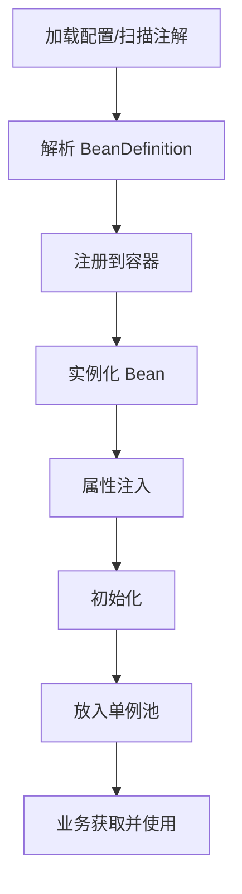
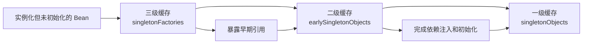
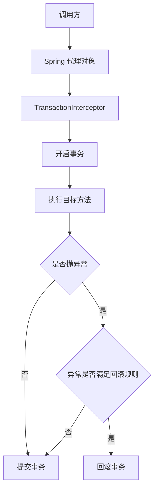

# Spring

> **模块**：11_后端八股/09_Spring.md  
> **来源**：购买资料 A（6 个源文件）— SpringMVC/IOC/AOP/注解/事务/自动装配  
> **规模**：约 1243 行  |  **生成**：2026-11-12  
> **状态**：已合并（多源合一）

## 本篇包含

01. SpringMVC
02. SpringIOC
03. SpringAOP
04. Spring常见注解
05. Spring事务
06. Spring自动装配

## 01 SpringMVC

Spring MVC 最常见的考法就是“执行流程”和“核心组件”。

### Spring MVC 的核心组件

> 💡 **Q：Spring MVC 有哪些核心组件？**

> 📝 最核心的组件有：
> - `DispatcherServlet`
> - `HandlerMapping`
> - `HandlerAdapter`
> - `HandlerInterceptor`
> - `ViewResolver`
> 其中 `DispatcherServlet` 是前端控制器，负责统一接收请求，再协调后续组件完成处理。

### Spring MVC 的执行流程

> 💡 **Q：Spring MVC 的执行流程是什么？**

> 📝 大致流程可以概括为：
> 1. 请求到达 `DispatcherServlet`
> 2. `DispatcherServlet` 通过 `HandlerMapping` 找到目标处理器
> 3. `HandlerAdapter` 调用具体 Controller 方法
> 4. 过程中完成参数绑定、类型转换、校验等逻辑
> 5. Controller 返回结果
> 6. 如果是前后端分离项目，通常通过 `HttpMessageConverter` 转成 JSON 返回
> 所以 Spring MVC 的核心思想就是：  
> **前端控制器统一调度 + 可插拔组件链。**

### `@RequestBody` 的底层依赖

> 💡 **Q：`@RequestBody` 为什么能把 JSON 变成 Java 对象？**

> 📝 因为 Spring MVC 在处理请求时，会结合参数解析器和 `HttpMessageConverter`。
> 当请求体是 JSON 时，常见会交给 Jackson 对应的消息转换器去完成反序列化，把 JSON 转成 Java 对象。

## 02 SpringIOC

### Spring IOC

Spring IOC 是 Spring 框架的核心，也是面试的必考题，面试官通常会问"什么是 IOC"，然后深挖 Bean 生命周期和循环依赖。

### 什么是IOC

> 💡 **Q：什么是 IOC？有什么好处？**

> 📝 IOC 全称是 **Inversion of Control**（控制反转），它是一种设计思想。
> 传统的程序设计中，我们在对象内部直接创建依赖对象，对象的控制权在程序员手里。而 IOC 是把对象的创建和依赖关系的管理交给容器来做，对象只需要声明自己需要什么依赖，容器会自动注入进来。这就是"控制反转"的含义——对象的控制权从程序员手里反转到了容器手里。
> **IOC 的好处**主要有三个：
> 第一个是**降低耦合度**。对象不需要自己创建依赖，只需要声明依赖，这样对象之间的耦合度就降低了。
> 第二个是**提高可维护性**。如果要替换一个依赖的实现，只需要修改配置，不需要修改代码。
> 第三个是**方便测试**。在单元测试时，可以很容易地注入 Mock 对象，不需要依赖真实的实现。
> **DI（Dependency Injection，依赖注入）**是 IOC 的一种实现方式。Spring 通过 DI 来实现 IOC，把依赖的对象注入到需要的地方。

> 🔎 **追问1：IOC 和 DI 有什么区别？**

IOC 是一种设计思想，DI 是 IOC 的一种实现方式。

IOC 强调的是"控制权的反转"，把对象的创建和管理交给容器。

DI 强调的是"依赖的注入"，容器把依赖的对象注入到需要的地方。

可以说，DI 是实现 IOC 的手段，IOC 是 DI 的目的。

### Spring IOC容器的实现

> 💡 **Q：Spring IOC 容器是如何实现的？**

> 📝 Spring IOC 容器的核心是 **BeanFactory**和**ApplicationContext**。
> **BeanFactory** 是 Spring IOC 容器的顶层接口，它提供了最基本的 IOC 功能，比如获取 Bean、判断 Bean 是否存在等。BeanFactory 是**懒加载**的，只有在获取 Bean 时才会创建 Bean。
> **ApplicationContext** 是 BeanFactory 的子接口，它在 BeanFactory 的基础上增加了很多企业级功能，比如国际化、事件发布、资源加载等。ApplicationContext 是**立即加载**的，容器启动时就会创建所有的单例 Bean。
> **常用的 ApplicationContext 实现类**：
> - **ClassPathXmlApplicationContext**：从类路径加载 XML 配置文件。
> - **FileSystemXmlApplicationContext**：从文件系统加载 XML 配置文件。
> - **AnnotationConfigApplicationContext**：基于注解的配置。
> **IOC 容器的工作流程**：
> 1. **加载配置**：读取 XML 配置文件或扫描注解。
> 2. **解析配置**：把配置信息解析成 BeanDefinition（Bean 的定义信息）。
> 3. **注册 BeanDefinition**：把 BeanDefinition 注册到 BeanFactory 中。
> 4. **实例化 Bean**：根据 BeanDefinition 创建 Bean 实例。
> 5. **依赖注入**：把依赖的 Bean 注入到目标 Bean 中。
> 6. **初始化 Bean**：调用 Bean 的初始化方法。
> 7. **使用 Bean**：应用程序可以从容器中获取 Bean 使用。
> 8. **销毁 Bean**：容器关闭时，调用 Bean 的销毁方法。

> 🔎 **追问1：BeanFactory 和 ApplicationContext 有什么区别？**

主要有三个区别：

第一个是**加载时机不同**。BeanFactory 是懒加载，ApplicationContext 是立即加载。

第二个是**功能不同**。BeanFactory 只提供基本的 IOC 功能，ApplicationContext 提供了更多企业级功能（国际化、事件发布、AOP 等）。

第三个是**使用场景不同**。BeanFactory 适合资源受限的环境（如移动设备），ApplicationContext 适合企业级应用。

实际开发中，我们基本都用 ApplicationContext。

### Bean的生命周期

> 💡 **Q：Spring Bean 的生命周期是怎样的？**

> 📝 Spring Bean 的生命周期可以分为**四个阶段**：
> **第一个阶段是实例化（Instantiation）**，Spring 通过反射调用 Bean 的构造方法创建 Bean 实例。
> **第二个阶段是属性赋值（Populate）**，Spring 把配置文件或注解中定义的属性值注入到 Bean 中，这就是依赖注入。
> **第三个阶段是初始化（Initialization）**，这个阶段会执行一系列的初始化操作：
> 1. 如果 Bean 实现了 `Aware` 接口（如 `BeanNameAware`、`ApplicationContextAware`），会调用相应的 `setXxx()` 方法。
> 2. 如果有 `BeanPostProcessor`，会调用它的 `postProcessBeforeInitialization()` 方法。
> 3. 如果 Bean 实现了 `InitializingBean` 接口，会调用 `afterPropertiesSet()` 方法。
> 4. 如果配置了 `init-method`，会调用自定义的初始化方法。
> 5. 如果有 `BeanPostProcessor`，会调用它的 `postProcessAfterInitialization()` 方法。
> **第四个阶段是销毁（Destruction）**，容器关闭时会销毁 Bean：
> 1. 如果 Bean 实现了 `DisposableBean` 接口，会调用 `destroy()` 方法。
> 2. 如果配置了 `destroy-method`，会调用自定义的销毁方法。
> **简化记忆**：实例化 → 属性赋值 → 初始化 → 销毁。

> 🔎 **追问1：BeanPostProcessor 有什么作用？**

BeanPostProcessor（Bean 后置处理器）是 Spring 提供的一个扩展点，可以在 Bean 初始化前后插入自定义逻辑。

它有两个方法：

- `postProcessBeforeInitialization()`：在 Bean 初始化之前调用。
- `postProcessAfterInitialization()`：在 Bean 初始化之后调用。

**典型应用**：

第一个是 **AOP**。Spring AOP 就是通过 BeanPostProcessor 实现的，在 `postProcessAfterInitialization()` 中创建代理对象。

第二个是 **@Autowired 注解**。`AutowiredAnnotationBeanPostProcessor` 会在 `postProcessBeforeInitialization()` 中处理 @Autowired 注解，完成依赖注入。

第三个是 **@PostConstruct 注解**。`CommonAnnotationBeanPostProcessor` 会在初始化阶段调用 @PostConstruct 标注的方法。

### 循环依赖问题

> 💡 **Q：什么是循环依赖？Spring 如何解决循环依赖？**

> 📝 循环依赖是指两个或多个 Bean 相互依赖，形成一个闭环。比如 A 依赖 B，B 又依赖 A。
> **Spring 解决循环依赖的核心是三级缓存**：
> **第一级缓存（singletonObjects）**：存放完全初始化好的单例 Bean，也叫"单例池"。
> **第二级缓存（earlySingletonObjects）**：存放早期暴露的 Bean，这些 Bean 已经实例化，但还没有完成属性赋值和初始化。
> **第三级缓存（singletonFactories）**：存放 Bean 的工厂对象，用于创建早期 Bean。
> **解决循环依赖的流程**（以 A 依赖 B，B 依赖 A 为例）：
> 1. 创建 A，先实例化 A，然后把 A 的工厂对象放入三级缓存。
> 2. 给 A 注入属性，发现依赖 B，去创建 B。
> 3. 创建 B，先实例化 B，然后把 B 的工厂对象放入三级缓存。
> 4. 给 B 注入属性，发现依赖 A，从三级缓存中获取 A 的工厂对象，创建 A 的早期引用，放入二级缓存，然后注入给 B。
> 5. B 完成初始化，放入一级缓存。
> 6. A 拿到完整的 B，完成初始化，放入一级缓存。
> **注意**：Spring 只能解决**单例 Bean 的 setter 注入**的循环依赖，无法解决构造器注入和 prototype 类型的循环依赖。

> 🔎 **追问1：为什么需要三级缓存？二级缓存不够吗？**

这是一个很经典的问题。理论上，如果只是解决循环依赖，二级缓存就够了。

但 Spring 需要考虑 **AOP** 的情况。如果 Bean 需要被代理（比如有 @Transactional 注解），那么注入给其他 Bean 的应该是代理对象，而不是原始对象。

**三级缓存的作用**：

三级缓存存放的是 Bean 的工厂对象（ObjectFactory），这个工厂对象可以创建 Bean 的早期引用。如果 Bean 需要被代理，工厂对象会返回代理对象；如果不需要代理，工厂对象会返回原始对象。

这样，即使在循环依赖的情况下，注入的也是正确的对象（代理对象或原始对象）。

如果只有二级缓存，就无法处理 AOP 的情况，可能导致注入的是原始对象，而不是代理对象。

> 🔎 **追问2：构造器注入为什么无法解决循环依赖？**

因为构造器注入是在实例化阶段就需要依赖对象，而此时依赖对象还没有创建。

比如 A 的构造器依赖 B，B 的构造器依赖 A：

1. 创建 A，需要先创建 B（构造器参数）。
2. 创建 B，需要先创建 A（构造器参数）。
3. 陷入死循环。

而 setter 注入是在属性赋值阶段才需要依赖对象，此时对象已经实例化了，可以先暴露一个早期引用，打破循环。

**解决方案**：

- 改用 setter 注入。
- 使用 @Lazy 注解，延迟加载依赖。

### 依赖注入的方式

> 💡 **Q：Spring 有哪些依赖注入的方式？推荐哪种？**

> 📝 Spring 主要有三种依赖注入方式：
> **第一种是构造器注入**，通过构造方法注入依赖。
> **优点**：依赖是不可变的（final），保证了线程安全。而且依赖是必需的，如果缺少依赖，编译时就会报错。
> **缺点**：如果依赖太多，构造方法会很长。而且无法解决循环依赖。
> **第二种是 setter 注入**，通过 setter 方法注入依赖。
> **优点**：可以解决循环依赖。而且依赖是可选的，可以有默认值。
> **缺点**：依赖是可变的，不够安全。而且依赖可能为 null，需要做空指针检查。
> **第三种是字段注入**，直接在字段上使用 @Autowired 注解。
> **优点**：代码简洁，使用方便。
> **缺点**：依赖不明显，不利于测试。而且无法注入 final 字段。
> **推荐使用构造器注入**，因为它能保证依赖的不可变性和必需性，更加安全。Spring 官方也推荐使用构造器注入。

> 🔎 **追问1：@Autowired 和 @Resource 有什么区别？**

这两个注解都可以用来注入依赖，但有一些区别：

**@Autowired**：

- 是 Spring 提供的注解。
- 默认按**类型（byType）**注入。
- 如果有多个同类型的 Bean，可以配合 @Qualifier 指定名称。
- 可以标注在构造器、setter 方法、字段上。

**@Resource**：

- 是 JDK 提供的注解（JSR-250）。
- 默认按**名称（byName）**注入。
- 如果按名称找不到，再按类型注入。
- 只能标注在字段和 setter 方法上，不能标注在构造器上。

**推荐使用 @Autowired**，因为它是 Spring 的标准注解，功能更强大。

### Bean的作用域

> 💡 **Q：Spring Bean 有哪些作用域？**

> 📝 Spring Bean 主要有五种作用域：
> **第一种是 singleton（单例）**，这是默认的作用域。整个 Spring 容器中只有一个 Bean 实例，所有对该 Bean 的请求都返回同一个实例。
> **第二种是 prototype（原型）**，每次请求都会创建一个新的 Bean 实例。
> **第三种是 request**，每个 HTTP 请求都会创建一个新的 Bean 实例，只在 Web 应用中有效。
> **第四种是 session**，每个 HTTP Session 都会创建一个新的 Bean 实例，只在 Web 应用中有效。
> **第五种是 application**，整个 ServletContext 中只有一个 Bean 实例，只在 Web 应用中有效。
> **实际开发中**，我们主要用 singleton 和 prototype。singleton 适合无状态的 Bean（如 Service、DAO），prototype 适合有状态的 Bean（如每次请求都需要新实例的对象）。

> 🔎 **追问1：singleton 的 Bean 是线程安全的吗？**

不一定。singleton 的 Bean 在整个容器中只有一个实例，如果 Bean 是**无状态的**（没有成员变量，或者成员变量是不可变的），那就是线程安全的。

如果 Bean 是**有状态的**（有可变的成员变量），那就不是线程安全的。多个线程同时访问这个 Bean，可能会出现线程安全问题。

**解决方案**：

- 尽量让 Bean 无状态。
- 如果必须有状态，使用 ThreadLocal 存储状态。
- 或者改用 prototype 作用域，每次请求都创建新实例。

#### 图解补充：IOC 容器工作链路



#### 图解补充：三级缓存怎么打破循环依赖



#### 对比补充：BeanFactory 和 ApplicationContext

| 维度 | BeanFactory | ApplicationContext |
|-|-|-|
| 定位 | 基础容器接口 | 企业级容器 |
| Bean 加载 | 偏懒加载 | 默认更偏预加载单例 |
| 能力 | 基础 IOC | 事件、国际化、AOP、资源加载 |
| 实际使用 | 很少直接用 | 业务开发主流选择 |

#### 高频追问补充

> 🔎 **追问补充1：为什么 Spring 只擅长解决单例 setter 循环依赖？**

因为 setter 注入发生在实例化之后，这时对象已经创建出来了，可以先暴露早期引用；而构造器注入在实例化时就要拿到完整依赖，根本来不及把对象先放进缓存。

> 🔎 **追问补充2：三级缓存为什么不能简单降成一级或二级？**

一级缓存放的是完整 Bean，显然来不及解决循环依赖；二级缓存虽然能放早期对象，但 Spring 还要兼顾 AOP 代理，所以需要三级缓存里的 `ObjectFactory` 来决定暴露原始对象还是代理对象。

> 🔎 **追问补充3：面试里 IOC 和 DI 怎么说更自然？**

可以说：IOC 是思想，强调控制权交给容器；DI 是落地方式，强调容器把依赖注入进来。这样既区分了抽象层次，也不会只背定义。

#### 速记版

> 📝 Spring IOC 建议按这条线记：
> - IOC 是控制反转，DI 是实现手段
> - 容器核心是 BeanDefinition + BeanFactory/ApplicationContext
> - Bean 生命周期四段：实例化、注入、初始化、销毁
> - 循环依赖重点盯住三级缓存
> 一句话面试版：
> Spring IOC 的本质，是由容器统一管理对象的创建、依赖注入和生命周期，并通过缓存和扩展点把对象装配过程组织起来。

> 更新: 2026-01-31 00:49:31  
> 原文: [https://www.yuque.com/u63312805/wnyutc/txg29ig37ly43vwg](https://www.yuque.com/u63312805/wnyutc/txg29ig37ly43vwg)

## 03 SpringAOP

### Spring AOP

Spring AOP 是 Spring 框架的另一个核心，面试中经常会问"什么是 AOP"，然后深挖动态代理的实现原理。

### 什么是AOP

> 💡 **Q：什么是 AOP？有什么作用？**

> 📝 AOP 全称是 **Aspect Oriented Programming**（面向切面编程），它是一种编程思想，是对 OOP（面向对象编程）的补充。
> AOP 的核心思想是：把系统中的**横切关注点**（Cross-cutting Concerns）从业务逻辑中分离出来，通过**动态代理**的方式，在不修改源代码的情况下，给程序动态地添加功能。
> **横切关注点**是指那些与业务逻辑无关，但又在多个模块中重复出现的功能，比如日志记录、性能统计、事务管理、权限控制等。
> **AOP 的好处**：
> 第一个是**降低耦合度**。把横切关注点从业务逻辑中分离出来，业务代码更加纯粹，只关注核心业务。
> 第二个是**提高复用性**。横切关注点可以在多个模块中复用，不需要在每个模块中重复编写。
> 第三个是**提高可维护性**。如果要修改横切关注点的逻辑，只需要修改一个地方，不需要修改所有使用的地方。

> 🔎 **追问1：AOP 的应用场景有哪些？**

AOP 的典型应用场景有这么几个：

第一个是**日志记录**。在方法执行前后记录日志，不需要在每个方法里写日志代码。

第二个是**性能统计**。统计方法的执行时间，用于性能分析。

第三个是**事务管理**。Spring 的 @Transactional 注解就是基于 AOP 实现的，在方法执行前开启事务，执行后提交或回滚事务。

第四个是**权限控制**。在方法执行前检查用户是否有权限，没有权限就抛出异常。

第五个是**异常处理**。统一处理方法抛出的异常，记录日志或返回友好的错误信息。

### AOP的核心概念

> 💡 **Q：AOP 有哪些核心概念？**

> 📝 AOP 的核心概念主要有这么几个：
> **第一个是切面（Aspect）**，它是横切关注点的模块化，一个切面可以包含多个通知和切点。在 Spring 中，用 @Aspect 注解标注的类就是一个切面。
> **第二个是连接点（Join Point）**，它是程序执行过程中的一个点，比如方法的调用、方法的执行、异常的抛出等。在 Spring AOP 中，连接点总是方法的执行。
> **第三个是切点（Pointcut）**，它是连接点的集合，定义了在哪些连接点上应用通知。在 Spring 中，用切点表达式来定义切点，比如 `execution(* com.example.service.*.*(..))`。
> **第四个是通知（Advice）**，它是在切点上执行的动作，定义了在什么时候做什么事。Spring AOP 有五种通知：
> - **前置通知（Before）**：在方法执行之前执行。
> - **后置通知（After）**：在方法执行之后执行，无论方法是否抛出异常。
> - **返回通知（AfterReturning）**：在方法正常返回之后执行。
> - **异常通知（AfterThrowing）**：在方法抛出异常之后执行。
> - **环绕通知（Around）**：在方法执行前后都可以执行，最强大的通知类型。
> **第五个是目标对象（Target Object）**，它是被代理的对象，也就是包含业务逻辑的对象。
> **第六个是代理对象（Proxy Object）**，它是 AOP 创建的对象，包含了目标对象和通知的逻辑。
> **第七个是织入（Weaving）**，它是把切面应用到目标对象，创建代理对象的过程。织入可以在编译期、类加载期、运行期进行。Spring AOP 是在运行期织入。

### 动态代理的实现

> 💡 **Q：Spring AOP 是如何实现的？JDK 动态代理和 CGLIB 代理有什么区别？**

> 📝 Spring AOP 是基于**动态代理**实现的，主要有两种代理方式：**JDK 动态代理**和 **CGLIB 代理**。
> **JDK 动态代理**：
> 它是 JDK 原生支持的代理方式，基于**接口**实现。如果目标对象实现了接口，Spring AOP 默认使用 JDK 动态代理。
> **实现原理**：JDK 动态代理通过 `java.lang.reflect.Proxy` 类和 `InvocationHandler` 接口来实现。Proxy 类会动态生成一个代理类，这个代理类实现了目标对象的接口，并在方法调用时委托给 InvocationHandler 处理。
> **CGLIB 代理**：
> 它是一个第三方库，基于**继承**实现。如果目标对象没有实现接口，Spring AOP 会使用 CGLIB 代理。
> **实现原理**：CGLIB 通过字节码技术，动态生成目标类的子类，并重写目标类的方法，在方法中插入增强逻辑。
> **两者的区别**：
> **Spring 的选择策略**：
> - 如果目标对象实现了接口，默认使用 JDK 动态代理。
> - 如果目标对象没有实现接口，使用 CGLIB 代理。
> - 可以通过配置强制使用 CGLIB 代理（`@EnableAspectJAutoProxy(proxyTargetClass = true)`）。

> 🔎 **追问1：为什么 CGLIB 创建代理对象慢，但调用方法快？**

**CGLIB 创建代理对象慢**：因为 CGLIB 需要通过字节码技术动态生成目标类的子类，这个过程涉及到字节码的生成和类的加载，比较耗时。

**CGLIB 调用方法快**：因为 CGLIB 生成的代理类是目标类的子类，方法调用是直接调用，不需要通过反射。而 JDK 动态代理每次方法调用都需要通过反射（InvocationHandler.invoke），反射的性能比直接调用差。

不过，在现代 JVM 中（JDK 8 及以后），JDK 动态代理的性能已经优化得很好了，两者的性能差距不大。

### 切点表达式

> 💡 **Q：Spring AOP 的切点表达式怎么写？**

> 📝 Spring AOP 的切点表达式主要使用 **execution** 表达式，语法是：
> 简化一下就是：
> **常用的通配符**：
> - `*`：匹配任意字符，但只能匹配一个元素（一个包名、一个类名、一个方法名、一个参数）。
> - `..`：匹配任意字符，可以匹配多个元素。在包名中表示当前包及其子包，在参数中表示任意个参数。
> - `+`：匹配指定类及其子类。
> **常用的切点表达式示例**：
> **其他切点表达式**：
> 除了 execution，还有一些其他的切点表达式：
> - `@annotation`：匹配标注了指定注解的方法。
> - `@within`：匹配标注了指定注解的类中的所有方法。
> - `within`：匹配指定包或类中的所有方法。
> - `bean`：匹配指定名称的 Bean 中的所有方法。

### AOP的使用示例

> 💡 **Q：如何使用 Spring AOP？**

> 📝 使用 Spring AOP 主要有三个步骤：
> **第一步是添加依赖**，在 pom.xml 中添加 spring-boot-starter-aop 依赖。
> **第二步是定义切面**，创建一个类，用 @Aspect 注解标注，并定义通知方法。
> **第三步是启用 AOP**，在 Spring Boot 中，默认已经启用了 AOP。如果是传统的 Spring 项目，需要在配置类上添加 @EnableAspectJAutoProxy 注解。

> 🔎 **追问1：多个通知的执行顺序是怎样的？**

如果一个方法被多个通知匹配，执行顺序是：

**正常情况**（方法正常返回）：

```plain
@Around 前半部分
  ↓
@Before
  ↓
目标方法执行
  ↓
@AfterReturning
  ↓
@After
  ↓
@Around 后半部分
```

**异常情况**（方法抛出异常）：

```plain
@Around 前半部分
  ↓
@Before
  ↓
目标方法执行（抛出异常）
  ↓
@AfterThrowing
  ↓
@After
  ↓
@Around 后半部分（不执行，因为异常被抛出）
```

**多个切面的执行顺序**：

如果有多个切面，可以通过 @Order 注解指定顺序，数字越小，优先级越高。

```java
@Aspect
@Component
@Order(1)
public class LogAspect {
}

@Aspect
@Component
@Order(2)
public class PerformanceAspect {
}
```

执行顺序是：LogAspect 的 @Around 前半部分 → PerformanceAspect 的 @Around 前半部分 → 目标方法 → PerformanceAspect 的 @Around 后半部分 → LogAspect 的 @Around 后半部分。

### AOP的局限性

> 💡 **Q：Spring AOP 有什么局限性？**

> 📝 Spring AOP 主要有以下几个局限性：
> **第一个是只能拦截 public 方法**。因为 Spring AOP 是基于代理实现的，代理对象只能拦截 public 方法。如果方法是 private、protected 或 default，AOP 无法拦截。
> **第二个是同类内部方法调用无法拦截**。如果在同一个类中，方法 A 调用方法 B，即使方法 B 有切面，也不会被拦截。因为内部调用是通过 this 调用的，不是通过代理对象调用的。
> **解决方案**：
> - 把方法 B 移到另一个类中。
> - 通过 ApplicationContext 获取代理对象，然后调用方法 B。
> - 使用 AspectJ 的编译期织入（不是 Spring AOP）。
> **第三个是性能开销**。虽然动态代理的性能已经很好了，但相比直接调用，还是有一定的开销。如果对性能要求极高，需要谨慎使用 AOP。
> **第四个是调试困难**。因为 AOP 是在运行期动态生成代理对象，调试时可能看不到切面的逻辑，增加了调试难度。

> 🔎 **追问1：如何解决同类内部方法调用无法拦截的问题？**

有几种解决方案：

**第一种是通过 ApplicationContext 获取代理对象**：

```java
@Service
public class UserService {
    @Autowired
    private ApplicationContext context;

    public void methodA() {
        // 获取代理对象，然后调用 methodB
        UserService proxy = context.getBean(UserService.class);
        proxy.methodB();
    }

    @Transactional
    public void methodB() {
        // 业务逻辑
    }
}
```

**第二种是使用 AopContext.currentProxy()**：

```java
@Service
@EnableAspectJAutoProxy(exposeProxy = true)  // 暴露代理对象
public class UserService {

    public void methodA() {
        // 获取当前代理对象
        UserService proxy = (UserService) AopContext.currentProxy();
        proxy.methodB();
    }

    @Transactional
    public void methodB() {
        // 业务逻辑
    }
}
```

**第三种是把方法移到另一个类**：

```java
@Service
public class UserService {
    @Autowired
    private UserHelper userHelper;

    public void methodA() {
        userHelper.methodB();  // 通过代理对象调用
    }
}

@Service
public class UserHelper {
    @Transactional
    public void methodB() {
        // 业务逻辑
    }
}
```

推荐使用第三种方案，因为它更符合单一职责原则，代码更清晰。

> 更新: 2026-01-31 00:49:38  
> 原文: [https://www.yuque.com/u63312805/wnyutc/ia9yt81icp1lq54m](https://www.yuque.com/u63312805/wnyutc/ia9yt81icp1lq54m)

## 04 Spring常见注解

Spring 注解题一般不是让你背名字，而是看你是否知道“这个注解在容器里起什么作用”。

### 组件注册类注解

> 💡 **Q：Spring 中常见的组件注解有哪些？**

> 📝 最常见的是：
> - `@Component`
> - `@Service`
> - `@Controller`
> - `@Repository`
> 它们本质上都能把类注册进 Spring 容器，只是语义分层不同。

### `@Autowired` 和 `@Resource`

> 💡 **Q：`@Autowired` 和 `@Resource` 有什么区别？**

> 📝 `@Autowired` 是 Spring 提供的，默认按类型注入。  
> `@Resource` 是 JSR-250 规范里的注解，默认语义更偏按名称注入。
> 如果同类型 Bean 太多，`@Autowired` 往往需要配合 `@Qualifier` 使用。

### `@Configuration` 和 `@Bean`

> 💡 **Q：`@Configuration` 和 `@Bean` 是做什么的？**

> 📝 `@Configuration` 用来声明配置类。  
> `@Bean` 用来把方法返回值注册成 Spring Bean。
> 这套方式非常适合：
> - 接入第三方组件
> - 初始化复杂对象
> - 替代早期 XML 配置

### Web 层常见注解

> 💡 **Q：Web 层常见注解有哪些？**

> 📝 最常见的是：
> - `@RestController`
> - `@RequestMapping`
> - `@GetMapping`
> - `@PostMapping`
> - `@RequestParam`
> - `@PathVariable`
> - `@RequestBody`
> 其中 `@RestController` 本质上等于 `@Controller + @ResponseBody`。

## 05 Spring事务

Spring 事务是面试的高频考点，面试官通常会问"事务的传播机制"和"@Transactional 什么时候会失效"。

### Spring事务的基本概念

> 💡 **Q：什么是事务？Spring 如何管理事务？**

> 📝 事务是数据库操作的一个执行单元，它要么全部成功，要么全部失败，保证数据的一致性。事务有四个特性（ACID）：
> **原子性（Atomicity）**：事务中的所有操作要么全部成功，要么全部失败回滚。
> **一致性（Consistency）**：事务执行前后，数据库的完整性约束没有被破坏。
> **隔离性（Isolation）**：多个事务并发执行时，一个事务的执行不应影响其他事务。
> **持久性（Durability）**：事务一旦提交，对数据库的改变是永久的。
> **Spring 管理事务的方式**有两种：
> 第一种是**编程式事务**，通过 TransactionTemplate 或 PlatformTransactionManager 手动管理事务。这种方式灵活，但代码侵入性强。
> 第二种是**声明式事务**，通过 @Transactional 注解或 XML 配置来管理事务。这种方式简单，代码侵入性低，是推荐的方式。Spring 通过 AOP 实现声明式事务。

> 🔎 **追问1：Spring 事务的实现原理是什么？**

Spring 事务是基于 **AOP** 实现的。

当我们在方法上加 @Transactional 注解时，Spring 会通过 AOP 创建一个代理对象。在方法执行前，代理对象会开启事务；方法执行成功后，提交事务；方法抛出异常时，回滚事务。

具体来说，Spring 使用 **TransactionInterceptor** 拦截器来实现事务管理。这个拦截器在方法执行前后插入事务管理的逻辑。

### 事务的传播机制

> 💡 **Q：Spring 事务的传播机制有哪些？**

> 📝 Spring 事务的传播机制定义了当一个事务方法被另一个事务方法调用时，事务应该如何传播。Spring 定义了**七种传播机制**：
> **第一种是 REQUIRED（默认）**，如果当前存在事务，就加入该事务；如果当前没有事务，就创建一个新事务。这是最常用的传播机制。
> **第二种是 SUPPORTS**，如果当前存在事务，就加入该事务；如果当前没有事务，就以非事务方式执行。
> **第三种是 MANDATORY**，如果当前存在事务，就加入该事务；如果当前没有事务，就抛出异常。
> **第四种是 REQUIRES_NEW**，无论当前是否存在事务，都创建一个新事务。如果当前存在事务，就把当前事务挂起。
> **第五种是 NOT_SUPPORTED**，以非事务方式执行。如果当前存在事务，就把当前事务挂起。
> **第六种是 NEVER**，以非事务方式执行。如果当前存在事务，就抛出异常。
> **第七种是 NESTED**，如果当前存在事务，就在嵌套事务中执行；如果当前没有事务，就创建一个新事务。嵌套事务是外部事务的一部分，外部事务回滚，嵌套事务也会回滚；但嵌套事务回滚，不会影响外部事务。
> **常用的传播机制**：
> 实际开发中，我们主要用 **REQUIRED**（默认）和 **REQUIRES_NEW**。
> - **REQUIRED**：适合大多数场景，多个方法共享一个事务。
> - **REQUIRES_NEW**：适合需要独立事务的场景，比如记录日志，即使主业务失败，日志也要保存。

> 🔎 **追问1：REQUIRED 和 REQUIRES_NEW 有什么区别？**

**REQUIRED**：

- 如果当前有事务，就加入当前事务。
- 多个方法共享一个事务，任何一个方法抛出异常，整个事务都会回滚。

**REQUIRES_NEW**：

- 无论当前是否有事务，都创建一个新事务。
- 新事务和外部事务是独立的，新事务的提交或回滚不会影响外部事务。

**示例**：

```java
@Service
public class OrderService {
    @Autowired
    private LogService logService;

    @Transactional
    public void createOrder() {
        // 创建订单
        saveOrder();
        // 记录日志（使用 REQUIRES_NEW）
        logService.saveLog();
        // 如果这里抛出异常，订单会回滚，但日志不会回滚
        throw new RuntimeException("订单创建失败");
    }
}

@Service
public class LogService {
    @Transactional(propagation = Propagation.REQUIRES_NEW)
    public void saveLog() {
        // 保存日志
    }
}
```

在这个例子中，即使 createOrder 方法抛出异常，订单会回滚，但日志已经在独立的事务中提交了，不会回滚。

> 🔎 **追问2：NESTED 和 REQUIRES_NEW 有什么区别？**

**NESTED（嵌套事务）**：

- 嵌套事务是外部事务的一部分。
- 外部事务回滚，嵌套事务也会回滚。
- 嵌套事务回滚，不会影响外部事务（可以捕获异常继续执行）。
- 底层使用数据库的 Savepoint 机制实现。

**REQUIRES_NEW（独立事务）**：

- 新事务和外部事务完全独立。
- 外部事务回滚，不会影响新事务。
- 新事务回滚，也不会影响外部事务。

**选择建议**：

- 如果需要部分回滚（子事务失败，主事务继续），用 **NESTED**。
- 如果需要完全独立的事务（如记录日志），用 **REQUIRES_NEW**。

### 事务的隔离级别

> 💡 **Q：Spring 事务的隔离级别有哪些？**

> 📝 Spring 事务的隔离级别定义了一个事务可能受其他并发事务影响的程度。Spring 定义了**五种隔离级别**：
> **第一种是 DEFAULT（默认）**，使用数据库默认的隔离级别。MySQL 默认是 REPEATABLE_READ，Oracle 默认是 READ_COMMITTED。
> **第二种是 READ_UNCOMMITTED（读未提交）**，最低的隔离级别，允许读取未提交的数据。会出现脏读、不可重复读、幻读问题。
> **第三种是 READ_COMMITTED（读已提交）**，只能读取已提交的数据。可以避免脏读，但会出现不可重复读、幻读问题。
> **第四种是 REPEATABLE_READ（可重复读）**，保证在同一个事务中多次读取同一数据的结果是一致的。可以避免脏读、不可重复读，但会出现幻读问题。MySQL 的 InnoDB 引擎通过 MVCC 和 Next-Key Lock 解决了幻读问题。
> **第五种是 SERIALIZABLE（串行化）**，最高的隔离级别，完全串行化执行，避免了所有并发问题，但性能最差。
> **并发问题**：
> - **脏读**：读取到其他事务未提交的数据。
> - **不可重复读**：在同一个事务中，多次读取同一数据，结果不一致（其他事务修改并提交了数据）。
> - **幻读**：在同一个事务中，多次查询，结果集的数量不一致（其他事务插入或删除了数据）。
> **实际开发中**，我们通常使用 **DEFAULT**（数据库默认）或 **READ_COMMITTED**。

> 🔎 **追问1：如何选择隔离级别？**

这要看业务需求和性能要求：

**READ_UNCOMMITTED**：几乎不用，因为会出现脏读，数据不可靠。

**READ_COMMITTED**：适合大多数场景，Oracle 的默认隔离级别。可以避免脏读，性能较好。

**REPEATABLE_READ**：MySQL 的默认隔离级别。适合对数据一致性要求较高的场景。

**SERIALIZABLE**：适合对数据一致性要求极高的场景（如金融系统），但性能很差，一般不用。

**我在项目中的选择**：通常使用数据库的默认隔离级别（DEFAULT），不需要特别指定。如果有特殊需求，再根据业务场景调整。

### @Transactional的失效场景

> 💡 **Q：@Transactional 注解什么时候会失效？**

> 📝 @Transactional 注解失效的场景主要有以下几种：
> **第一种是方法不是 public**。Spring AOP 只能拦截 public 方法，如果方法是 private、protected 或 default，@Transactional 会失效。
> **第二种是同类内部方法调用**。如果在同一个类中，方法 A 调用方法 B，即使方法 B 有 @Transactional 注解，事务也不会生效。因为内部调用是通过 this 调用的，不是通过代理对象调用的。
> **第三种是异常被捕获**。@Transactional 默认只回滚 RuntimeException 和 Error，如果方法抛出的异常被 catch 住了，事务不会回滚。
> **第四种是异常类型不匹配**。@Transactional 默认只回滚 RuntimeException 和 Error。如果方法抛出的是 checked exception（如 IOException），事务不会回滚。可以通过 `rollbackFor` 属性指定回滚的异常类型。
> **第五种是数据库引擎不支持事务**。如果使用的是 MyISAM 引擎（不支持事务），@Transactional 会失效。应该使用 InnoDB 引擎。
> **第六种是没有被 Spring 管理**。如果类没有被 Spring 管理（没有 @Service、@Component 等注解），@Transactional 会失效。
> **第七种是事务传播机制设置不当**。如果传播机制设置为 NOT_SUPPORTED 或 NEVER，事务会失效。

> 🔎 **追问1：如何解决同类内部方法调用导致的事务失效？**

有几种解决方案：

**第一种是把方法移到另一个类**（推荐）：

```java
@Service
public class OrderService {
    @Autowired
    private OrderHelper orderHelper;

    public void createOrder() {
        // 调用另一个类的方法，通过代理对象调用
        orderHelper.saveOrder();
    }
}

@Service
public class OrderHelper {
    @Transactional
    public void saveOrder() {
        // 保存订单
    }
}
```

**第二种是通过 ApplicationContext 获取代理对象**：

```java
@Service
public class OrderService {
    @Autowired
    private ApplicationContext context;

    public void createOrder() {
        OrderService proxy = context.getBean(OrderService.class);
        proxy.saveOrder();
    }

    @Transactional
    public void saveOrder() {
        // 保存订单
    }
}
```

**第三种是使用 AopContext.currentProxy()**：

```java
@Service
@EnableAspectJAutoProxy(exposeProxy = true)
public class OrderService {

    public void createOrder() {
        OrderService proxy = (OrderService) AopContext.currentProxy();
        proxy.saveOrder();
    }

    @Transactional
    public void saveOrder() {
        // 保存订单
    }
}
```

推荐使用第一种方案，代码更清晰，符合单一职责原则。

> 🔎 **追问2：如何让 checked exception 也回滚事务？**

默认情况下，@Transactional 只回滚 RuntimeException 和 Error。如果要让 checked exception 也回滚，可以使用 `rollbackFor` 属性：

```java
@Transactional(rollbackFor = Exception.class)
public void createOrder() throws Exception {
    // 业务逻辑
    throw new IOException("IO 异常");  // 会回滚
}
```

或者，把 checked exception 包装成 RuntimeException 抛出：

```java
@Transactional
public void createOrder() {
    try {
        // 业务逻辑
    } catch (IOException e) {
        throw new RuntimeException("IO 异常", e);  // 会回滚
    }
}
```

### 事务的最佳实践

> 💡 **Q：使用 Spring 事务有哪些最佳实践？**

> 📝 使用 Spring 事务的最佳实践主要有这么几点：
> **第一个是事务范围尽量小**。事务持有数据库连接，事务越大，连接占用时间越长，影响并发性能。应该只在需要事务的地方加 @Transactional，不要在整个 Service 类上加。
> **第二个是避免在事务中执行耗时操作**。比如调用外部接口、发送邮件、文件 IO 等，这些操作应该放在事务外执行，或者使用异步处理。
> **第三个是合理设置超时时间**。可以通过 `timeout` 属性设置事务超时时间，避免事务长时间占用连接。
> **第四个是明确指定回滚的异常类型**。如果业务中可能抛出 checked exception，应该使用 `rollbackFor` 属性明确指定。
> **第五个是避免大事务**。如果一个事务中有大量的数据库操作，可以考虑拆分成多个小事务，或者使用批处理。
> **第六个是注意事务的传播机制**。如果需要独立的事务（如记录日志），使用 REQUIRES_NEW；如果需要嵌套事务，使用 NESTED。
> **第七个是只读事务优化**。如果方法只是查询数据，不修改数据，可以设置 `readOnly = true`，数据库可以做一些优化。

> 🔎 **追问1：为什么要避免在事务中执行耗时操作？**

因为事务会持有数据库连接，如果在事务中执行耗时操作（如调用外部接口），会导致：

第一个是**连接占用时间长**，数据库连接池的连接被长时间占用，其他请求可能拿不到连接，影响并发性能。

第二个是**锁持有时间长**，如果事务中有更新操作，会持有行锁或表锁，其他事务可能被阻塞，导致性能下降甚至死锁。

第三个是**事务超时**，如果耗时操作太久，可能导致事务超时，事务被回滚。

**解决方案**：

- 把耗时操作放在事务外执行。
- 使用异步处理（如 @Async）。
- 使用消息队列（如 RabbitMQ）解耦。

#### 图解补充：`@Transactional` 生效链路



#### 对比补充：传播行为速记

| 传播行为 | 当前有事务时 | 当前没事务时 | 适用场景 |
|-|-|-|-|
| `REQUIRED` | 加入当前事务 | 新建事务 | 默认主业务 |
| `REQUIRES_NEW` | 挂起当前事务，新建事务 | 新建事务 | 日志、审计、补偿 |
| `SUPPORTS` | 加入当前事务 | 非事务执行 | 可有可无的事务读操作 |
| `MANDATORY` | 加入当前事务 | 抛异常 | 强依赖上游事务 |
| `NOT_SUPPORTED` | 挂起当前事务 | 非事务执行 | 明确不想进事务 |
| `NEVER` | 抛异常 | 非事务执行 | 禁止事务环境 |
| `NESTED` | 建立保存点 | 新建事务 | 局部回滚 |

#### 高频追问补充

> 🔎 **追问补充1：为什么同类内部调用会让事务失效？**

因为事务是靠 Spring AOP 代理织进去的。同类内部 `this.xxx()` 调用绕开了代理对象，没有经过 `TransactionInterceptor`，自然也就没有事务增强。

> 🔎 **追问补充2：为什么异常被吃掉之后事务不回滚？**

因为对 Spring 来说，方法已经“正常返回”了。事务拦截器只有在感知到异常向外抛出，或者显式标记 `setRollbackOnly()` 时，才会回滚。

> 🔎 **追问补充3：面试里怎么回答事务失效更完整？**

可以按这四类讲：

1. 没走代理，例如同类调用、对象不是 Spring 管理。
2. 回滚规则没命中，例如 checked exception。
3. 方法签名不符合代理拦截条件，例如非 public。
4. 底层资源不支持事务，例如引擎不支持或传播行为主动关闭事务。

#### 速记版

> 📝 Spring 事务面试建议按这条线背：
> - 先讲 `@Transactional` 基于 AOP 代理
> - 再讲传播行为，重点盯住 `REQUIRED` 和 `REQUIRES_NEW`
> - 再讲隔离级别和数据库默认值
> - 最后讲事务失效场景
> 一句话记忆：
> Spring 事务的本质不是注解本身，而是 `代理 + 拦截器 + 底层事务管理器` 的组合。

## 06 Spring自动装配

SpringBoot 自动装配是面试的高频考点，面试官通常会问"SpringBoot 是如何实现自动配置的"。

### SpringBoot的核心注解

> 💡 **Q：@SpringBootApplication 注解的作用是什么？**

> 📝 @SpringBootApplication 是 SpringBoot 的核心注解，它是一个组合注解，包含了三个重要的注解：
> **第一个是 @SpringBootConfiguration**，它本质上就是 @Configuration，表示这是一个配置类，可以在这个类中定义 Bean。
> **第二个是 @EnableAutoConfiguration**，这是自动配置的核心注解，它会根据类路径中的 jar 包和配置，自动配置 Spring 应用。
> **第三个是 @ComponentScan**，它会扫描当前包及其子包下的所有组件（@Component、@Service、@Controller 等），并注册到 Spring 容器中。
> 所以，@SpringBootApplication 相当于：

### 自动配置的原理

> 💡 **Q：SpringBoot 的自动配置是如何实现的？**

> 📝 SpringBoot 的自动配置主要依赖 **@EnableAutoConfiguration**注解和**Spring Boot Starter** 机制。
> **@EnableAutoConfiguration 的工作流程**：
> 1. **@EnableAutoConfiguration**注解上有一个**@Import(AutoConfigurationImportSelector.class)** 注解。
> 2. **AutoConfigurationImportSelector** 会读取 `META-INF/spring.factories` 文件（在 SpringBoot 2.7 之后改为 `META-INF/spring/org.springframework.boot.autoconfigure.AutoConfiguration.imports`）。
> 3. 这个文件中列出了所有的自动配置类，比如 `RedisAutoConfiguration`、`DataSourceAutoConfiguration` 等。
> 4. SpringBoot 会加载这些自动配置类，但不是所有的配置类都会生效，只有满足条件的配置类才会生效。
> 5. 每个自动配置类上都有 **条件注解**（如 @ConditionalOnClass、@ConditionalOnMissingBean），只有满足条件，配置类才会生效。
> 6. 如果条件满足，配置类中定义的 Bean 就会被注册到 Spring 容器中。
> **举个例子**（Redis 自动配置）：
> 这个配置类的意思是：
> - 如果类路径中有 RedisOperations 类（说明引入了 Redis 依赖）。
> - 并且容器中没有 redisTemplate 这个 Bean。
> - 那么就自动创建一个 RedisTemplate Bean。

> 🔎 **追问1：如何自定义一个 Starter？**

自定义 Starter 主要有四个步骤：

**第一步是创建一个 Maven 项目**，命名规范是 `xxx-spring-boot-starter`。

**第二步是添加依赖**，引入 `spring-boot-autoconfigure` 依赖。

```xml
<dependency>
    <groupId>org.springframework.boot</groupId>

    <artifactId>spring-boot-autoconfigure</artifactId>

</dependency>

```

**第三步是创建自动配置类**，定义需要自动配置的 Bean。

```java
@Configuration
@ConditionalOnClass(MyService.class)
@EnableConfigurationProperties(MyProperties.class)
public class MyAutoConfiguration {

    @Bean
    @ConditionalOnMissingBean
    public MyService myService(MyProperties properties) {
        return new MyService(properties);
    }
}
```

**第四步是创建 spring.factories 文件**，在 `src/main/resources/META-INF/spring.factories` 中注册自动配置类。

```properties
org.springframework.boot.autoconfigure.EnableAutoConfiguration=\
com.example.MyAutoConfiguration
```

或者在 SpringBoot 2.7 之后，创建 `src/main/resources/META-INF/spring/org.springframework.boot.autoconfigure.AutoConfiguration.imports` 文件：

```plain
com.example.MyAutoConfiguration
```

这样，其他项目引入这个 Starter 后，就会自动配置 MyService。

### 条件注解

> 💡 **Q：SpringBoot 有哪些常用的条件注解？**

> 📝 SpringBoot 提供了很多条件注解，用于控制配置类或 Bean 是否生效。常用的条件注解有这么几个：
> **第一个是 @ConditionalOnClass**，当类路径中存在指定的类时，配置才生效。比如 `@ConditionalOnClass(RedisOperations.class)` 表示只有引入了 Redis 依赖，配置才生效。
> **第二个是 @ConditionalOnMissingClass**，当类路径中不存在指定的类时，配置才生效。
> **第三个是 @ConditionalOnBean**，当容器中存在指定的 Bean 时，配置才生效。
> **第四个是 @ConditionalOnMissingBean**，当容器中不存在指定的 Bean 时，配置才生效。这个注解很常用，用于避免覆盖用户自定义的 Bean。
> **第五个是 @ConditionalOnProperty**，当配置文件中存在指定的属性时，配置才生效。比如 `@ConditionalOnProperty(name = "spring.redis.host")` 表示只有配置了 redis 的 host，配置才生效。
> **第六个是 @ConditionalOnWebApplication**，当应用是 Web 应用时，配置才生效。
> **第七个是 @ConditionalOnNotWebApplication**，当应用不是 Web 应用时，配置才生效。
> **示例**：

> 🔎 **追问1：如果我想自定义一个 Bean，如何覆盖自动配置的 Bean？**

SpringBoot 的自动配置类通常会使用 @ConditionalOnMissingBean 注解，这样如果用户自定义了 Bean，自动配置就不会生效。

比如，如果我想自定义 RedisTemplate：

```java
@Configuration
public class MyRedisConfig {

    @Bean
    public RedisTemplate<String, Object> redisTemplate(RedisConnectionFactory factory) {
        RedisTemplate<String, Object> template = new RedisTemplate<>();
        template.setConnectionFactory(factory);
        // 自定义序列化方式
        template.setKeySerializer(new StringRedisSerializer());
        template.setValueSerializer(new GenericJackson2JsonRedisSerializer());
        return template;
    }
}
```

因为 RedisAutoConfiguration 中的 redisTemplate 有 @ConditionalOnMissingBean 注解，所以我自定义的 Bean 会生效，自动配置的 Bean 不会生效。

### 配置文件的加载

> 💡 **Q：SpringBoot 如何加载配置文件？配置文件的优先级是怎样的？**

> 📝 SpringBoot 支持多种配置文件格式，主要有 **application.properties**和**application.yml**。
> **配置文件的加载位置**（优先级从高到低）：
> 1. **命令行参数**：`java -jar app.jar --server.port=8081`
> 2. **操作系统环境变量**
> 3. **Java 系统属性**：`System.getProperties()`
> 4. **JNDI 属性**
> 5. **RandomValuePropertySource**：`${random.int}`
> 6. **jar 包外的 application-{profile}.properties 或 .yml**（带 profile）
> 7. **jar 包内的 application-{profile}.properties 或 .yml**（带 profile）
> 8. **jar 包外的 application.properties 或 .yml**（不带 profile）
> 9. **jar 包内的 application.properties 或 .yml**（不带 profile）
> **配置文件的搜索位置**（优先级从高到低）：
> 1. **项目根目录的 /config 子目录**
> 2. **项目根目录**
> 3. **classpath 的 /config 包**
> 4. **classpath 根路径**
> **多环境配置**：
> SpringBoot 支持多环境配置，通过 `spring.profiles.active` 属性指定激活的环境。
> 然后创建 `application-dev.properties`、`application-prod.properties` 等文件，SpringBoot 会根据激活的环境加载对应的配置文件。

> 🔎 **追问1：如何在代码中获取配置文件的值？**

有三种方式：

**第一种是使用 @Value 注解**：

```java
@Component
public class MyService {
    @Value("${server.port}")
    private int port;
}
```

**第二种是使用 @ConfigurationProperties 注解**（推荐）：

```java
@Component
@ConfigurationProperties(prefix = "my.config")
public class MyConfig {
    private String name;
    private int age;
    // getter 和 setter
}
```

```properties
### application.properties
my.config.name=张三
my.config.age=18
```

**第三种是使用 Environment 对象**：

```java
@Component
public class MyService {
    @Autowired
    private Environment env;

    public void test() {
        String port = env.getProperty("server.port");
    }
}
```

推荐使用 @ConfigurationProperties，因为它支持类型安全、批量注入、JSR-303 校验等功能。

### SpringBoot的启动流程

> 💡 **Q：SpringBoot 的启动流程是怎样的？**

> 📝 面试官你好，SpringBoot 的启动流程主要分为以下几个步骤：
> **第一步是创建 SpringApplication 对象**，在 `SpringApplication.run()` 方法中，会先创建一个 SpringApplication 对象。这个对象会做一些初始化工作：
> - 推断应用类型（Web 应用还是非 Web 应用）。
> - 加载 ApplicationContextInitializer 和 ApplicationListener。
> - 推断主类（包含 main 方法的类）。
> **第二步是运行 SpringApplication**，调用 `run()` 方法启动应用。
> **第三步是准备环境（Environment）**，加载配置文件，设置环境变量。
> **第四步是创建 ApplicationContext**，根据应用类型创建对应的上下文（如 AnnotationConfigServletWebServerApplicationContext）。
> **第五步是准备 ApplicationContext**，设置环境、加载 BeanDefinition、注册单例 Bean 等。
> **第六步是刷新 ApplicationContext**，这是最核心的步骤，会执行以下操作：
> - 调用 BeanFactoryPostProcessor。
> - 注册 BeanPostProcessor。
> - 初始化 MessageSource（国际化）。
> - 初始化事件广播器。
> - 创建 Web 服务器（如 Tomcat）。
> - 注册监听器。
> - 实例化所有单例 Bean。
> - 完成刷新，发布事件。
> **第七步是启动完成**，调用 ApplicationRunner 和 CommandLineRunner，执行自定义的启动逻辑。
> **简化流程**：

> 🔎 **追问1：SpringBoot 是如何启动内嵌的 Tomcat 的？**

SpringBoot 通过 **ServletWebServerFactory** 来创建和启动内嵌的 Web 服务器。

在刷新 ApplicationContext 的过程中，会调用 `onRefresh()` 方法，这个方法会创建 Web 服务器：

1. 从容器中获取 ServletWebServerFactory（如 TomcatServletWebServerFactory）。
2. 调用 `getWebServer()` 方法创建 Web 服务器（如 Tomcat）。
3. 启动 Web 服务器。

**为什么 SpringBoot 可以打成 jar 包运行**：

因为 SpringBoot 使用了 **spring-boot-maven-plugin**插件，这个插件会把应用打成一个**可执行的 jar 包**（Fat Jar），jar 包中包含了所有的依赖和内嵌的 Tomcat。

运行 `java -jar app.jar` 时，会先执行 jar 包中的 `MANIFEST.MF` 文件指定的主类（JarLauncher），JarLauncher 会加载 jar 包中的所有依赖，然后启动 SpringBoot 应用。

### SpringBoot的优势

> 💡 **Q：SpringBoot 相比传统的 Spring 有什么优势？**

> 📝 面试官你好，SpringBoot 相比传统的 Spring 主要有以下几个优势：
> **第一个是简化配置**。传统的 Spring 需要大量的 XML 配置，而 SpringBoot 通过自动配置和约定优于配置的理念，大大简化了配置。
> **第二个是快速开发**。SpringBoot 提供了大量的 Starter，引入一个 Starter 就可以快速集成一个功能（如 Redis、MyBatis），不需要手动配置。
> **第三个是内嵌服务器**。SpringBoot 内嵌了 Tomcat、Jetty 等服务器，可以直接打成 jar 包运行，不需要部署到外部服务器。
> **第四个是生产就绪**。SpringBoot 提供了 Actuator 模块，可以监控应用的健康状况、性能指标等，方便运维。
> **第五个是微服务友好**。SpringBoot 是 Spring Cloud 的基础，非常适合构建微服务应用。
> **总结**：SpringBoot 让开发者可以专注于业务逻辑，而不是配置和基础设施，大大提高了开发效率。

> 🔎 **追问1：SpringBoot 和 Spring Cloud 有什么关系？**

**SpringBoot** 是一个快速开发框架，用于简化 Spring 应用的开发。

**Spring Cloud** 是一个微服务框架，基于 SpringBoot 构建，提供了服务注册与发现、配置中心、负载均衡、熔断器、网关等微服务组件。

**关系**：Spring Cloud 依赖于 SpringBoot，SpringBoot 是 Spring Cloud 的基础。可以说，SpringBoot 是单体应用的开发框架，Spring Cloud 是微服务架构的解决方案。

**常用的 Spring Cloud 组件**：

- **Nacos**：服务注册与发现、配置中心。
- **Gateway**：API 网关。
- **OpenFeign**：声明式 HTTP 客户端。
- **Sentinel**：熔断降级、限流。
- **Seata**：分布式事务。

### SpringBoot 如何优雅停机

> 💡 **Q：SpringBoot 如何优雅停机？**

> 📝 优雅停机的核心目标是：**不再接收新请求，但尽量处理完已经在执行中的请求，再关闭应用。**
> 常见做法包括：
> - 开启 SpringBoot 的优雅停机配置
> - 配合容器的关闭超时时间
> - 让线程池、连接池、消息消费者都有机会释放资源
> 所以优雅停机不只是停 Web 服务，还要把后台资源一起纳入关闭流程。

### Spring6.0 新特性

> 💡 **Q：你了解 Spring6.0 有哪些重要变化吗？**

> 📝 面试里一般不用背得很细，但知道几个方向会比较加分：
> - 全面拥抱 **JDK17+**
> - 全面迁移到 **Jakarta EE**
> - 对 AOT 和原生镜像支持更好
> - 更贴近云原生部署场景
> 所以 Spring6 和 SpringBoot3 可以理解成一次比较明显的现代化升级。

#### 图解补充：自动装配主链路

#### 对比补充：常见条件注解怎么记

| 注解 | 典型含义 | 常见用途 |
|-|-|-|
| `@ConditionalOnClass` | 类路径里有某个类才生效 | 依赖存在才自动配 |
| `@ConditionalOnMissingBean` | 容器里没有 Bean 才生效 | 给用户留覆盖口子 |
| `@ConditionalOnBean` | 容器里已有 Bean 才生效 | 依赖已有配置 |
| `@ConditionalOnProperty` | 配置项满足才生效 | 开关控制 |
| `@ConditionalOnWebApplication` | Web 场景才生效 | MVC、WebFlux 自动配置 |

#### 高频追问补充

> 🔎 **追问补充1：为什么自动配置不会随便把用户 Bean 覆盖掉？**

因为很多自动配置都会配合 `@ConditionalOnMissingBean`。只要你自己定义了同类型或同名 Bean，自动配置就会让位，这也是 Spring Boot“约定优于配置，但允许覆盖”的关键设计。

> 🔎 **追问补充2：**`spring.factories`**和**`AutoConfiguration.imports` **有什么区别？**

本质上都是自动配置类清单，只是新版本把自动配置入口拆得更清晰了。面试里只要知道旧版本常见 `spring.factories`，新版本更多看 `AutoConfiguration.imports`，就够用了。

> 🔎 **追问补充3：面试里怎么回答自动装配更像源码理解？**

可以按这条线讲：启动类上的 `@EnableAutoConfiguration` 导入选择器，选择器去读自动配置清单，再根据条件注解筛选，最后把满足条件的配置类注册进容器。这个链路比只背“Spring Boot 会自动配置”更有说服力。

#### 速记版

> 📝 自动装配建议按这条线记：
> - 入口在 `@EnableAutoConfiguration`
> - 核心类是 `AutoConfigurationImportSelector`
> - 清单里列自动配置类
> - 条件注解决定是否真正生效
> - `@ConditionalOnMissingBean` 给业务留覆盖空间
> 一句话面试版：
> Spring Boot 自动装配的本质，是在启动时扫描一批候选配置类，再按类路径、配置项和现有 Bean 条件做筛选，最后把满足条件的 Bean 注册进容器。

---

## 来源档案（原始文件，仅供溯源）

- `04_后端八股整理/08_Spring框架相关/00_SpringMVC.md`
- `04_后端八股整理/08_Spring框架相关/01_SpringIOC.md`
- `04_后端八股整理/08_Spring框架相关/02_SpringAOP.md`
- `04_后端八股整理/08_Spring框架相关/03_Spring常见注解.md`
- `04_后端八股整理/08_Spring框架相关/04_Spring事务.md`
- `04_后端八股整理/08_Spring框架相关/05_Spring自动装配.md`
