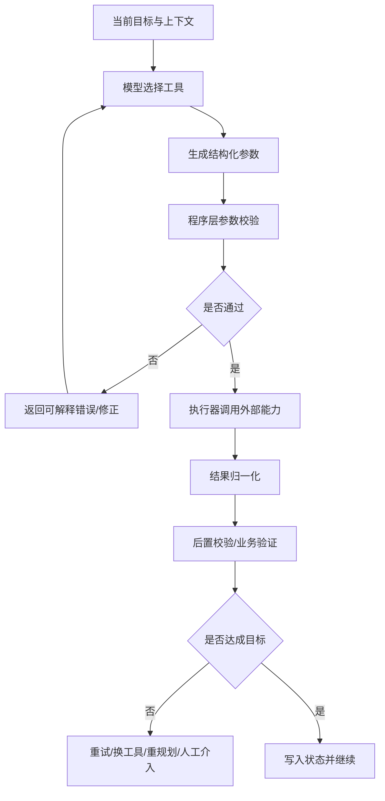

# 工具调用与协议

> **模块**：04_工具调用与协议/04_工具调用与协议.md  
> **构成**：5 个知识点合为一篇，按顺序编号  
> **规模**：约 4,372 行  |  **生成**：2026-11-12

## 目录

1. FunctionCalling与ToolSchema
2. ToolUse与Action执行
3. MCP
4. A2A与Agent互操作
5. Skills与插件化

---

## 1. FunctionCalling与ToolSchema

### 01 ★★★ 结构化输出与 Function Calling

> 阅读目标：搞清楚文本生成与可程序消费输出的差别，掌握 JSON Schema、Function Calling、工具执行循环与生产级防错方法。

#### 一、它真的很重要

如果说 Prompt Engineering 是让模型更像会做题，那么结构化输出与 function calling 则是让模型真正接进系统里。校招 Agent 岗位里，这一题几乎可以说是绕不开的，因为只要模型要和外部程序、数据库、搜索、日历、审批流或前端界面协同，它就不能只输出一段好看的自然语言，而必须输出稳定、可验证、可执行的结构。

面试官问这一题，核心在看四件事。

**第一，你是否知道输出合法 JSON和输出符合 schema 的 JSON不是一回事**。历史上很多人用 JSON mode，以为模型只要输出 parseable JSON 就够了。但真实工程里，你需要的是字段名、类型、枚举值、必填项都稳定一致，否则程序照样会崩。OpenAI 在 2024 年推出 Structured Outputs 时就明确区分：JSON mode 只保证是有效 JSON，不保证符合你给定的 schema；Structured Outputs 才是让模型严格对齐 schema。到 2026 年，Anthropic 的 structured outputs 也已 GA，Gemini 也有正式的 structured outputs 文档。这说明把输出变成机器可消费资产已经成为平台级能力，而不再是技巧。

**第二，面试官会看你是否理解 function calling 的本质。很多人会说function calling 就是模型帮我调函数。这句话不够准确。更准确的说法是：模型输出一个建议调用哪个工具、带什么参数**的结构；真正执行业务动作的是你的应用代码。也就是说，function calling 本质上是模型规划 + 程序执行的接口协议，不是模型自己直接跑外部世界。

**第三，面试官在看你有没有生产思维。**真实系统里，工具调用最大的风险不是调不出来，而是调错了还继续往下跑。所以你要会说：

- schema 要严格；
- 参数要验证；
- 高风险动作要审批；
- 工具失败要回传；
- 外部副作用要幂等；
- 不允许模型在没执行时谎称执行成功。  
一旦你能讲到这里，基本已经不再是懂 API，而是在讲 Agent 工程。

**第四，这一题还经常连着问多工具、并行工具、工具 schema 设计、工具选择策略、structured outputs vs function calling 的区别。**所以这里要学的不只是定义，而是一整套接口与工作流思维。

#### 二、概念拆解与区分


##### 1. 普通文本输出

模型输出自然语言，人读即可。适合聊天、写作、解释型内容，但不适合直接驱动程序。

##### 2. 结构化输出

模型按预定义 schema 输出 JSON/枚举/对象等结构。它更适合：

- 信息抽取；
- 分类；
- 审核结果；
- 表单生成；
- UI 渲染；
- 下游程序消费。

这里的重点是结构稳定，不是看起来像 JSON。

##### 3. Function Calling / Tool Calling

模型不直接给最终答案，而是输出：

- 要调用哪个工具；
- 工具参数是什么；  
然后由应用侧代码执行，并把结果再喂给模型。  
所以 function calling 更适合需要访问外部世界、实时数据或可执行动作的任务。

##### 4. Structured Outputs 与 Function Calling 的关系

它们既相关又不同。  
结构化输出关注最终输出长什么样；  
function calling 关注模型如何以结构化方式提出动作请求。  
很多平台把 tool schema 也建立在 JSON Schema 之上，因此两者底层思路越来越统一：都是用 schema 把模型自由文本空间收紧。

#### 三、为什么结构化输出这么重要

##### 1. 程序不消费差不多正确

人类读文本时能容忍字段名有点变体少个逗号我也懂这个枚举值写得像那个意思。程序不行。  
只要字段缺失、类型错误、枚举漂移、层级不对，下游系统就会失败。  
所以在应用系统里，可靠性来自可验证结构，不是可理解语义。

##### 2. 结构化输出能把任务从生成变成判定

一旦你把任务转成 JSON schema，很多问题就更容易被评估了。  
例如原来让模型总结用户问题意图，很难评；  
改成：

- intent；
- urgency；
- required_action；
- confidence；  
立刻就能算字段正确率、合法率、分布一致性。  
这对迭代和回归测试非常有价值。

##### 3. 结构化输出是 Agent 工作流的中间语言

很多 Agent 系统的本质，就是在多个步骤之间传递结构化状态：

- 计划；
- 子任务；
- 工具参数；
- 观察结果；
- 最终结论；
- 审批单。  
如果这些都只是自然语言段落，系统就很难稳。  
所以你可以把结构化输出看成 Agent 的中间表示。

#### 四、什么是好的 schema：面试真正拉开差距的地方

##### 1. 字段要贴近业务动作，而不是贴近原始文本

例如做工单路由，不要只定义一个 `summary` 字段；更好的 schema 可能是：

- `department`
- `priority`
- `category`
- `requires_human_review`
- `missing_information`
- `suggested_reply`

一个好的 schema 应该直接对应你的下游流程，而不是为了看起来完整。

##### 2. required / optional / nullable 要分清

很多结构化失败来自这三者混淆。

- required：字段一定要出现；
- optional：字段可以不出现；
- nullable：字段必须出现，但值可以是 null。  
校招面试如果你能主动说出这一点，会很加分，因为这体现了你考虑程序消费端的严谨性。

##### 3. enum 比自由文本更稳

如果下游只有 5 个合法路由部门，就应该用 enum，而不是让模型自由写部门名。  
能收紧的地方尽量收紧，模型自由度越大，漂移越大。

##### 4. additionalProperties: false 很有价值

OpenAI 结构化输出、很多 JSON Schema 最佳实践都强调这一点：如果你不希望模型输出多余字段，就应显式禁止。否则模型可能在好心补充时把 schema 撑歪。

##### 5. schema 不要为了通用而过度抽象

很多同学喜欢做一个超通用 schema，结果字段又多又虚，模型难学，下游也难用。  
更好的做法往往是：一个任务一个清晰 schema，必要时版本化，而不是试图用一个万能 schema 解决所有业务。

#### 五、Function Calling 的本质流程

OpenAI function calling 文档把流程概括得很清楚，核心一般分为五步：

1. 你把可用工具与 schema 发给模型；
2. 模型返回工具调用建议；
3. 应用侧代码执行工具；
4. 把工具结果回传给模型；
5. 模型给出最终答案，或者继续提出新的工具调用。

这五步里，真正容易出问题的不是第 2 步，而是第 3 步和第 4 步之间的衔接。因为一旦执行环境、权限系统、重试策略、幂等设计没做好，模型再聪明也救不了系统。

#### 六、Function Calling 的关键工程点

##### 1. 模型只决定建议调用，程序决定是否执行

这一句非常值得背。  
模型可以建议调用 transfer_money(amount=10000)，但是否真的转账，必须由程序做权限校验、额度校验、审批校验，必要时还要二次向用户确认。  
如果你在面试里能明确这句，基本就避开了 function calling 最大的认知坑。

##### 2. 工具描述要清晰，但不要冗长

工具 schema 设计常见错误是：

- 工具名模糊，如 `process_data`；
- 描述太短，模型分不清和别的工具区别；
- 描述太长，塞满实现细节，占上下文；  
一个好的工具定义应该清楚说出用途、输入、边界和限制，而不是堆 SDK 文档。

##### 3. 工具要做能力最小化

这和安全强相关。  
如果一个高风险动作可以拆成查询和执行两个工具，就不要一上来暴露能直接执行副作用的接口。  
例如：

- `get_balance`
- `create_transfer_draft`
- `confirm_transfer`  
比单一 `transfer_money` 更安全、更好控。

##### 4. 高风险动作必须有 approval / human-in-the-loop

Google 的 function calling 文档明确建议，对于有显著后果的函数调用，应在执行前做用户验证。  
这是一个非常好的面试加分点：  
**function calling 的可靠性不只靠 schema，还靠审批流和 side-effect guardrail。**

##### 5. 工具失败必须结构化回传

很多系统工具一报错，就只返回自然语言出错了。  
更好的方式是结构化返回：

- error_code；
- retryable；
- human_message；
- raw_detail（如有必要）；  
这样模型才更容易决定是重试、降级、换工具还是请人工介入。

#### 七、Structured Outputs vs JSON Mode vs Function Calling

这是校招面试里最容易被直接点名的问题。

##### 1. JSON Mode

保证模型输出可以被解析为 JSON。  
问题在于：它不保证字段齐全、不保证类型正确、不保证符合你的业务 schema。  
所以它更像一个最低门槛的语法约束。

##### 2. Structured Outputs

保证输出遵守你提供的 JSON Schema。  
OpenAI 官方文档明确把它定义为确保输出匹配 schema；Anthropic 在 2026-01 已把 structured outputs GA；Gemini 也在 2026-02 发布了正式 structured outputs 文档。  
这意味着如果你的任务本质是输出一个稳定对象，应优先考虑 structured outputs，而不是只开 JSON mode。

##### 3. Function Calling

关注的是让模型以结构化方式提出外部动作请求。  
它常用在需要实时信息、数据库、搜索、代码执行、系统操作时。  
如果任务只是抽取字段，不一定需要 function calling；  
如果任务需要查询订单、创建工单、调用搜索，就更适合 function calling。

##### 4. 一个非常实用的经验

- 纯抽取/分类：优先 structured outputs；
- 有外部动作：优先 function calling；
- 最终结果还要给前端/程序消费：最终答案也尽量结构化。

也就是说，很多真实工作流会同时用到两者：  
中间靠 function calling 调工具，最终靠 structured outputs 交付可消费结果。

#### 八、多工具、并行工具与工具选择

##### 1. 多工具场景常见难点

工具越多，模型越容易出现：

- 选错工具；
- 参数混淆；
- 工具 schema 占太多上下文；
- 明明需要组合工具却只调一个；
- 明明不该调工具却硬调。

所以多工具不是工具越全越好，而是工具集合是否最小、边界是否清楚、路由是否清晰。

##### 2. 并行工具调用

OpenAI 和 Anthropic 都在工具使用文档/工程文章里涉及并行或程序化工具调用。它的价值在于：当多个工具彼此独立时，可以并发执行，缩短总时延。  
但注意，并行调用只适合独立查询；有依赖关系的链式步骤不能强行并行。

##### 3. 工具搜索与按需装载

当工具非常多时，把全部 schema 每轮放进上下文会非常重。Anthropic 在 2025 年提出 tool search / programmatic tool calling，就是在解决大工具集上下文膨胀问题。  
这其实和 context engineering 是同一件事：不要在当前轮暴露不必要工具。

#### 九、生产级防错：这部分面试最能拉差距

##### 1. 校验先于执行

所有 function calling 输出都应该经过：

- schema 校验；
- 类型校验；
- 权限校验；
- 业务规则校验；  
通过后再执行。

##### 2. 幂等与重试

如果工具调用可能重试，就必须考虑幂等。例如创建订单、发消息、扣费这些动作，不能因为模型重复调用或网络抖动导致副作用重复发生。

##### 3. 显式记录 tool trace

要记录：

- 模型为什么选这个工具；
- 传了什么参数；
- 工具返回了什么；
- 最终答案如何利用了结果。  
这不仅方便排障，也方便后续做回放和评测。

##### 4. 不要把自由文本塞进高风险参数

能用 enum、ID、日期、受限字符串的地方，就不要让模型自由生成。  
这是降低错误执行率最有效的方法之一。

##### 5. 最终答案也要对齐工具真实结果

Agent 很容易犯的一个错是：工具失败了，但模型照样生成一个看似完成的自然语言答案。  
这类false claim of success非常危险，所以最终回答必须与工具真实返回绑定，而不是只凭模型主观推断。

#### 十、高频面试题与答题要点

##### 问题 1：什么是 function calling？

模型根据工具 schema 输出一个调用建议，包括工具名和参数；应用程序执行后再把结果反馈给模型。

##### 问题 2：function calling 和 structured outputs 的区别是什么？

前者主要解决如何发起外部动作/查询，后者主要解决如何稳定生成可程序消费的最终结构。

##### 问题 3：JSON mode 和 structured outputs 有什么区别？

JSON mode 只保证合法 JSON，structured outputs 还保证符合你给定的 schema。

##### 问题 4：模型会自己执行函数吗？

不会。真正执行函数的是你的应用代码，模型只负责输出调用意图和参数。

##### 问题 5：为什么 schema 设计很重要？

因为它决定模型自由度、参数合法率、下游解析成本和系统安全边界。

##### 问题 6：高风险工具如何设计？

应拆成查询、草稿、确认等多个阶段，并加审批或用户确认，避免模型直接触发不可逆副作用。

##### 问题 7：什么时候不该用 function calling？

当任务只是简单分类、抽取、打标签或生成最终 JSON，而不需要访问外部系统时，直接 structured outputs 往往更简单。

##### 问题 8：如何减少模型选错工具？

工具名和描述清晰、工具边界去重、减少同时暴露的工具数量、按需装载、提供高质量工具示例。

##### 问题 9：工具失败了怎么办？

结构化回传错误码和可重试信息，让模型决定重试、降级、换工具或请人工介入，绝不能默认成功。

##### 问题 10：并行工具调用的价值是什么？

当多个查询彼此独立时，可显著降低总时延；但要避免把有依赖关系的步骤错误并行。

最终答案与真实执行结果对齐。

#### 十二、常见误区

第一个误区，是把 function calling 理解成模型直接调用外部 API。  
真正执行的是应用层，不是模型本身。

第二个误区，是以为只要输出 JSON 就稳定。  
没有 schema 约束的 JSON 很容易字段漂移。

第三个误区，是把所有业务都塞进一个巨型工具。  
这会让工具选择困难、参数复杂、安全边界模糊。

第四个误区，是工具失败后只返回自由文本。  
这让模型很难稳定处理错误分支。

#### 十三、你应该记住的结论

如果只记一句话：  
**结构化输出解决的是模型结果怎么稳定接进程序，function calling 解决的是模型如何以受控方式请求外部能力。**

再记一句：  
**模型负责提出动作意图，程序负责校验与执行；高风险副作用绝不能直接交给模型自由决定。**

#### 资料来源与延伸阅读

##### 官方文档

1. OpenAI Structured Outputs  
[https://developers.openai.com/api/docs/guides/structured-outputs/](https://developers.openai.com/api/docs/guides/structured-outputs/)
2. OpenAI Function Calling  
[https://developers.openai.com/api/docs/guides/function-calling/](https://developers.openai.com/api/docs/guides/function-calling/)
3. OpenAI Responses API / 迁移指南  
[https://developers.openai.com/api/docs/guides/migrate-to-responses/](https://developers.openai.com/api/docs/guides/migrate-to-responses/)
4. OpenAI 2024 Structured Outputs 发布说明  
[https://openai.com/index/introducing-structured-outputs-in-the-api/](https://openai.com/index/introducing-structured-outputs-in-the-api/)
5. Anthropic Release Notes（Structured Outputs GA）  
[https://docs.anthropic.com/en/release-notes/overview](https://docs.anthropic.com/en/release-notes/overview)
6. Anthropic Tool Use / Prompt Engineering Overview  
[https://docs.anthropic.com/en/docs/build-with-claude/prompt-engineering/overview](https://docs.anthropic.com/en/docs/build-with-claude/prompt-engineering/overview)
7. Gemini Structured Outputs  
[https://ai.google.dev/gemini-api/docs/structured-output](https://ai.google.dev/gemini-api/docs/structured-output)
8. Gemini Function Calling  
[https://ai.google.dev/gemini-api/docs/function-calling](https://ai.google.dev/gemini-api/docs/function-calling)
9. Vertex AI Function Calling / Structured Output  
[https://docs.cloud.google.com/vertex-ai/generative-ai/docs/multimodal/function-calling](https://docs.cloud.google.com/vertex-ai/generative-ai/docs/multimodal/function-calling)  
[https://docs.cloud.google.com/vertex-ai/generative-ai/docs/multimodal/control-generated-output](https://docs.cloud.google.com/vertex-ai/generative-ai/docs/multimodal/control-generated-output)

##### Cookbook 与示例

1. OpenAI Cookbook: Structured Outputs Intro  
[https://developers.openai.com/cookbook/examples/structured_outputs_intro/](https://developers.openai.com/cookbook/examples/structured_outputs_intro/)
2. OpenAI Cookbook: Reasoning + Function Calls  
[https://developers.openai.com/cookbook/examples/reasoning_function_calls/](https://developers.openai.com/cookbook/examples/reasoning_function_calls/)

### 02 ★★★ Function Calling 与 Tool Schema

#### 这篇主要考察什么

Function Calling 是 Agent 系统里最容易被说得很浅的主题。很多候选人会说：模型识别到需要查天气，就调用 get_weather 函数。这句话当然没错，但只够及格。面试官真正想知道的是：

1. 你是否理解 **模型输出的是动作意图，而不是函数本身在执行**；
2. 你是否知道 **Tool Schema 是模型与系统之间的契约**，而不是随便写几个字段；
3. 你是否能解释 **Function Calling、Structured Outputs、JSON mode、Custom Tools** 的边界；
4. 你是否考虑过 **参数校验、错误恢复、权限控制、幂等保护、并行调用、副作用管理**；
5. 你是否知道在工具数量大、上下文紧张时，如何通过 **namespace、tool search、deferred loading、缓存友好设计** 做工程优化。

所以这道题的本质，是你会不会把模型的自由输出，变成受约束、可观测、可治理的系统动作。

面试里可以这么说

> 💡 Function Calling 本质上是让模型在自然语言推理之后，输出一个**符合预定义 schema 的动作请求**；真正的执行由应用侧完成。Schema 设计得越清楚，系统越稳；运行时控制得越严，副作用越安全。生产里要把它看成协议契约 + 执行循环 + 安全治理三件事，而不是一个方便的 API 小功能。

#### 一图看懂 Function Calling 的生产执行链


这张图里最容易被忽略的一点，是中间那一步schema 校验 / 权限检查 / 审批判断。很多 Demo 直接在收到 tool call 后就执行，但真正可上线的系统一定要在模型和外部副作用之间插一个受控 runtime。

#### Function Calling 到底解决什么问题

从系统设计角度看，Function Calling 解决的是**让语言模型用一种机器可解析、可校验、可执行的方式表达动作意图**。

如果没有 Function Calling，你通常会遇到下面几种糟糕情况：

- 模型输出我建议调用 search_orders(order_id=123)这类伪代码，你还得靠字符串解析；
- 模型用自然语言描述参数，结果日期、枚举、单位、时间区间都解析错；
- 工具越来越多以后，模型容易乱猜工具名、漏字段、字段拼错；
- 每个项目都写一套把模型输出转成函数参数的胶水代码，系统可维护性很差。

Function Calling 的价值，就在于把这些不确定性收敛成一个结构化接口：  
**模型只负责选哪个工具、填什么参数，应用负责能不能执行、什么时候执行、执行后怎么处理。**

你要特别强调：模型不会真正调用函数。函数是你的系统、容器、服务、数据库、第三方 API 在执行。模型只是在建议一个结构化动作。这句话在面试里非常重要，因为它直接体现你是否理解LLM 是控制面，不是数据面。

#### Tool Schema 是什么，为什么它比想象中更重要

Tool Schema 不是给机器看的注释，而是一个既给模型看、也给运行时看、还给开发者看的**动作契约**。它至少承担三层作用：

##### 第一层：给模型看，帮助模型正确选择工具

模型需要理解：

- 工具叫什么；
- 这个工具能做什么，不能做什么；
- 参数有哪些；
- 参数含义、单位、枚举值是什么；
- 哪些参数是必须的；
- 什么情况下应该调用，什么情况下不该调用。

这就是为什么 tool name、description、parameter description 都不能乱写。  
一个差的描述会直接导致模型选错工具；一个模糊的字段名会直接导致参数歧义。

例如，`query` 这个字段在一个搜索工具里可能表示用户原始查询，在另一个报表工具里可能表示SQL 过滤条件，如果不写清楚，模型经常会混。

##### 第二层：给运行时看，作为严格校验依据

在生产系统里，tool schema 不是提示词的一部分而已，它还是运行时做参数校验、权限治理和审计记录的基础。  
你至少要做到：

- 不允许未知字段悄悄混进来；
- 不允许必填字段缺失；
- 不允许字符串本应是枚举却随便写；
- 不允许日期、金额、ID、分页参数超出约束；
- 不允许模型绕过审批直接传危险参数。

如果你的运行时只把 schema 当作给模型参考，不拿它做真正校验，那么系统的安全性和可预测性会很差。

##### 第三层：给平台看，形成可复用的能力注册

当系统只有 3 个工具时，你可以在代码里手写；当系统有 30 个、300 个、3000 个工具时，你必须把 schema 当成资产。  
它会影响：

- 工具注册中心如何组织；
- namespace 如何拆分；
- 是否支持动态发现和延迟加载；
- 是否支持跨团队共享；
- 是否支持版本化、灰度、回滚；
- 是否支持自动生成 SDK、文档和测试用例。

所以，Schema 不是细节，而是整个能力平台的元数据入口。

#### 一个好 Tool Schema 应该长什么样

你可以从下面七条回答：

##### 1. 名字要像动作，不要像实现细节

好名字示例：

- `search_customer_orders`
- `get_invoice_status`
- `create_meeting_invite`

差名字示例：

- `tool1`
- `query`
- `run_api`
- `execute_order_service_v2`

原则是：模型理解的是语义，不是你的内部模块名。工具名要体现业务动作，而不是内部实现路径。

##### 2. description 要写边界，不要只写功能

差的 description：  
搜索订单信息。

更好的 description：  
按订单号、用户邮箱或时间区间检索订单。适合查询订单状态、发货时间和支付结果；不用于修改订单，也不用于模糊生成报表。

这种写法的好处在于，它告诉模型这个工具**适合做什么，不适合做什么**。很多误调用不是因为功能描述太少，而是因为边界描述太少。

##### 3. 参数名要业务语义清晰

`start_date` 比 `from` 清楚；  
`user_email` 比 `user` 清楚；  
`currency_code` 比 `currency` 清楚；  
`page_size` 比 `limit` 在很多业务里更容易懂。

校招生常见错误是把参数名写成后端实现风格，模型会更偏好业务语义明确的字段。

##### 4. 枚举和约束能写就写

如果一个字段只能是 `paid / pending / failed`，就不要让模型自由填字符串。  
如果分页上限是 100，就写在 schema 里；  
如果日期必须是 ISO 格式，也要约束。

这里的核心思想是：**能前移到契约层约束的问题，不要留到执行层兜底。**

##### 5. 严格模式比尽量解析更适合生产

现在主流平台已经支持更严格的 schema 约束。你在回答时要强调：  
生产里更推荐让模型输出严格匹配 schema，而不是让服务端写一堆容错解析 JSON的补丁代码。后者初期看起来灵活，长期却会把脏数据和隐性故障引进来。

一个很重要的工程点是：如果启用严格 schema，schema 本身也必须满足更严格要求，比如对象通常要显式禁止额外字段，并把字段必填关系描述完整。面试里说到这里，说明你不是停留在知道功能，而是关心它在生产里的可验证性。

##### 6. 把可选性、默认值、空值语义提前讲清楚

很多工具调用出错，不是字段缺了，而是有值 / 没值 / 用户没说 / 用户明确说不限四种语义混在一起。  
例如查询报销单：

- 用户没说时间范围；
- 用户说最近一个月；
- 用户说全部时间；
- 用户只说开始时间没说结束时间。

这些语义如果不在 schema 和调用约定中设计清楚，模型填参会反复出错。

##### 7. 工具返回值也应该结构化

很多人只关注入参，不关注出参。实际上，tool result 的结构化同样重要，因为它会影响模型下一步推理。  
一个好的 tool result 应该区分：

- 业务数据；
- 错误码 / 错误类型；
- 是否可重试；
- 是否需要用户补充信息；
- 是否需要审批；
- 是否包含敏感字段被脱敏。

如果工具返回一大段自由文本，模型下一步经常会误判状态、重复调用或忽略错误。

#### Function Calling、Structured Outputs、JSON mode、Custom Tools 的边界

这部分是高频考点，必须说清。

##### 1. Function Calling

适合场景：模型需要触发外部动作，或者访问应用侧工具。  
核心是：模型选工具并给参数，应用执行后再把结果喂回模型。

典型例子：

- 查数据库；
- 调外部 API；
- 执行搜索；
- 发起工单；
- 创建日程；
- 调 MCP server；
- 触发代码执行或 shell。

##### 2. Structured Outputs

适合场景：你想约束的是**模型最终给你的输出结构**，而不是要它调外部工具。  
比如：

- 把简历解析为结构化 JSON；
- 把用户请求抽成 DSL；
- 把客服意图输出为分类 + 槽位；
- 把审阅结果输出为固定 schema。

一句话记忆：  
**Function Calling 是输出动作；Structured Outputs 是输出结构。**

##### 3. JSON mode

JSON mode 只能提高输出像 JSON的概率，但不等于严格遵守你的业务 schema。  
所以在生产场景里，如果你真的要依赖结构稳定性，应该优先用更严格的 schema 机制，而不是只求它长得像 JSON。

##### 4. Custom Tools / Free-form Tools

有些场景下，工具的输入不适合被强行拆成很多字段，例如：

- 代码补丁；
- shell 命令；
- 正则表达式；
- SQL 草案；
- 长文本搜索表达式；
- 复杂脚本片段。

这时可以让模型输出一段自由格式文本交给工具。但你必须知道：自由度越高，校验难度越大，安全风险也越大。因此它更适合受控场景，如代码 agent、受限 shell、专门的 DSL 解析器，而不适合随意暴露给有副作用的业务系统。

#### 运行时如何执行一次安全的 Tool Call

面试时，建议你用下面这个执行循环来回答：

##### 第一步：把可用工具集合发给模型

这里不是把全世界工具都给模型。而是给它当前回合可用、当前租户可见、当前权限允许、当前业务阶段需要的工具集合。

你可以顺带讲两个工程点：

- 对大工具集，要做 namespace 或按场景裁剪；
- 如果平台支持动态工具发现或 tool search，可以避免一开始把所有 schema 塞进上下文，减少 token 和缓存失效。

##### 第二步：模型输出 tool call

模型会输出：

- 工具名；
- 参数对象；
- 有时会有多个调用；
- 有时会选择不调工具直接回答。

此时还不能直接执行，因为模型只是提出意图。

##### 第三步：运行时做校验与治理

这是最关键的一步。至少包括：

- **Schema 校验**：字段名、类型、枚举、必填、范围；
- **权限校验**：这个用户 / 租户 / 角色是否能执行；
- **业务校验**：比如会议时长上限、金额上限、目标环境限制；
- **审批校验**：删除、扣费、发通知、写生产库等危险动作是否需要人审；
- **幂等校验**：是否会重复执行；
- **上下文校验**：是否需要额外确认，比如是要给全部用户群发吗？；
- **安全校验**：是否存在 prompt injection 诱导危险调用。

##### 第四步：调用工具执行器

执行器通常不直接等于业务函数本体。更稳妥的设计是：

- 模型层只看到 tool schema；
- runtime 调用一个 tool executor；
- executor 再去访问内部 service / API / queue / database；
- 所有副作用、签名、超时、重试、日志都放在 executor 侧。

这样模型和内部系统之间有一个明确的隔离层。

##### 第五步：把工具结果作为结构化信息回填

不要只返回执行成功四个字。要让模型理解：

- 成功还是失败；
- 失败是什么类型；
- 是否可重试；
- 是否需要用户补充信息；
- 产物 ID 是什么；
- 是否已经产生副作用。

##### 第六步：让模型基于结果继续推理

模型可能：

- 直接给最终答案；
- 继续调用下一个工具；
- 请求用户补充信息；
- 发起审批；
- 结束当前任务但产出 artifact。

这就是典型的 tool loop。  
优秀的候选人会补一句：**tool loop 需要终止条件和最大步数上限，否则会进入错误的循环调用。**

#### Parallel Tool Calls 什么时候能开，什么时候该关

这也是高频追问。标准回答是：

##### 可以开并行的场景

- 多个只读查询，彼此独立；
- 多个数据源的聚合查询；
- 批量召回再 rerank 前的独立检索；
- 多个无副作用、无顺序依赖的工具。

例如：

- 同时查天气、交通、会议室空闲情况；
- 同时调用多个搜索源；
- 同时取用户画像、订单历史、会员等级。

##### 不该开并行的场景

- 有副作用的写操作；
- 后一步依赖前一步结果；
- 有共享资源竞争；
- 容易产生重复动作；
- 审批链条尚未完成。

例如：

- 同时创建工单和发送通知，但通知内容依赖工单 ID；
- 同时对同一订单做取消和退款；
- 同时更新配额和发放优惠券。

一句话记忆：  
**只读、独立、可交换的动作，适合并行；有副作用、有关联、有顺序的动作，默认串行。**

#### 工具很多时，为什么不能全塞给模型

这是现在越来越新的考法。因为工具规模一大，就会带来三类问题：

##### 1. 上下文成本变高

每个 tool schema 都占 token。工具一多，系统提示和工具定义本身就会吃掉大量上下文，影响真正业务内容。

##### 2. 选择精度下降

当大量工具描述彼此接近时，模型会更容易选错。例如：

- `search_customer_orders`
- `search_orders_by_status`
- `query_order_summary`
- `lookup_order_details`

这些工具如果都长得差不多，模型的选择负担会明显上升。

##### 3. Prompt caching / KV cache 更容易失效

如果每一轮都把一大坨工具定义重新发给模型，缓存命中率会受影响。现在很多平台开始提供 tool search、延迟加载和 namespace 机制，本质上就是在解决大工具集的成本和稳定性问题。

所以你可以给一个很工程化的回答：  
**小工具集适合静态注册；大工具集应该分 namespace、按场景裁剪，必要时做动态发现或延迟加载。**

#### 安全：为什么 Function Calling 是 Agent 风险的第一入口

Function Calling 能让模型连接世界，也就意味着它会成为风险入口。面试官如果问安全，不要只说做一下参数校验，要从五层讲：

##### 1. 能力最小化

不要把不需要的工具暴露给当前任务。  
用户只是问订单状态，不该把批量退款导出全部客户数据也给模型。

##### 2. 参数最小化

Schema 不要暴露危险自由度。  
例如删除文件工具不要让模型任意传绝对路径；SQL 工具不要直接让模型写裸 SQL 到生产库。

##### 3. 执行隔离

工具最好经过 sandbox、proxy 或 service layer，而不是让模型直接连内网高权限系统。

##### 4. 人审与审批

有副作用、高风险、跨租户、越权级别高的动作，必须可中断并要求 human-in-the-loop。

##### 5. 审计与回放

每次工具调用都要能追溯：

- 谁触发的；
- 模型当时看到了什么；
- 选了哪个工具；
- 传了什么参数；
- 运行时做了哪些校验；
- 最终是否执行成功；
- 是否产生了副作用。

如果你能答到Function Calling 的最大风险不是参数格式错，而是模型把不该执行的动作合法化，通常会给面试官留下很好的印象。

#### 常见失败模式

##### 失败模式 1：工具描述太短，模型老是选错

症状：模型总是调用相似工具中的错误一个。  
根因：description 只写了查询订单，没有写适用边界。  
修复：把能做什么 / 不能做什么 / 什么时候用写清楚。

##### 失败模式 2：Schema 太松，解析端补丁越来越多

症状：后端写一堆 if-else 修字段名、补默认值、猜枚举。  
根因：把宽松误当成鲁棒。  
修复：严格 schema + 明确错误返回 + 让模型重新填参，而不是后端偷偷猜。

##### 失败模式 3：工具返回自由文本，模型误判下一步

症状：工具失败了，但模型以为成功继续往下走。  
根因：tool result 不结构化。  
修复：显式返回 status / error_type / retryable / artifact_id 等字段。

##### 失败模式 4：模型可以直接执行高风险动作

症状：用户一句 prompt injection，模型开始调用危险工具。  
根因：运行时没有审批和权限边界。  
修复：把敏感工具放进 approval gate，动作前强校验。

##### 失败模式 5：重复调用导致重复副作用

症状：同一邮件发了两次、同一订单扣了两次。  
根因：没有幂等键，或者失败重试与成功返回混淆。  
修复：副作用工具必须有幂等策略和去重记录。

#### 高频面试题与标准回答

##### 1. Function Calling 和普通 prompt 输出 JSON 有什么区别？

标准回答：普通 prompt 输出 JSON 依然是自由生成文本，系统通常还要自己解析和容错；Function Calling 则把模型输出约束到工具名和参数 schema 上，更适合承载外部动作。生产里二者最大的区别是：前者更像格式约束，后者更像动作契约。

##### 2. Structured Outputs 和 Function Calling 怎么选？

标准回答：如果我要的是最终答案的结构，用 Structured Outputs；如果我要的是让模型触发外部能力，用 Function Calling。前者约束输出，后者组织执行。

##### 3. 什么时候不能相信模型生成的参数？

标准回答：任何涉及副作用、权限边界、金额、资源 ID、系统命令、生产环境写入的参数都不能只因为看起来合法就直接执行，必须经过 schema 校验、业务校验和权限校验。

##### 4. 为什么副作用型工具要更严格？

标准回答：查询类工具最多影响结果正确性，副作用型工具会改变外部世界，一旦重复执行、越权执行或顺序错误，代价更大。因此副作用工具要默认串行、默认幂等、默认可审计、必要时需要审批。

##### 5. 如果模型连续两次都选错工具怎么办？

标准回答：不要盲目继续试。应该从三层排查：第一看 schema / description 是否有歧义；第二看 runtime 是否给了过多相似工具；第三看是否要增加一个上游 routing / tool selection 阶段。必要时加 tool choice 限制、namespace 或更强的场景裁剪。

##### 6. Tool Schema 设计里最重要的一条经验是什么？

标准回答：把业务边界写进 schema，而不是只写字段。模型最怕的不是字段多，而是边界模糊。

##### 7. 为什么工具结果最好也做 schema？

标准回答：因为工具结果不是给人看的说明文，而是给模型作为下一步决策依据。如果结果结构化，模型更容易判断是否继续、是否重试、是否向用户追问。

##### 8. 当工具很多时，你怎么优化？

标准回答：按业务域拆 namespace，按场景裁剪工具集合；对超大工具集使用延迟加载 / tool search；尽量稳定高频工具定义，提升缓存命中；减少近义工具，防止模型混淆。

##### 9. Function Calling 最大的工程价值是什么？

标准回答：它把模型与系统之间的接口标准化了。这样我们可以把校验、权限、日志、审批、幂等和回放都统一放到 runtime 层，而不是散落在每个 prompt 和每个业务函数里。

##### 10. Function Calling 最大的风险是什么？

标准回答：模型通过看起来结构化的方式触发高风险动作。如果系统把 schema 合法误当成业务合法，就会把安全问题从自然语言层搬到结构化调用层，风险并没有消失。

#### 项目回答模板

你可以这样讲一个自己的项目：

> 💡 在我们的 Agent 项目里，模型不会直接访问后端服务，而是通过 Function Calling 输出结构化动作。我们先按业务域注册工具，比如检索、工单、日程和通知，每个工具都定义清晰的 name、description 和参数 schema。运行时收到 tool call 后，不会立刻执行，而是先做 schema 校验、权限判断和审批判断。对查询类工具我们允许并行，对副作用类工具默认串行并带幂等键。工具执行结果也不是一段自由文本，而是返回结构化状态和业务字段，方便模型决定下一步是继续调用、向用户追问还是直接结束。工具规模大了之后，我们又引入 namespace / 动态裁剪，避免把全部工具都塞进上下文，降低 token 成本并提高选工具准确率。整个过程都打 trace 和审计日志，这样遇到误调用时可以回放到具体的 schema、参数和执行链路。

既有概念，也有工程细节，还带上了 trade-off 和治理视角。

#### 你在面试里最值得主动补充的观点

第一，**Function Calling 不是让模型会编程，而是让模型会表达受控动作。**

第二，**Tool Schema 的设计质量，直接决定模型是否懂你的系统。**

第三，**生产系统的关键不在于模型会不会调工具，而在于 runtime 会不会拒绝不该执行的工具。**

第四，**工具调用是 Agent 可靠性的第一层地基。** 上层再复杂的 Planning、Memory、Multi-Agent，如果底层 tool contract 混乱，系统就不可能稳定。

#### 小结

把这篇内容浓缩成三句话，就是：

1. Function Calling 让模型输出结构化动作意图，真正执行在应用侧；
2. Tool Schema 是动作契约，既服务模型理解，也服务运行时校验和平台治理；
3. 生产可用的关键不在调起来，而在调得准、调得稳、调得可控、调得可审计。

如果你能把这三句话展开成完整的工程回答，这一题在校招面试里通常已经足够强。

#### 延伸阅读（OAI官方为主）

- [OpenAI Function Calling](https://developers.openai.com/api/docs/guides/function-calling)
- [OpenAI Structured Outputs](https://developers.openai.com/api/docs/guides/structured-outputs)
- [OpenAI Tool Search](https://developers.openai.com/api/docs/guides/tools-tool-search)
- [OpenAI Skills](https://developers.openai.com/api/docs/guides/tools-skills)
- [OpenAI Agents SDK](https://openai.github.io/openai-agents-python/)

### 补充 · Function Calling 是怎么训练出来的（B 套）

> 来源：购买资料 B（原文第 1475–1511 行）

#### 5 Function Calling

（Function call的能力其实一直都是 Agent非常重要的考点，虽然在实际面试中考察的并不是特别多，以下两个问题是来自于某次面试原题）

##### 5.1 Function calling是如何被训练出来的

Function calling是通过在模型训练的**预训练阶段**使用**自监督学习**，在**微调阶段**使用**SFT技术**，以及在**对齐阶段**使用**RLHF技术**来使模型具有能够理解用户意图并生成函数结构化的函数调用请求的能力。

具体来讲：

预训练阶段的自监督学习使得模型能够理解自然语言。

微调阶段的SFT技术使用标注数据让模型理解何时该调用函数，调用函数的格式是什么。

对齐阶段使用RLHF，使用人类的反馈来优化调用结果，使模型的调用更符合人类的习惯。

 

##### 5.2 工具调用失败问题

在使用一些Function call的接口设计的时候，如果参数比较多，实际使用中发现LLM调用失败（可能是没理解调用的时机）或者是缺少了必填的参数（导致调用失败），这个应该如何避免呢？

1.**重构函数设计：**《代码整洁之道》中就写过，函数参数最理想的是0个，其次是1，再次是2，我们应该尽量避免有3个及以上的参数，所以出现这种情况我们可以先考虑是否有必要重构。

2.**可以拆分函数：**让函数满足单一职责的原则，避免有过多的参数。

3.**优化JSON Schema设计：** 在JSON Schema中清晰地标明参数类型，是否必填，默认值，写清楚参数描述。

4.**优化函数/参数命名：** 让命名更具有描述性，便于LLM理解。

5.**优化提示词设计：**可以在提示词中加入一些引导，给出一些调用示例。

6.**可以增加一些验证，反馈，重试机制：**比如在调用前对参数进行验证，判断是否有误，如果调用失败，可以把失败的信息传回给LLM，让它利用这个信息重试。

---

---

### 来源档案（原始文件，仅供溯源）

- `07_Agent八股整理/00_LLM与大模型应用基础/06_07 结构化输出与 Function Calling（重要）.md`
- `07_Agent八股整理/03_协议-runtime-工程化/01_01 Function Calling 与 Tool Schema（重要）.md`

## 2. ToolUse与Action执行

### 一、tool use就是agent loop的核心

很多人学 Agent 时最先关注的是 prompt、推理、planning，但面试官在真实工程岗位上往往更看重另一个层面：**Agent 是如何和外部世界发生可靠交互的。** 这就是 Tool Use 与 Action Execution。  
如果说 planning 解决的是应该做什么，那么 tool use 解决的是怎样真正做成。这也是为什么在企业里，一个会思考但不会稳定执行的 agent，往往价值远低于一个思考一般但动作可靠的系统。

从工程角度看，工具使用是 agent 失败最常见的地方之一。不是模型不会选工具，就是参数填错；不是工具返回异常，就是接口超时；不是动作有副作用无法幂等，就是结果校验不充分导致误操作。面试官问这部分，往往是在看你有没有从模型层切换到系统层的意识。你如果只回答让模型调函数就行，基本就是送分题没拿到。

真正成熟的回答应该覆盖完整链路：工具如何描述，模型如何选择，参数如何约束，执行器如何运行，结果如何验证，失败如何重试，副作用如何控制，权限如何收口，历史如何记录，何时并行，何时人工确认。

### 二、先把问题说清楚：Tool Use 到底是什么

Tool Use 可以理解为：**让模型在文本生成之外，主动调用结构化外部能力，以便完成信息获取、计算、操作和控制类任务。**  
这些外部能力通常包括三大类：

#### 1. Data tools

数据类工具，用于拿信息。  
例如搜索、数据库查询、文档检索、向量检索、知识库、业务系统查询、网页读取等。  
这类工具通常副作用较小，是最常见的 agent 工具类型。

#### 2. Action tools

动作类工具，用于改世界。  
例如发邮件、创建工单、更新 CRM、执行 SQL 写操作、修改文件、触发审批、调用第三方系统 API、提交代码、点击网页按钮等。  
这类工具价值很大，但风险也高，因为它们有副作用。

#### 3. Orchestration tools

编排类工具，用于组织其他能力。  
例如创建子任务、唤起 sub-agent、暂停等待人工审批、提交到队列、触发 workflow 节点、切换角色等。  
这类工具把做某件事提升成组织系统如何运行。

面试时很加分的一句话是：**工具不只是查资料的能力，它也是模型与程序世界的接口层。**

### 三、Tool Use 的标准链路：从选择到执行再到观察

一个完整的工具使用过程，至少包含下面几个环节：

#### 1. Tool selection

模型判断当前目标最适合用哪个工具。  
这一步的难点是：

- 工具太多时，选择空间会变大；
- 工具描述不清时，模型容易误用；
- 相近工具同时存在时，容易路由错误。

#### 2. Argument grounding

模型根据当前上下文生成工具参数。  
很多线上问题都出在这里。  
例如用户说最近，到底是过去 7 天、30 天还是自然月；用户说帮我发给老板，系统能否正确解析联系人；搜索关键词如何构造；SQL 条件是否遗漏租户隔离。

#### 3. Pre-execution validation

参数在真正执行前应由程序层校验。  
这一步非常关键。不能把模型输出的参数直接视为可信输入。  
典型校验包括：

- 类型检查；
- 必填字段检查；
- 枚举值检查；
- 权限范围检查；
- 跨字段逻辑检查；
- 风险级别判断。

#### 4. Execution

执行器真正调用外部能力。  
执行时可能涉及：

- 重试策略；
- 超时；
- 幂等键；
- 事务；
- 限流；
- 沙箱；
- 资源隔离；
- 审计日志。

#### 5. Observation normalization

工具返回结果后，需要把原始响应转换成模型更好消费的形式。  
不能一股脑把几百行 JSON 全喂回去。  
通常要做：

- 关键字段提取；
- 状态码归一化；
- 错误类别映射；
- 证据摘要；
- 大结果分页或摘要。

#### 6. Post-execution verification

执行完不代表任务就真的完成。  
例如发邮件工具返回 success，不代表收件人正确；数据库更新执行成功，不代表业务逻辑正确；网页点击没有报错，不代表页面真的发生了预期变化。  
所以很多系统会在执行后加入 verifier 或二次检查。

### 四、工具 schema 怎么设计：这是高频追问

面试官特别喜欢问：Function calling 的 schema 怎么设计？这题答得好非常加分。

#### 1. 工具名称要明确

不要叫 `do_task`、`process_data` 这种含糊名字。  
工具名应该让模型一眼知道边界，例如：

- `search_public_web`
- `query_customer_order`
- `create_refund_request`
- `send_email_draft`

#### 2. 描述要强调边界和适用条件

工具描述不应只是用于搜索。更好的写法是：

- 什么时候该用；
- 什么时候不该用；
- 参数来源是什么；
- 是否有副作用；
- 是否需要审批。

#### 3. 参数要尽量结构化

不要把一堆自由文本塞进一个 `input` 字段。  
越结构化，模型越容易稳定生成，程序也越容易校验。  
例如把邮件发送拆成：

- `to`
- `cc`
- `subject`
- `body`
- `require_approval`

而不是一个大字符串。

#### 4. 把约束前置到 schema

如果某个字段只能取枚举值，就不要让模型自由发挥。  
如果某字段必须是 ISO 日期格式，就明确约束。  
如果某动作只允许当前租户资源，就在参数设计或执行层强约束，而不是靠提示词提醒。

#### 5. 明确副作用和幂等要求

例如：

- 发送类动作是否支持 dry-run；
- 创建类动作是否要求 client_request_id；
- 更新类动作是否支持 version check；
- 删除类动作是否必须人工确认。

一个很成熟的回答是：**schema 不是给模型看的说明书，它同时也是给执行器做安全控制和参数校验的合同。**

### 五、工具选择为什么会错：根因分析

#### 1. 工具集合过宽

什么都给模型，它反而更难选。  
工程上应该按场景暴露最小必要工具集。

#### 2. 工具定义重叠

两个工具都能查用户信息，但一个查 CRM，一个查订单系统。  
如果描述不清，模型很容易混用。

#### 3. 工具语义与用户语言错位

用户说帮我看看最近的销售情况，模型可能需要把自然语言映射成特定业务指标、时间粒度、区域过滤。  
如果没有中间规范化层，参数很容易歪。

#### 4. 缺乏反馈

如果工具调用失败后，系统只返回调用失败，模型很难知道错在哪里，也就难以修正。  
工具返回需要携带足够的错误语义，例如权限不足、参数缺失、资源不存在、暂时超时等。

### 六、Action Execution：为什么执行器不是简单调个 API

工具设计得再好，没有执行器治理也不行。执行器本质上是 agent 和现实世界之间的安全门。

#### 1. 幂等性

对有副作用的动作，比如发邮件、创建工单、下单、记账，必须考虑重复执行。  
常见做法包括：

- client_request_id
- 幂等键
- 事务日志
- 写前去重
- 重试时只允许在幂等窗口内重放

#### 2. 重试策略

不是所有错误都适合自动重试。  
需要区分：

- 瞬时错误：如网络超时、限流，可重试；
- 参数错误：不应盲目重试，应修正参数；
- 权限错误：需要升级权限或人工介入；
- 业务规则错误：应停止并反馈。

#### 3. 超时与取消

长动作如果没有超时和取消机制，agent 很容易被卡死。  
特别是外部 API、浏览器、代码执行、文件读写，都需要时间边界。

#### 4. 事务与回滚

对多步副作用动作，最好能设计事务边界。  
比如创建草稿—上传附件—发送，如果中间某步失败，是否可回滚到草稿态？  
如果完全不可回滚，就要在更早阶段做审批和 dry-run。

#### 5. 沙箱与资源隔离

对代码执行、文件系统、浏览器操作，更要限制：

- 网络访问；
- 文件范围；
- CPU / 内存；
- 可调用命令；
- 持久化能力。

### 七、并行 Tool Use：收益很大，但不是免费午餐

很多候选人听到 parallel tool calls 会很兴奋，但面试官更想听到取舍。

#### 并行的收益

- 降低总时延；
- 更适合独立数据源抓取；
- 提高整体吞吐；
- 适合 DAG 型任务执行。

#### 并行的风险

- 参数依赖关系搞错会导致错误结果；
- 副作用动作并行可能引发一致性问题；
- 上下文中很难同时消费过多并发结果；
- 并发过高会引发限流、成本飙升和调试困难。

#### 适合并行的场景

- 多来源检索；
- 多文档摘要；
- 独立 API 查询；
- 批量数据分析。

#### 不适合并行的场景

- 有强顺序依赖的任务；
- 会修改共享状态的动作；
- 需要人工审批的关键路径；
- 高风险事务链路。

### 八、面试高频点：如何防止工具误调用和越权

这是几乎必追问的生产问题。

#### 1. 最小权限原则

每次任务只暴露必要工具，不要把整个工具宇宙都交给模型。

#### 2. 工具分级

可把工具分为：

- 只读低风险；
- 写操作中风险；
- 高风险破坏性操作。  
不同级别对应不同审批和日志要求。

#### 3. 参数白名单与租户隔离

工具不是只校验字段类型，还要校验是否属于用户有权访问的资源范围。

#### 4. 审批前置

对于发送、支付、删除、发布等动作，最好提供 dry-run 和人工确认。

#### 5. 二次确认与结果复核

某些操作即使执行成功，也要要求 verifier 再判断结果是否合理。

#### 6. 审计记录

要能回答下面这些问题：

- 谁触发了任务；
- 模型选择了哪个工具；
- 参数是什么；
- 程序校验后变成什么；
- 最终执行结果怎样；
- 是否有人类审批；
- 是否发生重试或回滚。

### 九、Tool Use 与 Prompt / Context Engineering 的关系

这里非常容易答浅。成熟回答应该是：

1. Prompt 决定模型是否知道什么时候用工具；
2. Context 决定模型能不能拿到足够信息正确填参数；
3. Schema 决定模型输出是否稳定可校验；
4. Executor 决定动作能否可靠、安全地落地；
5. Verifier 决定系统是否知道这一步到底做成了没有。

所以 Tool Use 绝不是加一个 function calling 开关，而是从 prompt 到 runtime 的全链路设计。

### 十、典型失败模式

#### 失败模式一：工具太多，模型不会选

解决：按任务裁剪工具集，做分层路由。

#### 失败模式二：工具描述含糊，模型乱填参数

解决：重写 schema、增加示例、减少自由文本字段。

#### 失败模式三：程序对参数完全信任

解决：执行前强校验，不可信输入全部经过正规化。

#### 失败模式四：副作用动作缺少幂等

解决：引入 request_id、事务日志、状态检查。

#### 失败模式五：工具返回过于原始

解决：结果归一化与摘要，让模型读得懂重点。

#### 失败模式六：执行成功但业务失败

解决：增加 post-check，不只看 HTTP 200。

### 十一、Mermaid 图：工具使用执行链路



### 十二、高频面试题与参考回答

#### 题 1：什么是 Tool Use？

参考回答：  
让模型通过结构化接口调用模型外能力，完成信息获取、计算、操作和系统控制等任务。

#### 题 2：为什么工具是 agent 的核心？

参考回答：  
因为没有工具，模型大多只能生成文本；有了工具，agent 才能读取外部信息、执行动作并真正影响现实世界。

#### 题 3：工具 schema 怎么设计更稳定？

参考回答：  
名称清晰、边界明确、描述具体、参数结构化、约束前置、风险和副作用显式化，尽量减少模糊自由文本。

#### 题 4：为什么不能直接执行模型生成的参数？

参考回答：  
因为模型输出不应被视为可信输入，必须经过类型、权限、业务规则和租户边界等多层校验。

#### 题 5：副作用动作最重要的工程点是什么？

参考回答：  
幂等性、审批、审计、回滚设计和 post-check。仅仅调用成功不等于业务成功。

#### 题 6：什么时候适合并行 tool call？

参考回答：  
多个查询彼此独立、无共享副作用、结果可后续统一归并时。

#### 题 7：什么时候不适合并行？

参考回答：  
存在严格依赖关系、会修改共享状态、有高风险副作用或需要逐步验证时。

#### 题 8：如果模型总是选错工具怎么办？

参考回答：  
缩小工具集、重写描述、做上层路由、提供高质量示例，并分析错误是语义重叠还是参数映射问题。

#### 题 9：如何防止越权操作？

参考回答：  
最小权限、租户隔离、参数白名单、高风险审批、执行器强校验和完整审计。

#### 题 10：一句话总结 Tool Use 的本质？

参考回答：  
它是模型决策能力与程序执行能力之间的合同层和安全门。

### 十三、面试速记版

- Tool Use 不是会调函数，而是完整的选择—校验—执行—验证链路。
- 工具可分数据类、动作类、编排类。
- Schema 既是给模型看的，也是给执行器做安全控制的合同。
- 模型参数输出永远不是可信输入。
- 副作用动作必须考虑幂等、审批、回滚和审计。
- 并行调用有收益，但会带来一致性和调试成本。
- 工具层的可靠性，往往决定 agent 是否能上线。

### 参考资料与延伸阅读

1. Anthropic，《Building effective agents》，2024。适合用来界定 agent 与 workflow 的边界，强调能用简单工作流解决时不要过度 agent 化。
2. Anthropic，《Effective context engineering for AI agents》，2025。非常适合补充agent 不只是 prompt engineering，而是 context engineering的近年观点。
3. Anthropic，《How we built our multi-agent research system》，2025。适合放在多 agent、任务拆解、subagent 协作章节中。
4. OpenAI，《A practical guide to building agents》，2025。适合用作工具类型、agent 运行循环、单 agent 优先、多 agent 何时有意义的工程基线。
5. LangChain / LangGraph 官方文档，《Workflows and agents》《Multi-agent》《Human-in-the-loop》《Interrupts》《Durable execution》。
6. Yao et al., *ReAct: Synergizing Reasoning and Acting in Language Models*, 2023。
7. Wang et al., *Executable Code Actions Elicit Better LLM Agents (CodeAct)*, 2024。
8. Yao et al., *Tree of Thoughts*, 2023。
9. Kim et al., *An LLM Compiler for Parallel Function Calling*, 2024。
10. Erdogan et al., *Plan-and-Act: Improving Planning of Agents for Long-Horizon Tasks*, 2025。
11. Schick et al., *Toolformer*, 2023。
12. Packer et al., *MemGPT*, 2024。
13. Park et al., *Generative Agents*, 2023。
14. Shinn et al., *Reflexion*, 2023。
15. Wu et al., *AutoGen*, 2023。
16. Cemri et al., *Why Do Multi-Agent LLM Systems Fail?*, 2025。适合补充多 agent 失败模式。
17. Mialon et al., *GAIA: A Benchmark for General AI Assistants*, 2023。适合在为什么 agent 需要工具、规划、执行时做 benchmark 背景延伸。

## 3. MCP

### 01 ★★★ MCP 原理与实践

#### 这篇主要考察什么

MCP 是这两年 Agent 面试里非常容易被问到、也非常容易被答虚的一道题。很多同学会说：MCP 就是统一工具接入标准。这句话方向没错，但太薄。面试官真正想考的是：

1. 你是否知道 MCP 想统一的不只是调工具，而是 **AI 应用如何连接外部系统、资源、提示和工作流能力**；
2. 你是否理解 MCP 的核心角色不是一个 server，而是 **host / client / server 三者协作**；
3. 你是否知道 MCP 为什么要有 **生命周期、能力协商、传输层、认证框架、资源与工具区分**；
4. 你是否明白 MCP 和传统 HTTP API、自定义 function calling、A2A 的边界；
5. 你是否能讲清楚本地 stdio、远程 HTTP、网关代理、多租户隔离、审计和安全落地模式。

所以这道题不是背诵名词，而是考察你是否具有**协议意识**。协议意识强的人，面对生态演进时会思考可移植性、互操作性和治理成本；协议意识弱的人，往往只会在单项目里写私有 glue code。

面试一句话版本：

> 💡 MCP（Model Context Protocol）本质上是一个连接 AI 应用与外部系统的开放协议。它把能力如何被发现、描述、协商、调用、授权和返回标准化了，使工具、资源和提示不必为每个模型平台各写一套接入方式。小项目可以不用 MCP，但一旦你想做跨应用复用、跨团队共享、生态互通和企业级治理，MCP 的价值会迅速放大。

#### 为什么 MCP 会出现

如果你只在一个项目里、只接一个模型、只写几个工具，那么 Function Calling 已经足够好用。问题出在规模和生态一增长，私有方案会出现四个明显痛点：

##### 1. 每个平台都要接一遍

假设你写了一个企业知识库检索能力。  
如果没有统一协议，你可能要分别为：

- OpenAI 的 function calling；
- Anthropic 的 tool use；
- 某个 IDE 插件系统；
- 某个内部 agent runtime；
- 某个桌面客户端；

都写一套适配层。能力本身没变，胶水代码却复制了很多份。

##### 2. 能力描述不可迁移

不同系统对工具描述、资源发现、认证、版本、流式返回、订阅更新的要求不一致，导致你的能力难以在别的宿主里复用。  
也就是说，能力资产无法沉淀成可插拔模块，只能沉淀成和某平台强绑定的一份实现。

##### 3. 上下文和资源接入缺少统一抽象

很多真实能力并不是一个函数，而是：

- 一组可以浏览的资源；
- 一类参数化模板；
- 一个需要订阅变化的数据源；
- 一个需要代理认证的远程服务；
- 一个由宿主提供根目录 / 工作区上下文的能力。

如果只用函数 + 参数抽象，会显得很勉强。

##### 4. 企业治理成本越来越高

一旦涉及：

- 多租户；
- 多模型平台；
- 外部 SaaS；
- 内部敏感系统；
- 审计和审批；
- 认证与授权；
- 代理和网关；
- 版本兼容；

私有协议很快就会变成平台债务。  
MCP 的价值，正是在于把这些每家公司都要重新发明一次的问题标准化。

#### 一图看懂 MCP


一句话解释这张图：  
**Host 是宿主应用，MCP Client 是宿主里的协议适配层，MCP Server 是能力提供方。协议本身定义的不是某个具体工具，而是三者之间如何发现能力、协商能力、调用能力和处理结果。**

#### MCP 的核心角色：Host、Client、Server

这是高频基础题，必须清楚。

##### 1. Host

Host 指最终承载模型交互的应用环境，例如：

- Chat 产品；
- IDE / AI 编程工具；
- 企业内部 Agent 平台；
- 桌面应用；
- 浏览器插件；
- 任何会把模型和外部能力连接起来的宿主。

Host 的职责不是直接理解 MCP 协议细节，而是把我需要连接哪些能力、给模型暴露哪些上下文、当前用户有何权限这些事情管理起来。

##### 2. MCP Client

MCP Client 是 Host 里负责说 MCP 协议的那一层。  
它的职责包括：

- 连接 server；
- 发起初始化和能力协商；
- 列出 tools / resources / prompts；
- 处理调用请求和返回结果；
- 管理认证；
- 处理日志、错误、事件、通知。

面试中一个很容易加分的点是：**Client 并不等于模型。**  
模型只是通过 Host / Runtime 间接利用这些能力；真正跟 server 说话的是 client 这一层。

##### 3. MCP Server

MCP Server 是能力提供方。它可以暴露：

- **Tools**：让模型可以发起动作；
- **Resources**：让应用 / 模型可以读取外部上下文；
- **Prompts**：让能力提供方把一段可参数化的提示逻辑标准化输出。

你可以把它理解成能力适配器，但又比传统 adapter 更强，因为它不是某个平台私有插件，而是一个面向开放生态的标准服务端接口。

#### MCP 不只是 Tools：Tools、Resources、Prompts 分别是什么

这部分面试特别喜欢问，因为很多人只知道 tools。

##### 1. Tools：模型驱动的动作能力

Tools 是 MCP 里最接近 Function Calling 的部分。  
特点是：模型可以选择并调用它，通常用于触发动作，例如：

- 搜索；
- 查询数据库；
- 调 API；
- 执行脚本；
- 创建工单；
- 修改任务状态。

一句话记忆：  
**Tool 更偏做事。**

##### 2. Resources：标准化上下文入口

Resources 提供的是可读取的上下文资源，通常由应用侧主动获取或挂载，例如：

- 文件内容；
- 数据库表快照；
- 文档页面；
- 项目元数据；
- 仓库状态；
- 可订阅更新的资源流。

MCP 明确区分 resource 和 tool，很重要，因为不是所有外部能力都适合建模成动作调用。很多时候你只是要把某些上下文安全、标准地提供给模型或宿主，而不是触发执行。

一句话记忆：  
**Resource 更偏给上下文。**

##### 3. Prompts：可参数化的提示模板

Prompts 允许 server 暴露一些可参数化的 prompt 模板。  
听起来像小事，但它对平台化很重要，因为很多团队不是只输出一个函数，而是希望把：

- 分析模板；
- 审核模板；
- 代码修复模板；
- 特定领域任务模板；

作为可复用资产暴露出去。这样，能力的边界不再只是能做什么动作，还包括能提供什么结构化 prompt 入口。

一句话记忆：  
**Prompt 更偏给方法。**

#### MCP 和 Function Calling 的关系

面试里千万别把它们讲成对立关系。更准确的说法是：

- Function Calling 解决的是 **模型如何表达动作意图**；
- MCP 解决的是 **外部能力如何被标准化暴露给 AI 应用**。

所以它们经常是配合关系，而不是替代关系。  
你可以把 MCP server 暴露的 tools，最终映射成模型可调用的工具；也可以把远程 MCP server 当成一种能力来源，让 runtime 以统一方式接入。

如果面试官追问那为什么不只用 Function Calling 就好，你可以这样答：

> 如果只有单应用、少量工具、没有生态互通诉求，只用 function calling 完全可以；但一旦你要跨宿主、跨平台、跨团队复用能力，并且希望统一认证、资源发现和上下文供给，MCP 会更有长期价值。

#### MCP 协议里为什么有生命周期和能力协商

这部分很容易拉开差距。  
很多同学会把工具协议想成拿到 schema 就调用，但 MCP 更像一个真正的会话协议，因此需要 lifecycle。

##### 初始化（Initialization）

初始化阶段至少要解决三件事：

1. **版本协商**：双方支持哪个协议版本；
2. **能力协商**：client 和 server 各自支持哪些特性；
3. **实现信息交换**：让对方知道自己是谁、能做什么。

为什么这很重要？因为 MCP 不是一个固定死的、永远只有一种能力的接口。不同 server 可能支持：

- tools；
- resources；
- prompts；
- sampling；
- roots；
- logging；
- completion；
- tasks；
- 订阅变化通知。

如果没有初始化和能力协商，client 只能靠猜，生态就不稳。

##### 运行阶段（Operation）

运行阶段包括：

- 列出能力；
- 读取资源；
- 调用工具；
- 获取提示；
- 处理日志与事件；
- 接收通知；
- 执行扩展能力。

这里真正体现了 MCP 作为协议的价值：你不是在对接一个孤立 API，而是在进行一轮标准化会话。

##### 关闭阶段（Shutdown）

很多 Demo 完全不考虑关闭，但生产里连接生命周期管理很重要，尤其是：

- 本地 stdio 进程；
- 长连接 HTTP / SSE；
- 代理层；
- 资源订阅和清理。

面试里如果你能主动提到连接建立、能力协商、运行、关闭这四段生命周期，说明你理解的是协议，不只是概念。

#### 传输：stdio 与 Streamable HTTP 怎么选

这是 MCP 的高频工程题。

##### 1. stdio

适合：

- 本地工具；
- IDE 插件；
- 桌面应用；
- 单机开发环境；
- 本地进程内隔离相对容易的场景。

优点：

- 实现简单；
- 本地性能好；
- 不一定要暴露网络服务；
- 适合开发者工具和本地 agent。

缺点：

- 进程管理复杂；
- 分布式部署不方便；
- 企业认证、统一代理、网关和可观测通常不如 HTTP 友好；
- 对容器编排和远程服务治理不够自然。

一个很经典的落地点是：**stdio server 不要往 stdout 打普通日志**，否则会污染协议流；日志应该走 stderr 或单独通道。这个点很细，但很能体现你看过实践文档。

##### 2. Streamable HTTP

适合：

- 远程 MCP server；
- 多租户平台；
- 企业内网服务；
- SaaS 能力提供；
- 需要统一认证、代理、网关和安全治理的场景。

优点：

- 更适合生产网络架构；
- 更容易接入 OAuth、反向代理、审计与 WAF；
- 更容易跨语言和跨环境部署；
- 更符合服务化治理方式。

缺点：

- 网络链路更复杂；
- 远程调用延迟更高；
- 需要额外处理认证、连接恢复和多租户隔离。

一句话选择建议：  
**本地开发者工具偏 stdio，企业级远程能力偏 HTTP。**

#### 认证与授权：为什么 MCP 不只是连上就行

面试里答 MCP，如果完全不提 auth，基本不够完整。  
因为 MCP 很多时候连的是：

- 企业知识库；
- 内部业务系统；
- 第三方 SaaS；
- 带用户身份的资源；
- 高敏感数据与动作。

HTTP 传输下，MCP 已经把授权问题纳入标准考虑。  
你需要知道三点：

##### 1. 认证不是工具参数的一部分

不要把 access token 混在业务参数里传来传去。  
认证应该在连接层、传输层或 server 元数据协商层处理，而不是让模型直接接触认证细节。

##### 2. 用户身份和模型能力要分离

很多场景下，MCP server 代表的是当前用户在这个外部系统上的权限，而不是Agent 拥有一个超级账号。  
这意味着：

- 认证上下文要和用户会话绑定；
- 不同租户和不同用户的能力可见性应不同；
- 模型不能跨会话复用不该复用的 token。

##### 3. 企业落地要考虑代理与网关

真实生产里很少是客户端直连每一个 MCP server。  
更常见的是：

- 统一 gateway；
- 企业 proxy；
- 审计与访问策略中间层；
- 密钥托管；
- 统一注册和健康检查。

所以，一个成熟回答应该说到：  
**MCP 的问题不只是怎么接上，而是怎么在企业环境里安全、可审计、可治理地接上。**

#### Sampling、Roots、Completion、Tasks：为什么这些细节值得知道

校招生不一定要背所有扩展，但知道这些关键词，会让你显得更懂协议。

##### 1. Sampling

Sampling 允许 server 请求 client 侧再发起一次模型交互。  
这说明 MCP 不是单向的client 调 server，而可能出现server 请求宿主帮它完成某种模型推理的模式。  
但这里一定要强调：涉及额外模型调用和潜在敏感上下文时，**必须有人类可控边界**，不能让 server 无限向 client 索取更多推理权限。

##### 2. Roots

Roots 可以理解为宿主向 server 暴露的一组根上下文，例如允许访问的根目录、工作区范围等。  
这对 IDE、代码 agent、本地文件操作场景很关键，因为它决定了 server 能在什么边界内工作。

##### 3. Completion

Completion 允许对 prompt 参数或 resource 模板参数做自动补全。  
它的意义不在炫技，而在于工具和资源模板体验可以做得更友好、可引导、可发现。

##### 4. Tasks

随着协议演进，MCP 不再只适合短平快函数调用，也开始吸收更长任务、更异步化的一些能力表达。  
你不一定要把 Tasks 细节背完，但知道 MCP 正在往更完整的能力交互协议演进，会让你的回答更贴近 2026 的生态现实。

#### MCP 和 A2A 的边界怎么讲

这是当前最容易问混的一道题。推荐你直接用一句话先定锚：

> **MCP 更偏 agent-to-tool / app-to-context；A2A 更偏 agent-to-agent。**

展开讲：

- MCP 里的能力提供者通常是工具、资源、提示模板、上下文接口；
- A2A 里的对端更像一个完整 Agent，它有自己的状态、任务、artifact、生命周期，甚至有自己的内部工具和推理逻辑；
- MCP 更强调我怎么把外部能力接进来，A2A 更强调多个 agent 怎么协同分工。

你也可以举例子：

- 企业报表系统提供查报表、读资源、取模板，很适合 MCP；
- 法务 Agent 接收合同审查任务，产出 artifact，等待补充资料，再继续任务，比较适合 A2A。

#### 什么时候应该上 MCP，什么时候没必要

##### 适合上 MCP 的场景

1. 你要做平台化能力复用，不想每个模型平台各接一遍；
2. 你要接的不只是函数，还有资源、提示模板、文件工作区等上下文；
3. 你有多个宿主：IDE、Chat、后台 Agent、桌面端等；
4. 你要做企业级认证、审计和网关治理；
5. 你希望能力提供方和能力消费方之间通过开放协议解耦。

##### 暂时没必要的场景

1. 单应用、单模型、工具很少；
2. 纯内部项目，没有生态互通诉求；
3. 只是验证业务可行性，协议成本还不值得承担；
4. 团队对协议治理、版本兼容、认证管理还没有准备。

一个成熟的回答不是所有项目都应该用 MCP，而是能说出：  
**MCP 有长期复用价值，但也有引入协议复杂度的成本。**

#### 2025–2026 的 MCP 新变化，面试里可以怎么用

如果你想体现不是只看过早期博客，可以提到下面几件事：

##### 1. 当前规范版本已经推进到 2025-11-25

这意味着你不能再把 MCP 只理解成 2024 年初那个本地工具适配的早期形态。  
它已经逐渐成熟为一个更完整的开放协议，有版本化、授权、扩展、治理和生态路线。

##### 2. 2026 路线图更强调治理和企业准备度

MCP 现在讨论的不只是能不能接上，还包括：

- 正式治理机制；
- 工作组与提案流程；
- 企业级审计与可观测；
- 企业管理认证；
- gateway / proxy 模式；
- 配置可移植性。

这说明 MCP 已经从开发者方便用走向企业愿不愿意用。

##### 3. SDK 开始有 tiering 思路

这反映出生态成熟度的另一个信号：并不是所有 SDK 都同样完整和同样稳定，社区开始明确不同层级的支持与兼容要求。  
对于面试来说，这意味着你不应把支持 MCP简单理解成能列个工具就算支持。

##### 4. MCP Apps 与富 UI 能力

MCP 甚至开始探索工具返回富交互 UI 的能力。这很值得你在面试中顺带一提，因为它说明 MCP 不只是文本工具协议，而在往更丰富的人机交互形态扩展。  
如果你的项目涉及审批卡片、交互表单、嵌入式操作面板，这个点会特别加分。

#### 企业落地模式：我建议你背三种

##### 模式一：本地开发者工具模式

- Host：IDE / 本地 agent
- Client：内嵌在应用
- Server：本地 stdio 进程
- 能力：文件、代码库、shell、git、issue tracker
- 优点：快、简单、适合开发体验
- 风险：本地权限过大时，安全边界薄弱

##### 模式二：远程服务模式

- Host：企业 Chat / Agent 平台
- Client：平台统一 MCP 连接层
- Server：HTTP 远程服务
- 能力：知识库、CRM、报表、工单、审批系统
- 优点：统一认证、统一治理、易于运维
- 风险：网络链路复杂、延迟和多租户隔离要求高

##### 模式三：网关代理模式

- Host：多个上层应用
- Client：统一 gateway / proxy
- Server：后面挂多个 MCP server
- 能力：集中注册、统一审计、策略编排、密钥管理
- 优点：平台化最强，治理能力最好
- 风险：架构复杂度和平台投入更高

面试里如果你能把这三种模式讲出来，已经明显不是只停留在知道 MCP 这个词。

#### 常见误区

##### 误区 1：MCP 就是统一函数调用

不完整。  
MCP 的范围比函数调用大，因为它还处理 resources、prompts、生命周期、认证与扩展能力。

##### 误区 2：上了 MCP 就不需要业务治理

错误。  
协议统一的是接口，不是替你做权限、审计、审批和幂等。真正的治理还得由 runtime、gateway 和业务系统承担。

##### 误区 3：MCP 一定比 HTTP API 更好

不一定。  
如果你只是两个服务之间的固定集成，普通 HTTP API 可能已经足够。MCP 的优势在于开放生态和标准化能力接入，而不是替代所有内部服务调用。

##### 误区 4：只要工具能列出来，就叫 MCP 化完成

远远不够。  
真正成熟的 MCP 化还要看：

- schema 质量；
- 认证方式；
- 资源表达；
- 可观测性；
- 错误处理；
- 版本兼容；
- 多租户隔离；
- SDK 支持度。

##### 误区 5：MCP 和 A2A 二选一

错误。  
二者解决的层次不同，很多系统会同时用：  
Agent 内部通过 MCP 接工具，Agent 之间通过 A2A 协作。

#### 高频面试题与回答模板

##### 1. MCP 和普通 HTTP API 的核心差异是什么？

标准回答：HTTP API 是通用服务接口，MCP 是面向 AI 应用能力接入的标准协议。MCP 不只关心请求和响应，还关心能力发现、上下文资源、提示模板、生命周期协商、认证和生态互操作。

##### 2. MCP 和 Function Calling 是什么关系？

标准回答：Function Calling 主要是模型输出动作意图的方式，MCP 主要是外部能力暴露给 AI 应用的方式。前者更偏模型接口，后者更偏能力接入协议。它们常常协同使用。

##### 3. MCP 为什么要区分 tools 和 resources？

标准回答：因为做动作和给上下文是两类不同能力。把资源都包装成工具，会让只读上下文获取变得别扭，也不利于订阅、浏览和标准化上下文管理。

##### 4. 什么时候用 stdio，什么时候用 HTTP？

标准回答：本地开发者工具、IDE 场景适合 stdio；远程服务、多租户、企业治理和统一认证更适合 HTTP。

##### 5. 企业里直接让客户端连每个 MCP server 可行吗？

标准回答：通常不优雅。更常见是通过网关或代理统一接入，集中做认证、审计、策略、配额和注册发现。

##### 6. MCP 最大的工程价值是什么？

标准回答：把能力接入从项目私有 glue code提升为生态可互通、平台可治理的标准接口，让能力真正能跨宿主复用。

##### 7. MCP 最大的挑战是什么？

标准回答：引入协议本身就会增加复杂度。你要面对版本兼容、认证、SDK 成熟度、多租户和网关治理，因此它更适合有复用诉求和平台诉求的系统。

##### 8. 如果面试官问你你们项目为什么没用 MCP，该怎么答？

标准回答：可以直接说当前项目规模和边界下，function calling 加统一 tool registry 已经够用，MCP 的复用收益还没覆盖其协议复杂度。但我们在设计上保留了能力注册和 schema 标准化，为后续迁移或对外开放留接口。这样的回答比我们不会要成熟很多。

#### 项目表达模板

我们评估过 MCP，最后把系统分成两层：项目内部的轻量工具先用统一 schema 和 tool executor 管理，跨团队共享、需要资源发现和统一认证的能力则逐步 MCP 化。这样做的原因是，小范围功能用 MCP 会增加不必要复杂度，但平台级能力如果不标准化，后续每接一个宿主都要重写适配层。我们的落地方式是平台内有一个统一 MCP client / gateway，负责租户隔离、权限代理、审计和 trace，把知识库检索、报表查询、工单系统等能力以 MCP server 形式暴露出来。模型本身不直接碰认证，所有调用都经过 runtime 和策略层。这样后续无论接聊天产品、办公助手还是代码 agent，都可以共享同一套能力资产。

这个模板会给人一种你理解渐进式引入协议的感觉，而不是为了追热点而追热点。

#### 小结

把 MCP 这道题压缩成四句话：

1. MCP 是 AI 应用连接外部系统的开放协议，不只是统一函数调用；
2. 它通过 host / client / server、tools / resources / prompts、lifecycle / auth / transport 建立标准化能力接入层；
3. 它和 Function Calling、A2A 不是互斥关系，而是位于不同层次；
4. 它最适合能力复用、生态互通和企业治理诉求强的场景。

如果你能把这四句话展开成概念—边界—工程—落地模式—trade-off的完整回答，这一题已经足够在校招中脱颖而出。

#### 延伸阅读与更新依据（官方为主）

- [MCP Introduction](https://modelcontextprotocol.io/docs/getting-started/intro)
- [MCP Specification 2025-11-25](https://modelcontextprotocol.io/specification/2025-11-25)
- [MCP Lifecycle](https://modelcontextprotocol.io/specification/2025-11-25/basic/lifecycle)
- [MCP Transports](https://modelcontextprotocol.io/specification/2025-11-25/basic/transports)
- [MCP Authorization](https://modelcontextprotocol.io/specification/2025-11-25/basic/authorization)
- [MCP Server Tools](https://modelcontextprotocol.io/specification/2025-11-25/server/tools)
- [MCP Roadmap](https://modelcontextprotocol.io/development/roadmap)
- [MCP Apps](https://blog.modelcontextprotocol.io/posts/2026-01-26-mcp-apps/)

### 7.1 MCP：工具的标准接口

MiniAgent 现在有五个工具，全是我们手写的。接下来想让它查 GitHub issue、读数据库、操作浏览器、发企业微信消息，每个都自己写一遍工具函数、Schema、错误处理？这还只是你一个人的重复劳动。放眼整个行业：每个 Agent 产品团队，都在为同样的外部服务各写各的对接代码。这个全行业级别的重复劳动，就是 MCP（Model Context Protocol）要消灭的东西。

#### 从 M×N 到 M+N

在 MCP 之前，Agent 和外部服务的对接是一张全连接网：M 个 Agent 产品 × N 个外部服务 = M×N 份私有对接代码。Cursor 要写一遍 GitHub 对接，Windsurf 再写一遍，你的 MiniAgent 还得写一遍；GitHub 改个接口，所有人各自返工。

MCP 在中间立了一个标准接口，把网变成了总线：

```
之前：每对连接各写各的                之后：都对着同一个标准
Agent A ──┬── GitHub                 Agent A ──┐          ┌── GitHub server
Agent B ──┼── 数据库          →      Agent B ──┼── MCP ──┼── 数据库 server
Agent C ──┴── 浏览器                 Agent C ──┘          └── 浏览器 server
```

- **MCP server**：工具的提供方。[GitHub 官方维护的 MCP Server](https://github.com/github/github-mcp-server) 就是一个例子，兼容的 MCP client 可以通过同一套协议发现和调用它。
- **MCP client**：工具的使用方，也就是你的 Agent。实现一次协议，即插即用整个 server 生态。

M×N 变成 M+N。这就是它被叫作"AI 的 USB 接口"的原因：USB 之前，每种外设配每种电脑都要专门的接口；USB 之后，设备厂商和电脑厂商各自对标准负责。这里的 M+N 只指接口适配关系，权限认证、工具语义、版本兼容和服务运维不会因此自动消失。


这套协议由 [Anthropic 在 2024 年 11 月发起并开源](https://www.anthropic.com/news/model-context-protocol)。2025 年，[OpenAI 在 Responses API 中加入远程 MCP Server 支持](https://openai.com/index/new-tools-and-features-in-the-responses-api/)，[Google 的 Agent Development Kit 和数据库工具也开始支持 MCP](https://cloud.google.com/blog/products/ai-machine-learning/mcp-toolbox-for-databases-now-supports-model-context-protocol)。现在可以找到文件系统、Git、数据库和浏览器自动化等不同类型的 Server，但能接上协议不等于可以放心使用，来源、权限和运维仍要逐个判断。

#### 和 Function Calling 的关系：最容易答歪的问题

"MCP 和 Function Calling 有什么区别？"这是被问得最多、也最容易答歪的问题。常见的错误回答是"MCP 是 Function Calling 的升级版"。层级就搞错了，两者根本不在一层：

> **FC 是模型的说话格式，MCP 是工具的接线标准。一次工具调用，先经过 FC，再经过 MCP。**

把一次完整调用的旅程画出来就清楚了：

```
模型："我想调 github_search，参数是 …"     ← 这一段是 Function Calling
        ↓（你的 Agent 代码收到 tool_calls）
Agent：查工具表，发现 github_search 来自某个 MCP server
        ↓（转发给那个 server）                ← 这一段是 MCP
server：真正调 GitHub API，返回结果
        ↓
Agent：把结果塞回 messages，循环继续          ← 回到 FC 的世界
```

- FC 负责"模型 ↔ 你的代码"：模型怎么表达"我想用工具"。第 3 章已经写透了。
- MCP 负责"你的代码 ↔ 工具提供方"：这个工具去哪里真正执行、由谁维护。

所以不存在"该用 FC 还是 MCP"的选择题：模型侧永远走 FC；只有工具的**供给侧才有选择：这个工具是自己写个函数（第 3 章的路子），还是接一个现成的 MCP server（本章的路子）。判断标准也简单：和你业务强绑定的工具自己写，通用能力找现成的 server**。读写文件这种和 Agent 逻辑深度耦合的，自己写更可控；GitHub、数据库这种标准服务，别人维护得比你好。

#### 工具之外：MCP 的另外两类能力

MCP 定义了三类 server 能力，工具只是其中用得最广的一类：

- **tools**：可执行的动作，模型主动调用。本书的全部用例。
- **resources**：server 暴露的可读数据源（文件内容、数据库表、API 响应），由 Agent 的宿主程序决定读什么塞进上下文，不是模型调用的。
- **prompts**：server 提供的提示词模板，比如数据库 server 附带一个"帮我优化这条 SQL"的标准问法。

三类能力对应上下文的三种来源：动作产生的信息（tools）、静态挂载的信息（resources）、预制的话术（prompts）。看懂了 tools，另外两类读官方文档是十分钟的事。

#### 标准接口的另一面：来源要可信

MCP 把接入工具的成本降到接近零，这也意味着接入第三方代码的门槛同样低。要记住两件事：server 的工具描述会进入模型的上下文，server 的执行结果也会。它们都属于你无法完全掌控的外部输入。

原则和装软件一样：优先接入官方或知名社区维护的 server，接入前看一眼它的源码和权限范围。企业环境里通常再加一层：内部 MCP 网关统一管理、代理所有 server。

下一节看协议本身怎么工作，然后动手把 MiniAgent 接上去。

### 7.2 协议与传输层

上一节讲了 MCP 是什么，这一节拆开看它怎么工作。协议分两层：**说什么**（JSON-RPC 消息，三步生命周期）和**在哪说**（传输层，stdio 或 Streamable HTTP）。

#### 消息层：握手、发现、调用

client 和 server 之间的全部对话是 JSON-RPC 2.0 消息。一个 client 从连上 server 到用上工具，三步：


**第 1 步：握手（initialize）**。互报家门，交换协议版本和能力声明：

```json
→ {"method": "initialize", "params": {
     "protocolVersion": "2025-06-18",
     "capabilities": {...},
     "clientInfo": {"name": "miniagent", "version": "0.6"}}}
← {"result": {
     "protocolVersion": "2025-06-18",
     "capabilities": {"tools": {}},
     "serverInfo": {"name": "demo-server"}}}
```

版本协商的意义和 HTTP 的 Accept 头一样：协议在演进，双方要对齐到彼此都懂的版本。`capabilities` 声明各自支持哪些能力类别（tools/resources/prompts），没声明的能力后面不许用。

**第 2 步：发现（tools/list）**。问 server 有什么工具：

```json
→ {"method": "tools/list"}
← {"result": {"tools": [
     {"name": "current_time",
      "description": "返回当前的日期和时间",
      "inputSchema": {"type": "object", "properties": {}}},
     {"name": "project_stats",
      "description": "统计一个目录下的 Python 文件数量和总行数",
      "inputSchema": {"type": "object",
                      "properties": {"directory": {"type": "string"}},
                      "required": ["directory"]}}]}}
```

发现是 MCP 的灵魂：**client 事先不知道 server 有什么工具，运行时问出来的**。server 明天加十个工具，client 一行代码不用改，下次启动自动多十个能力。对比第 3 章我们把工具表硬编码在 tools.py 里，那种做法里加工具永远要改 Agent 的代码。

盯着 `inputSchema` 看：**它就是 JSON Schema，和 Function Calling 的工具 Schema 是同一套语言**。这不是巧合，是刻意的设计：MCP 工具进 Agent 的工具表时，"格式转换"几乎是原样转发。7.3 节的代码里这个转换只有三行。

**第 3 步：调用（tools/call）**。Agent Loop 里随用随调：

```json
→ {"method": "tools/call", "params": {
     "name": "current_time", "arguments": {}}}
← {"result": {"content": [
     {"type": "text", "text": "2026-07-05 16:17:40"}],
     "isError": false}}
```

返回的 `content` 是块数组，除了 text 还可以是图片等类型；`isError` 标记执行失败。注意失败也走正常返回而非协议异常，和第 3 章"工具报错要转成文字告诉模型"是同一个哲学：对模型来说，失败是有用信息。

#### 传输层：消息在哪条管道里跑

**stdio**：还记得 1.2 说的每个程序天生带的两根管道吗（stdin 进、stdout 出）？stdio 传输就是把它们征用为协议信道：client 把 server 作为**子进程**拉起（由自己启动并管理的另一个程序），把 JSON-RPC 消息从 server 的 stdin 灌进去，从它的 stdout 读回来。

- 零网络配置：没有端口、没有鉴权、没有防火墙问题
- server 生命周期跟着 client 走，用完即走
- 本地工具的默认选择：文件系统、git、本地数据库

stdio 有一个人人都会踩一次的坑：**stdout 是协议信道**。你在 server 代码里随手 `print()` 一行调试信息，这行字就混进了 JSON-RPC 消息流，client 端立刻报莫名其妙的解析错误。调试信息必须走 stderr 或日志文件。这个坑的报错信息和真实原因相距十万八千里，第一次遇到平均要卡半小时。现在你有了免疫。

**Streamable HTTP**：server 是独立的 HTTP 服务。

- 可以部署在远端、多个 client 共享、做鉴权和限流
- 适合云端/共享场景：公司内部 API 网关、SaaS 工具服务
- 代价是网络的一切麻烦都回来了：超时、重连、认证、TLS

**一个重要的时效提醒**：早期规范里还有一种 SSE（Server-Sent Events）传输，**2025 年已被 Streamable HTTP 取代**。网上大量旧教程还在教 SSE 配置，看到先查发布日期。这个细节同时是一堂领域课：Agent 技术栈半年换一茬，**永远以官方文档和自己的实测为准**，本书所有结论也都标注了验证时间（2026 年 7 月）。

选型直觉一张表：

| 场景 | 选择 |
|-|-|
| 工具跑在本机（文件、git、本地 DB） | stdio |
| 工具是远程/共享服务 | Streamable HTTP |
| 拿不准 | 先 stdio 跑通。消息层代码完全不变，换传输只是换配置 |

#### 多 server 时代的两个工程问题

真实的 Agent 往往同时接多个 server（文件系统 + GitHub + 数据库），马上会遇到：

**命名冲突**。两个 server 都叫自己的搜索工具 `search`，或者和你本地工具重名。业界通行做法是前缀路由：工具进表时改名为 `mcp__servername__toolname`，执行时按前缀拆回去。我们的实现用简化版 `mcp__` 前缀（只有一个 server），多 server 时把 server 名加进去即可。

**工具爆炸**。接五个 server 轻松凑出上百个工具，全塞进每次请求，token 白烧、模型选择准确率还会下降。生产系统的做法是按需挂载：根据任务先筛一轮相关工具再进工具表。MiniAgent 不做这层，但你要知道天花板在哪。

协议和传输都清楚了，下一节动手：写一个 server，接进 MiniAgent。

### 补充 · MCP 面试问法与趋势（B 套）

> 来源：购买资料 B（原文第 1511–1819 行）

#### 6 MCP

（这章的所有内容都是面试出现过的真题，都是我根据真题来总结的，都建议掌握，这个问题是MCP的概念，肯定是必背的）

MCP 是一种**标准化接口协议，**统一了AI模型与外部资源的连接方式，用于让LLM能够访问外部的**数据**，**工具**和**提示词**。

MCP采用**客户端-服务端架构**，包含三个关键组件：Host, Client,和Server. 其中Host是运行LLM的应用程序。Client是在Host中运行，负责与MCP Server通信。Server中暴露了**工具**，**数据资源**，**提示模板**等，供LLM使用。

MCP的典型优点是**动态能力更新(**工具参数变更时无需重写客户端代码)，**接口标准化**(不同工具统一接入，减少开发成本)的特点。

##### 6.1 MCP 和 Function calling 的区别

（面试也出现过，挺基础的一个考点）

《Agentic design pattern》第10章专门有对这一问题进行讲解。


##### 6.2 MCP 本地Server和远端Server 的对比

（我根据这个视频https://www.youtube.com/watch?v=wlerSyHzoCI总结的，但是如果有余力，还是建议自己看一下这个视频，表格的东西不难，重要是你自己能够理解，视频里都有，大家可以更深入理解一下，我在字节跳动一面的讲解视频中应该也会过一下这个表格，大概讲一下）


##### 6.3 MCP的传输协议

(最开始我复习的时候就是弄清楚了两种协议，本地:Stdio 远端：SSE，这也是有一些视频这么讲的。但我在面试的时候，其实因为这个答案被挑战过，因为现在SSE在MCP里已经被替代了，所以我有了以下答案，相对来说这个答案是比较完整的，这题也是面试会考的题）

MCP的传输协议针对于**本地服务器**和**远端服务器**有明显区别。

对于远端MCP Server, 协议在 2025 年 3 月进行了重大更新：原先采用 **有状态的 HTTP 长连接**，并强制使用 **Server-Sent Events (SSE)** 来实现服务器实时推送，这种方式复杂且对网络稳定性要求高。新版本改为 **无状态协议**，主要通过 **标准的 GET 和 POST HTTP 请求**完成交互，SSE 变为可选增强功能，只有在需要实时推送时才启用。这一改动降低了实现复杂度，提高了兼容性和灵活性，使协议更接近 REST 风格，易于集成和扩展。

对于 **本地 MCP Server**，通常运行在开发者机器上，直接通过本地接口或 STDIO（标准 I/O）进行通信，不涉及网络传输，因此不需要复杂的认证或长连接管理。

##### 6.4 MCP Server Tool设计原则

> 来自真实面试问题。本身直接被问到倒是比较少，但是当你的项目，比如就是设计了MCP的Server，比如我们的RAG项目。这时候聊到你设置了哪些工具的时候，这个问题可能会被问到。

> **资料来源**：MCP 官方规范 \[modelcontextprotocol.io/specification/2025-06-18/server/tools\](https://modelcontextprotocol.io/specification/2025-06-18/server/tools)

**第一，入参设计——参数最少化、类型严格、约束内联。** LLM 是根据 inputSchema 来构造参数的，schema 本身就是"给 LLM 看的说明书"。原则是：必填参数尽量少，能给默认值就给默认值，用枚举收敛可选项而不是让 LLM 自由发挥，类型要明确。约束直接写在 schema 里，比如最小值、最大值、默认值，这样 Server 端校验方便，LLM 传参准确率也更高。我们项目里查询工具的返回条数参数就限定了范围和默认值，LLM 不传就用默认值，传了超出范围直接截断。

**第二，出参设计——结构化返回，LLM 友好。** MCP 规范支持 outputSchema 声明返回结构，让 Client 和 LLM 提前知道数据长什么样，做类型校验和自动解析。同时规范要求向后兼容——结构化返回的同时要附带一个纯文本版本，保证老 Client 也能读。我们项目的做法是统一格式化输出，把检索结果转成带标题、来源引用、置信分数的可读文本，而不是丢裸 JSON 给 LLM——因为 LLM 读自然语言比读嵌套 JSON 效率高得多。

**第三，错误处理——双层错误机制，错误信息对 LLM 友好。** MCP 规范定义了两层错误：**协议级错误**用标准 JSON-RPC error code 处理参数非法、tool 找不到等问题；**业务级错误**通过 \`isError: true\` 加 error message 报告。关键原则是：**错误信息要告诉 LLM 下一步该怎么办，而不是丢一堆堆栈。** 比如返回"集合不存在，可用的集合有 A、B、C"，而不是返回 Python 异常堆栈。前者 LLM 能自主修正重试，后者只能把堆栈原样输出给用户看。

**第四，Tool Annotations——声明副作用，让 Client 做安全决策。** MCP 规范定义了 annotations 字段，包含四个关键属性：是否只读、是否有破坏性、是否幂等、是否与外部世界交互。这些标注不影响执行逻辑，但 **Client 会据此决定是否需要弹确认框**。比如只读的查询工具可以自动执行，但有破坏性的删除工具就应该让用户二次确认。我们项目的三个 tool 全部是只读查询，都应该标注为只读。

**第五，粒度控制——单一职责，工具间可组合。** MCP 的设计是 model-controlled——LLM 自己决定调用顺序和组合方式。所以工具拆分的粒度很关键：太粗 LLM 无法灵活组合，太细调用链路过长容易出错。我们项目拆了三个 tool：列出集合 → 查看文档详情 → 查询知识库，形成"先发现 → 再了解 → 最后查询"的自然工作流，上游的输出可以直接作为下游的输入参数。

**第六，安全与校验——输入校验和输出脱敏。** MCP 规范明确要求 Server 必须校验所有输入、实现访问控制、限流、清洗输出。即使 LLM 传了符合 schema 的参数，Server 端仍然要做业务层面的校验——比如路径穿越检查、注入防护、敏感信息脱敏。同时规范强调"始终要有人类在回路中"，高危操作必须有确认机制。

**总结来说**，MCP tool 的编写是"六位一体"的：description 决定 LLM 能不能找到你，inputSchema 决定传参准不准，outputSchema 决定结果可不可解析，error handling 决定失败后能不能自愈，annotations 决定 Client 信不信任你，粒度和安全则决定整个系统是否健壮可控。

---

##### 6.5 MCP的新技术&趋势

2026年8月份，[阿里淘天秋招大模型开发一面面试](https://my.feishu.cn/docx/NCsodvrcJoVDfVxjNDEcqfeEnSb#doxcnIBftyPWYOxjblQ6pd2OZNe)官问了这么三个MCP的问题： MCP 是为了解决什么问题提出的？ - 考察MCP的基本理解，概念和定义。 MCP 的工具形式给通用 Agent 带来了什么问题？有没有了解替代传统 MCP 调用形式的方法？ - 这两个问题考察了，有没有关注MCP的技术发展，替代技术和局限性。 从26年Agent SKILL 火起来以后，MCP确实受到了挺大的冲击，热度没有去年那么大。 但诚然MCP并没有完全消失，面试中也会出现。这三个问题，问的也很符合时代的趋势，在当前环境下，MCP受到了哪些冲击，又有哪些迭代？ 为了讲清楚这些问题，我要给大家介绍4个技术：

- **Tool Search：工具已接入，需要时才把相关工具的说明加载给模型。**
- **Code Mode：模型写流程，程序执行流程，不必每一步都让模型重新决定。**
- **Agent Skills：把某类任务的做法、脚本和资料封装起来，按需复用。**
- **MCP 2026 年演进：协议继续向易部署、可缓存、可授权和支持长任务的方向发展。**

弄明白了这4项技术后，对于MCP的面试问题回答，我们的回答会更有深度，也更加与时俱进。

###### 6.5.1 Tool Search

**痛点**

接入的 MCP 工具多了，如果客户端把所有工具说明都放进模型上下文，就会浪费 token，也增加模型选错工具的可能。

比如用户只是想查一封邮件，模型却收到了邮件、日历、CRM 等 100 个工具的说明，大部分都用不上。

**解决方案**

Tool Search 可以主要在客户端实现，不必修改 MCP Server：

- **MCP Server 端**：继续提供原来的工具，通过 `tools/list` 返回工具定义，通过 `tools/call` 执行调用。
- **客户端**：获取并保存完整工具目录，向模型提供搜索入口；根据任务检索相关工具，只把需要的工具说明加入模型上下文。模型选定工具后，客户端照常通过 MCP 调用。

例如处理邮件任务时，客户端只加载“搜索邮件”和“读取邮件”的说明，其他工具暂时不加载。常用工具可以直接提供，不必每次搜索。

**收益**

- **少占上下文**：不用加载大量无关工具说明，减少输入 token 开销。
- **更容易选工具**：模型主要面对与当前任务相关的工具，减少干扰。

搜索本身也有开销，并可能漏掉工具，因此更适合工具较多的场景；只有几个简单工具时，直接加载即可。


###### 6.5.2 Code Mode

> Code Mode 本质上是一种MCP 协议的用法，是2026年**美国的IT公司 Cloudflare 提出的一种使用方法。**协议本身内容没变，改变了MCP Server暴露的工具的思想，让客户端（大模型端）负责整个流程的脚本编排，把脚本的编排放在MCP Server侧。减少大模型多轮调用次数和等待时间。

MCP 解决了 Agent 如何统一接入外部工具的问题，但**工具接进来了，不代表多步任务就能高效完成。** 传统MCP的用法是：MCP Server 把查询客户、查询订单等业务操作分别暴露成工具，模型选择工具，客户端通过 MCP 发起调用，再把结果交给模型决定下一步。

只有一两次查询时，这种方式很直接。但当一个任务需要连续调用很多工具、反复查询分页、处理大量中间数据时，这种使用方式的痛点就出现了：**服务端只负责执行一个个业务操作，模型却要反复承担步骤编排和中间结果处理。**

上一章的 Tool Search 能减少一开始加载的工具说明，却不能单独解决执行阶段的这些往返。假设我们让 Agent 完成一个任务：**“查一下这 100 位客户的订单，找出本月消费超过 1 万元的人。”** 模型先通过 MCP 工具请求客户名单，拿到结果后再决定查谁的订单；订单返回后，又继续决定下一次调用。如果接口还有分页，就要继续取下一页，最后再汇总。

在这个过程中，**大量普通程序就能完成的机械步骤，也让模型反复参与了**：

- **等待多**：每轮都要等待模型读取结果、生成下一步操作。
- **上下文长**：大量订单作为工具结果交给模型，但用户真正需要的只是筛选后的名单。
- **处理不划算**：循环、求和、排序、去重本来就适合普通程序，不必让模型靠阅读原始数据完成。

既然模型会写代码，我们能不能让它把处理流程写出来，交给程序连续执行，而不是每一步都回来问它？**这就是 Code Mode 的核心思路：模型负责生成处理逻辑，运行时负责执行，只把必要结果返回模型。**

对于刚才的任务，模型可以生成这样的脚本逻辑：

```Plain Text
查询客户列表；
循环处理每位客户：
    查询本月订单，如果有下一页就继续查询；
    计算订单总额；
    如果总额超过 1 万元，加入结果；
返回符合条件的客户及总额。
```

根据这样的逻辑：**模型不需要预先知道具体有多少页、要调用多少次，只需要写清楚处理规则。** 大量订单留在执行环境里，最终只有筛选后的名单进入模型上下文。

那么，这段程序由谁执行，它又怎么知道能调用哪些业务能力？Cloudflare 演讲中的实现给了一个具体答案：**服务端不再把每个业务 API 都单独暴露成 MCP 工具，而是提供“能力发现”和“代码执行”两个入口：`search` 与 `execute`。**

以前，MCP Server 可能直接暴露 a、b、c、d、e 五个业务工具，模型分别发起调用。现在，面向客户端的 MCP 工具列表可以只有 `search` 和 `execute`，而 a、b、c、d、e 仍然存在，只是作为执行环境中的函数，供模型生成的脚本调用。

模型、客户端和服务侧的协作过程是：

1. **先查接口。** 模型调用 `search`，客户端通过 MCP 把请求发给服务端，获取本次需要的业务函数及参数说明。视频中的 `search` 接受代码，用它查询 OpenAPI 规格，并不是把全部接口文档交给模型。
2. **再写流程。** 模型根据说明，写出“查客户、循环查订单、求和、筛选”的脚本。它写的是组合已有能力的逻辑，不是重新实现订单查询服务。
3. **提交执行。** 模型调用 `execute`，客户端通过 MCP 提交整段脚本，服务侧的受控运行时执行代码。代码中的业务函数可以直接调用相应 HTTP API。
4. **返回结果。** 服务侧完成查询和统计后，把脚本输出返回客户端，再交给模型回答用户。中间每一次订单查询不必都让模型参与。

```Plain Text
模型通过 search 了解需要的接口
              ↓
模型写脚本，通过 execute 提交
              ↓
服务侧执行：查客户 → 循环查订单 → 计算 → 筛选
              ↓
只把必要结果返回模型
```

这里有两个不同的收益：`search` 让接口说明按需加载，避免开局塞入大量工具定义；`execute` 让多个业务操作在程序里完成，减少执行期间的模型往返和中间上下文。**搜索是配套机制，生成并执行程序才是 Code Mode 的核心。**

最后总结来说，CodeMode这个技术，并没有改变MCP协议本身，而是改变了使用方式。 MCP Server不暴露具体的业务接口，而只暴露让客户端（大模型侧）能够进行流程编排的必要接口，让客户端写整个过程的运行脚本，交给MCP Server侧统一执行。 省去模型多轮推理，等待，也减少不必要的上下文（只将最后结果送给大模型）。

**面试时可以这样总结：Code Mode 把可程序化的工具编排和中间数据处理，从模型逐步决策转移到外部运行时。模型写流程，程序执行流程，从而减少模型往返和上下文开销。Cloudflare 的 search/execute 是它与 MCP 结合的一种服务侧实现，而不是替代 MCP 的新协议。**

如果看了上面的内容你还一知半解，我们用这个图来做一下类比，希望你可以通过这个图明白Code Mode的优势。


###### 6.5.3 Agent Skills

Agent Skills 的基础用法就不展开了。在之前的 Skills 笔记和讲解视频中，我们已经拿它和 MCP 做过对比。围绕 Skills，也经常能看到“MCP 是不是被淘汰了”这样的讨论，但不能把这种说法直接当作技术结论。

相信大家对 Skills 和 MCP 都不陌生。这一节之所以仍然讲 Agent Skills，主要是因为它们太容易被放在一起比较。包括面试官问的“**有没有了解替代传统 MCP 调用形式的方法？**”，Skills 也是一个回答的出发点。这里就集中总结它们的区别、优缺点和适用场景，作为一道常见的面试对比题来准备。

**SKILLS VS MCP**

**Skills 主要教 Agent“这类事情应该怎么做”，MCP 主要解决“怎样以统一方式接入外部能力”。它们不是同一层的技术，所以既可以配合，也会在某些具体场景中形成替代选择。**

还是拿“生成月度经营报告”举例。MCP Server 可以提供查询订单、查询退款、读取客户信息等工具，但有了这些工具，Agent 不一定知道公司要求使用哪种统计口径、怎样排除异常、按什么模板输出。Skill 则可以把这些做法写清楚，并附带统计脚本和报告模板。

**从提供的内容来看，Skill 更像一份可以附带工具材料的操作手册。** `SKILL.md` 写明任务步骤，旁边可以放脚本、参考资料和模板，重点回答“这类任务应该怎么完成”。MCP 则约定外部能力如何被发现和调用，包括工具定义、参数 schema 和结果格式等，重点回答“有哪些能力可用，以及怎样调用”。

**从执行方式来看，Skill 本身不是执行器。** Agent 读完指南，仍要依靠宿主提供的工具、CLI 或脚本运行时干活，也可以按指南调用 MCP 工具。而通过 MCP 调用时，由客户端发送请求，服务器执行对应操作，再返回结果。

**从复用方式来看，Skills 复用的是做事方法和资源，MCP 复用的是服务接入。** 一份 Skill 可以交给兼容的 Agent 使用，但对方仍需具备相应的工具和环境；一个 MCP 服务可以让多个兼容应用接入，不必各自重新实现一套业务系统适配。

两者也都有边界：**写了 Skill，不代表自动获得了业务数据、账号权限或执行环境；接了 MCP，也不代表自动获得了完整业务流程，或者模型一定能选对工具。**

**为什么大家会觉得 Skills 能替代 MCP？因为有些任务原本就不需要额外包装一层 MCP。**

比如“查 GitHub Issue，再整理成周报”，可以有两种做法：

- 接入 GitHub MCP，让 Agent 调用相关工具。
- 写一个 Skill，指导 Agent 使用已经安装并授权的 `gh` 命令查询，再运行脚本整理结果。

如果命令行工具已经成熟可用，第二种方式可能更轻量，不必为了同一套操作再搭建、配置和维护一个 MCP Server。处理本地文件、生成文档、运行测试等任务，也经常适合“Skill + 现有工具或脚本”。

**但反过来，如果没有现成的访问能力，只写一个 Skill 就替代不了 MCP 接入。** 比如，公司内部有一套订单系统，数据库不允许员工电脑直接连接，也没有提供可用的 CLI。公司已经通过一个受控的 MCP Server 提供订单查询：服务端核验员工身份，只返回其有权查看的店铺订单，并记录查询日志。

这时候，即使写一个 Skill，告诉 Agent“先查订单，再扣除退款，最后生成经营报告”，Agent 也不会因此获得订单数据。**Skill 提供了操作指南，但查询入口、身份校验和数据权限仍然依赖已有的业务服务。** 实际方案应该是 Skill 规定统计方法，Agent 通过已授权的 MCP 工具取数，再完成报告。

**优缺点**

从优缺点看，Skills 的优势是容易编写、容易随项目版本管理，能够把团队经验、模板和经过测试的脚本一起复用；按需加载也避免了把完整操作指南一直放在上下文中。代价是仍要维护指南和脚本，并处理运行环境、依赖版本、凭据和权限。把 Skill 复制给另一个 Agent，不代表对方就有相同的工具和环境；模型读取了指南，也不保证每一步都正确执行。

MCP 的优势则是标准化接入：如果多个 Agent 应用都需要访问同一个业务系统，可以让它们复用同一个 MCP 服务，而不是每个应用各写一套适配。服务端也便于集中实现业务校验、权限检查和审计。代价是需要维护客户端与服务端的接入、鉴权、兼容性和运行环境；对于简单任务，额外包装服务可能不划算。如果全量加载工具说明、逐步回传大量结果，还会遇到前两章讨论的效率问题。

**实际选型**

- **已有工具，但缺少做事方法：优先考虑 Skills。** 例如统一代码审查步骤、固定报告口径、套用文档模板。
- **缺少业务系统接入，或者要让多个 Agent 应用复用同一服务：考虑 MCP。** 例如统一访问内部订单、CRM、工单系统。它不是唯一接入方式，但能减少各应用重复适配。
- **既需要接入能力，又需要业务流程：Skills + MCP 配合。** 例如 Skill 规定报表口径和检查步骤，MCP 查询真实订单，脚本负责计算，再按模板输出。

###### 6.5.4 2026新特性

因为MCP 是24年11月就推出的技术，现在如果再考它，回答的时候，我不想你的回答还和2025年那会烂大街，所以这里讲一下2026年MCP的演进，新的技术，在我们下次介绍的时候，可以把这些技术加进去。让答案与时俱进，与众不同。 这里我们不会特别展开，因为其实问的不多，热度也不算很高，我也没看到面试官专门问这个新特性，所以我的策略是大致理解一下，记一下就够了，不深入，然后下次面试官问到我MCP的内容的时候，我在会介绍MCP的内容的时候，把它的新特性带进去。

这里不背版本更新清单，只记三个与 Agent 发展趋势有关的方向：

1. **长任务：从回答一个问题，到持续完成一件事。**

Agent 的工程重点不再只有怎么写 Prompt，还包括工作流／图编排、任务状态和长时间执行。例如做一次深度调研、跑完整个测试流程，都不是一次调用马上就能返回的。

MCP 也在完善 Tasks 等任务机制，让服务端能够返回任务标识，供客户端查询状态、获取结果或补充输入，并继续推进事件通知等机制的协同。**它正在适应“工具在后台持续干活”，而不只是“一问一答”。** MCP 承接这些任务交互，但不替代 Agent 自身的工作流编排。

1. **按需发现：从堆工具、堆上下文，到只提供当前需要的能力。**

通用 Agent 接入的服务越来越多，不能把所有工具说明一直塞给模型。上下文管理越来越强调“需要什么，再加载什么”。

MCP 生态已有客户端 Tool Search、渐进式披露等实践，协议路线图也在推进服务器侧渐进发现。**方向是让 Agent 面对大量工具时，也能按任务找到需要的能力，而不是先读完整个工具目录。**

1. **身份与权限委托：从人在旁边操作，到 Agent 代表人自主执行。**

当 Agent 开始后台运行、操作企业系统，甚至把任务交给子 Agent，就必须回答：它代表谁？能操作什么？交给子 Agent 的权限能不能更小？

MCP 正在加强授权机制，并推进 Agent 身份、身份联合与权限委托等方向。**目标是让自主执行有明确的权限边界，而不是把人的全部权限直接交给每一个 Agent。**

介绍 MCP 时，可以用下面这段话收尾：

> MCP 也一直在跟着 Agent 的发展演进：任务越来越长，它就完善长任务机制；工具越来越多，它就朝按需发现发展；Agent 越来越自主，它就加强身份和权限委托。所以它不只是一个早期的工具接入协议，也在向长期运行、大规模工具使用和企业落地的需求靠近。

记住三个关键词就够了：**长任务、按需发现、身份与权限委托。** 这些方向中既有现成机制，也有仍在推进的标准化工作，不代表所有产品已经全部支持。

###### 6.5.5 面试真题

以下三个问题，都是选自[202608 阿里淘天秋招大模型开发一面](https://my.feishu.cn/docx/NCsodvrcJoVDfVxjNDEcqfeEnSb#doxcnhdkmsiCuLzQusatvv0mj3b)

1. 谈一谈你对MCP的理解？

 （子问题）MCP 是为了解决什么问题提出的？

**💡 思路**

2026年了，这个问题的介绍，我就希望可以答一点不一样的，答一点符合时代趋势的内容。其实阿里202608 阿里淘天问的这个三个MCP的问题，就是一个很好的介绍MCP技术的一个思路，我们可以从 **概念 - 局限性 - 替代方案 - 发展趋势（新技术）**这四个方面递进讲解，结合时代最新趋势回答。

**📝 参考回答**

【概念】MCP 最初解决的是 AI 应用接入外**部工具和数据时，接口不统一、适配重复的问题**。比如多个 Agent 都要接 GitHub、数据库和企业订单系统，没有统一协议时，每个应用往往都要做自己的适配。MCP 把能力描述、工具发现和调用方式标准化，让服务提供方实现一次 MCP Server，不同的兼容应用就能复用。它的核心价值不是让模型突然会用工具，而是降低工具接入和复用的成本。

【局限性】它也有它的局限性：**统一了接入方式，并不意味着工具使用就一定高效。**工具多的时候，**如果把所有工具说明都塞进上下文，会增加 token 开销和选择难度**；复杂任务如果每一步都让模型调用工具、读取完整结果，也会带来很多等待和中间数据，增加了延迟。

【替代方案】针对这些问题，现在有几类改进或替代方案。**Tool Search** 按任务搜索并加载需要的工具定义；**Code Mode** 让模型写脚本，把多步调用、循环和数据处理交给运行时，减少模型往返；**Skills 则封装做事方法**，配合现成 CLI 或脚本，在部分场景下可以不再专门接 MCP，但也可以与 MCP 配合。所以这些方案不代表 MCP 整体被替代，很多改变的是它的使用方式。

【发展趋势（新特性）】MCP 本身也在适应 Agent 的发展：**任务越来越长，就完善长任务机制；工具越来越多，就推进按需发现；Agent 越来越自主，就加强身份和权限委托。这些方向既有现成能力，也有仍在推进的标准化工作，目的都是让 MCP 更适合长期运行、大规模工具使用和企业落地**。

【总结】所以我理解，MCP 最初解决的是“让不同 AI 应用用统一的方式接入外部能力”，现在关注的则是“接入之后，怎样更高效、更可靠、更可控地使用这些能力”。它并没有因为新技术出现就失去价值，而是在与工具搜索、程序化执行和 Skills 等方案配合，适应越来越复杂的 Agent 任务。

1. MCP有哪些局限性？

**💡 思路**

这个题思考点，我们就可以从上面，我们定义的各个和MCP类似/配合使用的技术出发来回答，比如： 1.Agent SKILL - 它更轻量， 相应地就对应MCP的流程比较重。 2.Code Mode - 对应模型和MCP Server多次交互，延迟高的问题。 3.Tool Search - 工具太多，污染上下文。

**📝 参考回答**

主要有三个问题：简单场景下接入和维护偏重，复杂任务中多轮交互延迟高，以及工具数量多时上下文开销大。

**【接入和维护偏重】**首先，MCP 虽然统一了接入方式，但仍然需要配置和维护服务、处理连接、鉴权与兼容性。如果任务本来通过已有命令或脚本就能完成，再包装一层 MCP 服务，可能增加不必要的工程成本。所以像 Agent Skills，可以封装任务指南和脚本，让模型直接使用已有执行能力。这可以简化部分场景的接入。

**【多轮交互延迟高】**其次，传统逐步调用方式下，工具每执行一步，都可能要把结果交回模型，再由模型决定下一步。任务链路越长，模型推理和等待的次数就越多，大量中间数据也会反复进入上下文。Cloudflare今年提出，**Code Mode** 的技术，让模型先生成包含调用和处理逻辑的脚本，再由外部运行时连续执行，只返回必要结果。就很大程度缓解了这个问题。

**【上下文开销大】**最后，通用 Agent 的工具数量和种类往往比较多。如果把所有工具描述和参数说明一次性加载给模型，就会占用大量上下文，增加 token 成本；相似工具之间还可能互相干扰，让模型更难选对。针对这一问题，Tool Search：先根据任务检索相关工具，再加载需要的定义，避免把无关说明全部塞给模型，缓解了MCP的这个局限性。

1. 有没有了解过替代传统 MCP 调用形式的方案？ 

**💡 思路**

这个题思考点，还是可以从我们上面讲的**SKILL**, **Code Mode, Tool Search** 来出发讲解。 虽然严格意义上来说，Code Mode 和 Tool Search不是MCP的替代方案，不过这个比较沾边，我估计面试官不会那么**较真**。如果说替代方案，目前我想的就是SKILL这个技术，也暂时没想到更多。

**📝 参考回答**

有了解过，主要有三类：用代码组织多步调用、按需搜索工具，以及用 Skills 配合现成 CLI 或脚本完成任务。这里我会区分一下：有些替代的是传统的工具调用方式，有些则是在具体场景下不再使用 MCP 接入。

**【程序化调用】**第一类是让模型生成一段程序，而不是每调用一个工具都重新决定下一步，这种方式通常叫 Code Mode。模型把调用、循环、判断和数据处理写进脚本，由受控运行时执行，只回传必要结果，减少模型往返和中间数据占用。比如 Cloudflare 的一种实现，是通过 MCP 提供 search 和 execute 两个入口，模型先查需要的接口，再提交脚本，由服务侧完成多步操作。底层仍然可以使用 MCP，改变的是调用的组织和执行方式。它适合多步骤、批量处理的任务，但需要做好执行隔离和权限控制。

**【按需发现工具】**第二类是工具搜索，也就是 Tool Search。不再把所有工具说明一次性交给模型，而是根据当前任务检索相关工具，再加载需要的定义。这可以在客户端完成，MCP Server 继续提供原来的工具，实际调用方式不变。它适合工具数量多、任务类型不固定的通用 Agent，也可以和 Code Mode 配合：先找到工具，再用代码组织执行。

**【Skills 配合现有工具**】第三类是把任务指南、脚本和资源封装成 Agent Skills，让 Agent 直接使用已有 CLI、SDK 或脚本。如果执行能力已经具备，就不一定需要再包装一层 MCP 服务，接入和维护可能更轻量。但真正访问外部系统的是这些工具，不是 Skill 本身；如果缺少数据访问通道和授权，仍然需要 MCP 或其他 API 接入。

【总结】所以我不会把这些方案理解为谁全面淘汰谁，而是按场景选择：流程长、机械步骤多，就考虑程序化调用；工具多，就考虑按需搜索；已有成熟命令和脚本，就用 Skills 组织复用。核心是减少不必要的模型参与和接入成本，同时保留所需的权限与可靠性保障。

###### 6.5.6 讲解视频

https://www.bilibili.com/video/BV1aahz6kETD/?spm_id_from=333.1387.homepage.video_card.click

---

##### 6.6 MCP的参考资料

基础视频：推荐两个，马克的和爬爬虾的，这两视频可以从你0MCP基础到了解知道MCP是啥，可以动手接一接。

[嵌入视频](https://open.douyin.com/player/video?vid=7493337216203148563&mode=pc)

[嵌入视频](https://open.douyin.com/player/video?vid=7481284652561337609&mode=pc)

进阶视频：马克老师的进阶视频其实挺好的，特别是讲了抓包，让我们详细了解了中间发生了什么。看完内容对于我们笔记部分 其他问题-你在项目中遇到的最难的问题，如何解决的-MCP偶尔连接失败 的问题理解有很大帮助。 这几个视频就是当时我0 MCP基础去看的，也没有看其他视频。应该来说你把这几个按顺序看懂了，MCP就理解了，自己再动手做做，看看真题就行了。

[嵌入视频](https://open.douyin.com/player/video?vid=7495023371781033266&mode=pc)

[嵌入视频](https://open.douyin.com/player/video?vid=7499835360306842919&mode=pc)

---

### 来源档案（原始文件，仅供溯源）

- `07_Agent八股整理/03_协议-runtime-工程化/02_02 MCP 原理与实践（重要）.md`
- `05_Agent基础入门/07_第07章-MCP/00_7.1 MCP：工具的标准接口.md`
- `05_Agent基础入门/07_第07章-MCP/01_7.2 协议与传输层.md`

## 4. A2A与Agent互操作

### 这篇主要考察什么

A2A（Agent2Agent Protocol）是 2025–2026 年多 Agent 方向最值得关注的开放标准之一。面试里一旦问到 A2A，通常不是为了让你背术语，而是要看你有没有真正思考过下面几个问题：

1. 当一个 Agent 不是直接调用工具，而是把任务委托给另一个 Agent 时，交互对象为什么已经不是函数了？
2. 跨 Agent 协作时，为什么不能只靠一个普通 RPC 接口？
3. 任务状态、上下文、Artifact、异步执行、用户补充输入这些东西，应该如何在协议层表达？
4. A2A 和 MCP 为什么是互补关系，而不是替代关系？
5. 一个多 Agent 系统如何在开放生态下做发现、协作、治理和审计？

所以，A2A 这道题考察的不是你懂不懂多 Agent 这个热点，而是你是否理解 **Agent 作为一等公民** 时，协议设计会发生什么变化。（可以去看下linear之类的产品）

面试一句话版本：

> 💡 A2A 本质上是一个面向 Agent 协作的开放协议。它假设交互对端不是一个简单工具，而是一个有身份、有能力说明、有任务状态、有异步生命周期、能产出 artifact、也可能要求补充输入的完整 Agent。因此 A2A 关心的不只是调用一个函数，而是把一个任务安全、可追踪地委托给另一个 Agent 并持续跟踪其进度。

### 为什么 另一个 Agent 不能简单当成一个 Tool

这是理解 A2A 的起点。

如果你把另一个 Agent当成一个普通工具，会立刻遇到几个问题：

#### 1. 它不一定同步返回结果

一个工具调用往往是：

- 给参数；
- 执行；
- 回结果。

但一个 Agent 可能：

- 先接收任务；
- 进入 working 状态；
- 中途产出部分 artifact；
- 要求用户补充资料；
- 等待授权；
- 在很久之后才完成。

这明显比函数调用复杂得多。

#### 2. 它可能有自己的内部推理和工具系统

远端 Agent 不是一个黑盒函数，而是一个自治实体。  
它内部可能：

- 自己做 planning；
- 自己调工具；
- 自己维护短期状态；
- 自己产出多版本 artifact；
- 自己决定何时请求补充信息。

这意味着调用方不应该强行要求它暴露所有内部细节，而应该通过协议只约定**协作边界**。

#### 3. 它需要被发现和识别

如果是一个工具，你通常只要知道函数名和参数。  
但如果是一个 Agent，你还需要知道：

- 它是谁；
- 它擅长什么；
- 接收什么类型的任务；
- 用什么输入输出格式；
- 是否支持 streaming；
- 是否支持 push notification；
- 认证要求是什么；
- 能否处理多轮继续任务。

这就是为什么 A2A 需要 Agent Card 这类能力说明。

#### 4. 它会产出 Artifact 而不是只返回一个值

一个 Agent 的结果可能不是简单 JSON，而可能是：

- 报告草稿；
- 代码补丁；
- 审核意见；
- 合同批注；
- 多版本文档；
- 图表文件；
- 需要后续继续修改的工作产物。

这类产物通常需要版本和持续更新语义，不适合被压扁成一个函数返回值。

### 一图看懂 A2A 的定位


这张图表达的核心是：

- **MCP** 更适合 Agent 连接工具和资源；
- **A2A** 更适合 Agent 之间分工协作；
- 一个完整系统里，这两者经常同时存在：Agent 内部通过 MCP 获得外部能力，Agent 之间通过 A2A 协调任务。

### A2A 的核心对象有哪些

这部分是面试里的基本盘，建议用发现—发消息—跟踪任务—处理产物的顺序讲。

#### 1. Agent Card：Agent 的能力名片

Agent Card 可以理解成远端 Agent 的公开说明书，它告诉调用方：

- 这个 Agent 的名称、描述、版本；
- 它擅长什么任务；
- 支持什么输入输出；
- 是否支持 streaming；
- 是否支持 push notifications；
- 认证和连接信息；
- 可能还有更详细的扩展元数据。

面试里你可以直接说：  
**Agent Card 的作用相当于让 Agent 先完成自我介绍，调用方再决定要不要把任务委托给它。**

这个设计很重要，因为多 Agent 生态里，调用方不能靠硬编码记住所有远端能力，它需要一个标准化发现和描述机制。

#### 2. Message：一次交互输入

Message 表示一次发送给远端 Agent 的消息。  
但要注意，A2A 里的 message 不只是聊天文本，它可能包含不同类型的 Part，例如：

- 文本；
- 结构化数据；
- 文件引用；
- 表单数据；
- 其他协议定义的部件。

这说明 A2A 的交互模型比简单的文本 RPC 更丰富。

#### 3. Task：被委托出去的工作单元

Task 是 A2A 最重要的概念之一。  
当 client agent 把一件事情交给 remote agent 时，本质上是在创建或推进一个 task。  
Task 之所以重要，是因为它把下面这些东西统一挂在一起：

- 当前状态；
- 输入上下文；
- 相关 artifact；
- 错误信息；
- 后续继续交互所需的 taskId / contextId；
- 可能的进度与历史。

一句话记忆：  
**Message 更像一次通信，Task 更像一件持续存在的工作。**

#### 4. Artifact：工作产物

Artifact 是远端 Agent 产出的结果对象。  
它和 tool result 最大的不同在于：

- 可能有多个版本；
- 可能是中间产物，不是最终结果；
- 可能在任务过程中持续被更新；
- 可能需要人类或另一个 Agent 再次编辑。

例如：

- 一个调研报告草稿；
- 一份合同修订版；
- 一段生成的代码；
- 一个分析表格；
- 一个带批注的文档。

在 A2A 里，Artifact 把Agent 不只是回答一句话，而是在协作中生产工作成果这件事表达出来了。

#### 5. Context：任务继续所依赖的上下文

多轮任务推进时，只靠上一条消息文本是不够的。  
你还需要知道：

- 这是哪个任务上下文；
- 当前轮是在继续哪个 task；
- 之前已经产出了什么 artifact；
- 是不是等待用户补充；
- 是不是某个审批还没完成。

因此，A2A 里的 context 不是上下文窗口意义上的 prompt，而更接近协议层任务上下文标识。

### A2A 的任务状态为什么是关键设计

这是面试里最能区分理解深度的地方。  
A2A 明确把 task state 提上来了，因为 Agent 任务天然是长生命周期的。

一个典型状态流可以这样理解：


#### 各状态怎么理解

- **submitted**：任务已提交，远端 Agent 已经接收；
- **working**：正在处理；
- **input-required**：远端 Agent 不能继续，需要补充输入；
- **completed**：任务完成，通常伴随最终 artifact；
- **failed**：任务失败；
- **canceled**：任务被取消；
- **rejected**：任务被拒绝，通常表示能力不适配或策略不允许；
- **auth-required**：需要认证或额外授权；
- **unknown**：调用方无法准确判断的保底状态。

为什么这很重要？  
因为一旦你把远端 Agent 看成完整工作单元，系统就必须显式区分：

- 它是还在跑；
- 还是缺信息；
- 还是需要认证；
- 还是彻底失败；
- 还是可以继续推进。

如果没有这些状态，你就没法做真正的多 Agent 协作，只能做发一条消息碰碰运气。

### A2A 的标准协作流程

可以在面试里按下面这条链讲

#### 第一步：发现远端 Agent

通过 Agent Card 或目录服务，知道有哪些 Agent 可用、各自擅长什么。

#### 第二步：发送任务消息

Client agent 把用户需求或子任务封装成 message / task 请求发给远端 agent。

#### 第三步：远端进入任务状态机

远端可能立刻完成，也可能进入 working 状态持续执行。  
如果是长任务，它可能通过 polling、streaming 或 push notification 持续更新状态。

#### 第四步：产出 artifact 或请求补充输入

如果任务执行中遇到信息不足、权限不足、认证不足、边界不明确，远端 agent 可以进入 input-required 或 auth-required，而不是瞎猜着继续干。

#### 第五步：继续任务或结束任务

Client agent 可以基于 taskId / contextId 继续推进同一任务，而不是从头新开一轮。

这条流程的本质，是把跨 Agent 协作从一次性请求，升级为有状态任务协作。

### A2A 为什么需要 Streaming、Polling、Webhook / Push Notification

真实系统里，跨 Agent 任务经常很长。  
如果只支持同步请求-响应，会有三个问题：

#### 1. 用户体验差

你不可能让用户一直盯着一个同步请求等 2 分钟、5 分钟甚至更久。

#### 2. 中间结果无法暴露

很多复杂任务中间就已经有价值，例如：

- 已完成第一轮信息收集；
- 已生成报告初稿；
- 已发现风险点；
- 已完成 70% 子任务。

如果没有 streaming 或异步状态更新，调用方无法利用这些中间进展。

#### 3. 网络与前端连接不可靠

长任务执行期间，前端页面关闭、网络波动、连接断开都很常见。  
协议必须支持：

- 重新订阅；
- 查询 task 状态；
- 接收推送；
- 从中断处恢复。

所以 A2A 对 streaming 和 async 的关注，不是高级特性，而是它把 Agent 当作长期协作对象的自然结果。

### A2A v1.0 值得知道的更新点

如果想体现跟得上最新生态，可以在面试里提到一些 v1.0 之后的重要点。这里不要求你背协议字段，但应该知道方向：

#### 1. v1.0 走向稳定与生产可用

这意味着 A2A 不再只是概念验证，而是开始强调：

- 稳定语义；
- 版本迁移；
- 多语言 SDK；
- 企业部署需求。

#### 2. 交互协议有过迁移与升级

例如 Part、流式事件解析、Agent Card 解析、版本头、分页等都做了更明确的规范化。  
你不一定需要背每个字段，但要知道：  
**A2A 正在从能跑通走向行为更可预测、更适合生产。**

#### 3. SDK 生态更完整

Python、Go、Java、JavaScript、.NET 等多语言 SDK 的稳定度提升，说明协议正在从少数示范项目进入更广泛采用阶段。  
这个点在面试中很有用，因为它说明你知道一个协议是否能真正落地，不只看概念，还看 SDK 和生态。

### A2A 和 MCP 怎么讲最清楚

推荐用下面这个对照说法：

| 维度 | MCP | A2A |
|-|-|-|
| 主要对象 | 工具、资源、提示 | 完整 Agent |
| 关注点 | 接入外部能力 | 委托和协作任务 |
| 状态模型 | 相对轻 | 明确 task / artifact / async state |
| 典型场景 | 检索、文件、数据库、业务系统连接 | 专家 Agent 协作、跨团队智能体协作 |
| 关系 | Agent-to-tool / app-to-context | Agent-to-agent |

你甚至可以直接说：  
**MCP 像 USB-C，A2A 像互联网协议。**  
前者让 Agent 接能力，后者让 Agent 彼此通信。

### A2A 和普通微服务调用有什么差别

这是非常好的深入题。

普通微服务调用通常假设：

- 服务边界明确；
- 入参出参相对固定；
- 调用方知道对方 API；
- 返回值是业务响应；
- 不太强调继续任务的多轮语义。

而 A2A 假设：

- 对端是自治 Agent，不一定暴露内部细节；
- 能力往往以自然语言任务和 artifact 协作为主；
- 需要发现机制和能力描述；
- 需要状态化任务推进；
- 需要 input-required、auth-required 这类协作状态；
- 需要更强的异步与 streaming 语义。

所以 A2A 不是替代微服务，而是给智能代理之间的协作定义一个更贴合的语义层。

### 企业级 A2A 落地要注意什么

#### 1. 身份与信任

跨组织或跨系统协作时，远端 Agent 不能只是一个 URL。  
你需要知道：

- 它是谁；
- 其 Agent Card 是否可信；
- 是否经过签名验证；
- 是否在可信目录中；
- 该不该被授权访问某类任务。

#### 2. 数据最小化

不要把本地全部上下文都丢给远端 Agent。  
应该只发送完成当前子任务所需的最小数据集，并明确敏感字段脱敏或省略策略。

#### 3. 全链路追踪

A2A 场景里，一个用户请求可能穿过多个 Agent。  
因此必须有：

- correlation ID；
- taskId / contextId；
- trace / span；
- 请求者与被请求者身份信息；
- 明确的日志和审计记录。

#### 4. 多租户与策略

远端 Agent 可能是多租户服务。  
你必须确认：

- 是否按租户隔离任务；
- artifact 是否可能串租户；
- 调用额度和频率如何控制；
- 是否支持策略拒绝和审批。

#### 5. 失败与补偿

如果远端 Agent 已经做了部分动作，又在后续失败，你要能知道：

- 失败发生在哪一阶段；
- 是否已产出部分 artifact；
- 是否需要补偿；
- 是否需要重新委托或人工接管。

### 常见使用模式

#### 模式一：Supervisor + Expert Agents

主 Agent 负责理解用户问题和任务分解，把子任务交给不同专家 Agent，例如：

- 调研 Agent；
- 法务 Agent；
- 财务 Agent；
- 数据分析 Agent。

这是最典型的 A2A 使用方式。

#### 模式二：跨组织能力协作

本公司 Agent 不直接调用外部企业内部系统，而是把任务交给合作方的 Agent，由对方在自己的安全边界内完成工作并返回 artifact。  
这个模式很符合 A2A 的保留内部逻辑不暴露的理念。

#### 模式三：人机混合协作

某个远端 Agent 在执行过程中进入 input-required，请求用户补充信息；用户补充后，再由本地 client agent 继续推进任务。  
这类多轮、多主体协作，正是 A2A 比普通 API 更自然的地方。

### 常见误区

#### 误区 1：A2A 就是把 HTTP API 换个名字

错误。  
A2A 强调的是 Agent 的身份、发现、任务状态、artifact 和异步协作语义，而不是简单的接口封装。

#### 误区 2：A2A 可以替代 MCP

错误。  
MCP 更适合连接工具与上下文，A2A 更适合连接 Agent 与 Agent。它们经常同时使用。

#### 误区 3：多 Agent 一定要用 A2A

不一定。  
如果只是单项目内、单团队、少数子代理，而且完全受同一 runtime 控制，用框架内 handoff 或内部消息协议也可以。A2A 的价值在于**开放互操作**，不是所有多 Agent 场景都必须上。

#### 误区 4：远端 Agent 一定要暴露内部推理过程

不需要。  
A2A 的一个重要价值就是允许 Agent 以黑盒但可协作的方式存在，只暴露协作边界和任务结果，而不是内部工具链。

#### 误区 5：Artifact 只是附件

太浅。  
Artifact 是多 Agent 协作里的工作产物抽象，它承载的是持续演化的结果，而不是简单文件上传。

### 高频面试题与回答模板

#### 1. 为什么 A2A 不能简单用 Tool Calling 代替？

标准回答：Tool Calling 更适合短、同步、边界清晰的动作。A2A 面向的是完整 Agent 的协作，它需要任务状态、artifact、多轮继续、异步更新和能力发现，这些都不是简单函数调用能自然表达的。

#### 2. A2A 和 MCP 的区别是什么？

标准回答：MCP 解决 agent-to-tool / app-to-context 的标准接入问题，A2A 解决 agent-to-agent 的标准协作问题。前者接能力，后者协同工作。

#### 3. Agent Card 的作用是什么？

标准回答：它是 Agent 的能力名片，帮助调用方在调用前知道对方是谁、会什么、支持什么交互能力，从而进行发现、选择和策略判断。

#### 4. 为什么 Task 比 Message 更重要？

标准回答：Message 是一次通信，Task 是一件持续存在的工作。跨 Agent 协作的关键不是发出一句话，而是把任务在多个状态之间推进并跟踪产物和进度。

#### 5. 为什么 A2A 强调 Artifact？

标准回答：因为 Agent 的协作结果经常不是一句文本，而是报告、文档、代码、表格等工作产物。只有把 Artifact 抽象成一等公民，才能支持版本、持续更新和后续协作。

#### 6. A2A 最大的工程挑战是什么？

标准回答：信任和治理。因为远端是自治 Agent，你需要处理身份、授权、数据最小化、全链路追踪、多租户和失败恢复，而不是只关注一个请求有没有返回 200。

#### 7. 什么场景下没必要上 A2A？

标准回答：单团队、单 runtime、内部子代理 handoff 就能解决的问题，未必需要上 A2A。A2A 更适合开放生态、多组织协作和跨框架互操作。

### 项目表达模板

在我们的系统里，主 Agent 负责理解用户需求和任务编排，但有些子任务是由独立专家 Agent 完成的，比如法务审查和财务核验。我们没有把这些专家能力简单包装成普通工具，因为它们本身有较长生命周期，会产出报告、需要补充资料、可能等待认证或审批，因此更适合按 Agent 任务协作建模。我们用标准化的 Agent Card 做能力发现，用 taskId 跟踪任务状态，用 artifact 管理中间和最终产物，用 streaming / polling 反馈进度；而专家 Agent 自己内部再通过 MCP 去连接知识库和业务系统。这样做的好处是，每个 Agent 可以保持自治和安全边界，同时整个系统仍然可追踪、可恢复、可治理。

### 小结

把 A2A 这篇压缩成四句话：

1. A2A 解决的是 Agent 与 Agent 的协作，而不是简单函数调用；
2. 它把 Agent 看成有身份、能力说明、任务状态、artifact 和异步生命周期的完整实体；
3. 它与 MCP 互补：MCP 接能力，A2A 协作 Agent；
4. 它最适合多 Agent、跨团队、跨组织和开放生态的协作场景。

如果你能围绕这四句话展开到任务状态、artifact、发现机制、异步交互和企业治理层面，A2A 这一题就已经答得很有层次。

### 延伸阅读与更新依据（官方为主）

- [A2A Protocol Home](https://a2a-protocol.org/latest/)
- [A2A v1.0 Announcement](https://a2a-protocol.org/latest/announcing-1.0/)
- [A2A SDK](https://a2a-protocol.org/latest/sdk/)
- [A2A and MCP](https://a2a-protocol.org/latest/topics/a2a-and-mcp/)
- [A2A Enterprise Features](https://a2a-protocol.org/latest/topics/enterprise-ready/)
- [Google Blog: Interactions API and A2A](https://developers.googleblog.com/building-agents-with-the-adk-and-the-new-interactions-api/)

### 补充 · A2A（B 套）

> 来源：购买资料 B（原文第 2204–2238 行）

#### 9 A2A

（根据最新面试情况，A2A协议的概念，A2A 考的没有MCP那么多，没有那么热，但是还是偶尔会问到。暂时问的不深，我们先记一下概念）

A2A（Agent-to-Agent）协议的核心目标是**让不同智能体之间能够互操作和协作**，即使它们来自不同厂商、框架或运行环境。下面是一个简洁介绍：

---

**A2A 协议的关键特点**

1. **互操作性**

   - 通过标准化的消息格式和通信机制，让不同 Agent 可以发现彼此并交换任务或信息。
   - 常用技术：JSON-RPC、HTTP、SSE 等。
2. **Agent 卡片（描述元数据）**

   - 每个 Agent通过“卡片”描述自己的能力、接口、身份和安全策略，方便其他 Agent发现和调用。
3. **长时协作与异步交互**

   - 支持多轮对话、任务委派、进度更新、流式响应，适合复杂场景（如旅行规划、企业流程自动化）。
4. **内部实现不透明**

   - 调用方只知道对方是一个 Agent，不关心它内部用什么模型或工具，保证封装性。

---

**适用场景**

- **跨团队或跨厂商的 Agent 协作**：例如客服 Agent 与账单 Agent协作处理用户请求。
- **复杂任务编排**：多个专长 Agent分工完成一个大任务（如行程规划、供应链优化）。
- **生态互通**：构建开放的 Agent 网络，而不是单一厂商闭环。

---

## 5. Skills与插件化

### 01 ★★★ Skills、插件化与能力封装

#### 这篇主要考察什么

很多校招生做 Agent 项目时，会把所有逻辑都写在 prompt、tool 函数和几段 glue code 里。短期看当然能跑，但只要项目一多、团队一大，就会出现典型问题：

- 相似场景每个项目都重写一次 prompt；
- 领域知识散落在代码和文档里，无法复用；
- 一些复杂能力要复制脚本、模板和示例；
- 不同 Agent 对同类任务的做法不一致；
- 上线后很难做版本管理、评测和回滚。

这时就会自然走向一个问题：**能不能把“零散的能力”沉淀成标准化、可复用、可版本化的资产？**这就是 Skills、插件化和能力封装要解决的核心问题。

面试官问这一题，真正想看的是：

1. 你是否理解“能力资产化”的价值；
2. 你能否区分 Tool、Plugin、Skill、MCP Server、A2A Agent 的层次；
3. 你是否知道 Skill 不只是 prompt snippet，而是可能包含指令、脚本、资源、模板和执行环境要求；
4. 你是否考虑过版本、评测、安全、动态加载和平台复用。

可以这样一句话描述：

> 💡 Skill 是把一类可重复的做事方法、领域经验和配套资源，封装成一个可发现、可调用、可版本化的能力包。它通常高于单个 Tool，低于完整 Agent，目标不是替代工具，而是把“如何解决某类问题”的经验资产化、模块化和平台化。

#### 先把几个常混概念拆开

这是这篇最关键的基础题。

##### 1. Tool

Tool 是最细粒度的动作接口。通常代表一次能力调用，例如：

- 查订单；
- 搜网页；
- 读文件；
- 发邮件；
- 执行 shell；
- 调数据库。

它更像“一个动作”。

##### 2. Plugin

Plugin 更像扩展点的通称。它可能包含：

- 一组工具；
- 一套 UI；
- 一段集成逻辑；
- 某个平台的扩展能力。

Plugin 是一个偏产品 / 平台视角的词，粒度不固定。

##### 3. Skill

Skill 更强调“可复用的方法包”或“经验包”。它往往不仅有工具调用说明，还会包含：

- 任务指令；
- 示例；
- 最佳实践；
- 脚本；
- 参考资料；
- 执行环境依赖；
- 适用和不适用场景。

一句话记忆：**Tool 是一次动作，Skill 是一套做法。**

##### 4. MCP Server

MCP Server 是一种标准化能力提供方式。它可以暴露 tools、resources、prompts，供宿主或 Agent 统一接入。它关注的是“能力如何被开放协议接入”，而不一定直接表达“解决某类任务的方法论”。

##### 5. A2A Agent

A2A Agent 是更高一层的能力体。它是一个完整自治 Agent，有身份、任务状态、artifact 和协作语义。Skill 通常不会有这么重的自治与长期任务语义。

所以这几个概念的关系大致可以这样理解：

- Tool：最细粒度动作
- Skill：一组动作 + 指令 + 资源 +经验封装
- MCP Server：标准化接入这些能力的协议载体之一
- A2A Agent：更高层次、可协作的自治能力体

#### 为什么 Skills 会成为 Agent 时代的重要能力抽象

##### 1. Prompt 迟早会变成知识垃圾场

很多项目早期的习惯是：有一个新的业务场景，就在系统提示词里再加一段说明。久而久之 prompt 里会堆满：

- 业务规则；
- 例子；
- 操作步骤；
- 异常处理建议；
- 语气约束；
- 小技巧。

这会带来两个后果：

- prompt 越来越长，越来越难维护；
- 同类经验难以在不同 Agent 和项目间共享。

Skill 的价值就在于把这类“经验性内容”从超级 prompt 中拆出来。

##### 2. 复杂能力通常不只是一个函数

例如“修复 Python 测试失败”这个能力，往往不只是一个 `run_tests()` 工具，而是一整套方法：

- 先收集错误日志；
- 再定位失败测试；
- 再检查最近改动；
- 再生成最小 patch；
- 再重新运行测试；
- 再整理修复说明。

这种能力显然更适合封装成 Skill，而不是散落在多个工具定义和 prompt 里。

##### 3. 经验需要版本化和评测

一旦某类能力被多人反复使用，你就会关心：

- 哪个版本效果更好；
- 哪个版本更省 token；
- 哪个版本在某些 benchmark 上通过率更高；
- 出问题时如何回滚；
- 新版本能否灰度给部分团队。

这些都要求 Skill 成为一等资产，而不是“谁在 prompt 里改了几句”。

##### 4. 技能复用是平台竞争力

真正的平台化价值，不是“接了很多模型”，而是“沉淀了很多好用的能力资产”。一个成熟平台会把：

- 代码审查；
- 竞品调研；
- 会议纪要整理；
- 报销合规审查；
- 法务条款风险检查；
- 客诉归因分析；

都沉淀为可以反复复用的 Skill，而不是每个项目重写一次。

#### 一图看懂 Skill 的位置

```plain

```

这张图表达的是：**Skill 往往位于 Tool 和完整 Agent 之间。**它比 Tool 更高层，强调“怎么做”；又比完整 Agent 更轻，不一定具备完整自治和长期协作能力。

#### Agent Skills 标准：为什么它值得关注

现在 Skill 已经不只是某家平台的私有概念，而正在形成更开放的格式生态。这一点对面试很重要，因为它意味着 Skill 不再只是“某个平台里的一个小功能”，而是在往跨 Agent 复用标准演进。

一个比较清晰的抽象是：一个 Skill 目录通常至少包含一个 `SKILL.md` 作为描述入口，此外还可以带：

- 脚本；
- 参考资料；
- 资源文件；
- 示例；
- 辅助资产。

也就是说，Skill 天生就比“几段 instruction”更丰富。

#### 一个 Skill 应该封装什么内容

这是很好的设计题。你可以从六个方面回答：

##### 1. 适用任务

明确这个 Skill 是干什么的，例如：

- “总结 PR 变更风险”
- “定位 Python 测试失败”
- “撰写周报草稿”
- “分析客服工单根因”

##### 2. 调用条件

什么时候应该用它，什么时候不该用。这和 Tool schema 的边界描述类似，但更偏任务层。

##### 3. 操作步骤或策略

Skill 的核心不只是告诉模型“去做”，而是提供一套可复用方法，例如：

- 优先查哪些信息；
- 如何分步骤；
- 如何输出结果；
- 常见失败如何处理；
- 遇到歧义如何追问。

##### 4. 依赖资源与工具

Skill 可能需要：

- 某几个工具；
- 某个 MCP server；
- 某个 shell 环境；
- 一些示例文件或参考模板。

##### 5. 输出标准

一个好的 Skill 会规定：

- 结果结构；
- 质量要求；
- 风险提示；
- 验收清单。

##### 6. 示例与反例

示例非常重要，因为它能把隐性的经验显化出来。尤其对校招生项目来说，加入几组“输入—输出示例”和“常见错误案例”，会极大提升 Skill 的稳定性。

#### Skills 与 Prompt Engineering 的关系

一个非常值得主动补充的观点是：

Skill 不是 Prompt Engineering 的替代品，而是 Prompt Engineering 的资产化形式。

也就是说，你在某个场景里做出的好 prompt、好流程、好工具组合，并不应该永远停留在一段字符串里，而应该沉淀为一个可维护、可复用的 Skill。

这个观点很适合面试，因为它把“会调 prompt”提升成了“会沉淀能力资产”。

#### Skills 与 Runtime 的关系

Skill 很少独立存在，它通常由 Runtime 发现、挂载、调度和观测。Runtime 可能会做：

- 根据任务类型选择是否启用某个 Skill；
- 把 Skill 需要的文件和脚本挂到执行环境里；
- 根据 namespace / tool search 动态加载；
- 把 Skill 的元数据暴露给模型；
- 记录某次 Skill 调用的 trace 和评测结果。

所以 Skill 的平台价值，很大程度取决于 Runtime 是否把它当作一等资产来管理。

#### OpenAI 这一侧的 Skills，可以怎么理解

当前一个明显趋势是：平台不仅提供单个 tool，还开始支持 Skill 这种更高层的封装方式。在 OpenAI 这一侧，你至少可以理解到下面这些点：

##### 1. Skill 是版本化能力包

它不只是几句描述，而是可以作为一个有版本的对象管理。这意味着：

- 可以创建 / 更新 / 获取 Skill；
- 不同版本可以比较；
- 更适合平台化演进。

##### 2. Skill 能和执行环境结合

在容器或 shell 场景中，Skill 可以作为一组文件、说明和资源被挂载到环境里。这对代码 Agent、自动化执行类任务非常重要，因为很多知识和脚本不是纯文本提示能完整表达的。

##### 3. Skill 与 Tool Search / Deferred Loading 形成互补

如果工具和能力很多，不应该全部一股脑塞给模型。Skill 可以承担“更高层任务包”的角色，而 tool search / deferred loading 解决“运行时按需发现和注入具体工具”的问题。两者结合，能让系统既保持丰富能力，又避免上下文膨胀。

##### 4. Skill 不只是给模型看，也给执行环境看

一个成熟回答可以提到：Skill 既是模型侧的指令资产，也是运行时侧的执行资产，因为它可能包含脚本、参考文件、示例和环境要求。

#### Claude / Anthropic 这一侧的 Skills 可以怎么理解

Anthropic 在 Claude Code / Agent SDK 方向上也在持续强化 Skill 这一层抽象。一个值得你知道的点是：Skill 同样通常以 `SKILL.md` 为入口，并可结合更丰富的目录、脚本、上下文注入和子代理调用等能力。这说明“Skill 作为跨平台能力格式”的趋势不是单家产品自说自话，而是生态正在汇聚。

面试里可以用一句话表达这个观察：

Skill 正在从“某个产品里的技巧包”演化成“跨 Agent 生态可复用的能力封装格式”。

#### Skills、MCP、A2A 怎么搭配

这是很有深度的系统问题。

##### Skill + Tool

最常见。Skill 给出方法，Tool 负责做动作。例如“代码修复 Skill”内部会指导如何使用 `read_file`、`run_tests`、`apply_patch` 等工具。

##### Skill + MCP

很适合做平台能力复用。例如“企业知识检索 Skill”可能说明：

- 先读某类资源；
- 再调某个 MCP search tool；
- 再根据模板输出总结。

MCP 提供能力接口，Skill 提供使用方法。

##### Skill + A2A

当某种方法不是简单调用本地工具，而是需要委托给某类专家 Agent 时，Skill 也可以把“什么时候交给哪个远端 Agent”这种经验封装进去。例如“法务审查 Skill”可能规定：

- 金额大于某阈值时转交法务 Agent；
- 无风险模板合同时本地直接处理。

所以 Skill 往往是上层策略封装，可以把 Tool、MCP、A2A 都串起来。

#### 一个值得背的 Skill 目录示例

```plain
skills/
  code-debug-python/
    SKILL.md
    scripts/
      run_tests.sh
      collect_failure_logs.py
    references/
      pytest-triage-checklist.md
      common-failure-patterns.md
    examples/
      input-example.md
      output-example.md
```

这个目录结构非常有启发性。它说明一个 Skill 不是只有说明文，而是可以携带真正帮助执行的资源。

#### Skill 设计时最重要的七条原则

##### 1. 任务边界明确

不要做“万能 Skill”。边界越清晰，调用效果越稳，评测也越容易。

##### 2. 方法可复述

Skill 的价值在于可复制的做法，而不是“某个高手当时灵光一现写出来的 prompt”。

##### 3. 尽量和具体模型解耦

好的 Skill 应尽量表达任务方法，而不是过度依赖某个模型的偶然行为。这样迁移和复用才更容易。

##### 4. 工具依赖显式化

如果 Skill 依赖特定工具、特定 MCP server、特定执行环境，要写清楚。不要把这些依赖隐含在某句模糊提示里。

##### 5. 输出标准明确

如果没有输出标准，Skill 很容易“看起来会做，实际每次做法都不一样”。

##### 6. 可评测

Skill 应该有办法被 benchmark、回归测试或人工评审。否则就无法知道版本升级到底有没有变好。

##### 7. 可观测和可回滚

每次 Skill 调用最好都能追踪到：

- 用了哪个版本；
- 耗时多少；
- 调了哪些工具；
- 是否成功；
- 产出质量如何。

这样出问题时才能快速回滚。

#### Skill 的动态加载与发现

当 Skill 越来越多时，你不能让模型每轮都看见所有 Skill。常见做法包括：

- 按任务域分组；
- 按租户启用；
- 根据入口意图召回候选 Skill；
- 用工具搜索或命名空间缩小范围；
- 在运行时按需挂载 Skill 到容器或环境。

这背后的核心逻辑和“大工具集不能全塞进上下文”完全一致。所以 Skill 平台一旦规模化，**发现与动态加载** 就会变得很关键。

#### Skill 的评测：怎么知道它真的有价值

面试里如果能把“怎么评估 Skill”讲出来，会很强。可以从三个维度回答：

##### 1. 效果提升

例如：

- 任务完成率提升；
- benchmark 通过率提升；
- 错误率下降；
- 人工返工率下降。

##### 2. 成本与效率

例如：

- 平均 token 降低；
- 平均耗时下降；
- 减少不必要工具调用；
- 减少人工干预。

##### 3. 一致性与可维护性

例如：

- 同类任务输出格式更稳定；
- 新人上手更快；
- 改一次 Skill，多处受益；
- 回归测试更容易做。

所以 Skill 的价值不只是“好像更聪明了”，而是要能被量化和对比。

#### 安全：为什么 Skill 也会带来风险

Skill 不是天然安全的。它可能带来：

##### 1. 隐式权限放大

一个 Skill 可能通过组合多个工具，实现比单个工具更强的能力。因此 Skill 也需要权限审查，而不是只审单工具。

##### 2. 过时知识

如果 Skill 内置的规则、链接、脚本、模板过时，可能持续输出错误行为。所以 Skill 需要版本管理和维护者。

##### 3. 注入与供应链风险

如果 Skill 包含脚本、外部资源引用或第三方模板，就可能出现供应链风险。平台需要：

- 审核 Skill 来源；
- 控制执行环境；
- 限制高风险脚本权限；
- 保留审计记录。

##### 4. 误调用

如果 Skill 的适用边界写得不清楚，模型可能在不合适场景下调用它。所以 Skill 元数据设计和触发条件同样重要。

#### 常见误区

##### 误区 1：Skill 就是 prompt 模板

太窄。Skill 更像“任务方法包”，可能包含脚本、资源、示例和执行要求。

##### 误区 2：有了 Skill 就不需要工具

错误。Skill 负责“怎么做”，工具负责“真正去做”。

##### 误区 3：Skill 越大越好

不对。过大的 Skill 会边界模糊、难以评测、难以动态加载。通常更适合按明确任务边界拆分。

##### 误区 4：Skill 不需要版本管理

错误。一旦 Skill 被多人使用，它就是平台资产，必须版本化、可灰度、可回滚。

##### 误区 5：Skill 是纯模型侧概念

不完整。Skill 也涉及运行时、容器环境、工具依赖和平台治理。

#### 高频面试题与回答模板

##### 1. Tool 和 Skill 的区别是什么？

标准回答：Tool 是单次动作接口，Skill 是围绕某类任务的一整套方法封装，通常包含指令、示例、资源和脚本，目标是复用做事方法，而不是只暴露动作。

##### 2. 为什么 Agent 系统需要 Skills？

标准回答：因为很多稳定有效的经验不应长期埋在 prompt 和代码里。Skill 能把这些经验资产化、版本化、评测化，从而实现跨项目复用和平台沉淀。

##### 3. Skill 和 MCP 是什么关系？

标准回答：MCP 更像能力接入协议，Skill 更像能力使用方法包。Skill 可以建立在 MCP 提供的 tools / resources 之上。

##### 4. Skill 和 A2A Agent 的区别是什么？

标准回答：Skill 通常更轻，偏方法与资源封装；A2A Agent 是完整自治体，具有任务状态、artifact 和协作语义。Skill 可以决定何时调用 A2A Agent，但它本身不一定是一个 Agent。

##### 5. Skill 最重要的设计原则是什么？

标准回答：边界清晰、方法可复用、依赖显式、输出标准明确、可评测、可版本化。

##### 6. 怎么评估一个 Skill 是否值得保留？

标准回答：看它是否稳定提升任务效果、降低成本、提高一致性，并且这种收益是否能在 benchmark、回归测试或人工评审中被量化出来。

#### 项目表达模板

“我们发现很多 Agent 项目虽然工具集相似，但真正拉开效果差距的是一些可重复的方法论，比如如何分析日志、如何整理 PR 风险、如何生成业务周报。最初这些经验都散在 prompt 里，后来我们把它们沉淀成 Skills：每个 Skill 都有清晰的任务边界、步骤说明、示例、参考资料和依赖工具列表，必要时还会附带脚本与模板。Runtime 会根据任务类型动态暴露候选 Skills，并记录使用的是哪个版本、调了哪些工具、效果如何。这样同类能力可以跨项目复用，出问题也能快速回滚到旧版本，而不是每个团队各自维护一份 prompt。”

#### 小结

把这篇压缩成四句话：

1. Tool 是动作接口，Skill 是方法与经验的能力包；
2. Skill 的价值在于把 Prompt Engineering 和领域经验沉淀成可复用、可版本化、可评测的资产；
3. Skill 与 MCP、A2A、Tool、Runtime 是互补关系，而不是替代关系；
4. 真正的平台竞争力，往往来自高质量能力资产的持续积累，而不是只接了多少模型。

如果你能围绕这四句话，再补充目录结构、版本管理、动态加载和评测方式，这一题会非常完整。

#### 延伸阅读与更新依据（官方为主）

- [OpenAI Skills Guide](https://developers.openai.com/api/docs/guides/tools-skills)
- [OpenAI Tool Search](https://developers.openai.com/api/docs/guides/tools-tool-search)
- [Agent Skills Standard](https://agentskills.io/home)
- [Claude Code Skills](https://code.claude.com/docs/en/skills)
- [OpenAI Agents SDK](https://openai.github.io/openai-agents-python/)

### 02 Agent Skills 与 OpenCode：为什么“技能资产化”会成为代码 Agent 的共识方向

#### 这篇会考什么

这一篇其实在考两个层次的问题。  
第一层，是 **Skill 究竟是什么**。它和 prompt、tool、plugin、agent、rules 分别是什么关系？为什么 2026 年无论是 Claude Code、Codex，还是 OpenCode、CrewAI 甚至 Microsoft Agent Framework，都在不同程度上强化类似能力？  
第二层，是 **OpenCode 作为一个开源代码 Agent 运行时，为什么很适合拿来观察技能资产化如何真正落地**。它不仅支持 skills，还支持 rules、主/子代理、多种路径兼容、MCP、本地与远程 server、serve/headless 模式等，这让它成为一个非常适合校招生学习 Agent runtime 设计的案例。

面试里这道题最容易出现的两个错误是：

- 把 skill 说成高级提示词模板；
- 把 OpenCode 说成另一个 AI IDE 工具。

前者太轻，后者太平。更高层的理解应该是：**skill 是把稳定工作流沉淀为可复用知识资产；OpenCode 是一个用开放方式把这些资产组织进代码 Agent runtime 的系统。**

---

#### 一页结论

先给一个可直接背的版本：

**Skill 是面向某类任务的可复用操作知识包。**  
它通常包含适用场景、步骤、约束、参考资料、可选脚本与元数据，解决的是Agent 何时做、按什么流程做、做到什么程度算完成的问题，而不是单纯增加一个 API。  
2026 年 skill 之所以变热，是因为复杂 agent 已经很难只靠一个越来越长的 system prompt 维持稳定，团队必须把长期可复用知识沉淀成资产。  
OpenCode 的价值在于，它把 skills、rules、主/子代理、MCP、serve/headless、跨路径兼容这些能力组合成了一套开放的代码 Agent runtime，特别适合作为学习技能系统如何真正落地的案例。

如果要压缩成一句话：  
**Skill 是 Agent 时代的操作知识资产，OpenCode 则展示了这种资产如何在开源 runtime 里被组织、发现、调用和治理。**

---

#### 为什么 Skills 会在 2026 成为共识方向

Agent 刚开始火的时候，很多团队的直觉做法都是：  
系统提示不够，就再往 system prompt 里加一点规则。  
短期看这很省事，长期看几乎一定会崩。原因很简单：

1. 规则越来越多，系统提示会越来越臃肿；
2. 不同任务的规则混在一起，互相污染；
3. 很难复用，也很难按任务边界迭代；
4. 更难测试和版本化；
5. 对新成员来说，几乎没有能力目录可查。

这时候，skill 的价值就会凸显出来。它给了团队一个非常自然的封装单位：  
把一类相对稳定、经常重复、跨任务可复用的操作知识，抽成一个独立资产。  
比如：

- release 流程；
- bug triage 流程；
- PR review 流程；
- test fix 流程；
- RAG 评测流程；
- incident 排查流程；
- 文档更新流程；
- 数据导出与核验流程。

这些都不适合每次临时写在 prompt 里，而适合沉淀成 skill。

所以面试里如果被问为什么现在大家都谈 skills，你不要只说因为更方便。  
更高级的答法是：**随着 Agent 从单轮问答走向长期工作流，知识必须从‘一次性提示’升级为‘可维护资产’，skills 就是这种资产化的自然形态。**

---

#### Skill 与 prompt / tool / plugin / agent 的关系，必须分清

这是一个高频基础题。很多同学一着急就全混在一起说。  
最稳的区分方式如下。

##### Prompt

prompt 是一次性输入给模型的指令内容，粒度最小，也最即时。  
它可以包含任务描述、约束、格式要求等，但本身未必是稳定资产。

##### Tool

tool 是模型可调用的能力接口，强调能做什么。  
例如读文件、跑命令、发请求、查数据库。tool 一般以 schema 形式暴露。

##### Skill

skill 解决的是何时做、怎么做、有哪些步骤和限制。  
它更像一套可复用的操作知识。可以指导 agent 什么时候调用哪些 tool、按什么顺序调用、注意哪些坑。

##### Plugin

plugin 更多是打包与分发容器。  
它可能把 tool、skill、渠道、模型提供方、hooks、UI 能力等一起封装进来。

##### Agent

agent 是拥有目标、上下文、状态、可用能力边界的执行主体。  
skill 是 agent 的知识资产之一，不等于 agent 本身。

面试时你可以一句话总结：  
**tool 是能力接口，skill 是操作知识，plugin 是扩展分发，agent 是执行主体，prompt 是一次性指令。**

这句话非常通用，不仅能答 OpenCode，也能答 Claude Code、Codex、OpenClaw、MCP 生态里的类似问题。

---

#### 一个好的 Skill 应该长什么样

很多团队一开始做 skill，会犯两个常见错误：

- 要么写成一大段形容词堆砌的 prompt；
- 要么写得极短，只有一句你是一个擅长 X 的助手。

这两种都很难真正支撑工作流。  
更好的做法，是把 skill 当作操作手册 + 约束文档 + 资源索引的组合。

一个成熟的 skill 一般应该包含：

##### 1. 触发描述

告诉 agent 什么时候应该想到使用它。  
描述要足够具体，否则 skill 很难被正确选中。

##### 2. 目标定义

完成这类任务时，什么才算做完了。  
没有交付标准，Agent 就容易半途停下或做偏。

##### 3. 执行步骤

把流程结构化，而不是写成一坨自然语言。  
步骤最好有顺序感和异常处理提示。

##### 4. 约束与边界

比如哪些文件不能改、哪些命令要用户确认、哪些数据不能外发。  
很多 skill 失败，并不是步骤不够，而是约束不清。

##### 5. 确定性动作下沉

如果某步可以稳定脚本化，就尽量下沉到脚本，而不是每次让模型自由发挥。  
这是 skill 可靠性的关键来源之一。

##### 6. 参考资料与资源

比如规范文档、模板、历史案例、checklist。  
这样 skill 不只是命令，还是一个知识入口。

你在面试中如果能把一个好 skill 讲成这 6 部分，说明你已经不是把它当 prompt 片段在理解了。

---

#### 为什么说 Skill 本质上是 Context Engineering 的高级形态

本知识库前文专门区分过 Prompt Engineering 与 Context Engineering。  
skills 恰恰很适合作为 Context Engineering 的案例。

因为它不是简单换个措辞，而是在设计：

- 哪些知识长期驻留；
- 哪些知识按需加载；
- 知识如何分块；
- 知识如何被发现；
- 知识如何与工具协同；
- 知识如何不污染无关任务。

这也是为什么 Codex 强调 progressive disclosure，OpenCode 强调 native `skill` tool 按需加载，Claude Code 强调 skills 作为扩展能力。  
它们其实都在做同一件事：**让知识从大一统系统提示走向可索引、可路由、可按需展开的上下文资产。**

所以面试时如果你被问skills 和 prompt engineering 有什么区别，你可以答：  
prompt engineering 更偏单次交互层面的表述优化；skill 更偏稳定工作流知识的结构化沉淀与按需注入，属于更高一层的 context engineering。

---

#### OpenCode：为什么它是观察 Skills 落地的好样本

OpenCode 很适合被放在skills 这篇里讲，因为它不是只给你一个技能目录，而是把技能系统真正嵌进了 runtime。

从官方定位看，OpenCode 是一个开源 AI coding agent，支持终端、桌面、IDE extension 等多入口，也支持多模型提供方、本地或远程 MCP server、rules、agents 与 skills。  
但它最值得研究的不是能不能聊天改代码，而是它如何把这些能力组织在一起。

##### 1. 它有显式的 agent 分层

官方文档里，Build 和 Plan 是主 agent，General 和 Explore 是 subagent。  
这背后的思路很明确：不同任务阶段需要不同权限和不同关注点。

- **Build**：更偏执行，适合真正改代码、做操作。
- **Plan**：更偏分析与规划，默认更收敛、更谨慎。
- **General**：通用型子代理。
- **Explore**：偏快速、只读式探索。

这和 skill 有什么关系？  
因为 skill 往往并不是孤立存在的，它需要和哪个 agent 在什么权限下使用它结合起来考虑。  
一个 release skill 给 Build 和给 Plan 的意义就完全不同。

##### 2. 它把 skill 做成 native capability

OpenCode 不是把技能做成一个隐含约定，而是把 `skill` 作为 native tool 暴露给 agent。  
这意味着 agent 可以先看到可用技能目录，再决定何时加载具体内容。

这种设计非常符合上下文预算控制的思路：  
先看目录，再读正文，而不是把全部规则一股脑塞进去。

##### 3. 它强调开放兼容

OpenCode 支持 `.opencode/skills`，也兼容 `.claude/skills`、`.agents/skills` 等路径。  
这个设计非常关键，因为它表明 skill 正在成为一种**跨 runtime 的资产形态**。  
也就是说，团队沉淀的 skill 不应该被锁死在单一工具中，而应尽量可迁移、可共享。

这对校招面试来说很有话可说，因为它把生态锁定话题也带了进来。

---

#### OpenCode 的 agents、rules、skills、MCP 如何组合

这部分很适合拿来回答OpenCode 为什么不是另一个聊天工具。


从这张图可以看到，OpenCode 的运行逻辑至少有四层：

1. **规则层**：AGENTS.md / rules / 初始化规则文件；
2. **主 Agent 层**：决定主线任务如何推进；
3. **能力层**：内建工具、MCP、skills；
4. **子代理层**：在复杂任务里做职责拆分。

这说明技能系统不是孤立存在的，而是嵌在更大的 runtime 结构中。  
面试时如果你能说出skills 只是能力组织的一环，它还要和 rules、agent 分层、MCP 以及权限系统协同，通常会让你的回答更完整。

---

#### OpenCode 的兼容性为什么有面试价值

OpenCode 对 `.claude`、`.agents` 路径以及兼容规则文件的支持，不只是实现小细节，而是一个非常能体现你视野的点。  
因为它说明行业正在发生一件事：**不同工具虽然生态各异，但都在围绕相似的资产形态收敛。**

这些资产包括：

- repo 规则文件；
- skills / 操作知识包；
- agent 配置；
- MCP server 定义；
- 权限配置；
- 共享脚本与参考资料。

这意味着未来团队真正沉淀下来的高价值部分，可能不是你用哪个客户端，而是你积累了哪些工作流资产。  
这也是为什么今天越来越多团队开始把 skill、rule、tool wrapper、eval case 视为和代码同等重要的生产资产。

如果面试官问技能系统最大的价值是什么，你可以答：  
**它让团队经验从口头习惯变成可迁移、可复用、可版本化的资产。**

---

#### Skill 设计中的工程最佳实践

这一段非常适合面试时展开，因为大多数候选人不会说这么细。

##### 1. 描述必须可触发

skill 的 `description` 不是营销文案，而是给 agent 的路由信号。  
写得太泛，agent 不知道何时该用；写得太窄，又会错过应触发场景。

##### 2. 正文必须可执行

不要只写请仔细分析并给出专业方案这种空话。  
最好写成带顺序的步骤，并指明输出格式和验收方式。

##### 3. 能脚本化就脚本化

如果某些动作可以通过 `scripts/` 或固定命令完成，就不要让模型自由发挥。  
模型负责判断与组织，脚本负责确定性执行，这样更稳。

##### 4. 参考资料应最小够用

不要把一本大手册全文塞进 skill。  
应该给最小必要背景，让 agent 在需要时再结合外部文档或 MCP 查询。

##### 5. Skill 也要做 eval

Skill 不是写完就完事。  
你应该测试：是否会被正确触发、是否按预期步骤执行、有没有留下多余文件、有没有越权调用工具、输出格式是否稳定。  
这也是 OpenAI 官方已经开始公开讨论如何用 eval 系统地测试 Agent Skills的原因。

##### 6. Skill 与规则文件各司其职

AGENTS.md / rules 更适合放 repo 级、团队级、长期稳定的工作约定；  
skill 更适合放任务级、流程级的复用知识。  
不要把所有东西都塞到 skill 里。

---

#### 一个可以直接借鉴的 Skill 模板

你在面试里完全可以现场口述一个 skill 结构，这很加分。比如：

```markdown
---
name: regression-fix
description: Diagnose a failing test, identify root cause, implement minimal fix, and verify with targeted tests.
---

### 什么时候使用
当 CI 或本地测试失败，且目标是最小代价修复回归问题时使用。

### 工作步骤
1. 读取失败日志，定位第一处高置信错误。
2. 判断是测试问题、依赖问题还是业务逻辑问题。
3. 如果需要修改代码，优先做最小修复，不做无关重构。
4. 修改后先跑定向测试，再决定是否跑更大范围验证。
5. 输出根因、改动说明、验证结果、剩余风险。

### 约束
- 不要顺手改 unrelated 文件。
- 不要跳过失败测试。
- 引入新依赖前必须请求确认。

### 参考
- tests/README.md
- docs/debug-playbook.md
```

这个模板背后体现的就是 skill 的核心：可触发、可执行、可约束、可交付。  
面试官一听，通常会觉得你对 skill 的理解已经很落地。

---

#### OpenCode 还有哪些值得提的点

##### 1. MCP 原生支持

OpenCode 支持本地与远程 MCP server，这使它不仅能用内建工具，还能把更多外部能力纳入同一 Agent 环境。  
这和 skill 的关系是：skill 可以指导 agent 何时使用某个 MCP 能力，而 MCP server 则提供实际的外部接口。

##### 2. `opencode serve` 与 headless 场景

这说明 OpenCode 不是只能在交互式终端里使用，而可以被当作服务化组件嵌入更大系统。  
对面试来说，这很适合引出产品 vs runtime的话题。

##### 3. share / remote config / 配置合并

这些能力说明 OpenCode 在往更完整的 runtime 发展，而不仅是本地命令行工具。  
特别是配置合并优先级、远程配置、项目配置、全局配置等，都是工程系统常见能力。

##### 4. 开源路线的实验价值

即便面试官不熟 OpenCode，你也可以把它作为开源 runtime 如何吸收商业产品经验并保持开放兼容的案例。  
这类观察会比死记产品功能更有价值。

---

#### 如果让你设计一套 team-wide skills 体系，应该怎么答

这是一道非常好的开放题。你可以这样回答。

##### 第一步：区分 repo 规则与 task skill

先把长期稳定的团队约定放进 AGENTS.md / rules，再把重复任务抽成 skill。  
不要把两者混写。

##### 第二步：定义目录与命名规范

例如统一 skill 名称、目录结构、metadata 字段、版本策略。  
否则 skill 多了以后会失控。

##### 第三步：把确定性动作脚本化

如格式化、构建、发布、固定检查等，下沉到 scripts，skill 只负责编排。  
这样更稳。

##### 第四步：配套 eval 与 review

检查 skill 是否能正确触发、是否按要求输出、是否有越权行为。  
没有 eval 的 skill 很快会腐化。

##### 第五步：考虑跨工具兼容

尽量采用可迁移路径和通用资产结构，让 skill 不被某个单一客户端锁死。  
这一步在未来会越来越重要。

如果你能把这个设计过程答出来，面试官会觉得你已经把 skill 当成组织能力资产在思考。

---

#### 高频面试题

##### Q1. Agent Skill 到底是什么？它和 tool、plugin、agent、prompt 有什么区别？

最稳的区分方式是：tool 是能力接口，plugin 是打包与分发容器，agent 是拥有目标与上下文的执行主体，prompt 是一次性指令文本，skill 则是面向某类任务的可复用操作知识包。它通常会告诉 agent 什么时候用、怎么做、要遵守什么约束，并可能携带脚本、参考资料或元数据。

##### Q2. 为什么 2026 大家都在谈 skills？

因为单靠一个越来越长的 system prompt 已经很难支撑复杂 agent。团队需要把稳定工作流沉淀成可维护、可共享、可评估、可版本化的知识资产，而 skill 正好提供了一个很自然的封装单位。Claude Code、Codex、OpenCode 甚至其他框架都在往这个方向靠。

##### Q3. OpenCode 是什么？为什么它值得和 skills 放在一起讲？

OpenCode 是一个开源的 AI coding agent 产品/运行时，支持终端、桌面和 IDE 扩展，并且把 skills、rules、agents、MCP、兼容多种规则文件这些能力做得很开放。它非常适合拿来说明‘技能系统如何在开源 runtime 里真正落地’。

##### Q4. OpenCode 的 Build / Plan / General / Explore 分别可以怎么理解？

Build 和 Plan 是主 agent：Build 默认更偏有执行能力，Plan 更偏只读分析和规划。General 与 Explore 是 subagent：General 更通用，Explore 更偏快速、只读式探索。面试里不要死背名字，而要说出这是‘主代理与子代理分工 + 权限分层 + 上下文隔离’。

##### Q5. OpenCode 为什么兼容 `.claude/skills` 和 `.agents/skills`？

因为技能资产的价值之一就是可移植与可复用。OpenCode 兼容 `.opencode`、`.claude`、`.agents` 等路径，说明社区在推动 skill 成为跨 runtime 的资产形态，而不是被某一家工具锁死。

##### Q6. Skill 的 on-demand loading / progressive loading 为什么重要？

因为随着技能数量增加，如果每次都把所有技能正文注入上下文，会浪费 token、污染注意力并影响选择质量。让 agent 先看到技能目录，再按需加载正文，是更好的 context engineering 方式。

##### Q7. 设计一个好 skill 的关键是什么？

关键不是写得长，而是写得‘可触发、可执行、可验证’。也就是描述要足够让 agent 知道何时使用；步骤要结构化；约束要明确；如果有确定性动作，最好下沉到脚本；如果有验收条件，要写清。

##### Q8. Skill 应该放什么，不应该放什么？

适合放长期稳定、跨任务复用的操作知识、流程步骤、注意事项、脚本入口、参考资料；不适合放短期临时信息、大量业务数据、频繁变化的状态，或本应由 tool schema/权限系统约束的东西。

##### Q9. OpenCode 与 Claude Code / Codex 相比最值得关注的点是什么？

最值得关注的是它在开源路线下，把 rules、skills、agents、MCP、serve/headless、跨路径兼容这些东西揉成了一套非常开放的 runtime。它未必在所有方面都比商业产品更成熟，但它很适合研究‘代码 Agent 的能力资产化和可移植性’。

##### Q10. 校招项目里怎么借鉴 skill 思路？

你可以把 repo 规范、发布流程、测试修复、RAG 调优、文档生成、故障排查等稳定工作流抽成 skill，然后配合 scripts、evals、AGENTS.md / rules 文件一起用。即使不用某个具体产品，skills 这套思想也非常值得借鉴。

---

#### 一分钟标准答案

> Skill 可以理解成面向某类任务的可复用操作知识包。它不等于 tool，也不等于 prompt，而是把适用场景、执行步骤、约束、参考资料、可选脚本等沉淀成资产，帮助 agent 知道什么时候做、怎么做、做到什么程度。
> 
> 2026 大家都在谈 skills，本质上是因为复杂 agent 已经不能只靠一个越来越长的 system prompt 来维持稳定，而需要把团队经验和工作流资产化。
> 
> OpenCode 很适合观察这件事，因为它把 skills、rules、主/子代理、MCP、serve/headless、跨 `.opencode` / `.claude` / `.agents` 路径兼容这些能力放进了一套开源 runtime。
> 
> 所以它最值得学的不是某个 UI，而是：技能系统如何真正嵌进 Agent runtime，并成为团队级复用资产。

---

#### 你可以主动加分的延伸点

##### 延伸点 1：把 skill 讲成知识资产，不是长 prompt

这句话非常重要。  
如果你把 skill 讲成知识资产，面试官会自然相信你理解版本化、共享、测试和迁移这些工程话题。

##### 延伸点 2：强调可移植性

OpenCode 对 `.claude/skills`、`.agents/skills` 的兼容，本质上说明行业在推动 skill 资产跨 runtime 复用。  
这会让你的回答多出一层生态视角。

##### 延伸点 3：把 skill 与 eval 绑定

你可以主动说，skill 不只是写出来，还要测试触发率、步骤遵循率、输出质量和越权风险。  
这会把话题自然引到 eval 与 observability，层次会更高。

---

#### 资料来源与更新记录

**建议优先阅读官方一手资料：**

1. [OpenCode 文档首页](https://opencode.ai/docs/)
2. [OpenCode Skills](https://opencode.ai/docs/skills/)
3. [OpenCode Agents](https://opencode.ai/docs/agents/)
4. [OpenCode MCP Servers](https://opencode.ai/docs/mcp-servers/)
5. [OpenCode Rules](https://opencode.ai/docs/rules/)
6. [OpenCode Config](https://opencode.ai/docs/config/)
7. [OpenCode CLI / Serve](https://opencode.ai/docs/cli/)
8. [OpenAI Codex Skills](https://developers.openai.com/codex/skills/)
9. [Claude Code Skills](https://code.claude.com/docs/en/skills)

**写作备注：**

- 本文基于 2026-04-01 前可公开访问的一手资料整理。
- OpenCode 仍在快速迭代，文档、兼容路径、agent 模式、MCP 与技能系统细节都可能变化。
- 若你在面试里要引用非常细的字段或配置名，请以官方文档当前版本为准。

---

#### 收尾：Skill 这件事，实际上在决定 Agent 能不能成为团队资产

很多人把 Agent 的能力提升，归因到模型参数更多、推理更强、上下文更长。  
这些当然重要，但如果团队知识始终停留在散乱 prompt 和口头经验里，Agent 很难真正成为可持续复用的生产力工具。  
skills 的价值，就在于把这层经验变成可发现、可路由、可测试、可迁移的资产。

OpenCode 则展示了这样一种很有代表性的开源路线：  
**不是把 Agent 当成一个神秘聊天框，而是把 rules、skills、agents、MCP、serve 与配置治理组合成一个可真正承载团队工作流的 runtime。**

对校招生来说，能把这件事讲清楚，往往就已经超越了我会用某个工具，进入了我理解工具背后的系统设计。

### 补充 · Agent Skills 设计范式（B 套）

> 来源：购买资料 B（原文第 8099–8520 行）

#### 3 SKILL

SKILL 比较新，是2025年10月16号提出，在12月份左右才慢慢被市场支持，在26年1月份已经变得很火了。所以虽然目前我的面经没有涉及。但是很多朋友在1月份面试已经被问到了，而且这个概念现在很火。学习大模型，特别热门的新技术一定是要学的。从目前（2026年1月）来看，Skills会成为未来一段时间面试高频考点，务必要掌握。推荐学习路线为：

1：**入门视频:** 了解Skill是什么，怎么用。(视频见[3.10](https://my.feishu.cn/docx/NCsodvrcJoVDfVxjNDEcqfeEnSb#doxcnmw8pCw7zGU79SWNirLrdle))

2.  **进阶视频：**掌握Skill的设计思路。(视频见[3.10](https://my.feishu.cn/docx/NCsodvrcJoVDfVxjNDEcqfeEnSb#doxcnmw8pCw7zGU79SWNirLrdle))

3.  **Skill编写规范**：本节的笔记部分以及我在下面推荐的Anthropic关于Skill的官方文档：了解Skill编写的最佳实践，范式，命名规则等。

4. **如何写SKILL：**下面推荐视频有个博主讲如何写出SKILL的，以及现场教学。最重要的思想：[Feedback Cycle](https://www.youtube.com/watch?v=zKBPwDpBfhs&t=324s)其实就是反复迭代，了解了1，2，3，可以看一下他展示真的如何写的这个思想和过程。

5.  **实战**：

     1. 参考视频笔记提供了一些官方的SKILL github链接，特别是第4个链接，是由Anthropic提供的一组Skill示例，严格遵循了它提供的Skill的最佳实践文档，可以作为Skill的教科书级别的示例来阅读。 (链接见3.10 参考视频和项目里面的 **Skills实战**）

     2. 最后是你应该自己写一些SKILL，比如自己组内用的内部提效的SKILL，公司用的更标准的SKILL，写一些你就会更有经验。面试的时候除了基本概念，面试官喜欢问你自己做了一些什么SKILL，用了一些什么技巧，可以参考[面试实战部分](https://my.feishu.cn/docx/NCsodvrcJoVDfVxjNDEcqfeEnSb#doxcnIXstuPwoXcJaD6fAnH6SFe)。

##### 3.1 SKILL 概念

Skill是一组打包了指令的文件夹：文件夹会包含Skill.md 的核心指令文件，以及Scripts,Reference和assets的可选资源文件（后文SKILL目录结构小节有更详细解释）。它教会AI如何处理指定的任务和流程。当需要处理重复的工作流，比如根据规范生成前端设计，创建符合团队风格指南的文档，多步骤流程编排等任务时，Skill可以让你无需每次对话重新解释你的偏好，流程，领域知识，而是通过Skill一次教会AI，之后每次都能受用。相比传统的提示词，它采用渐进式披露，动态加载提示词，更节约Token.

##### 3.2 SKILL目录结构

从图中我们可以清晰的理解概念所说，一个SKILL就是一个文件夹。其中包含以下内容：


1.SKILL.md：必须，包含了 Yaml头和Body。Yaml是md文件中的头，告诉AI是否加载这个SKILL，AI必定会加载。而body

是正文，是渐进式披露的，只有AI读取了YAML头，认为这个SKILL应该被加载，才会加载这个正文部分。

2.Scripts: 可选。包含着在AI执行过程中需要使用的脚本文件。

3.References: 可选。存放执行SKILL相关的文档，说明，内容以MD为主。

4.Assets：可选。存放执行SKILL时需要的模板，静态资源，比如图片等。

2,3,4其实就是在SKILL执行过程中，所需要的资源。Anthropic 官方明确建议一个SKILL不应该超过500行，所以SKILL需要引用其它资源的时候，应该将这些东西放在SKILL.MD之外，而在SKILL.MD中显式指向它。

##### 3.3 SKILL的常见应用场景：

1.生成一致的，高质量的内容，比如文档，PPT，app, design, 代码等。实例：[frontend-design skill](https://github.com/anthropics/skills/tree/main/skills/frontend-design)

2.编排多步流程，让这些步骤遵循特定的顺序，示例：[Skill-creator](https://github.com/anthropics/skills/blob/main/skills/skill-creator/SKILL.md)

3.规范/增强MCP使用，将MCP转换成可靠的工作流。实例：[Sentry-code-review skill](https://github.com/getsentry/sentry-for-claude/tree/main/skills)

（这一点我想解释一下的是，根据Anthropic官方指南，规范MCP的使用指的是用了Skill, 可以让用户/AI更清楚知道某个MCP Server 如何使用，遇到问题如何解决，取得稳定的结果。通常的最佳实践是在MCP Server的文档中附上SKILL的链接。用户在使用多个MCP Server的时候，也可以通过SKILL来编排多个MCP的使用流。从这一点可以看出SKILL和MCP是相辅相成的，而不是替代关系。这一点是Anthropic官方指南，我觉得这一点比较新颖，也是一些视频没有提到的，面试时候说出一点SKILL和MCP的补充关系和最佳实践，可以加分）

##### 3.4 SKILL测试与评估

通常可以从以下几个角度来测试Skill的质量：

1. 触发测试：保证SKILL会在正确的时机被加载。在不该触发的情况不会被误触发，在该触发的情况也不会不触发。
2. 功能测试：测试SKILL产生正确的结果：输出是符合预期的，API正确调用，错误被处理，边缘情况被覆盖。
3. 性能测试：对比使用SKILL和不使用SKILL时，用户的介入次数是否减少，API调用失败次数是否减少，Token消耗是否降低。

##### 3.5 SKILL典型范式

1. 顺序工作流编排： 当有多个步骤，并且需要按照指定的顺序执行时使用。

核心要点：说明步骤顺序，步骤间的依赖，每一步如何验证，失败时如何回滚。


1. 多MCP 协作： 任务流包含多个MCP Server时使用。

核心要点：说明多MCP步骤间如何传递数据，错误异常处理，清晰的步骤界限；


1. 迭代优化： 需要通过多次迭代提升输出质量时：

核心要点：清晰的质量标准， 迭代提升，验证脚本，知道何时停止迭代。


1. 上下文感知工具选择： 当需要根据上下文场景，来动态选择使用不同的工具时使用

核心要点：清晰的选择策略，兜底选择，选择理由透明


1. 领域专业智能：Skill需要使用特定领域的知识来完成任务时使用。

关键要点：将专业知识嵌入逻辑，合规性保证，详尽的领域文档，


##### 3.6 SKILL  vs MCP

（面试官特喜欢问的就是差别，你答得不多，还喜欢追问，还有吗？这里尽量给大家总结全面一点）

借用Anthropic 官网文档原话，Skills 和 MCP的核心差别是：MCP 提供给模型数据，而Skills教会模型如何使用这些数据（"MCP connects Claude to data, Skills teach Claude what to do with data)。二者的区别为：

1. MCP侧重于提供工具调用，而Skills则侧重于提示词。MCP更像是一个标准的工具箱，提供规范，可复用的工具。而Skills则是一个带目录的说明书。
2. MCP 的本质是一个独立运行的程序，而Skills 本质是一个文档。他们本质不同，决定了他们性质也不同，Skills更适合处理轻量级的，简单的逻辑，安全性和稳定性都不及MCP。
3. Skills 采用渐进式披露提示词的机制，Tokens消耗低。而MCP则是一次性塞入所有提示词，Token消耗高。
4. Skills的开发难度相比于MCP，开发难度低很多。

总结来说，SKILL和MCP二者不是相互替代，而是相互补充的。 在开发MCP SERVER的时候，可以在MCP Server的文档中添加一个链接，指向一个SKILL的链接，这个SKILL让用户/AI更清楚知道该MCP 如何使用，遇到问题如何解决，让模型调用MCP时取得更稳定的结果。在同时使用了多个MCP Server的时候，也可以用SKILL对多个编排多个MCP Server的工作流

##### 3.7 SKILL vs Prompts

Skills 相比于Prompts的核心差别在于他们的**形态**和**生命周期**。

Prompts 是一次性对话内容，你需要自己保存，复制和粘贴。模型不会知道什么时候用哪一个Prompt，而且你需要把Prompts **全部塞到上下文里面**。这会大量占用你的上下文空间。

Skills 则是将提示词以一种**更加工程化的包装方式打包**，他是一个**文件夹的形式**，里面包含skills.md 和相关的资源文件。他会动**态加载/渐进式披露提示词，**更加节省提示词**。**容易复用和版本管理，易于协作和共享。

总结来说，Skills不是一个更复杂的提示词，而是把复杂的提示词，变成了一个**有结构，可复用，可以自动调用**的模块。


##### 3.8 SKILL的运行模式

1. **用户发起任务**  
 用户对 Claude Code 提需求，Claude Code 把这个请求连同当前可用的 Skills列表结合元数据一起交给 AI，让 AI 先基于需求判断该用哪类能力。
2. **AI 选择要用的 Skill**  
 AI 在可用的Skills里做匹配，然后返回指定的Skills
3. **按需加载 Skill 的指令层**一旦选定 skill，Claude Code 才把该 skill 的具体定义交给 AI, 这一步体现了Skills**指令层 按需加载**：只有用到这个 skill 时，才把更详细的指令灌给模型。
4. **按需加载 Skill 的资源层→ 读范文/材料 → 生成最终回答**如果需要使用到资源层，接下来 Claude Code 会执行读资源的动作，把 **references/范文内容**喂给 AI；AI 基于 用户材料 + skill 指令 + references 完成写作并输出 最终回答。


##### 3.9 SKILL的设计理念

（上面其实是一些SKILL的基础知识，相对来说是最基础，或者考到SKILL 必问的。 必须准备好。这一节可以理解为一个拔高项，我们不谈Skills 的具体概念，而结合行业的痛点，发展趋势，未来的展望来聊Skills。 如果你能和面试官讲出来，会体现出你其实是有思考，有想法，关注着行业发展和趋势的。把这些答了，是加分项）

    发展到现在（2026年初），现在的Agent工程的痛点不再是能不能做，而是能不能交付。目前的行业痛点是：

1.虽然模型能力很强，但是常识很弱，能解决通用问题，却在具体业务问题上频繁踩雷。经常做的是文本补全，而不是业务理解。这通常导致造出来的Agent需要质检，返工，人力成本高。

2.现在经常导致的一个问题是，公司重复造轮子。给财务做一个Agent，法务做一个Agent, 运营做一个Agent，每个Agent都有自己的权限，工具，prompt等。就会变成同一个业务规则，在5个Agent里各写一遍，这就导致重复造轮子很严重，难以维护。

3.现在的Agent通常是一个会有复杂的prompts，这导致token太大，模型不能精准执行，另外成本上升。当你用复制粘贴扩展能力，系统就会用维护地狱来还债。

所以行业发展到现在，需要从堆砌提示词，迭代，调试，优化做一个Agent的过程变成做一个 可治理，可迭代，可复用的产品。通过Skills， 行业开发Agent的模式变成去写一个可复用，可管理的技能资产（Reusable skills), 结合通用内核，来解决这些痛点。

##### 3.10 参考视频和项目

**入门视频推荐这两个：**从skills 是什么，组成，核心特点，实践，对比MCP这几个角度都讲了，基本是最基础的内容。这两个视频其实都围绕这几点讲，内容有重复性，可以结合互补着看，适合入门。

[嵌入视频](https://open.douyin.com/player/video?vid=7592521205031177499&mode=pc)

[嵌入视频](https://open.douyin.com/player/video?vid=7590008747938876706&mode=pc)

**进阶视频：**

这个讲了一些Skills背后的设计理念，行业痛点，学好了和面试官回答可以体现你的行业洞察能力。

https://www.youtube.com/watch?v=xeoWgfkxADI

这个提到了和Prompts的本质区别，以及提了两种skill的使用方式，相比入门视频深入一些。

     https://www.youtube.com/watch?v=ZzPoWrlzE1w

**如何写SKILL**

聊了这么多都是理论，到底如何写SKILL，看一下这个视频，特别是第13分钟开始，博主讲了如何写SKILL，原则是什么，现场展示了这个过程。其中他说的Feedback Cycle说的是写SKILL最重要的是迭代，这点我很认同。他的例子使用他自己写的Skill-builder生成skill(我用了感觉不好用），你可以使用官方的SKILL-Creator， 其它的原理是一样的。

https://www.youtube.com/watch?v=zKBPwDpBfhs&t=324s

     **Skills实战：**

    本小节提供了一些Skills的实例。

1. 为 AI Agent（如 Claude Code）提供一组操作 Obsidian 笔记的技能，让 AI 能直接创建、修改 Markdown / Canvas / Bases，实现“AI 管理知识库”。

     https://github.com/kepano/obsidian-skills

1. 一个给 AI 编程 Agent 用的“工程化技能框架”，强制先澄清需求、写设计、做计划，再用子 Agent 按 TDD / DRY 的方式自动开发代码

     https://github.com/obra/superpowers

1. 让 AI Agent 把“计划、进度、知识”写进持久化 Markdown 文件中，用文件系统当长期记忆，解决复杂任务中上下文丢失的问题（Manus 风格）。

     https://github.com/OthmanAdi/planning-with-files

1. Anthropic 的官方示例，关于Skill的编写规范，可以以这个为模板。比如命名规范，编写风格，可以把这个当作教科书。 下面分享的这个官方文档是由Anthropic官方写的，文档里给的Skill的例子也引用了这个github 项目里的例子。完全可以相信这个仓库中的Skill的质量。这个项目里的Skill-Creator 也是被广泛使用的Skill.

https://github.com/anthropics/skills/tree/main/skills

      https://github.com/anthropics/skills/tree/main/skills/skill-creator

   **官方文档**

    这个文档是Anthropic  提供的教科书，包含Skill组成，如何命名，使用场景，常见范式等。非常值得一读，笔记的Skill文档部分很多地方我也是参考的这个文档。时间充足可以自己阅读，不充足可以看我的笔记，我的笔记总结了这个文档的最精髓部分。

   https://resources.anthropic.com/hubfs/The-Complete-Guide-to-Building-Skill-for-Claude.pdf?hsLang=en

   https://platform.claude.com/docs/en/agents-and-tools/agent-skills/best-practices

##### 3.11 面试实战

最近自己在外面也面试了好几家公司，粉丝朋友在群里也反馈了SKILL的相关面试问题。我在这里给大家汇总一下相关面试题。本篇主要是汇总SKILL面试问题 + 讲解。主要深度解读两个我认为比较难的面试问题：

- **Q1：你在做 SKILL 时遇到了什么困难，如何解决的？**
- **Q2：你做了什么 SKILL，可以分享一下吗？**

这两个问题主要难在需要一些实践经验，最好回答的能比较有深度，解决的是一些比较难一点的SKILL问题。剩下汇总的其他问题：比如**SKILL是什么？他的设计思想是啥？**等等问题也经常被问到过，但是这些问题就容易啦，不需要精讲，我就直接给到答案好了。本小节的内容也接受大家继续反馈，你遇到的SKILL的面试问题，如果有咱们没讲到的，在粉丝群中向我反馈，我也会及时继续更新总结的（本小节写于2026/07/25）

讲清楚Q1,Q2，我的思路是先去学习理论基础。这些理论基础的来源还是我3.10里写到的这些文档，并没有超出这些文档之外。 我从上面的参考资料，主要是[Anthropic 公司的官方SKILL文档](https://platform.claude.com/docs/en/agents-and-tools/agent-skills/best-practices)抽取了一些最佳实践-解决方案。这是回答Q1,Q2的理论基础，我们Q1,Q2就围绕这个理论基础，展开回答就好。因为这两个问题偏向于实战内容，所以我们干脆以官方的Code review skill为例来讲解，顺便学习一下官方代码review skill的思路。

全文总结方式为：理论基础 - Q1,Q2问题答案 - Code-review Skill讲解 - 其它面试问题及答案。

---

###### 3.11.1 理论基础

这一节是整节的「理论底座」，也是「弹药库」：把 7 个官方最佳实践各自对应的**问题、根因、解决方案**讲清楚，后面 Q1/Q2 都从这里取用；被追问到任何一条都能接得住。

**实践 1｜设定合适的自由度**

- **对应问题**：误报泛滥——AI 报一堆没价值的问题（nitpick、既有问题、linter 就能抓的、用户没改的行）。根因是 code-review 属于"高自由度"任务，模型爱过度发挥。
- **解决方案**：rubric + 置信度打分 0–100 + 阈值过滤（只报 ≥80）；正文里显式写一份"false-positive 清单"让模型自我排除。这个有点像[3.3.1.1 LLM-as-a-judge里面这个提示词模板](https://my.feishu.cn/docx/NCsodvrcJoVDfVxjNDEcqfeEnSb#doxcnZ7pIChmdr5F75YJd8tQEZg)。

**实践 2｜写好 description**

- **对应问题**：触发不准——该触发没触发（undertrigger）/ 不该触发乱触发（overtrigger）。根因是 `description` 没写好。
- **解决方案**：description 用第三人称 + 写清 what+when + 用户会说的关键词；overtrigger 可用 `disable-model-invocation` 改成只手动调。

**实践 3｜渐进式披露**

- **对应问题**：团队规范落不了地——想让 skill 严格按团队规矩审，但规范内容多，全塞正文会超长、费 token、稀释指令。
- **解决方案**：规范外置成 reference 文件 + 按需加载，正文只放"逐条核对规范"的流程；SKILL.md 正文控制在 500 行以内。

**实践 4｜引用只保持一层深 + 长文件加目录**

- **对应问题**：指令被"预览"读不全——参考文件套得太深，模型用 `head -100` 只预览开头就走、读不全。根因是引用嵌套太深。
- **解决方案**：引用只保持一层深（都从 SKILL.md 直接链）；超过 100 行的参考文件顶部加目录。

**实践 5｜评测先行 + 与 Claude 迭代**

- **对应问题**：触发 ≠ 做对了（看到生效就以为成了，实际输出飘忽）+ 效果好坏全凭感觉（没客观基准，改一版测一版全靠人肉、跨版本没法比）。根因是缺验证闭环。EDD
- **解决方案**：先在无 skill 下裸跑真实任务、记失败点建 baseline；固化成 eval 集（官方建议至少 3 条，每条含 `query`+`files`+`expected_behavior`）；用全新 Claude 实例（fresh session）在真实任务上测，避免作者会话的残留上下文"脑补"掉指令漏洞；每改一版都用同一套 eval 对照 baseline 量化——eval 是效果的"真理来源"（source of truth）；官方无内置评测工具，需自建。

**实践 6｜测试所有计划使用的模型**

- **对应问题**：成本膨胀——多 agent 并行、每路都用最贵模型 → token 成本成倍涨。注意：子 agent 各自独立上下文、只回传结论，不污染主对话，上下文隔离反而是优势，代价只是钱。
- **解决方案**：按「要不要真读懂代码」把活分三档——**Haiku 做机械高频活**（PR 资格检查 / 打分 / 摘要 / 格式过滤）；**Sonnet** 做需读懂 diff 做规范合规判断的并行审查主力（默认档）；**Opus** 只按需升级给极难推理（跨文件架构、隐蔽并发 / 安全 bug）。

**实践 7｜持续测量与退休**

- **对应问题**：skill 会过时——模型升级后某些 skill 变多余。根因是分不清 skill 类型。
- **解决方案**：区分 capability-uplift（能力增强型，可能过时）vs encoded-preference（团队偏好型，长期有效）；靠 eval 判断该不该退休。

---

###### 3.11.2 面试问题汇总

总结了相关的SKILL面试问题，这些都是真的面试过程中被问到的，虽然我没有总结具体是哪一家公司哪一次面的，但是这些都是面试真题（来自于我自己面试和粉丝反馈）。其中我认为稍微难一点的是Q1,Q2，因为这两个问题偏实战，剩下的几个问题都比较偏理论。大家把上面的SKILL的理论学好，这些问题就都很容易回答了。

本节面试问题速览：

\- **Q1**：你在做 SKILL 时遇到了什么困难，如何解决的？

\- **Q2**：你做了什么 SKILL，可以分享一下吗？

\- **Q3**：SKILL 是什么，可以谈谈你的理解吗？

\- **Q4**：怎么样能写好一个 SKILL 呢？

\- **Q5**：怎么提升 SKILL 的任务准确率呢？

\- **Q6**：SKILL.md 随着业务变大越写越长、导致 AI 不听某些指令，要怎么解决？

**Q1：你在做 SKILL 的时候遇到了什么困难，如何解决的？**

**【思路】** 从上面 7 个最佳实践里挑 **3 个**、结合 code-review 场景讲深，我挑这个三个是因为我觉得这个相对高级一点，比如我没有挑渐进式披露这个思想，是因为我觉得这个思想太基本了。但是答案组织的方式是一样，你也可以从上面其他点出发，展开回答。

- **实践 1｜设定自由度**（解决**误报**问题，是 code-review 的命门，最能体现技术判断）
- **实践 4｜引用不要深层嵌套**（解决**深层调用读不全**问题，讲成一次自己踩坑排查：发现模型用 `head -100` 只读了开头）
- **实践 5｜测试先行 + feedback cycle**（表明 skill 是**基于测试**打磨的，解决"忽好忽坏、没法衡量"的问题）

**【口语化答案】**

我做的是一个团队用的 **code-review skill**，做的过程里踩了不少坑，我挑三个印象最深的说。

**第一个、也是最头疼的，是误报。** 一开始我就是很朴素地写了个 skill，让 Claude 去审 PR 的 diff，结果它特别"热心"，一个 PR 能给你挑出二三十条，但里面大部分是噪音——有的是这行代码本来就有的老问题、跟这次改动没关系；有的是 linter、编译器自己就能抓的，比如 import 顺序、格式；还有一堆是那种资深工程师根本不会 care 的 nitpick。结果就是没人愿意看它的评论，因为信噪比太低。

我后来想明白了，code review 本质是个**高自由度的任务**——同一段代码，怎么审都算"审了"，所以模型很容易放飞。这时候的解法就是**主动给它收窄自由度**，我用了两招：**一是给每个问题打一个 0 到 100 的置信度分，然后设一个阈值，只有 80 分以上的才真正发出来**；打分的标准我是写死在 skill 里的，比如"经不起推敲的、或者是既有问题"给 0 分，"确认是真的但可能是 nitpick"给 50 分，"高置信、确实会踩、而且团队规范明确点了名"才给 75 分往上。**二是我在 skill 正文里专门列了一份"什么不该报"的清单**——既有问题、用户没改的行、linter 能抓的、被规范显式豁免的，全列出来让它自己先排除。这两招下来，一个 PR 的评论从二三十条压到了三五条，但条条是干货。

**第二个坑更隐蔽，是我发现它有时候压根没按我写的规范审。** 我把团队规范单独抽成了一个 reference 文件，SKILL.md 正文里只写"去读这份规范、逐条核对"。但跑起来我就纳闷——有些明明规范里白纸黑字写了的点，它就是漏。我一开始以为是规范写得不够清楚，改了几版没用。后来我去扒它到底怎么读文件的，才发现问题：**它读那个 reference 文件的时候，用的是 `head -100` 这种命令，只把开头一百行"预览"了一下就走了**，我那份规范一百行开外的内容它根本没看到。再深挖，是我把引用套了太多层——SKILL.md 指到一个中间文件，那个文件再指到规范，嵌套一深，模型就倾向于只预览、不通读。解法有两个：一是把引用拍平、只保持一层深，所有 reference 都从 SKILL.md 直接链过去，不再转手；二是给超过一百行的规范文件顶部加一个目录（TOC），让它一眼看到全貌、知道该往下读。这么一改，规范漏检的问题基本就没了。这个坑挺提醒我的——**skill 不是你写了模型就会乖乖全读，得顺着它实际怎么取上下文去设计文件结构。**

**第三个，是这个 skill 一开始忽好忽坏，我说不清它到底行不行、也不知道每次改动是变好了还是变坏了。** 同样一类 PR，它今天审得挺准，明天可能就抽风。全靠我"感觉"，没法衡量。后来我干脆上了一套**测试先行 + 反馈闭环**的打法：**先不给 skill，让 Claude 裸跑几个我们真实的、有代表性的 PR，把它审错、漏审的地方记下来，固化成一组固定的测试用例、当成 baseline**——每条用例写清楚给什么 PR、期望它挑出哪些问题。之后就进入"测试→反馈→修改"的循环：**每改一版 skill，都拿这同一套用例重新跑一遍，跟 baseline 比是进步了还是退步了**；关键是**每次都用一个全新的 Claude 会话去测**，因为要是用我写 skill 那个会话测，它脑子里还残留着上下文，会把我指令里的漏洞给"脑补"掉，测不出真问题。就这么一轮轮跑到指标稳定、达到我要的效果为止。这套下来，skill 好不好不再是"我觉得"，而是有一组可复现的用例在给我兜底——**这版比上版强多少，是量化出来的。**

这三个坑其实对应了做 skill 的三个层面：**误报治理是"输出质量"、引用拍平是"结构设计"、测试闭环是"怎么科学地衡量和打磨"**，算是把这个 skill 从能跑到好用磨了出来。

*(被追问时的储备：团队规范外置省 token｜实践 3、分级用模型省成本｜实践 6、description 怎么写才触发准｜实践 2、skill 会不会过时｜实践 7——都在上面最佳实践表里。)*

---

**Q2：你做了什么 SKILL 可以分享一下吗？**

**【思路】** 按 **定位 → 结构 → 核心设计 → 效果** 讲，把 Q1 的困难解决方案自然带出来，形成呼应。我们还是以Code-review的SKILL来讲，融合进官方code-review skill的思想。如果你想讲你自己做了某个其它的SKILL也没问题，可以用我们上面的思想去包装一下。如果你没有做什么特别深入的SKILL，就可以说你做了**code-review skill，**然后用下面的回答讲。

**【口语化答案】**

我分享一个我给团队做的 **code-review skill**，目标很直接：**在提 PR 或者 review PR 的时候，让 Claude 自动按我们团队的规范审一遍代码，只把真正高价值的问题挑出来，直接回帖到 PR 上。**

**先说结构**，它其实就是一个文件夹：一个 `SKILL.md` 放触发条件和审查流程；一个 `references/team-spec.md` 把我们团队的规范全放进去、按需加载；还有个 `scripts/` 目录放一些辅助脚本，比如先跑一遍 linter 把机器能抓的问题过滤掉。触发方式两种都支持——Claude 识别到你在 review PR 会自动来问，或者手动打 `/code-review` 调。

**核心设计我讲三个我比较得意的点：**

**第一是多视角并行审查。** 我不是让一个 agent 从头审到尾，而是拆成几路并行、各审各的：有的专门盯**团队规范（CLAUDE.md）合规性**，有的**只看 diff 本身抓明显的 bug**、故意不让它读太多上下文免得分心，还有一路会去**看 git blame / history**、结合这个文件以前改动的上下文来判断。几路的结论汇总起来，比单打独斗全面。（官方那个 code-review plugin 就是 4 路并行，我这个思路是参考它的。）

**第二是置信度打分 + 阈值过滤**，这个就是我刚说的治理误报的核心——每个问题打 0 到 100 分，**只有 80 分以上才发**，把噪音死死摁住。

**第三是分级用模型来控成本。** 我拆成多 agent 并行有个好处——每个子 agent 是**独立的上下文窗口**，各自去读代码、各自汇总，最后只把结论回传，所以并不会把主对话的上下文撑爆，这点上下文隔离其实是多 agent 的优势。它真正的代价是**钱**：几路并行如果都用最贵的模型，token 成本是成倍涨的。所以我按难易把活分级——像判断这个 PR 该不该 review、给问题打分、写摘要这些简单活，都交给便宜快的小模型（Haiku 那档），只有真正需要理解代码的并行审查环节才上强模型（Sonnet 那档）。这样又快又省。

输出上我也做了规范：评论简洁、不带 emoji、每条问题都**带上精确到行的代码永久链接**，方便人一键跳过去看。

**效果**我是拿"用不用这个 skill"对比着测的——**人工 review 要来回介入的次数明显少了，误报基本被压下去了，token 消耗也因为分级用模型降了一截。** 现在它基本能当"人工 review 的第一道过滤网"，把机械的、明显的问题先扫掉，人只需要 focus 在真正需要判断的地方。

对我自己最大的收获是想通了一件事：**skill 不是"更长的提示词"，而是把一套团队流程沉淀成了可复用、能自动触发、还能持续迭代的模块**——写一次，全团队每次 review 都受用。

---

**Q3：SKILL 是什么，可以谈谈你的理解吗？**

**【思路】** 这题是概念题，考的是你对 skill 本质的理解，不用堆最佳实践。核心讲三层：**是什么（定位）→ 长什么样（结构：呼应实践 3 渐进式披露）→ 和提示词的区别（价值）**。落点回到"把团队流程沉淀成可复用、自动触发、可迭代的模块"。

**【口语化答案】**

我理解 **skill 本质上是一个"能被模型自动发现、按需加载"的能力包**——把某一类任务的做法、规范、脚本打包成一个文件夹，模型在合适的时候会自己判断该不该用它，然后把里面的指令加载进来照着做。

它最小就是一个带 `SKILL.md` 的文件夹。`SKILL.md` 顶部有一段 `description`，写清楚"这个 skill 干嘛的、什么时候该用"，模型平时只看这段元信息、几乎不占上下文，只有真被触发了才会去读正文和它引用的参考文件、脚本。这套"**平时只暴露一句话、用到才展开**"的机制就是**渐进式披露**，它解决的正是"知识多但上下文有限"的矛盾——让你能把大量规范塞进 skill，又不会一上来就把模型的上下文撑爆、把关键指令稀释掉。

它和"写一段长提示词"最大的区别是：提示词一次性、每次都得重敲、也不会自己触发；skill 是**沉淀下来、可复用、能自动触发、还能持续迭代**的。所以我会把它概括成一句话——**skill 不是"更长的提示词"，而是把一套流程和领域知识固化成一个模型能自主调用的模块。**

---

**Q4：怎么样能写好一个 SKILL 呢？**

**【思路】** 这题是方法论综述，正好把 7 个最佳实践当"checklist"串一遍，但**不逐条念**，而是按"写 skill 的自然顺序"归成几步讲：**触发（实践 2）→ 结构组织（实践 3、4）→ 输出质量/自由度（实践 1）→ 验证迭代（实践 5）→ 成本与退休（实践 6、7）**。

**【口语化答案】**

我自己写 skill 会按几步来，基本对应了几条我踩过坑总结的实践。

**第一步，先把 `description` 写好，保证它该触发的时候能触发。** 这是最容易被忽略、但最致命的一环——skill 写得再好，触发不了就等于零。我会用第三人称，把"**这个 skill 做什么 + 什么场景下用**"写清楚，还会特意把**用户真实会说的关键词**塞进去。如果一个 skill 老是乱触发，我就干脆把它设成只能手动调。

**第二步，组织好文件结构，别把正文写成一坨。** 我会把大块的、不常变的知识——比如团队规范——**外置成单独的参考文件，按需加载**，`SKILL.md` 正文只留流程骨架，控制在几百行以内。而且引用**只保持一层深**，所有参考文件都从 `SKILL.md` 直接链过去、不套娃；超过一百行的文件我还会在顶部加个目录，免得模型只"预览"开头就走、读不全。

**第三步，控制好模型的自由度、管住输出质量。** 像 code-review 这种高自由度任务，模型特别爱放飞，我会主动收窄——比如给结论打置信度分、设阈值过滤，再列一份"什么不该做"的清单让它自我排除。

**第四步，也是我觉得最关键的，是测试先行、迭代打磨。** 我不会凭感觉说 skill 好不好，而是先固化一组真实任务当测试集和 baseline，每改一版都用**全新会话**重新跑、跟 baseline 比，直到指标稳定。

**最后，还要考虑成本和生命周期。** 该用便宜小模型的环节就别上贵的；同时想清楚这个 skill 是"补模型能力的"还是"编码团队偏好的"——前者随模型变强可能会过时，得靠测试定期判断要不要退休。

一句话总结：**触发要准、结构要清、输出要收得住、效果要能量化、成本和时效要顾到**，这几条都做到，skill 基本就写好了。

---

**Q5：怎么提升 SKILL 的任务准确率呢？**

**【思路】** "准确率"要拆成两层：**触发准（实践 2）+ 触发之后做得对（实践 1 收误报、实践 3+4 让规范被完整读到、实践 5 用 eval 量化）**。落点强调**准确率是测出来的、不是写出来的**。

**【口语化答案】**

我会把"准确率"拆成两件事：**一是该不该触发它触发对没有，二是触发之后做得对不对。**

**先说触发准。** 很多"不准"其实是 `description` 没写好——该来的没来、不该来的乱来。我的做法就是把 what + when 写清楚、把用户真实会说的关键词塞进去；容易误触的就改成手动调。

**再说做得对。** 这里我有三招。**第一，收窄自由度、压误报**：高自由度任务模型容易乱发挥，我用置信度打分加阈值过滤，再列一份"不该做"的清单，把噪音摁下去，准确率立马上一个台阶。**第二，保证它真的把规范读全了**——我踩过一个坑，模型用 `head -100` 只预览了参考文件开头，规范后半段根本没看到，结果漏检。解法是引用拍平只留一层、长文件顶部加目录，让它能读到全貌。**第三，也是根本的一招，是用 eval 把准确率量化出来**：固化一组真实任务当基准，每改一版都用全新会话重跑、对照 baseline 看是涨了还是跌了。

所以我的核心观点是——**准确率不是"写"出来的，是"测"出来的。** 你得有一套可复现的评测集当真理来源，才知道每次改动到底让它更准还是更差，否则全是凭感觉。

---

**Q6：SKILL.md 随着业务变大越写越长，导致 AI 不听某些指令，要怎么解决？**

**【思路】** 这题问的是"正文膨胀 → 指令被稀释/漏读"，从三个方向答：**① 和模型能力做适配、做减法（实践 7）——模型越来越强，很多话不必再说，简化提示词；② 渐进式披露（实践 3）——把长内容外置成按需加载的参考文件，正文只留骨架；③ 引用组织（实践 4）——引用只保持一层深、长文件加目录，保证外置的内容能被完整读到。** 核心是：**正文越短、指令越不容易被淹没。**

**【口语化答案】**

这个问题我很有体会——`SKILL.md` 一长，模型就开始"挑着听"，越靠后、越啰嗦的指令越容易被它忽略。我会从三个方向去治。

**第一，做减法，跟模型当前的能力做适配。** 很多话其实是"防御式"写的，是当年模型比较弱才需要反复叮嘱的。**模型一代代变强之后，很多话根本不用再说了**——一些它现在默认就能做对的事，我就大胆删掉。我会定期拿最新模型跑一遍测试，把那些"不写它也照样做对"的指令精简掉，让正文只留真正还需要强调的部分。**正文越短，剩下的关键指令就越不容易被淹没。**

**第二，用渐进式披露，把长内容从正文里搬出去。** 业务变大，真正膨胀的往往是那些规范、清单、细则。我不会把它们堆在 `SKILL.md` 正文里，而是**外置成单独的参考文件、按需加载**，正文只留"什么时候去读哪份文件、怎么逐条核对"的流程骨架。这样正文能稳定控制在几百行以内，不管业务怎么长，主指令始终清爽。

**第三，把外置文件的引用组织好，保证它们真能被读全。** 光搬出去还不够——我踩过坑，参考文件套太多层、或者太长，模型就只 `head` 预览开头、读不全，等于白搬。所以**引用只保持一层深**，所有参考文件都从 `SKILL.md` 直接链；**超过一百行的文件顶部加个目录**，让模型知道后面还有内容、该往下读。

总结一下就是：**正文做减法（跟着模型能力精简）、长内容做外置（渐进式披露）、引用做拍平（保证读全）**——三招下来，业务再大，`SKILL.md` 也不会因为越写越长而让指令失灵。

---

###### 3.11.3 code review skill实战

顺便总结一波Anthropic code review skill的核心思路，其实上面都已经融合了这些思想。我们干脆顺便学一下这个实战例子。

上面整节的例子（尤其是误报治理、多视角并行、置信度打分）大量参考了 **Anthropic 官方 code-review plugin**（`claude-plugins-official`）。这里把它的整体思路和阶段单独讲清楚，作为这个例子的「原型出处」，答 Q2 时也可以顺带点一句「我这套思路是参考官方 plugin 的」。

**整体思路**：不是让一个 agent 从头审到尾，而是**多个 agent 并行、各审一个视角**，最后统一**用置信度打分把噪音过滤掉**，只把高价值问题发成 PR 评论。

**7 个阶段（官方 README 明确写了）**：

1. **判断是否需要 review** —— 跳过 closed / draft / trivial / 已 review 过的 PR
2. **收集规范** —— 找出仓库里相关的 `CLAUDE.md` 团队规范文件
3. **概述变更** —— 先把这个 PR 改了什么讲清楚
4. **启动 4 个并行 agent**：

   - **#1 & #2**：查 `CLAUDE.md` 规范合规性
   - **#3**：只看 diff 本身，抓明显 bug（故意不给太多上下文，免得分心）
   - **#4**：看 git blame / history，结合历史上下文判断
5. **置信度打分** —— 每个问题打 0–100 分
6. **阈值过滤** —— 丢掉 <80 分的
7. **只发 ≥80 分** —— 高置信问题才发成 review 评论

**置信度 rubric（原文）**：0 = false positive；25 = 可能真；50 = 真但次要；75 = 高置信且重要；100 = 绝对确定。

**官方参考链接**：

- code-review plugin 说明 README：[https://github.com/anthropics/claude-plugins-official/blob/main/plugins/code-review/README.md](https://github.com/anthropics/claude-plugins-official/blob/main/plugins/code-review/README.md)
- code-review 命令源码：[https://github.com/anthropics/claude-plugins-official/blob/main/plugins/code-review/commands/code-review.md](https://github.com/anthropics/claude-plugins-official/blob/main/plugins/code-review/commands/code-review.md)

---

---

### 来源档案（原始文件，仅供溯源）

- `07_Agent八股整理/03_协议-runtime-工程化/09_09 Skills、插件化与能力封装（重要）.md`
- `07_Agent八股整理/06_【必看】【持续更新】热点生态/02_03 Agent Skills 与 OpenCode：为什么“技能资产化”会成为代码 Agent 的共识方向.md`
